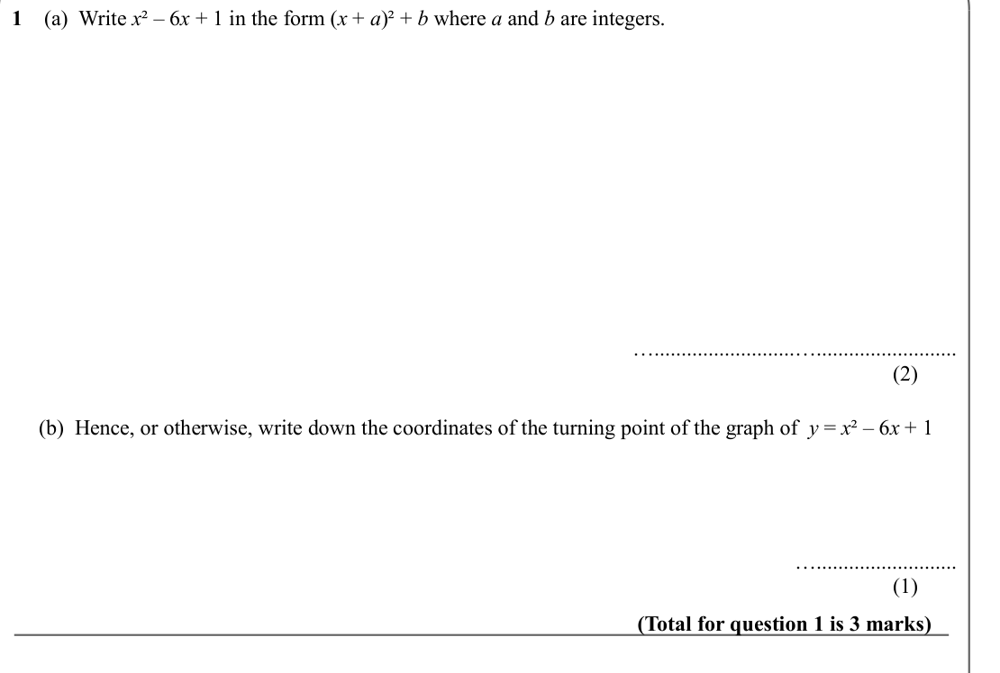
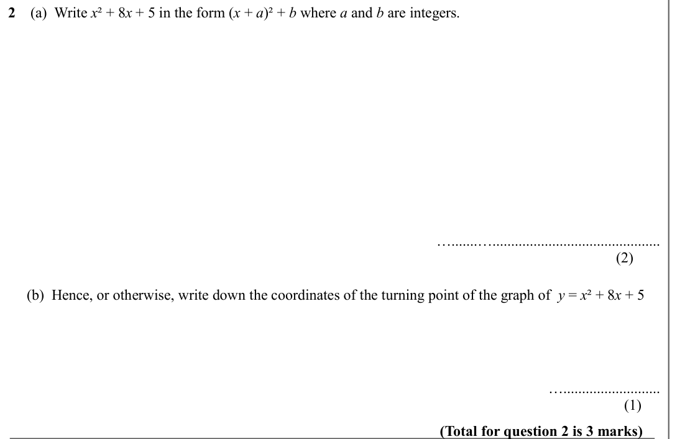
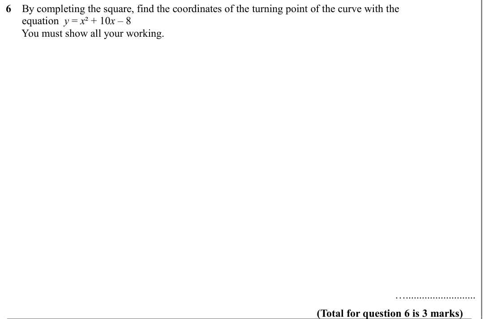
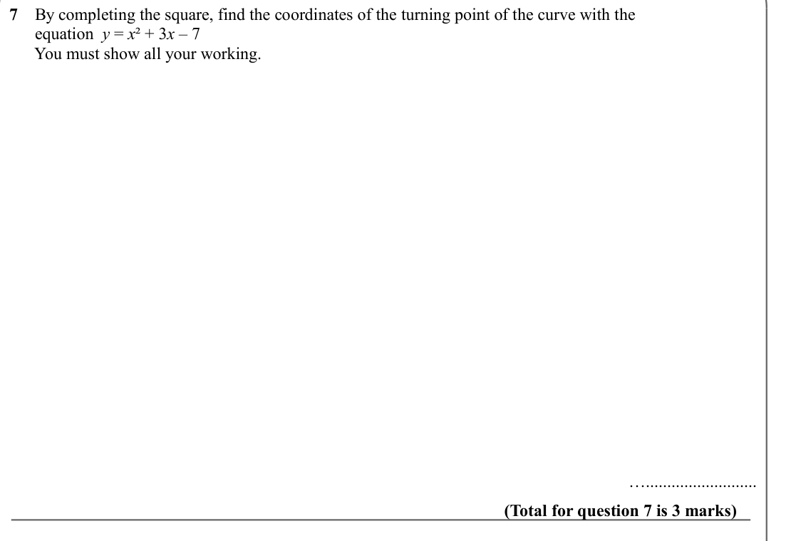
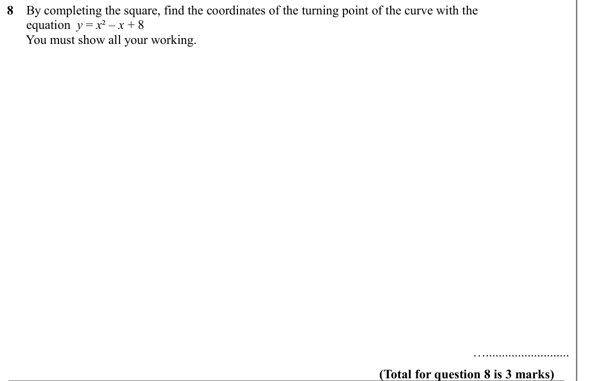
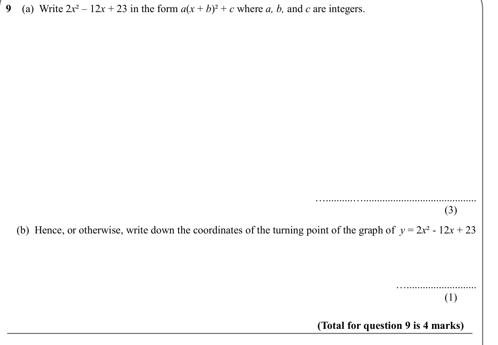
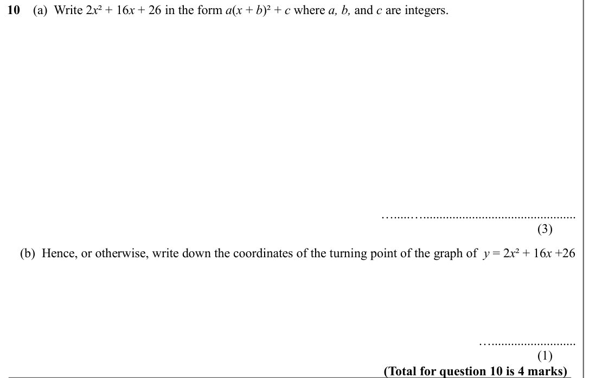
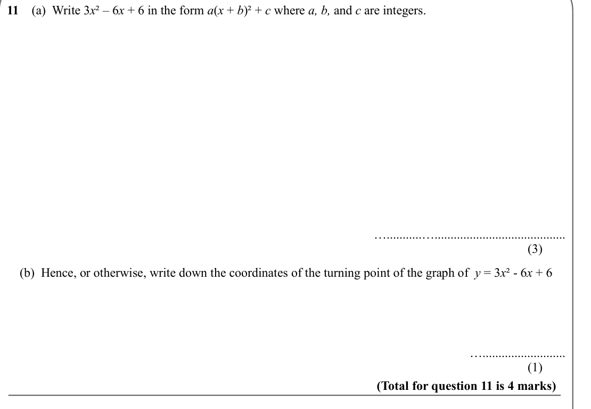
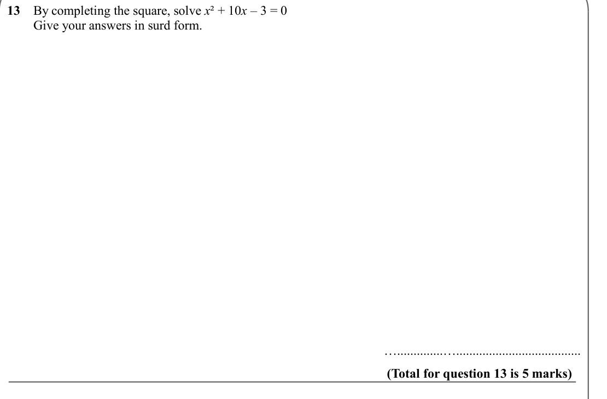
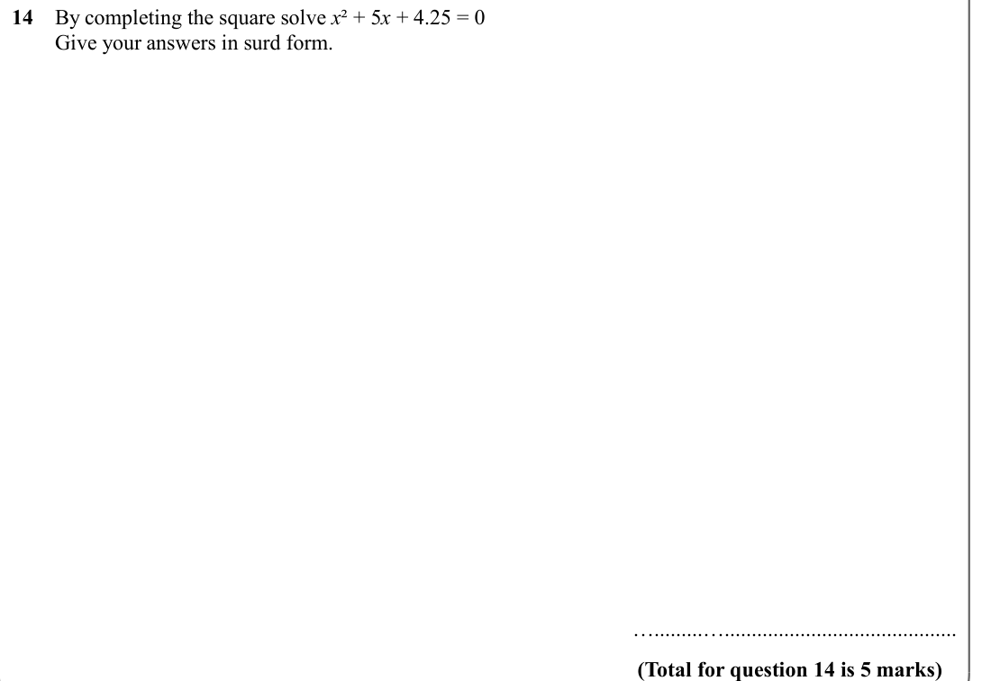

# Completing the Square — Exam Questions (IGCSE Maths · Edexcel · Grade 8-9)

Topic code `8.4` · slug `grade-8-9-8-4-completing-the-square` · source sheet sha256 `0adccc4d7f0e2639…`

## Q1 (marks not printed · parts b)

Text (lossy): 1    (a)  Write x ² – 6 x + 1 in the form (x + a)² + b where a and b are integers.   /        / …..........................….......................... / (2)        /      (b)  Hence, or otherwise, write down the coordinates of the turning point of the graph of  y = x ² – 6 x + 1  /        / ….......................... / (1)        / (Total for question 1 is 3 marks)

## Q2 (marks not printed · parts b)

Text (lossy): 2    (a)  Write x ² + 8 x + 5 in the form (x + a)² + b where a and b are integers.   /        / ….......…............................................. / (2)        /      (b)  Hence, or otherwise, write down the coordinates of the turning point of the graph of  y = x ² + 8 x + 5  /        / ….......................... / (1)      / (Total for question 2 is 3 marks)

## Q3 (marks not printed · parts b)

Text (lossy): 3    (a)  Write x ² + 10 x + 2 in the form (x + a)² + b where a and b are integers.   /        / ….....…............................................... / (2)        /      (b)  Hence, or otherwise, write down the coordinates of the turning point of the graph of  y = x ² + 10 x + 2  /        / ….......................... / (1)        / (Total for question 3 is 3 marks)

## Q4 (marks not printed · parts b)

Text (lossy): 4    (a)  Write x ² – 2 x – 1 in the form (x + a)² + b where a and b are integers.   /        / …..........….......................................... / (2)        /      (b)  Hence, or otherwise, write down the coordinates of the turning point of the graph of  y = x ² – 2 x – 1  /        / ….......................... / (1)       / (Total for question 4 is 3 marks)

## Q5 (marks not printed)

Text (lossy): 5    By completing the square, find the coordinates of the turning point of the curve with the  /       equation  y = x ² + 8 x + 3 /       You must show all your working.   /        / ….......................... / (Total for question 5 is 3 marks)

## Q6 (marks not printed)

Text (lossy): 6    By completing the square, find the coordinates of the turning point of the curve with the  /       equation  y = x ² + 10 x – 8 /       You must show all your working.   /        / ….......................... / (Total for question 6 is 3 marks)

## Q7 (marks not printed)

Text (lossy): 7    By completing the square, find the coordinates of the turning point of the curve with the  /       equation  y = x ² + 3 x – 7 /       You must show all your working.   /        / ….......................... / (Total for question 7 is 3 marks)

## Q8 (marks not printed)

Text (lossy): 8    By completing the square, find the coordinates of the turning point of the curve with the  /       equation  y = x ² – x + 8 /       You must show all your working.   /        / ….......................... / (Total for question 8 is 3 marks)

## Q9 (marks not printed · parts b)

Text (lossy): 9    (a)  Write 2 x ² – 12 x + 23 in the form a(x + b)² + c where a, b, and c are integers.   /        / …..........….......................................... / (3)        /     (b)  Hence, or otherwise, write down the coordinates of the turning point of the graph of  y = 2 x ² - 12 x + 23  /        / ….......................... / (1)        / (Total for question 9 is 4 marks)

## Q10 (marks not printed · parts b)

Text (lossy): 10    (a)  Write 2 x ² + 16 x + 26 in the form a(x + b)² + c where a, b, and c are integers.   /        / ….....…............................................... / (3)        /     (b)  Hence, or otherwise, write down the coordinates of the turning point of the graph of  y = 2 x ² + 16 x +26  /        / ….......................... / (1)        / (Total for question 10 is 4 marks)

## Q11 (marks not printed · parts b)

Text (lossy): 11    (a)  Write 3 x ² – 6 x + 6 in the form a(x + b)² + c where a, b, and c are integers.   /        / …...........…......................................... / (3)        /     (b)  Hence, or otherwise, write down the coordinates of the turning point of the graph of  y = 3 x ² - 6 x + 6  /        / ….......................... / (1)        / (Total for question 11 is 4 marks)

## Q12 (marks not printed · parts b)

Text (lossy): 12   (a)  Write 3 x ² – 30 x + 63 in the form a(x + b)² + c where a, b, and c are integers.   /        / …........…............................................ / (3)        /     (b)  Hence, or otherwise, write down the coordinates of the turning point of the graph of  y = 3 x ² – 30 x +63  /        / ….......................... / (1)        / (Total for question 12 is 4 marks)

## Q13 (marks not printed)

Text (lossy): 13    By completing the square, solve x ² + 10 x – 3 = 0  /         Give your answers in surd form.  /        / …..............…...................................... / (Total for question 13 is 5 marks)

## Q14 (marks not printed)

Text (lossy): 14    By completing the square solve x ² + 5 x + 4.25 = 0 /         Give your answers in surd form.    /        / ….........…........................................... / (Total for question 14 is 5 marks)

