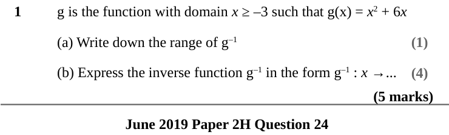
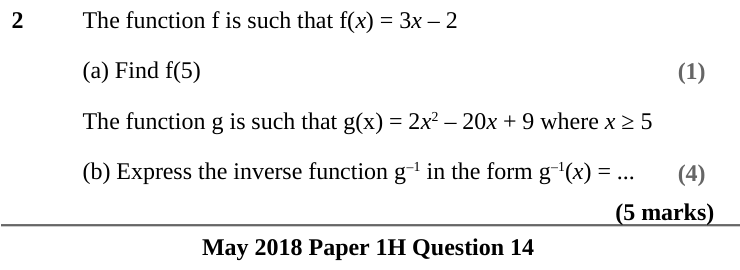
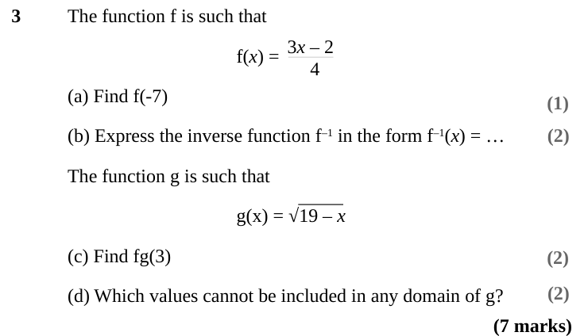
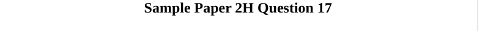
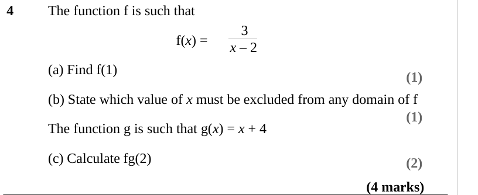

# Inverse and Composite Functions — Exam Questions (IGCSE Maths · Edexcel · Grade 8-9)

Topic code `8.5` · slug `grade-8-9-8-5-inverse-and-composite-functions` · source sheet sha256 `f72b9feb0213852a…`

## Q1 (5 marks · parts a, b)

Text (lossy): 1 / g is the function with domain x ≥ –3 such that g(x) = x 2 + 6 x / (1) / (a) Write down the range of g–1 / (b) Express the inverse function g–1 in the form g–1 : x →...  / (4) / (5 marks) / June 2019 Paper 2H Question 24

## Q2 (5 marks · parts a, b)

Text (lossy): 2 / The function f is such that f(x) = 3 x – 2 / (a) Find f(5) / (1) / The function g is such that g(x) = 2 x 2 – 20 x + 9 where x ≥ 5 / (b) Express the inverse function g–1 in the form g–1(x) = ... / (4) / (5 marks) / May 2018 Paper 1H Question 14

## Q3 (7 marks · parts a, b, c, d)

Text (lossy): 3 / The function f is such that / 3 x – 2 / f(x) =  / 4 / (a) Find f(-7) / (1) / (2) / (b) Express the inverse function f–1 in the form f–1(x) = … / The function g is such that / g(x) = √19 – x  / (c) Find fg(3) / (2) / (2) / (d) Which values cannot be included in any domain of g? / (7 marks)

## Q4 (4 marks · parts a, b, c)

Text (lossy): 4 / The function f is such that / 3 /  f(x) =  / x – 2 / (a) Find f(1) / (1) / (b) State which value of x must be excluded from any domain of f / (1) / The function g is such that g(x) = x + 4 / (c) Calculate fg(2) / (2) / (4 marks)

