# Quadratic Inequalities — Exam Questions (IGCSE Maths · Edexcel · Grade 8-9)

Topic code `8.6` · slug `grade-8-9-8-6-quadratic-inequalities` · source sheet sha256 `863adce11fe5a0a7…`

## Q1 (marks not printed)

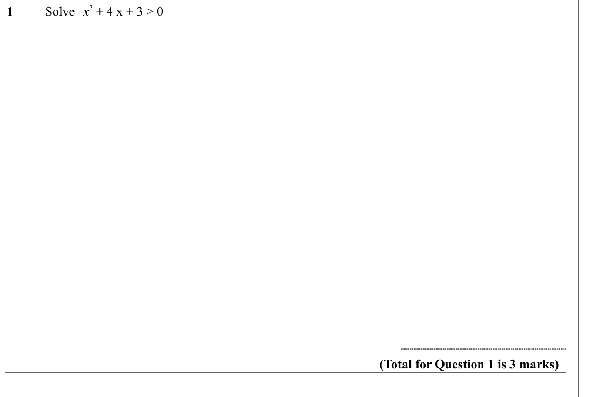

Text (lossy): 1 / Solve x 2 + 4 x + 3 > 0 / (Total for Question 1 is 3 marks)

## Q2 (marks not printed)

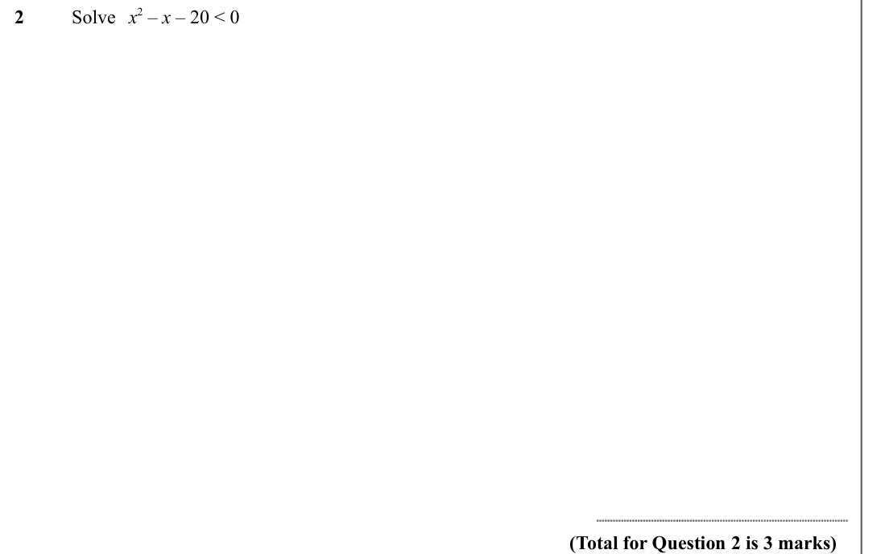

Text (lossy): 2 / Solve x 2 – x – 20 < 0 / (Total for Question 2 is 3 marks)

## Q3 (marks not printed)

Text (lossy): 3 / Solve x 2 – 5 x – 24 > 0 / (Total for Question 3 is 3 marks)

## Q4 (marks not printed)

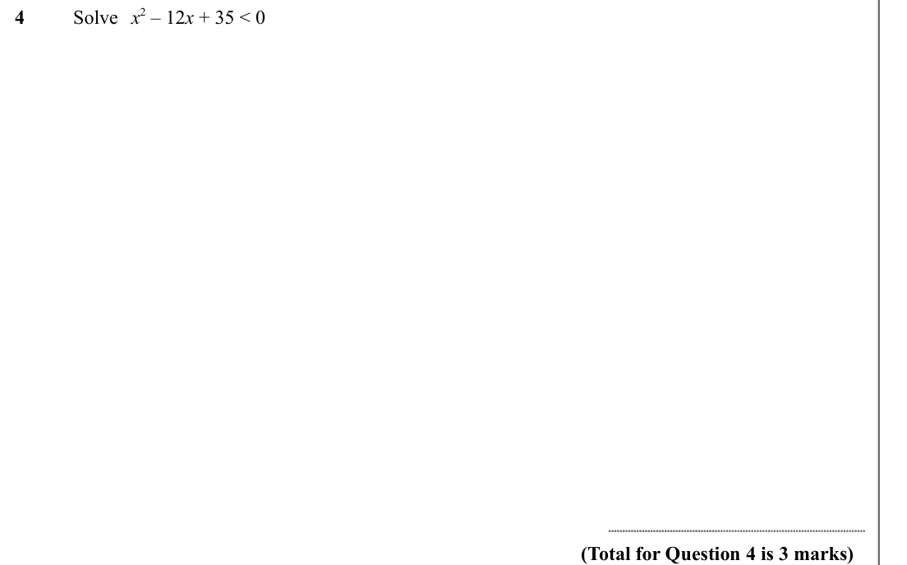

Text (lossy): 4 / Solve x 2 – 12 x + 35 < 0 / (Total for Question 4 is 3 marks)

## Q5 (marks not printed)

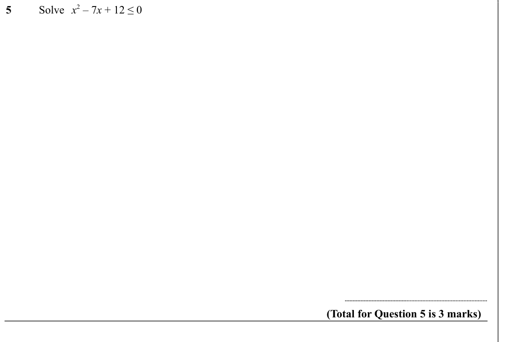

Text (lossy): 5 / Solve x 2 – 7 x + 12 ≤ 0 / (Total for Question 5 is 3 marks)

## Q6 (marks not printed)

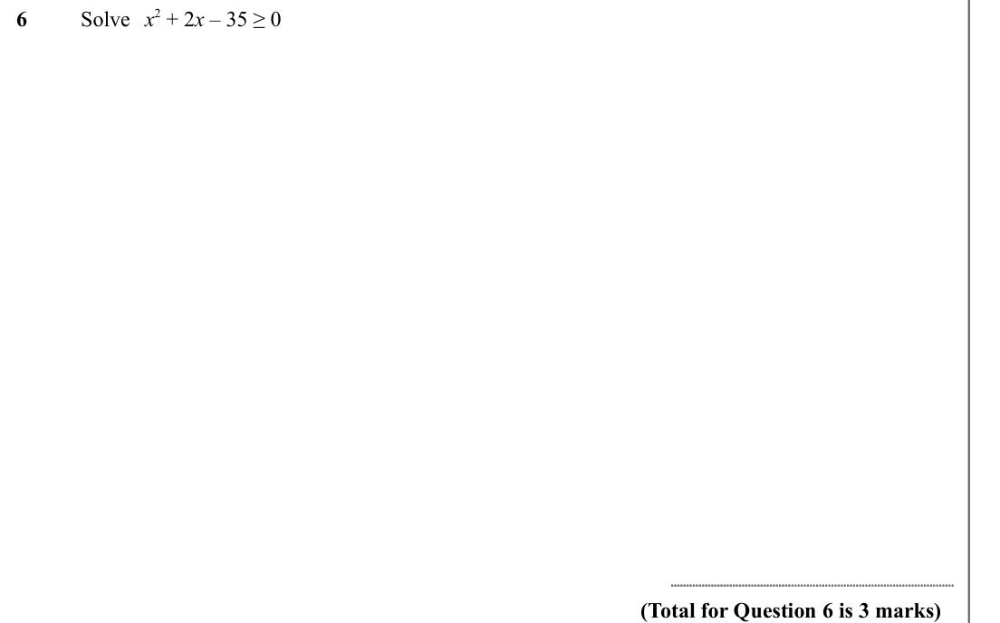

Text (lossy): 6 / Solve x 2 + 2 x – 35 ≥ 0 / (Total for Question 6 is 3 marks)

## Q7 (marks not printed)

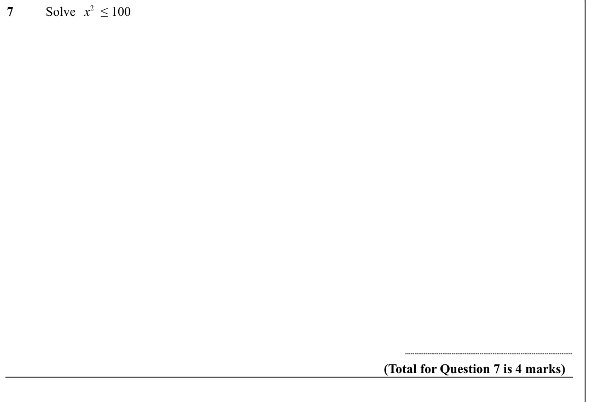

Text (lossy): 7 / Solve x 2  ≤ 100 / (Total for Question 7 is 4 marks)

## Q8 (marks not printed)

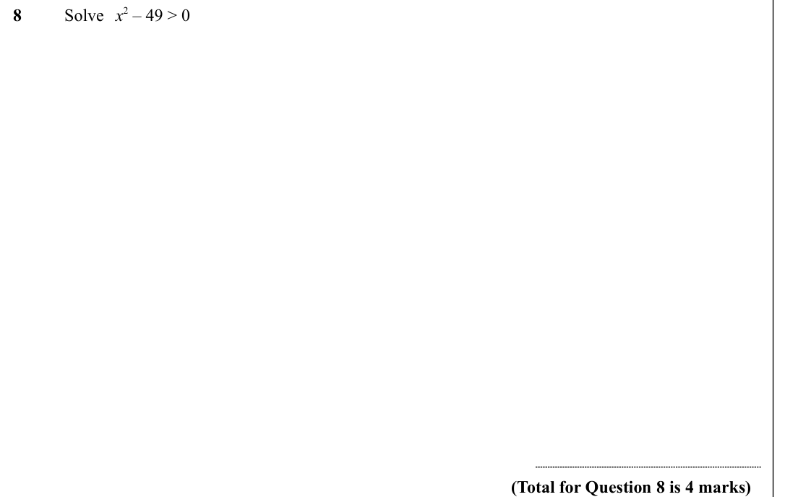

Text (lossy): 8 / Solve x 2 – 49 > 0 / (Total for Question 8 is 4 marks)

## Q9 (marks not printed)

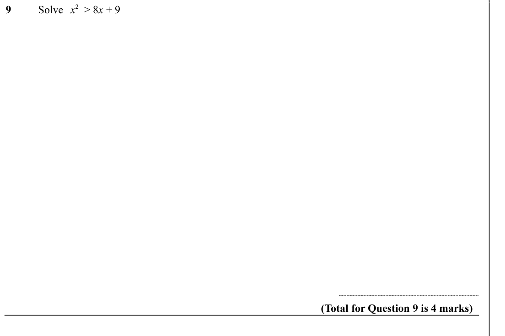

Text (lossy): 9 / Solve x 2  > 8 x + 9 / (Total for Question 9 is 4 marks)

## Q10 (marks not printed)

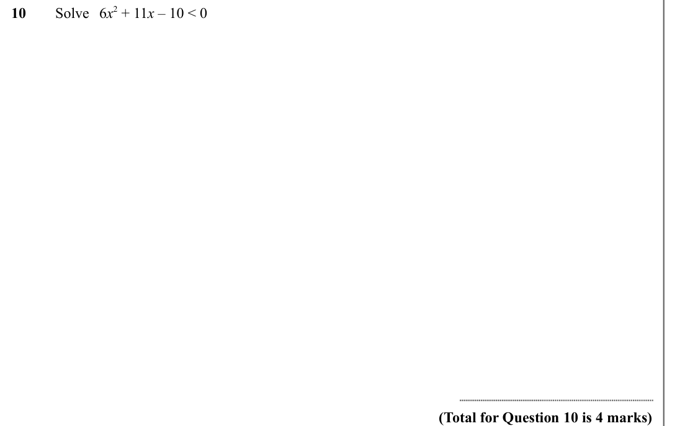

Text (lossy): 10 / Solve 6 x 2 + 11 x – 10 < 0 / (Total for Question 10 is 4 marks)

## Q11 (marks not printed)

Text (lossy): 11 / Solve 6 x + 27 > x 2  / (Total for Question 11 is 4 marks)

## Q12 (marks not printed)

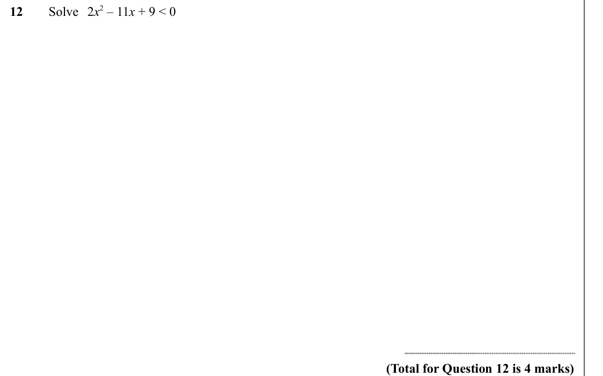

Text (lossy): 12 / Solve 2 x 2 – 11 x + 9 < 0 / (Total for Question 12 is 4 marks)

## Q13 (marks not printed)

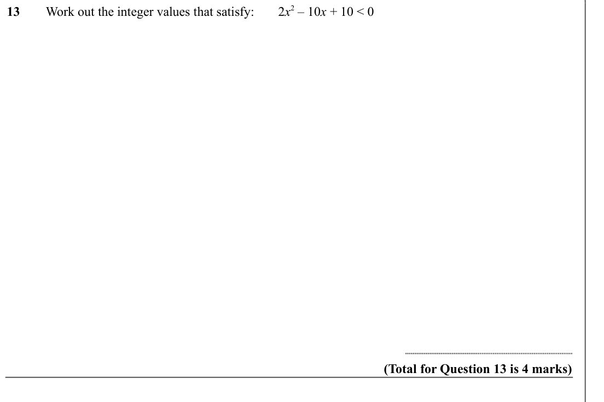

Text (lossy): 13 / Work out the integer values that satisfy: / 2 x 2 – 10 x + 10 < 0  / (Total for Question 13 is 4 marks)

## Q14 (marks not printed)

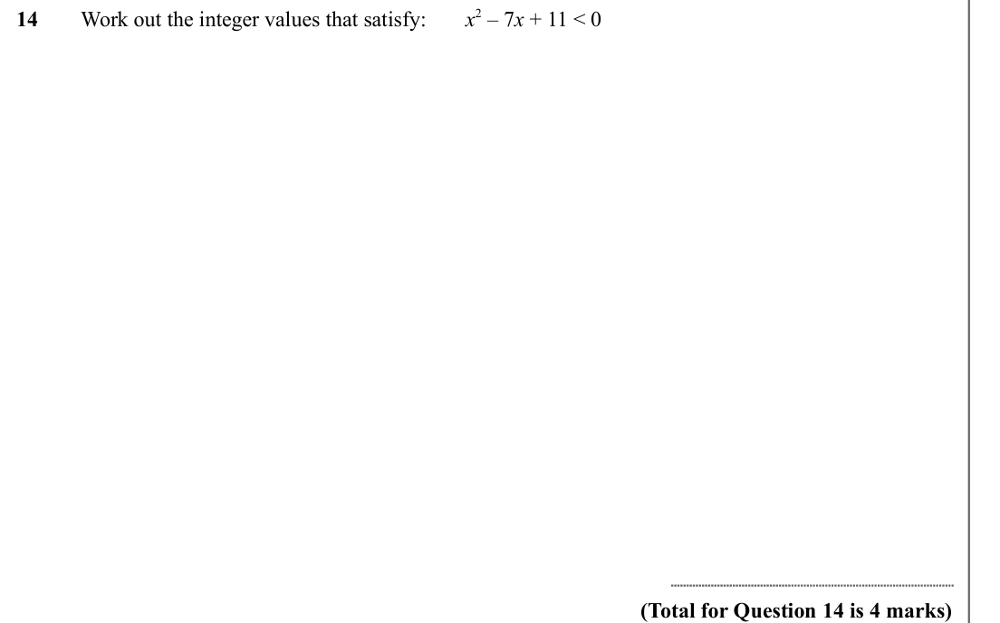

Text (lossy): 14 / Work out the integer values that satisfy: / x 2 – 7 x + 11 < 0  / (Total for Question 14 is 4 marks)

