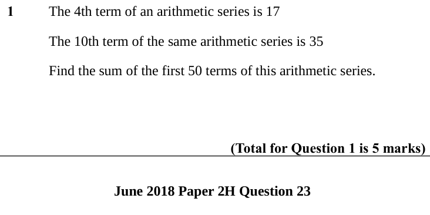
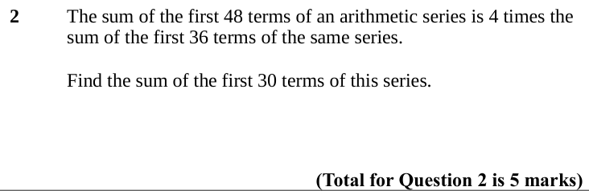
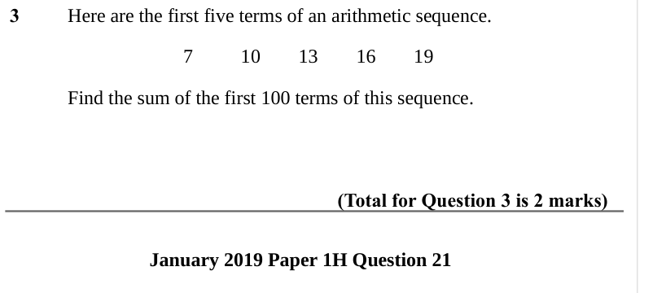
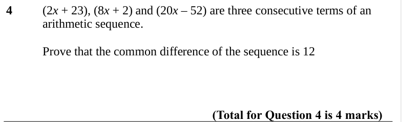

# Sequences (Higher) — Exam Questions (IGCSE Maths · Edexcel · Grade 8-9)

Topic code `8.7` · slug `grade-8-9-8-7-sequences-higher` · source sheet sha256 `59e374140e8b7280…`

## Q1 (marks not printed)

Text (lossy): 1 / The 4th term of an arithmetic series is 17 / The 10th term of the same arithmetic series is 35 / Find the sum of the first 50 terms of this arithmetic series. / (Total for Question 1 is 5 marks) / June 2018 Paper 2H Question 23

## Q2 (marks not printed)

Text (lossy): 2 / The sum of the first 48 terms of an arithmetic series is 4 times the  / sum of the first 36 terms of the same series. / Find the sum of the first 30 terms of this series. / (Total for Question 2 is 5 marks)

## Q3 (marks not printed)

Text (lossy): 3 / Here are the first five terms of an arithmetic sequence. / 7  / 10  / 13  / 16  / 19 / Find the sum of the first 100 terms of this sequence. / (Total for Question 3 is 2 marks) / January 2019 Paper 1H Question 21

## Q4 (marks not printed)

Text (lossy): 4 / (2 x + 23), (8 x + 2) and (20 x – 52) are three consecutive terms of an  / arithmetic sequence. / Prove that the common difference of the sequence is 12 / (Total for Question 4 is 4 marks)

