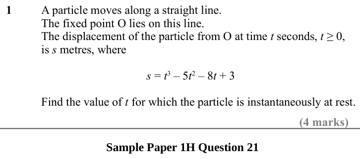
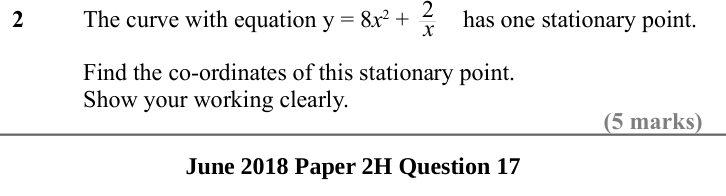
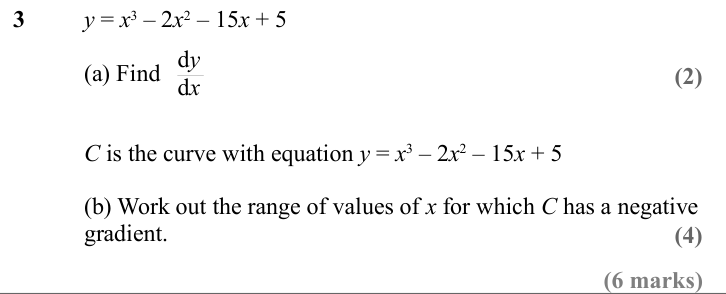
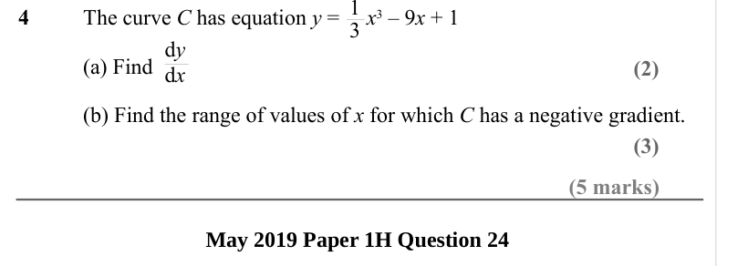
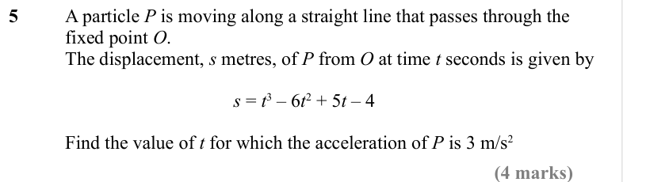

# Differentiation — Exam Questions (IGCSE Maths · Edexcel · Grade 8-9)

Topic code `8.8` · slug `grade-8-9-8-8-differentiation` · source sheet sha256 `efd99a01cef87353…`

## Q1 (4 marks)

Text (lossy): 1 / A particle moves along a straight line. / The fixed point O lies on this line. / The displacement of the particle from O at time t seconds, t ≥ 0,  / is s metres, where / s = t 3 – 5 t 2 – 8 t + 3 / Find the value of t for which the particle is instantaneously at rest. / (4 marks) / Sample Paper 1H Question 21 / 2 x

## Q2 (5 marks)

Text (lossy): 2 / The curve with equation y = 8 x 2 +         has one stationary point. / Find the co-ordinates of this stationary point. / Show your working clearly. / (5 marks) / June 2018 Paper 2H Question 17

## Q3 (6 marks · parts a, b)

Text (lossy): 3 / y = x 3 – 2 x 2 – 15 x + 5 / d y / d x / (a) Find / (2) / C is the curve with equation y = x 3 – 2 x 2 – 15 x + 5 / (b) Work out the range of values of x for which C has a negative  / gradient. / (4) / (6 marks)

## Q4 (5 marks · parts a, b)

Text (lossy): 4 / The curve C has equation y =     x 3 – 9 x + 1 / d y / d x / (a) Find  / (2) / (b) Find the range of values of x for which C has a negative gradient. / (3) / (5 marks) / May 2019 Paper 1H Question 24

## Q5 (4 marks)

Text (lossy): 5 / A particle P is moving along a straight line that passes through the  / fixed point O. / The displacement, s metres, of P from O at time t seconds is given by / s = t 3 – 6 t 2 + 5 t – 4 / Find the value of t for which the acceleration of P is 3 m/s 2 / (4 marks)

