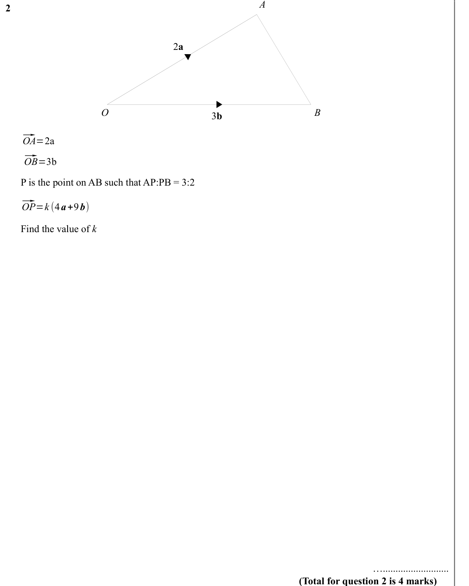
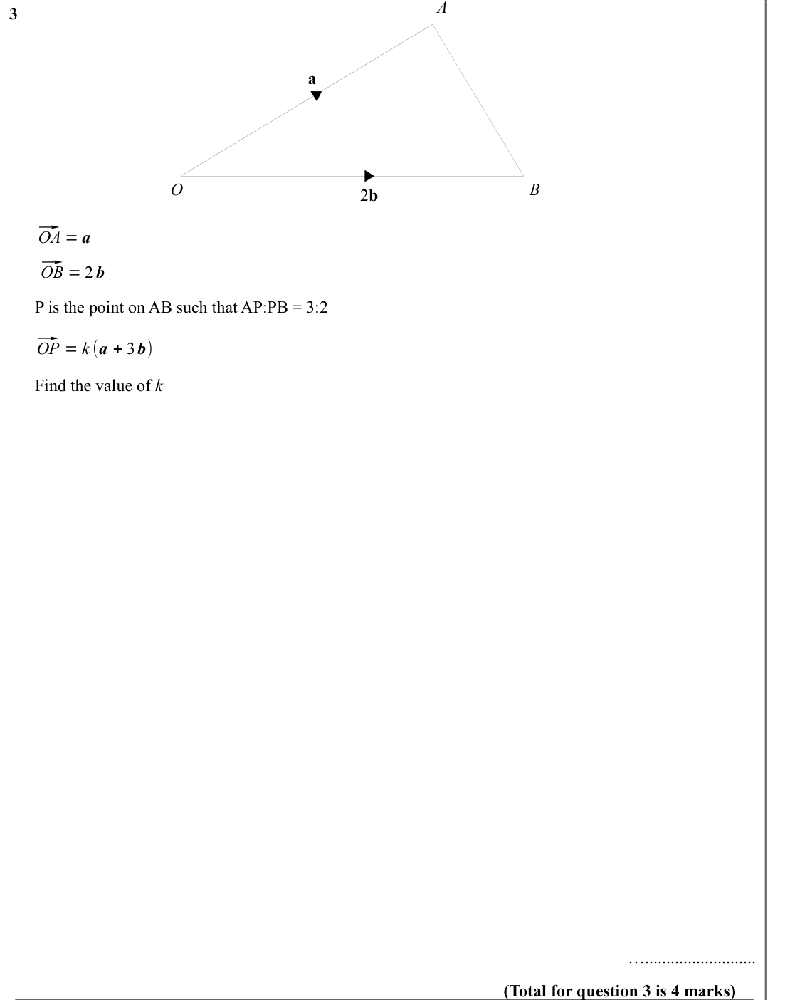
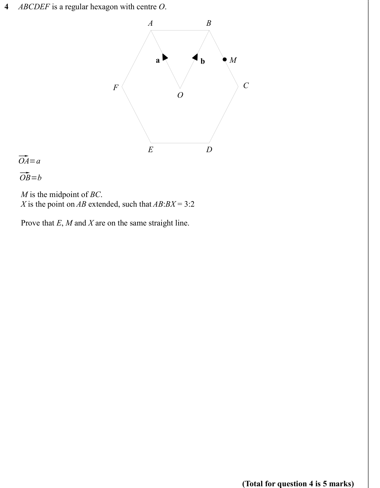
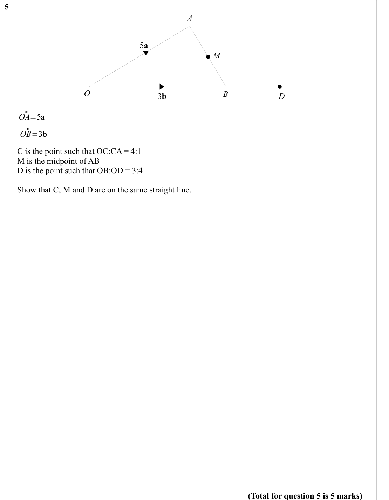
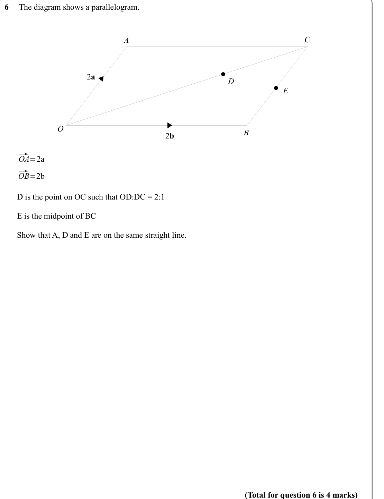
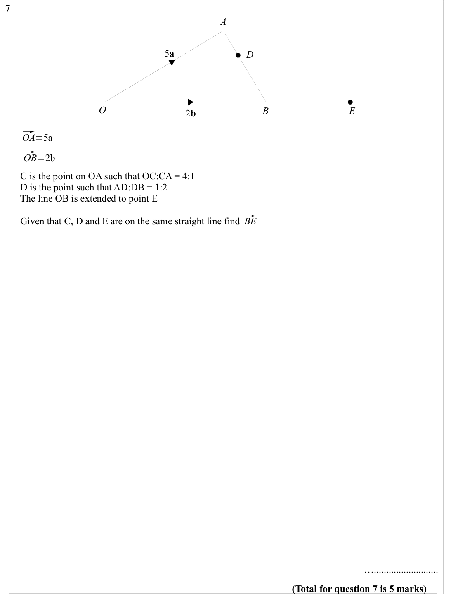

# Vectors Proof Questions — Exam Questions (IGCSE Maths · Edexcel · Grade 8-9)

Topic code `8.9` · slug `grade-8-9-8-9-vectors-proof-questions` · source sheet sha256 `079d8aeeac3645f5…`

## Q1 (marks not printed)

Text (lossy): 1     / a / O / B / b / ⃗ / OA = a / ⃗ / OB = b /    /       P is the point on AB such that AP:PB = 1:3  / ⃗ / OP = k (3 a + b) /       Find the value of k     / ….......................... / (Total for question 1 is 4 marks)

## Q2 (marks not printed)

Text (lossy): 2     / 2 a / O / B / 3 b / ⃗ / OA=2a / ⃗ / OB=3b /    /       P is the point on AB such that AP:PB = 3:2  / ⃗ / OP=k (4 a+9 b) /       Find the value of k     / ….......................... / (Total for question 2 is 4 marks)

## Q3 (marks not printed)

Text (lossy): 3 / a / O / B / 2 b / ⃗ / OA = a / ⃗ / OB = 2 b /    /       P is the point on AB such that AP:PB = 3:2  / ⃗ / OP = k (a + 3 b) /       Find the value of k     / ….......................... / (Total for question 3 is 4 marks)

## Q4 (marks not printed)

Text (lossy): 4     ABCDEF is a regular hexagon with centre O.  / A / B / a / b / M / C / F / O / D / E / ⃗ / OA=a / ⃗ / OB=b /    /         M is the midpoint of BC.  /         X is the point on AB extended, such that AB:BX = 3:2 /         Prove that E, M and X are on the same straight line.  / (Total for question 4 is 5 marks)

## Q5 (marks not printed)

Text (lossy): 5     / A / 5 a / M / O / B / 3 b / D / ⃗ / OA=5a / ⃗ / OB=3b /    /       C is the point such that OC:CA = 4:1 /       M is the midpoint of AB /       D is the point such that OB:OD = 3:4 /       Show that C, M and D are on the same straight line.   / (Total for question 5 is 5 marks)

## Q6 (marks not printed)

Text (lossy): 6     The diagram shows a parallelogram.  / C / A / 2 a / D / E / O / B / 2 b / ⃗ / OA=2a / ⃗ / OB=2b /    /       D is the point on OC such that OD:DC = 2:1 /       E is the midpoint of BC /       Show that A, D and E are on the same straight line.     / (Total for question 6 is 4 marks)

## Q7 (marks not printed)

Text (lossy): 7     / A / 5 a / D / O / B / 2 b / E / ⃗ / OA=5a / ⃗ / OB=2b /    /       C is the point on OA such that OC:CA = 4:1 /       D is the point such that AD:DB = 1:2 /       The line OB is extended to point E / ⃗ / BE /       Given that C, D and E are on the same straight line find   / ….......................... / (Total for question 7 is 5 marks)

