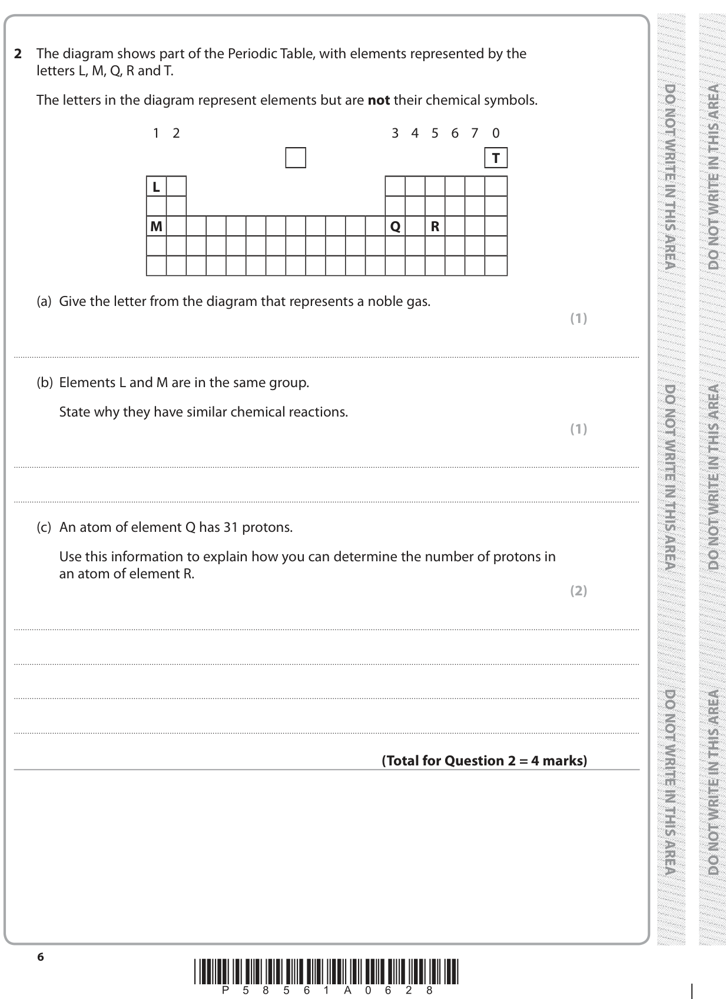
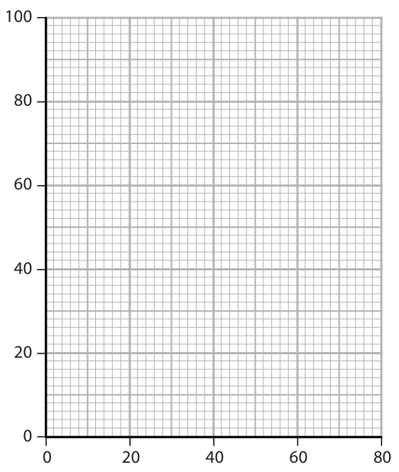

# 4CH1/1C — 2019-06 (official extraction)

> schema `syllabai.official-paper-questions/0.1` · paper_id `pearson-edexcel:international-gcse:chemistry:4ch1:2019-06:4CH1/1C` · qp sha256 `0254a7364b4434fd…` · extracted verbatim, never regenerated (ADR-037)

## Question 1 (4 marks)
### 1(c) [1]

The formula of potassium permanganate is KMnO4 How many different elements are there in potassium permanganate?

- **(A)** 3  ✔
- **(B)** 4
- **(C)** 6
- **(D)** 7

**Mark scheme answer**

> A (3)
> B is not correct as there are only 3 elements present
> not 4
> C is not correct as there are only 3 elements present
> not 6
> D is not correct as there are only 3 elements present
> not 7
> Question
> Answer Notes Marks
> number

- **(1)** Answer A: 3

## Question 2 (4 marks)

The diagram shows part of the Periodic Table, with elements represented by the letters L, M, Q, R and T. The letters in the diagram represent elements but are not their chemical symbols. 1 2 3 4 5 6 7 0 T L M Q R

### 2(a) [1]

Give the letter from the diagram that represents a noble gas.

**Mark scheme answer**

> T

- **(1)** T

### 2(b) [1]

Elements L and M are in the same group. State why they have similar chemical reactions.

**Mark scheme answer**

> they have the same number of electrons in their ACCEPT they have the
> outer shell same number of
> valence electrons/
> OR they have one valence
> they have one electron in the outer shell electron
> ACCEPT outer energy
> level
> ALLOW they need to
> lose 1 electron from
> the outer shell/ to gain
> a full outer shell

- **(1)** they have the same number of electrons in their ACCEPT they have the

### 2(c) [2]

An atom of element Q has 31 protons. Use this information to explain how you can determine the number of protons in an atom of element R.

**Mark scheme answer**

> An explanation linking the following two points:
> M1 33 ALLOW R has two
> more protons than Q
> M2 because the atomic number of R is two ACCEPT for each
> more (than Q) successive element (in
> the period) there is
> OR because R is two places to the right / two one more (proton)
> places further on/along (in the period) /the atomic number
> increases by one
> ACCEPT they are in the
> same period but Q is
> in group 3 and R is in
> group 5
> IGNORE reference to
> electrons
> Question
> Answer Notes Marks
> number

- **(1)** 33 ALLOW R has two
- **(1)** because the atomic number of R is two ACCEPT for each

## Question 3 (6 marks)

A student does these two tests on a solution made from a white solid. ● flame test ● add acidified silver nitrate solution The table shows his results. Test Result flame test red flame add acidified silver nitrate solution cream precipitate

**(d)** The student uses a clean metal wire in the flame test.

### 3(a) [1]

Give the formula of the ion that produces the red flame.

**Mark scheme answer**

> Li+ ALLOW Sr2+

- **(1)** Li+ ALLOW Sr2+

### 3(b) [1]

Name the cream precipitate.

**Mark scheme answer**

> silver bromide / AgBr If correct name given
> ignore incorrect
> formula
> If both name and
> formula given both
> must be correct

- **(1)** silver bromide / AgBr If correct name given

### 3(c) [1]

Identify the white solid.

**Mark scheme answer**

> lithium bromide / LiBr Mark CSQ on (a) and

- **(1)** lithium bromide / LiBr Mark CSQ on (a) and

### 3(d)(i) [1]

State why the wire should be clean when used in the flame test.

### 3(d)(ii) [2]

The table lists properties of some metals. Add ticks () to the table to show the two properties needed in a metal wire used in a flame test. Property good conductor of electricity high density high melting point unreactive

> 🖼 crop required: table (qp.pdf p.7)

## Question 4 (8 marks)

A student uses this apparatus to investigate the colours in four different inks, A, B, C and D. chromatography paper baseline drawn in ink water A B C D

**(b)** Another student does the experiment but does not make any mistakes. The diagram shows her results. baseline A B C D

### 4(a) [4]

Explain two mistakes the student made when setting up his experiment. 1 2

**Mark scheme answer**

> Explanations that link together the following two
> pairs of points:
> M1 baseline has been drawn in ink ACCEPT not drawn in
> pencil
> M2 and therefore it will interfere with ACCEPT will produce
> /contaminate the results other colours/will
> move up the
> paper/will get mixed
> up with the ink
> samples
> ALLOW pencil will
> not interfere with the
> results/ pencil will
> not dissolve
> M3 the water level is above the ink spots ACCEPT too
> high/above the
> baseline
> ACCEPT the spots
> are under water
> M4 and therefore the inks will mix with the ACCEPT the inks will
> water dissolve in the water
> / the inks will wash
> off the paper

- **(1)** baseline has been drawn in ink ACCEPT not drawn in
- **(1)** and therefore it will interfere with ACCEPT will produce
- **(1)** the water level is above the ink spots ACCEPT too
- **(1)** and therefore the inks will mix with the ACCEPT the inks will

### 4(b)(i) [1]

State how many colours ink D contains.

**Mark scheme answer**

> 3

- **(1)** 3

### 4(b)(ii) [1]

State which of the inks tested could be mixed together to make ink D.

**Mark scheme answer**

> A AND B

- **(1)** A AND B

### 4(b)(iii) [2]

Explain which of the inks tested is insoluble in water.

**Mark scheme answer**

> An explanation that links together the following
> two points:
> M1 C
> M2 because the spot/ink did not move (up) ACCEPT did not
> spread/stayed on the
> baseline
> M2 DEP on M1
> Question
> Answer Notes Marks
> number

- **(1)** C
- **(1)** because the spot/ink did not move (up) ACCEPT did not

## Question 5 (5 marks)

In 1937 an airship full of hydrogen gas flew from Germany to America.

**(c)** Hydrogen is used to manufacture ammonia, NH3 Hydrogen is reacted with nitrogen using an iron catalyst.

### 5(a) [1]

Which property of hydrogen makes it a suitable gas to use in an airship?

- **(A)** colourless
- **(B)** insoluble in water
- **(C)** low density  ✔
- **(D)** no smell

**Mark scheme answer**

> C (it has a low density)
> A is not correct as the colour of the gas is
> irrelevant
> B is not correct as the solubility of the gas is
> irrelevant
> D is not correct as the smell of the gas is irrelevant

- **(1)** Answer C: low density

### 5(b) [2]

Explain why helium is now used in airships instead of hydrogen.

**Mark scheme answer**

> M1 helium is inert / helium does not react (with ALLOW helium is
> air/oxygen) unreactive
> ALLOW helium is not
> flammable/ not
> explosive
> M2 hydrogen is flammable/explosive (in
> air/oxygen)

- **(1)** helium is inert / helium does not react (with ALLOW helium is
- **(1)** hydrogen is flammable/explosive (in

### 5(c)(i) [1]

Give a chemical equation for this reaction.

### 5(c)(ii) [1]

State why a catalyst is used in this reaction.

## Question 6 (5 marks)

The reactions of metals with water and with dilute sulfuric acid can be used to determine the order of reactivity of the metals. The table shows the reactions of four metals, W, X, Y and Z, with water and with dilute sulfuric acid. Reaction with Metal Reaction with water dilute sulfuric acid W no reaction no reaction X very slow reaction reacts quickly Y no reaction reacts slowly Z reacts quickly reacts violently

### 6(a) [1]

What is the order of reactivity of these metals? most reactive least reactive

- **(A)** W                                                         X                                                        Y                                                        Z
- **(B)** Z                                                        X                                                        Y                                                       W  ✔
- **(C)** W                                                         Y                                                        X                                                        Z
- **(D)** Z                                                        Y                                                        X                                                       W

**Mark scheme answer**

> B (Z X Y W)
> A is not correct as Z is the most reactive metal
> C is not correct as Z is the most reactive metal
> D is not correct as X is more reactive than Y

- **(1)** Answer B: Z                                                        X                                                        Y                                                       W

### 6(b)(i) [1]

State which metal, W, X, Y or Z, could be copper.

### 6(b)(ii) [1]

State which metal, W, X, Y or Z, could be magnesium.

### 6(c) [2]

A displacement reaction can also be used to decide the order of reactivity of two metals. State two observations made when an excess of magnesium powder is added to an aqueous solution of copper(II) sulfate. 1 2

**Mark scheme answer**

> M1 brown/pink/pink-brown solid forms ALLOW red-brown
> /orange-brown
> IGNORE red or
> orange alone
> ALLOW precipitate
> for solid
> M2 solution turns colourless ALLOW solution
> becomes paler
> IGNORE clear
> IGNORE incorrect
> initial colour of
> solution
> IGNORE references
> to magnesium
> disappearing
> IGNORE references
> to heat
> Question
> Answer Notes Marks
> number

- **(1)** brown/pink/pink-brown solid forms ALLOW red-brown
- **(1)** solution turns colourless ALLOW solution

## Question 8 (6 marks)

Ethene (C2H4) can be converted into chloroethene (C2H3Cl) in a two-stage process.

**(c)** The diagram shows the displayed formula of chloroethene. H Cl C C H H

### 8(a) [1]

The first stage is to convert ethene into 1,2-dichloroethane, C2H4Cl2 Ethene is reacted with hydrogen chloride and oxygen. Complete the chemical equation for this reaction C2H4 + HCl + O2 → C2H4Cl2 + H2O

**Mark scheme answer**

> 2 C2H4 + 4 HCl + (1) O2  2C2H4Cl2 + 2H2O ACCEPT multiples and
> fractions

- **(1)** 2 C2H4 + 4 HCl + (1) O2  2C2H4Cl2 + 2H2O ACCEPT multiples and

### 8(b) [1]

In the second stage, 1,2-dichloroethane is converted into chloroethene. C2H4Cl2 → C2H3Cl + HCl This is a thermal decomposition reaction. State what is meant by the term thermal decomposition.

**Mark scheme answer**

> breaking down by heating OWTTE

- **(1)** breaking down by heating OWTTE

### 8(c)(i) [1]

State why chloroethene is described as an unsaturated compound.

### 8(c)(ii) [2]

Describe a test to show that chloroethene is unsaturated.

### 8(d) [1]

Name the polymer formed from chloroethene.

**Mark scheme answer**

> poly(chloroethene) /polychloroethene ACCEPT polyvinyl
> chloride
> ALLOW PVC
> Question
> Answer Notes Marks
> number

- **(1)** poly(chloroethene) /polychloroethene ACCEPT polyvinyl

## Question 9 (6 marks)

Halon 1301 is a compound used in some fire extinguishers. Halon 1301 has the percentage composition by mass of C 8.05% Br 53.69% F 38.26%

### 9(a) [2]

Show, by calculation, that the empirical formula of this compound is CBrF3

**Mark scheme answer**

> M1 C 8.05 ÷ 12 OR 0.671
> and Br 53.69 ÷ 80 OR 0.671
> and F 38.26 ÷ 19 OR 2.01
> M2 divide all numbers by 0.671 ALLOW ECF from M1
> (to obtain ratio 1 : 1 : 3)
> If division by atomic numbers
> or numerators and
> denominators reversed 0
> marks
> Alternative method
> M1 Mr (of CBrF3) = 149
> M2 12 x 100 = 8.05 (%)
> 149
> and 80 x 100 = 53.69 (%)
> 149
> and 57 x 100 = 38.26 (%)
> 149
> b
> ACCEPT any combination of
> dots and crosses
> M1 all four bonding pairs correct
> M2 rest of electrons correct IGNORE inner shell electrons
> even if incorrect
> M2 DEP on M1
> Question
> Answer Notes Marks
> number

- **(2)** M1 C 8.05 ÷ 12 OR 0.671

### 9(b) [2]

The diagram shows the displayed formula of a molecule of Halon 1301. F Br C F F Draw a dot-and-cross diagram to show all the outer electrons in this molecule.

> 🖼 crop required: diagram (qp.pdf p.13)

### 9(c) [2]

The boiling point of Halon 1301 is −58 °C. Explain why Halon 1301 has a low boiling point.

**Mark scheme answer**

> An explanation that links together the following
> two points:
> M1 the intermolecular forces (of attraction) are ACCEPT London
> weak forces/dispersion
> forces/dipole-dipole
> forces
> ALLOW
> intermolecular bonds
> M2 therefore little energy is required to ALLOW little energy is
> overcome the forces required to separate
> the molecules
> ALLOW little energy is
> required to break the
> bonds as long as it is
> clear that the bonds
> are between
> molecules
> IGNORE less energy
> Any mention of
> covalent bonds/ionic
> bonds/metallic bonds
> breaking scores 0 out
> of 2
> Question Answer Notes Marks
> number
> 10ai M1 (compounds/molecules) with the same ACCEPT same number
> molecular formula and same type of
> atoms
> REJECT elements for
> compounds/molecules
> once only
> M2 but with different structural/displayed ACCEPT different
> formula structures
> ACCEPT atoms
> arranged differently
> REJECT contradicting
> statements, e.g. same
> displayed formula but
> different structures
> scores 0 out of 2
> ii
> OR
> M1 correct carbon skeleton
> M2 all hydrogen atoms and all bonds shown
> M2 dep on M1
> bi (C5H12 + Br2)  C5H11Br + HBr deduct 1 mark if cases
> or subscripts incorrect
> ACCEPT multiple
> M1 correct formula of organic product substitutions of
> bromine
> C5H10Br2 + H2 scores
> M2 HBr as a product and correctly balanced M1
> ii substitution
> Question
> Answer Notes Marks
> number

- **(2)** An explanation that links together the following

## Question 10 (7 marks)
**(a)** There are three isomers with the molecular formula C5H12 One of these isomers is pentane. The displayed formula for pentane is H H H H H H C C C C C H H H H H H

**(b)** Pentane reacts with bromine in the presence of ultraviolet radiation.

### 10(a)(i) [2]

State what is meant by the term isomers.

### 10(a)(ii) [2]

Draw the displayed formula for another isomer of C5H12

### 10(b)(i) [2]

Complete the equation for this reaction. C5H12 + Br2 → +

### 10(b)(ii) [1]

Give the name of this type of reaction.

## Question 11 (9 marks)
### 11(iii) [3]

Explain the change in appearance of the limewater.

## Question 12 (9 marks)
### 12(b) [3]

Show that the heat energy change, Q, is about 2400 J. [mass of 1.00 cm3 of solution = 1.00 g] [for the solution, c = 4.18 J/g/ °C ] Q = J

**Mark scheme answer**

>  calculation of temperature change
>  substitution into Q = mcΔT
>  evaluation
> Example calculation
> M1 14.2 – 20.0 = (-)5.8
> M2 Q = 100 × 4.18 × (‒)5.8
> 100 x 4.18 x (20 – 14.2)
> scores M1 and M2
> M3 = (‒) 2420 (J)
> ACCEPT any number of sig
> figs greater than 2
> Calculator answer is 2424.4
> Negative sign not required
> If answer in kJ unit must be
> given.
> Use of 108 can score M1
> and M3 (= 2618)
> 2400 alone scores 0
> ALLOW use of 4.2 for all 3
> marks (= 2436)

- **(1)** 14.2 – 20.0 = (-)5.8
- **(1)** Q = 100 × 4.18 × (‒)5.8
- **(1)** = (‒) 2420 (J)

### 12(c) [4]

Use your answer to part (b) to calculate the enthalpy change, ∆H, in kilojoules per mole of ammonium nitrate. [Mr of ammonium nitrate = 80.0] Include a sign in your answer. ∆H = kJ/mol

**Mark scheme answer**

>  calculation of moles (n) of
> ammonium nitrate
>  division of Q by n
>  conversion of J to kJ
>  answer given with + sign
> Example calculation
> M1 n[NH4NO3] = 8.00 ÷ 80 OR 0.1(00)
> (mol)
> M2 Q OR 2420 OR answer to b ACCEPT any number of sig
> n 0.1(00) answer to M1 figs in the numerator
> except 1
> M3 ΔH = (+) 24.2 (kJ/mol) ACCEPT any number of sig
> figs except 1
> M4 positive sign included ALLOW ecf from M2
> correct answer with no
> working and no sign or
> incorrect sign scores 3
> correct answer with no
> working and correct sign
> scores 4
> Question
> Answer Notes Marks
> number

- **(1)** n[NH4NO3] = 8.00 ÷ 80 OR 0.1(00)
- **(1)** Q OR 2420 OR answer to b ACCEPT any number of sig
- **(1)** ΔH = (+) 24.2 (kJ/mol) ACCEPT any number of sig
- **(1)** positive sign included ALLOW ecf from M2

## Question 13 (12 marks)
### 13(a)(i) [1]

Plot the student’s results on the grid.

**Mark scheme answer**

> all points plotted
> correctly to + or
> – half a square

- **(1)** all points plotted

### 13(a)(ii) [1]

Draw a curve of best fit. 100 Volume of hydrogen in cm3 0 20 40 60 80 Time in s

**Mark scheme answer**

> curve of best fit
> drawn for points
> plotted
> Question
> Answer Notes Marks
> number

- **(1)** curve of best fit

### 13(b)(i) [2]

The student repeats the experiment using ● 0.043 g of magnesium ribbon ● 50 cm3 of 2.00 mol/dm3 hydrochloric acid Draw, on the grid in part (a), the curve you would expect in this experiment. Label this curve Y.

### 13(b)(ii) [2]

The student repeats the experiment again, using ● 0.086 g of magnesium ribbon ● 50 cm3 of 2.00 mol/dm3 hydrochloric acid ● a slightly higher temperature than the first experiment Draw, on the grid in part (a), the curve you would expect in this experiment. Label this curve Z.

### 13(c) [1]

The expected volume of gas produced in the first experiment is 86 cm3. Suggest why the volume collected is less than the expected volume.

**Mark scheme answer**

> Any one from:
> M1 some gas escapes before the bung is IGNORE gas
> replaced/ before the syringe is connected escapes
> unqualified
> M2 the magnesium is impure/ the magnesium IGNORE
> ribbon has an oxide coating magnesium
> didn’t fully react
> /reaction didn’t
> go to completion
> ALLOW some
> gas dissolves in
> the
> solution/acid/wa
> ter
> Question
> Answer Notes Marks
> number

- **(1)** Any one from:

### 13(d) [2]

The student uses a graduated beaker to measure the volume of dilute hydrochloric acid. Explain why it is not necessary to use a measuring cylinder in this experiment.

**Mark scheme answer**

> An explanation that links together the following two
> points:
> M1 the acid is in excess
> M2 therefore a precise/ an accurate measurement
> of the volume is not required
> M2 dep on M1

- **(1)** the acid is in excess
- **(1)** therefore a precise/ an accurate measurement

### 13(e) [3]

The ionic equation for the reaction between magnesium and hydrochloric acid is Mg(s) + 2H+(aq) → Mg2+(aq) + H2(g) Use the information in this equation, and the particle collision theory, to explain why the rate of reaction decreases during each of the experiments.

**Mark scheme answer**

> An explanation that links the following points:
> M1 the concentration of the acid/hydrogen ions/H+ ALLOW there are
> (ions) decreases fewer hydrogen
> ions/H+ (ions) in the
> same volume
> ALLOW the surface
> area of the
> magnesium
> decreases
> M2 therefore there are fewer (successful) collisions less frequent
> (between the hydrogen ions/H+ ions and the collisions/ slower
> magnesium atoms) collision rate scores
> M2 and M3
> M3 per second/per unit time
> M3 dep on M2
> IGNORE less
> chance of collision
> MAX 1 if reference
> to energy of
> particles changing
> Question
> Answer Notes Marks
> number

- **(1)** the concentration of the acid/hydrogen ions/H+ ALLOW there are
- **(1)** therefore there are fewer (successful) collisions less frequent
- **(1)** per second/per unit time

## Question 14 (14 marks)

A salt can be made by reacting an acid with an insoluble base. A student has a sample of copper(II) oxide. The student uses this method. Stage 1 pour 50 cm3 of dilute sulfuric acid into a beaker Stage 2 warm the acid using a Bunsen burner Stage 3 add a small amount of copper(II) oxide to the warm acid and stir the mixture Stage 4 add further amounts of copper(II) oxide until copper(II) oxide is in excess Stage 5 filter the mixture Stage 6 obtain crystals from the filtrate

**(f)** The overall equation for the formation of hydrated copper(II) sulfate crystals from copper(II) oxide is CuO(s) + H2SO4(aq) + 4H2O(l) → CuSO4.5H2O(s)

### 14(a) [1]

State why the acid is warmed in stage 2.

**Mark scheme answer**

> to increase the rate of reaction ACCEPT to make
> the reaction
> faster/ to speed
> up the reaction
> REJECT any
> reference to
> increasing the
> solubility of
> copper(II) oxide

- **(1)** to increase the rate of reaction ACCEPT to make

### 14(b) [1]

State how the student would know that the copper(II) oxide is in excess in stage 4.

**Mark scheme answer**

> (the copper(II) oxide/it) stops disappearing ALLOW stops
> dissolving
> OR
> mixture turns cloudy (black) REJECT any other
> colour
> OR
> (black) solid settles (at the bottom of the beaker) REJECT any other
> colour
> ALLOW copper(II)
> oxide/ it settles (at
> the bottom of the
> beaker)
> IGNORE
> precipitate

- **(1)** (the copper(II) oxide/it) stops disappearing ALLOW stops

### 14(c) [1]

State why the mixture is filtered in stage 5.

**Mark scheme answer**

> to remove excess/unreacted copper(II) ACCEPT to
> oxide/solid/base (from the mixture) separate the
> copper(II) sulfate
> solution (from the
> copper(II)
> oxide/unreacted
> solid/excess solid)

- **(1)** to remove excess/unreacted copper(II) ACCEPT to

### 14(d) [1]

State the colour of the filtrate obtained in stage 5.

**Mark scheme answer**

> blue
> Question
> Answer Notes Marks
> number

- **(1)** blue

### 14(e) [5]

Describe how the student could obtain a pure, dry sample of hydrated copper(II) sulfate crystals from the filtrate in stage 6.

**Mark scheme answer**

> M1 heat/boil the filtrate NOTE: If the solution
> is heated to remove
> all the water then
> only M1 can be
> awarded
> NOTE If the solution
> is left to evaporate all
> the water without
> heating only 1 mark
> can be awarded
> M2 until crystals form in a cooled sample/ on a ACCEPT to
> glass rod crystallisation point
> /to form a saturated
> solution
> /until crystals start to
> form /to remove
> some of the water
> M2 dep on M1
> M3 leave the solution to cool/crystallise NOTE: If the solution
> is left to completely
> evaporate after
> heating then award
> MAX 3
> M4 filter (to remove the crystals) ACCEPT decant the
> (excess) solution
> IGNORE references
> to washing the
> crystals
> M5 dry the crystals on filter paper/on paper REJECT hot oven or
> towel/in a warm oven /in a desiccator /leave to any method of direct
> dry heating e.g. Bunsen
> burner
> No M5 if crystals
> washed after drying
> Question
> Answer Notes Marks
> number

- **(1)** heat/boil the filtrate NOTE: If the solution
- **(1)** until crystals form in a cooled sample/ on a ACCEPT to
- **(1)** leave the solution to cool/crystallise NOTE: If the solution
- **(1)** filter (to remove the crystals) ACCEPT decant the
- **(1)** dry the crystals on filter paper/on paper REJECT hot oven or

### 14(f)(i) [3]

In an experiment, a student completely reacts 9.54 g copper(II) oxide. Show that the maximum possible mass of CuSO4.5H2O crystals that can be obtained is about 30 g. [Mr of CuO = 79.5 Mr of CuSO4.5H2O = 249.5] Give your answer to an appropriate number of significant figures. mass = g

### 14(f)(ii) [2]

In this experiment, the actual yield of CuSO4.5H2O crystals is 23.92 g. Calculate the percentage yield of CuSO4.5H2O percentage yield = %

## Question 15 (9 marks)

The table shows the student's results. mass of empty test tube in g 22.04 mass of test tube and (NH4)2SO4.Fe2(SO4)3.xH2O in g 34.09 mass of test tube and (NH4)2SO4.Fe2(SO4)3 in g 28.69

### 15(i) [1]

Calculate the mass of (NH4)2SO4.Fe2(SO4)3 produced by heating. mass of (NH4)2SO4.Fe2(SO4)3 = g

### 15(ii) [1]

Calculate the mass of water produced. mass of water = g

### 15(iii) [4]

Calculate the value of x. [Mr of (NH4)2SO4.Fe2(SO4)3 = 532 and Mr of H2O = 18] Give your answer to the nearest whole number. value of x =

