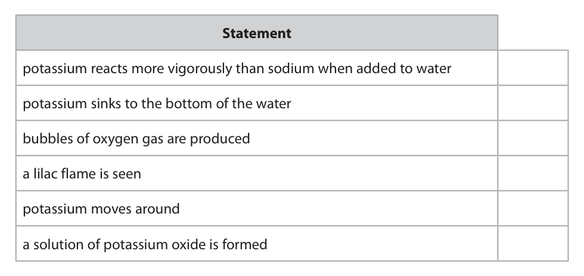
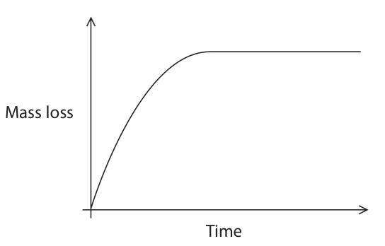
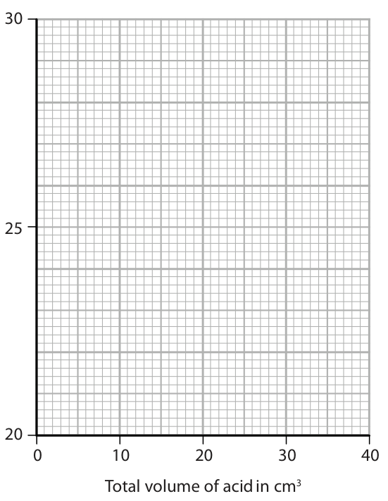

# 4CH1/1CR — 2019-06 (official extraction)

> schema `syllabai.official-paper-questions/0.1` · paper_id `pearson-edexcel:international-gcse:chemistry:4ch1:2019-06:4CH1/1CR` · qp sha256 `8df7bd6f8119e396…` · extracted verbatim, never regenerated (ADR-037)

## Question 1 (6 marks)

This question is about the three states of matter, solid, liquid and gas.

**(a)** Solids, liquids and gases can be changed from one state to another. The box gives the names of some changes of state. condensing evaporation melting sublimation Use words from the box to complete the sentences. Each word may be used once, more than once or not at all.

### 1(a)(i) [1]

The change from solid to liquid is called

**Mark scheme answer**

> melting

- **(1)** melting

### 1(a)(ii) [1]

The change from liquid to gas is called

**Mark scheme answer**

> evaporation

- **(1)** evaporation

### 1(a)(iii) [1]

The change from solid to gas is called

**Mark scheme answer**

> sublimation

- **(1)** sublimation

### 1(b) [3]

Describe the arrangement and the movement of particles in a solid.

**Mark scheme answer**

> A description that refers to three of
> the following points
> M1 (particles) close together ALLOW tightly
> packed/ touching
> M2 (particles) regularly arranged ALLOW
> arranged in a
> lattice
> M1 and M2 can
> be scored from a
> diagram
> M3 (particles) do not move around ALLOW do not
> move freely
> M4 (particles) vibrate (about a fixed
> position)
> IGNORE
> references to
> fixed shape and
> volume

- **(3)** A description that refers to three of

## Question 2 (6 marks)

This question is about some elements in Group 1 of the Periodic Table.

**(b)** After the reaction of potassium with water is complete, a few drops of universal indicator are added to the solution formed. The universal indicator turns purple.

### 2(a) [3]

The table gives some statements about the reaction of potassium with water. Place ticks (✓) in three boxes to show which three statements are correct. Statement potassium reacts more vigorously than sodium when added to water potassium sinks to the bottom of the water bubbles of oxygen gas are produced a lilac flame is seen potassium moves around a solution of potassium oxide is formed

**Mark scheme answer**

> l
> potassium reacts more vigorously with ✓
> water than sodium
> potassium sinks to the bottom of the
> water
> bubbles of oxygen gas are produced
> a lilac flame is seen ✓
> potassium moves around ✓
> potassium oxide solution is formed

- **(3)** l

### 2(b)(i) [1]

Suggest a value for the pH of the solution.

**Mark scheme answer**

> any value or range between 11 and 14

- **(1)** any value or range between 11 and 14

### 2(b)(ii) [1]

Give the formula of the ion responsible for this pH value.

**Mark scheme answer**

> OH- ACCEPT HO-
> IGNORE any
> name

- **(1)** OH- ACCEPT HO-

### 2(c) [1]

Sodium burns in oxygen to produce sodium oxide. Complete the equation for this reaction Na + O2 → Na2O

**Mark scheme answer**

> 4Na + (1)O2 → 2Na2O ACCEPT
> multiples or
> fractions

- **(1)** 4Na + (1)O2 → 2Na2O ACCEPT

## Question 3 (15 marks)

A student uses paper chromatography to investigate the dyes in five different inks, V, W, X, Y and Z. This is what she uses. • a beaker • a piece of chromatography paper with a pencil line drawn near the bottom of the paper • a solvent • inks V, W, X, Y and Z

**(c)** The chromatogram shows the results for inks V, W, X, Y and Z. solvent front V W X Y Z start line

### 3(a) [4]

Describe how the student should set up and carry out her experiment. You may draw a diagram to help with your answer.

**Mark scheme answer**

> A description/diagram which makes
> reference to the following points ALLOW water for
> solvent throughout
> If diagram shows
> solvent above pencil
> line only M1 and M2
> can be scored
> M1 put (separate) spots of each of
> the inks on the (pencil) line. OWTTE
> M2 pour some solvent into the
> bottom of the beaker OWTTE
> M3 place the paper in the beaker so DO NOT ALLOW M3 if
> that the spots are (just) above the words and diagram
> level of the solvent OWTTE contradict each other
> M4 leave until the solvent has risen ALLOW leave until
> up the paper (to the top/near the top inks stopped
> and then take paper out) OWTTE separating OWTTE
> ALLOW leave until
> spots/dyes stopped
> moving OWTTE
> IGNORE references to
> leaving for a specified
> length of time

- **(1)** put (separate) spots of each of
- **(1)** pour some solvent into the
- **(1)** place the paper in the beaker so DO NOT ALLOW M3 if
- **(1)** leave until the solvent has risen ALLOW leave until

### 3(b) [2]

Explain why the line on the paper is drawn in pencil rather than in ink.

**Mark scheme answer**

> An explanation which links the
> following two points
> M1 ink would/might dissolve in the
> solvent ALLOW water for
> OR solvent
> pencil would not dissolve in the
> solvent
> M2 ink would interfere
> with/contaminate the results OWTTE ALLOW would produce
> spots/other colours/get
> mixed up with
> inks/move up the
> paper OWTTE
> IGNORE smudge/run
> OR
> pencil would not interfere
> with/contaminate the results OWTTE ALLOW pencil would
> not produce spots/not
> produce other
> colours/not get mixed
> up with the inks/not
> move up the paper
> OWTTE

- **(1)** ink would/might dissolve in the
- **(1)** ink would interfere

### 3(c)(i) [2]

Explain which ink contains a dye that is insoluble in the solvent.

**Mark scheme answer**

> For all parts of 3c an explanation ALLOW blob/dot/mark
> which links each of the two points OWTTE for spot
> M1 V
> M2 as it stayed on the start line/did ACCEPT did not produce
> not move spots/did not separate
> ALLOW has Rf value of 0
> M2 DEP on M1

- **(1)** V
- **(1)** as it stayed on the start line/did ACCEPT did not produce

### 3(c)(ii) [2]

Explain which two inks contain the dye that is likely to be the most soluble in the solvent.

**Mark scheme answer**

> M1 X and Z
> M2 as they both have a dye/spot ALLOW both have spot
> that travelled the furthest (up the closest to solvent front
> paper)
> ALLOW have highest Rf
> value(s)
> M2 DEP on M1

- **(1)** X and Z
- **(1)** as they both have a dye/spot ALLOW both have spot

### 3(c)(iii) [2]

Explain which two inks may contain only one dye.

**Mark scheme answer**

> M1 V and W
> M2 as they both only form one spot ACCEPT as W only has
> (on the paper) one spot and cannot tell
> about V (as it does not
> move/is insoluble)
> ACCEPT reference to the
> other inks/X, Y, Z form
> more than one spot
> M2 DEP on M1

- **(1)** V and W
- **(1)** as they both only form one spot ACCEPT as W only has

### 3(d) [3]

One dye in ink Y moves 4.3 cm when the solvent front moves 6.5 cm. Calculate the Rf value for this dye. Give your answer to 2 significant figures. Rf value =

**Mark scheme answer**

> • Working or equation for Rf
> value
> • Calculating the Rf value
> • Giving the answer to 2
> significant figures
> M1 4.3 Award one mark if correct
> 6.5 equation for finding Rf
> value seen
> M2 0.6615 ACCEPT any number of
> sig fig
> M3 0.66 must be 2 sig fig
> 0.66 with no working
> scores 3
> correct answer given to 3
> or more sig fig with no
> working scores 2
> M3 subsumes M2
> can score M2 and M3
> ECF provided use 4.3 and
> 6.5 and do a division
> Total
> number Answer Notes Marks

- **(1)** 4.3 Award one mark if correct
- **(1)** 0.6615 ACCEPT any number of
- **(1)** 0.66 must be 2 sig fig

## Question 4 (13 marks)

This question is about hydrocarbons.

**(b)** One homologous series of hydrocarbons is the alkanes. Pentane (C5H12) is an alkane.

**(c)** Another homologous series of hydrocarbons is the alkenes. Alkenes are unsaturated hydrocarbons.

### 4(a) [2]

State the meaning of the term hydrocarbon.

**Mark scheme answer**

> M1 (a compound containing the ALLOW
> elements/atoms) hydrogen and carbon molecule/substance for
> compound
> REJECT element/atom/
> mixture for compound
> REJECT ions/molecules
> for elements/atoms
> M2 only ACCEPT other equivalent
> words eg solely
> M2 DEP on mention of
> hydrogen and carbon in
> M1

- **(1)** (a compound containing the ALLOW
- **(1)** only ACCEPT other equivalent

### 4(b)(i) [2]

When pentane burns completely in oxygen, carbon dioxide and water are produced. Give a chemical equation for this combustion reaction.

**Mark scheme answer**

> C5H12 + 8O2 → 5CO2 + 6H2O
> M1 all formulae correct
> ALLOW
> M2 balancing of correct formulae fractions/multiples
> IGNORE state symbols

- **(1)** all formulae correct
- **(1)** balancing of correct formulae fractions/multiples

### 4(b)(ii) [2]

Incomplete combustion can occur when the oxygen supply is limited. Give the names of two products of the incomplete combustion of pentane. 1 2

**Mark scheme answer**

> Any two from
> M1 carbon monoxide
> ACCEPT correct
> M2 carbon formulae/symbol
> M3 water ALLOW soot for carbon

- **(2)** Any two from

### 4(b)(iii) [1]

One of the products of incomplete combustion is a poisonous gas. State why this gas is poisonous to humans.

**Mark scheme answer**

> reduces/limits capacity of blood to
> transport oxygen OWTTE ACCEPT prevents blood
> from carrying oxygen
> OWTTE
> ACCEPT correct
> references to
> haemoglobin eg prevents
> haemoglobin from
> carrying oxygen
> M1

- **(1)** reduces/limits capacity of blood to

### 4(b)(iv) [2]

C5H12 has three isomers. The displayed formula for one of these isomers is H H H H H H C C C C C H H H H H H Draw the displayed formulae of the other two isomers.

**Mark scheme answer**

> M2
> in either order

- **(2)** M2

### 4(c)(i) [1]

Give the general formula for the alkenes.

**Mark scheme answer**

> CnH2n

- **(1)** CnH2n

### 4(c)(ii) [1]

State the meaning of the term unsaturated.

**Mark scheme answer**

> (contains a carbon to carbon) double ALLOW (contains a
> bond carbon to carbon)
> multiple bond

- **(1)** (contains a carbon to carbon) double ALLOW (contains a

### 4(c)(iii) [2]

Describe a test to show that a hydrocarbon is unsaturated.

**Mark scheme answer**

> A description linking the following two
> points
> M1 add bromine water/solution ALLOW Br2(aq)
> M2 (bromine water/solution) IGNORE clear
> is decolourised / turns (from orange
> to) colourless REJECT discoloured
> If initial colour of bromine
> water given it must be
> correct-
> ALLOW any combination
> of orange/yellow/brown
> M2 dep on M1 or near
> miss
> ALLOW
> M1 add acidified
> potassium
> manganate(VII)
> M2 (potassium
> manganate(VII)) is
> decolourised/turns (from
> purple to)
> colourless
> REJECT any other initial Total
> colour

- **(1)** add bromine water/solution ALLOW Br2(aq)
- **(1)** (bromine water/solution) IGNORE clear

## Question 5 (13 marks)

A student uses this apparatus to investigate the rate of reaction between marble chips and dilute hydrochloric acid. cotton wool dilute hydrochloric acid marble chips balance

**(a)** During the reaction, the reading on the balance decreases because mass is lost from the flask.

**(d)** The rate of this reaction can be altered by increasing the temperature or by increasing the concentration of the hydrochloric acid.

### 5(a)(i) [2]

Explain how using the cotton wool increases the accuracy of this investigation.

**Mark scheme answer**

> An explanation linking the following two
> points
> M1 to stop acid (spray) leaving the flask ALLOW so that only gas
> OWTTE can escape (from flask)
> OWTTE
> ALLOW so the only cause
> of mass loss is gas
> (escaping)
> REJECT stops gas
> escaping
> REJECT references to
> substances/impurities/gas
> es entering flask
> M2 as (without cotton wool) mass loss
> would be too large OWTTE ALLOW as with cotton
> wool
> the mass does not
> decrease by more than it
> should OWTTE

- **(1)** to stop acid (spray) leaving the flask ALLOW so that only gas
- **(1)** as (without cotton wool) mass loss

### 5(a)(ii) [1]

Why is mass lost from the flask?

- **(A)** acid particles are moving
- **(B)** gas is given off  ✔
- **(C)** heat energy is produced
- **(D)** marble chips are dissolving

**Mark scheme answer**

> B gas is given off
> A is incorrect as particles moving does
> not result in mass loss
> C is incorrect as heat energy being
> produced does not result in mass loss
> D is incorrect as marble chips dissolving
> does not result in mass loss

- **(1)** Answer B: gas is given off

### 5(b) [2]

This is the equation for the reaction between marble chips and dilute hydrochloric acid. Complete the equation by adding the state symbols. CaCO3 ( ) + 2HCl ( ) → CaCl2 ( ) + H2O ( ) + CO2 ( )

**Mark scheme answer**

> CaCO3 (s) + 2HCl (aq) →CaCl2 (aq) + ALLOW upper case
> H2O (l) + CO2 (g)
> All 5 correct scores 2
> 4, 3 correct scores 1

- **(2)** CaCO3 (s) + 2HCl (aq) →CaCl2 (aq) + ALLOW upper case

### 5(c) [2]

The student uses large marble chips in the investigation. This is a graph of his results. Mass loss Time The student repeats the experiment using the same total mass of smaller marble chips. On the graph, draw the curve that would be obtained. [assume the marble chips are in excess]

**Mark scheme answer**

> M1 curve steeper than the original curve
> M2 levels off at the same mass loss/place as
> original curve

- **(1)** curve steeper than the original curve
- **(1)** levels off at the same mass loss/place as

### 5(d)(i) [3]

Explain, using the particle collision theory, how increasing the concentration of the hydrochloric acid would affect the rate of this reaction.

**Mark scheme answer**

> An explanation linking the following three points
> M1 (rate) increases
> M2 more particles in the same volume ALLOW particles
> closer together
> M3 more (successful) collisions per unit time /
> more frequent (successful) collisions If reference to
> particles move
> faster/have more
> energy MAX 1
> IGNORE
> references to
> increased
> chance/probability
> of collisions
> An explanation linking the following three points

- **(1)** (rate) increases
- **(1)** more particles in the same volume ALLOW particles
- **(1)** more (successful) collisions per unit time /

### 5(d)(ii) [3]

Explain, using the particle collision theory, how increasing the temperature would affect the rate of this reaction.

**Mark scheme answer**

> M1 (rate) increases
> M2 (mean kinetic) energy of particles increases ALLOW particles
> move faster
> ALLOW more
> particles have
> energy ≥
> activation energy
> M3 more successful collisions per unit time / ALLOW reference
> more frequent successful collisions OWTTE to more frequent
> collisions between
> particles having ≥
> activation energy
> Total

- **(1)** (rate) increases
- **(1)** (mean kinetic) energy of particles increases ALLOW particles
- **(1)** more successful collisions per unit time / ALLOW reference

## Question 6 (13 marks)

Poly(chloroethene) is a polymer. It is made from its monomer, chloroethene.

**(b)** The molecular formula of chloroethene is also C2H3Cl Chloroethene can be prepared by a two‑stage process. In stage 1, ethene reacts with chlorine in the presence of an iron(III) chloride catalyst to form dichloroethane. The reaction is exothermic. C2H4 + Cl2 → C2H4Cl2

### 6(a) [3]

Chloroethene has the percentage composition by mass C = 38.4% H = 4.8% Cl = 56.8% Show, by calculation, that the empirical formula of chloroethene is C2H3Cl

**Mark scheme answer**

> • Dividing percentages by atomic 0 marks if division
> masses by atomic
> • Correct results of divisions numbers or
> • Obtaining ratio by dividing calculation upside
> results by smallest value down
> M1 C H Cl
> 38.4 4.8 56.8
> 12 1 35.5
> M2 3.2 4.8 1.6
> M3 3.2 4.8 1.6
> 1.6 1.6 1.6
> (=2 3 1)
> Alternative method
> • Calculating Mr of C2H3Cl
> • Working for finding ratio of each
> element
> • Evaluation of correct
> percentages
> M1 C2H3Cl (= 24 + 3 + 35.5) = 62.5
> M2 C H Cl
> 24 3 35.5
> 62.5 62.5 62.5
> M3 all x 100
> = 38.4(%) 4.8(%) 56.8(%)
> Question Answer Notes Marks
> Number

- **(3)** • Dividing percentages by atomic 0 marks if division

### 6(b)(i) [1]

Give the formula of iron(III) chloride.

**Mark scheme answer**

> FeCl3 REJECT incorrect
> use of upper and
> lower case letters,
> and superscript
> ACCEPT correct
> formula as ions
> -
> Fe3+(Cl )3

- **(1)** FeCl3 REJECT incorrect

### 6(b)(ii) [1]

State the purpose of using a catalyst.

**Mark scheme answer**

> to increase the rate of the reaction/ to ALLOW references
> speed up the reaction to (providing
> reaction pathway
> of) lower activation
> energy

- **(1)** to increase the rate of the reaction/ to ALLOW references

### 6(b)(iii) [1]

State the meaning of the term exothermic.

**Mark scheme answer**

> gives out heat (energy) ACCEPT thermal
> energy
> NOT energy alone
> IGNORE reference
> to negative ΔH

- **(1)** gives out heat (energy) ACCEPT thermal

### 6(b)(iv) [1]

What type of reaction occurs in stage 1 between ethene and chlorine?

- **(A)** addition  ✔
- **(B)** displacement
- **(C)** neutralisation
- **(D)** substitution

**Mark scheme answer**

> A addition
> B is incorrect as this is not a
> displacement reaction
> C is incorrect as this is not a
> neutralisation reaction
> D is incorrect as this is not a
> substitution reaction

- **(1)** Answer A: addition

### 6(b)(v) [1]

In stage 2, dichloroethane decomposes into chloroethene and hydrogen chloride. Give a chemical equation for this reaction.

**Mark scheme answer**

> C2H4Cl2 → C2H3Cl + HCl IGNORE incorrect
> use of lower/upper
> case and
> superscripts

- **(1)** C2H4Cl2 → C2H3Cl + HCl IGNORE incorrect

### 6(c)(i) [3]

Draw the displayed formula of • chloroethene • the repeat unit of poly(chloroethene) chloroethene repeat unit of poly(chloroethene)

**Mark scheme answer**

> M1 displayed formula of chloroethene IGNORE bond
> angles
> IGNORE brackets/n
> M2 correct displayed formula with If double bond in
> single bond between C atoms repeat unit no M2
> or M3
> IGNORE brackets/n
> M3 extension bonds shown on C atoms more than one
> correct repeat unit
> with extension
> bonds scores 1
> mark out of M2/M3

- **(1)** displayed formula of chloroethene IGNORE bond
- **(1)** correct displayed formula with If double bond in
- **(1)** extension bonds shown on C atoms more than one

### 6(c)(ii) [2]

Draw a dot‑and‑cross diagram to represent a molecule of chloroethene. Show only the outer electrons of each atom.

> 🖼 crop required: diagram (qp.pdf p.15)

**Mark scheme answer**

> M1 2 shared pairs between C atoms ACCEPT any
> combination of dots
> M2 rest of structure fully correct and crosses.
> IGNORE inner
> shells even if
> incorrect
> M2 DEP on M1
> Total
> number Answer Notes Marks

- **(1)** 2 shared pairs between C atoms ACCEPT any
- **(1)** rest of structure fully correct and crosses.

## Question 7 (14 marks)

A student makes some magnesium nitrate crystals from magnesium oxide and dilute nitric acid. The equation for the reaction is MgO(s) + 2HNO3(aq) → Mg(NO3)2(aq) + H2O(l)

**(b)** Magnesium nitrate crystals contain water of crystallisation with the formula Mg(NO3)2.6H2O

### 7(a)(i) [2]

Give the formula of each ion in magnesium nitrate and

**Mark scheme answer**

> M1 Mg2+
> M2 NO3-

- **(1)** Mg2+
- **(1)** NO3-

### 7(a)(ii) [6]

A student has a beaker containing dilute nitric acid. Describe a method that she could use to prepare a pure, dry sample of magnesium nitrate crystals from magnesium oxide.

**Mark scheme answer**

> Part 1 making magnesium nitrate
> solution - a description linking any
> three of the following points
> M1 warm / heat the acid (in a REJECT boil
> beaker/flask)
> M2 add magnesium oxide (to acid a
> little at a time) until in excess /no
> more dissolves
> M3 stir M3 DEP on use of
> acid and oxide
> M4 filter to remove excess
> magnesium oxide/excess solid
> Part 2 using (magnesium nitrate) NOTE if added
> solution/filtrate - a description linking excess but not
> any three of the following points filtered off – MAX
> 2 for Part 2
> M5 heat/boil (magnesium nitrate
> solution/filtrate)
> M6 until crystals form in a cooled ACCEPT to
> sample/on glass rod crystallisation
> point /to form a
> saturated solution
> /until crystals
> start to form /to
> remove some of
> the water
> M6 DEP M5
> M7 leave the solution to
> cool/crystallise
> M8 filter (to remove crystals) ACCEPT decant the
> (excess) solution
> IGNORE references
> to washing the
> crystals
> M9 suitable method to dry the REJECT hot oven or
> crystals eg using filter paper/using any method of
> paper towel/in warm oven/in a direct heating e.g.
> desiccator Bunsen
> ALLOW leave to
> dry but not just
> dry the crystals
> M9 DEP M8
> No M9 if then wash
> crystals after
> drying

- **(6)** Part 1 making magnesium nitrate

### 7(b)(i) [1]

Show by calculation that the relative formula mass of Mg(NO3)2.6H2O is 256.

**Mark scheme answer**

> 1
> 24 + (2 x 14) + (6 x 16) + (12 x 1) + Some working must
> (6 x 16) or equivalent working be seen
> ALLOW 24 + 124
> +108

- **(1)** 1

### 7(b)(ii) [3]

Show that the maximum mass of Mg(NO3)2.6H2O that could be made from 0.050 mol of nitric acid is about 6 g.

**Mark scheme answer**

> • Calculate moles of magnesium
> nitrate
> • Setting out of calculation of
> mass
> • Final answer
> M1 moles = (0.05 / 2) OR 0.025
> M2 mass = 0.025 x 256
> M3 6.4 (g) 6.4(g) with no
> working scores 3
> only ALLOW ECF M2
> from M1

- **(1)** moles = (0.05 / 2) OR 0.025
- **(1)** mass = 0.025 x 256
- **(1)** 6.4 (g) 6.4(g) with no

### 7(b)(iii) [2]

The actual mass of crystals that the student obtains is 4.8 g. Calculate the percentage yield of Mg(NO3)2.6H2O in this experiment. percentage yield = %

**Mark scheme answer**

> • Setting out of calculation
> • Final answer
> M1 4.8 x 100
> 6.4
> 75 (%) with or
> M2 75 (%) without working
> scores 2 marks
> OR
> M1 4.8 x 100
> M2 80 (%) 80 (%) with or
> without working
> scores 2 marks
> ALLOW ECF from
> b(ii)
> 6.4 x 100
> 4.8
> AND
> 6 x 100
> 4.8
> both score 0
> Answers of 25% and Total
> 20% score 1
> Question number Answer Notes Marks

- **(2)** • Setting out of calculation

## Question 8 (9 marks)

A student investigates the neutralisation reaction between sodium hydroxide and nitric acid. This is her method. • pour 20 cm3 of sodium hydroxide solution into a polystyrene cup • record the temperature of the sodium hydroxide solution • add 5 cm3 of dilute nitric acid to the cup • stir the mixture and record the highest temperature reached • add further 5 cm3 portions of dilute nitric acid, recording the highest temperature reached each time, until a total of 40 cm3 of acid has been added

**(b)** The table shows the student’s results. Total volume of acid in cm3 0 5 10 15 20 25 30 35 40 Temperature of 20.5 22.5 24.4 26.4 28.5 28.3 27.5 26.7 26.0 reaction mixture in oC

### 8(a)(i) [1]

Give a word equation for this neutralisation reaction.

**Mark scheme answer**

> sodium hydroxide + nitric acid → sodium nitrate+ water ACCEPT
> correct
> chemical
> equation
> IGNORE ionic
> equation

- **(1)** sodium hydroxide + nitric acid → sodium nitrate+ water ACCEPT

### 8(a)(ii) [2]

Explain why a polystyrene cup is used rather than a beaker.

**Mark scheme answer**

> An explanation which links the following two points
> M1 polystyrene is an insulator
> ALLOW
> poor/non-
> conductor of
> heat
> M2 less heat is lost (to the surroundings) ALLOW no
> heat lost
> ALLOW
> (polystyrene)
> retains more
> heat
> ALLOW
> reverse
> arguments for
> glass beaker

- **(1)** polystyrene is an insulator
- **(1)** less heat is lost (to the surroundings) ALLOW no

### 8(a)(iii) [1]

Give a safety precaution that the student should take when using sodium hydroxide solution.

**Mark scheme answer**

> Any one from
> (she should) wear eye protection ACCEPT
> (she should) wear gloves (safety)
> goggles
> ALLOW safety
> glasses

- **(1)** Any one from

### 8(b)(i) [3]

Plot the results on the grid. Draw a straight line of best fit through the first five points and another straight line of best fit through the last four points. Make sure that the two lines cross. Temperature of reaction mixture 25 in °C 0 10 20 30 40 Total volume of acid in cm3

**Mark scheme answer**

> M1 all points plotted correctly to +/– half a square
> M2 first best fit line drawn with a ruler Award MAX 1
> if ruler not
> M3 second best fit line drawn with a ruler used for both
> clip
> DO NOT
> PENALISE
> HERE IF
> LINES DO
> NOT CROSS

- **(1)** all points plotted correctly to +/– half a square
- **(1)** first best fit line drawn with a ruler Award MAX 1
- **(1)** second best fit line drawn with a ruler used for both

### 8(b)(ii) [2]

The point where the lines cross shows • the volume of acid needed to exactly neutralise the alkali • the maximum temperature reached Use your graph to determine these values. volume of acid = cm3 maximum temperature = °C

**Mark scheme answer**

> M1 volume reading read from graph +/- 0.5 (cm3) Award 1 mark
> if values
> M2 temp reading read from graph to +/- 0.1 (°C) correct but
> reversed.
> If lines do not
> meet or cross
> or a curve is
> drawn
> between the
> lines 0 marks
> for (ii)
> Total
> Question number Answer Notes Marks

- **(1)** volume reading read from graph +/- 0.5 (cm3) Award 1 mark
- **(1)** temp reading read from graph to +/- 0.1 (°C) correct but

## Question 9 (11 marks)
**(b)** C60 fullerene is another form of carbon. The diagram shows a molecule of C60 fullerene.

### 9(a) [3]

Diamond is a naturally‑occurring form of carbon. It has a giant molecular structure. Explain, with reference to its structure and bonding, why diamond has a high melting point.

**Mark scheme answer**

> An explanation linking the following
> three points
> M1 covalent bonds are strong ACCEPT strong
> (electrostatic) forces of
> attraction between the
> nuclei of atoms and the
> bonding electrons
> M2 many (covalent) bonds (need to
> be broken)
> M3 a large amount of (thermal/heat) IGNORE more energy
> energy is needed to break the bonds
> NOT just heat
> Any mention of
> intermolecular
> forces/forces between
> molecules or ions/ionic
> bonding /metallic bonding
> scores 0 out of 3

- **(1)** covalent bonds are strong ACCEPT strong
- **(1)** many (covalent) bonds (need to
- **(1)** a large amount of (thermal/heat) IGNORE more energy

### 9(b)(i) [2]

Explain why C60 fullerene has a much lower melting point than diamond.

**Mark scheme answer**

> An explanation linking the following
> two points
> M1 the intermolecular forces (of ACCEPT London
> attraction) are weak forces/dispersion
> forces/dipole-dipole
> forces/Van der Waals
> forces
> ALLOW the attractions
> between the molecules
> are weak
> ALLOW weak
> intermolecular bonds
> M2 therefore little/less NOT just heat
> (thermal/heat) energy needed to
> overcome the forces (of attraction) ALLOW little/less energy
> needed to separate the
> (fullerene) molecules
> ALLOW little/less energy
> is required to break the
> bonds as long as it is clear
> that the bonds are
> between molecules
> Any mention of (breaking
> of) covalent/ionic/metallic
> bonds scores 0 out of 2

- **(1)** the intermolecular forces (of ACCEPT London
- **(1)** therefore little/less NOT just heat

### 9(b)(ii) [1]

C60 fullerene is used by doctors when injecting medicines into their patients. C60 fullerene allows medicines, which might damage some parts of the body, to reach the part of the body where they are needed. Suggest why C60 fullerene is suitable for this purpose.

**Mark scheme answer**

> Any one from
> the medicine can fit inside (the C60 ALLOW any other
> molecule/it) sensible suggestion
> (the C60 molecule/it) will not react eg C60 molecule/it is
> with the blood/medicine inert/unreactive
> (the C60 molecule/it) is non-toxic

- **(1)** Any one from

### 9(c) [5]

Graphite is another naturally‑occurring form of carbon. Graphite can be used in pencils because it is soft and can leave marks on paper. Graphite can also be used as a conductor of electricity. Explain why graphite is soft and conducts electricity. Refer to structure and bonding in your answer.

**Mark scheme answer**

> An explanation linking any five of
> the following six points but
> must include M3 and M6 for full
> marks
> (graphite is soft because)
> M1 the structure is in layers
> M2 there are weak forces/attractions If reference to weak
> between the layers (of atoms) intermolecular forces or
> layers of molecules/ions
> no M2
> ALLOW air /water
> (molecules) trapped
> between the layers
> M3 layers can slide/slip over each ALLOW layers can easily
> other flake off
> M2/M3 can subsume M1
> (graphite conducts electricity
> because)
> M4 each carbon atom is (covalently)
> bonded to three other carbon atoms
> M5 one delocalised electron per ALLOW one
> carbon atom unbonded/free/spare
> electron per carbon atom
> ALLOW (only) three (of
> the carbon) electrons
> involved in (covalent)
> bonding
> ALLOW not all (of the
> carbon) electrons involved
> in (covalent) bonding
> M6 delocalised electrons flow/move ALLOW are mobile
> (through the structure)
> IGNORE free electrons
> IGNORE sea of electrons
> IGNORE references to
> carrying charge/current
> To score M6 the term
> delocalised electrons must
> be seen somewhere
> If reference to ions for
> conduction of electricity Total
> no M4 M5 M6
> Question number Answer Notes Marks

- **(5)** An explanation linking any five of

## Question 10 (10 marks)

A student investigates the reaction between zinc and copper(II) sulfate solution. The equation for the reaction is Zn + CuSO4 → Cu + ZnSO4 This is his method. • add exactly 25.0 cm3 of copper(II) sulfate solution to a polystyrene cup • record the temperature of the solution • add about 5 g of zinc powder (an excess) and stir the mixture • record the highest temperature reached

**(b)** The table shows the student’s results volume of copper(II) sulfate solution in cm3 25.0 initial temperature of copper(II) sulfate solution in °C 19.0 final temperature of solution in °C 31.5

### 10(a)(i) [1]

Suggest why it is not important to add an exact mass of zinc powder.

**Mark scheme answer**

> (because) the zinc (powder) is in ALLOW (because) not all
> excess zinc is used up/reacts
> ALLOW (because) some
> zinc is left over
> ALLOW because copper
> sulfate is limiting
> reagent/all reacted/all used
> up

- **(1)** (because) the zinc (powder) is in ALLOW (because) not all

### 10(a)(ii) [2]

State the colour change of the solution. from to

**Mark scheme answer**

> M1 blue ALLOW qualifiers such as
> dark/light but no other
> colours
> M2 to colourless IGNORE clear
> ALLOW no colour
> ALLOW decolourised
> REJECT discoloured

- **(1)** blue ALLOW qualifiers such as
- **(1)** to colourless IGNORE clear

### 10(b)(i) [3]

Show that the heat energy change (Q) is about 1300 J. [for the solution, c = 4.18 J/g/°C] [mass of 1.00 cm3 of solution = 1.00 g]

**Mark scheme answer**

> • Calculation of temperature
> increase
> • Substitution into Q = mcΔT
> • Evaluation
> Example calculation
> M1 (31.5 – 19.0) OR 12.5
> M2 Q = 25 x 4.18 x 12.5 25 x 4.18 x (31.5 – 19.0)
> scores M1 and M2
> M3 Q = 1310 (J) Calculator answer is
> 1306.25
> ACCEPT any number of sig
> fig greater than 1
> Correct answer to 3 or
> more sig fig without
> working scores 3
> 1300 with no working
> scores 0
> If answer in kJ unit must
> be given
> ALLOW use of 4.2 for all 3
> marks (= 1312.5)

- **(1)** (31.5 – 19.0) OR 12.5
- **(1)** Q = 25 x 4.18 x 12.5 25 x 4.18 x (31.5 – 19.0)
- **(1)** Q = 1310 (J) Calculator answer is

### 10(b)(ii) [1]

The mass of anhydrous copper(II) sulfate (CuSO4) used to make 25.0 cm3 of solution is 2.00 g. Calculate the amount, in moles, of CuSO4 in 2.00 g. [Mr of CuSO4 = 159.5] amount of CuSO4 = mol

**Mark scheme answer**

> n(CuSO4) = (2.00 ÷ 159.5) = 0.0125 ACCEPT any number of sig
> figs except 1

- **(1)** n(CuSO4) = (2.00 ÷ 159.5) = 0.0125 ACCEPT any number of sig

### 10(b)(iii) [3]

Calculate the value of the enthalpy change (ΔH), in kilojoules per mole, for the reaction between zinc and copper(II) sulfate. Include a sign in your answer. ΔH = kJ/mol

**Mark scheme answer**

> • Division of Q by n
> • Evaluation including conversion
> of J to kJ
> • Answer given with - sign
> Example calculation
> ACCEPT any number of sig
> M1 Q OR 1300 OR answer to b(i) figs in the numerator
> n 0.0125 answer to b(ii) except 1
> ACCEPT any number of sig
> M2 ∆H = (–) 104 (kJ/mol) figs
> ALLOW ECF from M1
> M3 Negative sign included
> Correct answer with no
> working and no sign or
> incorrect sign scores 2
> Correct answer with no
> working and correct sign
> scores 3
> 104.5(04) 104.48 104.8
> 105 all score 2
> -104.5(04) -104.48 -104.8 Total
> -105 all score 3
> Total marks 110
> Pearson Education Limited. Registered company number 872828
> with its registered office at 80 Strand, London, WC2R 0RL, United Kingdom

- **(1)** Q OR 1300 OR answer to b(i) figs in the numerator
- **(1)** ∆H = (–) 104 (kJ/mol) figs
- **(1)** Negative sign included

