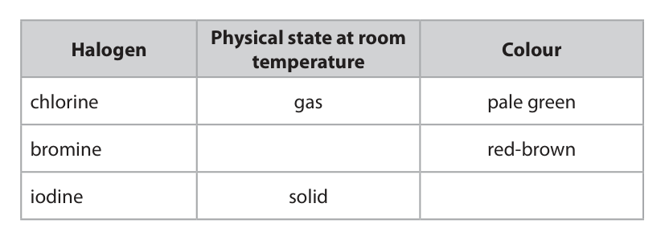

# 4CH1/2C — 2019-06 (official extraction)

> schema `syllabai.official-paper-questions/0.1` · paper_id `pearson-edexcel:international-gcse:chemistry:4ch1:2019-06:4CH1/2C` · qp sha256 `78737827bc8fd0e2…` · extracted verbatim, never regenerated (ADR-037)

## Question 1 (6 marks)

The diagram shows the particles in an atom of an element.

### 1(a) [3]

The box gives the names of some particles. electron ion molecule neutron proton Use words from the box to label the diagram.

**Mark scheme answer**

> 1 mark for each correct
> answer

- **(3)** 1 mark for each correct

### 1(b) [1]

Give the mass number of this atom.

**Mark scheme answer**

> 13

- **(1)** 13

### 1(c) [2]

Complete the sentence about isotopes. Isotopes are atoms that have the same number of but have a different number of

**Mark scheme answer**

> M1 protons IGNORE electrons
> M2 neutrons
> Answer Additional guidance Marks

- **(1)** protons IGNORE electrons
- **(1)** neutrons

## Question 2 (9 marks)

The table gives some information about the halogens, chlorine, bromine and iodine. Physical state at room Halogen Colour temperature chlorine gas pale green bromine red-brown iodine solid

### 2(a) [2]

Complete the table.

**Mark scheme answer**

> ALLOW black
> ALLOW any combination of
> grey and black eg grey-black

- **(2)** ALLOW black

### 2(b) [3]

Chlorine has two isotopes of mass numbers 35 and 37 The relative percentage of each isotope in a sample of chlorine is chlorine-35 77.78% chlorine-37 22.22% Calculate the relative atomic mass of this sample of chlorine. Give your answer to one decimal place. relative atomic mass =

**Mark scheme answer**

> M1 (35 × 77.78) + (37 × 22.22)
> OR 3544.44
> M2 3544.44 ÷ 100 OR 35.4444 OR M1 ÷ 100 (35 × 0.7778) + (37
> × 0.2222)
> OR
> 35.4444/35.444/35.44 with
> no working scores 2
> M3 35.4 35.4 with no working scores
> M3 can be ECF from an
> incorrect M2

- **(1)** (35 × 77.78) + (37 × 22.22)
- **(1)** 3544.44 ÷ 100 OR 35.4444 OR M1 ÷ 100 (35 × 0.7778) + (37
- **(1)** 35.4 35.4 with no working scores

### 2(c) [4]

A student is given an aqueous solution of chlorine and an aqueous solution of potassium bromide. Explain how he can use these two solutions to compare the reactivity of chlorine with the reactivity of bromine.

**Mark scheme answer**

> An explanation that links together the following four points:
> M1 add chlorine (solution) to potassium bromide ACCEPT mix the two
> (solution) solutions
> M2 (solution) turns orange ALLOW any combination of
> orange/yellow/brown
> IGNORE other observations
> eg bubbles
> M3 bromine/Br2 is displaced ALLOW bromine/Br2 is
> produced/formed
> IGNORE state of bromine
> REJECT bromide
> IGNORE a displacement
> reaction occurs
> M3 can be scored by Br2 as
> a product in an equation
> M4 (therefore) chlorine is more reactive (than bromine) ACCEPT reverse argument
> “If a reaction occurs then
> chlorine is more reactive
> than bromine” scores M4
> Question number Answer Additional guidance Marks

- **(1)** add chlorine (solution) to potassium bromide ACCEPT mix the two
- **(1)** (solution) turns orange ALLOW any combination of
- **(1)** bromine/Br2 is displaced ALLOW bromine/Br2 is
- **(1)** (therefore) chlorine is more reactive (than bromine) ACCEPT reverse argument

## Question 3 (9 marks)

Methanol, ethanol, propanol and butanol are alcohols. They are all liquids that evaporate easily when warmed. A student uses this apparatus to compare the time taken for the four liquids to evaporate. alcohol hot water She uses this method. • pour some methanol into an evaporating basin • place the evaporating basin on top of a beaker containing hot water • measure the time taken for the methanol to evaporate completely • repeat the experiment with each of the other alcohols, using the same apparatus

**(c)** The table shows the results of experiments done by four students, A, B, C and D. Formula Time taken for liquid to evaporate in s Alcohol of Student Student Student Student Mean time alcohol A B C D in s methanol CH3OH 20 24 22 26 23 ethanol C2H5OH 32 34 35 30 33 propanol C3H7OH 45 47 50 48 48 butanol C4H9OH 64 63 90 60

### 3(a) [2]

State two variables the student should control to make sure her results are valid. 1 2

**Mark scheme answer**

> M1 the volume of liquid/alcohol ALLOW amount of liquid/alcohol
> IGNORE mass
> IGNORE volume of water
> M2 the temperature of the water ALLOW temperature of surroundings
> IGNORE references to temperature of
> the alcohol

- **(1)** the volume of liquid/alcohol ALLOW amount of liquid/alcohol
- **(1)** the temperature of the water ALLOW temperature of surroundings

### 3(b) [1]

State why it is not safe to heat the evaporating basin directly with a Bunsen flame.

**Mark scheme answer**

> alcohols/the liquids are flammable/catch fire ALLOW alcohols/the liquids can be
> easily easily ignited
> ALLOW any named alcohol from the
> table

- **(1)** alcohols/the liquids are flammable/catch fire ALLOW alcohols/the liquids can be

### 3(c)(i) [2]

Calculate the mean (average) time for butanol to evaporate. mean time = s

**Mark scheme answer**

> M1 (64 + 63 + 60) ÷3
> M2 = 62
> ALLOW 62.3
> 62/62.3 with no working scores 2
> ALLOW 69/69.25/69.3 for 1 mark

- **(1)** (64 + 63 + 60) ÷3
- **(1)** = 62

### 3(c)(ii) [2]

Explain how the results show which alcohol evaporates most easily.

**Mark scheme answer**

> An explanation including the following two
> points:
> M1 methanol/CH3OH (evaporates most easily)
> M2 because the time taken is the shortest ACCEPT because has lowest (mean)
> time
> Question Answer Additional Guidance Marks
> Number

- **(1)** methanol/CH3OH (evaporates most easily)
- **(1)** because the time taken is the shortest ACCEPT because has lowest (mean)

### 3(c)(iii) [2]

State the relationship between the number of carbon atoms in the molecule and how easily the alcohol evaporates.

**Mark scheme answer**

> M1 as the number of carbon atoms increases
> M2 the ease of evaporation decreases/the less ALLOW the less volatile the alcohol
> easily the alcohol evaporates
> IGNORE the slower the alcohol
> evaporates
> IGNORE references to time taken
> ALLOW correct reverse argument
> number Answer Additional guidance Marks

- **(1)** as the number of carbon atoms increases
- **(1)** the ease of evaporation decreases/the less ALLOW the less volatile the alcohol

## Question 4 (7 marks)

This question is about metals.

**(c)** Magnalium is an alloy of aluminium and magnesium. The diagram shows how the atoms are arranged in this alloy. magnesium atom aluminium atom

### 4(a) [1]

Which statement describes metallic bonding? A electrostatic attraction between oppositely charged ions B electrostatic attraction between the nuclei of two atoms and a pair of electrons shared between them C electrostatic attraction between positively charged particles and delocalised electrons D electrostatic attraction between atoms

**Mark scheme answer**

> C (electrostatic attraction between positively charged
> particles and delocalised electrons) is correct as it
> describes metallic bonding
> A is incorrect since it describes ionic bonding not metallic
> bonding
> B is incorrect since it describes covalent bonding not
> metallic bonding
> D is incorrect since it describes interatomic or
> intermolecular forces not metallic bonding

- **(1)** C (electrostatic attraction between positively charged

### 4(b) [2]

Aluminium is malleable and can be easily shaped to make saucepans used for cooking food. State two other properties of aluminium that make it suitable for saucepans used for cooking food. 1 2

**Mark scheme answer**

> Any two from the following:
> M1 good conductor of heat/thermal energy
> M2 does not react with food/affect flavour of food IGNORE non-toxic
> M3 resistant to corrosion ALLOW does not corrode/rust
> IGNORE unreactive/inert
> M4 high melting point IGNORE references to recycling
> M5 low density/lightweight/strong IGNORE light
> Answer Additional guidance Marks

- **(2)** Any two from the following:

### 4(c)(i) [1]

State what is meant by the term alloy.

**Mark scheme answer**

> a mixture of (two or more) elements, one of which is ACCEPT a mixture of (two or
> a metal more) metals
> ALLOW combination for mixture
> REJECT compound or references to
> chemical bonding

- **(1)** a mixture of (two or more) elements, one of which is ACCEPT a mixture of (two or

### 4(c)(ii) [3]

Explain why magnalium is harder than aluminium.

**Mark scheme answer**

> An explanation that links together the following three
> points:
> M1 the regular arrangement of atoms is ALLOW lattice/layers/rows of
> distorted/disrupted OWTTE atoms are disrupted/distorted
> ALLOW lattice/layers/rows of
> atoms less regular
> M2 because magnesium atoms are larger than ALLOW magnesium and aluminium
> aluminium atoms atoms are of different sizes
> M3 and therefore it is more difficult for the layers to ALLOW layers cannot (as easily)
> slide over one another slide over one another
> IGNORE references to strength of
> metallic bonds
> Question Answer Additional guidance Marks

- **(1)** the regular arrangement of atoms is ALLOW lattice/layers/rows of
- **(1)** because magnesium atoms are larger than ALLOW magnesium and aluminium
- **(1)** and therefore it is more difficult for the layers to ALLOW layers cannot (as easily)

## Question 5 (10 marks)

During the Second World War, engineers developed a rocket-powered aircraft. combustion chamber hydrogen peroxide tank hydrazine tank The aircraft carried these two liquids • hydrazine, N2H4 • hydrogen peroxide, H2O2 When these two liquids mix in the combustion chamber, they evaporate and then react rapidly to form nitrogen gas, N2, and steam, H2O The reaction is exothermic. The equation for the reaction is N2H4 + 2H2O2 → N2 + 4H2O The displayed formulae for the reactants and products are H H H O H H H H H H O H N N H O O H H O H H H O O N=N O

**(a)** The tables give the bond energies for the bonds broken in the reactants and the bonds made in the products. Bonds broken Bonds made bond energy bond energy bond bond in kJ/mol in kJ/mol N—N 159 N=N 945 N—H 391 O—O 143 O—H 463 O—H 463

### 5(a)(i) [1]

Use the data in the tables to calculate the total amount of energy required to break all of the bonds in the reactants. energy required = kJ

**Mark scheme answer**

> (bonds broken)
> 3861 (kJ)

- **(1)** (bonds broken)

### 5(a)(ii) [1]

Use the data in the tables to calculate the total amount of energy released when all of the bonds in the products are made. energy released = kJ

**Mark scheme answer**

> (bonds made)
> 4649 (kJ)

- **(1)** (bonds made)

### 5(a)(iii) [3]

Calculate the enthalpy change, ∆H, in kJ/mol, for the reaction. Include a sign in your answer. ∆H = kJ/mol

**Mark scheme answer**

> M1 subtraction of Σ(bonds made) made and In (iii) ECF from (i) and
> Σ(bonds broken) (ii) must be applied
> Subtraction can be in any
> order
> M2 correct evaluation of the calculation shown in M1 IGNORE sign
> M3 If Σ(bonds made) > Σ(bonds broken) final answer must
> be negative
> If Σ(bonds made) < Σ(bonds broken) final answer must Expected final answer is
> be positive (and + sign given) ‒788 (kJ/mol)
> -788 with no working
> scores 3
> (+) 788 scores 2

- **(1)** subtraction of Σ(bonds made) made and In (iii) ECF from (i) and
- **(1)** correct evaluation of the calculation shown in M1 IGNORE sign
- **(1)** If Σ(bonds made) > Σ(bonds broken) final answer must

### 5(b) [2]

Explain, in terms of bonds broken and bonds made, why this reaction is exothermic.

**Mark scheme answer**

> An explanation that links together the following two points:
> M1 more energy is given out when the bonds are made If state/imply that energy
> required to make bonds
> OR
> If state/imply that energy
> released when bonds are
> broken scores 0/2
> M2 than is taken in when the bonds are broken
> ACCEPT correct reverse
> argument
> Answer Additional guidance Marks

- **(1)** more energy is given out when the bonds are made If state/imply that energy
- **(1)** than is taken in when the bonds are broken

### 5(c) [3]

Draw an energy level diagram for the reaction between N2H4 and H2O2 energy

**Mark scheme answer**

> IGNORE horizontal axis
> drawn
> IGNORE enthalpy change
> shown
> IGNORE activation
> energy shown
> M1 right hand line below left hand line
> M2 correct names/formulae of both reactants If only use words
> reactants (on left) and
> M3 correct names/formulae of both products products (on right) award
> 1 mark from M2 and M3
> Answer Additional guidance Marks

- **(1)** right hand line below left hand line
- **(1)** correct names/formulae of both reactants If only use words
- **(1)** correct names/formulae of both products products (on right) award

## Question 6 (14 marks)

Some cars in Brazil use ethanol, C2H5OH, as a fuel instead of petrol. The ethanol is made by the fermentation of glucose which is obtained from sugar cane. The sugar is extracted from the sugar cane and then dissolved in water to make a sugar solution.

**(d)** When ethanol is heated with acidified potassium dichromate(VI), it is oxidised to ethanoic acid.

### 6(a)(i) [1]

Name the substance that is added to the sugar solution that causes glucose to ferment.

**Mark scheme answer**

> yeast IGNORE zymase

- **(1)** yeast IGNORE zymase

### 6(a)(ii) [1]

Which temperature is the most suitable for fermentation?

- **(A)** 0°C
- **(B)** 10°C
- **(C)** 30°C  ✔
- **(D)** 80°C

**Mark scheme answer**

> C (30 °C) is correct as it is the most
> suitable temperature for fermentation
> A is incorrect as at 0°C the enzymes
> would not be active so not the most
> suitable temperature for fermentation
> B is incorrect as at 10°C the enzymes
> would not be very active so not the most
> suitable temperature for fermentation
> D is incorrect as at 80°C the enzymes
> would be denatured so not the most
> suitable temperature for fermentation

- **(1)** Answer C: 30°C

### 6(a)(iii) [2]

Explain why fermentation is done in the absence of air.

**Mark scheme answer**

> An explanation using either of the
> following linked pairs:
> M1 oxygen in the air would react with ACCEPT ethanol would be oxidised
> ethanol
> M2 to form ethanoic acid ALLOW to form carboxylic acid
> ALLOW to form vinegar
> OR
> M1 the fermentation/reaction/respiration
> needs to be anaerobic
> M2 ethanol would not be formed /CO2
> and H2O would form

- **(2)** An explanation using either of the

### 6(b)(i) [1]

State what is meant by the term fuel.

**Mark scheme answer**

> a substance that releases thermal IGNORE energy on its own
> energy/heat (energy) when
> burned/combusted

- **(1)** a substance that releases thermal IGNORE energy on its own

### 6(b)(ii) [2]

Write a chemical equation for the complete combustion of ethanol in air.

**Mark scheme answer**

> C2H5OH + 3 O2 → 2 CO2 + 3 H2O ACCEPT multiples
> M1 all formulae correct
> M2 correctly balanced M2 DEP M1
> Answer Additional guidance Marks

- **(1)** all formulae correct
- **(1)** correctly balanced M2 DEP M1

### 6(c) [2]

Ethanol is also manufactured by reacting steam with ethene, C2H4 The equation for this reaction is C2H4(g) + H2O(g) → C2H5OH(g) State the conditions of temperature and pressure used in this process. temperature pressure

**Mark scheme answer**

> M1 (temperature) 300 °C ACCEPT any value or range of values
> between 250 and 350 °C
> If no unit given assume it is Celsius
> ACCEPT equivalent temperatures in other
> units provided the unit is given
> M2 60 ‒ 70 atm ACCEPT any value or range of values
> between 60 and 70 atm
> If no unit given assume it is atm
> ACCEPT equivalent pressures in other units
> provided the unit is given

- **(1)** (temperature) 300 °C ACCEPT any value or range of values
- **(1)** 60 ‒ 70 atm ACCEPT any value or range of values

### 6(d)(i) [1]

State the colour change that occurs in the potassium dichromate(VI) during this reaction. from to

**Mark scheme answer**

> (from) orange (to) green

- **(1)** (from) orange (to) green

### 6(d)(ii) [2]

The structural formula of ethanoic acid is CH3COOH Draw the displayed formula of ethanoic acid.

**Mark scheme answer**

> IGNORE bond angles
> scores 1 mark

- **(2)** IGNORE bond angles

### 6(d)(iii) [2]

Complete the equation for the reaction of ethanoic acid with sodium CH3COOH(aq) + Na(s) → (aq) + (g)

**Mark scheme answer**

> CH3COONa + ½ H2 ALLOW NaCH3COO
> M1 for both products correct
> M2 for correctly balanced ACCEPT multiples
> M2 DEP M1
> Answer Additional guidance Marks

- **(1)** for both products correct
- **(1)** for correctly balanced ACCEPT multiples

## Question 7 (8 marks)

Dinitrogen tetraoxide, N2O4, is a colourless gas. Nitrogen dioxide, NO2, is a brown gas. The two gases can exist together in dynamic equilibrium according to the equation N2O4(g) ⇌ 2NO2(g)

**(b)** Some N2O4 and some NO2 are put into a sealed gas syringe and allowed to form an equilibrium mixture. equilibrium mixture piston gas syringe This equilibrium mixture is brown.

**(c)** Carbon monoxide, CO, and oxides of nitrogen are produced in a car engine when petrol is burned. These oxides can be partly removed by using a catalytic converter fitted to the car’s exhaust system.

### 7(a) [2]

Explain what is meant by the term dynamic equilibrium.

**Mark scheme answer**

> An explanation that links together the following
> two points:
> M1 reaction is taking place in both directions (at ACCEPT both forward and
> same time) backward reactions are taking place
> (at same time)
> IGNORE it is a reversible reaction
> M2 at equal rate M2 DEP M1
> rate of the forward reaction is equal
> to the rate of the backward reaction
> scores 2 marks
> REJECT both forward and backward
> reactions occur at constant rate for
> M2
> ALLOW the concentrations of the
> reactants and products remains
> constant scores 1 mark
> independently of M1
> but
> REJECT concentrations of the
> reactants and products are
> equal/the same

- **(1)** reaction is taking place in both directions (at ACCEPT both forward and
- **(1)** at equal rate M2 DEP M1

### 7(b)(i) [2]

The pressure of the gas in the syringe is increased by pushing in the piston. The mixture is then allowed to reach a new equilibrium at the same temperature as before. Explain why the new equilibrium mixture contains less NO2 than the original equilibrium mixture.

**Mark scheme answer**

> An explanation that links together the following
> two points:
> M1 (the position of) equilibrium has ALLOW (position of) equilibrium
> moved to the left has shifted in backwards direction
> ALLOW (position of) equilibrium
> has shifted towards the N2O4
> /reactants (side)
> ALLOW increasing pressure shifts
> (position of) equilibrium in direction
> that produces fewer moles (of gas)
> IGNORE references to Le
> Chatelier’s Principle eg increasing
> pressure favours the side that has
> fewer moles of gas / increasing
> pressure favours the backwards
> reaction
> M2 because there are fewer moles/molecules (of ALLOW particles
> gas) on the left REJECT atoms
> ALLOW because there are fewer
> moles of N2O4 (than NO2)
> ALLOW because there are fewer
> moles of reactant (than product)
> ACCEPT reverse argument

- **(1)** (the position of) equilibrium has ALLOW (position of) equilibrium
- **(1)** because there are fewer moles/molecules (of ALLOW particles

### 7(b)(ii) [1]

A student suggests that the new equilibrium mixture would be lighter in colour than the original equilibrium mixture, as there is now less NO2 present. Suggest why the new equilibrium mixture is actually darker than the original.

**Mark scheme answer**

> the concentration of NO2 has increased ALLOW molecules/particles of NO2
> are closer together
> ALLOW molecules/particles of NO2
> are in a smaller volume
> REJECT more NO2 produced
> Answer Additional guidance Marks

- **(1)** the concentration of NO2 has increased ALLOW molecules/particles of NO2

### 7(c)(i) [1]

State how oxides of nitrogen are produced in the car engine.

**Mark scheme answer**

> nitrogen/N2 reacts with oxygen/O2 (both from the IGNORE nitrogen burns/combusts
> air) in oxygen
> IGNORE nitrogen is oxidised

- **(1)** nitrogen/N2 reacts with oxygen/O2 (both from the IGNORE nitrogen burns/combusts

### 7(c)(ii) [1]

Give a disadvantage of allowing oxides of nitrogen to escape into the atmosphere.

**Mark scheme answer**

> (they form) acid rain ACCEPT references to respiratory
> problems
> ALLOW a specified harmful effect of
> acid rain
> ALLOW references to smog
> ALLOW references to greenhouse
> gases/global warming/climate
> change

- **(1)** (they form) acid rain ACCEPT references to respiratory

### 7(c)(iii) [1]

Write a chemical equation for the reaction between nitrogen monoxide, NO, and carbon monoxide to form carbon dioxide and nitrogen.

**Mark scheme answer**

> 2 NO + 2 CO → N2 + 2 CO2 ACCEPT multiples and fractions
> Answer Additional guidance Marks

- **(1)** 2 NO + 2 CO → N2 + 2 CO2 ACCEPT multiples and fractions

## Question 8 (7 marks)

The concentration of NaClO(aq) in a solution of bleach is found by reacting it with hydrochloric acid. The equation for the reaction is NaClO(aq) + 2HCl(aq) → NaCl(aq) + H2O(l) + Cl2(g) An excess of dilute hydrochloric acid is added to 4.00 cm3 of bleach solution. 60.0 cm3 of chlorine gas is produced.

### 8(a) [2]

Explain a safety precaution that should be taken when doing this experiment.

**Mark scheme answer**

> An explanation using either of the following
> linked pairs:
> M1 use a fume cupboard
> M2 because chlorine is toxic/poisonous IGNORE chlorine is
> dangerous/harmful/irritant
> OR
> M1 wear goggles/safety glasses/gloves
> M2 because acid/bleach (may be)
> irritant/corrosive
> IGNORE laboratory coats

- **(2)** An explanation using either of the following

### 8(b)(i) [2]

Calculate the amount, in moles, of chlorine gas produced. Assume one mole of chlorine gas occupies 24 000 cm3 . amount of chlorine = mol

**Mark scheme answer**

> M1 60 ÷ 24 000
> M2 0.0025 (mol) 0.0025 with no working scores 2 marks
> REJECT 0.003 for M2

- **(1)** 60 ÷ 24 000
- **(1)** 0.0025 (mol) 0.0025 with no working scores 2 marks

### 8(b)(ii) [1]

Determine the amount, in moles, of NaClO in 4.00 cm3 of bleach. amount of NaClO = mol

**Mark scheme answer**

> 0.0025 OR answer to M2 from (i)

- **(1)** 0.0025 OR answer to M2 from (i)

### 8(b)(iii) [2]

Calculate the concentration, in mol/dm3, of the bleach solution. concentration = mol/dm3

**Mark scheme answer**

> M1 (0.0025 ÷ 4.00) × 1000 Mark CSQ on (b)(ii)
> M2 0.625 (mol/dm3) ACCEPT any number of sig fig except 1
> (unless ECF answer is exactly 1 sig fig
> correct answer with no working
> throughout (b) scores 2 marks
> Pearson Education Limited. Registered company number 872828
> with its registered office at 80 Strand, London, WC2R 0RL, United Kingdom

- **(1)** (0.0025 ÷ 4.00) × 1000 Mark CSQ on (b)(ii)
- **(1)** 0.625 (mol/dm3) ACCEPT any number of sig fig except 1

