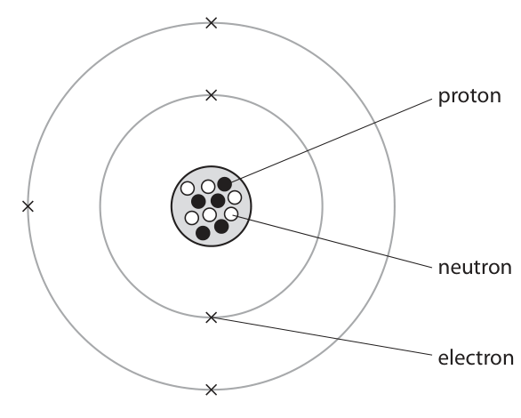
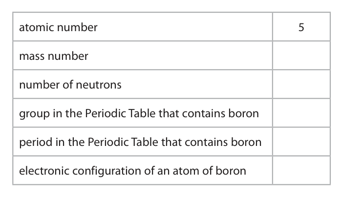
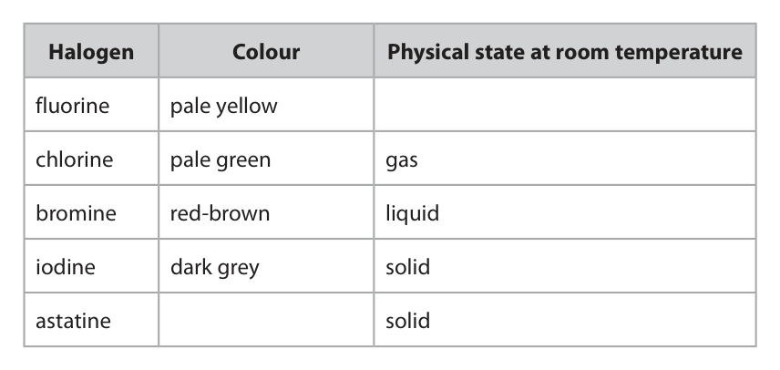
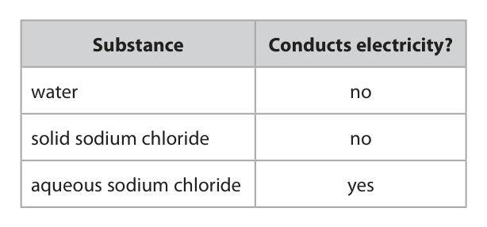
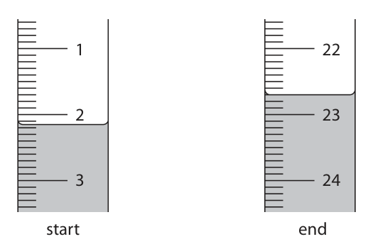
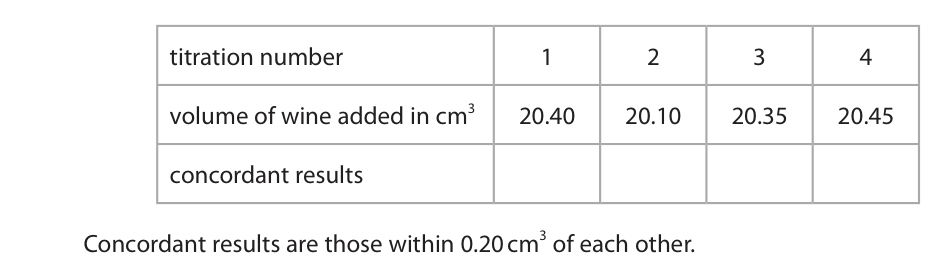

# 4CH1/2CR — 2019-06 (official extraction)

> schema `syllabai.official-paper-questions/0.2` · paper_id `pearson-edexcel:international-gcse:chemistry:4ch1:2019-06:4CH1/2CR` · qp sha256 `4e0bd25cb81f959b…` · extraction is the disclosed baseline (ADR-039)

## Question 1 (5 marks)

This question is about gases in the atmosphere.

**(a)** The box gives the names of some gases in the atmosphere. argon carbon dioxide helium nitrogen oxygen Use gases from the box to answer the questions. Each gas may be used once, more than once or not at all.

### 1(a)(i) [1]

Identify the two noble gases.

**Mark scheme answer**

> argon and helium ALLOW Ar and He

- **(1)** argon and helium ALLOW Ar and He

### 1(a)(ii) [1]

Identify the gas that is a compound.

**Mark scheme answer**

> carbon dioxide ALLOW CO2
> If both name and
> formula given both
> must be correct

- **(1)** carbon dioxide ALLOW CO2

### 1(a)(iii) [1]

Identify the most abundant gas in the atmosphere.

**Mark scheme answer**

> nitrogen ALLOW N2
> IGNORE N

- **(1)** nitrogen ALLOW N2

### 1(a)(iv) [1]

Identify the greenhouse gas.

**Mark scheme answer**

> carbon dioxide ALLOW CO2
> If both name and
> formula given both
> must be correct

- **(1)** carbon dioxide ALLOW CO2

### 1(b) [1]

Describe the test for oxygen.

**Mark scheme answer**

> relights a glowing spill/splint

- **(1)** relights a glowing spill/splint

## Question 2 (7 marks)

The diagram represents an atom of boron. proton neutron electron

### 2(a) [5]

Use information from the diagram to complete the table. The first row has been done for you. atomic number 5 mass number number of neutrons group in the Periodic Table that contains boron period in the Periodic Table that contains boron electronic configuration of an atom of boron

**Mark scheme answer**

> atomic number
> mass number
> number of neutrons
> group in the Periodic table that contains boron
> period in the Periodic table that contains boron
> electronic configuration of an atom of boron 2, ACCEPT
> 1s2 2s2
> 2p1

- **(5)** atomic number

### 2(b) [2]

Boron has two isotopes, boron‑10 and boron‑11. A sample of boron contains 18.7% of boron‑10 and 81.3% of boron‑11. Calculate the relative atomic mass of this sample of boron. relative atomic mass =

**Mark scheme answer**

> • Sum of masses multiplied by percentages
> • Division by 100 to give final answer
> M1 (18.7 x 10) + (81.3 x 11) OR 1081.3 ACCEPT 1080 and
> 1081
> M2 10.8 OR answer from M1 divided by 100
> ACCEPT 10.81 and
> 10.813
> Correct answer
> without working
> scores 2
> 11 without working
> scores 0
> 11 with correct
> working scores 1

- **(1)** (18.7 x 10) + (81.3 x 11) OR 1081.3 ACCEPT 1080 and
- **(1)** 10.8 OR answer from M1 divided by 100

## Question 3 (8 marks)

Crude oil is an important source of organic compounds.

**(a)** The diagram shows crude oil being separated into different fractions. F E D C B crude oil X A

### 3(a)(i) [1]

Name the process used to separate crude oil into different fractions.

**Mark scheme answer**

> fractional distillation ALLOW fractionating
> /fractionation

- **(1)** fractional distillation ALLOW fractionating

### 3(a)(ii) [1]

State what happens to the crude oil at X.

**Mark scheme answer**

> crude oil/it is heated/vapourised ALLOW boiled
> IGNORE evaporates

- **(1)** crude oil/it is heated/vapourised ALLOW boiled

### 3(a)(iii) [4]

Describe the differences between fraction B and fraction E. In your answer, refer to ● size of the molecules ● boiling point ● colour ● viscosity

**Mark scheme answer**

> A description which refers to the following ACCEPT reverse
> four points arguments for E
> M1 B contains larger/longer molecules
> M2 B has a higher boiling point ALLOW E is more volatile
> IGNORE melting point
> M3 B has a darker colour ALLOW arison giving
> specific colours e.g B is
> orange and E is pale
> yellow
> M4 B is more viscous/ has greater ALLOW E is more runny
> viscosity
> MAX 2 marks if no
> reference to fractions E or
> B in the answer?

- **(1)** B contains larger/longer molecules
- **(1)** B has a higher boiling point ALLOW E is more volatile
- **(1)** B has a darker colour ALLOW arison giving
- **(1)** B is more viscous/ has greater ALLOW E is more runny

### 3(b) [2]

Crude oil often contains sulfur as an impurity. Explain why this is a problem when using crude oil fractions as fuels.

**Mark scheme answer**

> An planation which links the following two
> points
> ALLOW sulfur trioxide/SO3
> M1 (when sulfur burns) sulfur dioxide /SO2
> is formed IGNORE sulfur oxides
> ALLOW a specified
> harmful effect of acid rain
> M2 causes acid rain
> ACCEPT references to
> causing/ acerbating
> respiratory problems
> ALLOW greenhouse gas/
> causes global warming/
> imate change

- **(1)** (when sulfur burns) sulfur dioxide /SO2
- **(1)** causes acid rain

## Question 4 (15 marks)

This question is about the halogens and their compounds.

**(e)** A concentrated aqueous solution of sodium chloride is electrolysed using graphite electrodes. Chlorine is formed at the positive electrode (anode).

### 4(a) [2]

The table gives the colour and physical state at room temperature of the halogens. Complete the table by predicting the colour of astatine and the physical state of fluorine at room temperature. Halogen Colour Physical state at room temperature fluorine pale yellow chlorine pale green gas bromine red‑brown liquid iodine dark grey solid astatine solid

**Mark scheme answer**

> M1 fluorine - gas
> M2 astatine - black ACCEPT very dark grey

- **(1)** fluorine - gas
- **(1)** astatine - black ACCEPT very dark grey

### 4(b) [2]

Chlorine gas is bubbled into a colourless solution of potassium bromide. Explain why the solution turns orange.

**Mark scheme answer**

> An planation linking the following two points
> M1 bromine / Br2 is formed / displaced / REJECT bromide for
> produced bromine
> ACCEPT bromine/Br2
> shown as the product
> in an equation
> IGNORE state of
> bromine
> M2 as chlorine is more reactive (than bromine) REJECT
> bromide/chloride

- **(1)** bromine / Br2 is formed / displaced / REJECT bromide for
- **(1)** as chlorine is more reactive (than bromine) REJECT

### 4(c) [3]

Potassium bromide is an ionic compound. Draw diagrams to show the outer electrons in a potassium ion and in a bromide ion. Include the charges on the ions. potassium ion bromide ion

**Mark scheme answer**

> M1 correct structure of potassium ion ACCEPT any
> combination of dots
> and crosses.
> IGNORE inner shells
> even if incorrect
> M2 correct structure of bromide ion
> M3 charges on both ions correct (with or
> without square brackets).

- **(1)** correct structure of potassium ion ACCEPT any
- **(1)** correct structure of bromide ion
- **(1)** charges on both ions correct (with or

### 4(d) [5]

A student sets up a circuit to test the electrical conductivity of water, solid sodium chloride and aqueous sodium chloride. The table shows the student’s results. Substance Conducts electricity? water no solid sodium chloride no aqueous sodium chloride yes Explain these results, with reference to the structure and bonding of the substances.

**Mark scheme answer**

> An planation linking the following five
> points
> ALLOW water is a
> M1 water is covalently bonded / has a covalent ound
> simple molecular structure
> ACCEPT water does not
> M2 water does not contain any free contain any free
> (moving) charged parti es (so does not ions/electrons or
> conduct electricity) delocalised electrons
> ALLOW sodium chloride is
> an ionic ound/ contains
> M3 sodium chloride has a giant ionic ions
> structure / has an ionic lattice structure /is
> ionically bonded REJECT mention of atoms/
> molecules/intermolecular
> forces in Na for M3 only
> M4 subsumes M3
> REJECT electrons being
> M4 the ions are in fixed positions / cannot unable to move for M4
> move (so does not conduct electricity)
> REJECT reference to
> electrons conducting
> electricity in aqueous
> M5 in solution/ aqueous sodium chloride sodium chloride for M5
> the ions are free to flow / move (so the
> solution does conduct electricity) IGNORE reference to ions
> carrying charge/current

- **(1)** water is covalently bonded / has a covalent ound
- **(1)** water does not contain any free contain any free
- **(1)** sodium chloride has a giant ionic ions
- **(1)** the ions are in fixed positions / cannot unable to move for M4
- **(1)** in solution/ aqueous sodium chloride sodium chloride for M5

### 4(e)(i) [1]

Give an ionic half‑equation for the formation of chlorine at the positive electrode.

**Mark scheme answer**

> 2- → 2 + 2e(-) ALLOW 2 - - 2e → 2

- **(1)** 2- → 2 + 2e(-) ALLOW 2 - - 2e → 2

### 4(e)(ii) [1]

State why this ionic half‑equation represents an oxidation reaction.

**Mark scheme answer**

> electrons are lost (by chloride ions/ - ) ACCEPT oxidation number
> of chlorine increases (by
> 1)
> / changes from -1 to 0
> REJECT chlorine loses
> electrons
> IGNORE references to
> gain of oxygen

- **(1)** electrons are lost (by chloride ions/ - ) ACCEPT oxidation number

### 4(e)(iii) [1]

Which substance is formed at the negative electrode (cathode)?

- **(A)** hydrogen  ✔
- **(B)** oxygen
- **(C)** sodium
- **(D)** water

**Mark scheme answer**

> A hydrogen
> B is incorrect as oxygen is not formed at the
> cathode
> C is incorrect as sodium is not formed when
> graphite electrodes are used Total 15
> D is incorrect as water is not formed at the
> cathode

- **(1)** Answer A: hydrogen

## Question 5 (11 marks)

This question is about the reactions of carboxylic acids.

**(a)** Carboxylic acids react with solutions of metal carbonates.

**(b)** The ester, ethyl ethanoate, can be prepared by reacting ethanol with ethanoic acid. This is the method for the preparation. ● mix equal amounts of ethanoic acid and ethanol in a boiling tube ● add a few drops of concentrated sulfuric acid ● place the boiling tube in a hot water bath for several minutes

**(c)** Another ester, methyl propanoate, can be prepared by reacting methanol with propanoic acid.

### 5(a)(i) [2]

Complete the chemical equation for the reaction of ethanoic acid, CH3COOH, with potassium carbonate solution. 2CH3COOH + K2CO3 → + +

**Mark scheme answer**

> 2CH3COOH + K2CO3 → 2CH3COOK + CO2 ALLOW multiples
> + H2O
> M1 2CH3COOK ACCEPT 2CH3 COO-K+
> ALLOW 2KCH3COO
> M2 CO2 + H2O If M1 not awarded any
> numbers before CO2 +
> H2O can be ignored and
> M2 can be awarded.
> For both marks to be
> awarded the equation
> must be correctly
> balanced

- **(1)** 2CH3COOK ACCEPT 2CH3 COO-K+
- **(1)** CO2 + H2O If M1 not awarded any

### 5(a)(ii) [1]

State what you would see in this reaction.

**Mark scheme answer**

> effervescence / fizzing / bubbles IGNORE carbon
> dioxide/gas given
> off/evolved/ formed
> /produced
> IGNORE mention of
> incorrect gas

- **(1)** effervescence / fizzing / bubbles IGNORE carbon

### 5(b)(i) [1]

State the role of concentrated sulfuric acid in this reaction.

**Mark scheme answer**

> (acts as a) catalyst ACCEPT increases the rate
> of the reaction/speeds up
> the reaction

- **(1)** (acts as a) catalyst ACCEPT increases the rate

### 5(b)(ii) [1]

Suggest why the mixture is heated in a water bath rather than directly with a Bunsen burner flame.

**Mark scheme answer**

> ethanol is flammable / might catch fire / ACCEPT ethyl ethanoate
> might ignite /the mixture /it is
> flammable /might catch
> fire /might ignite

- **(1)** ethanol is flammable / might catch fire / ACCEPT ethyl ethanoate

### 5(b)(iii) [1]

State how you would know that ethyl ethanoate has formed.

**Mark scheme answer**

> (ester has) sweet / fruity / distinctive smell ALLOW liquid (ester)
> floats on top of mixture
> OWTTE

- **(1)** (ester has) sweet / fruity / distinctive smell ALLOW liquid (ester)

### 5(c)(i) [3]

Draw the displayed formulae of methanol, propanoic acid and the ester, methyl propanoate. methanol propanoic acid methyl propanoate

**Mark scheme answer**

> Penalise missing bond
> between O and H once
> only
> If incorrect number of
> carbon atoms in
> alcohol and or acid
> allow ECF for structure
> of ester formed from
> their alcohol and acid

- **(3)** Penalise missing bond

### 5(c)(ii) [1]

Give the name of the other product of this reaction.

**Mark scheme answer**

> water ACCEPT H2O

- **(1)** water ACCEPT H2O

### 5(d) [1]

Give one use of esters.

**Mark scheme answer**

> food flavourings / perfumes ACCEPT any correct
> use
> e.g. in cosmetics /
> making soaps / making
> detergents /solvents
> (for paints / varnishes)

- **(1)** food flavourings / perfumes ACCEPT any correct

## Question 6 (15 marks)

When a bottle of wine is left open for several days, some of the ethanol in the wine turns to ethanoic acid, CH3COOH

**(a)** A scientist uses a titration method to investigate how much ethanoic acid is formed if a bottle of white wine is left open for one week. She uses this method. ● fill a burette with the white wine and record the reading ● add 25.0 cm3 of sodium hydroxide solution to a conical flask ● add a few drops of phenolphthalein indicator to the flask ● swirl the flask continuously while adding wine from the burette ● add the wine drop by drop near the end point ● record the reading at the end point

**(c)** The scientist repeats the titration four more times. The table shows her results for these four titrations. titration number 1 2 3 4 volume of wine added in cm3 20.40 20.10 20.35 20.45 concordant results Concordant results are those within 0.20 cm3 of each other.

**(d)** Another scientist repeats the titration with a different bottle of white wine that has been left open for a week. The equation for the reaction that occurs in this titration is CH3COOH + NaOH → CH3COONa + H2O The mean volume of wine added is 19.50 cm3.

### 6(a)(i) [1]

Name the piece of apparatus that would be most suitable for measuring the 25.0 cm3 of sodium hydroxide solution.

**Mark scheme answer**

> pipette

- **(1)** pipette

### 6(a)(ii) [1]

Suggest why red wine would not be suitable to use for this investigation.

**Mark scheme answer**

> red wine would mask the colour of the ACCEPT indicator and
> indicator / difficult to see colour change (at red wine are a similar
> end point) colour OWTTE

- **(1)** red wine would mask the colour of the ACCEPT indicator and

### 6(a)(iii) [1]

State why she swirls the flask continuously.

**Mark scheme answer**

> to mix the contents (of the flask so that they ACCEPT to ensure the
> can react) OWTTE colour change is
> permanent OWTTE
> ALLOW to speed up
> the reaction/ to ensure
> lete reaction

- **(1)** to mix the contents (of the flask so that they ACCEPT to ensure the

### 6(a)(iv) [1]

State why she adds the wine drop by drop near the end point.

**Mark scheme answer**

> so as not to add more wine than is needed ACCEPT to find the
> (for lete reaction )/ so as not to overshoot the act/precise point of
> end point OWTTE neutralisation
> IGNORE to obtain an
> accurate reading

- **(1)** so as not to add more wine than is needed ACCEPT to find the

### 6(b) [3]

The diagram shows the burette readings at the start and end of one of the titrations. 1 22 2 23 3 24 start end Use the readings to complete the table. Give your values to the nearest 0.05 cm3. burette reading at end burette reading at start volume of wine added in cm3

**Mark scheme answer**

> MAX 2 if final and
> initial burette readings
> M1 final burette 22.70 are reversed.
> reading in cm3
> M2 initial burette 2.15 MAX 2 if readings not
> reading in cm3 given to 2 decimal
> places.
> M3 volume of wine 20.55
> added in cm3
> ALLOW ECF for M3 on
> correct subtraction of
> M1 – M2

- **(1)** final burette 22.70 are reversed.
- **(1)** initial burette 2.15 MAX 2 if readings not
- **(1)** volume of wine 20.55

### 6(c)(i) [1]

Add ticks (✓) to the table to show the concordant results.

**Mark scheme answer**

> ip Ticks in boxes 1, 3 and 4

- **(1)** ip Ticks in boxes 1, 3 and 4

### 6(c)(ii) [2]

Use your ticked results to calculate the mean (average) volume of wine added. mean volume of wine added = cm3

**Mark scheme answer**

> ip • setting out of calculation
> • answer
> M1 20.40 + 20.35 + 20.45
> 3
> M2 20.40 20.40 without working
> scores 2
> 20.4 with or without
> working scores 1
> If no results ticked then
> only use of 2 or 3
> concordant titres can
> score both marks in (ii)
> If only one result ticked
> then M2 can be scored
> for averaging two or
> more titre values
> correctly
> M1 CQ on results
> ticked
> M2 CQ on correct
> calculation from M1
> Answer to M2 must be
> correct to 2dp

- **(1)** 20.40 + 20.35 + 20.45
- **(1)** 20.40 20.40 without working

### 6(d)(i) [2]

The concentration of the sodium hydroxide solution is 0.0500 mol/dm3 . Calculate the amount, in moles, of NaOH in 25.0 cm3 of sodium hydroxide solution. amount of NaOH = mol

**Mark scheme answer**

> • setting out of calculation
> • final answer
> M1 25.0 x 0.05(00)
> 1000
> M2 0.00125 If no division by 1000
> giving an answer of
> 1.25 award 1 mark
> Correct answer without
> working scores 2

- **(1)** 25.0 x 0.05(00)
- **(1)** 0.00125 If no division by 1000

### 6(d)(ii) [1]

Deduce the amount, in moles, of CH3COOH in 19.50 cm3 of the wine. amount of CH3COOH = mol

**Mark scheme answer**

> 0.00125 OR answer to (i)

- **(1)** 0.00125 OR answer to (i)

### 6(d)(iii) [2]

Calculate the concentration, in mol/dm3, of CH3COOH in the wine. concentration of CH3COOH = mol/dm3

**Mark scheme answer**

> • setting out of calculation
> • final answer
> M1 0.00125 x 1000 OR answer to (ii) x 1000
> 19.50 19.5
> M2 0.0641 OR answer to M1 ACCEPT any number of
> sig fig cept 1
> Correct answer without
> working scores 2
> answer to (ii)
> 19.5
> correctly evaluated to 2
> or more sig figs. scores
> 1
> Do not penalise not
> multiplying by 1000 in
> (iii) if they have not
> divided by 1000 in (i)

- **(1)** 0.00125 x 1000 OR answer to (ii) x 1000
- **(1)** 0.0641 OR answer to M1 ACCEPT any number of

## Question 7 (9 marks)

Hydrogen gas can be produced by reacting a mixture of methane and steam in the presence of a nickel catalyst. The reaction conditions are a temperature of 700 °C and a pressure of 5 atmospheres. The equation for the reaction is CH4(g) + H2O(g) ⇌ CO(g) + 3H2(g) ΔH = +206 kJ/mol

### 7(a) [1]

What does the symbol ⇌ represent?

**Mark scheme answer**

> reversible reaction IGNORE references to
> equilibrium
> ALLOW the reaction
> goes both ways
> ALLOW the reaction
> can go forwards and
> backwards

- **(1)** reversible reaction IGNORE references to

### 7(b)(i) [2]

The mixture of methane and steam is heated to a temperature greater than 700 °C but the pressure is kept at 5 atmospheres. Predict the effect of this change on the yield of hydrogen at equilibrium, giving a reason for your answer.

**Mark scheme answer**

> M1 yield increases ACCEPT more
> hydrogen produced
> M2 (equilibrium shifts to the right as the IGNORE references to
> forward) reaction is endothermic Le Chatelier e.g. an
> increase in
> temperature favours
> the forward reaction
> M2 dep on M1 correct
> or missing

- **(1)** yield increases ACCEPT more
- **(1)** (equilibrium shifts to the right as the IGNORE references to

### 7(b)(ii) [2]

The mixture of methane and steam is kept at the same temperature of 700 °C but the pressure is increased to more than 5 atmospheres. Predict the effect of this change on the yield of hydrogen at equilibrium, giving a reason for your answer.

**Mark scheme answer**

> M1 yield decreases ACCEPT less hydrogen
> produced
> M2 (equilibrium shifts to the left as) fewer ALLOW parti es
> moles/molecules (of gas) on lhs / more
> moles/molecules (of gas) on rhs OWTTE REJECT atoms
> IGNORE references to
> Le Chatelier e.g. an
> increase in pressure
> favours the side with
> fewer moles
> M2 dep on M1 correct
> or missing

- **(1)** yield decreases ACCEPT less hydrogen
- **(1)** (equilibrium shifts to the left as) fewer ALLOW parti es

### 7(c) [4]

Calculate the volume, in dm3, of hydrogen gas at rtp that is produced when 10 tonnes of methane gas completely react with steam. [molar volume of hydrogen at rtp is 24 dm3] Give your answer in standard form. volume of hydrogen = dm3

**Mark scheme answer**

> • calculate the amount, in moles, of
> methane
> • use the equation to calculate the amount
> of hydrogen
> • multiply amount by 24 to find the volume
> of hydrogen
> • final answer in standard form
> Mark consequentially for
> M1 10,000,000 OR 625,000 M2, M3 and M4.
> M2 625,000 x 3 OR 1,875,000
> M3 1,875,000 x 24 OR 45,000,000 (dm3)
> 45,000,000 without
> M4 4.5 x 10 (dm )
> 7
> working scores 3
> Correct answer in
> standard form without
> working scores 4
> Common answers
> 4.5 x 104 (3) 45,000 (2)
> 4.5 x 101 (3) 45 (2)
> 1.5 x 107 (3) 15,000,000
> (2)
> NOTE even if working is
> incorrect e.g. division by
> 24 instead of
> multiplication M4 can
> still be awarded for
> correct conversion to
> standard form

- **(1)** 10,000,000 OR 625,000 M2, M3 and M4.
- **(1)** 625,000 x 3 OR 1,875,000
- **(1)** 1,875,000 x 24 OR 45,000,000 (dm3)
- **(1)** 4.5 x 10 (dm )

