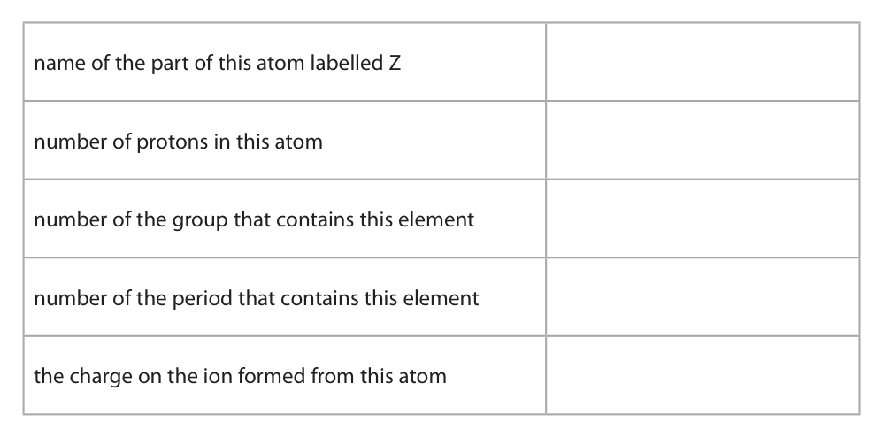
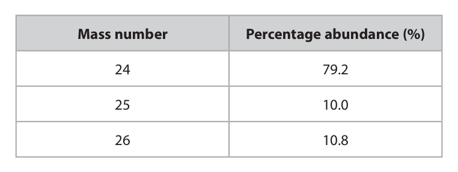
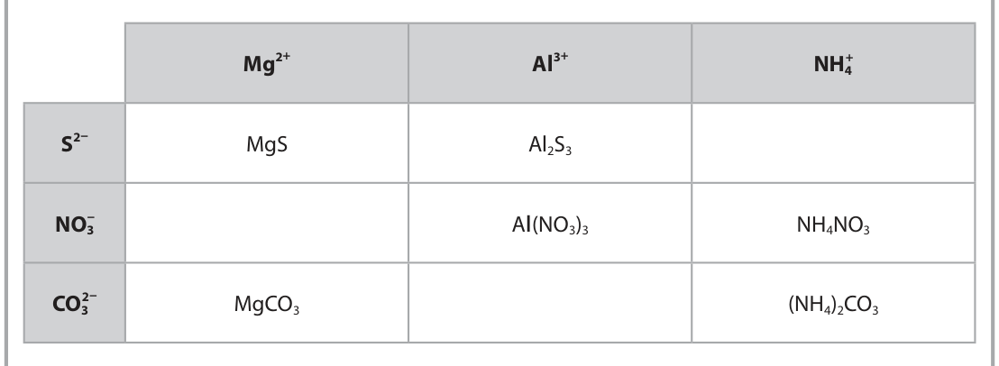
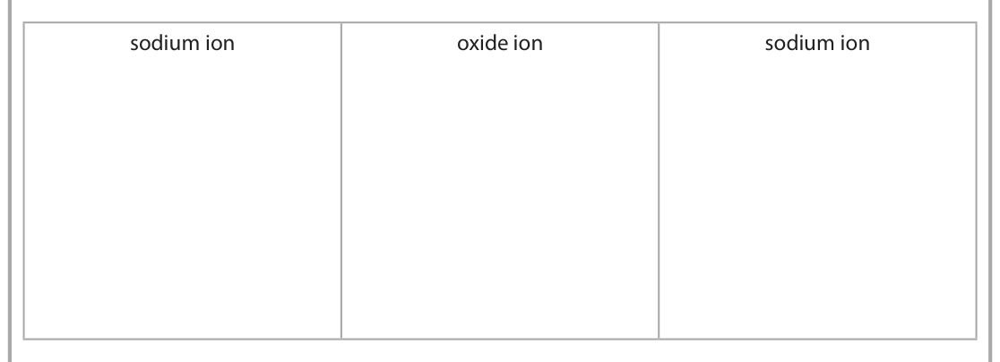
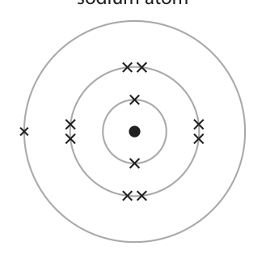
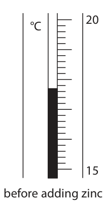
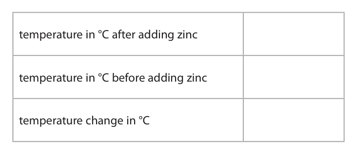
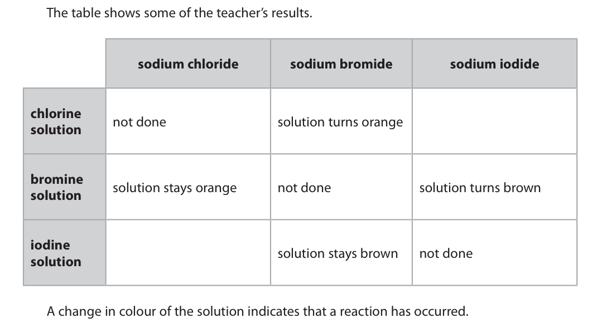
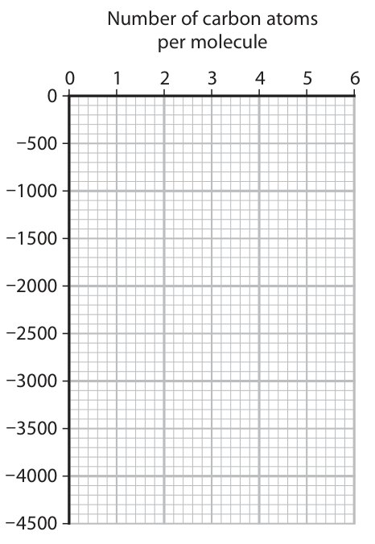
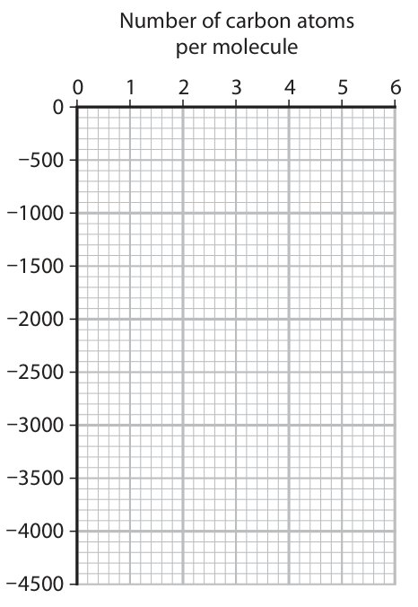

# 4CH1/1C — 2020-01 (official extraction)

> schema `syllabai.official-paper-questions/0.1` · paper_id `pearson-edexcel:international-gcse:chemistry:4ch1:2020-01:4CH1/1C` · qp sha256 `37247459b838d799…` · extracted verbatim, never regenerated (ADR-037)

## Question 1 (6 marks)

This question is about gases in the atmosphere.

**(a)** The box gives the names of some gases in the atmosphere. argon carbon dioxide helium nitrogen oxygen Choose gases from the box to answer these questions. Each gas may be used once, more than once or not at all.

**(b)** Sulfur reacts with oxygen to produce sulfur dioxide gas.

### 1(a)(i) [1]

Identify a noble gas.

**Mark scheme answer**

> argon / helium ACCEPT Ar / He

- **(1)** argon / helium ACCEPT Ar / He

### 1(a)(ii) [1]

Identify a gas that makes up about 78% of the atmosphere.

**Mark scheme answer**

> nitrogen ACCEPT N2

- **(1)** nitrogen ACCEPT N2

### 1(a)(iii) [1]

Identify a greenhouse gas.

**Mark scheme answer**

> carbon dioxide ACCEPT CO2

- **(1)** carbon dioxide ACCEPT CO2

### 1(a)(iv) [1]

Identify a gas produced by the thermal decomposition of calcium carbonate.

**Mark scheme answer**

> carbon dioxide ACCEPT CO2

- **(1)** carbon dioxide ACCEPT CO2

### 1(b)(i) [1]

Write a chemical equation for this reaction.

**Mark scheme answer**

> S + O2  SO2

- **(1)** S + O2  SO2

### 1(b)(ii) [1]

State an environmental problem caused when sulfur dioxide gas dissolves in water in the atmosphere.

**Mark scheme answer**

> acid rain ACCEPT an adverse
> effect of acid rain
> e.g. kills fish, damages
> plants, corrodes
> limestone/marble
> buildings/statues etc.
> IGNORE toxic/pollutant
> Question
> Answer Notes Marks
> number

- **(1)** acid rain ACCEPT an adverse

## Question 2 (8 marks)

The diagram shows the electronic configuration of an atom of an element. Z

### 2(a) [5]

Complete the table by giving the missing information about this atom. name of the part of this atom labelled Z number of protons in this atom number of the group that contains this element number of the period that contains this element the charge on the ion formed from this atom

**Mark scheme answer**

> name of the part of the atom nucleus
> labelled Z
> number of protons in this
> atom
> number of the group that
> contains this element
> number of the period that
> contains this element
> charge on the ion formed from 2+
> this atom ACCEPT +2 / Mg2+

- **(5)** name of the part of the atom nucleus

### 2(b) [3]

This element has three isotopes. The table shows the mass number and percentage abundance of each isotope in a sample of this element. Mass number Percentage abundance (%) 24 79.2 25 10.0 26 10.8 Calculate the relative atomic mass (Ar) of this element. Give your answer to one decimal place. relative atomic mass =

**Mark scheme answer**

> • calculate sum of mass numbers multiplied by
> percentage abundances
> • divide answer by 100
> • give answer to one decimal place
> Example calculation
> M1 (24 x 79.2) + (25 x 10.0) + (26 x 10.8) OR 2431.6 REJECT if correct
> working given but
> incorrectly evaluated
> M2 2431.6 ÷ 100 OR 24.316
> ALLOW ECF from M1
> (24 x 0.792) + (25 x
> 0.100) + (26 x 0.108)
> OR 24.316 with or
> without working
> scores M1 and M2
> M3 24.3 ALLOW ECF from M2 if
> calculated answer is
> to 1dp
> Question
> Answer Notes Marks
> number

- **(1)** (24 x 79.2) + (25 x 10.0) + (26 x 10.8) OR 2431.6 REJECT if correct
- **(1)** 2431.6 ÷ 100 OR 24.316
- **(1)** 24.3 ALLOW ECF from M2 if

## Question 3 (10 marks)

The diagram shows two samples of iron, A and B. iron iron zinc A B Sample B is coated with a thin layer of zinc.

**(b)** The two samples of iron are left outside for several weeks. A brown solid containing hydrated iron(III) oxide forms on sample A.

**(c)** Iron can be formed by reacting aluminium powder with iron(III) oxide. The diagram shows how this reaction can be demonstrated. magnesium fuse mixture of aluminium powder and iron(III) oxide powder When the magnesium fuse is lit, a very exothermic reaction occurs.

### 3(a) [1]

Name the process used to coat iron with zinc.

**Mark scheme answer**

> galvanising ACCEPT galvanisation

- **(1)** galvanising ACCEPT galvanisation

### 3(b)(i) [1]

Give the common name for the brown solid.

**Mark scheme answer**

> rust

- **(1)** rust

### 3(b)(ii) [2]

Give the names of the two substances that react with the iron to form the brown solid. 1 2

**Mark scheme answer**

> M1 oxygen / air ACCEPT O2
> IGNORE O
> M2 water ACCEPT H2O/moisture
> ACCEPT in either order

- **(1)** oxygen / air ACCEPT O2
- **(1)** water ACCEPT H2O/moisture

### 3(c)(i) [1]

State the meaning of the term exothermic.

**Mark scheme answer**

> (a reaction which) gives out / produces / releases IGNORE energy without
> heat (energy) / thermal energy mention of heat or
> thermal

- **(1)** (a reaction which) gives out / produces / releases IGNORE energy without

### 3(c)(ii) [2]

The equation for the reaction between aluminium and iron(III) oxide is 2Al + Fe2O3 → 2Fe + Al2O3 Explain what this reaction shows about the relative reactivities of aluminium and iron.

**Mark scheme answer**

> An explanation that links the following two points
> M1 aluminium/Al is more reactive than iron/Fe ACCEPT aluminium/Al
> is higher in reactivity
> series than iron/Fe
> ACCEPT reverse
> argument
> M2 (because) aluminium/Al displaces iron/Fe (from ALLOW replaces/takes
> its oxide) place of

- **(1)** aluminium/Al is more reactive than iron/Fe ACCEPT aluminium/Al
- **(1)** (because) aluminium/Al displaces iron/Fe (from ALLOW replaces/takes

### 3(c)(iii) [3]

Explain why the reaction between aluminium and iron(III) oxide is a redox reaction.

**Mark scheme answer**

> An explanation that links the following three points
> M1 aluminium is oxidised and iron/iron oxide is ALLOW both oxidation
> reduced and reduction occur
> M2 aluminium gains oxygen ALLOW aluminium/Al
> loses electrons
> M3 iron oxide/iron loses oxygen ALLOW iron ions /Fe3+
> gains electrons
> ALLOW correct
> references to changes
> in oxidation number for
> M2 and M3
> Question
> Answer Notes Marks
> number

- **(1)** aluminium is oxidised and iron/iron oxide is ALLOW both oxidation
- **(1)** aluminium gains oxygen ALLOW aluminium/Al
- **(1)** iron oxide/iron loses oxygen ALLOW iron ions /Fe3+

## Question 4 (9 marks)

This question is about ionic compounds.

**(a)** The table shows the formulae of some positive and negative ions, and the formulae of some compounds containing these ions. + + Mg2 Al3 NH4+ − S2 MgS Al2S3 NO3− Al(NO3)3 NH4NO3 − CO32 MgCO3 (NH4)2CO3

**(b)** Sodium oxide, Na2O, is an ionic compound. The sodium and oxide ions are held together by ionic bonds.

### 4(a)(i) [3]

Complete the table by giving the three missing formulae.

**Mark scheme answer**

> 3
> Mg2+ Al3+ NH4+
> 1 mark for each correct
> S2- MgS Al2S3 (NH4)2S formula
> NO3- Mg(NO3)2 Al(NO3)3 NH4NO3
> CO32- MgCO3 Al2(CO3)3 (NH4)2CO3

- **(3)** 3

### 4(a)(ii) [1]

Give the name of the compound with the formula NH4NO3

**Mark scheme answer**

> ammonium nitrate

- **(1)** ammonium nitrate

### 4(b)(i) [2]

State the meaning of the term ionic bond.

**Mark scheme answer**

> M1 electrostatic (force of) attraction ALLOW electrostatic
> force
> M2 between oppositely charged ions ACCEPT between
> positive and negative
> ions
> ACCEPT between
> cations and anions

- **(1)** electrostatic (force of) attraction ALLOW electrostatic
- **(1)** between oppositely charged ions ACCEPT between

### 4(b)(ii) [3]

The diagram shows the arrangement of the electrons in a sodium atom and in an oxygen atom. sodium atom oxygen atom Draw diagrams in the boxes to show the arrangement of the electrons in the ions of sodium oxide. Include the charges on the ions. sodium ion oxide ion sodium ion

**Mark scheme answer**

> 3
> M1 correct electron arrangement of both sodium
> ions If only outer shells
> shown correctly scores
> M2 correct electron arrangement of the oxide ion 1 mark
> ACCEPT dots in place of
> crosses or any
> combination of dots and
> crosses for M1 and M2
> M3 correct charges on all ions (with or without
> brackets)
> Question
> Answer Notes Marks
> number

- **(1)** correct electron arrangement of both sodium
- **(1)** correct electron arrangement of the oxide ion 1 mark
- **(1)** correct charges on all ions (with or without

## Question 5 (14 marks)

The boxes show the displayed formulae of six organic compounds, P, Q, R, S, T and U. H H H H H H H C H H C C H H C C C H H H H H H H P Q R H H H H H H C Br C C C C H H H H C H H H S T U

**(a)** Use the letters P, Q, R, S, T and U to answer these questions. Each letter may be used once, more than once or not at all.

**(d)** This is the displayed formula of an alkene, V. H H H H C C C C H H H H

**(e)** An organic compound has the percentage composition by mass C = 36.36% H = 6.06% F = 57.58%

### 5(a)(i) [1]

Give the letter of the compound that is not a hydrocarbon.

**Mark scheme answer**

> S

- **(1)** S

### 5(a)(ii) [1]

Give the letters of the two compounds that have the same empirical formula.

**Mark scheme answer**

> T and U

- **(1)** T and U

### 5(a)(iii) [1]

Give the letter of the compound that is used to manufacture poly(propene).

**Mark scheme answer**

> U

- **(1)** U

### 5(b) [3]

Describe a test that can be used to distinguish between compounds Q and T. test result with compound Q result with compound T

**Mark scheme answer**

> A description that makes reference to the following
> three points
> M1 (add) bromine water ACCEPT Br2 (aq)
> M2 no change / stays orange ALLOW no reaction
> If initial colour of bromine
> water is given in M2 or M3
> it must be correct -ALLOW
> any combination of
> orange/yellow/brown – but
> penalise once only
> If bromine given for M1
> then in M2 and M3 allow
> any combination of
> red/orange/brown/yellow
> M2 and M3 dep on bromine
> water/bromine in M1
> If no reagent and correct
> M2 and M3 – score 1
> if incorrect reagent and
> correct M2 and M3 score 0
> M3 (bromine water) decolourised / changes (from IGNORE clear
> orange) to colourless
> REJECT discoloured
> ALLOW M1 acidified
> potassium manganate(VII)
> M2 no change/stays purple
> M3 decolourised / goes
> colourless
> Question
> Answer Notes Marks
> number

- **(1)** (add) bromine water ACCEPT Br2 (aq)
- **(1)** no change / stays orange ALLOW no reaction
- **(1)** (bromine water) decolourised / changes (from IGNORE clear

### 5(c) [2]

Compounds P, Q and R are members of the same homologous series. Give two characteristics of a homologous series. 1 2

**Mark scheme answer**

> Any two of the following points
> M1 (can be represented by a) general formula
> M2 each member differs from the next by a CH2
> group OWTTE
> M3 (each member has) same functional group
> M4 (each member has) similar/same chemical ACCEPT react in
> properties / similar/same (chemical) reactions similar/same way
> M5 trend in physical properties (between successive
> members) ACCEPT named
> physical property,
> e.g. boiling point
> REJECT similar/same
> physical properties

- **(2)** Any two of the following points

### 5(d)(i) [1]

Give the name of alkene V.

**Mark scheme answer**

> but-1-ene ALLOW 1-butene

- **(1)** but-1-ene ALLOW 1-butene

### 5(d)(ii) [1]

Draw the displayed formula of another alkene that is an isomer of alkene V.

**Mark scheme answer**

> Either
> ACCEPT cis or trans
> isomer
> Or
> REJECT displayed
> formulae of cyclic
> alkanes
> Question
> Answer Notes Marks
> number

- **(1)** Either

### 5(e)(i) [2]

Show that the empirical formula of the compound is CH2F

**Mark scheme answer**

> • Divide percentages by relative atomic masses 0 marks if division by
> • Divide results by smallest value to obtain ratio atomic numbers or
> upside down
> Example calculation calculation
> M1 C H F
> 36.36 6.06 57.58
> 12 1
> M2 3.03 6.06 3.03
> 3.03 3.03 3.03
> OR 1 2

- **(1)** C H F
- **(1)** 3.03 6.06 3.03

### 5(e)(ii) [2]

The relative molecular mass (Mr) of the compound is 66. Determine the molecular formula of the compound. molecular formula =

**Mark scheme answer**

> • divide relative molecular mass by empirical
> formula mass
> • correct molecular formula
> Example calculation
> M1 66 OR 66 OR 2
> 12 + 2 + 19
> M2 C2H4F2 ACCEPT symbols in
> any order
> correct answer without
> working scores 2
> marks.
> 2CH2F scores 1
> Question
> Answer Notes Marks
> number

- **(1)** 66 OR 66 OR 2
- **(1)** C2H4F2 ACCEPT symbols in

## Question 6 (12 marks)

A student uses this method to investigate the reaction of dilute hydrochloric acid with zinc. ● pour some dilute hydrochloric acid into a glass beaker ● record the initial temperature of the acid ● add a piece of zinc and stir the mixture ● record the temperature of the mixture after one minute

**(c)** Another student repeats the method using five different metals to compare their reactivity.

**(d)** The table shows some of the student’s results. Metal added Observation Temperature change in °C copper no bubbling 0.0 iron slow bubbling magnesium rapid bubbling 8.7 tin very slow bubbling 1.4 zinc moderate bubbling 5.1

### 6(a) [1]

Write a word equation for the reaction of dilute hydrochloric acid with zinc.

**Mark scheme answer**

> zinc + hydrochloric acid  zinc chloride + hydrogen ACCEPT fully correct
> chemical equation

- **(1)** zinc + hydrochloric acid  zinc chloride + hydrogen ACCEPT fully correct

### 6(b) [3]

The diagram shows the thermometer readings for this reaction. 20 25 °C °C 15 20 before adding zinc after adding zinc Complete the table, giving all values to the nearest 0.1°C. temperature in °C after adding zinc temperature in °C before adding zinc temperature change in °C

**Mark scheme answer**

> If readings are correct
> temperature in oC after 22.4 but in wrong order
> adding zinc award 1 mark for M1
> and M2
> temperature in oC before 17.7
> adding zinc
> temperature change in oC 4.7
> M1 22.4
> M2 17.7
> M3 (+)4.7
> ALLOW ECF for M3 if
> M1 and/or M2
> incorrect
> If answers not given
> to nearest 0.1°C
> penalise once only

- **(1)** 22.4
- **(1)** 17.7
- **(1)** (+)4.7

### 6(c)(i) [2]

This student uses a polystyrene cup instead of a glass beaker. Explain why a polystyrene cup is better than a glass beaker in this investigation.

**Mark scheme answer**

> An explanation that links any two of the following points
> M1 polystyrene is an insulator ALLOW is not a
> (good) conductor of
> heat
> ALLOW is a poor
> conductor of heat
> M2 (so) reduces heat loss ALLOW prevents heat
> loss
> ALLOW keeps heat in
> M3 temperature rise/change/reading will be closer to ALLOW temperature
> true value OWTTE rise/change/reading
> will be more
> accurate/valid

- **(2)** An explanation that links any two of the following points

### 6(c)(ii) [3]

Give three factors that the student should keep constant in this investigation. 1 2 3

**Mark scheme answer**

> Any three from
> M1 amount/mass of metal ALLOW size / surface
> area of metal
> M2 concentration of acid
> M3 volume of acid ALLOW amount of
> acid
> M4 (speed/time of) stirring
> M5 external / room temperature ALLOW initial
> /starting temperature
> Question
> Answer Notes Marks
> number

- **(3)** Any three from

### 6(d)(i) [1]

State why there is no temperature change for copper.

**Mark scheme answer**

> no reaction (occurred between copper and IGNORE copper is unreactive
> hydrochloric acid) ALLOW copper is less
> reactive than hydrogen

- **(1)** no reaction (occurred between copper and IGNORE copper is unreactive

### 6(d)(ii) [1]

Predict the temperature change for iron. temperature change = °C

**Mark scheme answer**

> Any value between 1.5 and 5.0 oC inclusive

- **(1)** Any value between 1.5 and 5.0 oC inclusive

### 6(d)(iii) [1]

Deduce the order of reactivity of the five metals. most reactive least reactive

**Mark scheme answer**

> most reactive magnesium ACCEPT symbols
> zinc
> iron
> tin
> copper
> Total
> Question
> Answer Marks
> number

- **(1)** most reactive magnesium ACCEPT symbols

## Question 7 (13 marks)

This question is about some of the halogens and their compounds.

**(b)** A teacher uses displacement reactions to demonstrate the reactivities of some halogens. She adds solutions of chlorine, bromine and iodine separately to three different sodium halide solutions. The table shows some of the teacher’s results. sodium chloride sodium bromide sodium iodide chlorine not done solution turns orange solution bromine solution stays orange not done solution turns brown solution iodine solution stays brown not done solution A change in colour of the solution indicates that a reaction has occurred.

### 7(a)(i) [1]

Which element is a liquid at room temperature?

- **(A)** astatine
- **(B)** bromine  ✔
- **(C)** chlorine
- **(D)** iodine

**Mark scheme answer**

> B bromine
> A is incorrect as astatine is a solid
> C is incorrect as chlorine is a gas

- **(1)** Answer B: bromine

### 7(a)(ii) [1]

Which element has the palest colour?

- **(A)** astatine
- **(B)** bromine
- **(C)** chlorine
- **(D)** iodine

**Mark scheme answer**

> D is incorrect as iodine is a solid

- **(1)** D is incorrect as iodine is a solid

### 7(a)(iii) [1]

Which element is the least reactive?

- **(A)** astatine
- **(B)** bromine
- **(C)** chlorine
- **(D)** iodine

**Mark scheme answer**

> 1
> C chlorine (as it is pale green)
> A is incorrect as astatine is black
> B is incorrect as bromine is brown
> C is incorrect as iodine is dark grey
> A astatine
> B is incorrect as bromine is more reactive than astatine
> C is incorrect as chlorine is more reactive than astatine
> D is incorrect as iodine is more reactive than astatine

- **(1)** 1

### 7(b)(i) [2]

Complete the table by predicting the missing results.

**Mark scheme answer**

> M1 (colourless solution turns) brown
> M2 (solution stays) brown / no change ALLOW no reaction

- **(1)** (colourless solution turns) brown
- **(1)** (solution stays) brown / no change ALLOW no reaction

### 7(b)(ii) [1]

State why the teacher does not add bromine solution to sodium bromide solution.

**Mark scheme answer**

> bromine would not react with (sodium) bromide / ALLOW bromine
> bromine cannot displace itself OWTTE cannot react with
> itself
> ALLOW both contain
> bromine/same
> element/same
> halogen
> ALLOW because no
> reaction would occur
> REJECT bromine
> cannot displace
> bromide

- **(1)** bromine would not react with (sodium) bromide / ALLOW bromine

### 7(b)(iii) [1]

The word equation for the reaction of bromine with sodium iodide is bromine + sodium iodide → iodine + sodium bromide Write a chemical equation for this reaction.

**Mark scheme answer**

> Br2 + 2NaI  2NaBr + I2 ACCEPT correct
> ionic equation
> Br2 + 2I-  2Br- + I2
> ALLOW multiples
> and fractions
> Question
> Answer Notes Marks
> number

- **(1)** Br2 + 2NaI  2NaBr + I2 ACCEPT correct

### 7(c) [6]

A technician sees an unlabelled bottle containing a liquid. He knows that the liquid is a solution of one of these compounds. ● copper(II) chloride ● copper(II) bromide ● iron(II) chloride ● iron(II) bromide Describe chemical tests that the technician could use to identify the compound in the solution.

**Mark scheme answer**

> A description that makes reference to the following

- **(6)** A description that makes reference to the following

## Question 8 (11 marks)
**(a)** Carbon dioxide changes directly from a solid to a gas without becoming a liquid.

### 8(a)(i) [1]

Give the name of the change of state from solid to gas.

**Mark scheme answer**

> sublimation / subliming

- **(1)** sublimation / subliming

### 8(a)(ii) [2]

Describe the test for carbon dioxide gas.

**Mark scheme answer**

> M1 (add to/bubble into) limewater
> M2 (limewater) turns cloudy/milky ACCEPT forms white
> precipitate
> M2 DEP M1

- **(1)** (add to/bubble into) limewater
- **(1)** (limewater) turns cloudy/milky ACCEPT forms white

### 8(b) [2]

Carbon dioxide is a simple molecular covalent substance. Explain why carbon dioxide turns from a solid to a gas at a very low temperature.

**Mark scheme answer**

> An explanation that links the following two points
> M1 weak forces (of attraction) between ALLOW weak
> molecules / weak intermolecular forces (of intermolecular bonds
> attraction) ALLOW weak
> intermolecular attractions
> M2 little energy needed to overcome the IGNORE less energy
> (intermolecular) forces
> ALLOW little energy
> needed to separate the
> molecules
> M2 DEP M1 correct or
> missing

- **(1)** weak forces (of attraction) between ALLOW weak
- **(1)** little energy needed to overcome the IGNORE less energy

### 8(c) [6]

Diamond and graphite are both giant covalent substances made up of carbon atoms. ● diamonds are used in cutting tools ● graphite is used in pencils to make marks on paper Explain, with reference to structure and bonding, why each substance is suitable for its particular use.

**Mark scheme answer**

> Any explanation that links any three of the
> following points for diamond
> M1 each (carbon) atom is (covalently) bonded to ALLOW each carbon has
> four other (carbon) atoms four bonds
> M2 in a (giant) tetrahedral lattice /network /
> ALLOW 3D/rigid in place
> structure of tetrahedral
> M3 the (covalent) bonds are (very) strong ALLOW reference to lot of
> energy needed to break
> the (covalent) bonds
> ALLOW there are lots
> of/many (covalent) bonds
> M4 (therefore) diamond is (very) hard (and so ALLOW diamond is (very)
> good for cutting tools) strong
> If mention of
> intermolecular forces in
> diamond MAX 2 for
> diamond
> If mention of ions in
> diamond only M4 can be
> scored
> Any explanation that links any three of the
> following points for graphite
> M5 each (carbon) atom is (covalently) bonded to
> three other (carbon) atoms
> M6 (the structure is) in layers
> ALLOW sheets
> M7 weak forces (between layers)
> M8 (the layers can) slide over each other/ rub off
> M9 this makes graphite soft (so it can make
> ALLOW slippery
> marks on paper)
> If mention of
> intermolecular forces in
> graphite MAX 2 for
> graphite
> If mention of ions in
> graphite only M9 can be
> scored
> Question
> Answer Notes Marks
> number

- **(6)** Any explanation that links any three of the

## Question 9 (15 marks)

A student uses this apparatus to investigate the heat energy released when a liquid fuel is burned. thermometer copper can water spirit burner liquid fuel This is the student’s method. ● measure the mass of the spirit burner and fuel ● add 100 cm3 of water to the copper can ● record the temperature of the water ● use the spirit burner to heat the water until the temperature rises by 30 °C ● immediately measure the new mass of the spirit burner and fuel

**(b)** When the fuel is burned, the student notices that a black solid forms on the bottom of the copper can.

**(d)** The table shows data book values for the molar enthalpy change, ΔH, for the combustion of some alcohols with different numbers of carbon atoms per molecule. Number of carbon atoms per molecule 1 2 3 4 5 Molar enthalpy change, ΔH, in kJ/mol –730 –1370 –2020 –2680 –3320

### 9(a) [1]

Suggest why the student measures the mass of the spirit burner and fuel immediately after heating the water.

**Mark scheme answer**

> to minimise/prevent (mass loss by) evaporation of ALLOW to find mass
> the (liquid) fuel OWTTE of fuel used/burned

- **(1)** to minimise/prevent (mass loss by) evaporation of ALLOW to find mass

### 9(b)(i) [1]

Identify the black solid.

**Mark scheme answer**

> soot/carbon REJECT copper oxide

- **(1)** soot/carbon REJECT copper oxide

### 9(b)(ii) [2]

Explain why the black solid forms.

**Mark scheme answer**

> An explanation that links the following two points.
> M1 incomplete combustion (occurs)
> ALLOW mark for
> soot/carbon if not
> seen in (i), unless
> copper oxide is
> mentioned in (i)
> M2 (because) the air/oxygen supply is limited OWTTE
> If copper oxide in (i)
> ALLOW 1 mark for
> (because) copper
> reacts with oxygen (in
> air)

- **(1)** incomplete combustion (occurs)
- **(1)** (because) the air/oxygen supply is limited OWTTE

### 9(c)(i) [3]

Show that the heat energy change, Q, to raise the temperature of 100 cm3 of water by 30 °C is approximately 13 kJ. [mass of 1.0 cm3 of water = 1.0 g] [c for water = 4.2 J/g/ °C]

**Mark scheme answer**

> • substitution into Q = mcΔT
> • calculation of heat energy in Joules
> • conversion to kJ
> Example calculation
> M1 Q = 100 x 4.2 x 30
> M2 = 12600 (J) 12600 (J) with no
> working scores M1 and
> M2
> M2 ECF M1
> M3 = 12.6 kJ ALLOW approximately
> = 13 kJ
> 12.6 kJ with no
> working scores 3

- **(1)** Q = 100 x 4.2 x 30
- **(1)** = 12600 (J) 12600 (J) with no
- **(1)** = 12.6 kJ ALLOW approximately

### 9(c)(ii) [3]

The student burns 0.96 g of methanol, CH3OH Calculate the molar enthalpy change, ΔH , in kJ/mol, for the combustion of methanol. Include a sign in your answer. [Mr of methanol = 32] ΔH = kJ/mol

**Mark scheme answer**

> • calculate the amount, in moles, of methanol
> • divide Q by the amount in moles
> • give the answer with the correct sign
> Example calculation
> M1 0.96 ÷ 32 OR 0.03
> M2 12.6 ÷ 0.03 OR 420 (kJ/mol)
> ACCEPT 13 ÷ 0.03
> OR 430/433 for M2
> M3 – 420 (kJ/mol)
> AND – 430 / – 433 for
> M3
> Question
> Answer Notes Marks
> number

- **(1)** 0.96 ÷ 32 OR 0.03
- **(1)** 12.6 ÷ 0.03 OR 420 (kJ/mol)
- **(1)** – 420 (kJ/mol)

### 9(d)(i) [2]

Plot the data values from the table on the grid. Draw a straight line of best fit. Number of carbon atoms per molecule 0 1 2 3 4 5 6 –500 –1000 –1500 –2000 ΔH in kJ/mol –2500 –3000 –3500 – 4000 – 4500

**Mark scheme answer**

> M1 all points plotted correctly
> M2 line of best fit drawn with a ruler does not need to start at
> (0,0)

- **(1)** all points plotted correctly
- **(1)** line of best fit drawn with a ruler does not need to start at

### 9(d)(ii) [2]

Deduce the value of ΔH for an alcohol with six carbon atoms per molecule. Show on the graph how you obtained your answer. ΔH = kJ/mol

**Mark scheme answer**

> M1 straight line extrapolated up to 6 carbon atoms ALLOW extra point
> shown at 6 carbon
> atoms
> M2 value of ΔH read from their graph negative sign needed

- **(1)** straight line extrapolated up to 6 carbon atoms ALLOW extra point
- **(1)** value of ΔH read from their graph negative sign needed

### 9(d)(iii) [1]

State the relationship between ΔH and the number of carbon atoms per molecule.

**Mark scheme answer**

> The greater the number of carbon atoms (per ALLOW ΔH is (directly)
> molecule) the greater (the magnitude/ value of) ΔH proportional to the
> number of carbon atoms
> per molecule
> ALLOW The greater the
> number of carbon atoms
> (per molecule) the more
> exothermic the ΔH value
> Question
> Answer Notes Marks
> number

- **(1)** The greater the number of carbon atoms (per ALLOW ΔH is (directly)

## Question 10 (12 marks)

Nitric acid (HNO3) is used in the production of fertilisers. Nitric acid is manufactured in three stages. Stage 1	ammonia reacts with oxygen in the presence of a platinum catalyst to produce nitrogen monoxide gas, NO, and water. Stage 2	nitrogen monoxide gas reacts with more oxygen to produce nitrogen dioxide gas, NO2. Stage 3	nitrogen dioxide gas reacts with water to produce nitric acid and more nitrogen monoxide gas.

### 10(a)(i) [1]

Complete the chemical equation for the reaction in stage 1 NH3 + O2  NO + H2O

**Mark scheme answer**

> 4NH3 + 5O2 ⇌ 4NO + 6H2O ACCEPT multiples and fractions

- **(1)** 4NH3 + 5O2 ⇌ 4NO + 6H2O ACCEPT multiples and fractions

### 10(a)(ii) [1]

Give the meaning of the symbol 

**Mark scheme answer**

> reversible (reaction) ACCEPT reaction that goes
> both ways / both forwards and
> backwards reactions occur
> IGNORE references to
> equilibrium

- **(1)** reversible (reaction) ACCEPT reaction that goes

### 10(a)(iii) [1]

State the purpose of the platinum catalyst.

**Mark scheme answer**

> to increase the rate of the reaction / to speed IGNORE references to lowering
> up the reaction OWTTE the activation energy

- **(1)** to increase the rate of the reaction / to speed IGNORE references to lowering

### 10(b) [1]

Give a chemical equation for the reaction of nitrogen monoxide and oxygen in stage 2.

**Mark scheme answer**

> 2NO + O2  2NO2 ACCEPT multiples and fractions

- **(1)** 2NO + O2  2NO2 ACCEPT multiples and fractions

### 10(c)(i) [4]

The equation for the reaction in stage 3 is 3NO2 + H2O → 2HNO3 + NO Calculate the maximum mass, in tonnes, of nitric acid that could be produced in this reaction from 11.5 tonnes of nitrogen dioxide. [1 tonne = 1.0 × 106g] mass of nitric acid = tonnes

**Mark scheme answer**

> • calculate Mr of NO2 and HNO3
> • calculate the amount, in moles, of NO2
> • calculate the amount, in moles, of
> HNO3
> • calculate the mass in tonnes of HNO3
> Example calculation
> M1 Mr of NO2 = 46 Mr of HNO3 = 63
> M2 n(NO2) = 11.5 x 106 ÷ 46 OR 250 000 (mol) ALLOW working in megamoles
> i.e. 11.5 ÷ 46 OR 0.25
> ALLOW ECF from incorrect Mr
> of NO2
> M3 n(HNO3) = 2 x 25 0000 OR 167 000 / 170 000
> 3 calculator answer 166666.66
> ALLOW working in megamoles
> i.e. 2 x 0.25 OR 0.167 / 0.17
> ALLOW ECF from M2
> M4 (167 000 x 63 g) = 10.5 (tonnes) 10.5 (tonnes) with no working
> scores 4
> ACCEPT 10.7 (if 170 000 used)
> ALLOW ECF from M3
> ALLOW ECF from incorrect Mr
> of HNO3

- **(1)** Mr of NO2 = 46 Mr of HNO3 = 63
- **(1)** n(NO2) = 11.5 x 106 ÷ 46 OR 250 000 (mol) ALLOW working in megamoles
- **(1)** n(HNO3) = 2 x 25 0000 OR 167 000 / 170 000
- **(1)** (167 000 x 63 g) = 10.5 (tonnes) 10.5 (tonnes) with no working

### 10(c)(ii) [1]

Suggest what use can be made of the nitrogen monoxide gas formed in stage 3. QUESTION 10 CONTINUES ON NEXT PAGE

**Mark scheme answer**

> can be (re)used in stage 2 / to make more IGNORE can be
> nitrogen dioxide (in stage 2) / can be used to recycled/reused unless
> make more nitric acid qualified
> Question
> Answer Notes Marks
> number

- **(1)** can be (re)used in stage 2 / to make more IGNORE can be

### 10(d) [3]

When copper(II) oxide reacts with dilute nitric acid, copper(II) nitrate is produced. The equation for the reaction is CuO + 2HNO3 → Cu(NO3)2 + H2O 0.200 mol of nitric acid reacts with excess copper(II) oxide. A mass of 15.3 g of copper(II) nitrate is produced. Calculate the percentage yield of copper(II) nitrate. [Mr of copper(II) nitrate = 187.5] percentage yield = %

**Mark scheme answer**

> • calculate the amount, in moles, of copper(II)
> nitrate
> • calculate the theoretical yield, in moles, of
> copper(II) nitrate
> • calculate the percentage yield
> Example calculation
> M1 nCu(NO3)2 formed = 15.3 ÷ 187.5 OR 0.0816 ALLOW 0.082
> M2 theoretical nCu(NO3)2 = 0.200 ÷ 2 OR 0.100
> M3 (% yield) = (0.0816 x 100) = 81.6 (%) ACCEPT 82 (%)
> (0.100)
> Mark M3 CSQ on M1
> and M2
> 40.8 scores 2
> Alternative method
> • calculate the theoretical yield, in moles, of
> copper(II) nitrate
> • calculate the theoretical mass of copper
> nitrate that should be formed
> • calculate the percentage yield
> Example calculation
> M1 theoretical nCu(NO3)2 = 0.200 ÷ 2 OR 0.100
> M2 theoretical mass of copper nitrate = 0.1 x 187.5
> = 18.75 ALLOW 18.8
> M3 (% yield) = 15.3 x 100 = 81.6 (%)
> 18.75 ACCEPT 82 (%)
> Mark M3 CSQ on M1
> and M2
> 40.8 scores 2
> 81.6(%) with no working
> scores 3 marks
> Pearson Education Limited. Registered company number 872828
> with its registered office at 80 Strand, London, WC2R 0RL, United Kingdom

- **(3)** • calculate the amount, in moles, of copper(II)

