# 4CH1/1CR — 2020-01 (official extraction)

> schema `syllabai.official-paper-questions/0.2` · paper_id `pearson-edexcel:international-gcse:chemistry:4ch1:2020-01:4CH1/1CR` · qp sha256 `ffa46da2cff84c1c…` · extraction is the disclosed baseline (ADR-039)

## Question 1 (6 marks)

The diagram shows the particles in the atom of an element. Key particle Y particle Z

### 1(a) [1]

Particle Y is a proton. What is particle Z?

- **(A)** an electron
- **(B)** a molecule
- **(C)** a neutron  ✔
- **(D)** a nucleus

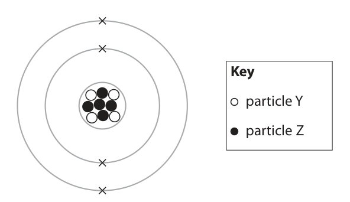

**Mark scheme answer**

> C Neutron
> The only correct answer is C because the nucleus
> contains protons and neutrons. Protons are
> identified as the white dots
> A is not correct because electrons occur in the
> shells
> B is not correct because a molecule is not a particle
> found in the nucleus
> D is not correct because the nucleus contains
> protons and neutrons

- **(1)** Answer C: a neutron

### 1(b) [1]

Which of these has the smallest mass?

- **(A)** an electron  ✔
- **(B)** a neutron
- **(C)** a nucleus
- **(D)** a proton

**Mark scheme answer**

> A Electron
> The only correct answer is A because electrons have
> a relative mass of 1/1836 compared to a proton or a
> neutron
> B is not correct because a neutron has a relative
> mass of 1
> C in not correct because the nucleus contains 4
> protons and 5 neutrons
> D is not correct because a proton has a relative
> mass of 1

- **(1)** Answer A: an electron

### 1(c) [1]

What is the mass number of this atom?

- **(A)** 4
- **(B)** 5
- **(C)** 9  ✔
- **(D)** 13

**Mark scheme answer**

> C9
> The only correct answer is C because the mass
> number is the sum of the protons and neutrons
> A is not correct because the atomic number is 4
> B is not correct because 5 is the number of
> neutrons
> D is not correct because 13 is the total number of
> protons, neutrons and electrons

- **(1)** Answer C: 9

### 1(d) [1]

What is the atomic number of this atom?

- **(A)** 4  ✔
- **(B)** 5
- **(C)** 9
- **(D)** 13

**Mark scheme answer**

> A4
> The only correct answer is A because the atomic
> number is equal to the number of protons which is 4
> B is not correct because 5 is the number of
> neutrons
> C is not correct because 9 is the total number of
> particles in the nucleus
> D is not correct because 13 is the total number of
> protons, neutrons and electrons

- **(1)** Answer A: 4

### 1(e)(i) [1]

Identify the element that contains this atom.

**Mark scheme answer**

> beryllium/Be

- **(1)** beryllium/Be

### 1(e)(ii) [1]

State what is formed when this atom loses its outer shell electrons.

**Mark scheme answer**

> (positive) ion ALLOW ecf from the
> element given in (e)(i)
> ACCEPT any positive
> beryllium ion (or other
> ecf ion)
> REJECT any negative
> ion

- **(1)** (positive) ion ALLOW ecf from the

## Question 2 (7 marks)

This question is about states of matter.

**(a)** The diagram shows how the particles of a substance are arranged in two different states. solid liquid gas

### 2(a)(i) [1]

Complete the diagram to show how particles are arranged in the liquid state.

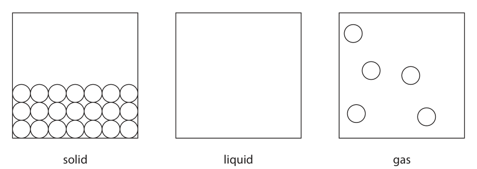

**Mark scheme answer**

> Particles should be close together and should fill ALLOW particles filling
> from the bottom of the box, some particles should the whole box
> touch IGNORE the size of the
> particles
> REJECT a regular
> arrangement

- **(1)** Particles should be close together and should fill ALLOW particles filling

### 2(a)(ii) [1]

Identify the state of matter in which the particles have the most energy.

**Mark scheme answer**

> Gas ALLOW gaseous

- **(1)** Gas ALLOW gaseous

### 2(b) [3]

The state symbols (s), (l), (g) and (aq) are often used in chemistry. The table shows some physical changes. Complete the table by giving the state symbol before and after each change. State symbol Physical change before change after change water evaporates crystals of iodine sublime ice melts

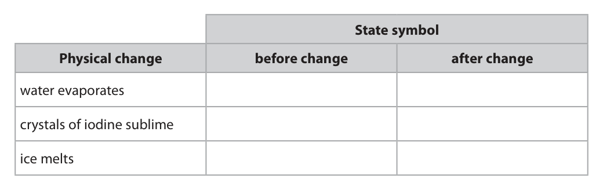

**Mark scheme answer**

> M1 (water evaporates) l to g ALLOW words for M1,
> M2 and M3
> M2 (crystals of iodine sublime) s to g
> M3 (ice melts) s to l

- **(1)** (water evaporates) l to g ALLOW words for M1,
- **(1)** (crystals of iodine sublime) s to g
- **(1)** (ice melts) s to l

### 2(c) [2]

Explain why hot water evaporates more quickly than cold water.

**Mark scheme answer**

> M1 (particles / molecules have) more energy ALLOW water has more
> energy
> ALLOW (particles /
> molecules have) move
> faster
> IGNORE vibrate more
> M2 to overcome / break the forces (between ALLOW to overcome /
> water molecules) break the bonds
> (between water
> molecules) OR
> to break away from one
> another OR so escape
> more easily
> IGNORE references to
> collisions or activation
> energy

- **(1)** (particles / molecules have) more energy ALLOW water has more
- **(1)** to overcome / break the forces (between ALLOW to overcome /

## Question 3 (9 marks)

The Group 7 elements are called halogens. Halogens form compounds called halides. Three of the halogens are represented by the formulae X2 , Y2 and Z2 Solutions of these halogens are added separately to solutions of sodium halides, NaX, NaY and NaZ. The table shows whether or not a reaction occurs. X2 Y2 Z2 NaX no yes yes NaY no no yes NaZ no no no

**(d)** A teacher uses this apparatus to demonstrate the reaction between chlorine gas and iron wool. The teacher does the reaction in a fume cupboard. iron wool unreacted chlorine chlorine heat

### 3(a) [1]

Use the information in the table to deduce the order of reactivity of the halogens X2 , Y2 and Z2 most reactive least reactive

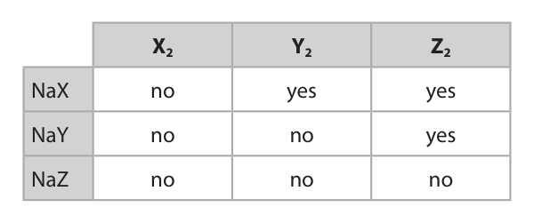

**Mark scheme answer**

> Most Z2 ALLOW Z
> Y2 Y
> Least X2 X
> ALLOW lower case
> letters
> IGNORE size of number
> IGNORE any names
> given

- **(1)** Most Z2 ALLOW Z

### 3(b) [1]

An aqueous solution of halogen Y2 is orange. This solution is decolourised when it reacts with an alkene. Deduce the identity of halogen Y2

**Mark scheme answer**

> bromine ALLOW bromine water
> OR bromine solution /
> Br / Br2
> REJECT bromide

- **(1)** bromine ALLOW bromine water

### 3(c)(i) [3]

The table shows some physical properties of the halogens. Complete the table by predicting a boiling point for chlorine, the state of fluorine at room temperature and the colour of astatine. State at Halogen Boiling point in °C Colour room temperature fluorine −188 yellow chlorine gas green bromine 59 liquid red-brown iodine sublimes solid grey astatine 337 solid

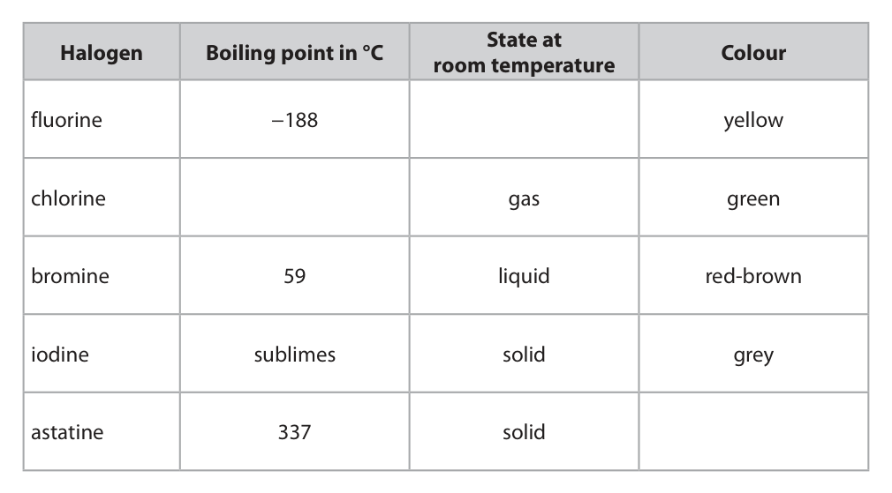

**Mark scheme answer**

> (Fluorine) gas / vapour
> (chlorine) range between -150°C to 10°C inclusive
> (Astatine) dark grey / black REJECT blue-black

- **(3)** (Fluorine) gas / vapour

### 3(c)(ii) [1]

Why do the halogens have similar chemical properties?

- **(A)** they are non-metals
- **(B)** they are molecules
- **(C)** they have the same number of outer shell electrons  ✔
- **(D)** they are in the same period of the Periodic Table

**Mark scheme answer**

> 1
> C – the halogens have the same number
> of outer shell electrons.
> The only correct answer is C because the halogens
> are in group 7 and have similar reactions because
> they have the same number of electrons in their
> outer shells.
> A is not correct because the fact halogens are non-
> metals does not make them react in a similar way.
> B is not correct because the fact halogens are
> molecules does not make them react in a similar
> way.
> D is not correct because elements in the same
> period have different numbers of outer shell
> electrons and react differently.

- **(1)** Answer C: they have the same number of outer shell electrons

### 3(d)(i) [1]

Suggest why the teacher does the reaction in a fume cupboard.

**Mark scheme answer**

> Chlorine is toxic / poisonous IGNORE harmful /
> dangerous / irritant
> IGNORE any reference
> to products

- **(1)** Chlorine is toxic / poisonous IGNORE harmful /

### 3(d)(ii) [2]

The product of the reaction between iron and chlorine is iron(III) chloride. The ions in iron(III) chloride are Fe3+ and Cl− Use this information to give the chemical equation for this reaction.

**Mark scheme answer**

> M1 FeCl3 ALLOW correct charges
> on the ions
> M2 2Fe + 3Cl2 →2FeCl3 REJECT incorrect
> capitals
> REJECT large or super-
> script 3
> M2 rest of the equation balanced ALLOW multiples or
> fractions for M2
> M2 dep on M1

- **(2)** M1 FeCl3 ALLOW correct charges

## Question 4 (9 marks)

This question is about ammonium chloride.

**(d)** The diagram shows the formation of ammonium chloride in a glass tube. cotton wool soaked in cotton wool soaked in concentrated hydrochloric acid ammonium chloride concentrated ammonia solution

### 4(a) [1]

Give the formula of the ammonium ion.

**Mark scheme answer**

> NH4+ ALLOW NH4+1 and NH41+

- **(1)** NH4+ ALLOW NH4+1 and NH41+

### 4(b) [3]

Describe a test to show that ammonium chloride contains ammonium ions.

**Mark scheme answer**

> M1 add sodium hydroxide solution (and warm)
> M2 (test the gas with damp) red litmus ALLOW (test the gas
> with damp) universal
> indicator
> M3 turns blue If universal indicator is
> used allow blue /
> purple for M3
> M3 dep on litmus or
> universal indicator in
> M2
> OR
> M2 expose the gas to concentrated hydrochloric
> acid
> M3 white smoke produced
> If sodium hydroxide
> solution is not added
> max = 1

- **(3)** M1 add sodium hydroxide solution (and warm)

### 4(c) [1]

The equation shows the thermal decomposition of ammonium chloride. NH4Cl(s) U NH3(g) + HCl(g) State what the U symbol indicates about this reaction.

**Mark scheme answer**

> (the reaction is) reversible ACCEPT reaction that
> goes both ways / both
> forwards and backwards
> reactions occur
> IGNORE references to
> equilibrium

- **(1)** (the reaction is) reversible ACCEPT reaction that

### 4(d)(i) [2]

Explain how the mean speed of ammonia molecules compares with the mean speed of hydrogen chloride molecules.

**Mark scheme answer**

> M1 (molecules / particles of) ammonia move /
> diffuse faster
> M2 because the ammonium chloride forms near(er) IGNORE references to
> to the HCl OR because the ammonia has travelled the masses / sizes of
> further (in the same time) the particles

- **(1)** (molecules / particles of) ammonia move /
- **(1)** because the ammonium chloride forms near(er) IGNORE references to

### 4(d)(ii) [2]

Gas particles travel very quickly. Give two reasons why it takes several minutes for the ammonium chloride to form. 1 2

**Mark scheme answer**

> Any two from:
> M1 (gas particles) move in random directions /
> don’t travel in straight lines OWTTE
> M2 (gas particles) collide with air / other particles ALLOW air / other
> particles slow them
> down
> M3 (gas particles) collide with the walls / sides (of
> the tube) OWTTE
> IGNORE any references
> to rate of reaction /
> collisions

- **(2)** Any two from:

## Question 5 (5 marks)

A teacher uses the reaction between phosphorus and oxygen to calculate the percentage of oxygen in air. She uses this apparatus and excess phosphorus. piece of phosphorus on a wire scale in 0.5 cm3 divisions glass tube full of air water The volume of gas in the tube decreases as the phosphorus reacts with oxygen. The teacher measures the volume of gas in the tube at one-minute intervals. The table shows the teacher’s results. Volume of gas in tube Time in minutes in cm3 0 48.5 1 41.0 2 38.0 4 37.5 5 37.0 6 37.0 7 37.0

### 5(a) [1]

State how the results show that all the oxygen has reacted.

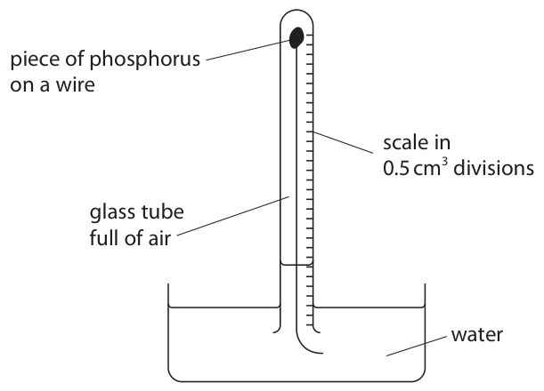

**Mark scheme answer**

> Results are the same at the end ALLOW there is a
> constant volume in the
> tube
> ALLOW the volume of
> gas stops decreasing
> ALLOW no change after
> 4 / 5 minutes
> IGNORE references to
> time
> REJECT the volume of
> gas stops increasing

- **(1)** Results are the same at the end ALLOW there is a

### 5(b) [1]

Give one change to this experiment that would make the results more accurate.

**Mark scheme answer**

> (use a glass tube / scale with) smaller divisions. ALLOW use a glass tube
> / scale with 0.1cm3
> divisions
> ALLOW use a smaller
> scale
> IGNORE references to
> repeating the
> experiment
> IGNORE references to
> temperature

- **(1)** (use a glass tube / scale with) smaller divisions. ALLOW use a glass tube

### 5(c) [3]

Use the results to calculate the percentage of oxygen in air. Give your answer to one decimal place. percentage = %

**Mark scheme answer**

> M1 Volume of oxygen = 11.5(cm3) Correct answer to 1 dp
> with or without working
> scores 3
> M2 (11.5 ÷ 48.5) x 100 ALLOW ecf from M1
> M3 23.7% M3 must be to 1dp

- **(1)** Volume of oxygen = 11.5(cm3) Correct answer to 1 dp
- **(1)** (11.5 ÷ 48.5) x 100 ALLOW ecf from M1
- **(1)** 23.7% M3 must be to 1dp

## Question 6 (12 marks)

The reaction between magnesium and copper(II) sulfate solution is exothermic. This apparatus is used to measure the temperature increase when excess magnesium is added to 100 cm3 of copper(II) sulfate solution. magnesium powder thermometer 100 cm3 copper(II) sulfate solution

**(b)** The temperature at the start of the reaction is 20.2 °C. The maximum temperature recorded is 56.3 °C.

**(c)** The reaction between zinc and copper(II) sulfate solution is also exothermic.

### 6(a)(i) [1]

State why a reaction occurs when magnesium is added to copper(II) sulfate solution.

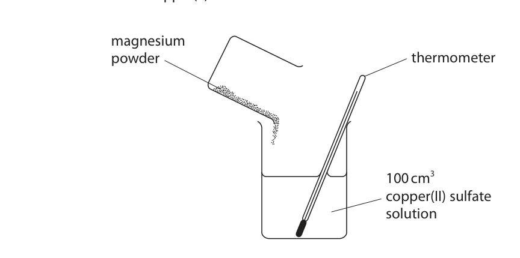

**Mark scheme answer**

> magnesium is more reactive than copper ALLOW magnesium can
> displace copper
> ALLOW magnesium is
> higher than copper in
> the reactivity series
> REJECT magnesium is
> more reactive than
> copper(II) or Cu2+ or
> copper sulfate

- **(1)** magnesium is more reactive than copper ALLOW magnesium can

### 6(a)(ii) [1]

Complete the word equation for this reaction. magnesium + copper(II) sulfate o +

**Mark scheme answer**

> magnesium sulfate + copper Both are required for
> the mark. Either order.
> REJECT copper(II)
> IGNORE any chemical
> formulae given

- **(1)** magnesium sulfate + copper Both are required for

### 6(b)(i) [2]

Calculate the heat energy change, in joules, for the reaction. [mass of 1.00 cm3 of solution = 1.00 g] [c for the solution = 4.2 J/g/ °C] heat energy change = J

**Mark scheme answer**

> M1 Temperature rise = 36.1(°C) Correct answer with or
> without working scores
> 2
> M2 15 162J ALLOW ecf from M1
> ALLOW 2 or more
> significant figures
> IGNORE negative sign

- **(1)** Temperature rise = 36.1(°C) Correct answer with or
- **(1)** 15 162J ALLOW ecf from M1

### 6(b)(ii) [2]

Explain why it is better to use a polystyrene cup rather than a glass beaker in this experiment.

**Mark scheme answer**

> An explanation that links any two of the following
> points
> M1 polystyrene is an insulator ALLOW polystyrene is
> not a (good) conductor
> of heat
> ALLOW polystyrene is a
> poor conductor of heat
> M2 (so) reduces heat loss (to the surroundings) ALLOW prevents heat
> OWTTE loss
> ALLOW keeps heat in
> M3 temperature rise/change/reading will be closer ALLOW temperature
> to true value OWTTE rise/change/reading
> will be more
> accurate/valid

- **(2)** An explanation that links any two of the following

### 6(c)(i) [3]

A mass of 0.500 g of zinc is reacted with an excess of copper(II) sulfate solution. The heat energy change is 1.67 kJ. Calculate the molar enthalpy change, ΔH, in kJ/mol. Include a sign in your answer. Give your answer to three significant figures. ΔH = kJ/mol

**Mark scheme answer**

> M1 calculate the amount, in moles, of zinc
> M2 divide Q by the amount in moles M2 subsumes M1
> M3 give the answer to three significant figures with Correct answer of -217
> a - sign with or without working
> scores 3 marks.
> Example calculation
> M1 0.500 ÷ 65 OR 0.00769 Allow ECF throughout
> M2 1.67 ÷ 0.00769 OR 217 (kJ/mol)
> M3 -217 (kJ/mol)
> OR
> M1 1.67 ÷ 0.5 OR 3.34 kJ/g)
> M2 3.34 × 65 OR 217 (kJ/mol)
> M3 -217 (kJ/mol)

- **(3)** M1 calculate the amount, in moles, of zinc

### 6(c)(ii) [3]

The ionic equation for the reaction between zinc and copper(II) sulfate is Zn(s) + Cu2+(aq) o Zn2+(aq) + Cu(s) Explain why this is a redox reaction.

**Mark scheme answer**

> M1 zinc is oxidised and Cu2+ is reduced ALLOW zinc is oxidised
> and copper(sulfate) is
> reduced in M1
> ALLOW oxidation and
> reduction occur
> M2 Zinc loses electrons ALLOW references to
> changes in oxidation
> number for M2 and M3
> M3 Cu2+ gains electrons Must mention copper
> ions for M3

- **(1)** zinc is oxidised and Cu2+ is reduced ALLOW zinc is oxidised
- **(1)** Zinc loses electrons ALLOW references to
- **(1)** Cu2+ gains electrons Must mention copper

## Question 7 (9 marks)

A student investigates the reaction between sodium hydroxide solution and hydrochloric acid. He uses this method. Step 1 add 50 cm3 of dilute hydrochloric acid to a conical flask Step 2 add a 5 cm3 portion of sodium hydroxide solution to the conical flask Step 3 test the pH of the mixture using both universal indicator paper and a pH meter The student repeats step 2 and step 3 until a total of 50 cm3 of sodium hydroxide solution has been added.

**(b)** Graph 1 shows how the pH of the mixture changes as the sodium hydroxide solution is added. pH 0 10 20 30 40 50 Volume of sodium hydroxide solution in cm3 Graph 1

### 7(a)(i) [1]

State the piece of apparatus that should be used to measure 50 cm3 of hydrochloric acid.

**Mark scheme answer**

> Measuring cylinder / burette / (volumetric)
> pipette

- **(1)** Measuring cylinder / burette / (volumetric)

### 7(a)(ii) [1]

Name the type of reaction that occurs between hydrochloric acid and sodium hydroxide.

**Mark scheme answer**

> Neutralisation ACCEPT exothermic
> IGNORE base or alkali

- **(1)** Neutralisation ACCEPT exothermic

### 7(b)(i) [1]

Determine the pH after 40 cm3 of sodium hydroxide solution has been added.

**Mark scheme answer**

> 12.4

- **(1)** 12.4

### 7(b)(ii) [2]

Suggest the colour of the universal indicator paper when these volumes of sodium hydroxide solution have been added. 15 cm3 30 cm3

**Mark scheme answer**

> 15cm3 - red/orange
> 30cm3 - blue/purple

- **(2)** 15cm3 - red/orange

### 7(b)(iii) [1]

Give the formula of the ion that causes sodium hydroxide to be alkaline.

**Mark scheme answer**

> OH- / hydroxide (ion) REJECT OH

- **(1)** OH- / hydroxide (ion) REJECT OH

### 7(c) [3]

Another student investigates how the temperature changes when the sodium hydroxide solution is added to the hydrochloric acid. The hydrochloric acid and the sodium hydroxide solution are at the same temperature at the start of the investigation. The student records the temperature of the mixture after adding each 5 cm3 portion of sodium hydroxide solution. Graph 2 shows her results. Temperature in °C 0 5 10 15 20 25 30 35 40 45 50 Volume of sodium hydroxide solution in cm3 Graph 2 Explain the shape of graph 2.

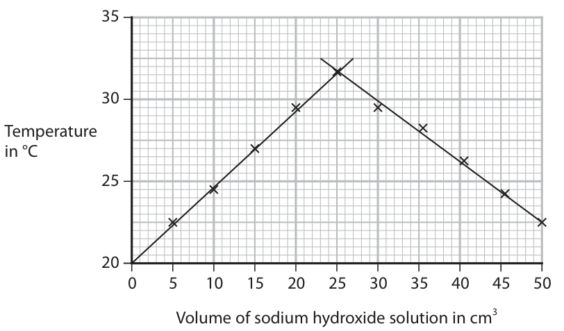

**Mark scheme answer**

> M1 the reaction is exothermic (therefore the ALLOW the reaction
> temperature rises) gives out heat (energy)
> or thermal energy
> IGNORE energy alone
> M2 (after 25cm3 of sodium hydroxide) the reaction ALLOW (after 25cm3 of
> is complete OWTTE sodium hydroxide)
> neutralisation happens
> M3 so adding more sodium hydroxide / liquid / ALLOW so no more heat
> solution cools the mixture down (energy) or thermal
> energy is given out
> OWTTE
> IGNORE energy alone

- **(1)** the reaction is exothermic (therefore the ALLOW the reaction
- **(1)** (after 25cm3 of sodium hydroxide) the reaction ALLOW (after 25cm3 of
- **(1)** so adding more sodium hydroxide / liquid / ALLOW so no more heat

## Question 8 (14 marks)
**(c)** Solid calcium chloride does not conduct electricity. Aqueous solutions of calcium chloride do conduct electricity. A student uses this method to investigate how the conductivity of a solution changes when calcium chloride is dissolved in pure water. Step 1 add 100 cm3 of pure water to a beaker Step 2 add one spatula of solid calcium chloride to the beaker Step 3 stir the solution Step 4 measure the conductivity of the solution Step 5 repeat until nine spatulas of solid calcium chloride have been added The table shows the student’s results. Number of spatulas Conductivity of solution of calcium chloride in arbitrary units 0 0 1 6 2 12 3 12 4 24 5 30 6 36 7 36 8 36 9 36

### 8(a) [3]

The diagram shows the arrangement of electrons in an atom of calcium and in an atom of chlorine. Ca Cl Describe, in terms of electrons, what happens when calcium reacts with chlorine to form the ionic compound calcium chloride, CaCl2

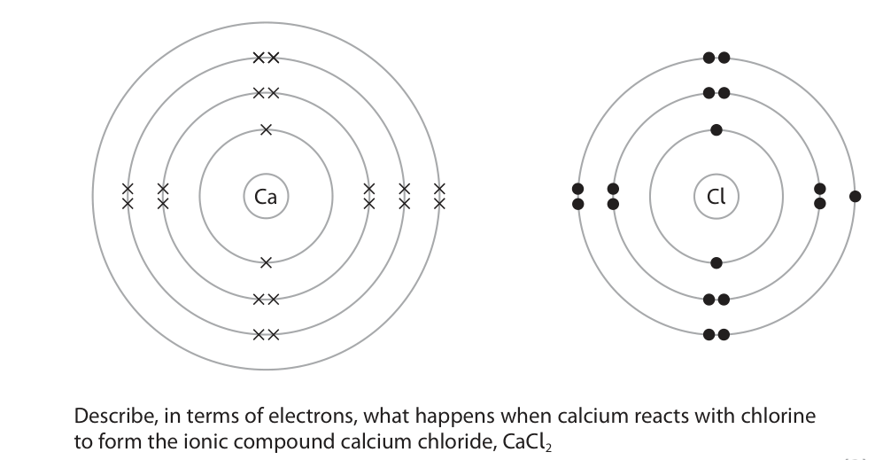

**Mark scheme answer**

> M1 calcium loses electrons IGNORE references to
> redox
> M2 chlorine gains electrons Allow 1 mark from M1
> and M2 for electron
> transfer from chlorine
> to calcium
> M3 two atoms of chlorine each gain one electron If chlorine molecules
> are gaining electrons do
> OR not award M3
> M3 calcium loses 2 electrons and chlorine gains 1
> electron
> Any reference to
> sharing electrons or
> covalent or metallic
> bonding scores 0

- **(3)** M1 calcium loses electrons IGNORE references to

### 8(b) [4]

Describe tests to show that an aqueous solution of calcium chloride contains calcium ions and chloride ions. calcium ions chloride ions

**Mark scheme answer**

> (test for Ca2+ ions)
> M1 flame test (allow description of a flame test)
> M2 orange-red flame colour ALLOW brick-red
> IGNORE orange / red
> alone
> M2 dep on M1
> ALLOW M1 add sodium
> hydroxide
> ALLOW M2 (slight)
> white precipitate
> (reject precipitate
> dissolves in excess
> sodium hydroxide)
> (test for Cl- ions)
> M3 add silver nitrate IGNORE reference to
> nitric acid
> REJECT hydrochloric
> acid or sulfuric acid
> M4 white precipitate M4 dep on silver nitrate
> in M3

- **(1)** flame test (allow description of a flame test)
- **(1)** orange-red flame colour ALLOW brick-red
- **(1)** add silver nitrate IGNORE reference to
- **(1)** white precipitate M4 dep on silver nitrate

### 8(c)(i) [3]

Plot the results on the grid and draw two straight lines of best fit. Ignore the anomalous result. Conductivity of solution 20 in arbitrary units 0 1 2 3 4 5 6 7 8 9 Number of spatulas of calcium chloride

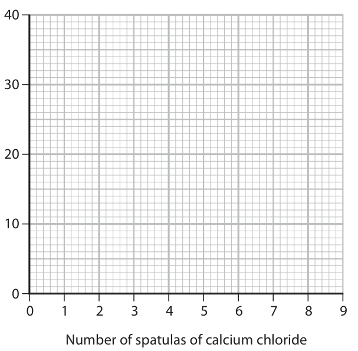

**Mark scheme answer**

> M1 and M2 all points correct ± half a square One plotting error
> scores M1
> M3 2 straight lines of best fit ignoring the
> anomalous point

- **(3)** M1 and M2 all points correct ± half a square One plotting error

### 8(c)(ii) [1]

State the trend shown on the graph for the first six spatulas of calcium chloride.

**Mark scheme answer**

> the conductivity is (directly) proportional (to the
> number of spatulas of calcium chloride added)
> OR
> the conductivity increases (as the number of
> spatulas of calcium chloride increases)

- **(1)** the conductivity is (directly) proportional (to the

### 8(c)(iii) [1]

Suggest an error the student could have made to cause the anomalous result.

**Mark scheme answer**

> Any one from:
> M1 The student took the reading before adding the
> calcium chloride
> M2 The student forgot to stir the mixture OR did
> not stir the mixture properly
> IGNORE any references
> to human error

- **(1)** Any one from:

### 8(d) [2]

Describe another way to make solid calcium chloride conduct electricity.

**Mark scheme answer**

> M1 Heat (the calcium chloride)
> M2 until molten / melts IGNORE references to
> electrons / ions

- **(1)** Heat (the calcium chloride)
- **(1)** until molten / melts IGNORE references to

## Question 9 (13 marks)

This question is about alkenes and polymers.

**(b)** Ethene is used to make poly(ethene).

### 9(a)(i) [2]

Ethene (C2H4) can be represented by different types of formula. Complete the table by giving the missing information. Molecular formula C 2 H4 Empirical formula General formula

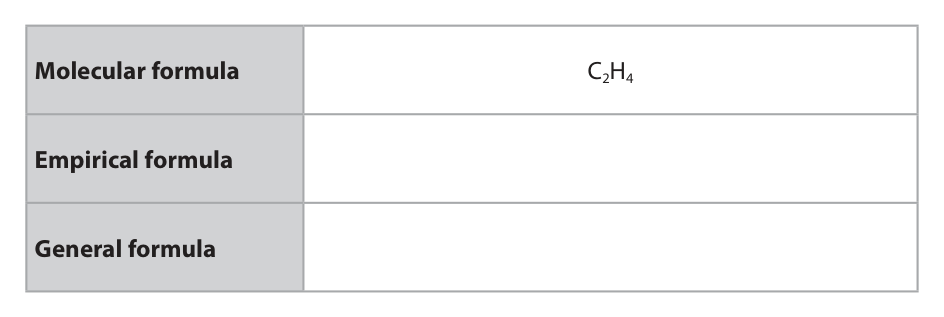

**Mark scheme answer**

> M1 (Empirical formula) CH2 ALLOW sub and super
> script numbers for M1
> and M2
> M2 (General formula) CnH2n ALLOW letters other
> than n
> ALLOW capital letters

- **(1)** (Empirical formula) CH2 ALLOW sub and super
- **(1)** (General formula) CnH2n ALLOW letters other

### 9(a)(ii) [2]

Ethene is a member of the homologous series of alkenes. All members of the same homologous series have the same general formula. Give two other characteristics of a homologous series. 1 2

**Mark scheme answer**

> Any two from:
> M1 each member differs from the next by a CH2
> group OWTTE
> M2 (each member has) same functional group
> M3 (each member has) similar/same chemical ACCEPT react in
> properties / similar/same (chemical) reactions similar/same way
> M4 trend in physical properties (between ACCEPT named
> successive members) physical property,
> e.g. boiling point
> REJECT similar/same
> physical properties

- **(2)** Any two from:

### 9(b)(i) [1]

State the type of polymerisation used to form poly(ethene).

**Mark scheme answer**

> addition ALLOW additional
> REJECT condensation

- **(1)** addition ALLOW additional

### 9(b)(ii) [2]

Complete the equation for the polymerisation of ethene.

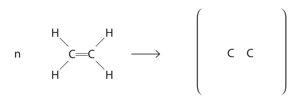

**Mark scheme answer**

> 2
> M1 Single bond between the two carbons, 4
> hydrogens joined by single bonds
> M2 trailing bonds through the brackets and the n ALLOW n in any
> to the right position outside the
> bracket to the right of
> the structure.
> ALLOW capital N

- **(1)** Single bond between the two carbons, 4
- **(1)** trailing bonds through the brackets and the n ALLOW n in any

### 9(b)(iii) [5]

Poly(ethene) is used to make plastic bags. Corn starch from plants can also be used to make polymers for plastic bags. The table gives some information about poly(ethene) and polymers made from corn starch. Poly(ethene) Polymers from corn starch Cost per tonne £1500 £3700 Relative strength 100 50 Time to decompose estimated 450 years 3–6 months Use the information in the table and your knowledge to discuss the advantages and disadvantages of using poly(ethene) to make plastic bags.

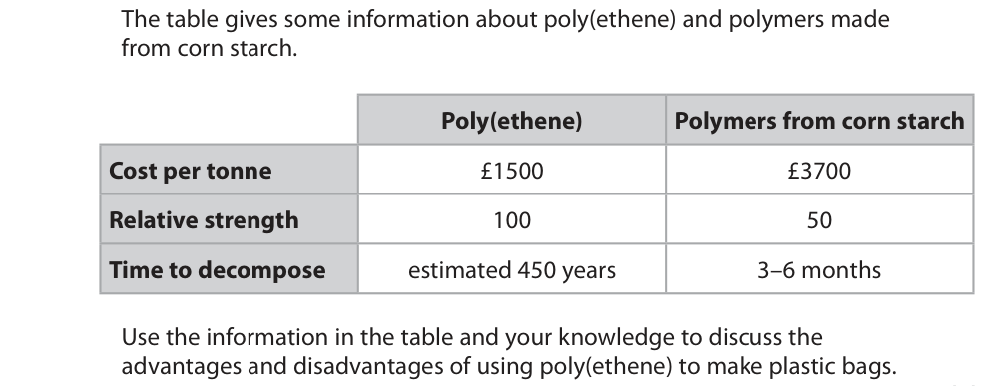

**Mark scheme answer**

> Any 5 points from: If only advantages or
> disadvantages given,
> max 3 marks
> M1 Poly(ethene) is cheaper than polymers from
> corn starch
> IGNORE durable
> M2 Poly(ethene) is stronger than polymers from
> corn starch
> M3 Poly(ethene) frees up land to grow food crops
> M4 Poly(ethene) comes from (cracking of certain
> fractions from) crude oil
> M5 Poly(ethene) is non-renewable OR ethene is a
> finite source
> M6 Poly(ethene) is inert
> M7 poly(ethene) is non-biodegradable
> M8 poly(ethene) takes longer to decompose
> M9 Disposal of poly(ethene) is a problem (in
> landfill)
> M10 Poly(ethene) causes problems with litter
> M11 Burning poly(ethene) (could) create toxic
> fumes / greenhouse gases

- **(5)** Any 5 points from: If only advantages or

### 9(c) [1]

The diagram shows the repeat unit of another polymer. H H C H H C C H H Draw the displayed formula of the monomer used to make this polymer.

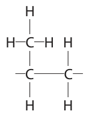

**Mark scheme answer**

> Must show every bond.
> IGNORE bond angles
> IGNORE n
> IGNORE brackets
> REJECT trailing bonds

- **(1)** Must show every bond.

## Question 10 (11 marks)

This question is about carbon and its compounds.

**(b)** The diagram shows three different structures of carbon. diamond graphite C60 fullerene

### 10(a)(i) [2]

Draw a dot-and-cross diagram to show the outer shell electrons in a molecule of carbon dioxide, CO2

**Mark scheme answer**

> M1 four electrons between the carbon and each
> oxygen
> M2 rest of molecule correct M2 dep on M1

- **(1)** four electrons between the carbon and each
- **(1)** rest of molecule correct M2 dep on M1

### 10(a)(ii) [2]

The atoms in carbon dioxide are held together by covalent bonds. Describe the forces of attraction in a covalent bond.

**Mark scheme answer**

> M1 shared pair(s) of electrons
> M2 attracted to (two) nuclei REJECT nucleus. Must
> be plural for M2.
> M2 dep on mention of
> electrons in M1

- **(1)** shared pair(s) of electrons
- **(1)** attracted to (two) nuclei REJECT nucleus. Must

### 10(b)(i) [2]

Explain why graphite conducts electricity.

**Mark scheme answer**

> M1 Graphite has delocalised electrons IGNORE sea of electrons
> IGNORE free electrons
> IGNORE number of
> electrons
> M2 (delocalised electron(s)) can move or flow IGNORE references to
> (throughout the structure) carrying a charge or
> current
> IGNORE references to
> layers
> M2 dep on mentioning
> electrons in M1
> Any mention of ions
> scores 0

- **(1)** Graphite has delocalised electrons IGNORE sea of electrons
- **(1)** (delocalised electron(s)) can move or flow IGNORE references to

### 10(b)(ii) [5]

Explain why diamond has a much higher melting point than C60 fullerene. Refer to structure and bonding in your answer.

**Mark scheme answer**

> M1 (diamond) giant covalent ALLOW macromolecular
> ALLOW giant structure
> if M2 is scored
> IGNORE tetrahedral
> structure
> REJECT molecules of
> diamond
> M2 (in melting diamond) covalent bonds are broken ALLOW description of
> covalent bonds
> M3 (C60) (simple) molecular structure ALLOW molecules of C60
> M4 (in melting C60) intermolecular forces (of
> attraction) are overcome
> M5 more energy is needed to break covalent bonds ALLOW strong covalent
> (in diamond) than intermolecular forces (in C60) bonds and weak
> intermolecular forces
> (or attraction)
> ACCEPT breaking bonds
> in C60 if intermolecular
> forces clearly
> mentioned
> Mention of
> intermolecular forces in
> diamond no M2 or M5
> Mention of breaking
> covalent bonds in C60 no
> M4 or M5

- **(5)** M1 (diamond) giant covalent ALLOW macromolecular

## Question 11 (15 marks)

This question is about the reduction of metal oxides.

**(b)** A teacher uses this apparatus to demonstrate the reaction between a different oxide of copper and methane. excess methane burning methane gas oxide of copper heat in weighing boat

**(c)** Iron forms when iron(III) oxide is heated with carbon. The equation for the reaction is Fe2O3 + 3C o 2Fe + 3CO

### 11(a) [2]

Solid oxides of copper can be reduced by reacting them with methane gas. Complete the equation for the reaction between copper(II) oxide and methane. Include state symbols CuO( ) + CH4( ) o Cu( ) + CO2( ) + H2O( )

**Mark scheme answer**

> 4 CuO (s)+ CH4 (g)→ 4 Cu (s)+ CO2 (g) + 2 H2O (l/g) ALLOW multiples and
> fractions
> M1 correct balancing
> M2 correct state symbols

- **(1)** correct balancing
- **(1)** correct state symbols

### 11(b)(i) [4]

The teacher heats the oxide of copper until the reaction is complete. The table shows the teacher’s results. Mass in g empty weighing boat 15.05 weighing boat + oxide of copper 18.63 weighing boat + copper 18.23 Use the teacher’s results to show that the empirical formula of this oxide of copper is Cu2O

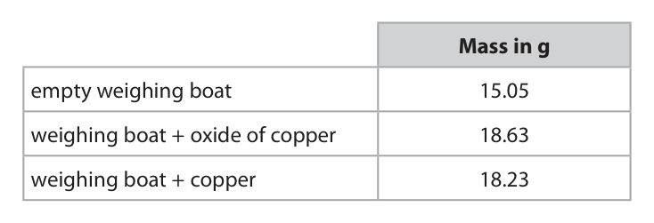

**Mark scheme answer**

> M1 Mass copper 3.18g and mass oxygen 0.40g
> M2 Moles copper = 3.18/63.5 OR 0.0500 moles
> M3 Moles oxygen = 0.40/16 OR 0.025 moles M2 and M3 allow ecf
> from M1
> M4 Ratio of moles Cu:O is 2:1 M4 is dep on M2 and M3

- **(1)** Mass copper 3.18g and mass oxygen 0.40g
- **(1)** Moles copper = 3.18/63.5 OR 0.0500 moles
- **(1)** Moles oxygen = 0.40/16 OR 0.025 moles M2 and M3 allow ecf
- **(1)** Ratio of moles Cu:O is 2:1 M4 is dep on M2 and M3

### 11(b)(ii) [1]

The teacher wears safety glasses and a lab coat during the demonstration. Give one other safety precaution that she should take.

**Mark scheme answer**

> Any one from:
> M1 Use a safety screen ALLOW tie hair back
> M2 Position the class some distance from the ALLOW wear heat-proof
> apparatus gloves
> M3 Do the experiment in a fume cupboard
> M4 Set fire to the (excess) methane gas straight
> away

- **(1)** Any one from:

### 11(c)(i) [1]

State how the equation shows that iron(III) oxide is reduced.

**Mark scheme answer**

> (Iron (III) oxide) loses oxygen ALLOW iron loses
> oxygen
> IGNORE any reference
> to electrons.

- **(1)** (Iron (III) oxide) loses oxygen ALLOW iron loses

### 11(c)(ii) [1]

State why carbon monoxide should not be released into the atmosphere.

**Mark scheme answer**

> Carbon monoxide is poisonous / toxic OR carbon ALLOW carbon
> monoxide reduces the ability of the blood to carry monoxide binds to
> oxygen haemoglobin in the
> blood

- **(1)** Carbon monoxide is poisonous / toxic OR carbon ALLOW carbon

### 11(c)(iii) [4]

Calculate the maximum mass, in tonnes, of iron that can be produced when 30.0 tonnes of iron(III) oxide are reacted with an excess of carbon. [1 tonne = 1.0 × 10⁶ g] mass = tonnes

**Mark scheme answer**

> • calculate Mr of Fe2O3 Correct answer of 21
> • calculate the amount, in moles, of Fe2O3 tonnes scores 4 marks
> • calculate the amount, in moles, of Fe with or without working
> • calculate the mass in tonnes of Fe
> Example calculation ALLOW ecf from M1
> (incorrect Mr)
> M1 Mr of Fe2O3 = 160
> M2 n(Fe2O3) = 30.0 x 106 ÷ 160 OR 187,500 moles ALLOW working in
> megamoles
> ALLOW ecf from M1
> M3 n(Fe) = 187,500 x 2 OR 375,000 moles ALLOW working in
> megamoles
> ALLOW ECF from M2
> M4 375,000 x 56 = 21 tonnes ALLOW ecf from M3

- **(1)** Mr of Fe2O3 = 160
- **(1)** n(Fe2O3) = 30.0 x 106 ÷ 160 OR 187,500 moles ALLOW working in
- **(1)** n(Fe) = 187,500 x 2 OR 375,000 moles ALLOW working in
- **(1)** 375,000 x 56 = 21 tonnes ALLOW ecf from M3

### 11(c)(iv) [2]

A mixture of 25 000 mol of iron(III) oxide and 840 000 g of carbon is heated. Use this equation to show that the iron(III) oxide is in excess. Fe2O3 + 3C o 2Fe + 3CO

**Mark scheme answer**

> M1 840,000g is 70,000 moles of carbon
> M2 therefore need 23,333 moles Fe2O3 (but we have
> 25,000 which is an excess)
> OR
> M1 Need 75,000 moles carbon
> M2 900,000g of carbon is needed (and have
> 840,000g of carbon so iron(III) oxide is in excess as
> carbon is the limiting reactant)
> OR
> M1 need 75,000 moles of carbon
> M2 have 840,000÷12 OR 70,000 moles of carbon (so
> iron(III) oxide is in excess as carbon is the limiting
> reactant)

- **(2)** M1 840,000g is 70,000 moles of carbon

