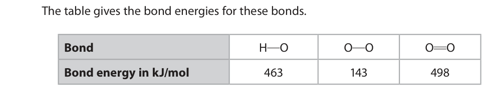
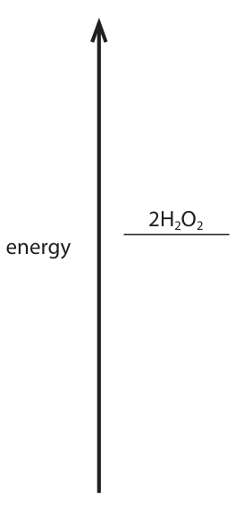

# 4CH1/2C — 2020-01 (official extraction)

> schema `syllabai.official-paper-questions/0.2` · paper_id `pearson-edexcel:international-gcse:chemistry:4ch1:2020-01:4CH1/2C` · qp sha256 `783224a36be5df82…` · extraction is the disclosed baseline (ADR-039)

## Question 1 (5 marks)

This question is about elements, compounds and mixtures.

**(c)** The box gives the names of some substances. air bromine magnesium neon sodium chloride sulfur Choose substances from the box to answer these questions.

### 1(a) [1]

Name the element that burns with a lilac flame.

**Mark scheme answer**

> potassium ALLOW K

- **(1)** potassium ALLOW K

### 1(b) [1]

Name the technique used to separate the mixture of colours in black ink.

**Mark scheme answer**

> (paper) chromatography

- **(1)** (paper) chromatography

### 1(c)(i) [1]

Identify the compound.

**Mark scheme answer**

> sodium chloride ALLOW NaCl

- **(1)** sodium chloride ALLOW NaCl

### 1(c)(ii) [1]

Identify the mixture.

**Mark scheme answer**

> air

- **(1)** air

### 1(c)(iii) [1]

Identify the non‑metal element that is a solid at room temperature.

**Mark scheme answer**

> sulfur ALLOW S

- **(1)** sulfur ALLOW S

## Question 2 (11 marks)

Crude oil is a mixture of hydrocarbons.

**(c)** One of the hydrocarbons in the refinery gas fraction is an alkane with the structural formula CH3CH2CH2CH3

**(d)** One of the alkanes in the gasoline fraction has the displayed formula H H H H H H H H C C C C C C C H H H H H H H H

**(e)** Catalytic cracking is used to convert long‑chain alkanes into shorter‑chain alkanes.

### 2(a) [1]

Name the process used to separate crude oil into fractions.

**Mark scheme answer**

> fractional distillation ACCEPT
> fractionation/fractionating
> IGNORE distillation alone

- **(1)** fractional distillation ACCEPT

### 2(b) [1]

Give one use of the kerosene fraction.

**Mark scheme answer**

> aircraft fuel/jet fuel/paraffin or fuel for lamps/ ALLOW heating oil
> heaters
> ALLOW cooking fuel

- **(1)** aircraft fuel/jet fuel/paraffin or fuel for lamps/ ALLOW heating oil

### 2(c)(i) [1]

Give the name of this alkane.

**Mark scheme answer**

> butane Spelling must be correct

- **(1)** butane Spelling must be correct

### 2(c)(ii) [1]

Calculate the relative molecular mass (Mr) of this alkane. Mr =

**Mark scheme answer**

> (Mr = 4 x 12 + 10 x 1 =) 58

- **(1)** (Mr = 4 x 12 + 10 x 1 =) 58

### 2(d)(i) [1]

Determine the molecular formula of this alkane.

**Mark scheme answer**

> C7H16

- **(1)** C7H16

### 2(d)(ii) [1]

Give the general formula for the alkanes.

**Mark scheme answer**

> CnH2n + 2 ACCEPT different letters
> to n / uppercase

- **(1)** CnH2n + 2 ACCEPT different letters

### 2(e)(i) [1]

Name the catalyst used in catalytic cracking.

**Mark scheme answer**

> alumina / silica ACCEPT aluminium
> oxide / silicon dioxide /
> Al2O3 / SiO2 / zeolite(s) /
> aluminosilicate(s)

- **(1)** alumina / silica ACCEPT aluminium

### 2(e)(ii) [2]

Explain why it is necessary to convert long‑chain alkanes into shorter‑chain alkanes.

**Mark scheme answer**

> An explanation that links the following two points
> M1 greater demand for short chain alkanes (than ALLOW short chain
> long chain alkanes) alkanes are more useful
> (than long chain
> alkanes)
> ALLOW short chain
> alkanes needed for
> specific uses e.g. petrol
> M2 more long-chain alkanes than are needed / too
> great a supply of /surplus of long-chain alkanes
> OR
> not enough short chain alkanes to meet demands

- **(1)** greater demand for short chain alkanes (than ALLOW short chain
- **(1)** more long-chain alkanes than are needed / too

### 2(f) [2]

Catalytic cracking also produces alkenes. C11H24 can undergo cracking to give pentane (C5H12) and two different alkenes. Complete the equation for this cracking reaction. C11H24 → C5H12 + +

**Mark scheme answer**

> (C11H24 → C5H12) + C2H4 + C4H8 alkenes can be in either
> order
> M1 C2H4
> M2 C4H8 ALLOW 1 mark for
> C6H12 / 2C3H6
> / C3H6 + C3H6
> ALLOW correct
> displayed formulae

- **(1)** C2H4
- **(1)** C4H8 ALLOW 1 mark for

## Question 3 (11 marks)

This question is about copper and its compounds.

**(b)** This apparatus is used to investigate the electrolysis of copper(II) sulfate solution with graphite electrodes. power supply + – lamp positive electrode negative electrode copper(II) sulfate solution Copper forms at the negative electrode and oxygen forms at the positive electrode.

### 3(a) [2]

Copper is a metal used for electrical wiring. Explain why copper is a good conductor of electricity.

**Mark scheme answer**

> An explanation that links the following two points
> M1 electrons are delocalised IGNORE sea of electrons
> /free electrons
> M2 (electrons) can move/can flow/are mobile REJECT cations/atoms
> move for both marks
> M2 dep on M1 or mention of
> electrons i.e. ‘electrons
> move’ scores 1 mark

- **(1)** electrons are delocalised IGNORE sea of electrons
- **(1)** (electrons) can move/can flow/are mobile REJECT cations/atoms

### 3(b)(i) [2]

State what would be observed at each electrode. negative electrode positive electrode

**Mark scheme answer**

> M1 brown/pink/pink-brown solid formed ACCEPT brown/pink
> coating/deposit on the
> electrode
> ALLOW red-brown
> REJECT orange
> REJECT precipitate
> M2 bubbles/fizzing/effervescence ALLOW 1 mark if both
> observations correct but at
> incorrect electrodes
> IGNORE gas produced
> /evolved/released
> IGNORE name of gas

- **(1)** brown/pink/pink-brown solid formed ACCEPT brown/pink
- **(1)** bubbles/fizzing/effervescence ALLOW 1 mark if both

### 3(b)(ii) [1]

The ionic half‑equation for the reaction at the negative electrode is Cu2+ + 2e– → Cu State why this is a reduction reaction.

**Mark scheme answer**

> copper ion(s)/Cu2+ gains electrons ACCEPT oxidation state of
> copper goes down / goes
> from +2 to 0
> IGNORE references to loss
> of oxygen
> ALLOW electrons are gained
> REJECT copper/Cu gains
> electrons

- **(1)** copper ion(s)/Cu2+ gains electrons ACCEPT oxidation state of

### 3(b)(iii) [2]

Explain why the copper(II) sulfate solution becomes paler blue during the electrolysis.

**Mark scheme answer**

> An explanation that links the following two points
> M1 the (blue) colour is caused by copper
> ions/Cu2+
> M2 copper ions/Cu2+ are being discharged/ ACCEPT concentration
> removed from the solution of copper ions/Cu2+
> decreases
> ALLOW copper ions/Cu2+
> form copper

- **(1)** the (blue) colour is caused by copper
- **(1)** copper ions/Cu2+ are being discharged/ ACCEPT concentration

### 3(c) [4]

When hydrated copper(II) sulfate crystals are heated, anhydrous copper(II) sulfate forms. A mass of 12.5 g of hydrated copper(II) sulfate crystals is heated in a crucible until all the water of crystallisation is removed. A mass of 8.0 g of anhydrous copper(II) sulfate forms. Show by calculation that the formula of hydrated copper(II) sulfate is CuSO4.5H2O [Mr of CuSO4 = 159.5 Mr of H2O = 18]

**Mark scheme answer**

> • calculate the mass of water removed ACCEPT alternative
> • calculate the amount, in moles, of CuSO4 methods which show
> • calculate the amount, in moles, of water that the answer is 5
> • divide amount of H2O by amount of CuSO4
> Example calculation
> M1 (12.5 – 8.0) = 4.5 (g)
> M2 n(CuSO4) = 8.0 ÷ 159.5 = 0.05(0) (mol)
> M3 n(H2O) = 4.5 ÷ 18 = 0.25 (mol)
> M4 0.25 ÷ 0.05(0) (= 5)

- **(1)** (12.5 – 8.0) = 4.5 (g)
- **(1)** n(CuSO4) = 8.0 ÷ 159.5 = 0.05(0) (mol)
- **(1)** n(H2O) = 4.5 ÷ 18 = 0.25 (mol)
- **(1)** 0.25 ÷ 0.05(0) (= 5)

## Question 4 (9 marks)

A student investigates the reaction between sodium hydroxide solution and dilute sulfuric acid. He does a titration to find the concentration of the sulfuric acid. This is his plan for the titration. There are some mistakes and omissions in his plan. ● rinse a conical flask with the sodium hydroxide solution ● use a measuring cylinder to measure out 25 cm3 of the sodium hydroxide solution and add it to the conical flask ● add a few drops of methyl orange indicator to the conical flask ● rinse a burette with water and then fill it with the sulfuric acid ● add the acid from the burette to the conical flask until the indicator changes colour at the end‑point of the titration ● record the final burette reading

### 4(a) [2]

Give the colour change of the methyl orange indicator at the end‑point. from to

**Mark scheme answer**

> M1 (from) yellow
> M2 (to) orange ACCEPT red
> ALLOW pink
> 1 mark for two correct
> colours in the wrong
> order

- **(1)** (from) yellow
- **(1)** (to) orange ACCEPT red

### 4(b) [4]

Describe four changes that the student could make to improve his plan. 1 2 3 4

**Mark scheme answer**

> A description that makes reference to any four of
> the following points
> M1 he should not rinse flask with sodium hydroxide
> solution or he should rinse flask with water
> M2 he should use a pipette to measure out the ACCEPT he should use a
> sodium hydroxide solution pipette instead of a
> measuring cylinder
> M3 he should not rinse the burette with water
> or he should rinse the burette with sulfuric acid
> M4 he should record the initial burette reading
> M5 he should place a white tile under the flask ALLOW white paper
> M6 he should swirl the flask whilst adding the acid IGNORE stir
> M7 he should add the acid dropwise near the
> end-point
> M8 repeat the titration (to obtain an average/
> concordant results)

- **(4)** A description that makes reference to any four of

### 4(c) [3]

The student then does the titration correctly. He finds that 16.70 cm3 of the dilute sulfuric acid neutralises 25.0 cm3 of sodium hydroxide solution of concentration 0.200 mol/dm3 The equation for the reaction is 2NaOH + H2SO4 → Na2SO4 + 2H2O Calculate the concentration, in mol/dm3, of the sulfuric acid. concentration of sulfuric acid = mol/dm3

**Mark scheme answer**

> • calculate the amount, in moles, of sodium
> hydroxide
> • calculate the amount, in moles, of sulfuric acid
> • calculate the concentration of sulfuric acid
> Example calculation
> M1 n(NaOH) = 0.0250 × 0.200 or 0.005 (mol)
> M2 n(H2SO4) = 0.005 ÷ 2 or 0.0025 (mol) answer to M1 ÷ 2
> M3 concn = (0.0025 ÷ 0.0167) = 0.150 (mol/dm3) answer to M2÷0.0167
> ALLOW 0.1497 or any
> number of sig fig except
> one
> Correct answer without
> working scores 3
> ACCEPT alternative
> methods

- **(1)** n(NaOH) = 0.0250 × 0.200 or 0.005 (mol)
- **(1)** n(H2SO4) = 0.005 ÷ 2 or 0.0025 (mol) answer to M1 ÷ 2
- **(1)** concn = (0.0025 ÷ 0.0167) = 0.150 (mol/dm3) answer to M2÷0.0167

## Question 5 (8 marks)

Oxygen can be prepared from hydrogen peroxide using a catalyst.

**(c)** The equation for the preparation of oxygen from hydrogen peroxide is 2H2O2 → 2H2O + O2 This equation can also be written using displayed formulae to show all the covalent bonds in the molecules. 2H—O—O—H → 2H—O—H + O O The table gives the bond energies for these bonds. Bond H O O O O O Bond energy in kJ/mol 463 143 498

### 5(a) [1]

Which is a correct statement about oxygen?

- **(A)** it burns with a squeaky pop
- **(B)** it relights a glowing splint  ✔
- **(C)** it turns blue litmus red
- **(D)** it turns limewater milky

**Mark scheme answer**

> B it relights a glowing splint
> A is incorrect as this is the test for hydrogen
> C is incorrect as oxygen is not an acidic gas
> D is incorrect as this is the test for carbon dioxide

- **(1)** Answer B: it relights a glowing splint

### 5(b) [2]

Explain how a catalyst increases the rate of a reaction.

**Mark scheme answer**

> An explanation that links the following two points
> M1 provides an alternative pathway OWTTE
> M2 with a lower activation energy OWTTE ACCEPT more collisions
> with energy greater
> than the activation
> energy
> ALLOW lowers the
> energy needed to start
> the reaction

- **(1)** provides an alternative pathway OWTTE
- **(1)** with a lower activation energy OWTTE ACCEPT more collisions

### 5(c)(i) [3]

Use the values in the table to calculate the enthalpy change, ΔH, for the reaction. Include a sign in your answer. ΔH = kJ

**Mark scheme answer**

> • find energy needed to break bonds
> • find energy released when bonds form
> • correct subtraction to find ΔH
> Example calculation
> M1 (4 x 463) + (2 x 143) OR 2138 (kJ) ACCEPT (2 x 143)/286
> for M1
> M2 (4 x 463) + 498 OR 2350 (kJ) and 498 for M2
> IGNORE any signs in M1
> and M2
> M3 — 212 (kJ) OR M1 – M2 correctly evaluated — 212 with or without
> working scores 3
> (+) 212 with or without
> working scores 2

- **(1)** (4 x 463) + (2 x 143) OR 2138 (kJ) ACCEPT (2 x 143)/286
- **(1)** (4 x 463) + 498 OR 2350 (kJ) and 498 for M2
- **(1)** — 212 (kJ) OR M1 – M2 correctly evaluated — 212 with or without

### 5(c)(ii) [2]

Complete the energy level diagram to show the position of the products and the enthalpy change, ΔH, for the reaction. 2H2O2 energy

**Mark scheme answer**

> 2
> Energy 2H2O2
> ¯¯¯¯¯¯¯¯¯¯¯
> ΔH
> 2H2O + O2
> ¯¯¯¯¯¯¯¯¯¯¯
> M1 horizontal line to show products in correct Mark CQ on sign in (i)
> position and correctly labelled
> M2 vertical line in correct position and labelled ΔH ACCEPT double headed
> arrow or arrow pointing
> from reactants level to
> products level
> REJECT arrow pointing
> from products level to
> reactants level
> IGNORE any attempts at
> including activation energy

- **(1)** horizontal line to show products in correct Mark CQ on sign in (i)
- **(1)** vertical line in correct position and labelled ΔH ACCEPT double headed

## Question 6 (11 marks)

Ethanol, C2H5OH, can be manufactured from ethene and steam using a phosphoric acid catalyst.

**(b)** Ethanol burns in a plentiful supply of air to form carbon dioxide and water.

**(d)** Butanedioic acid and ethanediol react together to form a polyester and water.

### 6(a)(i) [2]

State the temperature and pressure used in this manufacturing process. temperature pressure

**Mark scheme answer**

> M1 300 (oC) ACCEPT any
> temperature or range
> 250 to 350 inclusive.
> ACCEPT any correct
> alternative unit and
> quantity
> M2 60 to 70 (atm) ACCEPT any pressure or
> range 60 to 70 inclusive
> ACCEPT any correct
> alternative unit and
> quantity

- **(1)** 300 (oC) ACCEPT any
- **(1)** 60 to 70 (atm) ACCEPT any pressure or

### 6(a)(ii) [1]

Draw the displayed formula of ethanol.

**Mark scheme answer**

> All bonds including bond
> between O and H must
> be shown.

- **(1)** All bonds including bond

### 6(b)(i) [2]

Give the chemical equation for this reaction.

**Mark scheme answer**

> C2H5OH + 3O2 → 2CO2 + 3H2O
> M1 all formulae correct ALLOW C2H6O for
> ethanol
> M2 balancing of correct formulae ACCEPT multiples and
> fractions
> IGNORE state symbols
> even if incorrect
> M2 dep on M1

- **(1)** all formulae correct ALLOW C2H6O for
- **(1)** balancing of correct formulae ACCEPT multiples and

### 6(b)(ii) [1]

When the air supply is limited, incomplete combustion occurs and carbon monoxide forms. State why carbon monoxide is poisonous to humans.

**Mark scheme answer**

> prevents blood from carrying oxygen/ reduces the ALLOW references to
> capacity of blood to carry oxygen OWTTE combining with
> haemoglobin in red
> blood cells or forming
> carboxyhaemoglobin

- **(1)** prevents blood from carrying oxygen/ reduces the ALLOW references to

### 6(c) [1]

When ethanol reacts with ethanoic acid, an ester forms. Give the name of this ester.

**Mark scheme answer**

> ethyl ethanoate ALLOW ethyl acetate

- **(1)** ethyl ethanoate ALLOW ethyl acetate

### 6(d)(i) [1]

Give the name of this type of polymerisation.

**Mark scheme answer**

> condensation (polymerisation)

- **(1)** condensation (polymerisation)

### 6(d)(ii) [3]

Complete the equation. Show only one repeat unit of the polyester. O O HO C CH2CH2 C OH + + HO CH2CH2 OH

**Mark scheme answer**

> ACCEPT
> + 2H2O
> M1 correct ester link for M1 and M2
> M2 rest of polymer structure correct with extension
> bonds
> M3 2H2O If brackets and n
> present equation must
> be fully balanced with n
> in front of each reactant
> and 2nH2O for full
> marks, otherwise max 2
> If dimer is drawn with
> OH at one end and
> COOH at the other a
> mark can be awarded
> for H2O without the 2 as
> this equation is then
> balanced, so M1 and M3
> can be awarded.

- **(1)** correct ester link for M1 and M2
- **(1)** rest of polymer structure correct with extension
- **(1)** 2H2O If brackets and n

## Question 7 (15 marks)

This question is about some Group 2 elements and their compounds.

**(a)** Calcium reacts with water to produce calcium hydroxide and hydrogen gas.

**(c)** When magnesium nitrate is heated, magnesium oxide, nitrogen dioxide and oxygen form. The equation for the reaction is 2Mg(NO3)2(s) → 2MgO(s) + 4NO2(g) + O2(g)

### 7(a)(i) [1]

Give the word equation for this reaction.

**Mark scheme answer**

> calcium + water → calcium hydroxide + hydrogen ACCEPT fully correct
> balanced chemical equation.
> Ca + 2H2O → Ca(OH)2 + H2
> IGNORE state symbols even
> if incorrect

- **(1)** calcium + water → calcium hydroxide + hydrogen ACCEPT fully correct

### 7(a)(ii) [2]

State two observations that would be made during this reaction. 1 2

**Mark scheme answer**

> Any two from
> M1 effervescence/fizzing/bubbles IGNORE gas given off
> M2 calcium/metal/solid disappears/becomes ALLOW calcium/metal
> smaller OWTTE /solid dissolves
> M3 test tube/beaker feels warm/hot ALLOW heat produced
> /temperature increases

- **(2)** Any two from

### 7(b)(i) [5]

Describe how a pure, dry sample of the insoluble salt, barium sulfate, could be made from the two solids sodium sulfate and barium chloride.

**Mark scheme answer**

> A description that makes reference to the
> following five points
> M1 dissolve each of the solids in water/make a ALLOW M1 and M2 if just
> solution of each of the solids one of the solids is dissolved
> in water and then the other
> solid is added to it.
> M2 mix/add (the two solutions together) M2 dep on M1 or on
> reference to the solutions
> being mixed
> M3 filter (the mixture) If implication is that filtering
> is to obtain crystals from the
> solution no M3
> M4 wash the precipitate/solid/barium sulfate
> /salt/residue (with water)
> M5 suitable method of drying the solid e.g. dry in a (warm)
> oven/dry between filter
> papers
> ALLOW leave to dry
> REJECT hot oven or direct
> heating (with Bunsen burner)
> If evaporation of solution to
> form crystals do not award
> M4 but allow M5 for suitable
> drying method

- **(1)** dissolve each of the solids in water/make a ALLOW M1 and M2 if just
- **(1)** mix/add (the two solutions together) M2 dep on M1 or on
- **(1)** filter (the mixture) If implication is that filtering
- **(1)** wash the precipitate/solid/barium sulfate
- **(1)** suitable method of drying the solid e.g. dry in a (warm)

### 7(b)(ii) [2]

Give an ionic equation for the reaction that occurs. Include state symbols in your equation.

**Mark scheme answer**

> Ba2+(aq) + SO42-(aq) → BaSO4(s) If formulae incorrect or full
> equation given (even if
> M1 all formulae correct incorrect) M2 can still be
> awarded for correct state
> M2 state symbols correct symbols. If NaCl in equation
> must be (aq).

- **(1)** all formulae correct incorrect) M2 can still be
- **(1)** state symbols correct symbols. If NaCl in equation

### 7(c)(i) [1]

What is the name for this type of reaction?

- **(A)** addition
- **(B)** combustion
- **(C)** decomposition  ✔
- **(D)** neutralisation

**Mark scheme answer**

> C decomposition
> A is incorrect as it is not an addition reaction
> B is incorrect as oxygen is not a reactant
> D is incorrect as nothing is neutralised here

- **(1)** Answer C: decomposition

### 7(c)(ii) [4]

Calculate the total volume, in dm3, of gas produced at rtp when 7.7 g of magnesium nitrate completely reacts. [Assume that the molar volume of a gas at rtp is 24 dm3] [Mr of Mg(NO3)2 = 148] Give your answer to two significant figures. total volume of gas = dm3

**Mark scheme answer**

> • calculate the amount, in moles, of
> magnesium nitrate
> • use the equation to find the total amount, in
> moles, of gas produced
> • multiply this amount by 24
> • answer given to two significant figures
> Example calculation
> M1 n(magnesium nitrate) = 7.7 ÷ 148 or 0.052 (mol)
> M2 n(gas) = 5 x 0.052 ÷ 2 or 0.13 (mol)
> 5 x answer to M1 ÷2
> M3 Total volume of gas = 0.13 x 24 or 3.12 answer to M2 x 24
> M4 3.1(dm3) answer to M3 to 2 sig
> fig
> Allow any number of sig
> fig for M1, M2 and M3
> 3.1 without working
> scores 4
> 3.12 without working
> scores 3
> Pearson Education Limited. Registered company number 872828
> with its registered office at 80 Strand, London, WC2R 0RL, United Kingdom

- **(1)** n(magnesium nitrate) = 7.7 ÷ 148 or 0.052 (mol)
- **(1)** n(gas) = 5 x 0.052 ÷ 2 or 0.13 (mol)
- **(1)** Total volume of gas = 0.13 x 24 or 3.12 answer to M2 x 24
- **(1)** 3.1(dm3) answer to M3 to 2 sig

