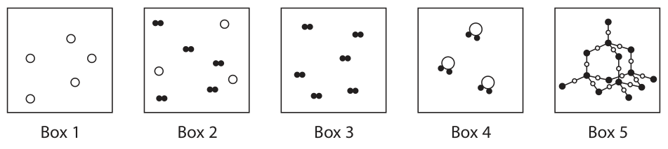
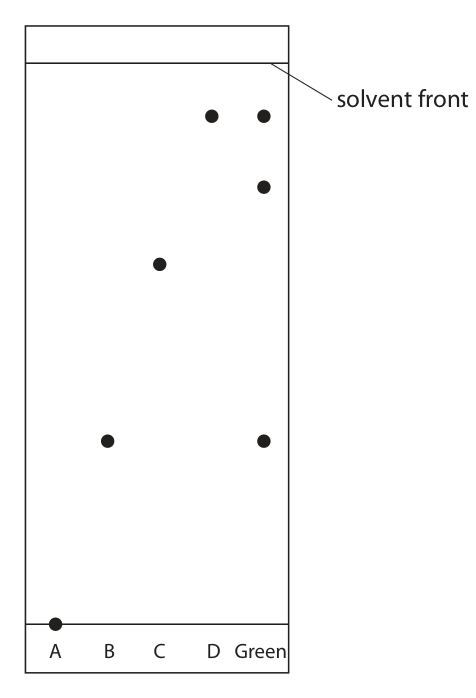
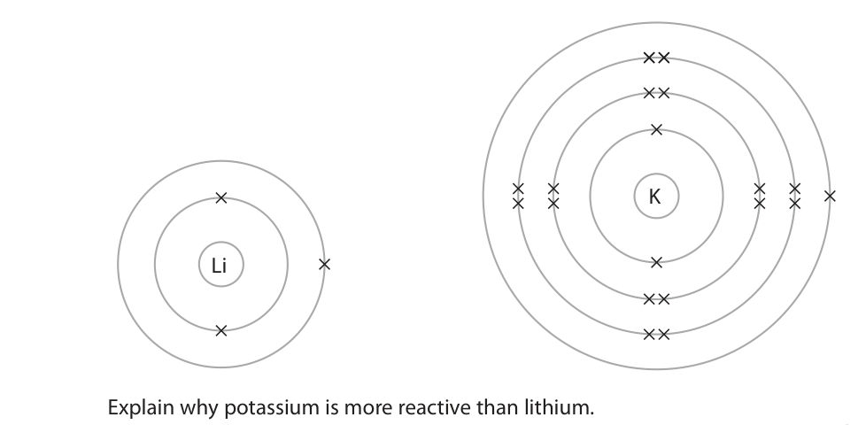
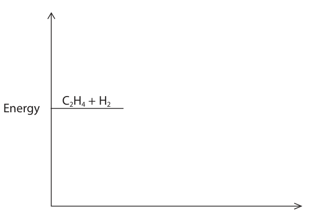
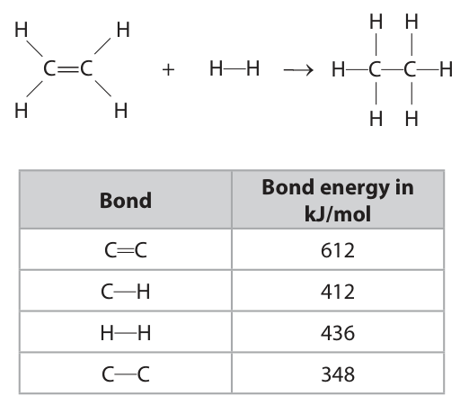
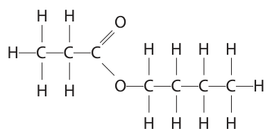

# 4CH1/2CR — 2020-01 (official extraction)

> schema `syllabai.official-paper-questions/0.2` · paper_id `pearson-edexcel:international-gcse:chemistry:4ch1:2020-01:4CH1/2CR` · qp sha256 `0aac8d239d1500d3…` · extraction is the disclosed baseline (ADR-039)

## Question 1 (6 marks)

Substances can be classified as elements, mixtures or compounds.

**(a)** Each box represents an element, a mixture or a compound. Box 1 Box 2 Box 3 Box 4 Box 5

**(b)** The Periodic Table contains all the known elements.

### 1(a)(i) [1]

Which box represents a mixture?

- **(A)** 1
- **(B)** 2  ✔
- **(C)** 3
- **(D)** 4

**Mark scheme answer**

> B box 2
> The only correct answer is B because box 2 contains
> two different particles in the same space that are
> not chemically joined
> A is not correct because box A shows an element
> C is not correct because box C shows an element
> D is not correct because box 4 shows a compound

- **(1)** Answer B: 2

### 1(a)(ii) [1]

Which two boxes represent elements?

- **(A)** 1 and 2
- **(B)** 2 and 3
- **(C)** 1 and 3  ✔
- **(D)** 3 and 4

**Mark scheme answer**

> C Boxes 1 and 3
> The only correct answer is C because boxes 1 and 2
> contain one type of atom only.
> A is not correct because box 2 shows a mixture
> B is not correct because box 2 shows a mixture
> D is not correct because box 4 shows a compound

- **(1)** Answer C: 1 and 3

### 1(a)(iii) [2]

Explain why Box 5 represents a compound.

**Mark scheme answer**

> M1 (box 5 shows) two (different) elements ALLOW two (different)
> types of atoms
> REJECT mixture for M1
> M2 (chemically) bonded (together) ALLOW (chemically)
> combined/joined
> (together)
> M2 DEP on mention of
> elements/atoms in M1

- **(1)** (box 5 shows) two (different) elements ALLOW two (different)
- **(1)** (chemically) bonded (together) ALLOW (chemically)

### 1(b)(i) [1]

How are the elements arranged in the Periodic Table?

- **(A)** increasing mass number
- **(B)** increasing number of neutrons
- **(C)** increasing number of protons  ✔
- **(D)** increasing reactivity

**Mark scheme answer**

> C number of protons
> The only correct answer is C because the elements in the periodic table are arranged in order of proton number
> A is not correct because elements are not arranged in order of mass number
> B is not correct because elements are not arranged in order of the number of neutrons
> D is not correct because elements are not arranged in order of reactivity

- **(1)** Answer C: increasing number of protons

### 1(b)(ii) [1]

Elements in the same group have the same number of

- **(A)** electrons in the outer shell  ✔
- **(B)** electron shells
- **(C)** neutrons
- **(D)** protons

**Mark scheme answer**

> A electrons in the outer shell
> The only correct answer is A because elements in
> the same group of the periodic table have the same
> number of electrons in the outer shell.
> B Is not the correct answer because elements in the
> same period have the same number of shells
> C elements in the same group do not have the same
> number of neutrons
> D is not the correct answer because elements in the
> same group do not have the same number of
> protons

- **(1)** Answer A: electrons in the outer shell

## Question 2 (9 marks)

Chromatography is used to analyse mixtures. A student does a chromatography experiment to analyse the composition of green food colouring in sweets. She places four known dyes, A, B, C and D, and the green food colouring on chromatography paper. The diagram shows the student’s apparatus at the start of her experiment. water A B C D Green start line drawn in ink

**(b)** Another student does the chromatography experiment correctly. The diagram shows her chromatogram at the end of the experiment. solvent front A B C D Green

### 2(a) [2]

The diagram shows that the student makes two mistakes when setting up her apparatus. State the two changes that the student should make so that her experiment works. 1 2

**Mark scheme answer**

> M1 level of the water must be below the dyes/start ACCEPT dyes/start line
> line should be above water
> level
> M2 the start line must be drawn in pencil

- **(1)** level of the water must be below the dyes/start ACCEPT dyes/start line
- **(1)** the start line must be drawn in pencil

### 2(b)(i) [3]

Explain what the chromatogram shows about the composition of the green food colouring.

**Mark scheme answer**

> 2 marks for any two conclusions from
> (the green food colouring)
> M1 contains (dye) B and (dye) D
> M2 contains an unknown dye
> M3 does not contain A or C
> M4 contains three dyes ALLOW is not pure
> and 1 mark for a correct explanation of given
> conclusion for the green food colouring
> eg (explanation for M1) because has spots at same
> level (as B and D)
> eg (explanation for M2) because has a spot at
> different level (from A B C D)
> eg (explanation for M3) because has no spots at
> same level (as A and C)
> eg (explanation for M4) because has three spots

- **(3)** 2 marks for any two conclusions from

### 2(b)(ii) [3]

The distance between the start line and the spot for dye C is 6.2 cm. Calculate the Rf value of dye C. Rf value =

**Mark scheme answer**

> M1 (distance moved by solvent correctly measured) ALLOW a tolerance of
> = 9.5 (cm) ±2mm
> M2 use of
> Rf = distance moved by the dye C eg 6.2
> distance moved by the solvent 9.5
> ALLOW ECF from M1
> M3 evaluation of Rf eg (6.2) = 0.65(3)
> (9.5)
> ALLOW 1-4 sig fig
> ALLOW ECF from M2

- **(1)** (distance moved by solvent correctly measured) ALLOW a tolerance of
- **(1)** use of
- **(1)** evaluation of Rf eg (6.2) = 0.65(3)

### 2(b)(iii) [1]

Suggest why dye A does not move.

**Mark scheme answer**

> (dye A) is not soluble in water ALLOW solvent for
> water

- **(1)** (dye A) is not soluble in water ALLOW solvent for

## Question 3 (6 marks)

Solutions of silver nitrate and potassium chloride react together to make the insoluble salt, silver chloride. A student uses this method to prepare a sample of silver chloride. Step 1 add 25 cm3 of silver nitrate solution to a conical flask Step 2 add potassium chloride solution to the flask Step 3 filter off the silver chloride

### 3(a) [1]

What term is used for this reaction?

- **(A)** neutralisation
- **(B)** precipitation  ✔
- **(C)** redox
- **(D)** thermal decomposition

**Mark scheme answer**

> B Precipitation
> The only correct answer is B the reaction of two
> solutions to produce an insoluble solid is
> precipitation.
> A is not correct because this reaction is not
> neutralisation
> C is not correct because this reaction is not a redox
> reaction
> D is not correct because this reaction is not thermal
> decomposition

- **(1)** Answer B: precipitation

### 3(b) [2]

Give two more steps that will produce a pure, dry sample of silver chloride. Step 4 Step 5

**Mark scheme answer**

> M1 wash the solid with (deionised) water
> M2 suitable method of drying solid eg dry between ALLOW leave to dry
> filter papers/on paper towel/in (warm) oven/in a ALLOW leave in a warm
> desiccator place
> ALLOW leave for the
> water to evaporate
> IGNORE dry it alone
> REJECT hot oven or any
> method of direct
> heating eg Bunsen
> burner
> REJECT references
> (direct or inferred) to
> silver chloride solution
> or crystallisation for M1
> and M2
> No M2 if solid washed
> after drying

- **(1)** wash the solid with (deionised) water
- **(1)** suitable method of drying solid eg dry between ALLOW leave to dry

### 3(c) [1]

Acidified silver nitrate solution is used to test for chloride ions. Give a reason why hydrochloric acid is not used to acidify silver nitrate solution.

**Mark scheme answer**

> Any one from:
> M1 (hydrochloric acid/it) contains chloride ions ALLOW contains Cl-
> M2 (hydrochloric acid/it) produces a (white)
> precipitate with silver nitrate
> M3 (hydrochloric acid/it) reacts with silver nitrate

- **(1)** Any one from:

### 3(d) [2]

The chemical equation for the reaction between solutions of silver nitrate and potassium chloride is AgNO3(aq) + KCl(aq) o AgCl(s) + KNO3(aq) A student adds an excess of potassium chloride solution to 25.0 cm3 of 0.100 mol/dm3 silver nitrate solution. Calculate the maximum mass of silver chloride, in grams, that can be produced. [Mr of AgCl = 143.5] mass = g

**Mark scheme answer**

> M1 n(AgNO3 or AgCl) = 0.0025
> M2 (mass AgCl) = 0.0025 x 143.5 = 0.35(9)g ALLOW ECF from M1
> ALLOW one or more sig
> fig
> Correct answer without
> working scores 2 marks.

- **(1)** n(AgNO3 or AgCl) = 0.0025
- **(1)** (mass AgCl) = 0.0025 x 143.5 = 0.35(9)g ALLOW ECF from M1

## Question 4 (7 marks)

This question is about the metal, lead.

**(b)** A teacher uses this apparatus in a fume cupboard to demonstrate the electrolysis of lead(II) bromide. positive electrode negative electrode lead(II) bromide heat The lead(II) bromide is heated until it melts. When the lead(II) bromide melts, the lamp lights. One of the products of this electrolysis is lead.

### 4(a) [2]

Explain why metals, such as lead, are malleable.

**Mark scheme answer**

> M1 layers of atoms/positive ions IGNORE layers
> unqualified
> REJECT layers of
> molecules
> M2 can slide over one another M2 DEP on mention of
> layers/atoms/ions in M1

- **(1)** layers of atoms/positive ions IGNORE layers
- **(1)** can slide over one another M2 DEP on mention of

### 4(b)(i) [1]

State why solid lead(II) bromide does not conduct electricity.

**Mark scheme answer**

> ions cannot move ALLOW ions are in fixed
> positions/in a lattice
> IGNORE no free ions
> REJECT any reference
> to electrons

- **(1)** ions cannot move ALLOW ions are in fixed

### 4(b)(ii) [1]

Bromine is formed by the oxidation of bromide ions at the positive electrode. Complete the ionic half-equation for the oxidation of bromide ions. 2Br– o +

**Mark scheme answer**

> 2Br- → Br2 + 2e-

- **(1)** 2Br- → Br2 + 2e-

### 4(b)(iii) [2]

Explain why lead metal forms at the negative electrode.

**Mark scheme answer**

> M1 lead ions (are positive and) are attracted to the ALLOW cathode for
> negative electrode / Pb2+ (ions) are attracted to the negative electrode
> negative electrode
> M2 lead ions gain electrons / Pb2+ (ions) gain ALLOW a correct half
> electrons (to form lead) equation for M2
> IGNORE references to
> redox
> ALLOW lead ions get
> discharged (to form
> lead)

- **(1)** lead ions (are positive and) are attracted to the ALLOW cathode for
- **(1)** lead ions gain electrons / Pb2+ (ions) gain ALLOW a correct half

### 4(b)(iv) [1]

The teacher stops heating the mixture and allows it to solidify. Suggest why the lamp stays alight.

**Mark scheme answer**

> metal or lead connects the electrodes or completes ALLOW metal or lead
> the circuit OWTTE conducts electricity
> ALLOW metal or lead
> allows electrons to flow

- **(1)** metal or lead connects the electrodes or completes ALLOW metal or lead

## Question 5 (13 marks)

This question is about Group 1 metals and their reactions.

**(a)** When lithium is added to water, bubbles of hydrogen gas are observed.

**(c)** The equation for the reaction between lithium and water is 2Li(s) + 2H2O(l) o 2LiOH(aq) + H2(g)

### 5(a)(i) [2]

Give two other observations that could be made. 1 2

**Mark scheme answer**

> Any two from:
> M1 (lithium) moves (on the surface) ALLOW floats
> M2 (lithium) gets smaller/disappears ALLOW dissolves
> M3 colourless solution forms IGNORE white trail
> forms
> REJECT melts / turns
> into a ball
> ALLOW temperature
> increases/heat given off

- **(2)** Any two from:

### 5(a)(ii) [1]

Give the test for hydrogen gas.

**Mark scheme answer**

> (when mixed with air) must refer to test and
> lit spill/splint or flame gives (squeaky) pop result
> IGNORE squeaky pop
> test alone
> ALLOW burns with
> (squeaky) pop
> REJECT glowing
> spill/splint and pop

- **(1)** (when mixed with air) must refer to test and

### 5(b)(i) [1]

Give one observation that would be different if potassium is used instead of lithium.

**Mark scheme answer**

> Any one from:
> M1 more rapid bubbles/fizzing/effervescence
> M2 turns into a ball ALLOW potassium melts
> M3 moves more quickly ALLOW gets
> smaller/disappears
> more quickly
> M4 catches alight / burns / produces a flame IGNORE flame colour

- **(1)** Any one from:

### 5(b)(ii) [3]

The diagram represents an atom of lithium and an atom of potassium. K Li Explain why potassium is more reactive than lithium.

**Mark scheme answer**

> M1 potassium has more shells than lithium ALLOW potassium atom
> is bigger than lithium
> ALLOW outer
> shell/electron is further
> from nucleus
> M2 (therefore) there is less attraction between the ALLOW more repulsion
> outer shell/electron and the nucleus (from inner shells) or
> more shielding (from
> the nuclear attraction)
> ALLOW nuclear pull for
> the outer shell/electron
> is weaker
> M3 so the electron in the outer shell is more easily ACCEPT answers in
> lost terms of lithium for M1,
> M2 and M3

- **(1)** potassium has more shells than lithium ALLOW potassium atom
- **(1)** (therefore) there is less attraction between the ALLOW more repulsion
- **(1)** so the electron in the outer shell is more easily ACCEPT answers in

### 5(c)(i) [3]

A mass of 0.500 g of lithium reacts with an excess of water. Calculate the volume, in cm3, of hydrogen gas produced at rtp. [molar volume of a gas at rtp = 24 000 cm3] Give your answer to three significant figures. volume = cm3

**Mark scheme answer**

> M1 n(Li) = 0.500 OR 0.0714
> M2 n(H2) = 0.0714 OR 0.0357 ALLOW ECF from M1
> M3 volume of H2 (= 0.0357 x 24000) = 857 (cm3) ALLOW ECF M2 x 24 000
> M3 must be to 3 sig fig
> Correct answer to 3 sig
> fig without working
> scores 3 marks.

- **(1)** n(Li) = 0.500 OR 0.0714
- **(1)** n(H2) = 0.0714 OR 0.0357 ALLOW ECF from M1
- **(1)** volume of H2 (= 0.0357 x 24000) = 857 (cm3) ALLOW ECF M2 x 24 000

### 5(c)(ii) [3]

In a reaction between lithium and water, 150 cm3 of lithium hydroxide solution is formed. The lithium hydroxide solution is then completely neutralised by 24.85 cm3 of 0.100 mol/dm3 sulfuric acid. The equation for the neutralisation is 2LiOH(aq) + H2SO4(aq) o Li2SO4(aq) + 2H2O(l) Calculate the concentration, in mol/dm3, of the lithium hydroxide solution. concentration = mol/dm3

**Mark scheme answer**

> M1 n(H2SO4)= 0.02485 x 0.1 OR 0.002485
> M2 n(LiOH) = 2 x 0.002485 OR 0.00497 ALLOW ECF from M1
> M3 concentration of LiOH = 0.0331 (mol/dm3) ALLOW ECF from M2
> (M2 ÷ 0.150)
> ALLOW any number of
> sig fig except one for
> M1 M2 and M3
> Correct answer without
> working scores 3 marks.

- **(1)** n(H2SO4)= 0.02485 x 0.1 OR 0.002485
- **(1)** n(LiOH) = 2 x 0.002485 OR 0.00497 ALLOW ECF from M1
- **(1)** concentration of LiOH = 0.0331 (mol/dm3) ALLOW ECF from M2

## Question 6 (15 marks)

This question is about ethane and ethene.

**(b)** The equation for the reaction between ethene gas and hydrogen gas is C 2 H4 + H 2 o C 2 H6 The rate of this reaction can be increased by increasing the pressure.

### 6(a) [4]

Ethane can be obtained from crude oil. Describe the industrial process used to separate crude oil into fractions.

**Mark scheme answer**

> A description including the following points:
> M1 (use) fractional distillation / fractionating column /
> fractionating tower
> M2 (crude oil) heated / vaporised ALLOW boiled
> M3 column is cooler at top / hotter at the bottom / idea
> of temperature gradient
> M4 fractions condense/collected at different heights ALLOW fractions with
> OWTTE high(er) boiling
> OR fractions have different boiling point (ranges) points/large(r)
> molecules
> condense/collected
> near bottom ORA

- **(1)** (use) fractional distillation / fractionating column /
- **(1)** (crude oil) heated / vaporised ALLOW boiled
- **(1)** column is cooler at top / hotter at the bottom / idea
- **(1)** fractions condense/collected at different heights ALLOW fractions with

### 6(b)(i) [2]

Explain why increasing the pressure increases the rate of this reaction.

**Mark scheme answer**

> M1 particles/molecules are closer together ALLOW more
> particles/molecules per
> unit volume
> M2 therefore more (successful) collisions per unit time ALLOW more frequent
> (successful) collisions
> If reference to particles
> have more energy/move
> faster, then 0/2

- **(1)** particles/molecules are closer together ALLOW more
- **(1)** therefore more (successful) collisions per unit time ALLOW more frequent

### 6(b)(ii) [2]

The rate of this reaction can also be increased by using a catalyst. Explain how using a catalyst increases the rate of a reaction.

**Mark scheme answer**

> M1 (a catalyst provides) an alternative pathway ALLOW a catalyst
> provides a surface for
> the reaction to take
> place on
> M2 of lower activation energy ALLOW so more
> collisions/particles have
> energy greater than the
> activation energy.

- **(1)** (a catalyst provides) an alternative pathway ALLOW a catalyst
- **(1)** of lower activation energy ALLOW so more

### 6(b)(iii) [1]

Give one other way that the rate of reaction between ethene gas and hydrogen gas can be increased.

**Mark scheme answer**

> increase the temperature ALLOW heat it up
> IGNORE references to
> concentration
> REJECT increase the
> surface area

- **(1)** increase the temperature ALLOW heat it up

### 6(b)(iv) [3]

The reaction between ethene and hydrogen is exothermic. Complete the reaction profile diagram, including labels for the activation energy and the enthalpy change, ΔH. C 2 H4 + H 2 Energy

**Mark scheme answer**

> 3
> M1 C2H6 on horizontal line below the reactants
> M2 activation energy correctly shown and labelled ACCEPT arrow pointing
> upwards or double
> headed arrow
> M3 ΔH correctly shown and labelled ACCEPT arrow pointing
> from reactants level to
> product level or double
> headed arrow
> ALLOW max 2 for a
> correctly labelled
> endothermic reaction

- **(1)** C2H6 on horizontal line below the reactants
- **(1)** activation energy correctly shown and labelled ACCEPT arrow pointing
- **(1)** ΔH correctly shown and labelled ACCEPT arrow pointing

### 6(c) [3]

The reaction between ethene and hydrogen can be represented using displayed formulae. H H H H C=C + H H –o H C C H H H H H Bond energy in Bond kJ/mol C C 612 C H 412 H H 436 C C 348 Use the bond energies in the table to calculate the enthalpy change, ΔH, in kJ/mol for this reaction. ΔH = kJ/mol

**Mark scheme answer**

> • find energy needed to break bonds
> • find energy released when bonds form
> • correct evaluation of ΔH
> Example calculation
> M1 (4 x 412) + 612 + 436 OR 2696 IGNORE sign
> ALLOW 1048
> M2 (6 x 412) + 348 OR 2820 IGNORE sign
> ALLOW 1172
> M3 -124 if M1 M2 correct
> -124 without working
> scores 3
> (+)124 scores 2
> ALLOW M3 ECF M1 M2

- **(1)** (4 x 412) + 612 + 436 OR 2696 IGNORE sign
- **(1)** (6 x 412) + 348 OR 2820 IGNORE sign
- **(1)** -124 if M1 M2 correct

## Question 7 (14 marks)
**(a)** Ethanol, C2H5OH, can be produced by the fermentation of glucose, C6H12O6

**(b)** Ethanol can also be produced by the reaction between ethene and steam. The equation for the reaction is C2H4(g) + H2O(g) U C2H5OH(g)

**(c)** Carboxylic acids react with alcohols to form esters. The displayed formula of an ester is H H O H C C C H H H H H H O C C C C H H H H H

### 7(a)(i) [1]

Complete the equation for the fermentation of glucose. C6H12O6 o 2C2H5OH + 2

**Mark scheme answer**

> CO2

- **(1)** CO2

### 7(a)(ii) [1]

State why it is necessary for fermentation to be done in the absence of air.

**Mark scheme answer**

> (otherwise) ethanoic acid will form ALLOW (otherwise) ethanol will be
> oxidised or react with oxygen
> ALLOW
> fermentation/reaction/respiration
> needs to be anaerobic
> ALLOW (otherwise) ethanol would
> not be formed /CO2 and H2O would
> be formed

- **(1)** (otherwise) ethanoic acid will form ALLOW (otherwise) ethanol will be

### 7(a)(iii) [2]

Explain why the temperature should not be higher than 40 °C.

**Mark scheme answer**

> M1(reaction is catalysed by) enzymes (in yeast) IGNORE yeast unqualified
> M2 which will denature (above 40°C) ALLOW enzymes do not work
> above 40°C

- **(2)** M1(reaction is catalysed by) enzymes (in yeast) IGNORE yeast unqualified

### 7(a)(iv) [2]

When 4 mol of glucose is fermented, a mass of 55.2 g of ethanol is produced. Show that the percentage yield of ethanol is 15%. [Mr of C2H5OH = 46]

**Mark scheme answer**

> M1 maximum mass of ethanol = 8 x 46 = 368 (g)
> M2 55.2 x 100 (=15%)
> 368
> Alternative method:
> M1 actual yield of ethanol in mol = 55.2 = 1.2
> M2 1.2 x 100 (=15%)

- **(2)** M1 maximum mass of ethanol = 8 x 46 = 368 (g)

### 7(b)(i) [2]

This reaction is in dynamic equilibrium. Give two features of a reaction in dynamic equilibrium. 1 2

**Mark scheme answer**

> M1 rate of the forwards reaction = the rate of IGNORE it is reversible reaction
> the backwards reaction
> M2 the concentrations of reactants and REJECT concentrations of
> products remain constant reactants and products are equal
> or are the same

- **(1)** rate of the forwards reaction = the rate of IGNORE it is reversible reaction
- **(1)** the concentrations of reactants and REJECT concentrations of

### 7(b)(ii) [2]

When the equilibrium mixture is heated, the yield of ethanol decreases. Explain whether the forward reaction is exothermic or endothermic.

**Mark scheme answer**

> M1 an increase in temperature shifts the IGNORE references to Le
> (position of) equilibrium in the endothermic Chatelier’s Principle
> direction (so backwards reaction is ALLOW heating for increase in
> endothermic) temperature
> M2 so forward reaction is exothermic M2 DEP M1 or near miss

- **(1)** an increase in temperature shifts the IGNORE references to Le
- **(1)** so forward reaction is exothermic M2 DEP M1 or near miss

### 7(c)(i) [2]

Carboxylic acid A and alcohol B react to produce this ester. Give the displayed formula of carboxylic acid A and of alcohol B. Carboxylic acid A Alcohol B

**Mark scheme answer**

> M1 (displayed formula of A - propanoic acid) ALLOW 1 mark if both OH but
> otherwise correct
> M2 (displayed formula of B - butan-1-ol)

- **(1)** (displayed formula of A - propanoic acid) ALLOW 1 mark if both OH but
- **(1)** (displayed formula of B - butan-1-ol)

### 7(c)(ii) [2]

Indicators can be used to test for carboxylic acids. Describe a different chemical test for a carboxylic acid.

**Mark scheme answer**

> M1 add a named carbonate or ALLOW correct formula
> hydrogencarbonate
> M2 effervescence/bubbles/fizzing M2 DEP M1 or near miss
> ALLOW carbon dioxide/CO2
> produced
> REJECT incorrect gas
> OR
> M1 add a suitable named metal e.g. ALLOW correct symbol
> magnesium, aluminium, zinc, iron REJECT a metal that is too
> reactive e.g. potassium or too
> unreactive e.g. copper
> M2 effervescence/bubbles/fizzing M2 DEP M1 or near miss
> ALLOW hydrogen/H2 produced
> REJECT incorrect gas
> OR
> M1 add a named alcohol (and some ALLOW correct formula
> concentrated sulfuric acid and warm)
> M2 sweet smell (of an ester) M2 DEP M1 or near miss

- **(2)** M1 add a named carbonate or ALLOW correct formula

