# 4CH1/1C — 2020-11 (official extraction)

> schema `syllabai.official-paper-questions/0.1` · paper_id `pearson-edexcel:international-gcse:chemistry:4ch1:2020-11:4CH1/1C` · qp sha256 `f3c860dbd4640525…` · extracted verbatim, never regenerated (ADR-037)

## Question 1 (7 marks)

This question is about chemical elements. Use the Periodic Table to help you answer this question.

**(b)** The position of an element in the Periodic Table can be used to predict its properties.

### 1(a)(i) [1]

Identify the element with atomic number 5

**Mark scheme answer**

> Boron/B
> cler

- **(1)** Boron/B

### 1(a)(ii) [1]

Give the symbol of a metallic element in Period 3

**Mark scheme answer**

> Na/Mg/Al
> cler

- **(1)** Na/Mg/Al

### 1(a)(iii) [1]

Identify the element whose atoms contain 14 protons.

**Mark scheme answer**

> Silicon/Si
> cler

- **(1)** Silicon/Si

### 1(a)(iv) [1]

Identify the element whose atoms have the electronic configuration 2.5

**Mark scheme answer**

> Nitrogen/N ALLOW N2
> cler

- **(1)** Nitrogen/N ALLOW N2

### 1(a)(v) [1]

Give the name of the compound formed between oxygen and the element with atomic number 13

**Mark scheme answer**

> aluminium oxide ALLOW Al2O3
> cler

- **(1)** aluminium oxide ALLOW Al2O3

### 1(b)(i) [1]

Which group contains elements that are all unreactive?

- **(A)** Group 2
- **(B)** Group 5
- **(C)** Group 6
- **(D)** Group 0  ✔

**Mark scheme answer**

> D Group 0 is correct because Group 0 contains
> elements that are all unreactive comp
> A is not correct because Group 2 does not contain
> elements that are all unreactive
> B is not correct because Group 5 does not contain
> elements that are all unreactive
> C is not correct because Group 6 does not contain
> elements that are all unreactive

- **(1)** Answer D: Group 0

### 1(b)(ii) [1]

Which of these is the least reactive element in Group 1?

- **(A)** caesium
- **(B)** lithium  ✔
- **(C)** potassium
- **(D)** sodium

**Mark scheme answer**

> B lithium is correct because lithhium
> is the least reactive element in Group 1 comp
> A is not correct because caesium is not the least
> reactive element in Group 1
> C is not correct because potassium is not the least
> reactive element in Group 1
> D is not correct because sodium is not the least
> reactive element in Group 1
> Total for Q1 = 7 marks

- **(1)** Answer B: lithium

## Question 2 (6 marks)
### 2(a) [3]

The boxes list changes that may happen in a laboratory and the names of some changes. Draw one straight line from each change to its correct name. Change Name of change diffusion dissolving ice turns into water evaporation solid carbon dioxide turns directly into a gas freezing a solute is stirred into a solvent melting sublimation

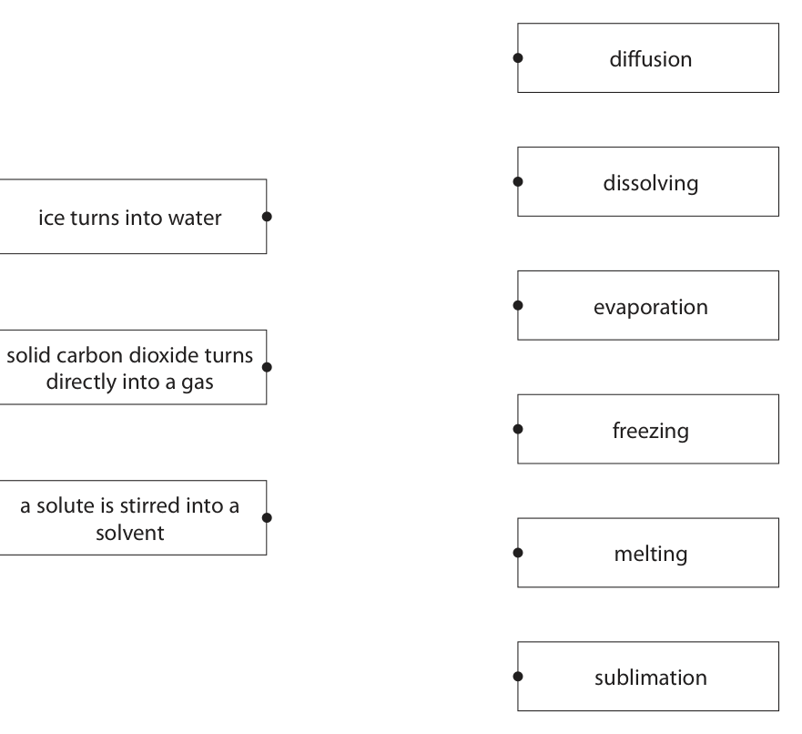

**Mark scheme answer**

> 1 mark for each
> correct line form cler
> boxes on left
> If more than one
> line from a box
> on left column do
> not award mark
> for that box

- **(3)** 1 mark for each

### 2(b) [3]

A student has two solids, X and Y. One of these solids is a pure substance and the other is a mixture. Describe how the student could identify which solid is pure and which is a mixture by measuring a physical property of each solid.

**Mark scheme answer**

> a description including
> grad
> M1 measure the melting point ALLOW measure
> boiling point for
> M2 if fixed/sharp melting point the substance is pure M1 and
> substitute b.p.
> M3 if melts over range of temperatures the substance is a mixture for m.p in M2
> and boils for
> melts in M3
> ALLOW max 2 if
> reference to
> freezing point as
> opposed to
> melting point
> Total for Q2 = 6 marks

- **(1)** measure the melting point ALLOW measure
- **(1)** if fixed/sharp melting point the substance is pure M1 and
- **(1)** if melts over range of temperatures the substance is a mixture for m.p in M2

## Question 3 (8 marks)

This question is about metals.

**(a)** Metals can be arranged in a reactivity series based on their reactions with water and their reactions with dilute hydrochloric acid. The table shows how four metals, P, Q, R and S, react with water and with dilute hydrochloric acid. Reaction with Reaction with Metal water dilute hydrochloric acid P no reaction hydrogen gas forms very slowly Q no reaction no reaction R hydrogen gas forms very quickly not done S hydrogen gas forms quickly hydrogen gas forms very quickly

**(b)** Zinc is used to coat iron gates to prevent the iron from rusting.

**(c)** A mixture of zinc powder and copper(II) oxide is heated. The chemical equation for the reaction that takes place is Zn + CuO → ZnO + Cu

### 3(a)(i) [1]

Identify which of the metals P, Q, R or S could be gold.

**Mark scheme answer**

> Q
> cler

- **(1)** Q

### 3(a)(ii) [1]

Suggest why the reaction between metal R and dilute hydrochloric acid was not done.

**Mark scheme answer**

> might be explosive/dangerous/unsafe
> grad

- **(1)** might be explosive/dangerous/unsafe

### 3(a)(iii) [1]

Use the information in the table to place the metals in order of reactivity from most reactive to least reactive. most reactive least reactive

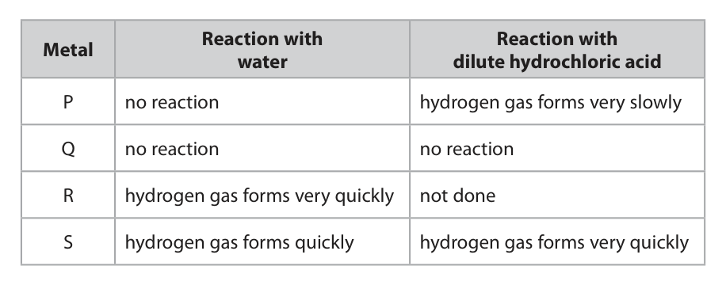

**Mark scheme answer**

> RSPQ
> cler

- **(1)** RSPQ

### 3(b)(i) [1]

State the name of this method of preventing iron from rusting.

**Mark scheme answer**

> galvanising/galvanisation
> grad

- **(1)** galvanising/galvanisation

### 3(b)(ii) [1]

State another method of preventing iron from rusting.

**Mark scheme answer**

> Any one from
> grad
> paint/oil/grease/sacrificial protection OWTTE IGNORE barrier
> method
> If answer to (i) missing
> or incorrect credit
> galvanising in (ii)

- **(1)** Any one from

### 3(c)(i) [1]

State how the reaction shows that zinc is more reactive than copper.

**Mark scheme answer**

> zinc displaces copper ALLOW zinc replaces
> copper/zinc takes grad
> oxygen from copper

- **(1)** zinc displaces copper ALLOW zinc replaces

### 3(c)(ii) [2]

Explain which substance is the oxidising agent.

**Mark scheme answer**

> M1 copper(II) oxide/CuO
> M2 because copper(II) oxide/CuO/it loses oxygen ALLOW because expert
> copper(II) oxide/CuO/it
> gives oxygen to zinc/is
> reduced
> M2 DEP M1 or near
> miss
> e.g. Cu as it gives
> oxygen to zinc scores 1
> mark for M2
> IGNORE references to
> electrons
> Total for Q3 = 8 marks
> - -

- **(1)** copper(II) oxide/CuO
- **(1)** because copper(II) oxide/CuO/it loses oxygen ALLOW because expert

## Question 4 (10 marks)

Sodium hydroxide dissolves in water, forming a strongly alkaline solution. Ammonia dissolves in water, forming a slightly less alkaline solution.

**(b)** When ammonia solution reacts with sulfuric acid, a neutralisation reaction occurs and ammonium sulfate forms.

**(c)** Ammonium sulfate is used by gardeners as a fertiliser because it contains nitrogen.

### 4(a)(i) [1]

Identify the ion that makes the sodium hydroxide solution alkaline.

**Mark scheme answer**

> hydroxide/OH ALLOW HO
> grad
> REJECT OH

- **(1)** hydroxide/OH ALLOW HO

### 4(a)(ii) [1]

What is a possible pH of ammonia solution?

- **(A)** 3
- **(B)** 6
- **(C)** 11  ✔
- **(D)** 14

**Mark scheme answer**

> C 11 is correct because 11 is a possible pH for
> ammonia solution comp
> A is not correct because 3 is not a possible pH for
> ammonia solution
> B is not correct because 6 is not a possible pH for
> ammonia solution
> D is not correct because 14 is not a possible pH for
> ammonia solution

- **(1)** Answer C: 11

### 4(b)(i) [1]

How does the sulfuric acid act in this reaction?

- **(A)** as a neutron donor
- **(B)** as a neutron acceptor
- **(C)** as a proton donor  ✔
- **(D)** as a proton acceptor

**Mark scheme answer**

> C a proton donor is correct because an acid acts
> as a proton donor comp
> A is not correct because an acid does not act as a
> neutron donor
> B is not correct because an acid does not act as a
> neutron acceptor
> D is not correct because an acid does not act as a
> proton acceptor

- **(1)** Answer C: as a proton donor

### 4(b)(ii) [1]

The diagram shows a beaker containing some ammonia solution and a few drops of phenolphthalein indicator. ammonia solution and phenolphthalein indicator Dilute sulfuric acid is added to the beaker until it is in excess. What are the colours of the phenolphthalein indicator before and after adding excess sulfuric acid? Before After

- **(A)** orange         red
- **(B)** yellow         red
- **(C)** pink           colourless  ✔
- **(D)** colourless     pink

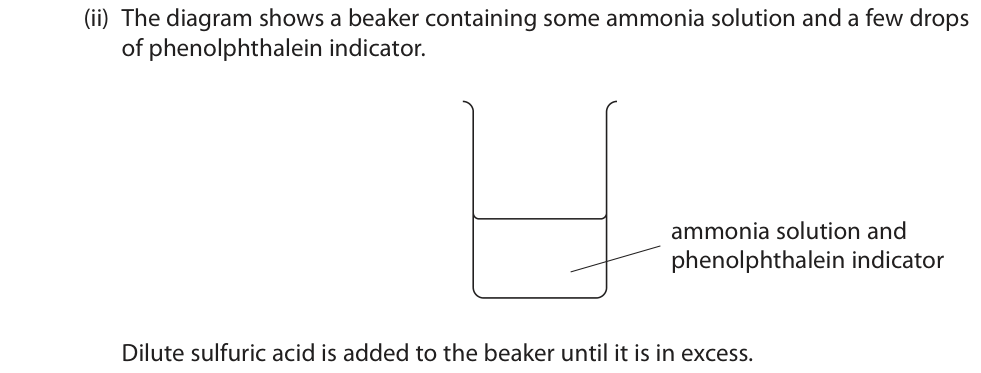

**Mark scheme answer**

> C is correct because phenolphthalein is pink in alkali
> and colourless in acid comp
> A is not correct because phenolphthalein is not
> orange in alkali and red in acid
> B is not correct because phenolphthalein is not
> yellow in alkali and red in acid
> D is not correct because phenolphthalein is not
> colourless in alkali and pink in acid

- **(1)** Answer C: pink           colourless

### 4(c)(i) [2]

Explain why the chemical formula of ammonium sulfate is (NH4)2SO4 Refer to the charges on the ions in your answer.

**Mark scheme answer**

> M1 ammonium ion is charged 1+ / NH4+
> AND sulfate ion is charged 2- /SO42- grad
> M2 so charges balance/cancel (each other) OWTTE ALLOW so that
> ammonium sulfate
> has no overall
> charge
> M2 not dep on M1

- **(1)** ammonium ion is charged 1+ / NH4+
- **(1)** so charges balance/cancel (each other) OWTTE ALLOW so that

### 4(c)(ii) [1]

Calculate the relative formula mass of ammonium sulfate, (NH4)2SO4 relative formula mass =

**Mark scheme answer**

> [ [2x(14+4) + 32 + (4x16)] = ] 132
> exp

- **(1)** [ [2x(14+4) + 32 + (4x16)] = ] 132

### 4(c)(iii) [3]

Calculate the mass, in grams, of nitrogen in 1.0 kg of ammonium sulfate. mass = g

**Mark scheme answer**

> Example calculation mark CQ from (i)
> exp
> 212 without working
> scores 3 marks
> M1 132(g) ammonium sulfate contains 28(g) nitrogen /
> 1(g) ammonium sulfate contains (28÷132) (g) nitrogen
> M2 1000(g) ammonium sulfate contains
> 1000 x (28÷132) (g) nitrogen
> M3 = 212(.12) (g)
> OR
> M1 (moles of ammonium sulfate =) 1000 ÷ 132 OR 7.58
> M2 (mass of nitrogen =) 28 x 1000 ÷ 132 OR 7.58 x 28
> M3 = 212 (g) If 7.58 used in
> calculation answer is
> 212.24
> If 14 used instead of
> 28 answer of
> 106.(06) scores 2
> marks with or without
> working
> ALLOW any number
> of sig figs except 1
> Total for Q4 = 10

- **(3)** Example calculation mark CQ from (i)

## Question 5 (12 marks)
**(b)** Chlorine reacts with methane to form CH3Cl and HCl

### 5(a) [2]

Chlorine, bromine and iodine are elements in the Periodic Table. Explain how the position of these elements in the Periodic Table depends on their electronic configurations.

**Mark scheme answer**

> Any two from
> M1 all in Group 7/same group Grad
> M2 because all have 7/same number of electrons in
> outer shell
> M3 the number of shells determines the Period they
> are in

- **(2)** Any two from

### 5(b)(i) [1]

State the condition necessary for this reaction.

**Mark scheme answer**

> Ultraviolet radiation ALLOW UV radiation
> ALLOW ultraviolet light cler
> /UV light/ultraviolet
> rays/UV rays

- **(1)** Ultraviolet radiation ALLOW UV radiation

### 5(b)(ii) [1]

Give the equation for this reaction.

**Mark scheme answer**

> Cl2 + CH4 CH3Cl + HCl ALLOW multiples
> Grad

- **(1)** Cl2 + CH4 CH3Cl + HCl ALLOW multiples

### 5(b)(iii) [2]

The bonds in a molecule of CH3Cl are covalent. Explain, in terms of electrostatic attractions, what is meant by a covalent bond.

**Mark scheme answer**

> M1 attraction between shared pair of electrons
> Exp
> M2 and nuclei of the two/both atoms (in the bond)
> OR
> M1 bonding/shared pair of electrons
> M2 attracted to (both) nuclei of atoms (in the bond)
> ALLOW M1 attraction of
> (two) nuclei
> M2 for shared/bonded
> pair of electrons
> (between them)

- **(2)** M1 attraction between shared pair of electrons

### 5(b)(iv) [2]

Draw a dot‑and‑cross diagram for a molecule of CH3Cl Show only the outer electrons of the atoms. H H C Cl H

**Mark scheme answer**

> M1 the four shared pairs of electrons between
> carbon and the other four atoms Grad
> M2 rest of molecule correct including the three lone M2 DEP M1
> pairs of electrons around chlorine atom ALLOW any
> combination of dots and
> crosses

- **(1)** the four shared pairs of electrons between
- **(1)** rest of molecule correct including the three lone M2 DEP M1

### 5(b)(v) [2]

CH3Cl has a simple molecular structure. Explain why CH3Cl has a low boiling point.

**Mark scheme answer**

> M1 weak forces of attraction between ALLOW weak bonds
> molecules/weak intermolecular forces between molecules Exp
> /weak intermolecular
> bonds
> M2 little (heat) energy needed to overcome them IGNORE less energy
> 0 marks if implication is
> that covalent bonds are
> weak/broken

- **(1)** weak forces of attraction between ALLOW weak bonds
- **(1)** little (heat) energy needed to overcome them IGNORE less energy

### 5(c) [2]

Graphite is another substance that contains covalent bonds. The diagram shows the structure of graphite. Most covalent substances do not conduct electricity. Explain why graphite is able to conduct electricity.

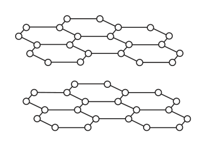

**Mark scheme answer**

> Explanation including
> M1 (one) electron (per carbon atom) delocalised IGNORE sea of Exp
> electrons /free electrons
> M2 (so) free to move (between layers)
> M2 DEP on mention of
> electrons
> 0 marks if mention of
> ions in graphite
> Total Q5 = 12

- **(1)** (one) electron (per carbon atom) delocalised IGNORE sea of Exp
- **(1)** (so) free to move (between layers)

## Question 6 (14 marks)

The table shows the molecular formulae of six organic compounds, A, B, C, D, E and F. A B C D E F C2H4 C2H6 C3H6 C3H8 C4H8 C4H10

**(c)** Compound C can be used to make a polymer.

### 6(a)(i) [2]

Explain which homologous series compound B belongs to.

**Mark scheme answer**

> M1 alkanes
> Grad
> M2 because fits general formula CnH2n+2 M2 not dep on M1

- **(1)** alkanes
- **(1)** because fits general formula CnH2n+2 M2 not dep on M1

### 6(a)(ii) [1]

Give the letter of the compound that has the same empirical formula as its molecular formula.

**Mark scheme answer**

> D ALLOW C3H8
> cler

- **(1)** D ALLOW C3H8

### 6(a)(iii) [3]

Compound F exists as two isomers. Explain what is meant by the term isomers. Include the structures of the two isomers of compound F in your answer.

**Mark scheme answer**

> M1 (compounds of F with same molecular formula
> /C4H10) but different structural/displayed formulae Exp
> M2 structural/displayed formula of butane
> M3 structural/displayed formulae of methylpropane

- **(1)** (compounds of F with same molecular formula
- **(1)** structural/displayed formula of butane
- **(1)** structural/displayed formulae of methylpropane

### 6(b) [4]

Describe how compound D can be obtained from crude oil using the industrial process of fractional distillation.

**Mark scheme answer**

> a description including the following points
> Exp
> M1 heat/vapourise crude oil ALLOW boil
> M2 pass into (fractionating) column/tower
> M3 fractions/compounds/molecules/hydrocarbons ALLOW idea of
> separate because of different boiling points temperature gradient
> M4 compound D collected at top of column/in
> refinery gas fraction
> All marks could be
> scored from a suitably
> labelled diagram
> MAX 3 if description of
> lab process
> If confusion with
> cracking only M1 can be
> awarded

- **(1)** heat/vapourise crude oil ALLOW boil
- **(1)** pass into (fractionating) column/tower
- **(1)** fractions/compounds/molecules/hydrocarbons ALLOW idea of
- **(1)** compound D collected at top of column/in

### 6(c)(i) [1]

State the type of polymer formed from compound C.

**Mark scheme answer**

> addition (polymer) REJECT additional
> Cler

- **(1)** addition (polymer) REJECT additional

### 6(c)(ii) [1]

Name the polymer formed from compound C.

**Mark scheme answer**

> poly(propene) / polypropene ALLOW polypropylene
> grad

- **(1)** poly(propene) / polypropene ALLOW polypropylene

### 6(c)(iii) [2]

Draw the structure of this polymer. Include the displayed formula of the repeat unit.

**Mark scheme answer**

> 2
> Exp
> M1 correct repeat unit Ignore bond angles
> ALLOW use of CH3
> M2 brackets and n and extension bonds M2 DEP M1
> Total for Q6 = 14

- **(1)** correct repeat unit Ignore bond angles
- **(1)** brackets and n and extension bonds M2 DEP M1

## Question 7 (14 marks)

Dilute hydrochloric acid reacts with a solution of sodium thiosulfate (Na2S2O3) to form a precipitate. The equation for the reaction is Na2S2O3(aq) + 2HCl(aq) → 2NaCl(aq) + S(s) + H2O(l) + SO2(g)

### 7(a) [1]

State the name of the precipitate that forms.

**Mark scheme answer**

> Sulfur ALLOW sulphur
> cler

- **(1)** Sulfur ALLOW sulphur

### 7(b) [2]

The reaction is often used to investigate rates of reaction. The diagram shows the apparatus a student uses to investigate the effect of temperature on the rate of the reaction. eye conical flask sodium thiosulfate solution paper with cross drawn on it This is the student’s method. ● pour 50 cm3 of cold sodium thiosulfate solution into a conical flask and heat it to 20 °C ● draw a cross (X) on a piece of paper and place it under the flask ● add 5 cm3 of dilute hydrochloric acid to the flask ● look at the cross from above and record the time taken until the cross cannot be seen The student repeats the experiment four times, using sodium thiosulfate solution at a different temperature each time. He keeps the volumes of sodium thiosulfate solution and hydrochloric acid constant in each experiment. Give two other factors that the student should keep constant. 1 2

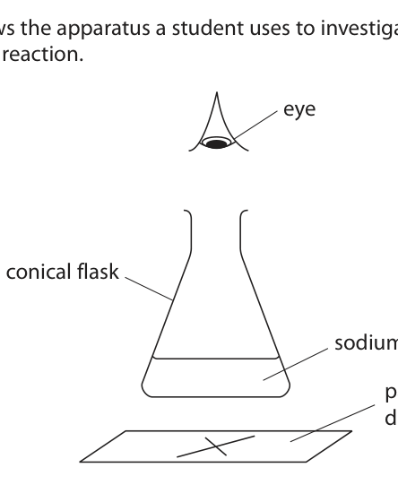

**Mark scheme answer**

> any two from
> exp
> M1 concentration of hydrochloric acid
> M2 concentration of sodium thiosulfate
> M3 height of eye above flask OWTTE
> M4 same size of flask
> ALLOW same
> colour/darkness
> /size of cross
> /use same
> cross

- **(2)** any two from

### 7(c) [1]

The table shows the student’s results. Temperature Time until cross in °C cannot be seen in s 20 400 30 188 40 84 50 44 60 24 The highest temperature the student uses is 60 °C because he thinks the results might not be as accurate at temperatures higher than 60 °C. Suggest a reason why the results might not be as accurate at temperatures higher than 60 °C.

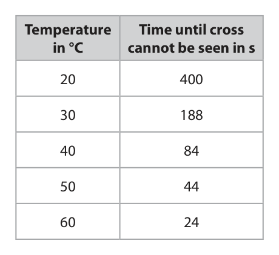

**Mark scheme answer**

> any one from IGNORE
> references to exp
> M1 the thiosulfate/solution would cool down/not remain at required some of
> temperature solution might
> evaporate
> M2 larger (percentage) errors in values of times (as they become ALLOW too
> smaller) short a time
> leads to less
> accurate
> readings
> OWTTE

- **(1)** any one from IGNORE

### 7(d) [2]

The student wants to compare the rates of the reaction at the different temperatures. He uses this formula to obtain a value for each rate of reaction rate = time in s The table shows the value of the rate of reaction at each temperature. Temperature Time until cross Rate of reaction in °C cannot be seen in s in s–1 20 400 0.0025 30 188 0.0053 40 84 0.012 50 44 0.023 60 24 0.042 Plot the values of temperature and rate of reaction on the grid. Draw a curve of best fit through the points. 0.05 0.04 0.03 Rate of reaction in s–1 0.02 0.01 0 10 20 30 40 50 60 70 Temperature in °C

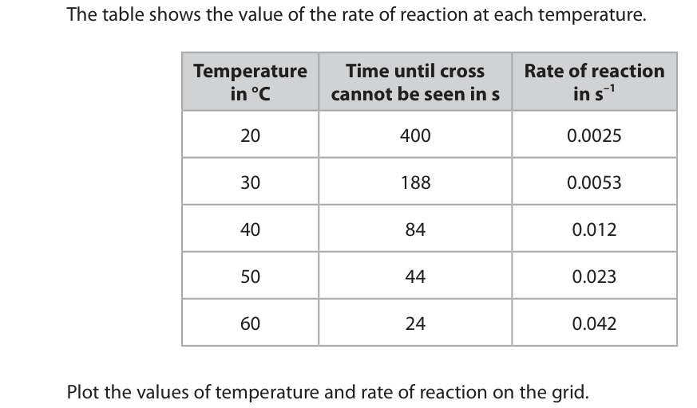

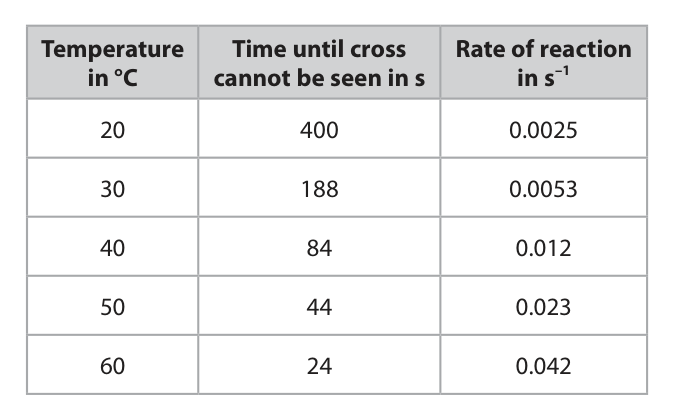

**Mark scheme answer**

> M1 all points plotted correctly (to the nearest grid line)
> exp
> M2 curve of best fit drawn IGNORE curve
> below 20 and
> above 60

- **(1)** all points plotted correctly (to the nearest grid line)
- **(1)** curve of best fit drawn IGNORE curve

### 7(e)(i) [2]

Use the graph to determine a value for the rate of the reaction at 45 °C. Show on the graph how you obtained your answer. rate of reaction = s−1

**Mark scheme answer**

> M1 line on graph from 45 ◦C to curve ALLOW mark on curve at 45
> ◦C exp
> M2 candidate value of rate from graph at 45 ◦C ACCEPT value to +/– 0.0005
> (expected value approx. 0.016/7)

- **(1)** line on graph from 45 ◦C to curve ALLOW mark on curve at 45
- **(1)** candidate value of rate from graph at 45 ◦C ACCEPT value to +/– 0.0005

### 7(e)(ii) [2]

Calculate the time that it would take for the cross not to be seen at 45 °C. time = s

**Mark scheme answer**

> M1 substitute answer from (i) into (time = 1 ÷ rate)
> exp
> M2 correct value ACCEPT answers to 2 or
> more sig figs
> rate = 0.016 time = 62.5
> rate = 0.0165 time = 60.6
> rate = 0.017 time = 58.8

- **(1)** substitute answer from (i) into (time = 1 ÷ rate)
- **(1)** correct value ACCEPT answers to 2 or

### 7(e)(iii) [1]

Describe the relationship between rate of reaction and temperature shown by the graph.

**Mark scheme answer**

> as temperature increases rate of reaction increases ORA
> ALLOW positive correlation grad
> REJECT linear/directly
> proportional

- **(1)** as temperature increases rate of reaction increases ORA

### 7(f) [3]

Explain, in terms of particle collision theory, the effect that increasing the temperature has on the rate of a reaction.

**Mark scheme answer**

> explanation including following points
> (when temperature increases)
> M1 (mean) kinetic energy of particles increases ALLOW particles move faster
> exp
> IGNORE vibrate more/faster
> M2 (so) more successful collisions per second/unit ALLOW reference to more
> time / more frequent successful collisions frequent collisions between
> particles having energy ≥
> activation energy
> M3 rate (of reaction) increases ALLOW reaction is faster
> /speeds up
> Total Q7 =14

- **(1)** (mean) kinetic energy of particles increases ALLOW particles move faster
- **(1)** (so) more successful collisions per second/unit ALLOW reference to more
- **(1)** rate (of reaction) increases ALLOW reaction is faster

## Question 8 (14 marks)

A student uses this apparatus to investigate the heat energy change when a salt dissolves in water to form a solution. polystyrene cup distilled water This is the student’s method. ● add 50 cm3 of distilled water to a polystyrene cup ● record the initial temperature of the water ● add a known mass of solid anhydrous copper(II) sulfate to the polystyrene cup and stir the solution with the thermometer until all the solid has dissolved ● record the maximum temperature of the copper(II) sulfate solution

**(c)** In a second experiment, when a student dissolves the anhydrous copper(II) sulfate in 50 cm3 of distilled water, the increase in temperature is 3.3 °C.

### 8(a)(i) [1]

Name the piece of apparatus the student should use to add the distilled water to the polystyrene cup.

**Mark scheme answer**

> measuring cylinder ALLOW pipette/burette
> cler

- **(1)** measuring cylinder ALLOW pipette/burette

### 8(a)(ii) [1]

The student stirs the solution to help the solid dissolve more quickly. Suggest another reason why the student stirs the solution.

**Mark scheme answer**

> to ensure temperature same throughout solution ACCEPT to ensure heat
> OWTTE evenly distributed grad
> throughout solution
> OWTTE

- **(1)** to ensure temperature same throughout solution ACCEPT to ensure heat

### 8(a)(iii) [1]

State the colour of the copper(II) sulfate solution.

**Mark scheme answer**

> blue IGNORE qualifiers eg
> light/dark cler
> REJECT blue-green

- **(1)** blue IGNORE qualifiers eg

### 8(b) [3]

The diagram shows the temperatures in one experiment. °C 25 °C 30 20 25 initial temperature maximum temperature Complete the table, giving all values to the nearest 0.1 °C. maximum temperature in °C initial temperature in °C increase in temperature in °C

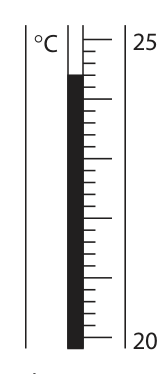

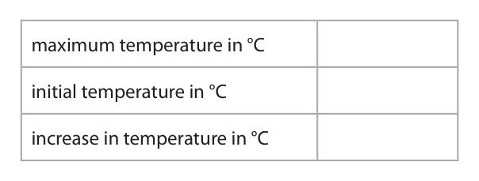

**Mark scheme answer**

> If readings are correct
> Maximum temperature in oC 27.3 but in reverse order grad
> award 1 mark for M1
> Initial 24.4 and M2
> temperature in
> o
> C
> Increase in 2.9
> temperature in
> o
> C
> M1 27.3
> M2 24.4
> M3 2.9 ALLOW ECF for M3 if
> M1 and/or M2 incorrect

- **(1)** 27.3
- **(1)** 24.4
- **(1)** 2.9 ALLOW ECF for M3 if

### 8(c)(i) [2]

Show that the heat energy change (Q) in this second experiment is approximately 700 J. [for water, c = 4.2 J/g/°C] [mass of 1.0 cm3 of water = 1.0 g]

**Mark scheme answer**

> • substitution into Q = mcΔT
> • calculation of heat energy in Joules exp
> Example calculation
> M1 Q = 50 x 4.2 x 3.3
> M2 693 J 693 without working
> scores 2 marks

- **(1)** Q = 50 x 4.2 x 3.3
- **(1)** 693 J 693 without working

### 8(c)(ii) [4]

In this experiment the student uses 1.70 g of the anhydrous copper(II) sulfate. Calculate the molar enthalpy change (ΔH) in kJ/mol. Include a sign in your answer. [Mr of CuSO4 = 159.5] ΔH = kJ/mol

**Mark scheme answer**

> • calculate the amount, in moles, of CuSO4 exp
> • divide Q by the amount in moles
> • conversion to KJ
> • give the correct sign
> Example calculation
> M1 1.70 ÷ 159.5 OR 0.0107 ALLOW any number of SF
> throughout except one
> M2 693 ÷ 0.0107 OR 64766 (J/mol)
> Mark CQ from (i)
> ALLOW use of 700
> M3 64.8 (kJ/mol)
> M4 – 64.8 (kJ/mol)
> use of 700 gives -65.02
> 693 & 0.011 gives -63
> 700 & 0.011 gives -63.64
> correct answer with
> correct sign and without
> working scores 4
> correct answer without
> sign or incorrect sign and
> without working scores 3

- **(1)** 1.70 ÷ 159.5 OR 0.0107 ALLOW any number of SF
- **(1)** 693 ÷ 0.0107 OR 64766 (J/mol)
- **(1)** 64.8 (kJ/mol)
- **(1)** – 64.8 (kJ/mol)

### 8(d) [2]

Another student does a similar experiment but uses hydrated copper(II) sulfate instead of anhydrous copper(II) sulfate. The table shows his results. initial temperature in °C 23.8 final temperature in °C when all solid dissolves 22.7 Explain what the results show about the type of energy change that occurs when hydrated copper(II) sulfate dissolves.

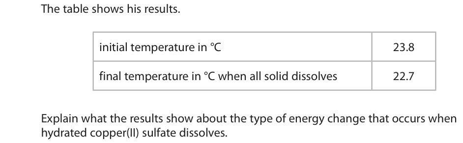

**Mark scheme answer**

> M1 temperature decreases/falls
> grad
> M2 (so) endothermic
> Total Q8 = 14

- **(1)** temperature decreases/falls
- **(1)** (so) endothermic

## Question 9 (12 marks)

Sodium hydrogencarbonate (NaHCO3) is also known as baking soda. Baking soda can be used to make cakes increase in size in an oven. This is the equation for the reaction that takes place when baking soda is heated. 2NaHCO3(s) → Na2CO3(s) + CO2(g) + H2O(g)

**(b)** A student uses this apparatus to investigate the reaction that takes place when sodium hydrogencarbonate is heated. sodium hydrogencarbonate crucible pipeclay triangle heat This is the student’s method. ● weigh a crucible and record the mass ● add some sodium hydrogencarbonate to the crucible, reweigh it and record the mass ● heat the crucible and contents for five minutes, then allow to cool before weighing and recording the mass ● heat the crucible and contents again for a further three minutes, then allow to cool before weighing and recording the mass

**(c)** The table shows some of the student’s results. mass of crucible and sodium hydrogencarbonate in g 29.75 mass of empty crucible in g 26.50

**(d)** In a second experiment, the student uses a larger mass of sodium hydrogencarbonate. She calculates that she should obtain 4.8 g of sodium carbonate. She actually obtains 4.2 g of sodium carbonate.

### 9(a)(i) [1]

What type of reaction is this?

- **(A)** combustion
- **(B)** decomposition  ✔
- **(C)** oxidation
- **(D)** reduction

**Mark scheme answer**

> B decomposition
> comp
> A is not correct because when sodium
> hydrogencarbonate is heated combustion does not
> take place
> C is not correct because when sodium
> hydrogencarbonate is heated oxidation does not take
> place
> D is not correct because when sodium
> hydrogencarbonate is heated reduction does not
> take place

- **(1)** Answer B: decomposition

### 9(a)(ii) [1]

Suggest why the reaction makes the cakes increase in size.

**Mark scheme answer**

> (because) carbon dioxide/gas is produced/given off
> grad

- **(1)** (because) carbon dioxide/gas is produced/given off

### 9(b)(i) [1]

Give a reason why the crucible and contents are heated for a further three minutes.

**Mark scheme answer**

> to obtain a constant mass OWTTE / ACCEPT to ensure only
> to show the reaction is complete OWTTE Na2CO3 is left (in exp
> crucible)
> ACCEPT to ensure all
> the NaHCO3 has
> reacted /decomposed

- **(1)** to obtain a constant mass OWTTE / ACCEPT to ensure only

### 9(b)(ii) [2]

The student considered using a lid on the crucible in the experiment. Suggest an advantage and a disadvantage of using a lid on the crucible. advantage disadvantage

**Mark scheme answer**

> M1 advantage: to stop any solid/Na2CO3/NaHCO3 REJECT references to
> spitting out/being lost stopping gases exp
> escaping
> M2 disadvantage: the gas(es)/CO2/H2O/steam could
> not easily escape OWTTE

- **(1)** advantage: to stop any solid/Na2CO3/NaHCO3 REJECT references to
- **(1)** disadvantage: the gas(es)/CO2/H2O/steam could

### 9(c)(i) [1]

Calculate the mass of sodium hydrogencarbonate that the student uses. mass = g

**Mark scheme answer**

> 3.25 (g)
> exp

- **(1)** 3.25 (g)

### 9(c)(ii) [3]

Using this equation, calculate the maximum mass of sodium carbonate (Na2CO3) that could form in the student’s reaction. 2NaHCO3(s) → Na2CO3(s) + CO2(g) + H2O(g) [Mr of NaHCO3 = 84 Mr of Na2CO3 = 106] maximum mass = g

**Mark scheme answer**

> • calculate moles of NaHCO3
> • use equation to determine moles of Na2CO3 exp
> • multiply by Mr to find mass of Na2CO3
> Example calculation:
> mark CQ on (i)
> M1 3.25 ÷ 84 OR 0.0387 (mol)
> ALLOW any number of
> M2 0.0387 ÷ 2 OR 0.01935 (mol) sig figs except 1
> M3 0.01935 x 106 = 2.05 (g) 2.05 (g) without working
> scores 3 marks
> 4.1 (g) without working
> scores 2 marks
> OR
> • use of equation to relate mass of NaHCO3 to
> mass of Na2CO3
> • shows how to find mass of Na2CO3 using 3.25g
> NaHCO3
> • correct evaluation of answer
> Example calculation:
> M1 (2x84)/168 (g) NaHCO3  106 (g) Na2CO3
> M2 3.25 (g NaHCO3) (106÷168) x 3.25 (g Na2CO3) mark CQ on (i)
> M3 2.05 (g Na2CO3)

- **(3)** • calculate moles of NaHCO3

### 9(d)(i) [2]

Calculate the percentage yield from the student’s experiment. percentage yield = %

**Mark scheme answer**

> M1 percentage yield = 4.2÷4.8 OR 0.875
> grad
> M2 = (0.875 x 100) = 87.5 (%) ACCEPT 88 (%)
> Correct answer without
> working scores 2

- **(1)** percentage yield = 4.2÷4.8 OR 0.875
- **(1)** = (0.875 x 100) = 87.5 (%) ACCEPT 88 (%)

### 9(d)(ii) [1]

Other than spillages, suggest a possible reason why the student’s actual yield is less than expected.

**Mark scheme answer**

> any one from
> grad
> M1 sodium hydrogencarbonate was impure
> M2 not all sodium hydrogencarbonate
> reacted/decomposed
> Total Q9 = 12 marks

- **(1)** any one from

## Question 10 (13 marks)

The table gives information about some lead compounds. Compound Formula Appearance Solubility in water lead(II) oxide PbO yellow solid insoluble lead(IV) oxide PbO2 brown solid insoluble red lead oxide Pb3O4 red solid insoluble lead(II) nitrate Pb(NO3)2 white solid soluble

**(c)** Red lead oxide reacts with warm dilute nitric acid.

### 10(a) [2]

When a sample of red lead oxide is heated, it changes into a yellow solid and a gas forms that relights a glowing splint. Complete the word equation for this reaction. red lead oxide → +

**Mark scheme answer**

> M1 red lead oxide  lead(II) oxide + must have (II)
> grad
> M2 oxygen
> ACCEPT answers in
> either order
> If formulae given allow 1
> mark for O2 even if
> formula for lead(II) oxide
> is incorrect

- **(1)** red lead oxide  lead(II) oxide + must have (II)
- **(1)** oxygen

### 10(b) [3]

A sample of one of the oxides of lead contains 86.6% lead and 13.4% oxygen by mass. Show by calculation that the sample is lead(IV) oxide, PbO2 [Ar of Pb = 207 Ar of O = 16]

**Mark scheme answer**

> • dividing percentages by Ar 0 marks if division by
> • correct results of divisions atomic numbers or exp
> calculation upside down
> • divide by smallest to obtain correct ratio/EF
> Example of calculation:
> Pb O
> M1 86.6÷207 13.4÷16 ACCEPT alternative
> methods
> M2 0.42 0.84
> M3 (0.42÷0.42 =)1 (0.84÷0.42 =) 2

- **(1)** 86.6÷207 13.4÷16 ACCEPT alternative
- **(1)** 0.42 0.84
- **(1)** (0.42÷0.42 =)1 (0.84÷0.42 =) 2

### 10(c)(i) [2]

Complete the chemical equation for the reaction. Pb3O4( ) + 4HNO3( ) → Pb(NO3)2(aq) + PbO2(s) + H2O(l)

**Mark scheme answer**

> M1 Pb3O4 (s) + 4HNO3 (aq) both state symbols
> required grad
> ALLOW upper case
> letters for state symbols
> M2 2Pb(NO3)2(aq) + 2H2O both numbers required

- **(1)** Pb3O4 (s) + 4HNO3 (aq) both state symbols
- **(1)** 2Pb(NO3)2(aq) + 2H2O both numbers required

### 10(c)(ii) [6]

A student is given a sample of solid red lead oxide and some dilute nitric acid. Describe how the student could obtain a pure dry sample of lead(II) nitrate crystals.

**Mark scheme answer**

> description that makes reference to the following
> three points: exp
> M1 warm/heat (nitric) acid REJECT boil
> M2 add/mix/react (red) lead oxide (and stir) IGNORE references to
> adding excess(red) lead
> oxide
> M3 filter to obtain lead(II) nitrate solution ALLOW to remove
> lead(IV) oxide/PbO2
> ALLOW to remove
> (unreacted/excess) red
> lead oxide/Pb3O4
> AND three of the following points:
> M4 heat/boil (lead(II) nitrate) solution/filtrate If heat to dryness only
> M4 can be scored
> M5 until crystals form in a cooled sample/on a glass ACCEPT to
> rod OWTTE crystallisation point/to
> form a saturated
> solution /until crystals
> start to form /to remove
> some of the water
> M5 DEP M4
> M6 leave solution to cool / leave solution for more
> crystals to form
> ACCEPT decant off the
> M7(and then) filter off crystals/lead nitrate solution
> M7 DEP M6
> IGNORE references to
> washing
> REJECT hot oven or
> M8 suitable method of drying the crystals eg using any method of direct
> filter paper/using paper towel/in a warm oven heating eg Bunsen
> ALLOW leave to dry but
> not just dry the crystals
> No M8 if crystals are
> washed after drying
> Total for Q10 = 13 marks
> Pearson Education Limited. Registered company number 872828
> with its registered office at 80 Strand, London, WC2R 0RL, United Kingdom

- **(6)** description that makes reference to the following

