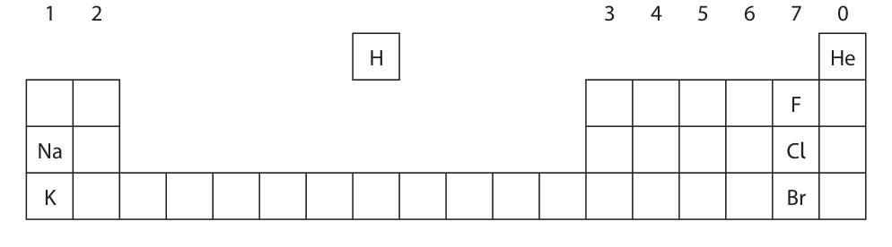
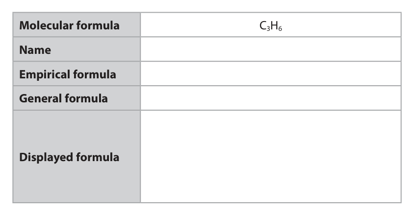
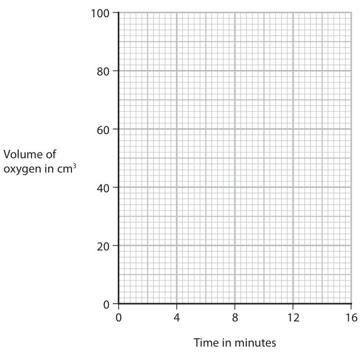
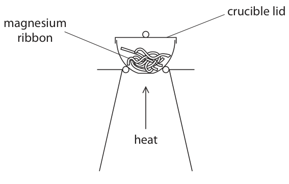
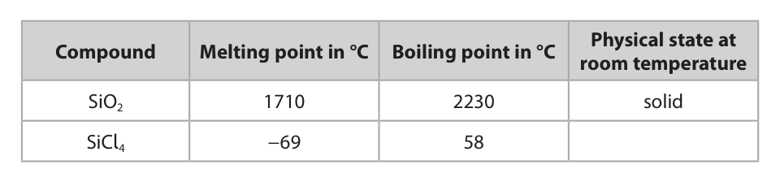
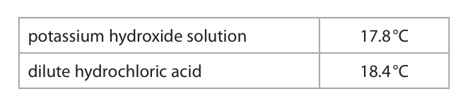
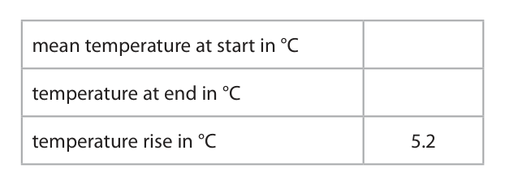

# 4CH1/1CR — 2020-11 (official extraction)

> schema `syllabai.official-paper-questions/0.2` · paper_id `pearson-edexcel:international-gcse:chemistry:4ch1:2020-11:4CH1/1CR` · qp sha256 `9f2ab398e5de3d19…` · extraction is the disclosed baseline (ADR-039)

## Question 1 (6 marks)
**(a)** The box gives some methods used in the separation of mixtures. chromatography crystallisation evaporation filtration fractional distillation simple distillation Use words from the box to answer these questions.

### 1(a)(i) [1]

Identify the method used to obtain pure water from sea water.

**Mark scheme answer**

> simple distillation REJECT fractional
> distillation
> REJECT distillation

- **(1)** simple distillation REJECT fractional

### 1(a)(ii) [1]

Identify the method used to separate the dyes in a food colouring.

**Mark scheme answer**

> chromatography

- **(1)** chromatography

### 1(a)(iii) [1]

Identify the method used to obtain ethanol from a mixture of ethanol and water.

**Mark scheme answer**

> fractional distillation

- **(1)** fractional distillation

### 1(b) [3]

Complete the sentences by writing a suitable word in each blank space. When salt is added to water and stirred until no more will , a saturated solution forms. The salt is the The water is the

**Mark scheme answer**

> M1 dissolve
> M2 solute
> M3 solvent

- **(1)** dissolve
- **(1)** solute
- **(1)** solvent

## Question 2 (5 marks)

The diagram shows the positions of some elements in the Periodic Table. 1 2 3 4 5 6 7 0 H He F Na Cl K Br

**(a)** Use symbols from this table to answer these questions. Each symbol may be used once, more than once or not at all.

### 2(a)(i) [1]

Give the symbol of a metal.

**Mark scheme answer**

> Na/K ACCEPT sodium/potassium

- **(1)** Na/K ACCEPT sodium/potassium

### 2(a)(ii) [1]

Give the symbol of a noble gas.

**Mark scheme answer**

> He ACCEPT helium

- **(1)** He ACCEPT helium

### 2(a)(iii) [1]

Give the symbol of a liquid at room temperature.

**Mark scheme answer**

> Br ACCEPT bromine
> REJECT bromide

- **(1)** Br ACCEPT bromine

### 2(a)(iv) [1]

Give the symbols of the two elements in Period 3 and

**Mark scheme answer**

> Na and Cl ACCEPT sodium and
> chlorine
> REJECT chloride

- **(1)** Na and Cl ACCEPT sodium and

### 2(b) [1]

Deduce the electronic configuration of Na

**Mark scheme answer**

> 2.8.1 ACCEPT 2,8,1 or 2 8 1
> ALLOW diagram of atom
> showing correct electron
> configuration.

- **(1)** 2.8.1 ACCEPT 2,8,1 or 2 8 1

## Question 3 (14 marks)

This question is about alkenes and alkanes.

**(b)** Alkenes are unsaturated compounds.

**(c)** When the alkane methane reacts with chlorine, the products are chloromethane (CH3Cl) and hydrogen chloride gas.

**(d)** When ethane reacts with chlorine, one of the products of the reaction has the formula C2H4Cl2 There are two isomers with this formula.

### 3(a) [4]

Complete the table by giving the missing information about the alkene with the molecular formula C3H6 Molecular formula C3H6 Name Empirical formula General formula Displayed formula

**Mark scheme answer**

> 4
> molecular formula C3H6
> name of this alkene propene ACCEPT propylene
> empirical formula CH2
> general formula CnH2n ACCEPT N or other
> letters e.g. x
> H H H
> I I I
> displayed formula H—C=C—C—H
> I
> H
> 1 mark for each correct answer

- **(4)** 4

### 3(b)(i) [1]

State what is meant by the term unsaturated.

**Mark scheme answer**

> (contains a carbon carbon) double bond ACCEPT multiple bond

- **(1)** (contains a carbon carbon) double bond ACCEPT multiple bond

### 3(b)(ii) [2]

Describe a test to show that a compound is unsaturated.

**Mark scheme answer**

> M1 add bromine water REJECT bromine
> REJECT bromide
> M2 decolourises/changes to colourless ALLOW turns colourless
> IGNORE clear
> M2 dep M1 or near miss

- **(1)** add bromine water REJECT bromine
- **(1)** decolourises/changes to colourless ALLOW turns colourless

### 3(c)(i) [1]

Give a chemical equation for this reaction.

**Mark scheme answer**

> CH4 + Cl2 → CH3Cl + HCl ACCEPT multiples

- **(1)** CH4 + Cl2 → CH3Cl + HCl ACCEPT multiples

### 3(c)(ii) [1]

What is the name of this type of reaction?

- **(A)** addition
- **(B)** decomposition
- **(C)** neutralisation
- **(D)** substitution  ✔

**Mark scheme answer**

> D Substitution
> A is incorrect as it is not an addition reaction
> B is incorrect as it is not a decomposition reaction
> C is incorrect as it is not a neutralisation reaction

- **(1)** Answer D: substitution

### 3(c)(iii) [1]

State the condition needed for this reaction to occur.

**Mark scheme answer**

> Ultraviolet radiation/light ACCEPT UV/ultraviolet
> rays

- **(1)** Ultraviolet radiation/light ACCEPT UV/ultraviolet

### 3(d)(i) [2]

State what is meant by the term isomers.

**Mark scheme answer**

> M1 (isomers have) the same molecular formula
> M2 (but) different structural/displayed formulae ALLOW different
> structures
> ALLOW different
> arrangement of atoms

- **(1)** (isomers have) the same molecular formula
- **(1)** (but) different structural/displayed formulae ALLOW different

### 3(d)(ii) [2]

Draw the displayed formulae of the two isomers with the formula C2H4Cl2 isomer 1 isomer 2

**Mark scheme answer**

> M1 H H
> H C C H
> Cl Cl
> M2 Cl H
> H C C H
> Cl H
> Total

- **(1)** H H
- **(1)** Cl H

## Question 4 (14 marks)

A solution of hydrogen peroxide decomposes when a catalyst of manganese(IV) oxide is added. The products of the reaction are water and oxygen.

**(d)** A student investigates how changing the concentration of the hydrogen peroxide solution affects the rate of this reaction. She uses this apparatus. hydrogen peroxide solution 0 20 40 60 80 100 cm3 oxygen manganese(IV) oxide The student records the volume of oxygen that collects every 2 minutes for 16 minutes. The table shows her results. Time in minutes 0 2 4 6 8 10 12 14 16 Volume of oxygen in cm3 0 22 38 50 55 69 76 80 80

**(e)** The student repeats the experiment using hydrogen peroxide solution of half the concentration of the original solution. She keeps the volume of the hydrogen peroxide solution and all other conditions the same.

### 4(a) [1]

Complete the chemical equation for this reaction H2O2 → H2O + O2

**Mark scheme answer**

> 2 H2 O2 → 2 H2O + (1) O2 ALLOW multiples and
> fractions

- **(1)** 2 H2 O2 → 2 H2O + (1) O2 ALLOW multiples and

### 4(b) [1]

Give a test for oxygen.

**Mark scheme answer**

> Relights a glowing splint/spill

- **(1)** Relights a glowing splint/spill

### 4(c) [1]

State the reason for adding a catalyst.

**Mark scheme answer**

> Speeds up/increases rate of the reaction IGNORE references to
> lowering activation
> energy

- **(1)** Speeds up/increases rate of the reaction IGNORE references to

### 4(d)(i) [1]

Plot the student’s results on the grid.

**Mark scheme answer**

> All points plotted correctly ALLOW ± half a
> square

- **(1)** All points plotted correctly ALLOW ± half a

### 4(d)(ii) [1]

Draw a circle on the grid around the anomalous result.

**Mark scheme answer**

> Point at 8 minutes circled

- **(1)** Point at 8 minutes circled

### 4(d)(iii) [1]

Draw a curve of best fit through the points, ignoring the anomalous result. 100 Volume of oxygen in cm3 0 4 8 12 16 Time in minutes

**Mark scheme answer**

> Smooth curve of best fit

- **(1)** Smooth curve of best fit

### 4(d)(iv) [1]

Suggest a mistake that the student might have made to cause the anomalous result.

**Mark scheme answer**

> took the reading too soon/before 8 minutes ACCEPT misread the
> volume (of oxygen)

- **(1)** took the reading too soon/before 8 minutes ACCEPT misread the

### 4(d)(v) [2]

Determine the volume of oxygen collected during the first 3 minutes. Show on your graph how you obtain your answer. volume of oxygen = cm3

**Mark scheme answer**

> M1 vertical line on graph drawn to curve from 3 mins
> M2 value obtained from candidate’s graph Expected value 29 or
> 30 cm3
> ALLOW ± half a
> square

- **(1)** vertical line on graph drawn to curve from 3 mins
- **(1)** value obtained from candidate’s graph Expected value 29 or

### 4(e)(i) [2]

Draw on the grid the curve you would expect the student to obtain.

**Mark scheme answer**

> M1 curve drawn on graph that is less steep than
> curve of student’s results.
> M2 curve levels off at 40 cm3 ALLOW ± half a square

- **(1)** curve drawn on graph that is less steep than
- **(1)** curve levels off at 40 cm3 ALLOW ± half a square

### 4(e)(ii) [3]

Explain how using hydrogen peroxide solution of half the concentration affects the rate of the reaction. Refer to particle collision theory in your answer.

**Mark scheme answer**

> An explanation that links the following three points
> M1 reaction is slower
> M2 fewer particles/molecules (in the same volume) ACCEPT particles are
> further apart / less
> crowded
> M3 fewer collisions per unit time ACCEPT less frequent
> collisions
> IGNORE less chance of a
> collision

- **(1)** reaction is slower
- **(1)** fewer particles/molecules (in the same volume) ACCEPT particles are
- **(1)** fewer collisions per unit time ACCEPT less frequent

## Question 5 (11 marks)
**(a)** The diagram shows the displayed formula of the organic compound methanol, CH3OH H H C O H H

**(b)** The atoms in methanol are held together by covalent bonds.

**(c)** Another organic compound has the percentage composition by mass C = 38.7% H = 9.7% O = 51.6%

### 5(a)(i) [1]

Determine the number of atoms in one molecule of methanol.

**Mark scheme answer**

> 6/six

- **(1)** 6/six

### 5(a)(ii) [1]

State why methanol is not a hydrocarbon.

**Mark scheme answer**

> One of the following two points
> methanol/it) does not contain only carbon and
> hydrogen
> OR
> (methanol/it) contains (an atom of) oxygen

- **(1)** One of the following two points

### 5(b)(i) [2]

State what is meant by the term covalent bond.

**Mark scheme answer**

> M1 two/ pair of electrons
> M2 shared between two atoms ACCEPT (electrons)
> attracted to the nuclei
> (of the two atoms in the
> bond)
> ACCEPT
> M1 (electrostatic)
> attraction between two
> nuclei
> M2 (and the) shared
> pair(s) of electrons
> (between them)

- **(1)** two/ pair of electrons
- **(1)** shared between two atoms ACCEPT (electrons)

### 5(b)(ii) [2]

Draw a dot-and-cross diagram to show the bonding in a molecule of methanol. Show only the outer electrons of each atom.

**Mark scheme answer**

> M1 4 pairs of electrons around central carbon atom, ALLOW any combination
> with one pair to O and 3 pairs to H of dots and crosses
> M2 rest of molecule fully correct M2 DEP on M1

- **(1)** 4 pairs of electrons around central carbon atom, ALLOW any combination
- **(1)** rest of molecule fully correct M2 DEP on M1

### 5(c)(i) [3]

Calculate the empirical formula of this compound. empirical formula =

**Mark scheme answer**

> • Divide percentages by relative atomic 0 marks if division by
> masses atomic numbers or
> • Divide results by smallest value to obtain upside-down calculation
> ratio
> • Write empirical formula
> Example calculation
> M1 C H O
> 38.7 9.7 51.6
> 12 1
> M2 3.225 9.7 3.225 M2 subsumes M1
> (3.225) (3.225) (3.225)
> OR 1 3
> M3 CH3O ACCEPT symbols in any
> order

- **(1)** C H O
- **(1)** 3.225 9.7 3.225 M2 subsumes M1
- **(1)** CH3O ACCEPT symbols in any

### 5(c)(ii) [2]

The relative molecular mass (Mr) of the compound is 62 Determine the molecular formula of the compound. molecular formula =

**Mark scheme answer**

> • Divide relative molecular mass by empirical
> formula mass
> • Write molecular formula
> Example calculation
> M1 62 OR 62 (= 2)
> 12 + 3 + 16
> M2 C2H6O2 ACCEPT symbols in any
> order
> Correct answer without
> working scores 2 marks

- **(1)** 62 OR 62 (= 2)
- **(1)** C2H6O2 ACCEPT symbols in any

## Question 6 (13 marks)

This question is about elements in Group 7 of the Periodic Table and their compounds.

### 6(a)(i) [1]

Give the name of this group of elements.

**Mark scheme answer**

> halogens REJECT halides

- **(1)** halogens REJECT halides

### 6(a)(ii) [1]

State the colour of chlorine gas.

**Mark scheme answer**

> (pale) green

- **(1)** (pale) green

### 6(a)(iii) [2]

Give a test for chlorine gas.

**Mark scheme answer**

> M1 test with (damp) litmus paper ALLOW (damp)
> universal indicator
> paper
> M2 bleaches
> ALLOW turns white
> IGNORE turns red
> M2 dep on M1

- **(1)** test with (damp) litmus paper ALLOW (damp)
- **(1)** bleaches

### 6(b) [3]

Give a test to show that a solution contains iodide ions. test result

**Mark scheme answer**

> A description that refers to the following three points M1 and M2 can be in
> either order
> M1 add (dilute) nitric acid (to the unknown solution) REJECT addition of
> incorrect acid
> M2 add silver nitrate (solution)
> M3 (pale) yellow precipitate M3 dep on M2

- **(1)** add (dilute) nitric acid (to the unknown solution) REJECT addition of
- **(1)** add silver nitrate (solution)
- **(1)** (pale) yellow precipitate M3 dep on M2

### 6(c) [6]

A student compares the reactivity of the elements bromine, chlorine and iodine. He mixes these pairs of solutions and observes the reactions that occur. • chlorine solution and potassium bromide solution • bromine solution and potassium iodide solution Explain how the reactions can be used to show the order of reactivity of the three elements. Include the colour change that the student would observe in each reaction.

**Mark scheme answer**

> An explanation that links the following six points
> chlorine solution and potassium bromide solution
> M1 (solution) turns orange ACCEPT yellow
> REJECT brown/red
> M2 (because) chlorine displaces bromine ACCEPT correct word
> equation, balanced
> chemical equation or ionic
> equation.
> M3 (so) chlorine is more reactive than bromine
> bromine solution and potassium iodide solution
> M4 (solution) turns brown
> M5 (because) bromine displaces iodine ACCEPT correct word
> equation, balanced
> chemical equation or ionic
> equation
> M6 (so) bromine is more reactive than iodine If incorrect use of chloride,
> bromide or iodide in any
> marking point deduct 1
> mark.
> ALLOW 1 mark for correct
> order of reactivity given if
> M3 and M6 not scored
> Total

- **(1)** (solution) turns orange ACCEPT yellow
- **(1)** (because) chlorine displaces bromine ACCEPT correct word
- **(1)** (so) chlorine is more reactive than bromine
- **(1)** (solution) turns brown
- **(1)** (because) bromine displaces iodine ACCEPT correct word
- **(1)** (so) bromine is more reactive than iodine If incorrect use of chloride,

## Question 7 (13 marks)

A student uses the reaction between zinc and dilute sulfuric acid to prepare some zinc sulfate crystals.

**(b)** The student adds excess zinc to a beaker of dilute sulfuric acid.

**(c)** The student obtains a pure, dry sample of zinc sulfate crystals. The formula of zinc sulfate crystals is ZnSO4.7H2O

### 7(a)(i) [1]

Complete the equation for this reaction by giving the correct state symbols. Zn ( ) + H2SO4 ( ) → ZnSO4 ( ) + H2 ( )

**Mark scheme answer**

> Zn (s) + H2SO4 (aq) → ZnSO4 (aq) + H2 (g) ACCEPT upper case
> letters

- **(1)** Zn (s) + H2SO4 (aq) → ZnSO4 (aq) + H2 (g) ACCEPT upper case

### 7(a)(ii) [1]

State what would be observed during this reaction.

**Mark scheme answer**

> effervescence/bubbles/fizzing ACCEPT zinc gets smaller
> or disappears
> IGNORE hydrogen / gas
> produced / given off

- **(1)** effervescence/bubbles/fizzing ACCEPT zinc gets smaller

### 7(b)(i) [2]

Explain why it is necessary to add excess zinc.

**Mark scheme answer**

> An explanation that links the following two points
> M1 to make sure all of the acid reacts
> M2 (so that) a pure zinc sulfate solution is
> obtained/pure zinc sulfate crystals are obtained
> OWTTE

- **(1)** to make sure all of the acid reacts
- **(1)** (so that) a pure zinc sulfate solution is

### 7(b)(ii) [2]

Draw a diagram of the apparatus the student should use to remove the unreacted zinc and collect the zinc sulfate solution.

> 🖼 crop required: apparatus (qp.pdf p.16)

**Mark scheme answer**

> M1 filter funnel containing filter paper
> M2 suitable container to collect filtrate e.g. M2 dep on a filter funnel
> beaker, conical flask, evaporating basin in M1

- **(1)** filter funnel containing filter paper
- **(1)** suitable container to collect filtrate e.g. M2 dep on a filter funnel

### 7(c)(i) [2]

Calculate the relative molecular mass (Mr) of zinc sulfate crystals. Mr =

**Mark scheme answer**

> • setting out of calculation correct answer without
> • evaluation working scores 2
> Example calculation
> M1 65 + 32 + (4 x 16) + (7 x 18)
> M2 287

- **(1)** 65 + 32 + (4 x 16) + (7 x 18)
- **(1)** 287

### 7(c)(ii) [2]

The student uses 0.0200 mol of dilute sulfuric acid in her preparation. Show that the maximum mass of zinc sulfate crystals that the student could obtain is about 6 g.

**Mark scheme answer**

> • multiply moles by Mr correct answer (5.74)
> • evaluation without working scores
> Example calculation
> M1 (mass of ZnSO4.7H2O =) 287 x 0.02(00) ALLOW ecf from (i)
> M2 (mass of ZnSO4.7H2O =) 5.74 (g)

- **(1)** (mass of ZnSO4.7H2O =) 287 x 0.02(00) ALLOW ecf from (i)
- **(1)** (mass of ZnSO4.7H2O =) 5.74 (g)

### 7(c)(iii) [3]

The student obtains a mass of 4.28 g of zinc sulfate crystals. Calculate the percentage yield of the zinc sulfate crystals. Give your answer to three significant figures. percentage yield = %

**Mark scheme answer**

> M1 4.28÷5.74 OR 0.7456 correct answer to 3 sig
> figs without working
> scores 3
> ALLOW ecf from (ii)
> ALLOW use of 6g
> M2 0.7456 × 100 ALLOW any number of
> sig fig greater than 1
> M3 74.6 ALLOW use of 6g giving
> answer of 71.3
> Must be 3 sig figs to
> score M3
> Total

- **(1)** 4.28÷5.74 OR 0.7456 correct answer to 3 sig
- **(1)** 0.7456 × 100 ALLOW any number of
- **(1)** 74.6 ALLOW use of 6g giving

## Question 8 (10 marks)
**(a)** A piece of magnesium ribbon is ignited and placed in a gas jar of oxygen. The equation for the reaction is 2Mg + O2 → 2MgO

**(b)** A second piece of magnesium ribbon is ignited and placed in a gas jar of carbon dioxide. A very exothermic reaction occurs, forming magnesium oxide and carbon.

### 8(a)(i) [2]

Give two observations that would be made in this reaction. 1 2

**Mark scheme answer**

> M1 white flame/light
> M2 white powder/solid (formed) ALLOW white smoke
> ALLOW white ash
> REJECT white precipitate

- **(1)** white flame/light
- **(1)** white powder/solid (formed) ALLOW white smoke

### 8(a)(ii) [1]

State why this is an oxidation reaction.

**Mark scheme answer**

> magnesium gains oxygen ACCEPT magnesium loses
> electrons/ oxidation state
> (of Mg) increases / goes
> from / changes from 0 to
> +2

- **(1)** magnesium gains oxygen ACCEPT magnesium loses

### 8(b)(i) [1]

State what is meant by the term exothermic.

**Mark scheme answer**

> gives out/releases heat (energy)/thermal energy IGNORE energy alone

- **(1)** gives out/releases heat (energy)/thermal energy IGNORE energy alone

### 8(b)(ii) [1]

Give the chemical equation for this reaction.

**Mark scheme answer**

> 2Mg + CO2 → 2MgO + C ALLOW multiples and
> fractions

- **(1)** 2Mg + CO2 → 2MgO + C ALLOW multiples and

### 8(b)(iii) [1]

A fire starts in a warehouse where magnesium is stored. Suggest why it would not be suitable to use a carbon dioxide fire extinguisher to put out this fire.

**Mark scheme answer**

> Any one from
> the fire would keep burning ALLOW Any other sensible
> OR suggestion
> the carbon dioxide would not put out the fire
> OR
> a large amount of heat/thermal energy would be
> released

- **(1)** Any one from

### 8(c) [4]

A student uses this apparatus to find the mass of magnesium oxide that forms when a known mass of magnesium is heated. crucible lid magnesium ribbon heat This is his method. • find the mass of the crucible and lid • place some magnesium ribbon in the crucible • find the mass of the crucible, lid and magnesium • heat the crucible with the lid on for a few minutes • find the mass of the crucible, lid and magnesium oxide Using this method, the mass of magnesium oxide formed is less than expected. Explain two changes that the student should make to his method to obtain a mass of magnesium oxide closer to the expected mass. 1 2

**Mark scheme answer**

> An explanation giving two linked changes
> M1 (the student should) lift and replace the lid
> M2 (to allow) oxygen/air to enter the crucible (to
> react with the magnesium)
> AND
> M3 reheat and reweigh / heat to constant mass
> M4 to make sure that all the magnesium has reacted

- **(1)** (the student should) lift and replace the lid
- **(1)** (to allow) oxygen/air to enter the crucible (to
- **(1)** reheat and reweigh / heat to constant mass
- **(1)** to make sure that all the magnesium has reacted

## Question 9 (11 marks)

This question is about some compounds of the elements in Group 4 of the Periodic Table.

**(a)** When carbon dioxide dissolves in water, a weak acid forms.

**(b)** When lead(II) carbonate is heated, lead(II) oxide and carbon dioxide form.

**(c)** Silicon dioxide, SiO2, and silicon(IV) chloride, SiCl4, are both covalently bonded compounds. The table shows the melting and boiling points of these two compounds, and the physical state of silicon dioxide at room temperature. Physical state at Compound Melting point in °C Boiling point in °C room temperature SiO2 1710 2230 solid SiCl4 −69 58

### 9(a)(i) [1]

Which of these could be the pH of this weak acid?

- **(A)** 1
- **(B)** 5  ✔
- **(C)** 7
- **(D)** 9

**Mark scheme answer**

> B5
> A is incorrect as 1 is the pH of a strong acid
> C is incorrect as 7 is the pH of a neutral solution
> D is incorrect as 9 is the pH of a weak alkali

- **(1)** Answer B: 5

### 9(a)(ii) [1]

Which of these is a correct statement about acids?

- **(A)** acids contain OH⁻ ions
- **(B)** acids are electron donors
- **(C)** acids are proton acceptors
- **(D)** acids are proton donors  ✔

**Mark scheme answer**

> D acids are proton donors
> A is incorrect as alkalis contain OH− ions not acids
> B is incorrect as acids do not donate electrons
> C is incorrect as bases are proton acceptors not
> acids

- **(1)** Answer D: acids are proton donors

### 9(b)(i) [1]

Give the name of this type of reaction.

**Mark scheme answer**

> (thermal) decomposition

- **(1)** (thermal) decomposition

### 9(b)(ii) [1]

Complete the equation for this reaction. PbCO3 → +

**Mark scheme answer**

> PbCO3 → PbO + CO2 ALLOW multiples

- **(1)** PbCO3 → PbO + CO2 ALLOW multiples

### 9(c)(i) [1]

Complete the table by giving the physical state of silicon(IV) chloride at room temperature.

**Mark scheme answer**

> liquid (shown in table) ALLOW if liquid written
> in space under question
> ALLOW l or L

- **(1)** liquid (shown in table) ALLOW if liquid written

### 9(c)(ii) [6]

Explain, in terms of structure and bonding, why silicon dioxide has a much higher melting point than silicon(IV) chloride.

**Mark scheme answer**

> An explanation which links any six of the following
> points
> M1 silicon dioxide has a giant (covalent) structure
> M2 covalent bonds are (very) strong
> M3 (in silicon dioxide) many/all the covalent bonds No M3 or M4 if
> need to be broken reference to
> overcoming / breaking
> intermolecular forces in
> silicon dioxide
> M4 a large amount of / more energy is required to
> break the bonds (in silicon dioxide)
> M5 silicon(IV) chloride has a simple molecular
> structure
> M6 the forces between the
> molecules/intermolecular forces (in silicon(IV) No M6 or M7 if any
> chloride) are weak reference to weak
> covalent bonds or
> M7 little / less energy is needed to overcome the breaking of covalent
> forces in silicon(IV) chloride bonds in silicon(IV)
> chloride
> A statement such as
> ‘more energy is needed
> to break the bonds in
> silicon dioxide than to
> overcome the forces in
> silicon(IV) chloride’
> scores M4 and M7

- **(6)** An explanation which links any six of the following

## Question 10 (13 marks)

A student uses this apparatus to investigate the reaction between potassium hydroxide solution and dilute hydrochloric acid. polystyrene cup This is her method. • pour 25 cm3 of potassium hydroxide solution into a polystyrene cup and record the temperature of the solution • pour 25 cm3 of dilute hydrochloric acid into a measuring cylinder and record the temperature of the acid • add the acid to the polystyrene cup and stir the mixture • record the highest temperature reached

**(c)** The student repeats the experiment on a different day, using 25 cm3 of potassium hydroxide solution and 25 cm3 of dilute hydrochloric acid. The thermometer shows the highest temperature reached at the end of the experiment. °C 25

### 10(a)(i) [1]

Give a word equation for the reaction between potassium hydroxide and hydrochloric acid.

**Mark scheme answer**

> potassium hydroxide + hydrochloric acid → ALLOW correctly
> potassium chloride + water balanced chemical
> equation

- **(1)** potassium hydroxide + hydrochloric acid → ALLOW correctly

### 10(a)(ii) [2]

Explain why the student needs to stir the mixture.

**Mark scheme answer**

> M1 to mix (the two solutions more thoroughly)
> M2 (so that) more reactant particles come into ALLOW references to
> contact with each other OWTTE increasing rate of
> reaction
> M3 so that the heat energy is given out more
> quickly OWTTE
> M4 so that the mixture is the same temperature
> throughout OWTTE

- **(2)** M1 to mix (the two solutions more thoroughly)

### 10(b) [2]

The table gives the temperatures of the solutions before the student mixes them. potassium hydroxide solution 17.8 °C dilute hydrochloric acid 18.4 °C Calculate the mean (average) temperature of the two solutions. mean temperature = °C

**Mark scheme answer**

> Correct answer with or without working scores 2
> • setting out of calculation
> • evaluation
> Example calculation
> M1 17.8 + 18.4
> M2 18.1

- **(1)** 17.8 + 18.4
- **(1)** 18.1

### 10(c)(i) [2]

Complete the table by giving the missing information. Give both temperatures to the nearest 0.1 °C. mean temperature at start in °C temperature at end in °C temperature rise in °C 5.2

**Mark scheme answer**

> Mean temperature at start in oC 17.2
> Temperature at end in oC 22.4
> Temperature rise in oC 5.2

- **(2)** Mean temperature at start in oC 17.2

### 10(c)(ii) [3]

Show that the heat energy change, Q, in the student’s experiment is about 1100 J. [for the mixture, c = 4.2 J/g/°C] [mass of 1.0 cm3 of mixture = 1.0 g]

**Mark scheme answer**

> • calculation of volume/mass of mixture
> • substitution of values into Q = mcΔT
> • evaluation
> Example calculation
> M1 (volume/mass =) 25 + 25 OR 50 (cm3) or (g)
> M2 (Q =) 50 x 4.2 x 5.2 ALLOW ecf if 25 used in
> calculation
> M3 (Q =) 1092 1092 without working
> scores 3 marks

- **(1)** (volume/mass =) 25 + 25 OR 50 (cm3) or (g)
- **(1)** (Q =) 50 x 4.2 x 5.2 ALLOW ecf if 25 used in
- **(1)** (Q =) 1092 1092 without working

### 10(c)(iii) [3]

The student uses 0.020 mol of potassium hydroxide in his experiment. Calculate the enthalpy change (ΔH) in kJ/mol, for 1.0 mol of potassium hydroxide. Include a sign in your answer. ΔH = kJ/mol

**Mark scheme answer**

> • division of Q by moles of KOH ALLOW ecf from answer
> • conversion of J to kJ to (ii)
> • answer with correct sign ALLOW any number of sig
> figs greater than 1
> throughout
> Example calculation
> M1 1092 OR 54600 ACCEPT 1092 or 1100 used
> 0.02 in calculation
> M2 conversion from J to kJ OR 54.6(00) ALLOW ecf from M1
> M3 (ΔH =) − 54.6 (kJ/mol) Minus sign must be
> present
> ALLOW ecf from M2
> ACCEPT any value
> between 54.5 and 55
> M3 dep on division of Q by
> moles
> Correct answer with
> correct sign and without
> working scores 3
> Correct answer without
> sign or with incorrect sign
> and without working
> scores 2.

- **(1)** 1092 OR 54600 ACCEPT 1092 or 1100 used
- **(1)** conversion from J to kJ OR 54.6(00) ALLOW ecf from M1
- **(1)** (ΔH =) − 54.6 (kJ/mol) Minus sign must be

