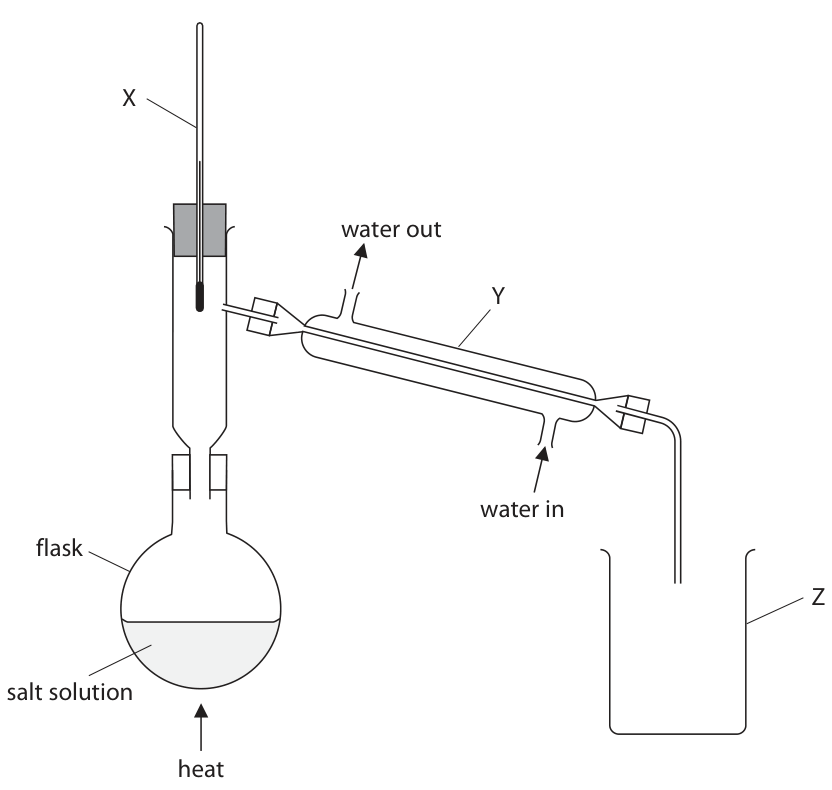
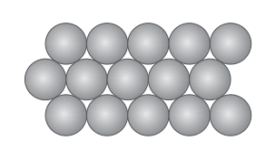
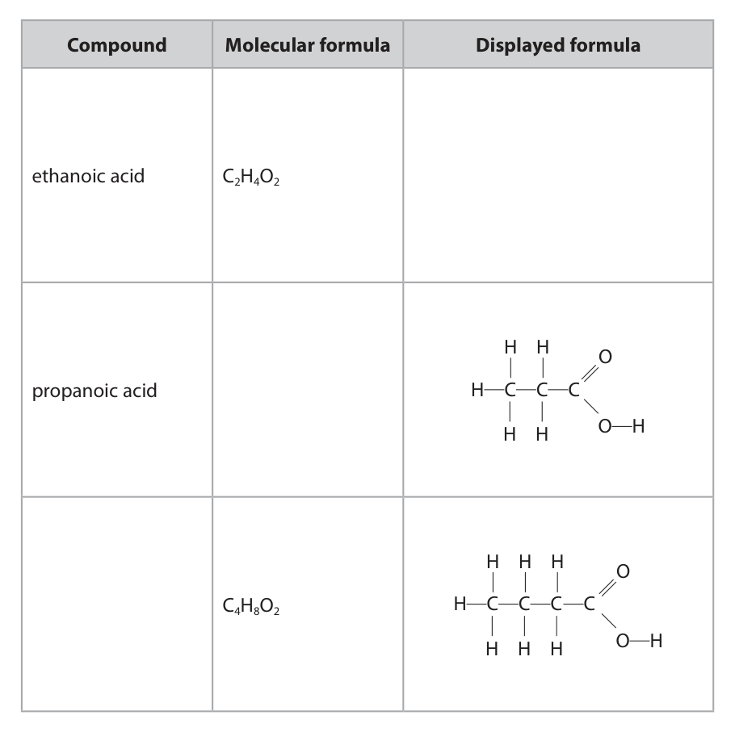
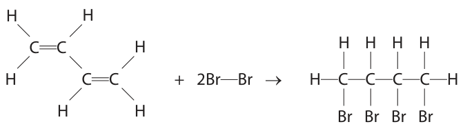
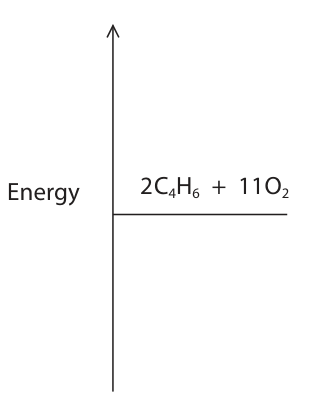

# 4CH1/2C — 2020-11 (official extraction)

> schema `syllabai.official-paper-questions/0.1` · paper_id `pearson-edexcel:international-gcse:chemistry:4ch1:2020-11:4CH1/2C` · qp sha256 `01949da0e27e17ec…` · extracted verbatim, never regenerated (ADR-037)

## Question 1 (5 marks)

A student is given a mixture of salt solution and sand. She wants to obtain pure water from the mixture.

**(b)** The student then uses this apparatus to obtain pure water from the salt solution. X water out Y water in flask Z salt solution heat

### 1(a) [1]

She separates the sand from the salt solution. Which method of separation should she use?

- **(A)** crystallisation
- **(B)** filtration  ✔
- **(C)** fractional distillation
- **(D)** simple distillation

**Mark scheme answer**

> B filtration is the correct answer because it will
> enable sand to be separated from salt solution comp
> A is not correct because crystallisation will not
> enable sand to be separated from salt solution
> C is not correct because fractional distillation will
> not enable sand to be separated from salt solution
> D is not correct because simple distillation will not
> enable sand to be separated from salt solution

- **(1)** Answer B: filtration

### 1(b)(i) [3]

Name the pieces of apparatus labelled X, Y and Z. X Y Z

**Mark scheme answer**

> X is a thermometer
> cler
> Y is a (Liebig) condenser
> Z is a beaker

- **(3)** X is a thermometer

### 1(b)(ii) [1]

State what remains in the flask when the separation is complete.

**Mark scheme answer**

> salt
> cler
> Total for Q1 = 5
> Question
> Notes Marks
> number
> Answer

- **(1)** salt

## Question 2 (7 marks)

In a chromatography experiment a student uses samples of three pure food dyes, blue (B), red (R) and yellow (Y). He also uses samples of four unknown substances, S, T, U and V. The student puts a small drop of each substance on the pencil line. The diagram shows the student’s chromatogram at the end of the experiment. solvent front at end pencil line B R Y S T U V solvent level at start

### 2(a) [1]

Which of the unknown substances contains only one food dye?

- **(A)** substance S  ✔
- **(B)** substance T
- **(C)** substance U
- **(D)** substance V

**Mark scheme answer**

> A substance S is the correct answer because S
> only contains one dye as it produces only one spot comp
> B is not correct because T does not only contain
> one dye as it produces two spots
> C is not correct because U does not only contain
> one dye as it produces three spots
> D is not correct because V does not only contain
> one dye as it produces two spots

- **(1)** Answer A: substance S

### 2(b) [2]

Explain which pure food dyes are in substance V.

**Mark scheme answer**

> explanation containing following points
> grad
> M1 (V contains) blue/B and red/R (dyes)
> M2 because V has spots at same height as those
> from blue/B and red/R OWTTE

- **(1)** (V contains) blue/B and red/R (dyes)
- **(1)** because V has spots at same height as those

### 2(c)(i) [3]

Calculate the Rf value of the yellow food dye Y. Rf =

**Mark scheme answer**

> M1 correct measurement of distance moved by ALLOW 5.7-6.1
> spot Y
> exp
> M2 correct measurement of distance moved by ALLOW 8.7-9.1
> solvent
> M3 use and evaluation of
> Rf = distance moved by spot Y ALLOW 1-4 sig fig
> distance moved by solvent ALLOW ECF from M1 M2
> only if Rf < 1

- **(1)** correct measurement of distance moved by ALLOW 5.7-6.1
- **(1)** correct measurement of distance moved by ALLOW 8.7-9.1
- **(1)** use and evaluation of

### 2(c)(ii) [1]

State how the chromatogram suggests that the yellow food dye Y is less soluble in the solvent than the red food dye R.

**Mark scheme answer**

> spot from yellow food dye/Y does not move as far ORA
> as spot from red food dye/R OWTTE exp
> Total for Q2 = 7
> Question
> Answer Notes Marks
> number

- **(1)** spot from yellow food dye/Y does not move as far ORA

## Question 3 (10 marks)
**(a)** The box gives the names of some metals. calcium copper iron magnesium silver zinc

### 3(a)(i) [1]

Identify the metal from the box that burns with a bright white flame.

**Mark scheme answer**

> magnesium ALLOW Mg
> cler

- **(1)** magnesium ALLOW Mg

### 3(a)(ii) [2]

In the Earth, metals are found either in ores or as uncombined elements. Explain which metal from the box is most likely to be found as an uncombined element.

**Mark scheme answer**

> explanation including the following points
> grad
> M1 silver
> M2 because it is the least reactive (of the metals) ALLOW it is very
> unreactive

- **(1)** silver
- **(1)** because it is the least reactive (of the metals) ALLOW it is very

### 3(b) [3]

This is the order of reactivity of four metals. most reactive aluminium iron lead least reactive copper The method used to obtain a metal from its oxide depends on the reactivity of the metal. Two possible methods are Method 1 heating the metal oxide with carbon Method 2 electrolysis Explain which method should be used to obtain lead from lead(II) oxide, PbO Include an equation for the formation of lead in your answer.

**Mark scheme answer**

> explanation including the following points:
> exp
> M1 Method 1/ heating the metal oxide/lead(II)
> oxide with carbon
> M2 (because) lead is less reactive than iron (and ALLOW carbon is more
> iron is obtained from iron oxide by carbon reactive than lead
> extraction)
> ACCEPT reverse
> arguments
> M3 2PbO + C  2Pb + CO2 ALLOW PbO + CO  Pb
> + CO2
> ALLOW PbO + C  Pb
> +CO
> Question
> Answer Notes Marks
> number

- **(1)** Method 1/ heating the metal oxide/lead(II)
- **(1)** (because) lead is less reactive than iron (and ALLOW carbon is more
- **(1)** 2PbO + C  2Pb + CO2 ALLOW PbO + CO  Pb

### 3(c) [4]

The diagram shows the arrangement of the particles in a pure metal. Metals are often made into alloys to make them harder. Explain why alloys are harder than pure metals. Draw a diagram to support your answer.

**Mark scheme answer**

> Explanation containing the following points
> exp
> Pure metal: REJECT molecules once
> only
> M1 (particles/ions/atoms are same size in a regular
> arrangement so) layers can easily slide over each
> other
> Alloy:
> M2 diagram of alloy structure showing minimum of
> three layers with at least one different sized circle
> M3 (having different sized particles/ions/atoms) ALLOW disrupts the
> disrupts/breaks up regular arrangement OWTTE lattice / layers / rows
> (of particles/ions
> /atoms)
> M4 so hard(er) for layers to slide over each other ALLOW layers cannot
> slide over each other
> IGNORE references to
> strength/breaking of
> forces/(metallic) bonds
> Total for Q3 = 10
> Question
> Answer Notes Marks
> number

- **(1)** (particles/ions/atoms are same size in a regular
- **(1)** diagram of alloy structure showing minimum of
- **(1)** (having different sized particles/ions/atoms) ALLOW disrupts the
- **(1)** so hard(er) for layers to slide over each other ALLOW layers cannot

## Question 4 (15 marks)

Alcohols contain the functional group —OH

**(b)** Ethanol (C2H5OH) is an alcohol that can be obtained from glucose (C6H12O6).

**(c)** The table gives information about some organic compounds in the same homologous series. Compound Molecular formula Displayed formula ethanoic acid C2H4O2 H H O propanoic acid H C C C H H O H H H H O C4H8O2 H C C C C H H H O H

**(d)** The compounds in the table can react with alcohols to form esters. When preparing esters, a small amount of concentrated sulfuric acid is also used.

### 4(a) [1]

Give the structural formula of the alcohol that contains one carbon atom.

**Mark scheme answer**

> CH3OH IGNORE displayed
> formula grad

- **(1)** CH3OH IGNORE displayed

### 4(b)(i) [1]

Name the process that converts glucose into ethanol.

**Mark scheme answer**

> fermentation
> cler

- **(1)** fermentation

### 4(b)(ii) [4]

Explain why this process is carried out in the absence of air and at a temperature below 40 °C.

**Mark scheme answer**

> Explanation including four from
> M1 fermentation/reaction/respiration needs to be ALLOW exp
> anaerobic M1 in air ethanol would
> react with oxygen / be
> oxidised
> M2 because in air / aerobic conditions ethanol not M2 in air ethanol would
> produced form ethanoic acid
> /carboxylic
> acid/vinegar
> M3 because in air / aerobic conditions CO2 and H2O
> are produced
> M4 (if temperature above 40 ℃/too high) enzymes
> (in yeast) become denatured/lose their structure
> OWTTE
> M5 causing fermentation/reaction to slow down ALLOW reference to
> /stop optimum temperature
> (between 30 ℃ and
> 40 ℃)
> Question
> Answer Notes Marks
> number

- **(4)** Explanation including four from

### 4(c)(i) [3]

Complete the table by giving the missing information.

**Mark scheme answer**

> 3
> grad
> M1
> M2 C3H6O2
> M3 butanoic acid

- **(3)** 3

### 4(c)(ii) [1]

Name the homologous series that contains these compounds.

**Mark scheme answer**

> carboxylic (acids)
> grad

- **(1)** carboxylic (acids)

### 4(d)(i) [1]

State the purpose of the acid.

**Mark scheme answer**

> (acid acts as) a catalyst/to speed up reaction IGNORE references to
> activation energy grad

- **(1)** (acid acts as) a catalyst/to speed up reaction IGNORE references to

### 4(d)(ii) [2]

Draw the displayed formula of the ester that forms when propanoic acid reacts with ethanol.

**Mark scheme answer**

> exp
> M1 ester linkage
> M2 rest of molecule fully correct M2 DEP M1

- **(1)** ester linkage
- **(1)** rest of molecule fully correct M2 DEP M1

### 4(d)(iii) [2]

Esters have particular uses that depend on their properties. Give an example of a property and use of esters. property use

**Mark scheme answer**

> M1 (Property:) distinctive/sweet/fruity smell ALLOW volatile
> exp
> M2 used in perfumes/flavourings ALLOW any correct use
> eg in making soaps/ in
> solvents (for
> paints/varnishes)
> Total for Q4 = 15
> Question
> Answer Notes Marks
> number

- **(1)** (Property:) distinctive/sweet/fruity smell ALLOW volatile
- **(1)** used in perfumes/flavourings ALLOW any correct use

## Question 5 (15 marks)

The organic compound butadiene is a colourless gas used in the manufacture of synthetic rubber for tyres. The displayed formula of butadiene is H H C C H H C C H H

**(c)** A scientist does an investigation to find out if butadiene would be a good fuel. He burns a sample of butadiene gas and observes that carbon forms as black soot.

### 5(a) [3]

Explain why butadiene is described as an unsaturated hydrocarbon.

**Mark scheme answer**

> Explanation including following points
> grad
> M1 (unsaturated because) ALLOW contains C=C
> contains (carbon to carbon) double bond(s)
> M2 (hydrocarbon because) REJECT molecules
> contains (the elements/atoms) carbon and hydrogen
> M3 only M3 DEP on carbon and
> hydrogen

- **(1)** (unsaturated because) ALLOW contains C=C
- **(1)** (hydrocarbon because) REJECT molecules
- **(1)** only M3 DEP on carbon and

### 5(b)(i) [1]

Butadiene reacts with bromine water. State the colour change that occurs during this reaction. from to

**Mark scheme answer**

> from orange to colourless ALLOW yellow for
> orange or any grad
> combination of
> orange/yellow
> IGNORE clear

- **(1)** from orange to colourless ALLOW yellow for

### 5(b)(ii) [4]

The equation for the reaction between butadiene and bromine can be shown using displayed formulae. H H C C H H H H H H C C + 2Br Br → H C C C C H H H Br Br Br Br The table gives some bond energies. Bond C—H C= C Br—Br C—C C—Br Bond energy in kJ/mol 412 612 193 348 276 Use this information to calculate the enthalpy change, ΔH, for the reaction. Include a sign in your answer. ΔH = kJ/mol

**Mark scheme answer**

> calculation including following steps
> Exp
> M1 calculation of energy involved in bond breaking in reactants
> M2 calculation of energy involved in bond making in products
> M3 evaluation of difference ECF from M1 and M2
> M4 correct answer and sign
> Example calculation
> M1 2(612) + 1(348) + 6(412) + 2(193) OR 4430 IGNORE signs in M1 and
> M2
> M2 3(348) + 6(412) + 4(276) OR 4620 ACCEPT
> 2(612) + 2(193) OR 1610
> for M1 and
> 2(348) + 4(276) OR 1800
> for M2
> M3 (4620 - 4430 = ) 190 IGNORE sign
> ACCEPT (1800 – 1610 = )
> 190
> M4 -190
> M3 M4 ECF from M1 and
> M2
> If M1 > M2 answer for
> M4 must be positive
> If M1 < M2 answer for
> M4 must be negative
> -190 with or without
> working scores 4
> (+) 190 with or without
> working scores 3

- **(4)** calculation including following steps

### 5(c)(i) [1]

Complete the equation to explain the scientist’s observation. 2C4H6 + 7O2 → C + 4CO + 2CO2 + H2O

**Mark scheme answer**

> 2 C4H6 + 7 O2 2C + 4 CO + 2 CO2+ 6H2O
> Exp

- **(1)** 2 C4H6 + 7 O2 2C + 4 CO + 2 CO2+ 6H2O

### 5(c)(ii) [2]

Explain how one of the products, other than carbon, may cause a problem.

**Mark scheme answer**

> Explanation including
> M2 DEP M1 correct or Exp
> M1 CO/carbon monoxide missing
> M2 is poisonous/toxic/reduces capacity of blood to carry oxygen ACCEPT prevents blood
> OWTTE from carrying oxygen
> OWTTE
> ALLOW correct
> explanation in terms of
> haemoglobin eg
> OR prevents haemoglobin
> from carrying oxygen /
> M1 CO2/carbon dioxide forms
> carboxyhaemoglobin
> M2 is a greenhouse gas/contributes to global warming/
> contributes to climate change OWTTE

- **(2)** Explanation including

### 5(c)(iii) [4]

The equation for the combustion of butadiene in excess oxygen is 2C4H6 + 11O2 → 8CO2 + 6H2O The enthalpy change for this reaction, ΔH, is – 3446 kJ/mol. Complete the energy profile diagram for the reaction. Label the enthalpy change for this reaction, ΔH, and the activation energy. Energy 2C4H6 + 11O2

**Mark scheme answer**

> 4
> Exp
> M1 horizontal line below level of reactants with 8 CO2 + 6 H2O
> M2 profile curve rising from reactants level to form “hump” and
> then falling down to products level
> M3 activation energy correctly shown and labelled ALLOW double headed
> arrow
> REJECT arrow pointing
> downwards
> M4 H correctly shown and labelled ALLOW double headed
> arrow
> REJECT arrow pointing
> upwards
> ALLOW -3446 for H
> label
> an endothermic
> reaction profile can
> score M2 M3 M4 ECF
> Total for Q5 = 15
> Question
> Answer Notes Marks
> number

- **(1)** horizontal line below level of reactants with 8 CO2 + 6 H2O
- **(1)** profile curve rising from reactants level to form “hump” and
- **(1)** activation energy correctly shown and labelled ALLOW double headed
- **(1)** H correctly shown and labelled ALLOW double headed

## Question 6 (11 marks)

A student is provided with a bottle containing a colourless solution X. Solution X is thought to be dilute sulfuric acid of concentration 0.10 mol/dm3. The student does some experiments on samples of solution X to try to show that it is dilute sulfuric acid. The student adds a few drops of litmus to a sample of solution X. The litmus turns red.

**(a)** The student knows that the products of the electrolysis of dilute sulfuric acid are hydrogen and oxygen. She carries out the electrolysis using this apparatus. oxygen hydrogen solution X graphite anode graphite cathode + − power supply

**(c)** The student then does a titration to see if the concentration of the dilute sulfuric acid is 0.10 mol/dm3. She measures 25.0 cm3 of potassium hydroxide solution into a conical flask, and then adds a few drops of indicator solution.

### 6(a)(i) [1]

Suggest why the student does not use zinc electrodes in her experiment.

**Mark scheme answer**

> zinc would react with sulfuric acid/solution X IGNORE zinc is too
> reactive grad

- **(1)** zinc would react with sulfuric acid/solution X IGNORE zinc is too

### 6(a)(ii) [1]

State what is observed at both the anode and the cathode during the electrolysis.

**Mark scheme answer**

> bubbles ALLOW fizzing /
> effervescence grad
> IGNORE gas evolved
> IGNORE incorrectly
> named gas

- **(1)** bubbles ALLOW fizzing /

### 6(a)(iii) [1]

Which of these tests shows that the gas formed at the cathode is hydrogen?

- **(A)** a glowing splint relights
- **(B)** a burning splint gives a squeaky pop  ✔
- **(C)** a burning splint goes out
- **(D)** limewater turns cloudy

**Mark scheme answer**

> B a burning splint gives a squeaky pop is correct
> because this is the test for hydrogen comp
> A is incorrect because a glowing splint relights is
> not the test for hydrogen
> C is incorrect because a burning splint goes out is
> not the test for hydrogen
> D is incorrect because limewater turns cloudy is
> not the test for hydrogen

- **(1)** Answer B: a burning splint gives a squeaky pop

### 6(b) [2]

Describe a test to show that solution X contains sulfate ions.

**Mark scheme answer**

> description including
> M1 add barium chloride/BaCl2 ACCEPT barium
> nitrate/Ba(NO3)2 Grad
> IGNORE references to
> adding (dilute)
> HCl/HNO3
> REJECT add H2SO4
> M2 white ppt forms M2 DEP M1

- **(1)** add barium chloride/BaCl2 ACCEPT barium
- **(1)** white ppt forms M2 DEP M1

### 6(c)(i) [1]

Name the piece of apparatus the student should use to measure 25.0 cm3 of the potassium hydroxide solution.

**Mark scheme answer**

> (graduated) pipette ALLOW burette
> Cler

- **(1)** (graduated) pipette ALLOW burette

### 6(c)(ii) [2]

The concentration of potassium hydroxide in the solution is 0.125 mol/dm3. Calculate the amount, in mol, of KOH in 25.0 cm3 of this solution. amount = mol

**Mark scheme answer**

> calculation with following steps
> M1 setting out of how to calculate n(KOH)
> M2 evaluation
> Example calculation
> M1 n(KOH) = 0.125 x 25 ÷ 1000
> M2 = 0.003125 / 3.125 x10-3 ALLOW any number of
> sig figs except one Exp
> If no division by 1000
> giving answer of 3.125
> award 1 mark
> correct answer with no
> working scores 2

- **(2)** calculation with following steps

### 6(c)(iii) [3]

The equation for the reaction in the titration is H2SO4 + 2KOH → K2SO4 + 2H2O Calculate the volume, in cm3, of 0.10 mol/dm3 sulfuric acid needed to neutralise 25.0 cm3 of the potassium hydroxide solution. volume of sulfuric acid = cm3

**Mark scheme answer**

> calculation with following steps
> Exp
> M1 calculate n (H2SO4) = M2 from (i) ÷ 2
> M2 calculate vol H2SO4 = (M1 x 1000) ÷ 0.10
> M3 evaluation of volume
> Example calculation
> M1 0.003125 ÷ 2 = 0.0015625 / 1.5625 x10-3
> M2 0.0015625 x 1000 ÷ 0.10 Mark ECF from M1
> M3 = 15.625/15.63/15.6 /16 (cm3) Mark ECF from M2
> ALLOW any number of
> sig figs except one
> correct answer with no
> working scores 3
> Do not penalise not
> multiplying by 1000 in
> (iii) if they have not
> divided by 1000 in (ii)
> 31.25/31.3/31 scores 2
> 62.5/63 scores 2
> Total for Q6 = 11
> Question
> Answer Notes Marks
> number

- **(3)** calculation with following steps

## Question 7 (7 marks)

This question is about reactions involving gases.

**(b)** This reaction involving gases is in dynamic equilibrium at a temperature of 225 °C. H2(g) + CO2(g)  CO(g) + H2O(g) ΔH = + 41 kJ/mol

### 7(a) [3]

Potassium carbonate reacts with dilute hydrochloric acid to produce carbon dioxide gas. The equation for the reaction is K2CO3(s) + 2HCl(aq) → 2KCl(aq) + H2O(l) + CO2(g) Calculate the volume, in cm3, of carbon dioxide gas produced when 6.9 g of potassium carbonate reacts with excess dilute hydrochloric acid. [Mr of K2CO3 = 138] [molar volume of CO2 at rtp = 24 dm3 ] volume = cm3

**Mark scheme answer**

> calculation with following steps
> Exp
> M1 calculation of n(K2CO3)
> M2 deduction of n(CO2) and
> vol(CO2) by multiplying by 24 (dm3)
> M3 correct evaluation of volume in cm3
> Example calculation
> M1 n(K2CO3) = 6.9 ÷ 138 OR 0.05
> M2 vol(CO2) = 0.05 x 24 (dm3) Mark ECF from M1
> M3 1200 (cm3) correct answer with no
> working scores 3
> 1.2 scores 2 marks

- **(3)** calculation with following steps

### 7(b)(i) [2]

Predict the effect on the yield of CO(g) at equilibrium when the temperature is increased without changing the pressure. Give a reason for your answer.

**Mark scheme answer**

> M1 higher yield of CO ACCEPT more CO is
> produced Exp
> M2 because (equilibrium shifts to the right as the IGNORE references to
> forward) reaction is endothermic Le Chatelier’s Principle
> eg increasing
> temperature favours
> the forward reaction
> M2 DEP M1 correct or
> missing

- **(1)** higher yield of CO ACCEPT more CO is
- **(1)** because (equilibrium shifts to the right as the IGNORE references to

### 7(b)(ii) [2]

Predict the effect on the yield of CO(g) at equilibrium when the pressure is increased without changing the temperature. Give a reason for your answer.

**Mark scheme answer**

> M1 no effect (on yield) OWTTE
> Exp
> M2 because equal numbers of moles/molecules (of M2 DEP M1 correct or
> gas) on both sides missing
> Total for Q7 = 7
> Pearson Education Limited. Registered company number 872828
> with its registered office at 80 Strand, London, WC2R 0RL, United Kingdom

- **(1)** no effect (on yield) OWTTE
- **(1)** because equal numbers of moles/molecules (of M2 DEP M1 correct or

