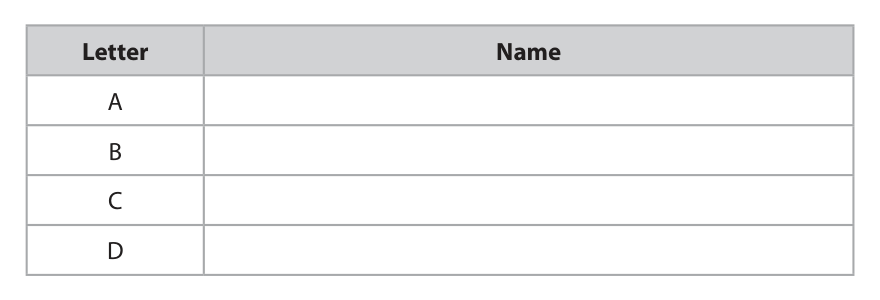
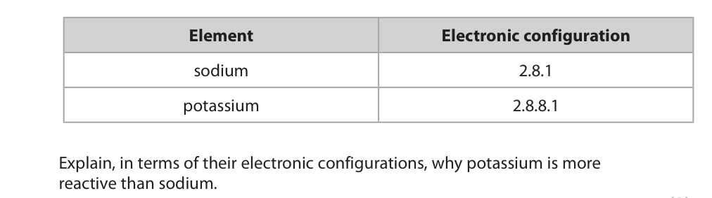
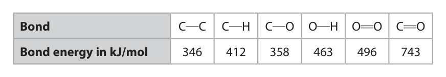

# 4CH1/2CR — 2020-11 (official extraction)

> schema `syllabai.official-paper-questions/0.1` · paper_id `pearson-edexcel:international-gcse:chemistry:4ch1:2020-11:4CH1/2CR` · qp sha256 `bc6e12f1d5e6a27a…` · extracted verbatim, never regenerated (ADR-037)

## Question 1 (5 marks)

The diagram shows some pieces of apparatus. A B C D

### 1(a) [4]

Complete the table by giving the name of each piece of apparatus. Letter Name A B C D

**Mark scheme answer**

> M1 A test tube / boiling tube
> Grad
> M2 B evaporating basin ALLOW evaporating
> dish/crystallising dish
> M3 C measuring cylinder
> M4 D (top-pan) balance ALLOW (weighing) scale(s)
> ALLOW weighing machine

- **(1)** A test tube / boiling tube
- **(1)** B evaporating basin ALLOW evaporating
- **(1)** C measuring cylinder
- **(1)** D (top-pan) balance ALLOW (weighing) scale(s)

### 1(b) [1]

Which piece of apparatus can be used to measure the volume of a liquid? A B C D

**Mark scheme answer**

> C
> Comp
> A is incorrect as a test tube cannot measure a
> volume of liquid
> B is incorrect as an evaporating basin cannot
> measure a volume of liquid
> D is incorrect as a balance measures mass not
> volume

- **(1)** C

## Question 2 (7 marks)

Thallium, Tl, is an element in Group 3 and Period 6 of the Periodic Table. The atomic number of thallium is 81

**(c)** A sample of thallium contains two isotopes. The table shows the mass number and percentage abundance of each isotope in the sample. Isotope Mass number Percentage abundance (%) thallium-203 203 30.80 thallium-205 205 69.20

### 2(a) [1]

How many electrons are there in the outer shell of an atom of thallium?

- **(A)** 3  ✔
- **(B)** 6
- **(C)** 13
- **(D)** 81

**Mark scheme answer**

> A 3
> Comp
> B is incorrect as there are not 6 electrons in the outer
> shell of a thallium atom
> C is incorrect as there are not 13 electrons in the
> outer shell of a thallium atom
> D is incorrect as 81 is the total number of electrons
> in a thallium atom not the number in the outer shell

- **(1)** Answer A: 3

### 2(b) [1]

A thallium ion has a charge of 3+ How many electrons are there in this thallium ion? A 3 B 78 C 81 D 84

**Mark scheme answer**

> B 78
> Comp
> A is incorrect as there are not 3 electrons in a
> thallium ion
> C is incorrect as 81 is the number of electrons in a
> thallium atom not a thallium ion
> D is incorrect as there are not 84 electrons in a
> thallium ion

- **(1)** B 78

### 2(c)(i) [2]

Give the number of protons and the number of neutrons in one atom of the thallium-205 isotope. number of protons number of neutrons

**Mark scheme answer**

> M1 (number of protons) 81 ACCEPT eighty-one
> Cl
> M2 (number of neutrons) 124 ACCEPT one hundred and
> twenty-four

- **(1)** (number of protons) 81 ACCEPT eighty-one
- **(1)** (number of neutrons) 124 ACCEPT one hundred and

### 2(c)(ii) [3]

Calculate the relative atomic mass of this sample of thallium. Give your answer to one decimal place. relative atomic mass =

**Mark scheme answer**

> • calculate sum of mass numbers multiplied
> by percentage abundances Exp
> • divide answer by 100
> • give answer to one decimal place
> Example calculation
> M1 (203 x 30.8) + (205 x 69.2) OR 20438.4 ACCEPT 4, 5 or 6 sig fig
> M2 20438.4 ÷ 100 OR 204.384 ACCEPT 5 or 6 sig fig
> (203 x 0.308) + (205 x 0.692)
> OR 204.384 with or without
> working scores M1 and M2
> M3 204.4 Correct answer to 1 d.p. with
> or without working scores 3
> marks

- **(1)** (203 x 30.8) + (205 x 69.2) OR 20438.4 ACCEPT 4, 5 or 6 sig fig
- **(1)** 20438.4 ÷ 100 OR 204.384 ACCEPT 5 or 6 sig fig
- **(1)** 204.4 Correct answer to 1 d.p. with

## Question 3 (8 marks)
**(a)** The diagram shows a fractionating column used to separate crude oil into fractions. refinery gases gasoline kerosene diesel crude oil fuel oil bitumen

**(b)** There is a low demand for some of the fractions obtained from crude oil. Cracking can be used to convert these fractions into more useful substances.

### 3(a)(i) [2]

Give a use for bitumen and a use for gasoline. use for bitumen use for gasoline

**Mark scheme answer**

> M1 (bitumen) (surfacing) roads/(surfacing) roofs ALLOW other suitable
> uses Exp
> M2 (gasoline) petrol / fuel for cars/vehicles ALLOW other suitable
> uses e.g. fuel for
> cooking

- **(1)** (bitumen) (surfacing) roads/(surfacing) roofs ALLOW other suitable
- **(1)** (gasoline) petrol / fuel for cars/vehicles ALLOW other suitable

### 3(a)(ii) [2]

Explain why bitumen is collected at the bottom of the fractionating column and gasoline is collected near the top of the fractionating column.

**Mark scheme answer**

> An explanation that links the following two points
> Exp
> M1 column is cooler near the top than at the bottom ACCEPT column cool
> ORA near the top and hot at
> the bottom
> ACCEPT temperature
> decreases up the
> column ORA
> M2 gasoline has a lower boiling point than bitumen ACCEPT gasoline has a
> (so is collected nearer the top) ORA low boiling point (so is
> collected near the top)
> and bitumen has a high
> boiling point (so is
> collected near the
> bottom)

- **(1)** column is cooler near the top than at the bottom ACCEPT column cool
- **(1)** gasoline has a lower boiling point than bitumen ACCEPT gasoline has a

### 3(b)(i) [2]

State the conditions needed for cracking.

**Mark scheme answer**

> M1 alumina/silica (catalyst) ACCEPT Al2O3 / SiO2
> /aluminium oxide Exp
> /silicon dioxide
> /aluminosilicate(s)
> /zeolite(s)
> M2 600 – 700 (oC) ACCEPT range or any
> value within the range
> ACCEPT correct
> temperatures in other
> units

- **(1)** alumina/silica (catalyst) ACCEPT Al2O3 / SiO2
- **(1)** 600 – 700 (oC) ACCEPT range or any

### 3(b)(ii) [2]

Dodecane (C12H26) can be cracked to produce an alkane and two alkenes. Complete the equation by giving the formulae of the two alkenes. . C12H26 → C7H16 + +

**Mark scheme answer**

> C12H26 --> C7H16 + C2H4 + C3H6 ACCEPT answers in
> either order Exp
> M1 C2H4
> M2 C3H6

- **(1)** C2H4
- **(1)** C3H6

## Question 4 (11 marks)

This question is about some of the alkali metals and their compounds.

**(b)** Lithium reacts with fluorine to form the compound lithium fluoride.

### 4(a) [2]

When a teacher drops a small piece of sodium into a trough of cold water, she observes bubbles of gas. Give two other observations that would be made when sodium reacts with cold water. 1 2

**Mark scheme answer**

> Any two of the following observations.
> Exp
> M1 (sodium) floats/moves on surface (of water)
> M2 (sodium) melts/forms a ball
> M3 (sodium) gets smaller/disappears ALLOW dissolves
> M4 (sodium forms) white trail IGNORE references to
> flame/heat released
> /temperature increases
> IGNORE fizzing
> /effervescence

- **(2)** Any two of the following observations.

### 4(b)(i) [1]

Give a chemical equation for this reaction.

**Mark scheme answer**

> 2Li + F2 → 2LiF ALLOW multiples or
> fractions Exp
> IGNORE state symbols
> even if incorrect

- **(1)** 2Li + F2 → 2LiF ALLOW multiples or

### 4(b)(ii) [2]

Give a test to show that lithium fluoride contains lithium ions.

**Mark scheme answer**

> M1 flame test ALLOW description of
> flame test Exp
> M2 red (flame) ALLOW crimson /scarlet
> REJECT orange-red/
> brick red

- **(1)** flame test ALLOW description of
- **(1)** red (flame) ALLOW crimson /scarlet

### 4(b)(iii) [3]

Draw diagrams to show the arrangement of the electrons in a lithium ion and in a fluoride ion. Include the charge on each ion. lithium ion fluoride ion

**Mark scheme answer**

> M1 correct electron arrangement of lithium ion ACCEPT any
> combination of dots and Exp
> crosses
> IGNORE empty second
> shell
> M2 correct electron arrangement of fluoride ion
> Inner electron shell
> required to score M2
> M3 correct charges on both ions (with or without M3 not dep on M1 and
> brackets) M2 correct

- **(1)** correct electron arrangement of lithium ion ACCEPT any
- **(1)** correct electron arrangement of fluoride ion
- **(1)** correct charges on both ions (with or without M3 not dep on M1 and

### 4(c) [3]

The table shows the electronic configurations of sodium and potassium. Element Electronic configuration sodium 2.8.1 potassium 2.8.8.1 Explain, in terms of their electronic configurations, why potassium is more reactive than sodium.

**Mark scheme answer**

> An explanation that links three of the following four
> points Exp
> M1 the outer electron is further from the nucleus in ALLOW potassium
> potassium / potassium has more shells/ potassium atom is bigger than a
> has larger atomic radius ORA sodium atom
> M2 there is more shielding (by the inner shells) in
> potassium ORA
> M3 there is less attraction between the outer electron
> and the nucleus in potassium ORA
> M4 (so outer) electron (in potassium) more easily lost outer electron needs to
> ORA be mentioned at least
> once in the answer for
> full marks
> Max 2 if no mention of
> outer electron in the
> answer

- **(3)** An explanation that links three of the following four

## Question 5 (10 marks)

This question is about the metal aluminium.

**(c)** Aluminium is extracted from aluminium oxide (Al2O3) by electrolysis. The electrolyte is aluminium oxide dissolved in molten cryolite.

### 5(a)(i) [2]

Draw a labelled diagram to represent the structure and bonding in a metal.

**Mark scheme answer**

> A labelled diagram showing
> Exp
> M1 at least three rows of at least three cations/atoms in
> a regular arrangement
> M2 surrounded by (delocalised) electrons
> Example of diagram
> Max 1 if no labels
> Minimum requirement
> for 2 marks is + signs on
> atoms and electrons
> labelled or shown as e−

- **(1)** at least three rows of at least three cations/atoms in
- **(1)** surrounded by (delocalised) electrons

### 5(a)(ii) [2]

Explain why a metal conducts electricity.

**Mark scheme answer**

> An explanation that links the following two points
> Exp
> M1 delocalised electrons IGNORE free
> electrons/ sea of
> electrons
> M2 flow/are mobile/move/are free to move M2 dep on mention of
> electrons
> Any mention of
> ions/atoms moving
> scores 0

- **(1)** delocalised electrons IGNORE free
- **(1)** flow/are mobile/move/are free to move M2 dep on mention of

### 5(b) [2]

Aluminium is used to make cans for drinks. Give two properties of aluminium that make it suitable for this use. 1 2

**Mark scheme answer**

> Any two of the following properties
> Exp
> M1 low density ALLOW lightweight
> IGNORE light
> IGNORE less dense
> M2 does not react with drink ALLOW does not
> corrode/non-toxic
> IGNORE does not rust
> M3 malleable ALLOW easy to bend/
> easy to shape
> IGNORE references to
> cost
> IGNORE can be
> recycled
> IGNORE any irrelevant
> properties e.g. high
> melting/boiling point/
> good conductor/ductile

- **(2)** Any two of the following properties

### 5(c)(i) [1]

State why aluminium cannot be extracted by heating aluminium oxide with carbon.

**Mark scheme answer**

> aluminium/it is more reactive/higher in the reactivity ALLOW aluminium is
> series than carbon ORA too reactive/too high in Grad
> the reactivity series

- **(1)** aluminium/it is more reactive/higher in the reactivity ALLOW aluminium is

### 5(c)(ii) [1]

Aluminium is produced at the negative electrode. The ionic half-equation for the reaction is Al3+ + 3e− → Al State why this is a reduction reaction.

**Mark scheme answer**

> electrons are gained (by aluminium ion/Al3+) ACCEPT oxidation state
> of aluminium/Al is Exp
> decreased/ changes
> from +3 to 0
> REJECT aluminium/Al
> gains electrons
> IGNORE references to
> loss of oxygen

- **(1)** electrons are gained (by aluminium ion/Al3+) ACCEPT oxidation state

### 5(c)(iii) [2]

Complete the ionic half-equation for the reaction at the positive electrode O2− → +

**Mark scheme answer**

> 2O2− → O2 + 4e(−) ACCEPT multiples and
> fractions Exp
> M1 correct formulae of products
> M2 balancing of correct formulae M2 dep on M1

- **(1)** correct formulae of products
- **(1)** balancing of correct formulae M2 dep on M1

## Question 6 (13 marks)

A student wants to prepare sodium chloride crystals from sodium hydroxide solution and dilute hydrochloric acid. He does a titration to find the volume of dilute hydrochloric acid needed to neutralise the sodium hydroxide solution. This is his method. ● add 25.0 cm3 of sodium hydroxide solution to a conical flask ● add a few drops of phenolphthalein indicator to the conical flask ● titrate the solution with the hydrochloric acid

**(c)** The student finds that 21.50 cm3 of hydrochloric acid is needed to neutralise 25.0 cm3 of sodium hydroxide solution.

### 6(a) [1]

Name a suitable piece of apparatus that the student should use to measure 25.0 cm3 of sodium hydroxide solution.

**Mark scheme answer**

> pipette
> Cl

- **(1)** pipette

### 6(b)(i) [2]

Give the colour of the phenolphthalein indicator in sodium hydroxide solution and in hydrochloric acid. colour in sodium hydroxide solution colour in hydrochloric acid

**Mark scheme answer**

> M1 (colour in NaOH) pink ACCEPT magenta
> Grad
> ALLOW red
> M2 (colour in HCl) colourless/no colour IGNORE clear
> 1 mark for two correct
> colours in the wrong
> order

- **(1)** (colour in NaOH) pink ACCEPT magenta
- **(1)** (colour in HCl) colourless/no colour IGNORE clear

### 6(b)(ii) [1]

Suggest why universal indicator is never used in a titration.

**Mark scheme answer**

> There is no clear (colour change at the) end point/ ALLOW it has a range
> difficult to determine which shade of green is pH 7 of colours Exp
> OWTTE

- **(1)** There is no clear (colour change at the) end point/ ALLOW it has a range

### 6(c)(i) [2]

Describe what the student should do next to prepare a pure solution of sodium chloride.

**Mark scheme answer**

> A description that makes reference to the following
> two points Exp
> M1 add 21.5 cm3 of hydrochloric acid
> M2 to 25 cm3 of sodium hydroxide solution
> 0 marks if mention of
> adding indicator
> ALLOW repeat the titration
> without indicator for 1 mark
> ALLOW the following
> alternative method
> M1 add activated charcoal
> (to absorb the indicator)
> M2 filter (to remove the
> activated charcoal and
> indicator)
> M2 dep on M1

- **(1)** add 21.5 cm3 of hydrochloric acid
- **(1)** to 25 cm3 of sodium hydroxide solution

### 6(c)(ii) [4]

Describe how the student could obtain dry crystals of sodium chloride from the pure sodium chloride solution.

**Mark scheme answer**

> A description that makes reference to the following Max 1 mark if solution
> four points evaporated to dryness Exp
> M1 heat the solution to evaporate some of the water/ If solution left to partially
> to form a saturated solution/ to crystallisation point evaporate without heating
> only M3 and M4 can be
> awarded
> M2 leave the solution to cool /leave the solution for
> (more) crystals to form
> M3 filter off the crystals
> IGNORE references to
> washing
> M4 suitable method of drying the crystals e.g. dry between filter
> papers/dry in a warm oven/
> leave to dry
> REJECT hot oven or direct
> heating with Bunsen burner
> No M4 if crystals are
> washed after drying

- **(1)** heat the solution to evaporate some of the water/ If solution left to partially
- **(1)** leave the solution to cool /leave the solution for
- **(1)** filter off the crystals
- **(1)** suitable method of drying the crystals e.g. dry between filter

### 6(d) [3]

The student needs 21.50 cm3 of hydrochloric acid to neutralise 25.0 cm3 of sodium hydroxide solution of concentration 0.800 mol/dm3. The equation for the reaction is NaOH + HCl → NaCl + H2O Calculate the concentration, in mol/dm3, of the hydrochloric acid. concentration = mol/dm3

**Mark scheme answer**

> • calculate the amount, in moles, of NaOH correct answer without
> • divide amount in moles by volume in dm3 working scores 3 marks Exp
> • evaluation to obtain correct answer
> Example calculation
> M1 n(NaOH) = 0.0250 x 0.800 or 0.02(00)
> M2 conc = (0.02 ÷ 0.0215) answer to M1 ÷ 0.0215
> M3 0.930 ALLOW any number of sig
> fig except 1
> ALLOW ecf on M2
> Total

- **(1)** n(NaOH) = 0.0250 x 0.800 or 0.02(00)
- **(1)** conc = (0.02 ÷ 0.0215) answer to M1 ÷ 0.0215
- **(1)** 0.930 ALLOW any number of sig

## Question 7 (16 marks)
**(a)** Ethanol, C2H5OH, can be oxidised to produce ethanoic acid, CH3COOH, by heating it with potassium dichromate(VI).

**(b)** When ethanol is burned in air, complete combustion can occur. The equation for this reaction is C2H5OH + 3O2 → 2CO2 + 3H2O This equation can also be written using displayed formulae to show all the covalent bonds in the molecules. H H H C C O H + 3O O → 2O C O + 3H O H H H The table gives the bond energies for these bonds. Bond C C C H C O O H O O C O Bond energy in kJ/mol 346 412 358 463 496 743

**(c)** Ethanol reacts with methanoic acid, HCOOH, in the presence of an acid catalyst to form an ester. The equation for the reaction is C2H5OH + HCOOH ⇌ HCOOC2H5 + H2O

### 7(a)(i) [1]

Name one other reactant needed for this reaction to occur.

**Mark scheme answer**

> sulfuric acid IGNORE references to
> concentration Grad
> ALLOW H2SO4
> REJECT sulfurous acid

- **(1)** sulfuric acid IGNORE references to

### 7(a)(ii) [1]

Which colour change occurs during this reaction?

- **(A)** colourless to green
- **(B)** green to orange
- **(C)** orange to colourless
- **(D)** orange to green  ✔

**Mark scheme answer**

> D orange to green
> Comp
> A is incorrect as the solution is not colourless at the
> start of the reaction
> B is incorrect as the solution is not green at the start
> or orange at the end of the reaction
> C is incorrect as the solution is not colourless at the
> end of the reaction

- **(1)** Answer D: orange to green

### 7(b)(i) [2]

Use values from the table to calculate the energy needed to break all the bonds in the reactants. energy needed kJ

**Mark scheme answer**

> • show the expression for the sum of the bond correct answer without
> energies for the breaking of bonds working scores 2 Exp
> • evaluation to give answer in kJ
> Example calculation
> M1 ∑ C-C + 5C-H + C-O + O-H + 3O=O
> OR ∑ 346 + (5 x 412) + 358 + 463 + (3 x 496)
> M2 4715 (kJ) - 1 mark for each error

- **(1)** ∑ C-C + 5C-H + C-O + O-H + 3O=O
- **(1)** 4715 (kJ) - 1 mark for each error

### 7(b)(ii) [2]

Use values from the table to calculate the energy released when all the bonds in the products are formed. energy released kJ

**Mark scheme answer**

> • show the expression for the sum of the bond correct answer without
> energies for the forming of bonds working scores 2 Exp
> • evaluation to give answer in kJ
> Example calculation
> M1 ∑ 4C=O + 6O-H
> OR ∑ (4 x 743) + (6 x 463)
> M2 5750 (kJ) - 1 mark for each error
> IGNORE any signs in (i)
> and (ii)

- **(1)** ∑ 4C=O + 6O-H
- **(1)** 5750 (kJ) - 1 mark for each error

### 7(b)(iii) [1]

Calculate the molar enthalpy change (ΔH) in kJ/mol, for the complete combustion of ethanol. Include a sign in your answer. ΔH = kJ/mol

**Mark scheme answer**

> (4715 – 5750 =) – 1035 (kJ/mol) minus sign must be
> included Exp
> ACCEPT – 1040
> (kJ/mol)
> ALLOW ecf on answers
> to (i) and (ii)
> If answers to (i) and (ii)
> are reversed allow max
> 3 and ecf on (iii)

- **(1)** (4715 – 5750 =) – 1035 (kJ/mol) minus sign must be

### 7(c)(i) [1]

Give the name of the ester that forms.

**Mark scheme answer**

> ethyl methanoate ALLOW ethyl formate
> Grad
> ALLOW words written
> without gap

- **(1)** ethyl methanoate ALLOW ethyl formate

### 7(c)(ii) [2]

Draw the displayed formula for this ester.

**Mark scheme answer**

> M1 ester linkage
> Exp
> O
> − C − O−
> M2 rest of molecule correct
> M2 dep on M1

- **(1)** ester linkage
- **(1)** rest of molecule correct

### 7(c)(iii) [2]

When this reaction takes place in a sealed container, the reaction can reach dynamic equilibrium. Give two characteristics of a reaction at dynamic equilibrium. 1 2

**Mark scheme answer**

> M1 forward and reverse reactions occur at the same
> rate OWTTE Exp
> M2 concentrations of reactants and products remain
> constant

- **(1)** forward and reverse reactions occur at the same
- **(1)** concentrations of reactants and products remain

### 7(d) [4]

Methanoic acid reacts with sodium carbonate to form sodium methanoate, carbon dioxide and water. The equation for the reaction is 2HCOOH + Na2CO3 → 2HCOONa + CO2 + H2O Calculate the volume, in cm3, of carbon dioxide gas produced when 2.3 g of methanoic acid reacts completely with sodium carbonate. [Mr of HCOOH = 46] [molar volume of carbon dioxide at rtp = 24 dm3] volume of carbon dioxide = cm3

**Mark scheme answer**

> • calculate amount in moles of HCOOH correct answer without
> • use equation to find amount in moles of CO2 working scores 4 Exp
> • multiply amount in moles of CO2 by molar
> volume
> • evaluation of answer in cm3
> Example calculation
> M1 n(HCOOH) = 2.3 ÷ 46 or 0.05(0)
> M2 n(CO2) = 0.05(0) ÷ 2 or 0.025
> M3 (volume of CO2) = 0.025 x 24 or 0.025 x 24000 No ecf from M1 and M2
> if mass or Mr multiplied
> by 24 /24000
> M4 600 (cm3) ALLOW ecf from M3
> 0.6, 1200 and 2400
> score 3
> 1.2 and 2.4 score 2
> Total
> Pearson Education Limited. Registered company number 872828
> with its registered office at 80 Strand, London, WC2R 0RL, United Kingdom

- **(1)** n(HCOOH) = 2.3 ÷ 46 or 0.05(0)
- **(1)** n(CO2) = 0.05(0) ÷ 2 or 0.025
- **(1)** (volume of CO2) = 0.025 x 24 or 0.025 x 24000 No ecf from M1 and M2
- **(1)** 600 (cm3) ALLOW ecf from M3

