# 4CH1/1C — 2021-01 (official extraction)

> schema `syllabai.official-paper-questions/0.1` · paper_id `pearson-edexcel:international-gcse:chemistry:4ch1:2021-01:4CH1/1C` · qp sha256 `adb0593af53a637d…` · extracted verbatim, never regenerated (ADR-037)

## Question 1 (6 marks)

This question is about states of matter.

### 1(a) [3]

Use the words solid, liquid or gas to give the initial and final state of matter for each of the changes listed in the table. The first one has been done for you. Change Initial state Final state melting solid liquid sublimation condensing evaporation

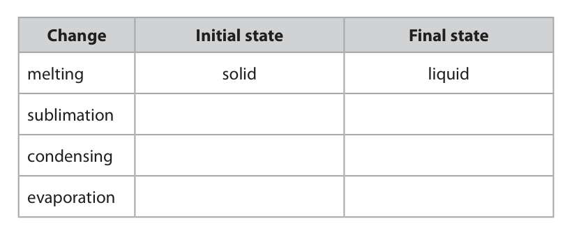

**Mark scheme answer**

> Award 1 mark for each
> Start End correct row
> solid liquid
> solid gas ALLOW gas to solid for
> sublimation
> gas liquid
> liquid gas

- **(3)** Award 1 mark for each

### 1(b) [3]

Particles in a solid are closely packed, arranged in a regular pattern and vibrate about fixed positions. Describe the arrangement and movement of the particles in a gas.

**Mark scheme answer**

> A description that refers to any three of the
> following points
> M1 irregular /random arrangement (of particles)
> M2 large gaps between them /far apart /widely ALLOW spread out
> spaced
> M3 random movement / move freely
> M4 move (very) quickly IGNORE references to
> kinetic energy
> 6 marks
> Question
> Answer Notes Marks
> number

- **(3)** A description that refers to any three of the

## Question 2 (5 marks)

The table gives the melting and boiling points of four pure substances, W, X, Y and Z. Melting point in °C Boiling point in °C W –7 60 X 660 2500 Y 180 1330 Z 115 445 Use data from the table to answer the questions.

### 2(a)(i) [1]

Which substance is a gas at 100 °C?

- **(A)** W  ✔
- **(B)** X
- **(C)** Y
- **(D)** Z

**Mark scheme answer**

> A
> A is the correct answer because 100°C is above
> the boiling point of W
> B is not the correct answer because X is a solid at
> 100°C
> C is not the correct answer because Y is a solid at
> 100°C
> D is not the correct answer because Z is a solid at
> 100°C

- **(1)** Answer A: W

### 2(a)(ii) [1]

Which substance is a liquid for the largest range of temperature?

- **(A)** W
- **(B)** X  ✔
- **(C)** Y
- **(D)** Z

**Mark scheme answer**

> B
> B is the correct answer because X is a liquid for
> 1840°C
> A is not the correct answer because W is a liquid
> for 67°C
> C is not the correct answer because Y is a liquid
> for 1150°C
> D is not the correct answer because Z is a liquid
> for 330°C

- **(1)** Answer B: X

### 2(a)(iii) [1]

Which substance is a liquid at 1000 °C and a gas at 2000 °C?

- **(A)** W
- **(B)** X
- **(C)** Y  ✔
- **(D)** Z

**Mark scheme answer**

> C
> C is the correct answer because Y is a liquid at
> 1000°C and a gas at 2000°C
> A is not the correct answer because W is a gas at
> 1000°C and at 2000°C
> B is not the correct answer because X is a liquid
> at 1000°C and 2000°C
> D is not the correct answer because Z is a gas at
> 1000°C and at 2000°C

- **(1)** Answer C: Y

### 2(b) [1]

Substance Y does not conduct electricity when solid but does conduct electricity when molten. Give the type of bonding in substance Y.

**Mark scheme answer**

> ionic ALLOW electrovalent

- **(1)** ionic ALLOW electrovalent

### 2(c) [1]

Suggest how the melting point of a pure substance changes when an impurity is added.

**Mark scheme answer**

> the (impure) substance will melt over a range of ALLOW the (impure)
> temperatures substance will have a
> lower melting point
> 5 marks
> Question
> Answer Notes Marks
> number

- **(1)** the (impure) substance will melt over a range of ALLOW the (impure)

## Question 3 (7 marks)

Lead nitrate and potassium iodide react to form the insoluble solid lead iodide. Crystals of lead nitrate and potassium iodide are placed at opposite ends of a container of water. Solid lead iodide forms after several minutes. The diagram shows the container at the start and after several minutes. crystals of crystals of potassium iodide lead nitrate lead iodide At the start After several minutes

**(c)** The formula for lead nitrate is Pb(NO3)2

### 3(a) [2]

Name the two processes that occur before the solid lead iodide forms. 1 2

### 3(b) [2]

Explain why solid lead iodide takes less time to form when the reaction is repeated using water at a higher temperature.

### 3(c)(i) [1]

Give the number of different elements in lead nitrate.

**Mark scheme answer**

> 3 / three

- **(1)** 3 / three

### 3(c)(ii) [1]

Give the charge on the lead ion in Pb(NO3)2

**Mark scheme answer**

> 2+ /+2 ALLOW Pb2+

- **(1)** 2+ /+2 ALLOW Pb2+

### 3(d) [1]

Complete the chemical equation for the reaction between lead nitrate and potassium iodide. Pb(NO3)2(aq) + KI(aq) → PbI2(s) + KNO3(aq)

**Mark scheme answer**

> ALLOW multiples and
> Pb(NO3)2(aq) + 2KI(aq) → PbI2(s) +
> fractions
> 2KNO3(aq)
> 7 marks
> Question
> Answer Notes Marks
> number

- **(1)** ALLOW multiples and

## Question 4 (7 marks)

This question is about rusting.

### 4(a) [3]

When iron rusts, it reacts with oxygen in the air. A student uses the rusting of iron to find the percentage of oxygen in a sample of air. The diagram shows the apparatus. 100 80 60 40 20 0 cm3 air gas syringe wet iron conical flask filings These are the student’s results. volume of air in conical flask and connecting tube = 265 cm3 volume of air in gas syringe at start = 100 cm3 volume of air in gas syringe at end = 25 cm3 Calculate the percentage of oxygen in the sample of air using the student’s results. percentage of oxygen = %

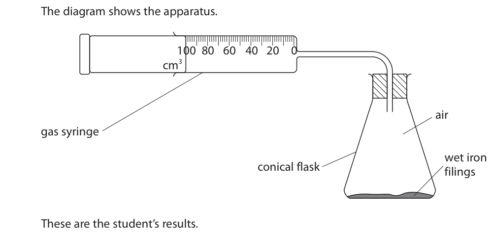

**Mark scheme answer**

> Example calculation Correct answer of 20.5
> % with or without
> M1 (volume of oxygen =) 100 – 25 OR 75 (cm3) working scores 3
> M2 75 ÷ 365 × 100 ALLOW ecf from M1
> M3 20.5 (%) ALLOW ecf from M2
> ALLOW 2 or more
> significant figures
> REJECT incorrect
> rounding
> Use of 265 instead of
> 365 gives an answer of
> 28.3 and scores 2
> Alternative method
> M1 (volume of air left
> =) 265 + 25 OR 290
> (cm3)
> M2 290 ÷ 365 × 100 OR
> 79.5 (%)
> M3 (100 – 79.5 =) 20.5
> (%)

- **(1)** (volume of oxygen =) 100 – 25 OR 75 (cm3) working scores 3
- **(1)** 75 ÷ 365 × 100 ALLOW ecf from M1
- **(1)** 20.5 (%) ALLOW ecf from M2

### 4(b)(i) [2]

Cars are painted to prevent the iron in car bodies from rusting. Explain how painting prevents the iron in car bodies from rusting.

**Mark scheme answer**

> M1 paint provides a barrier ALLOW paint forms a
> coating (on the iron) /
> paint is non-permeable
> M2 which prevents oxygen / water getting to ALLOW air
> /reacting with the iron

- **(1)** paint provides a barrier ALLOW paint forms a
- **(1)** which prevents oxygen / water getting to ALLOW air

### 4(b)(ii) [2]

Some car manufacturers use paint containing tiny particles of zinc. Explain how particles of zinc prevent iron in car bodies from rusting even when this paint is scratched.

**Mark scheme answer**

> M1 zinc is more reactive/higher in the reactivity ALLOW zinc is a
> series (than iron) sacrificial metal
> M2 zinc will oxidise / react / corrode instead of IGNORE references to
> /before iron zinc rusting
> IGNORE references to
> galvanising
> 7 marks
> Question
> Answer Notes Marks
> number

- **(1)** zinc is more reactive/higher in the reactivity ALLOW zinc is a
- **(1)** zinc will oxidise / react / corrode instead of IGNORE references to

## Question 5 (10 marks)

This question is about the separation of mixtures.

**(b)** A student uses chromatography to analyse the composition of purple ink. The diagram shows the student’s chromatogram at the end of the experiment. solvent front start line purple A B C D ink

### 5(a) [4]

The box gives some methods used to separate mixtures. crystallisation filtration fractional distillation simple distillation Complete the table by giving the correct method from the box for each separation. Each method can be used once, more than once or not at all. Separation Method insoluble solid from a liquid pure water from a solution liquid from a mixture of liquids with different boiling points soluble solid from a solution

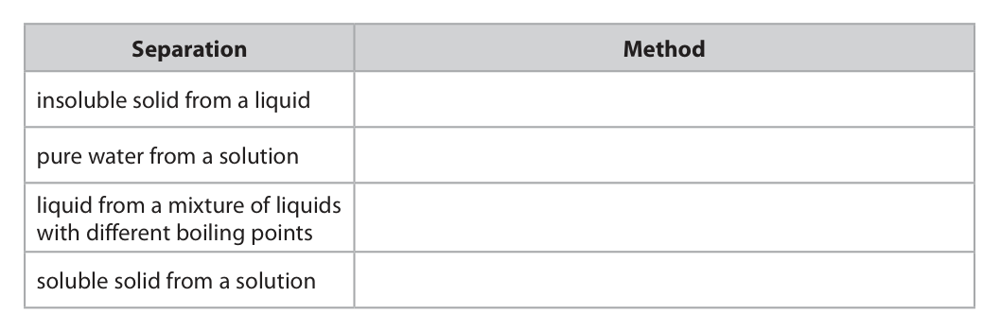

**Mark scheme answer**

> Method
> filtration ALLOW filtering
> simple distillation or fractional distillation ALLOW distillation
> fractional distillation REJECT simple
> distillation or
> distillation
> crystallisation

- **(4)** Method

### 5(b)(i) [2]

Explain which dyes are contained in the purple ink.

**Mark scheme answer**

> M1 A and B
> M2 because they are the same height /moved the
> same distance up the paper / have the same Rf
> values as the spots in the purple ink
> M2 dep on M1 correct
> or missing

- **(1)** A and B
- **(1)** because they are the same height /moved the

### 5(b)(ii) [2]

Explain which dye is least soluble in the solvent.

**Mark scheme answer**

> M1 D
> M2 because the spot is closest to the start line
> /travelled the least distance (from the start line) /
> has the lowest Rf value
> M2 dep on M1 correct
> or missing

- **(1)** D
- **(1)** because the spot is closest to the start line

### 5(c) [2]

A different chromatography experiment is set up. A spot of food colouring is placed on the start line. A food dye in the colouring has an Rf value of 0.72 The distance between the start line and the solvent front is 120 mm. Calculate the distance the food dye moves from the start line. distance = mm

**Mark scheme answer**

> Example calculation Correct answer of 86 or
> 86.4 (mm) with or
> M1 120 × 0.72 without working scores
> M2 86 / 86.4 (mm)
> 10 marks
> Question
> Answer Notes Marks
> number

- **(1)** 120 × 0.72 without working scores
- **(1)** 86 / 86.4 (mm)

## Question 6 (9 marks)

This question is about salts.

### 6(a) [3]

When solutions of salts are mixed together, precipitates sometimes form. The insoluble salt barium carbonate forms as a precipitate when solutions of the soluble salts ammonium carbonate and barium chloride react together. When solutions of the soluble salts potassium chloride and magnesium sulfate are mixed, no precipitate forms. Complete the table to show the results of mixing solutions of some soluble salts. ammonium carbonate solution magnesium sulfate solution barium chloride precipitate of solution barium carbonate potassium chloride no precipitate solution calcium chloride precipitate of solution calcium sulfate

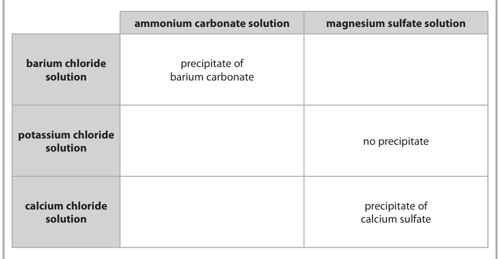

**Mark scheme answer**

> 3
> precipitate of barium precipitate of barium if barium sulfate and
> carbonate sulfate calcium carbonate correct
> no precipitate no precipitate but without including
> ‘precipitate of’ scores 1
> precipitate of calcium precipitate of calcium out of 2
> carbonate sulfate
> ALLOW correct formulae

- **(3)** 3

### 6(b) [6]

A student has four unlabelled beakers, each containing a colourless solution of a different salt. The four solutions are • potassium carbonate • potassium chloride • potassium iodide • sodium chloride Describe a method to identify each solution. Do not refer to safety in your answer.

**Mark scheme answer**

> A description that refers to any six of the following
> points
> ACCEPT any description
> M1 do a flame test of a flame test
> ACCEPT yellow-orange or
> M2 sodium chloride produces a yellow flame orange
> IGNORE any flame colour
> given for the potassium
> compounds
> ALLOW any named acid
> M3 add acid
> ACCEPT carbon
> M4 potassium carbonate effervesces / bubbles dioxide/gas given off
> which turns limewater
> cloudy for M4
> M4 is dep on M3
> M5 add dilute nitric acid
> M6 add silver nitrate (solution)
> M7 potassium chloride gives a white precipitate M7 and M8 are dep on
> M6
> M8 potassium iodide gives a yellow precipitate
> ALLOW addition of
> chlorine/bromine solution
> as an alternative to M6
> M7 no colour change with
> potassium chloride
> M8 solution turns brown
> with potassium iodide
> If this alternative given no
> M5
> 9 marks
> Question
> Answer Notes Marks
> number

- **(6)** A description that refers to any six of the following

## Question 7 (13 marks)

This question is about lithium oxide.

**(b)** Lithium oxide reacts with water to form lithium hydroxide as the only product. A scientist uses this apparatus to measure the temperature change of the reaction. beaker 100 g water polystyrene cup This is the scientist’s method. • pour 100 g of water into a polystyrene cup • record the temperature of the water • add the lithium oxide and stir the mixture • record the maximum temperature reached The diagram shows the thermometer readings before and after adding the lithium oxide. 20 30 15 25 before after

### 7(a) [3]

The diagram shows the electron configurations of an atom of lithium and an atom of oxygen. lithium oxygen Describe the changes in electronic configuration when lithium and oxygen react to form lithium oxide, Li2O

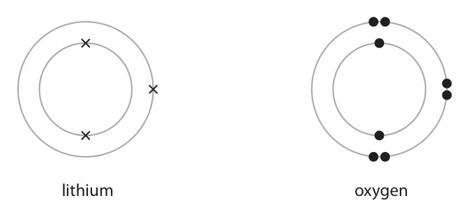

**Mark scheme answer**

> M1 two lithium atoms each lose one electron /give ALLOW lithium loses one
> one electron to oxygen electron /gives one
> electron to oxygen
> M2 oxygen gains two electrons
> M3 lithium (ion) has an electron configuration of 2 ALLOW oxygen becomes
> and oxide (ion) is 2,8 2,8
> All 3 marks can be scored
> from diagrams showing
> the electron
> configurations of the ions
> 0 marks if reference to
> sharing electrons

- **(1)** two lithium atoms each lose one electron /give ALLOW lithium loses one
- **(1)** oxygen gains two electrons
- **(1)** lithium (ion) has an electron configuration of 2 ALLOW oxygen becomes

### 7(b)(i) [2]

Complete the table, giving all values to the nearest 0.1 °C. temperature in °C after adding the lithium oxide temperature in °C before adding the lithium oxide 17.3 temperature rise in °C

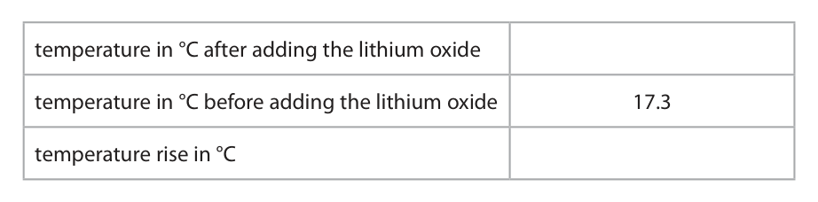

**Mark scheme answer**

> M1 (temperature after) = 27.7°C
> M2 temperature rise = 10.4 °C ALLOW ecf from M1

- **(1)** (temperature after) = 27.7°C
- **(1)** temperature rise = 10.4 °C ALLOW ecf from M1

### 7(b)(ii) [4]

Calculate the heat energy change in the reaction. Give your answer to two significant figures. [c = 4.2 J / g / °C] heat energy change = J

**Mark scheme answer**

> Example calculation Correct answer of 4400J
> with or without working
> scores 4
> M1 Use of 100 in Q = m x c (x ΔT)
> M2 Use of 10.4 in Q = (m x) c x ΔT ALLOW ecf from (b)(i)
> 100 x 4.2 x 10.4 scores M1
> and M2
> M3 4368J ALLOW ecf from M1 and
> M2
> M4 4400J ALLOW ecf from M3
> IGNORE + or – sign in front
> of answer

- **(1)** Use of 100 in Q = m x c (x ΔT)
- **(1)** Use of 10.4 in Q = (m x) c x ΔT ALLOW ecf from (b)(i)
- **(1)** 4368J ALLOW ecf from M1 and
- **(1)** 4400J ALLOW ecf from M3

### 7(b)(iii) [3]

In another experiment the scientist obtains these results. amount of lithium oxide in mol 0.0580 heat energy change in J 5210 Calculate the molar enthalpy change (ΔH ) in kJ / mol. Include a sign in your answer. ΔH = kJ / mol

**Mark scheme answer**

> Example calculation Correct answer of -89.8
> (kJ/mol) scores 3
> M1 5210 ÷ 1000 or 5.21
> M2 5.21 ÷ 0.0580
> M3 -89.8(kJ/mol) ALLOW -90 (kJ/mol) or
> any number of sig figs as
> long as correctly rounded.

- **(1)** 5210 ÷ 1000 or 5.21
- **(1)** 5.21 ÷ 0.0580
- **(1)** -89.8(kJ/mol) ALLOW -90 (kJ/mol) or

### 7(b)(iv) [1]

Give a reason why the scientist does the experiment in a polystyrene cup.

**Mark scheme answer**

> polystyrene is a good insulator /poor conductor (of ALLOW prevent heat loss
> heat) OR to minimise/reduce heat loss
> 13 marks
> Question
> Answer Notes Marks
> number

- **(1)** polystyrene is a good insulator /poor conductor (of ALLOW prevent heat loss

## Question 8 (12 marks)

This question is about the halogens.

**(b)** Bromine has two isotopes with mass numbers 79 and 81

**(c)** A student investigates the reactivity of some halogens. She uses these solutions of halogens and their halides. • bromine, chlorine and iodine • sodium bromide, sodium chloride and sodium iodide She adds each halogen solution to each halide solution. The table shows her results. Sodium bromide Sodium chloride Sodium iodide Bromine no reaction no reaction reaction occurs Chlorine reaction occurs no reaction reaction occurs Iodine no reaction no reaction no reaction

### 8(a) [2]

The table gives some information about the halogens. Complete the table by predicting the physical state of astatine at room temperature and the colour of astatine. Physical state at room Halogen Colour temperature fluorine gas yellow chlorine gas pale green bromine liquid red-brown iodine solid grey astatine

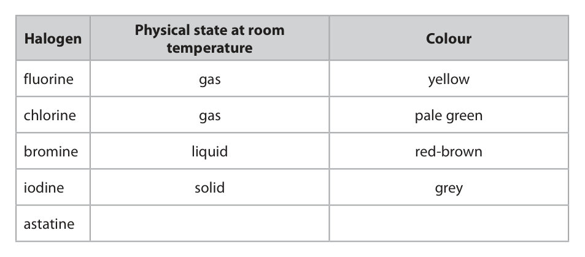

**Mark scheme answer**

> M1 solid
> M2 dark grey / black

- **(1)** solid
- **(1)** dark grey / black

### 8(b)(i) [3]

The relative percentages of each isotope in a sample of bromine are bromine-79 = 51.0% bromine-81 = 49.0% Calculate the relative atomic mass of this sample of bromine. Give your answer to one decimal place. relative atomic mass =

**Mark scheme answer**

> Example calculation 80.0 with no working
> scores 3
> M1 (51 × 79) + (49 × 81) OR 7998
> M2 7998 ÷ 100
> M3 80.0 79.9 with no working
> scores 1
> 79.98 or 80 with no
> working scores 2

- **(1)** (51 × 79) + (49 × 81) OR 7998
- **(1)** 7998 ÷ 100
- **(1)** 80.0 79.9 with no working

### 8(b)(ii) [1]

Give a reason why both isotopes of bromine have the same chemical properties.

**Mark scheme answer**

> same electron configuration ALLOW same (total)
> number of electrons
> IGNORE same number
> of electrons in the
> outer shell
> IGNORE references to
> same number of
> protons

- **(1)** same electron configuration ALLOW same (total)

### 8(c)(i) [3]

Explain how these results show the order of reactivity of bromine, chlorine and iodine.

**Mark scheme answer**

> An explanation that links the following three
> points
> M1 the order of reactivity is chlorine (most),
> bromine and iodine (least)
> ACCEPT bromine is
> M2 chlorine (is most reactive because it) displaces only displaced by
> bromine and iodine/ oxidises bromide and iodide chlorine and iodine is
> (ions) / reacts with sodium bromide and sodium displaced by chlorine
> iodide and bromine scores
> M2 and M3
> M3 bromine (is less reactive than chlorine since it)
> only displaces iodine / only oxidises iodide (ions) / ALLOW chlorine has
> only reacts with sodium iodide two reactions, bromine
> has one reaction and
> iodine no reactions for
> 1 mark out of M2 and
> M3
> Deduct 1 mark for
> incorrect use of ine
> and ide e.g. bromine
> displaces iodide

- **(1)** the order of reactivity is chlorine (most),
- **(1)** chlorine (is most reactive because it) displaces only displaced by
- **(1)** bromine (is less reactive than chlorine since it)

### 8(c)(ii) [1]

Suggest why the student does not need to add bromine solution to sodium bromide solution.

**Mark scheme answer**

> bromine cannot displace itself / bromine does not ALLOW there would be
> react with sodium bromide OWTTE no reaction

- **(1)** bromine cannot displace itself / bromine does not ALLOW there would be

### 8(c)(iii) [2]

The ionic equation for the reaction between bromine and sodium iodide is Br2(aq) + 2I−(aq) → I2(aq) + 2Br−(aq) Explain why this is a redox reaction.

**Mark scheme answer**

> M1 bromine is reduced and iodide (ions)/I- is
> oxidised
> Deduct 1 mark for
> M2 bromine gains electrons and iodide (ions)/I- mention of iodine
> loses electrons (ions) being oxidised or
> losing electrons
> OR
> M1 bromine gains electrons so is reduced
> REJECT iodine (ions)
> M2 iodide (ions) /I loses electrons so is oxidised
> -
> loses electrons so is
> oxidised
> 12 marks
> Question
> Answer Notes Marks
> number

- **(2)** M1 bromine is reduced and iodide (ions)/I- is

## Question 9 (12 marks)

Propane is a hydrocarbon with the formula C3H8

**(e)** Propane reacts with bromine in the presence of ultraviolet radiation.

### 9(a) [2]

State why propane is a hydrocarbon.

**Mark scheme answer**

> M1 (propane/it) contains hydrogen and carbon REJECT carbon and
> (atoms) hydrogen molecules
> M2 only M2 is dependent on
> mention of just carbon
> and hydrogen in M1

- **(1)** (propane/it) contains hydrogen and carbon REJECT carbon and
- **(1)** only M2 is dependent on

### 9(b)(i) [1]

Name the poisonous gas that forms when propane is burned in a limited supply of air.

**Mark scheme answer**

> carbon monoxide ALLOW CO

- **(1)** carbon monoxide ALLOW CO

### 9(b)(ii) [1]

State why this gas is poisonous to humans.

**Mark scheme answer**

> it decreases the capacity of the blood to transport ALLOW carbon
> oxygen OWTTE monoxide binds to
> haemoglobin

- **(1)** it decreases the capacity of the blood to transport ALLOW carbon

### 9(c) [2]

The diagram represents a molecule of propane. H H H H C C C H H H H Describe the forces of attraction between the atoms in a molecule of propane.

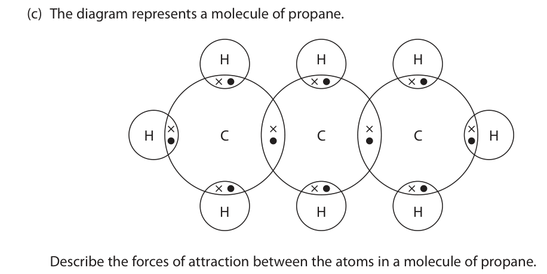

**Mark scheme answer**

> M1 (strong electrostatic) attraction between
> (bonding) pair of electrons
> M2 (and) nuclei (of both atoms) REJECT nucleus
> OR
> M1 (bonding) pair of electrons
> M2 attracted to nuclei REJECT nucleus
> 0 marks if reference to
> intermolecular forces
> between atoms

- **(2)** M1 (strong electrostatic) attraction between

### 9(d) [3]

Propane can be produced by cracking. An equation for cracking is C13H28 → C3H8 + 2C3H6 + 2C2H4 Explain why cracking is an important process in the oil industry.

**Mark scheme answer**

> An explanation that links the following three
> points
> M1 (crude oil) produces more long chain ALLOW less demand for
> hydrocarbons than can be used directly OWTTE long chain hydrocarbons
> M2 shorter chain alkanes are more flammable ALLOW shorter chain
> /more useful as fuels alkanes/hydrocarbons
> are more useful
> M3 alkenes are used to make polymers / plastics

- **(1)** (crude oil) produces more long chain ALLOW less demand for
- **(1)** shorter chain alkanes are more flammable ALLOW shorter chain
- **(1)** alkenes are used to make polymers / plastics

### 9(e)(i) [2]

Complete the equation for this reaction. C3H8 + Br2 → +

**Mark scheme answer**

> M1 C3H7Br
> M2 HBr ALLOW polysubstituted
> product if correct
> balancing number in
> front of Br2 and HBr

- **(1)** C3H7Br
- **(1)** HBr ALLOW polysubstituted

### 9(e)(ii) [1]

Give the name of this type of reaction.

**Mark scheme answer**

> substitution
> 12 marks
> Question
> Answer Notes Marks
> number

- **(1)** substitution

## Question 10 (14 marks)

This question is about alkanes.

**(a)** The graph shows the boiling points of several unbranched alkanes. 160 140 120 100 Boiling point in °C 4 5 6 7 8 9 Number of carbon atoms in molecule

### 10(a)(i) [1]

Draw a curve of best fit.

**Mark scheme answer**

> curve of best fit REJECT dot to dot line

- **(1)** curve of best fit REJECT dot to dot line

### 10(a)(ii) [2]

Use the graph to find the boiling point of the alkane with 7 carbon atoms in its molecule. Show on the graph how you obtain your answer. boiling point = °C

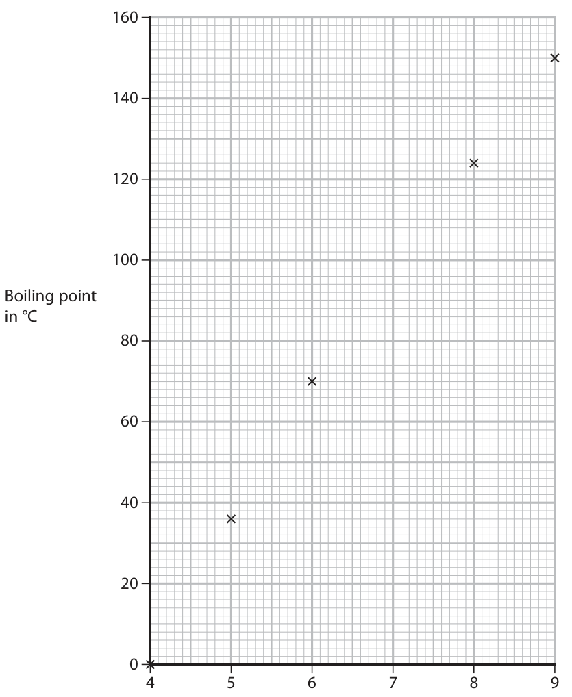

**Mark scheme answer**

> M1 lines shown on graph ALLOW extra point on
> curve at 7 carbon atoms
> M2 value correctly read from graph (expected value ACCEPT value to + 1oC
> between 97 and 103°C)

- **(1)** lines shown on graph ALLOW extra point on
- **(1)** value correctly read from graph (expected value ACCEPT value to + 1oC

### 10(a)(iii) [3]

Explain the trend shown by the graph.

**Mark scheme answer**

> An explanation that links the following three points
> M1 the boiling point increases as the number of ALLOW boiling point
> carbons / the chain length increases increases as the Mr
> increases
> REJECT directly
> M2 because the intermolecular forces (of attraction) proportional
> get stronger
> M3 and therefore take more energy to overcome /
> break
> M3 dep on M2
> Any mention of breaking
> covalent bonds does not
> score M2 or M3

- **(1)** the boiling point increases as the number of ALLOW boiling point
- **(1)** because the intermolecular forces (of attraction) proportional
- **(1)** and therefore take more energy to overcome /

### 10(b) [2]

The diagram represents two isomers with the formula C5H12 H H H H H H H H H H C C C C C H H C C C C H H H H H H H H H H C H H Explain why these compounds are isomers.

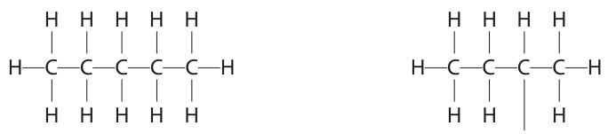

**Mark scheme answer**

> M1 same molecular formula
> M2 different displayed / structural formulae ALLOW different
> structures/ different
> arrangement of atoms

- **(1)** same molecular formula
- **(1)** different displayed / structural formulae ALLOW different

### 10(c)(i) [2]

An alkane contains 82.8% carbon and 17.2% hydrogen by mass. Show by calculation that the empirical formula of this alkane is C2H5

**Mark scheme answer**

> M1 82.8 ÷ 12 or 6.9 0 marks if upside down
> 17.2 ÷ 1 or 17.2 calculation or use of
> atomic numbers
> M2 (divide by smallest to give) 1:2.5 which is 2:5
> ACCEPT alternative
> methods

- **(1)** 82.8 ÷ 12 or 6.9 0 marks if upside down
- **(1)** (divide by smallest to give) 1:2.5 which is 2:5

### 10(c)(ii) [1]

Deduce the molecular formula of this alkane.

**Mark scheme answer**

> C4H10

- **(1)** C4H10

### 10(d) [3]

The equation for the complete combustion of one mole of an alkane can be represented by alkane + ZO2 → XCO2 + YH2O Complete combustion of one mole of the alkane produces 308 g of carbon dioxide and 144 g of water. X, Y and Z are the numbers used to balance the equation. Calculate the values of X, Y and Z. [Mr of CO2 = 44, Mr of H2O = 18] X = Y = Z =

**Mark scheme answer**

> M1 moles of CO2 = 7 or X = 7
> M2 moles of H2O = 8 or Y = 8
> M3 balancing number = 11 or Z = 11 ALLOW ecf from
> incorrect values of X and
> Y
> 14 marks
> Question
> Answer Notes Marks
> number

- **(1)** moles of CO2 = 7 or X = 7
- **(1)** moles of H2O = 8 or Y = 8
- **(1)** balancing number = 11 or Z = 11 ALLOW ecf from

## Question 11 (15 marks)

This question is about reactions that form gases.

**(a)** Hydrogen peroxide decomposes to form water and oxygen. The equation for the reaction is 2H2O2 → 2H2O + O2 25.0 cm3 of hydrogen peroxide solution are poured into a conical flask and 1.00 g of solid manganese(IV) oxide is added. Bubbles of oxygen gas are formed.

**(b)** A student uses this apparatus to investigate the rate of the reaction between zinc and an excess of dilute hydrochloric acid. dilute hydrochloric acid zinc This is the student’s method. • pour 50 cm3 of dilute hydrochloric acid into a conical flask • add about 1.2 g of zinc lumps • record the volume of hydrogen gas collected every 30 s until no more hydrogen is collected The graph shows the student’s results. 500 450 400 350 300 Volume of hydrogen 250 in cm3 200 150 100 0 60 120 180 240 300 Time in s

### 11(a)(i) [1]

Give the test for oxygen gas.

**Mark scheme answer**

> glowing splint relights REJECT burning splint

- **(1)** glowing splint relights REJECT burning splint

### 11(a)(ii) [3]

Describe a method to show that solid manganese(IV) oxide is a catalyst in this reaction and not a reactant.

**Mark scheme answer**

> A description that refers to the following three
> points
> M1 filter out manganese(IV) oxide / solid
> M2 leave to dry
> M3 same mass/ 1g of manganese(IV) oxide / solid

- **(1)** filter out manganese(IV) oxide / solid
- **(1)** leave to dry
- **(1)** same mass/ 1g of manganese(IV) oxide / solid

### 11(b)(i) [2]

Calculate the mean (average) rate of reaction, in cm3 / s, in the first 120 s. mean rate = cm3 / s

**Mark scheme answer**

> M1 280 ÷ 120
> M2 2.33 ALLOW ecf from M1
> ALLOW any number of
> significant figures except

- **(1)** 280 ÷ 120
- **(1)** 2.33 ALLOW ecf from M1

### 11(b)(ii) [3]

The equation for the reaction between zinc and hydrochloric acid is Zn(s) + 2HCl(aq) → ZnCl2(aq) + H2(g) Use this equation and the particle collision theory to explain why the rate of reaction is greatest at the start of the reaction.

**Mark scheme answer**

> An explanation that links the following three points
> M1 the concentration of hydrochloric acid is ALLOW the surface area
> greatest of zinc is greatest
> ALLOW greatest number
> of/more particles (of
> hydrochloric acid/ zinc)
> M2 therefore there are more collisions
> More frequent collisions
> M3 per unit time scores M2 and M3
> Max 1 if incorrect
> reference to energy

- **(1)** the concentration of hydrochloric acid is ALLOW the surface area
- **(1)** therefore there are more collisions
- **(1)** per unit time scores M2 and M3

### 11(b)(iii) [2]

The student repeats the experiment at a higher temperature but keeps all other conditions the same. On the grid, draw the curve you would expect to see in this experiment. Question continues on next page

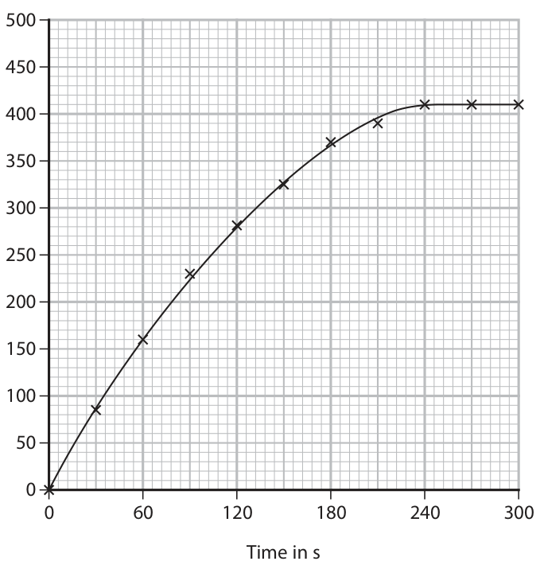

**Mark scheme answer**

> M1 curve above original and starts at 0
> M2 curve goes flat at same volume (410cm3)

- **(1)** curve above original and starts at 0
- **(1)** curve goes flat at same volume (410cm3)

### 11(b)(iv) [2]

Explain why the rate of reaction is greater if the same mass of zinc powder is used instead of zinc lumps. All other conditions are kept the same.

**Mark scheme answer**

> M1 greater surface area
> M2 more collisions per unit time / more frequent
> collisions

- **(1)** greater surface area
- **(1)** more collisions per unit time / more frequent

### 11(c) [2]

In another experiment, the student adds 0.55 g of zinc to a solution containing 2.50 × 10−2 moles of hydrochloric acid. Use the equation to show that hydrochloric acid is in excess. Zn(s) + 2HCl(aq) → ZnCl2(aq) + H2(g) [Ar of Zn = 65]

**Mark scheme answer**

> M1 8.46 × 10-3 mol of zinc ALLOW any number of
> sig figs including one e.g.
> M2 therefore 1.69 × 10-2 mol hydrochloric acid 0.008 moles of zinc,
> needed (which is less than 2.50 × 10-2 mol) therefore 0.016 moles of
> acid needed scores M1
> OR and M2
> M1 1.25 × 10-2 mol of zinc are needed
> M2 therefore 0.8(13) g of zinc is needed (and there
> is only 0.55g)
> 15 marks
> Pearson Education Limited. Registered company number 872828
> with its registered office at 80 Strand, London, WC2R 0RL, United Kingdom

- **(2)** M1 8.46 × 10-3 mol of zinc ALLOW any number of

