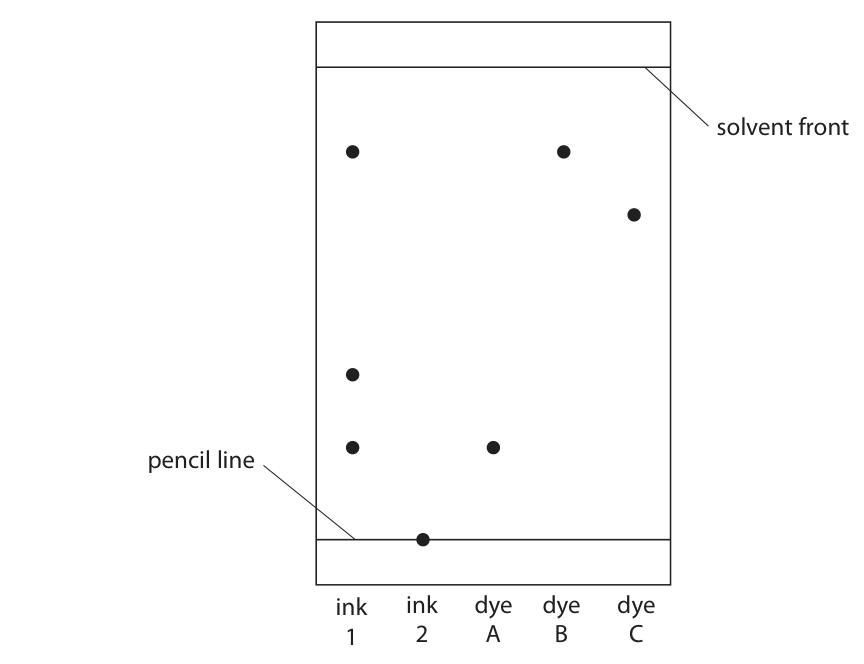
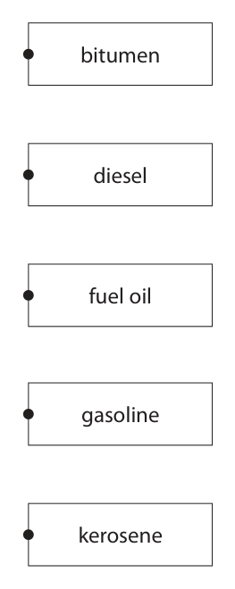
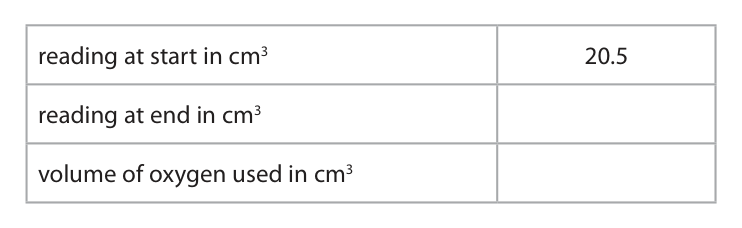
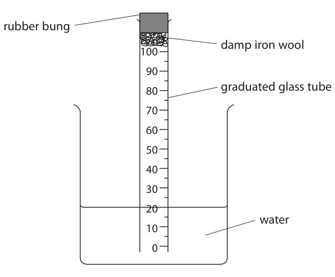
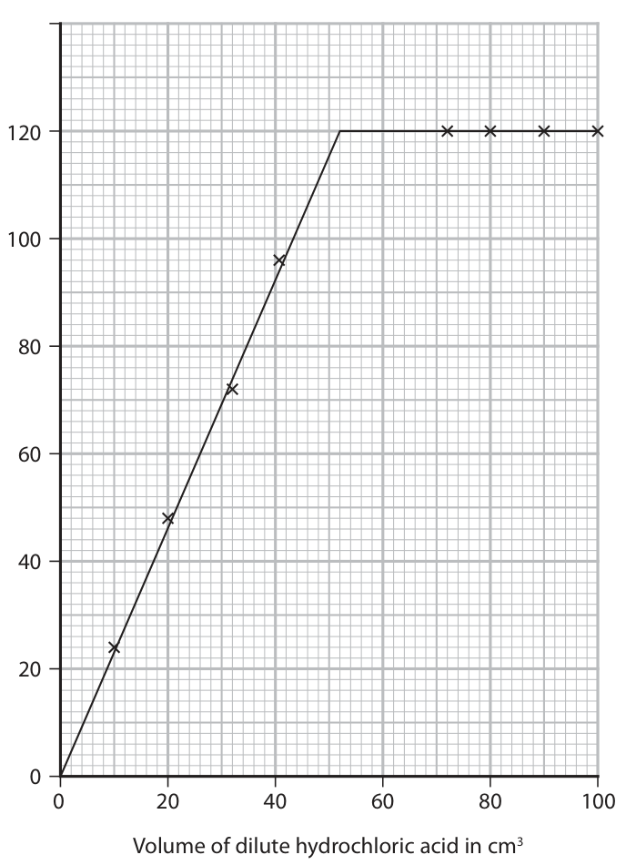
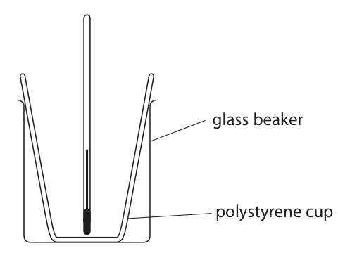

# 4CH1/1CR — 2021-01 (official extraction)

> schema `syllabai.official-paper-questions/0.2` · paper_id `pearson-edexcel:international-gcse:chemistry:4ch1:2021-01:4CH1/1CR` · qp sha256 `e8bf13d2517fcc66…` · extraction is the disclosed baseline (ADR-039)

## Question 1 (6 marks)

The box lists some substances. air bromine carbon copper glucose nitrogen oxygen sulfur water Choose substances from the box to answer these questions. Each substance may be used once, more than once or not at all.

### 1(a) [1]

Name a metallic element.

**Mark scheme answer**

> copper

- **(1)** copper

### 1(b) [1]

Name a compound.

**Mark scheme answer**

> glucose/water

- **(1)** glucose/water

### 1(c) [1]

Name a mixture.

**Mark scheme answer**

> air

- **(1)** air

### 1(d) [1]

Name an element that is a gas at room temperature.

**Mark scheme answer**

> nitrogen/oxygen

- **(1)** nitrogen/oxygen

### 1(e) [1]

Name an element that forms a basic oxide.

**Mark scheme answer**

> copper

- **(1)** copper

### 1(f) [1]

Name two elements that are in the same group of the Periodic Table.

**Mark scheme answer**

> oxygen and sulfur in either order
> (Total for Question 1 = 6)

- **(1)** oxygen and sulfur in either order

## Question 2 (7 marks)

A student does a chromatography experiment using ink 1, ink 2, and three known dyes A, B and C. The student uses water as the solvent. The diagram shows the student’s chromatogram. solvent front pencil line ink ink dye dye dye 1 2 A B C

### 2(a) [2]

Deduce what conclusions can be made about the composition of ink 1.

**Mark scheme answer**

> Any two from the following:
> M1 contains 3 dyes
> M2 contains (dye) A
> M3 contains (dye) B
> M4 does not contain (dye) C / contains an
> unknown
> dye OWTTE

- **(2)** Any two from the following:

### 2(b)(i) [1]

Give one conclusion that can be made about ink 2.

**Mark scheme answer**

> (Ink 2) is insoluble (in solvent/water) ALLOW does not
> contain (dye) A/B/C

- **(1)** (Ink 2) is insoluble (in solvent/water) ALLOW does not

### 2(b)(ii) [1]

Suggest how the student could change the experiment to find the composition of ink 2.

**Mark scheme answer**

> (repeat) using different solvent ALLOW named
> alternative solvent eg
> alcohol/ethanol

- **(1)** (repeat) using different solvent ALLOW named

### 2(c) [3]

Calculate the Rf value of dye C, giving your answer to 2 significant figures. Rf value =

**Mark scheme answer**

> M1 correct measurement of distance moved by ALLOW 5.4-5.6
> spot ALLOW 7.9-8.1
> AND correct measurement of distance moved by
> solvent
> Expected:
> M2 use and evaluation of 5.5 = 0.6875
> 8.0
> Rf = distance moved by spot
> = 0.69
> distance moved by solvent front
> ALLOW ECF from M1
> M3 answer to 2 sig fig
> M2
> correct answer with no
> working scores 3
> (Total for Question 2 = 7)

- **(1)** correct measurement of distance moved by ALLOW 5.4-5.6
- **(1)** use and evaluation of 5.5 = 0.6875
- **(1)** answer to 2 sig fig

## Question 3 (13 marks)

Crude oil is a mixture of organic compounds. Most of these compounds are members of the same homologous series.

**(b)** An industrial process is used to separate crude oil into fractions.

**(d)** Some of the fractions contain long-chain molecules which are not very useful.

### 3(a) [1]

State the name of this homologous series.

**Mark scheme answer**

> alkanes

- **(1)** alkanes

### 3(b)(i) [1]

The process depends on a difference in a property of the fractions. What is this property?

- **(A)** boiling point  ✔
- **(B)** density
- **(C)** melting point
- **(D)** solubility

**Mark scheme answer**

> A boiling point is the correct answer because fractional
> distillation depends on differences in boiling point
> B is not correct because fractional distillation does not
> depend on differences in density
> C is not correct because fractional distillation does not
> depend on differences in melting point
> D is not correct because fractional distillation does not
> depend on differences in solubility

- **(1)** Answer A: boiling point

### 3(b)(ii) [3]

The boxes give some uses of fractions and some names of fractions. Draw one straight line from each use to its correct fraction. Use Fraction bitumen fuel for aeroplanes diesel fuel for ships fuel oil surfacing roads gasoline kerosene

**Mark scheme answer**

> 1 mark for each correct line from boxes on left If more than
> one line from a
> box on left
> do not award mark for
> that box

- **(3)** 1 mark for each correct line from boxes on left If more than

### 3(c) [3]

Fuels obtained from the fractions may contain impurities. Explain how the combustion of a common impurity in fuels may cause an environmental problem.

**Mark scheme answer**

> explanation including the following points:
> M1 (common impurity in fuels is) sulfur
> M2 sulfur burns/combusts/reacts (in air/oxygen) to form
> sulfur dioxide/SO2
> M3 sulfur dioxide/SO2 dissolves in/reacts with rain/water
> to form acid rain
> If M2 M3 not scored
> ALLOW 1 mark for
> reference to sulphur
> dioxide/SO2 and acid
> rain

- **(1)** (common impurity in fuels is) sulfur
- **(1)** sulfur burns/combusts/reacts (in air/oxygen) to form
- **(1)** sulfur dioxide/SO2 dissolves in/reacts with rain/water

### 3(d)(i) [1]

Give the name of the process used to convert long-chain molecules into more useful shorter-chain molecules.

**Mark scheme answer**

> cracking

- **(1)** cracking

### 3(d)(ii) [2]

Give the catalyst and temperature used in the industrial process to convert long-chain molecules into shorter-chain molecules. catalyst temperature

**Mark scheme answer**

> M1 (catalyst) silica/alumina ALLOW silicon
> dioxide/aluminium
> oxide
> ALLOW formulae
> M2 (temperature) 600-700 (°C) ALLOW zeolite

- **(1)** (catalyst) silica/alumina ALLOW silicon
- **(1)** (temperature) 600-700 (°C) ALLOW zeolite

### 3(d)(iii) [2]

When C13H28 is used in this process, three different molecules are formed. Complete the equation for this reaction. C13H28 → C8H18 + +

**Mark scheme answer**

> C13H28 → C8H18 +
> M1 C3H6 + in either order
> ALLOW structural
> formulae
> M2 C2H4
> ALLOW 1 mark for
> single product C5H10
> (Total for Question 3 = 13)

- **(1)** C3H6 + in either order
- **(1)** C2H4

## Question 4 (9 marks)

When iron is left in damp air, rust forms on its surface.

**(b)** A student uses this apparatus to find the approximate percentage by volume of oxygen in air. rubber bung damp iron wool 100 80 graduated glass tube water This is the student’s method. • place a graduated glass tube in a beaker of water • place some damp iron wool and a rubber bung in the top of the tube • record the reading of the water level in the tube • leave the apparatus for a few days • record the reading of the water level again The diagram shows the readings at the start and at the end of the experiment. 30 40 20 30 10 20 start end

### 4(a)(i) [1]

State the chemical name for rust.

**Mark scheme answer**

> (hydrated) iron(III) oxide REJECT incorrect
> oxidation states

- **(1)** (hydrated) iron(III) oxide REJECT incorrect

### 4(a)(ii) [2]

Explain how a barrier method prevents rusting.

**Mark scheme answer**

> M1 (barrier method involves) ALLOW coating in
> coating iron in paint/oil/grease/plastic named metal below
> iron in reactivity series
> eg tin
> M2 stops oxygen/air/water getting to the iron
> ALLOW stops iron
> reacting with
> oxygen/air/water

- **(1)** (barrier method involves) ALLOW coating in
- **(1)** stops oxygen/air/water getting to the iron

### 4(b)(i) [2]

Use the readings to complete the table, giving all values to the nearest 0.5 cm3. reading at start in cm3 20.5 reading at end in cm3 volume of oxygen used in cm3

**Mark scheme answer**

> reading at start 20.5
> reading at end 33.5 (1)
> CSQ on reading
> volume of oxygen 13.0 (1)
> used in cm3

- **(2)** reading at start 20.5

### 4(b)(ii) [1]

The student uses these results to calculate the percentage by volume of oxygen in air. Suggest why her calculated value is lower than the expected value.

**Mark scheme answer**

> not all oxygen had reacted / not enough iron ALLOW not left for long
> (wool) enough/ OWTTE

- **(1)** not all oxygen had reacted / not enough iron ALLOW not left for long

### 4(c) [3]

The student repeats the experiment using the same apparatus. These are her results for the second experiment. volume of air in tube at start = 80.0 cm3 reading at start = 20.0 reading at end = 35.5 Use the results to calculate the percentage by volume of oxygen in air. percentage = %

**Mark scheme answer**

> M1 calculation of volume oxygen used
> M2 correct expression for percentage of oxygen
> M3 correct evaluation
> Example calculation:
> M1 (35.5 – 20.0 =) 15.5
> M2 (15.5 ÷ 80.0) x 100 ALLOW ECF from M1
> M3 19.4(%) ACCEPT 19.375/19.38
> correct answer with no
> working scores 3
> (Total for Question 4 = 9)

- **(3)** M1 calculation of volume oxygen used

## Question 5 (12 marks)

A student uses this apparatus to investigate the effect of heat on different solid metal carbonates. metal carbonate boiling tube delivery tube test tube heat limewater This is the student’s method. • use a spatula to put some metal carbonate in the boiling tube • fit the delivery tube into position • pour some limewater into the test tube • start a timer and immediately begin to heat the metal carbonate • record the time when a change first occurs in the limewater The student repeats the method using different metal carbonates. When a metal carbonate is heated a reaction sometimes occurs. The equation for the reaction is metal carbonate → metal oxide + carbon dioxide

**(e)** The table shows some of the results for the student’s investigation. Time taken for any Metal carbonate Colour change of solid change in limewater calcium carbonate remains white 90 seconds sodium carbonate remains white no change copper(II) carbonate 50 seconds

### 5(a) [1]

State the name given to this type of reaction.

**Mark scheme answer**

> (thermal) decomposition (1)

- **(1)** (thermal) decomposition (1)

### 5(b) [2]

State two variables that the student should control in this investigation. 1 2

**Mark scheme answer**

> any two of the following:
> M1 (use the same) amount of metal carbonate ALLOW mass
> M2 (use the same) sized pieces/surface area
> M3 (use the same) volume of limewater ALLOW amount
> M4 (use same) size flame / distance of flame from
> boiling tube OWTTE

- **(2)** any two of the following:

### 5(c) [1]

Suggest why bubbles appear in the limewater immediately after heating has started but before there is any change to the metal carbonate.

**Mark scheme answer**

> bubbles are air (from tube) / caused by air ALLOW gas in tube
> (expanding on heating) expands (on heating)

- **(1)** bubbles are air (from tube) / caused by air ALLOW gas in tube

### 5(d) [2]

Explain the purpose of limewater in this investigation.

**Mark scheme answer**

> explanation including
> M1 (when limewater turns milky/cloudy it)
> shows carbon dioxide produced
> M2 showing metal carbonate has ALLOW carbon dioxide
> reacted/decomposed comes from carbonate
> (reacting/decomposing)

- **(1)** (when limewater turns milky/cloudy it)
- **(1)** showing metal carbonate has ALLOW carbon dioxide

### 5(e)(i) [2]

State the colour change that occurs for copper(II) carbonate. from to

**Mark scheme answer**

> M1 (from) green IGNORE qualifiers eg
> light
> M2 (to) black

- **(1)** (from) green IGNORE qualifiers eg
- **(1)** (to) black

### 5(e)(ii) [1]

Give a chemical equation for this reaction of copper(II) carbonate.

**Mark scheme answer**

> CuCO3 → CuO + CO2 ALLOW products in
> either order

- **(1)** CuCO3 → CuO + CO2 ALLOW products in

### 5(f)(i) [2]

There is a relationship between the position of a metal in the reactivity series and how easily the metal carbonate reacts when heated. Use the student’s results and your own knowledge to deduce this relationship.

**Mark scheme answer**

> M1 the lower the metal is (in the reactivity series) ALLOW the less
> reactive a metal is
> M2 the more easily the (metal) carbonate ALLOW the more
> reacts/decomposes easily the (metal)
> carbonate
> produces carbon
> dioxide
> ALLOW references
> to the less time the
> (metal) carbonate
> takes to
> react/decompose
> ALLOW references
> to the faster the
> (metal) carbonate
> reacts/decomposes
> ACCEPT reverse
> arguments

- **(1)** the lower the metal is (in the reactivity series) ALLOW the less
- **(1)** the more easily the (metal) carbonate ALLOW the more

### 5(f)(ii) [1]

State how you should extend the investigation to see if your deduction is correct.

**Mark scheme answer**

> repeat (the investigation) using different / other / more
> (metal) carbonates
> (Total for Question 5 = 12)

- **(1)** repeat (the investigation) using different / other / more

## Question 6 (12 marks)

Zinc reacts with dilute hydrochloric acid to form hydrogen.

**(b)** A student investigates the reaction between pieces of zinc and dilute hydrochloric acid. In each experiment, he uses the same mass of zinc but a different volume of the acid. He collects the hydrogen and measures its volume in each experiment. The graph shows the student’s results. 120 100 Volume of hydrogen in cm3 0 20 40 60 80 100 Volume of dilute hydrochloric acid in cm3

### 6(a)(i) [2]

Give a chemical equation for this reaction.

**Mark scheme answer**

> Zn + 2HCl → ZnCl2 + H2
> M1 all symbols and formulae correct
> M2 correctly balanced M2 DEP M1

- **(1)** all symbols and formulae correct
- **(1)** correctly balanced M2 DEP M1

### 6(a)(ii) [1]

Give a test for hydrogen gas.

**Mark scheme answer**

> lighted splint (produces squeaky) pop

- **(1)** lighted splint (produces squeaky) pop

### 6(b)(i) [1]

Use the graph to find the minimum volume of acid needed to react with all of the zinc.

**Mark scheme answer**

> 52 (cm3) ALLOW 51.5-52.5

- **(1)** 52 (cm3) ALLOW 51.5-52.5

### 6(b)(ii) [2]

The student repeats the investigation, using hydrochloric acid of double the original concentration. Determine the volume of hydrogen that would be collected using 15 cm3 of this acid. Show your working on the graph. volume = cm3

**Mark scheme answer**

> M1 vertical line from 15 cm3 acid to graph line ALLOW extra point drawn
> at 15 cm3
> M2 volume hydrogen from graph multiplied by 2 ALLOW 68-70
> OR
> M1 vertical line from 30 cm3 acid to graph line ALLOW extra point drawn
> at 30 cm3
> M2 volume hydrogen from graph ALLOW 68-70

- **(2)** M1 vertical line from 15 cm3 acid to graph line ALLOW extra point drawn

### 6(c) [3]

Explain how increasing the concentration of the hydrochloric acid affects the rate of reaction.

**Mark scheme answer**

> explanation linking
> M1 more (acid) particles/(hydrogen) ions/H+ in REJECT molecules once
> same volume only
> ALLOW particles are
> closer together
> M2 more (successful) collisions per second/unit ACCEPT more frequent
> time collisions
> IGNORE more
> chance/probability of
> collision
> ALLOW reaction is faster
> M3 rate increases /speeds up
> MAX 1 if refer to particles
> moving faster/having
> more energy

- **(1)** more (acid) particles/(hydrogen) ions/H+ in REJECT molecules once
- **(1)** more (successful) collisions per second/unit ACCEPT more frequent
- **(1)** rate increases /speeds up

### 6(d) [3]

The rate of reaction could also be affected by changing the temperature of the hydrochloric acid, or by using a catalyst. Explain one other way in which the rate of reaction between zinc and hydrochloric acid can be affected.

**Mark scheme answer**

> explanation including
> M1 (increase/decrease) surface area
> M2 increase surface area by using smaller pieces
> of zinc
> M3 more (successful) collisions per second/unit ACCEPT more frequent
> time (so rate increases) collisions
> IGNORE more
> chance/probability of
> collision
> M2 M3 ACCEPT reverse
> arguments
> (Total for Question 6 = 12)

- **(1)** (increase/decrease) surface area
- **(1)** increase surface area by using smaller pieces
- **(1)** more (successful) collisions per second/unit ACCEPT more frequent

## Question 7 (8 marks)

The formation of ions and covalent bonds involves electrons. The table gives the electronic configurations of atoms of hydrogen, lithium and chlorine. Element Electronic configuration of atom hydrogen 1 lithium 2.1 chlorine 2.8.7

### 7(a) [3]

Describe the different roles of electrons in the formation of • ions in lithium chloride • covalent bonds in hydrogen chloride

**Mark scheme answer**

> description including
> (formation of ions in lithium chloride involves)
> ALLOW correct dot-and-
> M1 lithium (atom) losing electron cross diagrams for ions
> for M1 and M2
> M2 chlorine (atom) gaining an electron
> (formation of covalent bonds in hydrogen
> chloride involves)
> M3 sharing a pair of electrons (one electron from ALLOW correct dot-and-
> each atom) cross diagram showing
> shared pair in hydrogen
> chloride for M3

- **(1)** lithium (atom) losing electron cross diagrams for ions
- **(1)** chlorine (atom) gaining an electron
- **(1)** sharing a pair of electrons (one electron from ALLOW correct dot-and-

### 7(b) [5]

Explain why lithium chloride has a higher melting point than hydrogen chloride. Refer to structure and bonding in your answer.

**Mark scheme answer**

> explanation including five of the following points:
> (lithium chloride)
> M1 giant (ionic) structure ALLOW giant lattice
> M2 strong (electrostatic) forces of attraction ALLOW strong bonds
> M3 between oppositely charged ions ACCEPT positive and
> negative ions
> If any reference to
> molecules/atoms/covalent
> bonds/intermolecular
> forces/metallic bonds
> (hydrogen chloride) cannot score M2 M3 M6
> M4 simple molecular structure
> M5 weak intermolecular forces of attraction ALLOW weak bonds
> between molecules
> M6 more (heat/thermal) energy needed to
> overcome forces/break bonds in lithium chloride
> (than intermolecular forces in hydrogen chloride) ACCEPT reverse argument
> OWTTE
> If description/implication
> of breaking covalent
> bonds in hydrogen
> chloride cannot score M5
> M6
> (Total for Question 7 = 8)

- **(5)** explanation including five of the following points:

## Question 8 (15 marks)
**(b)** An acrylic polymer can be formed from molecules with this structure. H CH3 C C H COOCH3

**(c)** Octane is a compound in petrol. The equation for the complete combustion of octane is C8H18 + 12.5 O2 → 8 CO2 + 9 H2O

### 8(a)(i) [2]

Organic compounds can exist as isomers. Explain what is meant by the term isomers.

**Mark scheme answer**

> explanation linking
> M1 (molecules/compounds) having same
> molecular formulae
> M2 but different structural/displayed formulae ALLOW different
> structures
> ALLOW different
> arrangement of atoms

- **(1)** (molecules/compounds) having same
- **(1)** but different structural/displayed formulae ALLOW different

### 8(a)(ii) [2]

Organic compound Q reacts with bromine, without the presence of ultraviolet radiation, to form the compound C4H8Br2 Draw the displayed formulae of two isomers of Q.

**Mark scheme answer**

> M1 displayed formula of but-1-ene IGNORE bond angles
> ALLOW displayed
> M2 displayed formula of but-2-ene
> formula of
> methylpropene

- **(1)** displayed formula of but-1-ene IGNORE bond angles
- **(1)** displayed formula of but-2-ene

### 8(b)(i) [2]

A student describes the molecule as an unsaturated hydrocarbon. Explain whether this is a correct description.

**Mark scheme answer**

> explanation linking
> M1 molecule is unsaturated as contains (carbon to
> carbon) double bond
> M2 molecule not a hydrocarbon as contains ACCEPT does not
> oxygen contain hydrogen and
> carbon only

- **(1)** molecule is unsaturated as contains (carbon to
- **(1)** molecule not a hydrocarbon as contains ACCEPT does not

### 8(b)(ii) [1]

Name the type of polymerisation that occurs in the formation of the polymer.

**Mark scheme answer**

> addition

- **(1)** addition

### 8(b)(iii) [2]

Complete the equation for the polymerisation reaction. H CH3 n C C H COOCH3

**Mark scheme answer**

> M1 correct repeat unit structure
> M2 extension bonds, brackets and n n can be anywhere
> after bracket
> extension bonds do
> not have to go through
> brackets
> M2 DEP M1 or near
> miss

- **(1)** correct repeat unit structure
- **(1)** extension bonds, brackets and n n can be anywhere

### 8(c)(i) [5]

The fuel tank of a car contains 50.0 dm3 of octane. Calculate the mass, in kg, of carbon dioxide formed if all the octane in the fuel tank undergoes complete combustion. [mass of 1 dm3 of octane = 700 g] mass = kg

**Mark scheme answer**

> M1 calculation of mass of octane
> M2 calculation of Mr of C8H18 and CO2
> M3 link between mass/mol C8H18 and mass/mol
> CO2
> M4 calculation of mass CO2 in g
> M5 calculation of mass CO2 in kg
> Example calculation:
> M1 50 x 700 = 35000 (g)
> M2 Mr of C8H18 = 114 and Mr CO2 = 44
> M3 114g C8H18 produces (8 x 44 =) 352 (g) CO2
> M4 35000 g C8H18 produces 35000 × 352
> 114
> = 108070.2 (g) CO2 ALLOW 2 sig fig or
> more in M4 and M5
> M5 = 108 (kg)
> Alternative method using mol:
> M1 50 x 700 = 35000 (g)
> M2 Mr of C8H18 = 114 and Mr CO2 = 44
> M3 n (C8H18) = 35000 = 307.0175 mol
> 114
> so n (CO2) = 8 x 307.0175 = 2456.14 mol ALLOW 2 sig fig or
> more in M3 M4 and M5
> M4 mass CO2 = 2456.14 x 44 = 108070.2 (g)
> M5 = 108 (kg) MARK CSQ in both
> methods
> correct answer without
> working scores 5

- **(5)** M1 calculation of mass of octane

### 8(c)(ii) [1]

State an environmental problem caused by carbon dioxide.

**Mark scheme answer**

> IGNORE greenhouse
> global warming/climate change effect
> (Total for Question 8 = 15)

- **(1)** IGNORE greenhouse

## Question 9 (13 marks)

Lithium, sodium and potassium are the first three elements in Group 1 of the Periodic Table.

**(b)** Caesium, Cs, is below potassium in Group 1.

**(c)** A student investigates the temperature change in the reaction between dilute acids and solutions of Group 1 hydroxides. He uses this apparatus. glass beaker polystyrene cup This is the student’s method. • measure the temperature of 50 cm3 of hydrochloric acid • pour the acid into a polystyrene cup • add 50 cm3 of sodium hydroxide solution to the acid • measure the maximum temperature of the mixture

**(d)** These are the student’s results. temperature of hydrochloric acid = 19.9 °C maximum temperature of mixture = 26.5 °C

### 9(a) [1]

Suggest why these three elements are all stored in paraffin oil.

**Mark scheme answer**

> to keep out of contact/prevent reaction with ALLOW they react with
> air/oxygen/water/moisture air/oxygen/water/moisture

- **(1)** to keep out of contact/prevent reaction with ALLOW they react with

### 9(b)(i) [2]

Give a similarity and a difference between the reactions of potassium with water and caesium with water. similarity difference

**Mark scheme answer**

> similarity: both fizz/move on surface/ produce flame ALLOW both melt/form a
> ball/produce a gas/
> produce hydrogen/form
> an alkaline solution
> difference caesium: faster/more violent reaction ACCEPT reverse argument
> for potassium
> ALLOW caesium explodes

- **(2)** similarity: both fizz/move on surface/ produce flame ALLOW both melt/form a

### 9(b)(ii) [2]

Give the chemical equation for the reaction between caesium and water.

**Mark scheme answer**

> 2Cs + 2H2O → 2CsOH + H2 ACCEPT fractions and
> multiples
> M1 all symbols/formulae correct
> M2 correctly balanced M2 DEP M1

- **(1)** all symbols/formulae correct
- **(1)** correctly balanced M2 DEP M1

### 9(c)(i) [1]

Suggest what could be added to the apparatus to improve the experiment.

**Mark scheme answer**

> a lid/cover

- **(1)** a lid/cover

### 9(c)(ii) [2]

Explain a change to the method that would improve the accuracy of the experiment.

**Mark scheme answer**

> explanation linking either
> M1 stir solution
> M2 to obtain more accurate (maximum) temperature ALLOW reference to even
> temperature throughout/
> heat evenly distributed
> OWTTE
> OR
> M1 measure temperature of sodium hydroxide
> M2 to check if different to/same as temperature of ALLOW take an average of
> (hydrochloric) acid temperature of sodium
> hydroxide and
> temperature of
> (hydrochloric) acid for 2
> marks

- **(2)** explanation linking either

### 9(d)(i) [3]

Calculate the energy change, Q, in joules for this reaction. [mass of 1.0 cm3 of mixture = 1.0 g] [for the mixture, c = 4.2 J/g/°C] Q = J

**Mark scheme answer**

> M1 correct temperature change/ΔT
> M2 correct substitution into Q = m x c x ΔT
> M3 correct evaluation
> Example calculation:
> M1 ΔT = (26.5 – 19.9) OR 6.6
> M2 Q = 100 x 4.2 x 6.6 M2 ECF M1
> M3 = 2800 (J) M3 ECF M2
> IGNORE any sign
> ALLOW 2770, 2772
> correct answer without
> working scores 3

- **(3)** M1 correct temperature change/ΔT

### 9(d)(ii) [2]

In the student’s reaction between hydrochloric acid and sodium hydroxide, 0.050 mol of water forms. Calculate the molar enthalpy change, ΔH, in kJ/mol for this reaction. ΔH = kJ/mol

**Mark scheme answer**

> M1 answer to M3 from (i) ÷ 0.05
> M2 correct evaluation in kJ/mol with negative
> sign
> expected answer
> M1 2800 ÷ 0.05 OR 56000 (J) 2770 gives 55400
> 2772 gives 55440
> M2 - 56 (kJ/mol)
> negative sign required
> ACCEPT -55.4
> ACCEPT -55.44
> ACCEPT -55
> correct answer without
> working scores 2
> (Total for Question 9 = 13)

- **(2)** M1 answer to M3 from (i) ÷ 0.05

## Question 10 (15 marks)

This question is about salts.

**(a)** Soluble salts can be prepared by the reaction between a metal oxide and an acid. The equation for this type of reaction is metal oxide + acid → salt + water

### 10(a)(i) [1]

State the name given to this type of reaction.

**Mark scheme answer**

> neutralisation ALLOW acid - base

- **(1)** neutralisation ALLOW acid - base

### 10(a)(ii) [1]

State, in terms of protons, what happens in this reaction.

**Mark scheme answer**

> acid donates proton(s)/base accepts proton(s) ALLOW metal oxide for
> base

- **(1)** acid donates proton(s)/base accepts proton(s) ALLOW metal oxide for

### 10(b)(i) [5]

A student is given 50 cm3 of dilute sulfuric acid and a bottle of solid copper(II) carbonate. Describe the method that the student should use to prepare a saturated solution of copper(II) sulfate. In your answer, refer to the pieces of apparatus that the student should use.

> 🖼 crop required: apparatus (qp.pdf p.28)

**Mark scheme answer**

> description including
> M1 appropriate use of at least three named pieces
> of apparatus
> AND any four of the following points
> M2 add copper(II) carbonate to (dilute sulfuric)
> acid (a spatula/little at a time and stir after each
> addition)
> ALLOW until no more
> M3 until no more effervescence reacts/dissolves
> ALLOW until in excess
> M4 filter (to remove excess copper(II)
> carbonate/to obtain (copper(II) sulfate) solution)
> M5 heat/warm filtrate/(copper(II) sulfate) solution
> until crystals start to appear (solution saturated)
> OWTTE
> IGNORE if continue and
> M6 filter to obtain (the saturated) solution prepare crystals
> instead of saturated
> solution

- **(5)** description including

### 10(b)(ii) [3]

The student produces dry crystals of hydrated copper(II) sulfate from the saturated solution. He calculates that 6.40 g of dry crystals should be formed. The mass of dry crystals he actually obtains is 1.80 g less than he calculated. Calculate the student’s percentage yield. Give your answer to one decimal place. percentage yield = %

**Mark scheme answer**

> 3
> M1 calculation of actual mass of crystals obtained
> M2 division by expected mass of crystals (6.4) and
> multiplication by 100 to convert to percentage
> M3 correct to 1 dp
> Example calculation
> M1 (6.40 – 1.80 = ) 4.6(0)
> M2 (% yield = ) 4.6 x100 OR 71.875 (%) M2 ECF M1
> 6.4
> M3 = 71.9 (%)
> M3 DEP M2

- **(3)** 3

### 10(c)(i) [3]

Gypsum is hydrated calcium sulfate. A sample of gypsum contains 79% of calcium sulfate by mass. Calculate the value of x in CaSO4.xH2O [Mr of CaSO4 = 136 Mr of H2O = 18] x =

**Mark scheme answer**

> M1 find percentage of water
> M2 divide each percentage by Mr to find number
> of moles
> M3 divide each answer by smallest to find ratio
> and value of x
> Expected calculation:
> M1 (79%) CaSO4 21% H2O
> M2 79 (= 0.58) 21 (= 1.17)
> 136
> M3 0.58 1.17 =1:2
> 0.58 0.58
> so x = 2 correct answer without
> working scores 3

- **(3)** M1 find percentage of water

### 10(c)(ii) [2]

Describe a test for calcium ions in the sample of gypsum.

**Mark scheme answer**

> description including
> M1 do a flame test ALLOW description of
> flame test
> M2 orange-red flame
> (Total for Question 10 = 15)
> Total for paper = 110 marks
> Pearson Education Limited. Registered company number 872828
> with its registered office at 80 Strand, London, WC2R 0RL, United Kingdom

- **(1)** do a flame test ALLOW description of
- **(1)** orange-red flame

