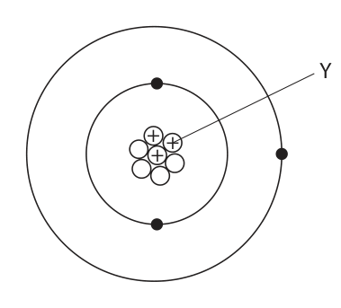
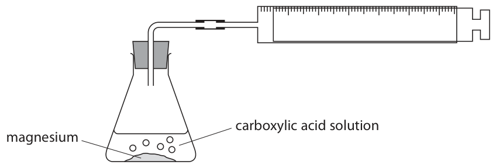
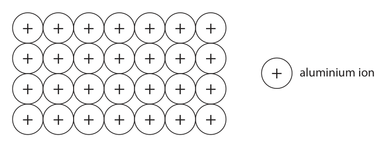
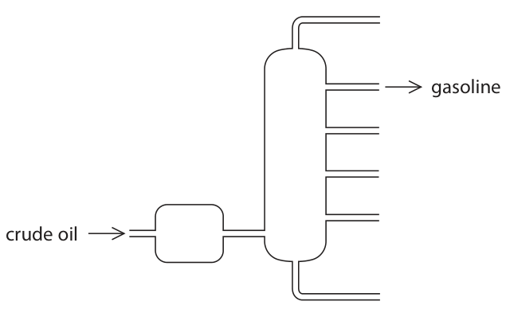

# 4CH1/2C — 2021-01 (official extraction)

> schema `syllabai.official-paper-questions/0.2` · paper_id `pearson-edexcel:international-gcse:chemistry:4ch1:2021-01:4CH1/2C` · qp sha256 `99ef1fc89c8a3f2a…` · extraction is the disclosed baseline (ADR-039)

## Question 1 (5 marks)

The diagram shows an atom of an element. Y ++ +

### 1(a)(i) [1]

What is the name of the particle labelled Y?

- **(A)** electron
- **(B)** ion
- **(C)** neutron
- **(D)** proton  ✔

**Mark scheme answer**

> D
> D is the correct answer because protons occur in
> the nucleus and have a positive charge.
> A is not the correct answer since electrons occur
> in the energy levels.
> B is not the answer since ions do not occur in the
> nucleus.
> C is not the correct answer since neutrons have
> no charge.

- **(1)** Answer D: proton

### 1(a)(ii) [1]

Give the mass number of this atom.

**Mark scheme answer**

> 7

- **(1)** 7

### 1(a)(iii) [1]

Name this element. Use the Periodic Table on page 2 to help you.

**Mark scheme answer**

> lithium ALLOW Li

- **(1)** lithium ALLOW Li

### 1(b) [2]

There are two isotopes of this element. Give one way, in terms of sub-atomic particles, that these isotopes are the same and one way that they are different. same different

**Mark scheme answer**

> M1 same number of protons ALLOW same number
> of electrons
> M2 different number of neutrons
> IGNORE references to
> mass number and
> atomic number.

- **(1)** same number of protons ALLOW same number
- **(1)** different number of neutrons

## Question 2 (5 marks)

This question is about gases.

**(a)** The box gives the names of some gases. argon carbon dioxide hydrogen nitrogen oxygen Use gases from the box to answer these questions. Each gas may be used once, more than once or not at all.

### 2(a)(i) [1]

Name the most abundant gas in the Earth’s atmosphere.

**Mark scheme answer**

> nitrogen ALLOW N2/N

- **(1)** nitrogen ALLOW N2/N

### 2(a)(ii) [1]

Name the gas that is a compound.

**Mark scheme answer**

> carbon dioxide ALLOW CO2

- **(1)** carbon dioxide ALLOW CO2

### 2(a)(iii) [1]

Name the least reactive of the gases.

**Mark scheme answer**

> argon ALLOW Ar

- **(1)** argon ALLOW Ar

### 2(a)(iv) [1]

Name the gas formed by the complete combustion of hydrocarbons.

**Mark scheme answer**

> carbon dioxide ALLOW CO2

- **(1)** carbon dioxide ALLOW CO2

### 2(b) [1]

Describe the test for hydrogen gas.

**Mark scheme answer**

> lighted splint (produces squeaky) pop

- **(1)** lighted splint (produces squeaky) pop

## Question 3 (8 marks)

This question is about carboxylic acids. Solutions of carboxylic acids react with magnesium metal to form hydrogen gas. A student uses this apparatus to investigate the time taken to produce 10 cm3 of hydrogen gas from different carboxylic acids. carboxylic acid solution magnesium This is the student’s method. • pour some carboxylic acid solution into a conical flask • add some magnesium powder • quickly connect the gas syringe and start a timer • record the time taken to collect 10 cm3 of hydrogen gas The student repeats the method with three other carboxylic acids.

**(b)** The table shows the student’s results. Time taken to produce 10 cm3 of hydrogen in s Carboxylic Formula of acid carboxylic acid Experiment Experiment Experiment Experiment Mean 1 2 3 4 time in s Methanoic HCOOH 48 50 47 49 49 acid Ethanoic CH3COOH 61 63 60 61 61 acid Propanoic CH3CH2COOH 69 93 70 71 acid Butanoic CH3CH2CH2COOH 83 85 82 81 83 acid

### 3(a)(i) [2]

All the carboxylic acids are of the same concentration. Give two other variables the student should control in his investigation. 1 2

**Mark scheme answer**

> Any two from:
> M1 volume of acid
> M2 temperature
> M3 mass / moles of magnesium
> M4 surface area / size of pieces of magnesium

- **(2)** Any two from:

### 3(a)(ii) [1]

Give a reason why it is important to connect the gas syringe quickly.

**Mark scheme answer**

> so as little gas as possible escapes ALLOW so no gas
> escapes
> IGNORE references to
> accuracy
> REJECT references to
> gas getting in

- **(1)** so as little gas as possible escapes ALLOW so no gas

### 3(b)(i) [2]

Calculate the mean (average) time for propanoic acid to produce 10 cm3 of hydrogen gas. mean time = s

**Mark scheme answer**

> M1 (69 + 70 + 71) ÷ 3 Answer of 70 with or
> without working scores
> M2 70s
> Answer of 76 or 75.8 or
> 75.75 with or without
> working scores 1

- **(1)** (69 + 70 + 71) ÷ 3 Answer of 70 with or
- **(1)** 70s

### 3(b)(ii) [1]

Deduce the relationship between the number of carbon atoms in the molecule and the time taken to produce 10 cm3 of hydrogen gas.

**Mark scheme answer**

> as the (number of) carbons increases the time (to
> produce 10 cm3 of hydrogen) increases ORA

- **(1)** as the (number of) carbons increases the time (to

### 3(c) [2]

An ester is formed by adding ethanoic acid to ethanol in the presence of sulfuric acid. Give the displayed formula of the ester produced when ethanoic acid reacts with ethanol.

**Mark scheme answer**

> M1 ester linkage as a displayed
> structure
> M2 rest of molecule correct as a fully displayed
> structure

- **(1)** ester linkage as a displayed
- **(1)** rest of molecule correct as a fully displayed

## Question 4 (9 marks)

This question is about sodium and potassium. A trough is filled with water and a few drops of phenolphthalein indicator are added.

**(a)** A small piece of sodium is dropped into the water. One of the products of the reaction is an alkali.

### 4(a)(i) [2]

Complete the chemical equation for the reaction of sodium with water. _____Na( ) + ______H2O(l) → _____NaOH( ) + H2(g)

**Mark scheme answer**

> 2
> 2 Na(s) + 2 H2O(l) → 2 NaOH(aq) + H2(g)
> M1 correct balancing numbers ALLOW multiples or
> fractions.
> M2 (s) and (aq) for state symbols

- **(1)** correct balancing numbers ALLOW multiples or
- **(1)** (s) and (aq) for state symbols

### 4(a)(ii) [1]

Identify the ion that causes the solution to become alkaline.

**Mark scheme answer**

> hydroxide or OH- REJECT OH

- **(1)** hydroxide or OH- REJECT OH

### 4(a)(iii) [3]

Give three observations that would be made when sodium reacts with water. 1 2 3

**Mark scheme answer**

> Any three from:
> M1 the sodium moves (on the surface) ALLOW sodium floats
> M2 effervescence or bubbles (of gas) IGNORE gas or
> hydrogen produced
> M3 (indicator or phenolphthalein or water) turns IGNORE initial colour
> pink of indicator
> ALLOW the sodium
> M4 the sodium gets smaller disappears / (appears
> to) dissolve
> M5 the sodium melts or turns into a ball

- **(3)** Any three from:

### 4(b) [3]

Explain why potassium is more reactive than sodium. Refer to the electronic configurations of the atoms in your answer.

**Mark scheme answer**

> M1 electron configuration of sodium is 2,8,1 and ALLOW the outer shell
> electron configuration of potassium is 2,8,8,1 is further from the
> nucleus
> ALLOW potassium has
> more shells
> ALLOW larger atom /
> larger atomic radius
> M2 outer electron less attracted (to the nucleus of
> potassium)
> M3 therefore (outer shell electron) is more easily ALLOW reverse
> lost argument for sodium

- **(1)** electron configuration of sodium is 2,8,1 and ALLOW the outer shell
- **(1)** outer electron less attracted (to the nucleus of
- **(1)** therefore (outer shell electron) is more easily ALLOW reverse

## Question 5 (14 marks)

This question is about the metal aluminium.

**(a)** Aluminium is malleable and conducts electricity. The diagram shows the arrangement of the ions in aluminium metal. + + + + + + + + + + + + + + + aluminium ion + + + + + + + + + + + + + +

**(c)** Aluminium is extracted industrially by the electrolysis of molten aluminium oxide Al2O3 at a temperature of about 950 °C. Aluminium metal forms at the negative electrode and oxygen gas forms at the positive electrode. The positive and negative electrodes are made of graphite. The diagram shows the apparatus used. positive graphite electrode molten aluminium oxide molten aluminium metal negative graphite electrode

**(d)** Aluminium reacts with iron(III) oxide. The reaction is exothermic. The equation for the reaction is 2Al + Fe2O3 → Al2O3 + 2Fe

### 5(a)(i) [2]

Explain why aluminium is malleable.

**Mark scheme answer**

> M1 layers / rows (of atoms / ions)
> M2 can slide over one another M2 is dependent on
> mention of layers /
> rows in M1

- **(1)** layers / rows (of atoms / ions)
- **(1)** can slide over one another M2 is dependent on

### 5(a)(ii) [2]

Explain why aluminium conducts electricity.

**Mark scheme answer**

> M1 delocalised electrons
> M2 can move / can flow / are free to move (throughout IGNORE references to
> the structure) charge or current
> IGNORE free electrons
> M2 dependent on
> mention of electrons in
> M1

- **(1)** delocalised electrons
- **(1)** can move / can flow / are free to move (throughout IGNORE references to

### 5(b) [1]

Aluminium cannot be extracted by heating a mixture of carbon and aluminium oxide. Give a reason why heating a mixture of aluminium oxide and carbon does not produce aluminium.

**Mark scheme answer**

> aluminium is more reactive than carbon ALLOW references to
> position in reactivity
> series e.g. aluminium is
> higher in reactivity
> series than carbon.
> ALLOW carbon is less
> reactive than
> aluminium

- **(1)** aluminium is more reactive than carbon ALLOW references to

### 5(c)(i) [2]

Explain how aluminium metal forms at the negative electrode.

**Mark scheme answer**

> M1 aluminium / Al3+ions are attracted to the negative
> electrode / cathode (because they are positively
> charged)
> ALLOW Al3+ + 3e-→Al
> M2 where they gain electrons (forming aluminium) IGNORE references to
> reduction

- **(1)** aluminium / Al3+ions are attracted to the negative
- **(1)** where they gain electrons (forming aluminium) IGNORE references to

### 5(c)(ii) [1]

Write an ionic half-equation for the formation of oxygen gas at the positive electrode →

**Mark scheme answer**

> 2O2- → O2 + 4e- ALLOW 2O2- - 4e- → O2

- **(1)** 2O2- → O2 + 4e- ALLOW 2O2- - 4e- → O2

### 5(c)(iii) [2]

Suggest why carbon dioxide gas is also produced at the positive electrode.

**Mark scheme answer**

> M1 electrodes are made of carbon
> M2 which reacts with / burns in oxygen

- **(1)** electrodes are made of carbon
- **(1)** which reacts with / burns in oxygen

### 5(d)(i) [1]

State how the equation shows that iron(III) oxide is reduced.

**Mark scheme answer**

> iron oxide loses oxygen IGNORE references to
> electrons

- **(1)** iron oxide loses oxygen IGNORE references to

### 5(d)(ii) [3]

Draw an energy level diagram for the reaction between aluminium and iron(III) oxide. Energy

**Mark scheme answer**

> IGNORE horizontal axis
> drawn
> IGNORE activation
> energy if shown
> M1 right hand line below left hand line
> M2 correct name / formula of both reactants
> M3 correct name / formula of both products
> If only use words
> reactants (on left) and
> products (on right)
> award 1 mark from M2
> and M3
> M2 and M3 can be
> scored from an
> endothermic diagram

- **(1)** right hand line below left hand line
- **(1)** correct name / formula of both reactants
- **(1)** correct name / formula of both products

## Question 6 (15 marks)

This question is about the insoluble salt silver chloride (AgCl). Silver chloride can be made by the reaction between copper(II) chloride and silver nitrate.

**(b)** A student investigates the quantity of silver chloride produced when different volumes of silver nitrate solution are added to copper(II) chloride solution. This is the student’s method. · pour 5.0 cm3 of copper(II) chloride solution into a test tube · add 1.0 cm3 of silver nitrate solution to the test tube · allow the silver chloride precipitate to settle · measure the height of the precipitate The student repeats the method using different volumes of silver nitrate solution. The table shows the student’s results. Volume of silver nitrate Height of precipitate added in cm3 in cm 0.0 0.0 1.0 0.5 2.0 1.0 3.0 1.2 4.0 2.0 5.0 2.5 6.0 3.0 7.0 3.0 8.0 3.0

**(c)** The equation for the reaction between copper(II) chloride and silver nitrate is CuCl2(aq) + 2AgNO3(aq) → 2AgCl(s) + Cu(NO3)2(aq) A student measures 25.0 cm3 of 0.500 mol/dm3 copper(II) chloride solution and reacts it with silver nitrate solution.

### 6(a) [4]

Describe how a student could prepare a pure, dry sample of silver chloride starting with copper(II) chloride solution and silver nitrate solution.

**Mark scheme answer**

> M1 mix / stir / add (silver nitrate and copper (II) IGNORE references
> chloride) to heating
> M2 filter (the silver chloride)
> M3 wash with (deionised / distilled) water
> M4 dry in a warm oven or dry with filter paper or
> leave / allow to dry (on a windowsill) or dry in a
> desiccator
> If evaporation is
> mentioned to form
> crystals max = 1

- **(1)** mix / stir / add (silver nitrate and copper (II) IGNORE references
- **(1)** filter (the silver chloride)
- **(1)** wash with (deionised / distilled) water
- **(1)** dry in a warm oven or dry with filter paper or

### 6(b)(i) [2]

Plot the student’s results.

**Mark scheme answer**

> M1 and M2 all points correctly plotted to ± half a Deduct 1 mark for
> square every incorrect point.

- **(2)** M1 and M2 all points correctly plotted to ± half a Deduct 1 mark for

### 6(b)(ii) [1]

Draw two straight lines of best fit, ignoring the anomalous result. Height of precipitate 2 in cm 0 1 2 3 4 5 6 7 8 Volume of silver nitrate added in cm

**Mark scheme answer**

> M3 two straight lines of best fit which must meet
> at
> 3 cm and 6 cm3

- **(1)** M3 two straight lines of best fit which must meet

### 6(b)(iii) [1]

Suggest a mistake the student made to cause the anomalous result.

**Mark scheme answer**

> Any one from:
> the precipitate wasn’t left to settle (for long ALLOW measured
> enough) the height too early
> the tube was on a slant
> not enough / less than 3.0 cm3 of silver nitrate IGNORE references
> added to human error
> unqualified

- **(1)** Any one from:

### 6(b)(iv) [1]

Give a reason why the last three heights are the same.

**Mark scheme answer**

> all the copper [(II)] chloride has reacted ALLOW the silver
> nitrate is in excess /
> not all the silver
> nitrate has reacted

- **(1)** all the copper [(II)] chloride has reacted ALLOW the silver

### 6(c)(i) [1]

Name a piece of apparatus suitable for measuring 25.0 cm3 of copper(II) chloride solution.

**Mark scheme answer**

> Any one from:
> burette ALLOW measuring
> cylinder
> (volumetric) pipette REJECT beaker

- **(1)** Any one from:

### 6(c)(ii) [3]

Calculate the maximum mass, in grams, of silver chloride that could be produced. [Mr of AgCl = 143.5] maximum mass = g

**Mark scheme answer**

> Example calculation
> M1 moles of coper chloride = (25 x 0.50) ÷ 1000 OR
> 0.0125 moles
> M2 moles of silver chloride = 0.0250 ALLOW answer to M1
> x2
> M3 mass of silver chloride = 3.59 g ALLOW answer to M1
> or M2 × 143.5
> ALLOW 2 or more
> significant figures
> Correct answer of 3.59
> g scores 3 marks

- **(1)** moles of coper chloride = (25 x 0.50) ÷ 1000 OR
- **(1)** moles of silver chloride = 0.0250 ALLOW answer to M1
- **(1)** mass of silver chloride = 3.59 g ALLOW answer to M1

### 6(c)(iii) [2]

In an experiment using different solutions, the mass of silver chloride produced is 0.744 g. The maximum mass of silver chloride that could be produced is 0.850 g. Calculate the percentage yield. percentage yield = %

**Mark scheme answer**

> M1 (0.744 ÷ 0.850) × 100
> M2 87.5(%) ALLOW 2 or more
> significant figures

- **(1)** (0.744 ÷ 0.850) × 100
- **(1)** 87.5(%) ALLOW 2 or more

## Question 7 (14 marks)

This question is about octane (C8H18) which is produced in the gasoline fraction during fractional distillation of crude oil.

**(c)** A car is driven at constant speed for 4.00 km. The exhaust gases are collected and their volume at room temperature and pressure (rtp) is 5.02 × 10⁵ cm3. The exhaust gases include carbon dioxide and oxides of nitrogen. The carbon dioxide is removed from the exhaust gases. The volume of the remaining gases at rtp is 2.96 × 10⁵ cm3.

### 7(a) [4]

The diagram shows a fractionating column. gasoline crude oil Describe how crude oil is separated into fractions in the fractionating column.

**Mark scheme answer**

> M1 crude oil is heated / vapourised ALLOW boiled
> M2 vapours / gases / compounds / hydrocarbons
> rise up the column
> M3 the column is hotter at the bottom than the ALLOW temperature
> top gradient of the column
> ALLOW vapours /
> M4 vapours / compounds / hydrocarbons compounds /
> condense at their boiling point hydrocarbons /
> condense at different
> heights
> ALLOW the vapours /
> compounds /
> hydrocarbons /
> fractions have different
> boiling points.

- **(1)** crude oil is heated / vapourised ALLOW boiled
- **(1)** vapours / gases / compounds / hydrocarbons
- **(1)** the column is hotter at the bottom than the ALLOW temperature
- **(1)** vapours / compounds / hydrocarbons compounds /

### 7(b) [2]

Octane can also be produced by the process of cracking. Give the conditions for cracking.

**Mark scheme answer**

> M1 temperature of 600°C - 700°C
> M2 catalyst of silica / alumina ALLOW
> aluminosilicates /
> zeolites / silicon
> dioxide / aluminium
> oxide
> IGNORE references to
> pressure

- **(1)** temperature of 600°C - 700°C
- **(1)** catalyst of silica / alumina ALLOW

### 7(c)(i) [2]

Explain how oxides of nitrogen form in a car engine.

**Mark scheme answer**

> M1 nitrogen (from the air) reacts / combines with REJECT any implication
> oxygen (from the air) that oxygen or
> nitrogen come from
> the fuel.
> M2 at high temperatures (in the car engine)

- **(1)** nitrogen (from the air) reacts / combines with REJECT any implication
- **(1)** at high temperatures (in the car engine)

### 7(c)(ii) [1]

Give a reason why oxides of nitrogen should not be released into the atmosphere.

**Mark scheme answer**

> Any one from:
> acid rain
> respiratory problems

- **(1)** Any one from:

### 7(c)(iii) [5]

Show that the car produces less than 100 g of carbon dioxide per km. [molar volume of carbon dioxide at rtp = 24 000 cm3]

**Mark scheme answer**

> Example calculation
> M1 volume of carbon dioxide = 206 000 cm3 /
> 2.06× 10⁵ cm3 / 206 dm3
> M2 volume of carbon dioxide per km = 51 500 cm3/ Division by 4 can
> 5.15× 10⁴ cm3 / 51.5 dm3 happen in M1, M2, M3
> or M5
> ALLOW M1 ÷ 4
> M3 (51 500 ÷ 24 000) = 2.15 moles ALLOW M2 or
> M1 ÷ 24 000
> M4 Mr of carbon dioxide is 44
> M5 mass of carbon dioxide per Km = 94.4 g ALLOW 94 – 95 g
> ALLOW ecf from
> incorrect Mr
> Correct answer of 94 –
> 95 g scores 5 marks.

- **(1)** volume of carbon dioxide = 206 000 cm3 /
- **(1)** volume of carbon dioxide per km = 51 500 cm3/ Division by 4 can
- **(1)** (51 500 ÷ 24 000) = 2.15 moles ALLOW M2 or
- **(1)** Mr of carbon dioxide is 44
- **(1)** mass of carbon dioxide per Km = 94.4 g ALLOW 94 – 95 g

