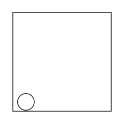
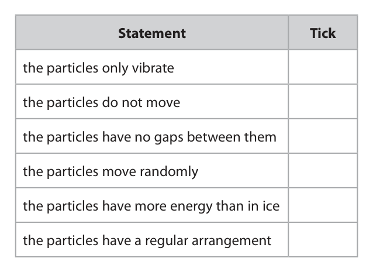
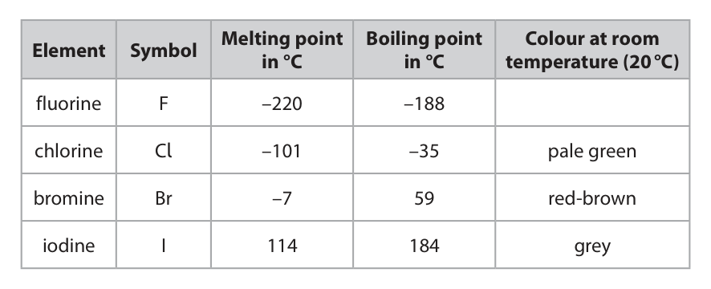
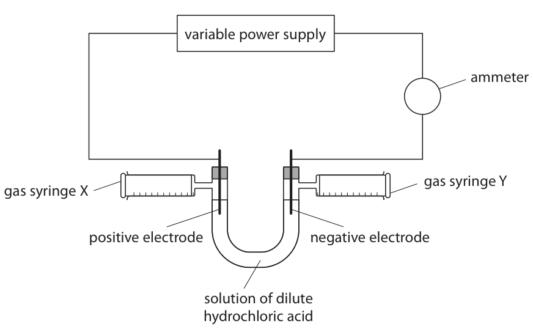
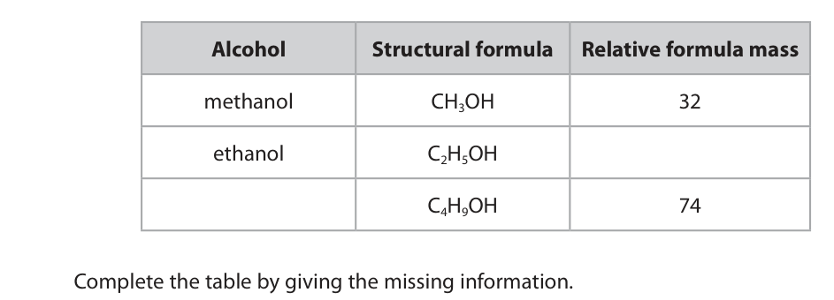
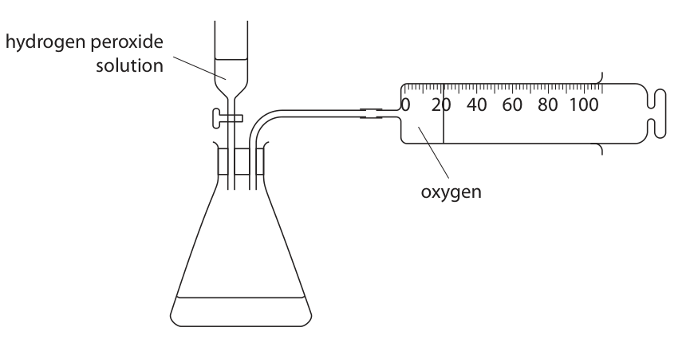
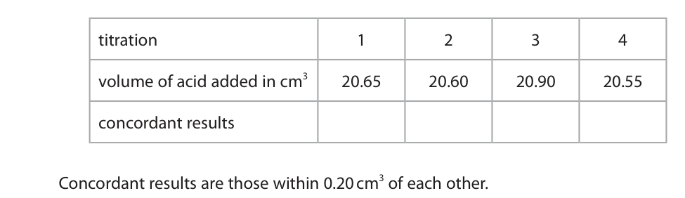
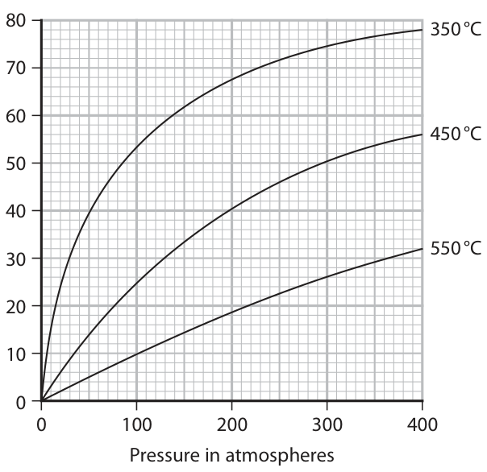

# 4CH1/2CR — 2021-01 (official extraction)

> schema `syllabai.official-paper-questions/0.2` · paper_id `pearson-edexcel:international-gcse:chemistry:4ch1:2021-01:4CH1/2CR` · qp sha256 `330fd797fc8cb97d…` · extraction is the disclosed baseline (ADR-039)

## Question 1 (5 marks)

Substances can exist as solids, liquids or gases.

### 1(a)(i) [1]

Give the change of state that occurs when a substance melts.

**Mark scheme answer**

> (from) solid to liquid

- **(1)** (from) solid to liquid

### 1(a)(ii) [1]

Complete the word equation for the sublimation of iodine. iodine (s) → iodine ( )

**Mark scheme answer**

> iodine (s) → iodine (g)

- **(1)** iodine (s) → iodine (g)

### 1(b) [1]

The circle in the diagram represents a particle. Complete the diagram to show the arrangement of particles in a gas.

**Mark scheme answer**

> (diagram showing) particles well spread out with
> none touching

- **(1)** (diagram showing) particles well spread out with

### 1(c) [2]

The table lists some statements about particles. Place ticks (✓ ) in boxes to show which two statements are correct for water particles. Statement Tick the particles only vibrate the particles do not move the particles have no gaps between them the particles move randomly the particles have more energy than in ice the particles have a regular arrangement

**Mark scheme answer**

> 2
> Statement Tick
> the particles only vibrate
> the particles do not move
> the particles have no gaps between
> them
> the particles move randomly ✓
> the particles have more energy than ✓
> in ice
> the particles have a regular
> arrangement
> tick in 4th box (1)
> tick in 5th box (1)
> if more than two ticks deduct 1 mark for each
> incorrect tick
> (Total for Question 1 = 5)

- **(2)** 2

## Question 2 (9 marks)

This question is about elements in Group 7 and their compounds. The table gives information about some of these elements. Melting point Boiling point Colour at room Element Symbol in °C in °C temperature (20 °C) fluorine F –220 –188 chlorine Cl –101 –35 pale green bromine Br –7 59 red‑brown iodine I 114 184 grey

**(b)** Sea water contains bromide ions. Bromine can be obtained by bubbling chlorine through a sample of sea water. The ionic equation for the reaction is Cl2 (g) + 2Br– (aq) → 2Cl– (aq) + Br2 (aq)

### 2(a)(i) [1]

Predict the colour of fluorine at room temperature.

**Mark scheme answer**

> (pale/light) yellow

- **(1)** (pale/light) yellow

### 2(a)(ii) [1]

How many of the elements in the table are liquids at room temperature (20 °C)?

- **(A)** 0
- **(B)** 1  ✔
- **(C)** 2
- **(D)** 3

**Mark scheme answer**

> The correct answer is B 1 as bromine is the
> only liquid at room temperature (20 °C)
> A 0 is incorrect because bromine is a liquid at
> room temperature (20 °C)
> C 2 is incorrect because bromine is the only liquid
> at room temperature (20 °C)
> D 3 is incorrect because bromine is the only liquid
> at room temperature (20 °C)

- **(1)** Answer B: 1

### 2(a)(iii) [1]

The element astatine is below iodine in Group 7. Predict the formula of a molecule of astatine.

**Mark scheme answer**

> At2

- **(1)** At2

### 2(b)(i) [2]

Explain which species acts as an oxidising agent in this reaction.

**Mark scheme answer**

> explanation including
> M1 oxidising agent is chlorine/Cl2
> M2 because chlorine/Cl2 gains electron(s)/is ACCEPT because
> reduced bromide ions/Br– lose
> electrons/are oxidised
> REJECT bromine ions
> M2 DEP M1 correct or
> missing

- **(1)** oxidising agent is chlorine/Cl2
- **(1)** because chlorine/Cl2 gains electron(s)/is ACCEPT because

### 2(b)(ii) [3]

The reaction occurs because chlorine is more reactive than bromine. Bromine is below chlorine in Group 7. Explain the decrease in reactivity from chlorine to bromine.

**Mark scheme answer**

> explanation containing three of following points
> M1 bromine and chlorine react by gaining
> electron/forming 1- or negative ion
> M2 bromine atom larger (than chlorine atom) ALLOW bromine has
> larger atomic radius
> ALLOW bromine outer
> (electron) shell further
> from nucleus
> ALLOW bromine atom
> has more (electron)
> shells (than chlorine)
> M3 bromine (atom) has smaller/weaker attraction
> (from nucleus) for (outer shell) electrons (than
> chlorine) OWTTE
> M4 so (bromine has) less tendency to gain
> electron/form negative ion (so less reactive than
> chlorine) OWTTE ALLOW reverse
> argument for chlorine
> in M2 M3 M4

- **(3)** explanation containing three of following points

### 2(c) [1]

Elements in Group 7 react with elements in Group 1 to form ionic compounds. Which pair of ions both have the electronic configuration 2.8.8?

- **(A)** Li⁺ and Cl⁻
- **(B)** K⁺ and F⁻
- **(C)** Li⁺ and F⁻
- **(D)** K⁺ and Cl⁻  ✔

**Mark scheme answer**

> The correct answer is D K+ and Cl– because both
> have electronic configuration of 2.8.8
> A is not correct because Li+ does not have
> electronic configuration of 2.8.8
> B is not correct because F– does not have
> electronic configuration of 2.8.8
> C is not correct because neither Li+ nor F– have
> electronic configuration of 2.8.8
> (Total for Question 2 = 9)

- **(1)** Answer D: K+ and Cl–

## Question 3 (13 marks)
**(c)** The teacher uses this apparatus to investigate the electrolysis of a solution of dilute hydrochloric acid. The ammeter measures the current. variable power supply ammeter gas syringe Y gas syringe X positive electrode negative electrode solution of dilute hydrochloric acid The teacher wants to find out if there is a relationship between current and volume of gas collected at each electrode. She adjusts the power supply until the current is 0.1 amp. After 5 minutes she records the volume of gas collected in syringe X and syringe Y. The teacher repeats the experiment several times, using a different current each time. The table gives the teacher’s results for syringe Y. Current in amp 0.1 0.2 0.3 0.4 0.5 0.6 0.7 0.8 Volume of gas in cm3 8 15 22 25 37 44 52 60

**(d)** The ionic half‑equation for the reaction that produces the gas in syringe X is 2Cl– → Cl2 + 2e– The ionic half‑equation for the reaction that produces the gas in syringe Y is 2H+ + 2e– → H2

### 3(a) [4]

Explain why metals conduct electricity but covalent compounds do not conduct electricity.

**Mark scheme answer**

> Explanation including the following points:
> (metals)
> M1 contain delocalised electrons IGNORE free
> electrons/sea of
> electrons
> M2 (which) move/flow/are mobile/are free to
> move (through the metal structure) M2 dependent on
> mention of electrons
> If any mention of
> ions/atoms moving
> and two from
> cannot score M1 M2
> (covalent compounds)
> M3 contain neutral molecules / molecules with no ALLOW do not contain
> overall charge ions
> M4 electrons held (tightly) in covalent bonds (so)
> ALLOW there are no
> delocalised electrons
> M5 no electrons free to move (so do not conduct)
> If state ions present
> cannot score M3 M4
> M5

- **(4)** Explanation including the following points:

### 3(b) [1]

Hydrogen chloride, HCl, is a covalent substance. When hydrogen chloride is added to water, a solution of dilute hydrochloric acid is formed. This solution does conduct electricity. Name the type of particle in the solution of the dilute hydrochloric acid that allows it to conduct electricity.

**Mark scheme answer**

> ion(s) ALLOW hydrogen ion/H+
> ALLOW chloride ion/Cl_

- **(1)** ion(s) ALLOW hydrogen ion/H+

### 3(c)(i) [1]

Plot the results for syringe Y.

**Mark scheme answer**

> all points plotted correctly (within half a small
> square)

- **(1)** all points plotted correctly (within half a small

### 3(c)(ii) [1]

Draw a circle around the anomalous result.

**Mark scheme answer**

> point at (0.4, 25) circled

- **(1)** point at (0.4, 25) circled

### 3(c)(iii) [1]

Draw a line of best fit. Volume of gas in syringe Y in cm3 0.0 0.1 0.2 0.3 0.4 0.5 0.6 0.7 0.8 Current in amp

**Mark scheme answer**

> straight line of best fit through origin drawn with
> ruler

- **(1)** straight line of best fit through origin drawn with

### 3(c)(iv) [2]

Explain a possible cause of the anomalous result, other than misreading the apparatus.

**Mark scheme answer**

> explanation linking
> M1 the volume/reading is less than expected
> M2 because the current was less than 0.4A / some ALLOW reading taken
> gas escaped/ there was a leak before 5 minutes

- **(1)** the volume/reading is less than expected
- **(1)** because the current was less than 0.4A / some ALLOW reading taken

### 3(c)(v) [1]

Deduce the relationship between current and volume of gas collected in syringe Y.

**Mark scheme answer**

> the greater the current the greater the volume (of ACCEPT directly
> gas) proportional
> ACCEPT positive
> correlation

- **(1)** the greater the current the greater the volume (of ACCEPT directly

### 3(d)(i) [1]

Suggest how these ionic half‑equations show that the volume of chlorine collected in syringe X should be the same as the volume of hydrogen collected in syringe Y.

**Mark scheme answer**

> (transfer of two/same number of electrons produces)
> one mole of chlorine/Cl2 and one mole of hydrogen/H2 ALLOW same number
> of moles of chlorine/Cl2
> and hydrogen/H2
> ALLOW molecules for
> moles

- **(1)** (transfer of two/same number of electrons produces)

### 3(d)(ii) [1]

Suggest why the volume of chlorine collected in syringe X is always less than the volume of hydrogen collected in syringe Y.

**Mark scheme answer**

> chlorine dissolves/soluble in acid/solution ALLOW
> dissolves/soluble in
> water
> (Total for Question 3 = 13)

- **(1)** chlorine dissolves/soluble in acid/solution ALLOW

## Question 4 (7 marks)

This question is about alcohols, carboxylic acids and esters.

**(b)** Ethanol can be oxidised to ethanoic acid by heating with potassium dichromate(VI) and another reagent.

**(c)** Alcohols react with carboxylic acids to form esters.

### 4(a) [2]

The table gives information about some alcohols. Alcohol Structural formula Relative formula mass methanol CH3OH 32 ethanol C2H5OH C4H9OH 74 Complete the table by giving the missing information.

**Mark scheme answer**

> 2
> Name Structural Relative
> formula formula
> mass
> methanol CH3OH
> ethanol C2H5OH 46 (1)
> butanol (1) C4H9OH
> ALLOW correct names
> of isomers

- **(2)** 2

### 4(b)(i) [1]

Name the other reagent.

**Mark scheme answer**

> sulfuric acid If oxidation number
> given must be correct
> ALLOW H2SO4
> IGNORE reference to
> concentration

- **(1)** sulfuric acid If oxidation number

### 4(b)(ii) [1]

State the colour change that occurs during this reaction. from to

**Mark scheme answer**

> from orange to green

- **(1)** from orange to green

### 4(c)(i) [1]

Name the ester that forms when ethanol reacts with ethanoic acid.

**Mark scheme answer**

> ethyl ethanoate ALLOW as one word

- **(1)** ethyl ethanoate ALLOW as one word

### 4(c)(ii) [2]

Complete the equation for the reaction between methanol and ethanoic acid. CH3OH + → + H2O

**Mark scheme answer**

> CH3OH + CH3COOH → CH3COOCH3 + H2O ALLOW displayed
> formula
> M1 CH3COOH
> M2 CH3COOCH3
> (Total for Question 4 = 7)

- **(1)** CH3COOH
- **(1)** CH3COOCH3

## Question 5 (13 marks)

Hydrogen peroxide solution decomposes slowly at room temperature to form water and oxygen. The equation for the reaction is 2H2O2 → 2H2O + O2

**(d)** The equation for the reaction can be shown using displayed formulae. 2H O O H → 2H O H + O O ΔH = –204 kJ The table gives the bond energies for two of the bonds. Bond Bond energy in kJ/mol H O 463 O O 146

### 5(a) [1]

A catalyst increases the rate of this reaction. State one other property of a catalyst.

**Mark scheme answer**

> a catalyst is chemically unchanged at the end of ALLOW (provides
> the reaction alternative route for
> reaction of) lower
> activation energy
> ALLOW not used up in
> reaction

- **(1)** a catalyst is chemically unchanged at the end of ALLOW (provides

### 5(b) [6]

A student has samples of three solids, X, Y and Z. The student uses this apparatus to find out which solids act as catalysts in the decomposition of hydrogen peroxide solution. hydrogen peroxide solution 0 20 40 60 80 100 oxygen Describe the method that the student should use to find out which solids act as catalysts.

**Mark scheme answer**

> description including six of the following points:
> M1 do experiment using hydrogen peroxide
> solution only/without X/Y/Z
> M2 use known volume of hydrogen peroxide
> solution OWTTE
> M3 (and) measure time for certain volume of ALLOW measure time
> oxygen gas to be collected OR measure volume of until no more oxygen
> gas collected in a certain time period OWTTE produced
> M4 repeat using same volume of hydrogen ALLOW amount
> peroxide solution
> M5 with known mass/amount of solid X (then Y,
> then Z)
> M6 measure time for same volume of oxygen gas
> to be collected OR measure volume of gas
> collected in same time period (with solid/X/Y/Z
> present)
> M7 after reaction (remove solid/X/Y/Z by filtration
> and dry) find mass of solid/X/Y/Z /check if mass
> unchanged
> ALLOW reference to
> M8 reference to reduced time (for certain volume increased rate
> of oxygen gas to be collected) OR increased
> volume of gas (collected in a certain time period)
> means X/Y/Z (possible) catalyst (1)

- **(6)** description including six of the following points:

### 5(c) [2]

The decomposition of hydrogen peroxide solution is exothermic. On the diagram, draw and label the reaction profiles for the reaction • without a catalyst • with a catalyst 2H2O2 Energy 2H2O + O2 Progress of the reaction

**Mark scheme answer**

> M1 labelled profile curve drawn for reaction without catalyst must start from
> reactants energy level
> and end at products
> M2 labelled profile curve drawn with lower activation energy energy level
> for reaction with catalyst

- **(1)** labelled profile curve drawn for reaction without catalyst must start from
- **(1)** labelled profile curve drawn with lower activation energy energy level

### 5(d)(i) [1]

Use this information to calculate the total amount of energy needed to break all the bonds in two moles of H2O2 energy needed = kJ

**Mark scheme answer**

> energy needed= [(4 x 463) + 2(146)] = 2144 Ignore sign
> M2 correct calculation
> Example:
> M1 [1852+ (O=O)] - 2144 = 204
> OR (O=O) = 2144 – 1852 + 204 Mark CSQ on (i) and (ii)
> M2 (O=O) = 496 -496 scores 1 mark
> (Total for Question 5 = 13)

- **(1)** energy needed= [(4 x 463) + 2(146)] = 2144 Ignore sign

### 5(d)(ii) [1]

Use this information to calculate the total amount of energy released when all the bonds in two moles of H2O are formed. energy released = kJ

**Mark scheme answer**

> energy released = [(4 x 463)] = 1852 ignore sign

- **(1)** energy released = [(4 x 463)] = 1852 ignore sign

### 5(d)(iii) [2]

Use the value of ΔH and your answers for (i) and (ii) to calculate the bond energy, in kJ/mol, for the O O bond. bond energy = kJ/mol

**Mark scheme answer**

> M1 for showing equation linking between

- **(2)** M1 for showing equation linking between

## Question 6 (10 marks)

A student does a titration using dilute sulfuric acid to find the concentration of a solution of potassium hydroxide. The student adds 25.0 cm3 of the potassium hydroxide solution to a conical flask. He then adds a few drops of methyl orange indicator. The student does the titration four times.

**(b)** The table shows the student’s results. titration 1 2 3 4 volume of acid added in cm3 20.65 20.60 20.90 20.55 concordant results Concordant results are those within 0.20 cm3 of each other.

**(c)** This table shows the student’s results for another titration. volume of potassium hydroxide solution used in cm3 25.0 concentration of potassium hydroxide solution in mol/dm3 0.0370 mean volume of sulfuric acid added in cm3 21.20 The equation for the reaction is 2KOH + H2SO4 → K2SO4 + 2H2O

### 6(a)(i) [1]

Name the piece of apparatus the student should use to add the potassium hydroxide solution.

**Mark scheme answer**

> pipette ALLOW graduated
> pipette

- **(1)** pipette ALLOW graduated

### 6(a)(ii) [1]

What is the colour of methyl orange in an alkaline solution? .

- **(A)** blue
- **(B)** orange
- **(C)** red
- **(D)** yellow  ✔

**Mark scheme answer**

> The correct answer is D yellow because
> methyl orange is yellow in alkaline solution
> A is incorrect because methyl orange is not blue in
> alkaline solution
> B is incorrect because methyl orange is not
> orange in alkaline solution
> C is incorrect because methyl orange is not red in
> alkaline solution

- **(1)** Answer D: yellow

### 6(b)(i) [1]

Place ticks (✓ ) in the table to show which results are concordant.

**Mark scheme answer**

> ticks under titration numbers 1, 2 and 4
> 1 2 3
> 20.65 20.60 20.90 20.55
> ✓ ✓ ✓

- **(1)** ticks under titration numbers 1, 2 and 4

### 6(b)(ii) [2]

Use the concordant results to calculate the mean (average) volume of acid added. mean volume = cm3

**Mark scheme answer**

> M1 (20 .65 + 20.60 + 20.55) = M1 CSQ on results
> 3 ticked
> M2 20.60 M2 CSQ on correct
> calculation from M1
> Answer to M2 must be
> correct to 2dp
> 20.60 without working
> scores 2
> 20.6 with or without
> working scores 1
> If no ticks then
> only use of 2 or 3
> concordant titres can
> score M1 and M2 in (ii)
> If only one tick
> then M2 can be scored
> for averaging two or
> more titre values
> correctly

- **(1)** (20 .65 + 20.60 + 20.55) = M1 CSQ on results
- **(1)** 20.60 M2 CSQ on correct

### 6(c)(i) [2]

Calculate the amount, in moles, of KOH in 25.0 cm3 of the potassium hydroxide solution. amount of KOH = mol

**Mark scheme answer**

> M1 mol (KOH) = 0.0370 x 25
> 1000
> M2 = 9.25 x 10 -4 / 0.000925 ALLOW any number of
> sig fig except one
> If no division by 1000
> giving answer of
> 0.925 award 1 mark
> correct answer with no
> working scores 2

- **(1)** mol (KOH) = 0.0370 x 25
- **(1)** = 9.25 x 10 -4 / 0.000925 ALLOW any number of

### 6(c)(ii) [1]

Calculate the amount, in moles, of H2SO4 in 21.20 cm3 of sulfuric acid. amount of H2SO4 = mol

**Mark scheme answer**

> M2 from (i) divided by 2
> expected answer 4.625 x 10 -4
> / 0.0004625 ALLOW any number of
> sig fig except one

- **(1)** M2 from (i) divided by 2

### 6(c)(iii) [2]

Calculate the concentration, in mol/dm3, of the sulfuric acid. concentration of sulfuric acid = mol/dm3

**Mark scheme answer**

> M1 answer to (ii) x 1000
> 21.20
> M2 correctly evaluated
> expected answer if (i) and (ii) correct 0.0218 ACCEPT any number of
> sig fig except one
> (unless ECF answer is
> exactly 1 sig fig)
> correct answer with no
> working scores 2
> (Total for Question 6 = 10)

- **(1)** answer to (ii) x 1000
- **(1)** correctly evaluated

## Question 7 (6 marks)

A sample of a gaseous hydrocarbon, X, has a volume of 600 cm3 at room temperature and pressure (rtp).

### 7(a) [2]

Calculate the amount, in moles, of hydrocarbon X in the sample. [molar volume of a gas = 24 000 cm3 at rtp] amount of hydrocarbon X = mol

**Mark scheme answer**

> M1 use of amount in moles = volume of gas
> molar volume
> M2 correct evaluation
> Example calculation
> M1 amount in moles = 600
> 24000
> M2 = 0.025 (mol) 0.025 with no working
> scores 2
> REJECT 0.03 for M2

- **(2)** M1 use of amount in moles = volume of gas

### 7(b) [2]

The mass of the sample of hydrocarbon X is 1.45 g. Show that the relative molecular mass (Mr) of X is 58 Mr =

**Mark scheme answer**

> M1 statement/use of amount in moles = mass
> Mr
> M2 substitution and correct evaluation:
> Mr = 1.45 = 58
> 0.025

- **(1)** statement/use of amount in moles = mass
- **(1)** substitution and correct evaluation:

### 7(c) [1]

Hydrocarbon X is an alkane. Show that the molecular formula of X is C4H10

**Mark scheme answer**

> molecular formula = C4H10 = (4 x 12) + (10 x 1) = 58
> OR
> alkane general formula = CnH2n+2
> so
> M1 (nx12) + (2n+2)x1 = 58 so 14n = 56
> M2 n =4 so C4H10

- **(1)** molecular formula = C4H10 = (4 x 12) + (10 x 1) = 58

### 7(d) [1]

Give the displayed formula of the branched‑chain isomer of hydrocarbon X.

**Mark scheme answer**

> (Total for Question 7 = 6)

- **(1)** (Total for Question 7 = 6)

## Question 8 (7 marks)

This question is about ammonia gas, NH3

**(a)** Ammonia can be prepared in a laboratory from the reaction between ammonium chloride, NH4Cl, and sodium hydroxide. The other products of the reaction are sodium chloride and water.

### 8(a)(i) [1]

Give a chemical equation for this reaction.

**Mark scheme answer**

> NH4Cl + NaOH → NaCl + NH3 + H2O

- **(1)** NH4Cl + NaOH → NaCl + NH3 + H2O

### 8(a)(ii) [2]

Give a test for ammonia gas.

**Mark scheme answer**

> M1 moist/damp red litmus paper ALLOW moist/damp
> universal indicator
> paper
> M2 turns blue

- **(1)** moist/damp red litmus paper ALLOW moist/damp
- **(1)** turns blue

### 8(b) [2]

In industry, ammonia is produced from nitrogen and hydrogen. The equation for this reaction is N2(g) + 3H2(g) ⇌ 2NH3(g) In a sealed container, the reaction can reach a position of dynamic equilibrium. Explain the meaning of the term dynamic equilibrium.

**Mark scheme answer**

> an explanation linking following two points:
> M1 forward and backward/reverse reactions are ACCEPT reaction is
> taking place at same rate taking place in both
> directions at same rate
> M2 the concentrations of reactants and products REJECT concentrations
> remain constant of the reactants and
> products are
> equal/the same

- **(1)** forward and backward/reverse reactions are ACCEPT reaction is
- **(1)** the concentrations of reactants and products REJECT concentrations

### 8(c) [2]

The graph shows the percentage yield of ammonia at equilibrium for different temperatures and pressures. 80 350 °C 450 °C Percentage yield of ammonia at 40 equilibrium 550 °C 0 100 200 300 400 Pressure in atmospheres Using the graph, explain if the forward reaction is exothermic or endothermic.

**Mark scheme answer**

> an explanation linking following two points:
> M1 as temperature decreases yield of ammonia ALLOW as
> (formed in forward reaction) increases temperature decreases
> equilibrium position
> shifts in forward
> direction/(from left) to
> right (producing more
> ammonia)
> IGNORE references to
> pressure
> ALLOW reverse
> arguments
> IGNORE references to
> M2 so forward reaction is exothermic Le
> Chatelier’s Principle
> M2 DEP M1
> (Total for Question 8 = 7)
> Total for Paper = 70 marks
> Pearson Education Limited. Registered company number 872828
> with its registered office at 80 Strand, London, WC2R 0RL, United Kingdom

- **(1)** as temperature decreases yield of ammonia ALLOW as
- **(1)** so forward reaction is exothermic Le

