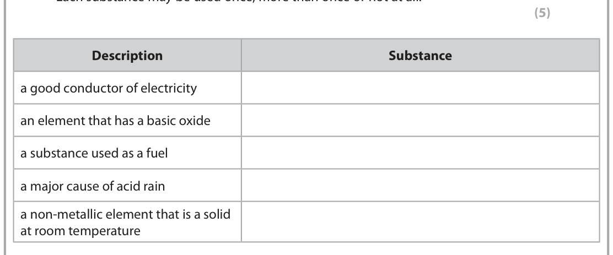
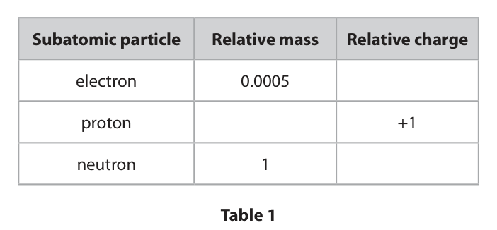
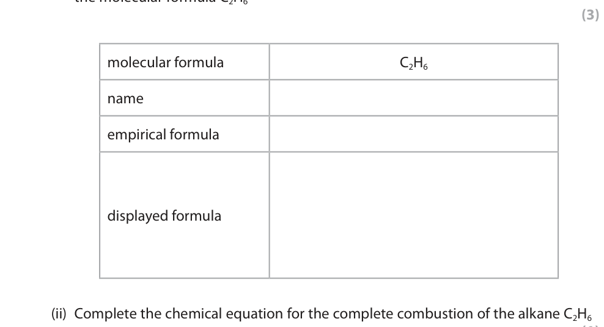
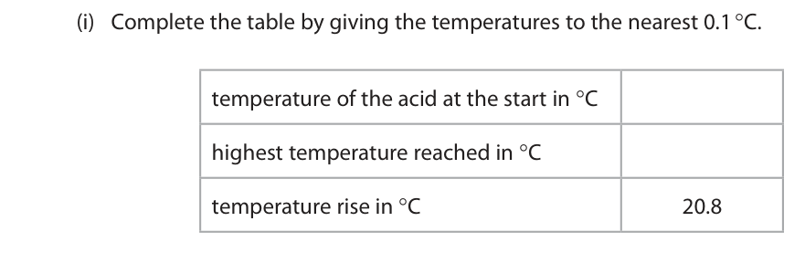
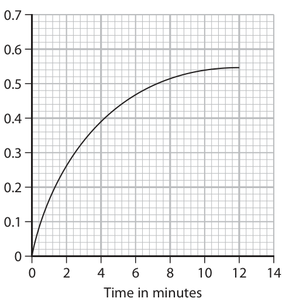

# 4CH1/1C — 2021-06 (official extraction)

> schema `syllabai.official-paper-questions/0.1` · paper_id `pearson-edexcel:international-gcse:chemistry:4ch1:2021-06:4CH1/1C` · qp sha256 `f23c24c14501fce4…` · extracted verbatim, never regenerated (ADR-037)

## Question 1 (7 marks)

The box shows the names of some substances. bromine carbon dioxide copper iodine methane nitrogen sulfur dioxide water

### 1(a) [5]

Complete the table by choosing substances from the box that match the description. Each substance may be used once, more than once or not at all. Description Substance a good conductor of electricity an element that has a basic oxide a substance used as a fuel a major cause of acid rain a non‑metallic element that is a solid at room temperature

**Mark scheme answer**

> ALLOW correct
> Information Substance formulae
> a good conductor of copper
> electricity
> an element that has a copper
> basic oxide
> a substance used as a methane
> fuel
> a major cause of acid sulfur dioxide
> rain
> a non-metallic element iodine
> that is a solid at room
> temperature

- **(5)** ALLOW correct

### 1(b) [2]

Describe a test for carbon dioxide.

**Mark scheme answer**

> A description which refers to the following points
> M1 bubble/add (the gas/carbon dioxide) into ACCEPT calcium
> limewater hydroxide
> M2 (limewater) turns cloudy/milky ACCEPT white
> precipitate
> M2 dep on use of
> limewater/calcium
> hydroxide in M1

- **(1)** bubble/add (the gas/carbon dioxide) into ACCEPT calcium
- **(1)** (limewater) turns cloudy/milky ACCEPT white

## Question 2 (11 marks)
**(a)** Table 1 gives some information about three subatomic particles.

**(b)** Table 2 shows the numbers of protons, neutrons and electrons in the species U, V, W, X, Y and Z. Species Number of protons Number of neutrons Number of electrons U 8 10 8 V 9 10 10 W 11 12 10 X 11 12 11 Y 12 12 12 Z 12 13 12 Table 2 Use the information in Table 2 to answer these questions. Each species may be used once, more than once or not at all.

### 2(a)(i) [3]

Complete Table 1 by giving the missing information. Subatomic particle Relative mass Relative charge electron 0.0005 proton +1 neutron 1 Table 1

**Mark scheme answer**

> 1 mark for each correct
> answer
> Sub-atomic Relative Relative
> particle mass charge
> ACCEPT minus one
> electron 0.0005 −1 REJECT – unqualified
> proton 1 +1 ACCEPT one
> ALLOW +1
> neutron 1 0 ACCEPT zero/none/ no
> charge

- **(3)** 1 mark for each correct

### 2(a)(ii) [1]

Give the name of the part of the atom containing protons and neutrons.

**Mark scheme answer**

> nucleus

- **(1)** nucleus

### 2(b)(i) [1]

Give the letter of the species that has six electrons in its outer shell.

**Mark scheme answer**

> U

- **(1)** U

### 2(b)(ii) [1]

Give the mass number of Z.

**Mark scheme answer**

> 25

- **(1)** 25

### 2(b)(iii) [1]

Give the letter of the species that is a positive ion.

**Mark scheme answer**

> W

- **(1)** W

### 2(b)(iv) [1]

Give the letters of the two species that are isotopes of the same element.

**Mark scheme answer**

> Y and Z

- **(1)** Y and Z

### 2(c) [3]

A sample of neon contains two isotopes, 20Ne and 22Ne The relative abundances of the two isotopes in the sample are 20 22 Ne 91.2% Ne 8.80% Calculate the relative atomic mass of this sample of neon. Give your answer to one decimal place. relative atomic mass =

**Mark scheme answer**

> • sum of masses multiplied by percentages Correct answer of 20.2
> • division by 100 with or without working
> • answer given to 1 decimal place scores 3
> Example calculation
> M1 (91.2 x 20) + (8.80 x 22) OR 2017.6 ACCEPT 2018
> M2 2017.6 ÷ 100 OR 20.176 ACCEPT 20.18
> M3 20.2 OR answer from M2 given to 1d.p.
> correct answer without
> working scores 3
> 20.176 and 20.18
> without working score 2
> 2020 scores M1 and M3
> 20 without working
> scores 0
> 20 with correct working
> scores 2

- **(1)** (91.2 x 20) + (8.80 x 22) OR 2017.6 ACCEPT 2018
- **(1)** 2017.6 ÷ 100 OR 20.176 ACCEPT 20.18
- **(1)** 20.2 OR answer from M2 given to 1d.p.

## Question 3 (6 marks)

Some sugar is added to cold water in a beaker. After some time, all the sugar dissolves and spreads throughout the water.

**(b)** Pure water can be obtained from the sugar solution using this apparatus. water out X water in heat

### 3(a)(i) [1]

Name the process that occurs which causes the sugar to spread throughout the water.

**Mark scheme answer**

> diffusion

- **(1)** diffusion

### 3(a)(ii) [2]

State two ways to make the sugar dissolve more quickly. 1 2

**Mark scheme answer**

> Any two from ALLOW shake/swirl
> M1 stir (the mixture) ALLOW any description
> of heating
> M2 heat (the mixture)
> M3 grind the sugar or break into smaller pieces or
> increase its surface area

- **(2)** Any two from ALLOW shake/swirl

### 3(b)(i) [1]

Name the process used to obtain pure water from the sugar solution.

**Mark scheme answer**

> (simple) distillation REJECT fractional
> distillation
> ALLOW distilling
> OWTTE

- **(1)** (simple) distillation REJECT fractional

### 3(b)(ii) [2]

Explain the purpose of the piece of apparatus labelled X.

**Mark scheme answer**

> An explanation that links the following two points
> M1 (water/ vapour/ steam / gas) is cooled
> M2 and condenses OR in the condenser

- **(1)** (water/ vapour/ steam / gas) is cooled
- **(1)** and condenses OR in the condenser

## Question 4 (10 marks)

A student uses paper chromatography in an experiment to separate the dyes in four different food colourings, E, F, G and H. The diagram shows the appearance of the paper before and after the experiment. level reached by solvent E F G H E F G H before after

### 4(a)(i) [3]

Describe how the student should complete the experiment after putting a spot of each food colouring on the paper.

**Mark scheme answer**

> A description including any three of the following M1 and M2 can be
> scored from a labelled
> diagram
> M1 pour some solvent into a beaker ALLOW any named
> /chromatography tank solvent
> M2 place the paper in the solvent so that the food
> colourings are above the level of the solvent
> M3 leave the paper until the solvent reaches the
> level shown in the diagram/ has moved to near the
> top of the paper OWTTE
> M4 take the paper out and leave to dry

- **(3)** A description including any three of the following M1 and M2 can be

### 4(a)(ii) [1]

Deduce the number of dyes in food colouring H.

**Mark scheme answer**

> one/1

- **(1)** one/1

### 4(a)(iii) [1]

Suggest why food colouring F does not move during the experiment.

**Mark scheme answer**

> (F/it is) insoluble (in the solvent)/ does not dissolve
> (in the solvent)

- **(1)** (F/it is) insoluble (in the solvent)/ does not dissolve

### 4(a)(iv) [2]

Explain which two food colourings contain the dye that is likely to be the most soluble in the solvent.

**Mark scheme answer**

> M1 E and H
> M2 they contain a dye that moved the furthest
> (distance up the paper)/ is closest to the solvent
> front / has the greatest Rf value
> M2 dep on M1

- **(1)** E and H
- **(1)** they contain a dye that moved the furthest

### 4(b) [3]

Determine which food colouring contains a dye with Rf value closest to 0.67 Show your working.

**Mark scheme answer**

> M1 distance moved by solvent = 59-61mm and ALLOW distances in cm
> distance moved by the dye = 37-41mm e.g. 6cm and 4cm
> If paper has been
> printed on A4 distances
> will be 51-53mm and
> 33-37mm
> M2 distance moved by the dye ÷ distance moved by
> the solvent ≈ 0.67
> M3 (the dye in food colouring) G
> ALLOW alternative
> methods

- **(1)** distance moved by solvent = 59-61mm and ALLOW distances in cm
- **(1)** distance moved by the dye ÷ distance moved by
- **(1)** (the dye in food colouring) G

## Question 5 (15 marks)

This question is about alkanes and alkenes.

**(b)** An alkene with molecular formula C4H8 reacts with bromine to form a compound with molecular formula C4H8Br2

**(c)** The alkene C3H6 can be polymerised to form the polymer poly(propene).

### 5(a)(i) [3]

Complete the boxes by giving the missing information about the alkane with the molecular formula C2H6 molecular formula C2H6 name empirical formula displayed formula

**Mark scheme answer**

> 3
> molecular formula C 2 H6
> name ethane
> Penalise incorrect use
> empirical formula CH3 of case, superscripts
> H H
> displayed formula H−C−C−H
> H H

- **(3)** 3

### 5(a)(ii) [1]

Complete the chemical equation for the complete combustion of the alkane C2H6 C2H6 + O2 → CO2 + H2O

**Mark scheme answer**

> 2C2H6 + 7O2  4CO2 + 6H2O ACCEPT multiples and
> fractions

- **(1)** 2C2H6 + 7O2  4CO2 + 6H2O ACCEPT multiples and

### 5(a)(iii) [2]

Incomplete combustion occurs when the air supply is limited. Give the names of two products of incomplete combustion. 1 2

**Mark scheme answer**

> Any two from
> M1 carbon monoxide/CO
> M2 carbon/C ALLOW soot
> M3 water (vapour)/steam/H2O IGNORE carbon dioxide

- **(2)** Any two from

### 5(b)(i) [1]

What is the name of this type of reaction?

- **(A)** addition  ✔
- **(B)** decomposition
- **(C)** precipitation
- **(D)** substitution

**Mark scheme answer**

> A addition
> B is incorrect as it is not a decomposition reaction
> C is incorrect as no solid precipitate is produced
> D is incorrect as it is not a substitution reaction

- **(1)** Answer A: addition

### 5(b)(ii) [2]

Draw displayed formulae for two different alkenes with the molecular formula C4H8 alkene 1 alkene 2

**Mark scheme answer**

> Any two from Do not accept displayed
> formulae of cyclic
> M1 alkanes
> ALLOW cis-trans (E/Z)
> M2 isomers of but-2-ene for
> both marks
> M3

- **(1)** alkanes
- **(1)** isomers of but-2-ene for

### 5(b)(iii) [1]

State the term used for compounds with the same molecular formula but different structural formulae.

**Mark scheme answer**

> isomers ALLOW isomerism

- **(1)** isomers ALLOW isomerism

### 5(c)(i) [2]

Complete the equation for this polymerisation reaction. H CH3 nC C → H H

**Mark scheme answer**

> If double bond between
> H CH3 carbon atoms scores 0
> I I
> C−C
> I I
> H H n
> M1 correct repeat unit
> M2 extension bonds, brackets and n after brackets

- **(1)** correct repeat unit
- **(1)** extension bonds, brackets and n after brackets

### 5(c)(ii) [3]

Two ways of disposing of polymers such as poly(propene) are  burying them in landfill sites  burning them to release heat energy Discuss the environmental problems caused by these two methods of disposal.

**Mark scheme answer**

> A discussion which refers to the following points
> M1 polymers/poly(propene) will remain in landfill
> indefinitely OWTTE
> M2 (as they) are inert /unreactive/do not biodegrade
> M3 burning produces toxic gases ALLOW burning
> produces greenhouse
> gases

- **(1)** polymers/poly(propene) will remain in landfill
- **(1)** (as they) are inert /unreactive/do not biodegrade
- **(1)** burning produces toxic gases ALLOW burning

## Question 6 (15 marks)

This question is about some of the Group 1 elements and their compounds.

**(a)** A teacher adds a small piece of lithium to water in a trough.

**(b)** A student does a flame test to see if a white solid contains sodium ions. She cleans a platinum wire before using it for the flame test.

**(c)** Potassium sulfate (K2SO4) is an ionic compound.

### 6(a)(i) [3]

Give three observations that are made when lithium reacts with water. 1 2 3

**Mark scheme answer**

> Any 3 from
> M1 effervescence/bubbles/fizzing
> M2 moves moves on surface
> scores M2 and M3
> M3 floats
> M4 disappears/gets smaller ALLOW dissolves
> M5 vapour trail/steam
> IGNORE melts/heat
> produced
> IGNORE any reference
> to indicators

- **(3)** Any 3 from

### 6(a)(ii) [2]

After the reaction has finished, the teacher adds a few drops of universal indicator to the solution in the trough. Explain the colour of the universal indicator after it is added to the solution.

**Mark scheme answer**

> An explanation that links the following two points
> M1 the universal indicator turns purple/blue
> M2 (because) OH−/hydroxide ions are present ALLOW an alkaline
> solution /an alkali is
> produced / a solution
> of high pH is formed

- **(1)** the universal indicator turns purple/blue
- **(1)** (because) OH−/hydroxide ions are present ALLOW an alkaline

### 6(a)(iii) [2]

Write a chemical equation for the reaction of lithium with water. .

**Mark scheme answer**

> 2Li + 2H2O  2LiOH + H2 ALLOW multiples and
> fractions
> M1 all formulae correct
> M2 balancing of correct formulae M2 dep on M1

- **(1)** all formulae correct
- **(1)** balancing of correct formulae M2 dep on M1

### 6(b)(i) [2]

Explain why the student needs to clean the platinum wire.

**Mark scheme answer**

> An explanation that links the following two points
> M1 to remove any other ions/chemicals/ impurities/
> contaminants/ compounds/substances (that may be on
> the wire)
> M2 (so that) they do not interfere with/mask the ALLOW (so that) they
> colour of the flame do not affect the
> result (of the test)
> ALLOW (remove
> substances) that could
> colour the flame

- **(1)** to remove any other ions/chemicals/ impurities/
- **(1)** (so that) they do not interfere with/mask the ALLOW (so that) they

### 6(b)(ii) [1]

Which of these is the colour of the flame if the solid contains sodium ions?

- **(A)** green
- **(B)** lilac
- **(C)** red
- **(D)** yellow  ✔

**Mark scheme answer**

> D yellow
> A is incorrect as sodium ions do not give a green flame
> B is incorrect as sodium ions do not give a lilac flame
> C is incorrect as sodium ions do not give a red flame

- **(1)** Answer D: yellow

### 6(c)(i) [1]

Give the formula of each ion in potassium sulfate. potassium ion sulfate ion

**Mark scheme answer**

> K+ and SO42−

- **(1)** K+ and SO42−

### 6(c)(ii) [4]

The melting point of potassium sulfate is 1069 °C. Explain why potassium sulfate has a high melting point. Refer to structure and bonding in your answer.

**Mark scheme answer**

> An explanation that links the following four points
> M1 (potassium sulfate) has a giant (ionic) structure
> /lattice
> M2 electrostatic attraction between oppositely
> charged ions
> M3 (ionic bonds or forces / attractions between ions) ionic bonds are strong
> are strong scores M3
> M4 a large amount of energy is needed to overcome
> the forces/break the bonds

- **(1)** (potassium sulfate) has a giant (ionic) structure
- **(1)** electrostatic attraction between oppositely
- **(1)** (ionic bonds or forces / attractions between ions) ionic bonds are strong
- **(1)** a large amount of energy is needed to overcome

## Question 7 (9 marks)

A student investigates the reaction between magnesium and hydrochloric acid. He uses this method. Step 1 add 25 cm3 of dilute hydrochloric acid to a polystyrene cup Step 2 record the temperature of the acid Step 3 find the mass of a 10 cm strip of magnesium ribbon Step 4 add the magnesium ribbon to the hydrochloric acid Step 5 when all the magnesium has reacted, record the highest temperature reached

**(b)** The thermometer shows the temperature of the acid at the start of the experiment. °C 25

### 7(a) [1]

Complete the word equation for the reaction. magnesium + hydrochloric acid → +

**Mark scheme answer**

>  magnesium chloride + hydrogen ACCEPT in either order

- **(1)**  magnesium chloride + hydrogen ACCEPT in either order

### 7(b)(i) [2]

Complete the table by giving the temperatures to the nearest 0.1 °C. temperature of the acid at the start in °C highest temperature reached in °C temperature rise in °C 20.8

**Mark scheme answer**

> 2
> temperature of the acid at 22.4
> the start in oC
> highest temperature 43.2 ALLOW ECF from
> reached in oC incorrect starting
> temperature
> temperature rise in oC 20.8

- **(2)** 2

### 7(b)(ii) [2]

Show that the heat energy change (Q) for this reaction is about 2200 J. [mass of 1.0 cm3 of solution = 1.0 g] [for the solution, c = 4.2 J/g/°C]

**Mark scheme answer**

> • substitute correct values into Q = mcΔT Correct answer of 2184
> • evaluation or 2194 without working
> scores 2
> Example calculation
> M1 Q = 25 x 4.2 x 20.8 ALLOW 25.12g for m
> M2 2184 (J) ACCEPT any number of
> sig figs except 1
> ALLOW ECF from M1

- **(1)** Q = 25 x 4.2 x 20.8 ALLOW 25.12g for m
- **(1)** 2184 (J) ACCEPT any number of

### 7(b)(iii) [4]

The mass of magnesium used by the student was 0.12 g. Calculate the value of the enthalpy change (ΔH), in kilojoules per mole of magnesium, for the reaction between magnesium and hydrochloric acid. Include a sign in your answer. ΔH = kJ/mol

**Mark scheme answer**

> • find the amount of magnesium in moles
> • divide Q by n
> • convert answer in J/mol to kJ/mol
> • answer including sign
> Example calculation
> M1 n(Mg) = 0.12 ÷ 24 OR 0.005(0)
> M2 Q ÷ n OR 2184 ÷ 0.005(0) OR 436,800 (J/mol) ACCEPT use of 2180 or
> 2200
> ALLOW ECF on
> incorrect answer to (ii)
> and/or M1
> M3 436,800 ÷ 1000 OR 436.8 (kJ/mol) ALLOW ECF on
> incorrect answer to M2
> M4 – 436.8 (kJ/mol) ALLOW ECF on
> incorrect answer to M3
> Correct answer with
> minus sign and without
> working scores 4
> Correct answer without
> minus sign and without
> working scores 3
> ACCEPT any number of
> sig figs except 1
> throughout (ii)
> -438.8 or-438.9 also
> scores 4 (from 5.12g
> and 2194J in (ii))

- **(1)** n(Mg) = 0.12 ÷ 24 OR 0.005(0)
- **(1)** Q ÷ n OR 2184 ÷ 0.005(0) OR 436,800 (J/mol) ACCEPT use of 2180 or
- **(1)** 436,800 ÷ 1000 OR 436.8 (kJ/mol) ALLOW ECF on
- **(1)** – 436.8 (kJ/mol) ALLOW ECF on

## Question 8 (10 marks)
**(b)** Ammonium sulfate is often used as a fertiliser. It is prepared by reacting ammonia (NH3) with sulfuric acid (H2SO4).

### 8(a) [6]

A scientist finds an unlabelled bottle on a shelf. She thinks the bottle contains a solution of ammonium sulfate, (NH4)2SO4 Describe tests the scientist could do to show that the solution is ammonium sulfate.

**Mark scheme answer**

> A description which refers to the following six
> points
> Test for ammonium ions:
> M1 add sodium hydroxide (solution) (and warm) ALLOW other alkalis
> M2 test the gas with (damp) (red) litmus No M2 or M3 if solution
> paper/(damp) universal indicator paper tested with litmus/
> universal indicator
> paper
> M3 (litmus) turns blue /(universal indicator) turns
> blue/purple (if ammonium ions are present)
> Test for sulfate ions:
> M4 add (dilute hydrochloric/nitric) acid M4 and M5 can be in
> either order
> M5 add barium chloride (solution) /barium nitrate
> (solution)
> M6 white precipitate (if sulfate ions are present)
> No M4 or M6 if sulfuric
> acid added
> M6 dep on M5

- **(1)** add sodium hydroxide (solution) (and warm) ALLOW other alkalis
- **(1)** test the gas with (damp) (red) litmus No M2 or M3 if solution
- **(1)** (litmus) turns blue /(universal indicator) turns
- **(1)** add (dilute hydrochloric/nitric) acid M4 and M5 can be in
- **(1)** add barium chloride (solution) /barium nitrate
- **(1)** white precipitate (if sulfate ions are present)

### 8(b)(i) [1]

Name the type of reaction that occurs between ammonia and sulfuric acid.

**Mark scheme answer**

> neutralisation ALLOW acid-base OR
> acid-alkali

- **(1)** neutralisation ALLOW acid-base OR

### 8(b)(ii) [1]

Write a chemical equation for the reaction of ammonia with sulfuric acid.

**Mark scheme answer**

> 2NH3 + H2SO4  (NH4)2SO4 ALLOW multiples

- **(1)** 2NH3 + H2SO4  (NH4)2SO4 ALLOW multiples

### 8(b)(iii) [2]

Draw a dot‑and‑cross diagram to show the bonding in a molecule of ammonia. Show outer electrons only.

> 🖼 crop required: diagram (qp.pdf p.19)

**Mark scheme answer**

> M1 3 bonding pairs correct
> M2 rest of molecule correct M2 dep on M1
> ALLOW any
> combination of dots and
> crosses

- **(1)** 3 bonding pairs correct
- **(1)** rest of molecule correct M2 dep on M1

## Question 9 (14 marks)

A student uses this apparatus to investigate the rate of reaction between marble chips and dilute hydrochloric acid. cotton wool marble chips dilute hydrochloric acid g balance The equation for the reaction is CaCO3 + 2HCl → CaCl2 + H2O + CO2

**(a)** During the reaction the mass of the contents of the flask decreases.

**(b)** The graph shows the student’s results. 0.7 0.6 0.5 0.4 Decrease in mass in g 0.3 0.2 0.1 0 2 4 6 8 10 12 14 Time in minutes

### 9(a)(i) [1]

State why the mass of the contents of the flask decreases.

**Mark scheme answer**

> carbon dioxide/a gas is given off/escapes REJECT incorrect gas

- **(1)** carbon dioxide/a gas is given off/escapes REJECT incorrect gas

### 9(a)(ii) [1]

State the purpose of the cotton wool.

**Mark scheme answer**

> to prevent acid/ liquid/ solution/ spray from
> leaving the flask OWTTE

- **(1)** to prevent acid/ liquid/ solution/ spray from

### 9(a)(iii) [2]

Explain why sulfuric acid is not a suitable acid to use in this investigation.

**Mark scheme answer**

> An explanation that links two of the following
> M1 (insoluble) calcium sulfate will form
> M2 which will form a coating/ layer on the marble
> chips
> M3 slowing down/ preventing/ stopping the M3 dep on M1 or M2
> reaction

- **(2)** An explanation that links two of the following

### 9(b)(i) [4]

In the investigation the marble chips are in excess. Explain the shape of the graph.

**Mark scheme answer**

> An explanation that links the following four points
> M1 the curve is steep(est) at the start
> M2 because the (acid) concentration is high(est) ALLOW there are the
> most (acid) particles in
> solution
> M3 the curve becomes less steep as the solution/ ALLOW the curve
> acid is becoming more dilute becomes less steep as
> there are fewer acid
> particles/particles in
> solution
> M4 the curve levels off/ stops going up when the
> acid has all been used up
> IGNORE references to
> particles of marble
> chips
> IGNORE references to
> energy
> OR
> M1 the curve is steep(est) at the start
> M2 because the reaction is fast(est) at the start
> M3 the curve becomes less steep because the
> reaction slows down
> M4 the curve levels off/stops going up when the
> acid has all been used up

- **(4)** An explanation that links the following four points

### 9(b)(ii) [2]

The student repeats the experiment using the same volume of hydrochloric acid but of half the concentration of the original acid. All other conditions are kept the same. On the grid, draw the curve the student would obtain.

**Mark scheme answer**

> M1 curve drawn starting at the origin and below the
> original curve
> M2 curve levels off at 0.27 g + or − half a small
> square

- **(1)** curve drawn starting at the origin and below the
- **(1)** curve levels off at 0.27 g + or − half a small

### 9(c) [4]

Explain, using particle collision theory, how increasing the temperature affects the rate of a reaction.

**Mark scheme answer**

> An explanation that links the following four points
> M1 the rate of reaction increases/ the reaction is
> faster/ the reaction speeds up
> and any three from
> M2 because the particles gain (kinetic) energy /move
> faster
> M3 there are more collisions per unit time
> M4 more collisions/particles have energy greater than
> the activation energy
> M5 more collisions are successful
> there are more frequent
> successful collisions
> scores M3 and M5

- **(4)** An explanation that links the following four points

## Question 10 (13 marks)
**(a)** The diagram shows the apparatus a teacher uses to determine the formula of an oxide of lead. an oxide of lead hydrogen burning hole hydrogen reduction tube heat This is the teacher’s method. Step 1 find the mass of the reduction tube Step 2 add some of the lead oxide to the reduction tube Step 3 find the mass of the reduction tube and lead oxide Step 4 pass hydrogen gas over the lead oxide and ignite the hydrogen at the hole Step 5 heat the lead oxide strongly for 10 minutes Step 6 keep passing hydrogen through the reduction tube until the tube and contents are cool Step 7 find the new mass of the reduction tube and its contents

**(b)** The teacher completes the experiment and obtains these results. mass of reduction tube = 23.50 g mass of tube + lead oxide = 28.64 g mass of tube + lead = 28.16 g

**(c)** The insoluble salt lead(II) chloride (PbCl2) can be prepared by reacting a solution of lead(II) nitrate with dilute hydrochloric acid.

### 10(a)(i) [1]

Give a reason why hydrogen is passed through the reduction tube until the tube and contents are cool.

**Mark scheme answer**

> so that the (hot) lead does not react with ACCEPT so that lead is
> oxygen/air (converting back into lead oxide) not oxidised (back to
> lead oxide)

- **(1)** so that the (hot) lead does not react with ACCEPT so that lead is

### 10(a)(ii) [2]

Describe what the teacher should do next to make sure all the lead oxide has been reduced to lead. .

**Mark scheme answer**

> M1 repeat the heating ACCEPT heat to
> constant mass for both
> M2 until the mass remains constant/ does not marks
> change

- **(1)** repeat the heating ACCEPT heat to
- **(1)** until the mass remains constant/ does not marks

### 10(b)(i) [1]

Calculate the mass of lead formed. mass of lead = g

**Mark scheme answer**

> 4.66 (g)

- **(1)** 4.66 (g)

### 10(b)(ii) [1]

Calculate the mass of oxygen removed from the lead oxide. mass of oxygen = g

**Mark scheme answer**

> 0.48 (g)

- **(1)** 0.48 (g)

### 10(b)(iii) [4]

Determine the empirical formula of the lead oxide. empirical formula of the lead oxide

**Mark scheme answer**

> • calculate the moles of lead and oxygen
> • divide by the smaller number
> • calculate the whole number ratio
> • give the empirical formula
> Example calculation
> M1 4.66 and 0.48 OR 0.0225 and 0.03(00) Division by atomic
> 207 16 numbers or upside down
> calculation scores 0
> M2 0.0225 and 0.03(00) OR 1:1.33
> 0.0225 0.0225
> M3 1 x 3 and 1.33 x 3 OR 3:4 3:4 ratio without
> working scores 3
> M4 Pb3O4
> Pb3O4 without working
> scores 4
> ALLOW ECF from
> incorrect masses.

- **(1)** 4.66 and 0.48 OR 0.0225 and 0.03(00) Division by atomic
- **(1)** 0.0225 and 0.03(00) OR 1:1.33
- **(1)** 1 x 3 and 1.33 x 3 OR 3:4 3:4 ratio without
- **(1)** Pb3O4

### 10(c)(i) [1]

Complete the equation for the reaction by adding the state symbols. Pb(NO3)2( ) + 2HCl( ) → PbCl2( ) + 2HNO3( )

**Mark scheme answer**

> ALLOW any
> Pb(NO3)2 (aq) + 2HCl (aq)  PbCl2 (s) + 2HNO3 (aq) combination of
> uppercase and
> lowercase letters

- **(1)** ALLOW any

### 10(c)(ii) [3]

Show that the maximum mass of lead(II) chloride that can be made from 0.0370 mol of hydrochloric acid is about 5 g. [Mr of PbCl2 = 278] maximum mass = g

**Mark scheme answer**

> • calculate the amount of PbCl2
> • multiply the moles by the Mr of PbCl2
> • evaluation to show that the value is about 5 g
> Example calculation
> M1 n(PbCl2) = 0.0370 OR 0.0185 (mol)
> M2 mass of PbCl2 = 0.0185 x 278 (g) MAX 1 for 0.0370 x 278
> if no division by 2 in M1
> M3 5.143 (g)
> ALLOW any number of
> sig figs
> 5.1, 5.14 and 5.143 g
> without working score 3
> 5 g without working
> scores 0
> ALLOW alternative
> methods
> Pearson Education Limited. Registered company number 872828
> with its registered office at 80 Strand, London, WC2R 0RL, United Kingdom

- **(1)** n(PbCl2) = 0.0370 OR 0.0185 (mol)
- **(1)** mass of PbCl2 = 0.0185 x 278 (g) MAX 1 for 0.0370 x 278
- **(1)** 5.143 (g)

