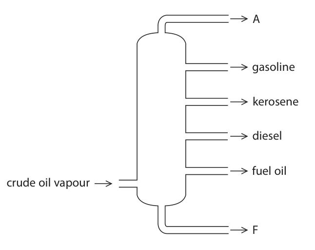
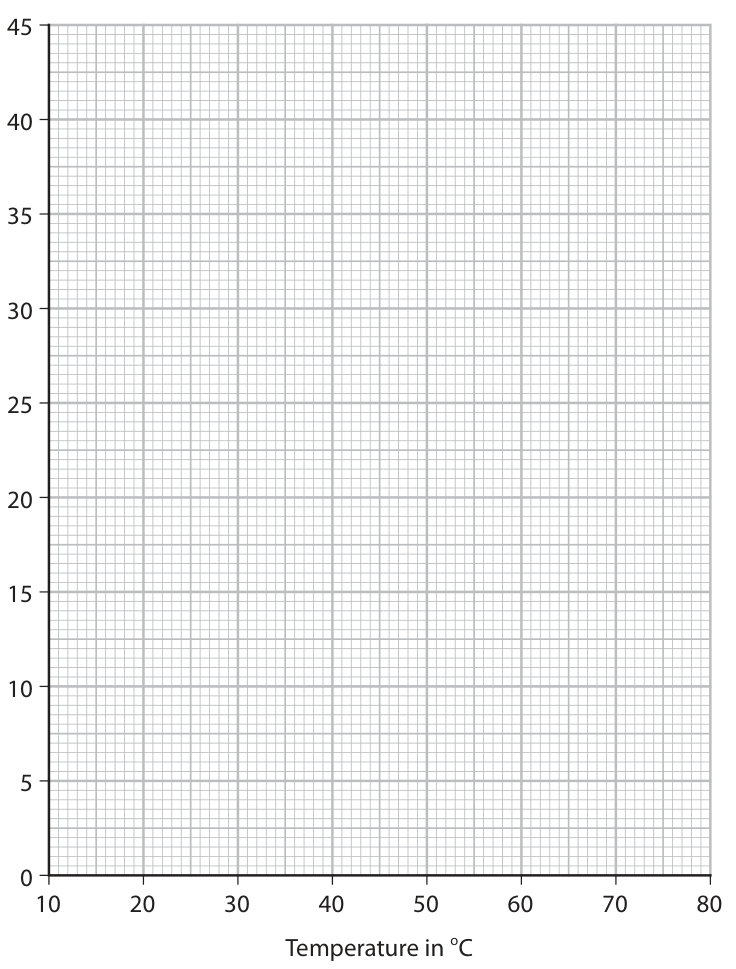
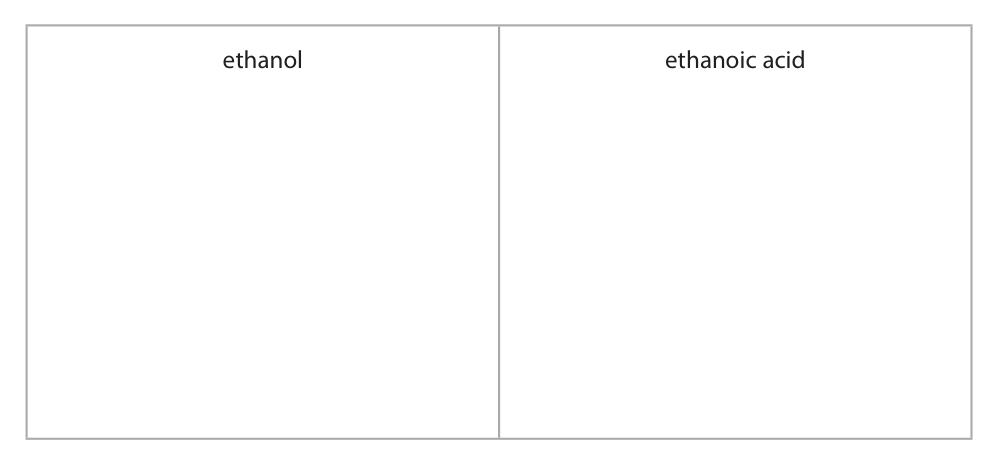
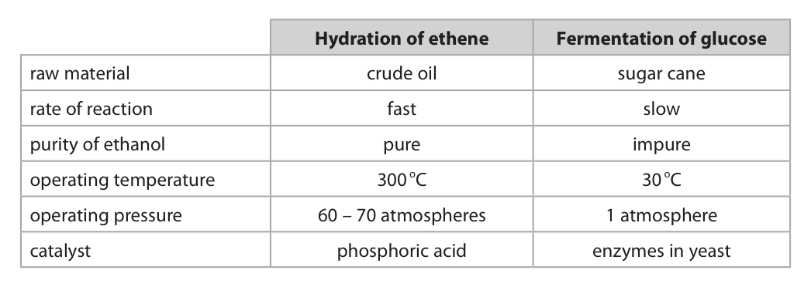
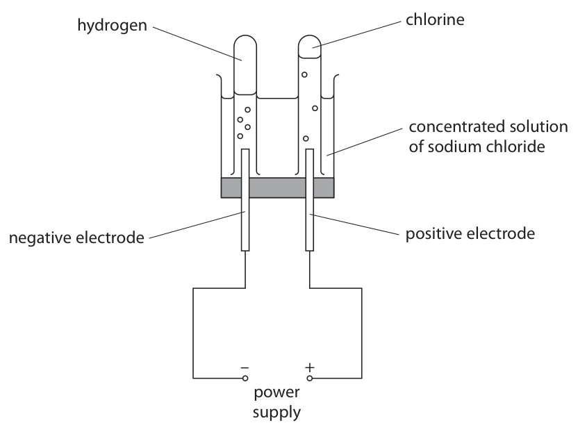
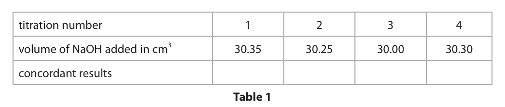

# 4CH1/2C — 2021-06 (official extraction)

> schema `syllabai.official-paper-questions/0.2` · paper_id `pearson-edexcel:international-gcse:chemistry:4ch1:2021-06:4CH1/2C` · qp sha256 `eaf09d7f7aca30db…` · extraction is the disclosed baseline (ADR-039)

## Question 1 (6 marks)

Use the Periodic Table to help you answer this question.

### 1(a)(i) [1]

Name the element with atomic number 14

**Mark scheme answer**

> silicon ALLOW Si

- **(1)** silicon ALLOW Si

### 1(a)(ii) [1]

Name the element with a relative atomic mass of 11

**Mark scheme answer**

> boron ALLOW B

- **(1)** boron ALLOW B

### 1(a)(iii) [1]

Name the element in Group 2 and Period 3

**Mark scheme answer**

> magnesium ALLOW Mg

- **(1)** magnesium ALLOW Mg

### 1(b)(i) [1]

Determine the number of neutrons in a phosphorus atom with mass number 31

**Mark scheme answer**

> 16 / sixteen

- **(1)** 16 / sixteen

### 1(b)(ii) [1]

State the electronic configuration of an aluminium atom.

**Mark scheme answer**

> 2.8.3 / 2,8,3 ACCEPT diagram
> showing correct
> electron configuration
> ALLOW correct electron
> configuration using s
> and p notation

- **(1)** 2.8.3 / 2,8,3 ACCEPT diagram

### 1(b)(iii) [1]

State why neon is unreactive.

**Mark scheme answer**

> does not (easily) gain/lose/share electrons ALLOW full outer
> shell/energy level
> ALLOW 8 electrons in
> outer shell/energy level

- **(1)** does not (easily) gain/lose/share electrons ALLOW full outer

## Question 2 (6 marks)

A student investigates the rusting of iron.

**(a)** She places an iron nail in a test tube of water and leaves it for several days. water

### 2(a)(i) [1]

Predict the appearance of the iron nail after several days.

**Mark scheme answer**

> red-brown (coating on nail) ACCEPT orange-brown /
> brown
> ALLOW orange
> IGNORE rust colour
> IGNORE red alone

- **(1)** red-brown (coating on nail) ACCEPT orange-brown /

### 2(a)(ii) [1]

Name the main compound in rust.

**Mark scheme answer**

> (hydrated) iron(III) oxide/ferric oxide ACCEPT (hydrated) iron
> oxide
> REJECT iron oxide with
> incorrect oxidation state

- **(1)** (hydrated) iron(III) oxide/ferric oxide ACCEPT (hydrated) iron

### 2(b) [4]

The student then sets up two more test tubes containing iron nails. drying agent oil boiled air water tube 1 tube 2 Explain why the iron nail in tube 1 and the iron nail in tube 2 do not rust. tube 1 tube 2

**Mark scheme answer**

> An explanation that links 4 of the following 5 points
> tube 1
> M1 air/oxygen is needed for rusting
> M2 boiled water does not contain air/oxygen ALLOW 1 mark for no
> air/oxygen present as an
> alternative to M1 and M2
> M3 oil keeps air/oxygen out
> tube 2
> M4 water/moisture is needed for rusting
> M5 drying agent keeps water/moisture out ALLOW 1 mark for no
> water/moisture present
> as an alternative to M4
> and M5

- **(4)** An explanation that links 4 of the following 5 points

## Question 3 (10 marks)

The diagram shows the industrial equipment used to separate crude oil into fractions. A gasoline kerosene diesel fuel oil crude oil vapour F

**(b)** One compound in the gasoline fraction is the alkane octane (C8H18) and one compound in the kerosene fraction is the alkane dodecane (C12H26) These two alkanes are covalently bonded and have simple molecular structures.

**(c)** Catalytic cracking can be used to convert the alkane C12H26 into more useful products.

### 3(a)(i) [1]

Give the name of the industrial equipment.

**Mark scheme answer**

> fractionating column/ fractionating tower ALLOW fraction(al) column
> /fraction(al) tower
> IGNORE fractional
> distillation

- **(1)** fractionating column/ fractionating tower ALLOW fraction(al) column

### 3(a)(ii) [1]

Give one use of the fuel oil fraction.

**Mark scheme answer**

> fuel for ships/fuel for power stations

- **(1)** fuel for ships/fuel for power stations

### 3(a)(iii) [2]

Give the names of fraction A and fraction F. fraction A fraction F

**Mark scheme answer**

> M1 fraction A refinery gases
> M2 fraction F bitumen

- **(1)** fraction A refinery gases
- **(1)** fraction F bitumen

### 3(b)(i) [1]

Give the general formula for the alkanes.

**Mark scheme answer**

> CnH2n + 2 ALLOW x or N in place of n

- **(1)** CnH2n + 2 ALLOW x or N in place of n

### 3(b)(ii) [3]

Explain, in terms of their structures, why C12H26 has a higher boiling point than C8H18

**Mark scheme answer**

> An explanation that links the following 3 points
> M1 C12H26 has larger molecules/longer chain/ORA
> M2 C12H26 has stronger intermolecular forces/ORA ACCEPT forces between
> molecules for
> intermolecular forces
> ALLOW intermolecular
> bonds /bonds between
> molecules
> M3 more energy is needed to separate the no M2 or M3 if implied that
> molecules/ overcome the forces in C12H26 /ORA covalent bonds break

- **(1)** C12H26 has larger molecules/longer chain/ORA
- **(1)** C12H26 has stronger intermolecular forces/ORA ACCEPT forces between
- **(1)** more energy is needed to separate the no M2 or M3 if implied that

### 3(c)(i) [1]

Give the name of the catalyst used for catalytic cracking.

**Mark scheme answer**

> silica/alumina ACCEPT silicon dioxide
> /aluminium oxide
> /SiO2/Al2O3
> /aluminosilicates /zeolite

- **(1)** silica/alumina ACCEPT silicon dioxide

### 3(c)(ii) [1]

Complete the equation for this cracking reaction. C12H26 → C9H20 +

**Mark scheme answer**

> C12H26 → C9H20 + C3H6
> Question number Answer Notes Marks

- **(1)** C12H26 → C9H20 + C3H6

## Question 4 (9 marks)

A student investigates the solubility of potassium nitrate in water. She measures the masses of potassium nitrate that dissolve in 25 cm3 of water at different temperatures. The table shows the student’s results. One of the results is anomalous. Temperature in oC 10 20 30 40 50 60 70 Mass of potassium nitrate in g 8.0 10.0 12.5 16.0 17.5 26.5 34.0

### 4(a)(i) [1]

Plot the results on the grid.

**Mark scheme answer**

> all points plotted correctly to the nearest grid line

- **(1)** all points plotted correctly to the nearest grid line

### 4(a)(ii) [1]

Draw a circle around the anomalous result.

**Mark scheme answer**

> point at 50 oC and 17.5 g circled on grid/in table ALLOW ECF from
> incorrect plotting

- **(1)** point at 50 oC and 17.5 g circled on grid/in table ALLOW ECF from

### 4(a)(iii) [1]

Ignoring the anomalous result, draw a curve of best fit. Mass of potassium nitrate in g 10 20 30 40 50 60 70 80 Temperature in oC

**Mark scheme answer**

> smooth curve of best fit

- **(1)** smooth curve of best fit

### 4(b) [2]

Suggest two possible mistakes that could have caused the anomalous result. 1 2

**Mark scheme answer**

> Any two from
> M1 less than 25 cm3 of water was used ALLOW ECF from
> incorrect plotting and
> M2 the temperature was less than 50 oC incorrect point circled
> for M1 and M2 only
> M3 not enough potassium nitrate was added
> M4 the solution was not stirred
> Question number Answer Notes Marks

- **(2)** Any two from

### 4(c) [2]

Use your graph to find the maximum mass of potassium nitrate that dissolves in 25 cm3 of water at 75 oC. Show on your graph how you obtained your answer. mass = g

**Mark scheme answer**

> M1 curve extended to 75 oC
> M2 correct mass read from graph to the nearest grid expected answer around
> line 39 to 40 g
> 0 marks if curve not
> extended

- **(1)** curve extended to 75 oC
- **(1)** correct mass read from graph to the nearest grid expected answer around

### 4(d) [2]

Use your graph to calculate the solubility of potassium nitrate in g per 100 g of water at 25 oC. [1.0 cm3 of water has a mass of 1.0 g] solubility = g per 100 g of water

**Mark scheme answer**

> M1 mass at 25 oC read from graph to nearest grid line
> M2 mass from graph multiplied by 4 expected answer around
> 44 g
> ALLOW ECF from
> incorrect plotting

- **(1)** mass at 25 oC read from graph to nearest grid line
- **(1)** mass from graph multiplied by 4 expected answer around

## Question 5 (14 marks)

Ethanol, C2H5OH, is a member of the homologous series of alcohols.

**(b)** When ethanol is heated with potassium dichromate(VI) and one other reagent, the ethanol is oxidised to ethanoic acid, CH3COOH

**(c)** Ethanol can be manufactured by two different methods. The table gives some information about the two methods. Hydration of ethene Fermentation of glucose raw material crude oil sugar cane rate of reaction fast slow purity of ethanol pure impure operating temperature 300 oC 30 oC operating pressure 60 – 70 atmospheres 1 atmosphere catalyst phosphoric acid enzymes in yeast

### 5(a) [2]

Give two characteristics of a homologous series. 1 2

**Mark scheme answer**

> Any two from:
> M1 same general formula
> M2 each member differs from the next by CH2
> M3 same functional group
> M4 similar chemical properties/reactions ALLOW same chemical
> properties/reactions
> M5 trend/steady increase in physical properties ACCEPT named physical
> properties e.g. trend in
> boiling points

- **(2)** Any two from:

### 5(b)(i) [1]

Give the formula of the other reagent.

**Mark scheme answer**

> H2SO4 If name and formula
> given, name must be
> correct.

- **(1)** H2SO4 If name and formula

### 5(b)(ii) [2]

State the colour change that occurs during this oxidation reaction. from to

**Mark scheme answer**

> M1 from orange colours must be in the
> correct order
> M2 to green

- **(1)** from orange colours must be in the
- **(1)** to green

### 5(b)(iii) [2]

Draw the displayed formulae for ethanol and ethanoic acid in the boxes. ethanol ethanoic acid

**Mark scheme answer**

> M1 Penalise no bond
> between O and H once
> only
> M2

- **(2)** M1 Penalise no bond

### 5(c)(i) [6]

Discuss the advantages and disadvantages of these two methods, using information from the table.

**Mark scheme answer**

> A discussion which refers to any six of the following
> points:
> Advantages of fermentation/disadvantages of
> hydration
> M1 sugar cane can be re-grown/is renewable
> M2 crude oil is finite/cannot be replaced/is non-
> renewable
> M3 fermentation uses lower temperatures so energy
> costs are lower/ hydration uses higher
> temperatures, so energy costs are higher
> M4 fermentation uses lower pressure so energy costs
> are lower/ hydration uses higher pressure, so energy
> costs are higher
> M5 yeast is a natural substance and not harmful/
> phosphoric acid is corrosive
> Advantages of hydration/disadvantages of
> fermentation
> M6 hydration is a faster process/ fermentation is a
> slower process
> M7 hydration gives pure ethanol/ fermentation gives
> impure ethanol
> M8 growing sugar cane takes up land which could be
> used for growing food/rearing livestock
> M9 hydration is a continuous process/fermentation
> is a batch process

- **(6)** A discussion which refers to any six of the following

### 5(c)(ii) [1]

The word equation for the fermentation process is glucose → ethanol + carbon dioxide Complete the chemical equation for this reaction. C6H12O6 → +

**Mark scheme answer**

> C6H12O6 → 2C2H5OH + 2CO2 ALLOW 2C2H6O for
> ethanol
> ALLOW multiples and
> fractions

- **(1)** C6H12O6 → 2C2H5OH + 2CO2 ALLOW 2C2H6O for

## Question 6 (13 marks)

The diagram shows how hydrogen gas and chlorine gas can be prepared in the laboratory by electrolysis of a concentrated solution of sodium chloride. hydrogen chlorine concentrated solution of sodium chloride negative electrode positive electrode – + power supply

**(b)** The ionic half-equation for the formation of chlorine at the positive electrode is 2Cl− → Cl2 + 2e−

**(c)** In the chemical industry, chlorine can be produced by the electrolysis of molten sodium chloride. The overall equation for this reaction is 2NaCl(l) → 2Na(l) + Cl2(g)

### 6(a)(i) [1]

Give a test for hydrogen gas.

**Mark scheme answer**

> (squeaky) pop with lighted splint

- **(1)** (squeaky) pop with lighted splint

### 6(a)(ii) [2]

Give a test for chlorine gas.

**Mark scheme answer**

> M1 (damp) litmus paper/ universal indicator
> M2 bleached ACCEPT turns white OR
> decolourised
> ACCEPT (damp) blue
> litmus turns red and is
> bleached scores M1 and
> M2

- **(1)** (damp) litmus paper/ universal indicator
- **(1)** bleached ACCEPT turns white OR

### 6(b)(i) [1]

State why this reaction is an oxidation reaction.

**Mark scheme answer**

> chloride ions/Cl − lose electrons /electrons are lost ALLOW oxidation state
> of chlorine increases
> /changes from -1 to 0
> REJECT chlorine loses
> electrons
> REJECT reference to
> gain of oxygen

- **(1)** chloride ions/Cl − lose electrons /electrons are lost ALLOW oxidation state

### 6(b)(ii) [1]

Give the ionic half-equation for the formation of hydrogen at the negative electrode.

**Mark scheme answer**

> 2H+ + 2e(−) → H2

- **(1)** 2H+ + 2e(−) → H2

### 6(b)(iii) [1]

State why it is safer to do this electrolysis in a fume cupboard.

**Mark scheme answer**

> chlorine is toxic/poisonous

- **(1)** chlorine is toxic/poisonous

### 6(b)(iv) [1]

Suggest why the volume of chlorine collected during this electrolysis is less than the volume of hydrogen collected.

**Mark scheme answer**

> (some) chlorine dissolves (in the solution) ALLOW chlorine
> dissolves in water

- **(1)** (some) chlorine dissolves (in the solution) ALLOW chlorine

### 6(c)(i) [2]

Explain why sodium chloride needs to be molten rather than solid for electrolysis to occur.

**Mark scheme answer**

> An explanation that links two of the following points
> M1 in solid sodium chloride the ions are not free to
> move/are in fixed positions
> M2 in molten sodium chloride the ions are mobile
> M3 ions/charged particles need to move for current
> (to flow) / to conduct electricity
> No marks if reference to
> mobile electrons

- **(2)** An explanation that links two of the following points

### 6(c)(ii) [4]

Calculate the maximum volume, in dm3, of chlorine gas at rtp that can be obtained from 23.4 tonnes of molten sodium chloride. [1 tonne = 106 g] [Mr of NaCl = 58.5] [molar volume of chlorine at rtp = 24 dm3] Give your answer in standard form. volume = dm3

**Mark scheme answer**

> • calculate the amount, in moles, of NaCl
> • determine the amount, in moles, of Cl2
> • calculate the volume of Cl2
> • give the final answer in standard form
> Example calculation
> M1 23 400 000 OR 400 000
> 58.5
> M2 400 000 OR 200 000 OR answer to M1
> 2
> M3 200 000 x 24 OR 4 800 000 (dm3) OR answer to M2 x 24
> M4 4.8 x 106 (dm3) OR answer to M3 in
> standard form
> correct answer in
> standard form without
> working scores 4
> 4 800 000 without working
> scores 3
> 9.6 x 106 and 1.92 x 107
> score 3
> 9 600 000 and 19 200 000
> score 2
> M4 can be awarded for an
> answer in standard form
> as long as some working
> is shown

- **(1)** 23 400 000 OR 400 000
- **(1)** 400 000 OR 200 000 OR answer to M1
- **(1)** 200 000 x 24 OR 4 800 000 (dm3) OR answer to M2 x 24
- **(1)** 4.8 x 106 (dm3) OR answer to M3 in

## Question 7 (12 marks)

A student does a titration to find the concentration of a solution of phosphoric acid. He uses these pieces of apparatus X, Y and Z in his titration. cm3 cm3 X Y Z Diagrams are not to scale.

**(c)** The student titrates 25.0 cm3 of phosphoric acid with a solution of sodium hydroxide (NaOH). Table 1 shows the student’s results. titration number 1 2 3 4 volume of NaOH added in cm3 30.35 30.25 30.00 30.30 concordant results Table 1 Concordant results are those within 0.20 cm3 of each other.

**(d)** Table 2 shows the titration results of another student. volume of phosphoric acid used in cm3 25.0 concentration of sodium hydroxide solution in mol/dm3 0.525 mean volume of sodium hydroxide added in cm3 30.40 Table 2 The equation for the reaction is 3NaOH + H3PO4 → Na3PO4 + 3H2O

### 7(a) [3]

Give the names of X, Y and Z. X Y Z

**Mark scheme answer**

> M1 X conical flask
> M2 Y pipette
> M3 Z burette

- **(1)** X conical flask
- **(1)** Y pipette
- **(1)** Z burette

### 7(b) [1]

What is the colour of phenolphthalein in phosphoric acid?

- **(A)** blue
- **(B)** colourless  ✔
- **(C)** pink
- **(D)** red

**Mark scheme answer**

> B colourless
> A is not correct as the colour of phenolphthalein in
> phosphoric acid is not blue
> C is not correct as phenolphthalein is pink in alkali
> not in acid
> D is not correct as the colour of phenolphthalein in
> phosphoric acid is not red

- **(1)** Answer B: colourless

### 7(c)(i) [1]

Add ticks (✓) to table 1 to show the concordant results.

**Mark scheme answer**

> ticks in boxes 1, 2 and 4

- **(1)** ticks in boxes 1, 2 and 4

### 7(c)(ii) [2]

Use your ticked results to calculate the mean (average) volume of NaOH added. mean volume = cm3

**Mark scheme answer**

> M1 30.35 + 30.25 + 30.30
> )
> M2 30.30 30.30 without working scores 2
> 30.3 without working scores 1
> If no results ticked then only use of 2 or
> 3 concordant titres can score both
> marks in (ii)
> If only one result ticked then M2 can be
> scored for averaging two or more titre
> values correctly
> M1 CQ on results ticked
> M2 CQ on correct calculation from M1
> Answer to M2 must be correct to 2dp

- **(1)** 30.35 + 30.25 + 30.30
- **(1)** 30.30 30.30 without working scores 2

### 7(d)(i) [2]

Calculate the amount, in moles, of NaOH in 30.40 cm3 of sodium hydroxide solution. amount = mol

**Mark scheme answer**

> M1 30.40 x 0.525 If no division by 1000 giving an answer
> 1000 of 15.96 award 1 mark
> M2 0.01596 (mol) correct answer without working scores 2

- **(1)** 30.40 x 0.525 If no division by 1000 giving an answer
- **(1)** 0.01596 (mol) correct answer without working scores 2

### 7(d)(ii) [1]

Calculate the amount, in moles, of H3PO4 in 25.0 cm3 of phosphoric acid. amount = mol

**Mark scheme answer**

> (0.01596 ÷ 3) = 0.00532 (mol) OR answer to (i) ÷ 3

- **(1)** (0.01596 ÷ 3) = 0.00532 (mol) OR answer to (i) ÷ 3

### 7(d)(iii) [2]

Calculate the concentration, in mol/dm3, of the phosphoric acid. concentration = mol/dm3

**Mark scheme answer**

> M1 0.00532 x 1000 OR answer to (ii) x 1000
> 25.0 25.0
> M2 0.2128 (mol/dm3) OR answer to M1 evaluated correctly
> correct answer without working scores 2
> ACCEPT answers to any number of sig
> figs except 1 throughout (d)
> If no division by 1000 in (i) and no
> multiplication by 1000 in (iii) do not
> penalise twice

- **(1)** 0.00532 x 1000 OR answer to (ii) x 1000
- **(1)** 0.2128 (mol/dm3) OR answer to M1 evaluated correctly

