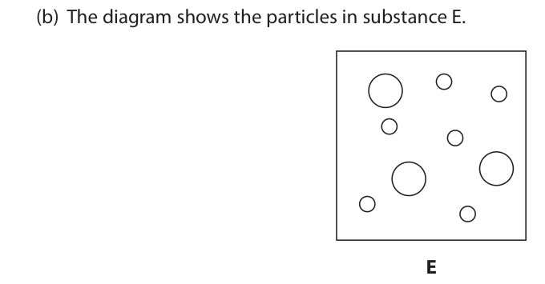
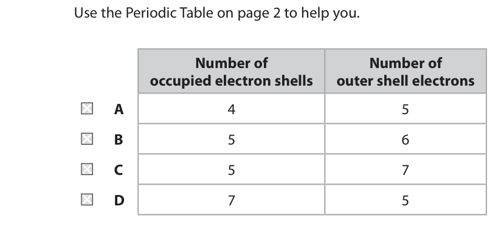
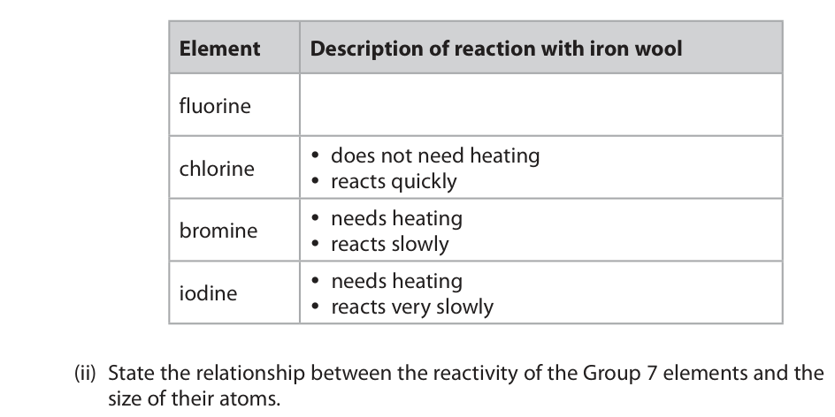
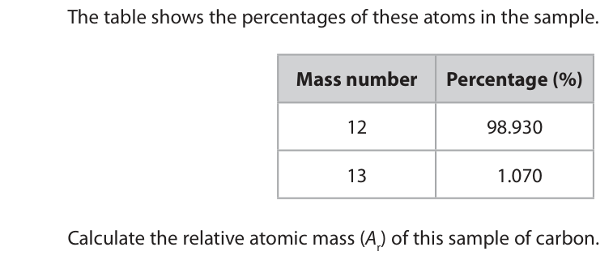
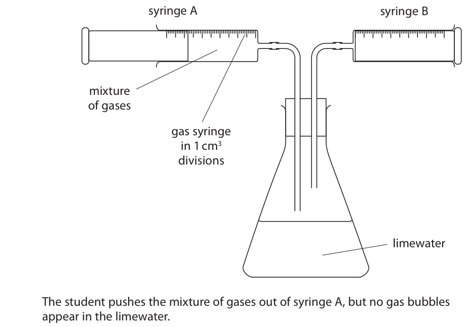
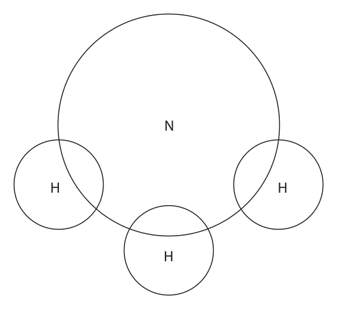
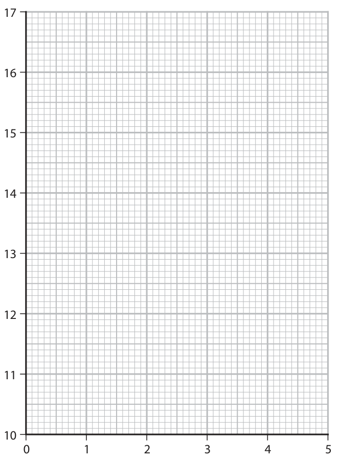
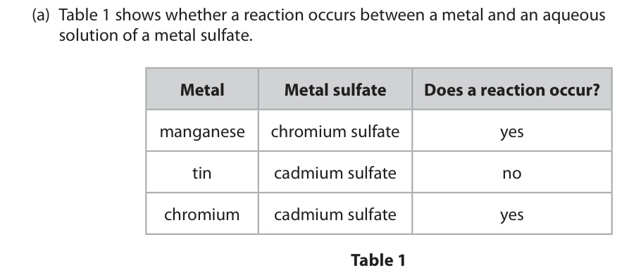
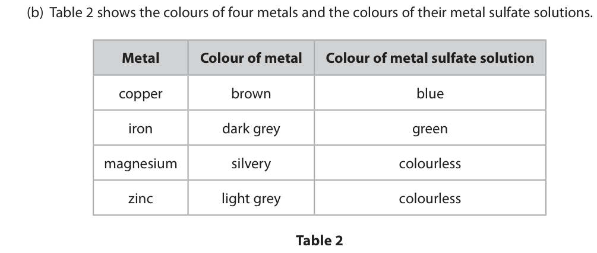

# 4CH1/1C — 2021-11 (official extraction)

> schema `syllabai.official-paper-questions/0.1` · paper_id `pearson-edexcel:international-gcse:chemistry:4ch1:2021-11:4CH1/1C` · qp sha256 `fa4c64a38fa6438c…` · extracted verbatim, never regenerated (ADR-037)

## Question 1 (5 marks)
**(a)** The diagram shows the particles in four substances, A, B, C and D. A B C D

### 1(a)(i) [1]

Which substance contains single atoms of one element? A B C D

**Mark scheme answer**

> A
> A is the correct answer because A contains one
> element and the atoms are not joined to other
> atoms.
> B is incorrect because B contains molecules of an
> element.
> C is incorrect because C contains molecules of a
> compound
> D is incorrect. D contains an element but the
> atoms are joined together to form a giant covalent
> structure.

- **(1)** A

### 1(a)(ii) [1]

Which substance is a compound? A B C D

**Mark scheme answer**

> C
> C is the correct answer because C contains atoms of
> two different elements chemically bonded
> together.
> A is incorrect because A is an element.
> B is incorrect because B is an element.
> D is incorrect because D is an element.

- **(1)** C

### 1(a)(iii) [1]

Which substance could have the formula H2? A B C D

**Mark scheme answer**

> B
> B is correct because B shows two atoms of the same
> element chemically bonded together e.g. H2
> A is incorrect because A contains atoms of an
> element
> C in incorrect because C contains molecules of a
> compound with the formula e.g. H2O
> D is incorrect because C contains a giant covalent
> structure that could have the formula C

- **(1)** B

### 1(b) [2]

The diagram shows the particles in substance E. E Give two reasons why substance E is a mixture. 1 2

**Mark scheme answer**

> M1 two different elements ALLOW two different
> types of/sizes of atom.
> M2 not (chemically) joined / (chemically) bonded
> together
> Question
> Answer Notes Marks
> number

- **(1)** two different elements ALLOW two different
- **(1)** not (chemically) joined / (chemically) bonded

## Question 2 (6 marks)

This question is about Group 7 elements and their reactions.

**(a)** Fluorine has the smallest atoms in Group 7. The diagram shows the electronic configuration of a fluorine atom.

### 2(a)(i) [1]

State why fluorine has the smallest atoms in Group 7.

**Mark scheme answer**

> fluorine has the fewest number of shells / energy ALLOW fluorine has the
> levels fewest number of
> electrons
> IGNORE references to
> protons, neutrons,
> atomic number and
> mass number

- **(1)** fluorine has the fewest number of shells / energy ALLOW fluorine has the

### 2(a)(ii) [1]

Which row gives the correct number of occupied electron shells and the correct number of outer shell electrons in an atom of iodine? Use the Periodic Table on page 2 to help you. Number of Number of occupied electron shells outer shell electrons

- **(A)** 4                                                                                                      5
- **(B)** 5                                                                                                      6
- **(C)** 5                                                                                                      7  ✔
- **(D)** 7                                                                                                      5

**Mark scheme answer**

> C
> C is the correct answer because iodine is in period

- **(1)** Answer C: 5                                                                                                      7

### 2(b)(i) [2]

The table gives descriptions of the reactions of some Group 7 elements with iron wool. Complete the table by giving a description of the reaction of fluorine with iron wool. Element Description of reaction with iron wool fluorine  does not need heating chlorine  reacts quickly  needs heating bromine  reacts slowly  needs heating iodine  reacts very slowly

### 2(b)(ii) [2]

State the relationship between the reactivity of the Group 7 elements and the size of their atoms.

## Question 3 (7 marks)

This question is about the rusting of iron.

**(a)** Water is needed for iron to rust.

**(b)** The diagram shows two methods used to prevent iron from rusting. iron plastic iron zinc Method A Method B Method A will only work if the plastic coating is not damaged. Method B will work even when the zinc coating is damaged.

### 3(a)(i) [1]

Name one other substance needed for iron to rust.

**Mark scheme answer**

> oxygen IGNORE air
> ACCEPT O2

- **(1)** oxygen IGNORE air

### 3(a)(ii) [1]

Give the chemical name for rust.

**Mark scheme answer**

> (hydrated) iron (III) oxide ALLOW iron oxide
> /ferric oxide
> REJECT incorrect
> oxidation states of iron

- **(1)** (hydrated) iron (III) oxide ALLOW iron oxide

### 3(b)(i) [2]

Explain how method A prevents iron from rusting.

**Mark scheme answer**

> M1 plastic acts as a barrier ALLOW forms a
> protective layer
> M2 therefore stops oxygen / water getting to the ALLOW air in place of
> iron oxygen

- **(1)** plastic acts as a barrier ALLOW forms a
- **(1)** therefore stops oxygen / water getting to the ALLOW air in place of

### 3(b)(ii) [1]

Give the name of method B.

**Mark scheme answer**

> galvanising ALLOW sacrificial
> protection
> IGNORE sacrificial
> method

- **(1)** galvanising ALLOW sacrificial

### 3(b)(iii) [2]

Explain how method B prevents iron from rusting even when the zinc coating is damaged.

**Mark scheme answer**

> M1 zinc is more reactive than iron /higher in the
> reactivity series than iron
> M2 therefore reacts / oxidises / corrodes in IGNORE references to
> preference to iron rates of reaction
> REJECT references to
> zinc rusting
> Question
> Answer Notes Marks
> number

- **(1)** zinc is more reactive than iron /higher in the
- **(1)** therefore reacts / oxidises / corrodes in IGNORE references to

## Question 4 (8 marks)
**(a)** The table shows the number of protons, neutrons and electrons in species F, G and H. Species F Species G Species H number of protons 7 7 7 number of neutrons 7 8 7 number of electrons 7 7 10

### 4(a)(i) [1]

Give the mass number of F.

**Mark scheme answer**

> 14

- **(1)** 14

### 4(a)(ii) [1]

Give the electronic configuration of G.

**Mark scheme answer**

> 2.5 REJECT any charge
> shown
> IGNORE brackets

- **(1)** 2.5 REJECT any charge

### 4(a)(iii) [2]

Explain why F and G are isotopes of the same element. Refer to subatomic particles in your answer.

**Mark scheme answer**

> M1 same number of protons IGNORE references to
> numbers of electrons
> M2 different numbers of neutrons

- **(1)** same number of protons IGNORE references to
- **(1)** different numbers of neutrons

### 4(a)(iv) [2]

Explain why H is a negative ion. Refer to subatomic particles and their charges in your answer.

**Mark scheme answer**

> M1 (three) more electrons than protons REJECT incorrect
> numbers of electrons
> M2 electrons have a negative charge and protons
> have a positive charge

- **(1)** (three) more electrons than protons REJECT incorrect
- **(1)** electrons have a negative charge and protons

### 4(b) [2]

A sample of carbon contains atoms of mass number 12 and 13 The table shows the percentages of these atoms in the sample. Mass number Percentage (%) 12 98.930 13 1.070 Calculate the relative atomic mass (Ar) of this sample of carbon. Give your answer to two decimal places. relative atomic mass =

**Mark scheme answer**

> M1 (98.930 × 12) + (1.070 × 13) ÷ 100
> M2 12.01 ALLOW 1 mark for
> 1201.07 if not divided
> by 100 as long as given
> to 2dp
> correct answer to 2
> decimal places with or
> without working scores
> 2 marks.
> Question
> Answer Notes Marks
> number

- **(1)** (98.930 × 12) + (1.070 × 13) ÷ 100
- **(1)** 12.01 ALLOW 1 mark for

## Question 5 (10 marks)

Two experiments are done to determine the percentage composition by volume of a mixture of three gases, carbon dioxide, oxygen and argon.

**(b)** When the apparatus in experiment 1 is set up correctly, the mixture of gases is bubbled gently through the limewater so that all the carbon dioxide is removed. The volume of the mixture of gases in syringe A at the start is 76 cm3. The volume of the mixture of gases in syringe B at the end is 66 cm3.

**(c)** In experiment 2, a teacher pushes the remaining gases over hot copper powder. The diagram shows the apparatus the teacher uses. copper powder gas syringe HEAT The copper powder turns black as it reacts with oxygen. Argon is extremely unreactive, so it does not react with copper.

### 5(a) [1]

In experiment 1, a student bubbles the mixture of gases through limewater. Carbon dioxide reacts with limewater. The diagram shows the apparatus the student uses. syringe A syringe B mixture of gases gas syringe in 1 cm3 divisions limewater The student pushes the mixture of gases out of syringe A, but no gas bubbles appear in the limewater. Give one change the student needs to make to the apparatus for gas bubbles to appear in the limewater.

**Mark scheme answer**

> therefore has 5 shells and group 7 therefore has
> M1 add more limewater (to cover tube on left)
> M2 the glass tube on the left should be longer/in
> the limewater

- **(1)** therefore has 5 shells and group 7 therefore has

### 5(b)(i) [2]

Calculate the percentage by volume of carbon dioxide in the mixture of gases in syringe A. percentage of carbon dioxide = %

**Mark scheme answer**

> M1 volume of carbon dioxide = 10 (cm3)
> M2 10÷76 × 100 = 13.2 (%) correct answer with or
> without working scores
> 2 marks.
> ACCEPT any number of
> significant figures
> except 1
> REJECT incorrect
> rounding
> ALLOW ecf on incorrect
> volume of carbon
> dioxide
> ALLOW 66/76 x 100 =
> 86.8 for 1 mark

- **(1)** volume of carbon dioxide = 10 (cm3)
- **(1)** 10÷76 × 100 = 13.2 (%) correct answer with or

### 5(b)(ii) [1]

Give the change in the appearance of the limewater.

**Mark scheme answer**

> limewater turns (from colourless to) cloudy or milky ALLOW white
> precipitate

- **(1)** limewater turns (from colourless to) cloudy or milky ALLOW white

### 5(b)(iii) [2]

Explain why the gas syringes in experiment 1 cannot be used to find the percentage of carbon dioxide in a typical sample of air.

**Mark scheme answer**

> M1 the percentage/amount of carbon dioxide in the ALLOW there is 0.04%
> air is too small of carbon dioxide in the
> air
> M2 therefore the reading on the syringe would ALLOW the change on
> change by less than 1 cm3 the gas syringe would
> be too small
> ALLOW syringe not
> precise/accurate
> enough to measure
> small volume changes
> Question
> Answer Notes Marks
> number

- **(1)** the percentage/amount of carbon dioxide in the ALLOW there is 0.04%
- **(1)** therefore the reading on the syringe would ALLOW the change on

### 5(c)(i) [1]

Name the black substance that forms on the copper powder.

**Mark scheme answer**

> copper(II) oxide ALLOW copper oxide
> /CuO
> REJECT copper (I) oxide

- **(1)** copper(II) oxide ALLOW copper oxide

### 5(c)(ii) [1]

Suggest why the teacher uses copper powder instead of the same mass of large pieces of copper.

**Mark scheme answer**

> the powder has a greater surface area (than larger ALLOW the powder
> pieces of copper) reacts more quickly
> (than larger pieces of
> copper)

- **(1)** the powder has a greater surface area (than larger ALLOW the powder

### 5(c)(iii) [2]

Explain why argon is extremely unreactive.

**Mark scheme answer**

> M1 argon/it has a full outer shell of electrons ALLOW has eight outer
> shell electrons
> M2 therefore does not lose or gain (or share)
> electrons
> Question
> Answer Notes Marks
> number

- **(1)** argon/it has a full outer shell of electrons ALLOW has eight outer
- **(1)** therefore does not lose or gain (or share)

## Question 6 (11 marks)

This question is about organic compounds.

**(a)** The diagram shows the displayed formulae of five compounds, U, V, W, X and Y. U V H H H H H H H H C C H H C C C C C H H C C H H H H H H W X H H H H H H H H H C C C C H H C C C C H H H H H H H Y H H H H H C C C C O H H H H H

**(b)** Compound Z contains 38.7% carbon, 9.7% hydrogen and 51.6% oxygen by mass.

### 6(a)(i) [1]

Give the letter of the compound that is not a hydrocarbon.

**Mark scheme answer**

> Y

- **(1)** Y

### 6(a)(ii) [1]

Give the letter of the compound that is a saturated hydrocarbon with the empirical formula CH2

**Mark scheme answer**

> V

- **(1)** V

### 6(a)(iii) [1]

Give the letter of the compound that reacts with bromine in the presence of ultraviolet radiation to form this structure. H H H H H C C C C H H Br H H

**Mark scheme answer**

> W

- **(1)** W

### 6(a)(iv) [1]

Give the letter of the compound that forms an addition polymer with this repeat unit. CH3 CH3 C C H H

**Mark scheme answer**

> X

- **(1)** X

### 6(a)(v) [1]

Give the displayed formula of an alkene that is an isomer of compound X.

**Mark scheme answer**

> displayed formula of but-1-ene or methylpropene

- **(1)** displayed formula of but-1-ene or methylpropene

### 6(a)(vi) [2]

Compounds U and X are members of the same homologous series. Members of the same homologous series have the same functional group. Give two other characteristics of compounds in the same homologous series. 1 2

**Mark scheme answer**

> Any two from
> M1 same general formula ALLOW same empirical
> formula
> M2 similar chemical properties ALLOW they react in a
> similar way/same
> chemical properties
> M3 trend in physical properties ACCEPT named physical
> property e.g. trend in
> boiling points
> M4 each consecutive member differs by a CH2 group

- **(2)** Any two from

### 6(b)(i) [2]

Show by calculation that the empirical formula of compound Z is CH3O

**Mark scheme answer**

> M1 38.7 9.7 51.6 0 marks if upside down

- **(2)** M1 38.7 9.7 51.6 0 marks if upside down

### 6(b)(ii) [2]

The relative formula mass (Mr) of compound Z is 62 Deduce the molecular formula of compound Z. molecular formula =

## Question 7 (14 marks)

This question is about nitrogen and some of its compounds.

**(a)** Nitrogen and oxygen do not react together at room temperature. At the high temperatures in a car engine, nitrogen and oxygen react to form nitrogen monoxide, NO

**(b)** Nitrogen monoxide gas can be removed from car exhaust fumes when it reacts with carbon monoxide gas.

**(c)** Ammonia is a simple molecule with the formula NH3

### 7(a)(i) [1]

Give a chemical equation for this reaction.

**Mark scheme answer**

> N2 + O2 → 2NO ALLOW fractions and
> multiples
> IGNORE state symbols,
> even if incorrect

- **(1)** N2 + O2 → 2NO ALLOW fractions and

### 7(a)(ii) [1]

Give a reason why this reaction only occurs at high temperatures.

**Mark scheme answer**

> the reaction has a high activation energy / Ea ACCEPT to give the
> reactants enough
> energy to react
> ACCEPT a lot of energy
> is required to break the
> bonds in the reactants
> ALLOW nitrogen is
> unreactive

- **(1)** the reaction has a high activation energy / Ea ACCEPT to give the

### 7(a)(iii) [1]

State why it is important that oxides of nitrogen are not released into the atmosphere.

**Mark scheme answer**

> acid rain ACCEPT references to
> respiratory problems
> ALLOW a specific
> harmful effect of acid
> rain
> ALLOW references to
> smog
> ALLOW references to
> greenhouse gases /
> global warming /
> climate change
> ALLOW toxic

- **(1)** acid rain ACCEPT references to

### 7(b)(i) [2]

The rate of the reaction is increased by passing the gases over a catalyst. Explain how a catalyst increases the rate of a reaction.

**Mark scheme answer**

> M1 does not need heating
> M2 reacts very quickly must imply quicker
> reaction than chlorine
> pathway
> M2 with lower activation energy

- **(2)** M1 does not need heating

### 7(b)(ii) [3]

Explain how increasing the pressure of gases increases the rate of reaction.

**Mark scheme answer**

> M1 as the atoms get bigger
> M2 the reactivity decreases ACCEPT reverse
> argument
> Question
> Answer Notes Marks
> number
> in a smaller volume
> /space
> M2 therefore more collisions
> M3 per unit time
> more frequent collisions
> scores M2 and M3
> any reference to
> increasing energy max =

- **(3)** M1 as the atoms get bigger

### 7(c)(i) [2]

Complete the diagram to show the outer shell electrons in ammonia. N H H H

**Mark scheme answer**

> M1 one pair of electrons between the nitrogen and
> each hydrogen
> M2 two non-bonding electrons on the nitrogen M2 dep on M1

- **(1)** one pair of electrons between the nitrogen and
- **(1)** two non-bonding electrons on the nitrogen M2 dep on M1

### 7(c)(ii) [2]

The bonds in ammonia are covalent. Describe the forces of attraction in a covalent bond.

**Mark scheme answer**

> M1 (electrostatic) attraction between nuclei nuclei must be plural
> M2 and shared pair(s) of electrons ALLOW bonding pair(s)
> of electrons
> OR
> M1 (electrostatic) attraction between shared pair(s) ALLOW bonding pair(s)
> of electrons of electrons
> M2 and nuclei (of both atoms) nuclei must be plural

- **(2)** M1 (electrostatic) attraction between nuclei nuclei must be plural

### 7(c)(iii) [2]

Explain why ammonia has a low boiling point.

**Mark scheme answer**

> M1 forces between molecules/intermolecular forces ALLOW intermolecular
> (of attraction) are weak bonds are weak
> M2 and therefore require little energy to overcome IGNORE less energy
> Mention of breaking
> covalent bonds = 0
> Question
> Answer Notes Marks
> number

- **(1)** forces between molecules/intermolecular forces ALLOW intermolecular
- **(1)** and therefore require little energy to overcome IGNORE less energy

## Question 8 (8 marks)

This question is about barium chloride.

### 8(a) [6]

Barium chloride can be made by reacting barium carbonate with dilute hydrochloric acid. The chemical equation for the reaction is BaCO3(s) + 2HCl(aq) → BaCl2(aq) + H2O(l) + CO2(g) Describe a method to produce dry crystals of hydrated barium chloride, starting with barium carbonate powder and dilute hydrochloric acid.

**Mark scheme answer**

> Any six from:
> M1 add barium carbonate (one spatula at a time) to
> the acid
> M2 until the barium carbonate is in excess ALLOW until some
> barium carbonate is
> left/no longer
> effervesces
> /fizzes/bubbles
> M3 filter off the excess barium carbonate M3 dep on M2
> M4 heat solution to evaporate some of the water ALLOW heat until
> crystals start to form
> ALLOW heat until
> solution is saturated
> ALLOW heat until
> crystals form on the end
> of a glass rod/heat to
> crystallisation point
> M5 cool or leave to crystallise
> M6 filter the crystals (from the solution) M6 dep on M5
> IGNORE washing
> M7 leave crystals in a warm place to dry ALLOW leave to dry
> ALLOW dry on filter
> paper
> ALLOW dry in a
> desiccator
> ALLOW dry in a (warm)
> oven
> If solution is evaporated
> to dryness M5, M6 and
> M7 cannot be scored

- **(6)** Any six from:

### 8(b) [2]

A colourless solution contains sodium carbonate and sodium sulfate. Describe a test using barium chloride to show that the colourless solution contains sulfate ions.

**Mark scheme answer**

> M1 add (dilute) acid before adding the barium ALLOW any named acid
> chloride except sulfuric acid
> M2 white precipitate M2 is dependent on M1
> Question
> Answer Notes Marks
> number

- **(1)** add (dilute) acid before adding the barium ALLOW any named acid
- **(1)** white precipitate M2 is dependent on M1

## Question 9 (14 marks)

A student investigates the reaction between solid hydrated sodium carbonate and dilute hydrochloric acid.

**(a)** She uses this method to investigate the temperature change during the reaction. Step 1 pour 25.0 cm3 of dilute hydrochloric acid into a polystyrene cup Step 2 record the temperature of the dilute hydrochloric acid Step 3 add 0.5 g of sodium carbonate and stir the mixture Step 4 record the lowest temperature of the mixture Step 5 add further 0.5 g portions of sodium carbonate, one portion at a time, stir the mixture and record the lowest temperature each time The table shows the student’s results. Mass of sodium carbonate Temperature in °C added in g 0.0 17.0 0.5 15.6 1.0 14.1 1.5 13.0 2.0 12.9 2.5 12.2 3.0 11.8 3.5 11.5 4.0 11.2 4.5 11.0 5.0 11.0

**(b)** The student does another experiment using the same reaction. The diagram shows the student’s apparatus. cotton wool sodium carbonate dilute hydrochloric acid balance g The mass on the balance decreases as carbon dioxide gas escapes.

### 9(a)(i) [2]

Plot the student’s results on the grid.

**Mark scheme answer**

> M1 and M2 all points correctly plotted to the deduct 1 mark for each
> nearest half a square error

- **(2)** M1 and M2 all points correctly plotted to the deduct 1 mark for each

### 9(a)(ii) [1]

Draw a curve of best fit, ignoring the anomalous result. Temperature in °C 0 1 2 3 4 5 Mass of hydrated sodium carbonate added in g

**Mark scheme answer**

> smooth curve of best fit

- **(1)** smooth curve of best fit

### 9(a)(iii) [2]

Explain why it is better to use a polystyrene cup instead of a glass beaker in this experiment.

**Mark scheme answer**

> An explanation that links any two of the following
> points
> M1 polystyrene is an insulator
> M2 reduces thermal energy/heat coming in from the
> surroundings OWTTE
> M3 temperature decrease will be closer to true ALLOW results will be
> value OWTTE more accurate

- **(2)** An explanation that links any two of the following

### 9(a)(iv) [1]

Suggest a reason for the anomalous result.

**Mark scheme answer**

> Any one from:
> M1 the student recorded the temperature before ALLOW less than 0.5 g
> adding the sodium carbonate /the temperature had of/not enough sodium
> not stopped decreasing OWTTE carbonate was added
> M2 the student forgot to the stir the mixture

- **(1)** Any one from:

### 9(a)(v) [1]

State how the results show that all the dilute hydrochloric acid has reacted.

**Mark scheme answer**

> (two) results at the end are the same ALLOW the
> temperature stops
> decreasing

- **(1)** (two) results at the end are the same ALLOW the

### 9(a)(vi) [2]

Use the results of the experiment to explain the type of reaction that occurs when sodium carbonate is added to dilute hydrochloric acid.

**Mark scheme answer**

> An explanation that links together
> M1 the reaction is endothermic REJECT exothermic for
> both marks
> and either of the following points
> M2 it takes in thermal energy/heat from the
> surroundings
> OR
> M3 as shown by the temperature decrease (of the ALLOW references to
> reaction mixture) cooling
> No M2 or M3 if the
> statements contradict
> one another
> Question
> Answer Notes Marks
> number

- **(2)** An explanation that links together

### 9(b)(i) [1]

Give a reason for the cotton wool plug in the conical flask.

**Mark scheme answer**

> to prevent acid / liquid / solution splashing out

- **(1)** to prevent acid / liquid / solution splashing out

### 9(b)(ii) [3]

The student adds 2.12 g of sodium carbonate to an excess of dilute hydrochloric acid. The chemical equation for the reaction is Na2CO3(s) + 2HCl(aq) → 2NaCl(aq) + H2O(l) + CO2(g) Calculate the maximum mass, in g, of carbon dioxide formed in the reaction. mass = g

**Mark scheme answer**

> M1 (Mr of sodium carbonate) = 106
> M2 (moles of sodium carbonate 2.12 ÷ 106 =) 0.02 ALLOW ecf from M1
> M2 subsumes M1
> M3 (mass of carbon dioxide 0.02 × 44 =) 0.88 (g) ALLOW answer from M2
> x 44
> answer of 0.88 (g) with
> or without working
> scores 3

- **(1)** (Mr of sodium carbonate) = 106
- **(1)** (moles of sodium carbonate 2.12 ÷ 106 =) 0.02 ALLOW ecf from M1
- **(1)** (mass of carbon dioxide 0.02 × 44 =) 0.88 (g) ALLOW answer from M2

### 9(b)(iii) [1]

Suggest why the mass of carbon dioxide produced is less than the calculated maximum mass.

**Mark scheme answer**

> Any one from:
> M1 the sodium carbonate is impure
> M2 some of the carbon dioxide dissolves in the
> acid/solution
> Question
> Answer Notes Marks
> number

- **(1)** Any one from:

## Question 10 (15 marks)

A teacher uses this apparatus to separate a mixture of ethanol and water. B A HEAT

**(b)** The mixture contains 15.5 cm3 of ethanol. 1.0 cm3 of ethanol has a mass of 0.79 g. One mole of ethanol contains 6.00 × 1023 molecules. [Mr of ethanol = 46]

**(c)** After five minutes, the teacher collects a sample of colourless liquid in a new beaker.

**(d)** The teacher uses this apparatus to heat 100 g of water. copper can 100 g of water burner ethanol He records the temperature of the water before and after heating. temperature of water before heating = 21.0 °C temperature of water after heating = 70.5 °C

### 10(a)(i) [1]

Name this method of separation.

**Mark scheme answer**

> fractional distillation ALLOW distillation
> REJECT simple
> distillation

- **(1)** fractional distillation ALLOW distillation

### 10(a)(ii) [1]

Name the change of state taking place at A.

**Mark scheme answer**

> evaporation ALLOW evaporating
> /boiling

- **(1)** evaporation ALLOW evaporating

### 10(a)(iii) [1]

Name the change of state taking place at B.

**Mark scheme answer**

> condensation ALLOW condensing

- **(1)** condensation ALLOW condensing

### 10(b)(i) [2]

Calculate the amount, in moles, of ethanol in 15.5 cm3 of ethanol. amount = mol

**Mark scheme answer**

> M1 (mass ethanol 15.50 × 0.79 =) 12.245 (g)
> M2 (moles ethanol = 12.245 ÷ 46 =) 0.266 (mol) ALLOW any number of
> significant figures
> except 1
> ALLOW ecf from M1
> OR
> M1 (1 cm3 ethanol = 0.79 ÷ 46 =) 0.0172 mol
> M2 (15.5 cm3 ethanol = 0.0172 × 15.5 =) 0.267 (mol) ALLOW any number of
> significant figures
> except 1
> ALLOW ecf from M1
> correct answer with or
> without working
> scores 2.

- **(2)** M1 (mass ethanol 15.50 × 0.79 =) 12.245 (g)

### 10(b)(ii) [1]

Calculate the number of molecules of ethanol in 15.5 cm3 of ethanol. number of molecules =

**Mark scheme answer**

> answer from (b)(i) × 6 × 1023 ALLOW any number of
> e.g. (0.266  6.0 x 1023 =) 1.60 x 1023 significant figures
> except 1
> ALLOW answer in
> ordinary form
> Question
> Answer Notes Marks
> number

- **(1)** answer from (b)(i) × 6 × 1023 ALLOW any number of

### 10(c)(i) [2]

Describe a chemical test to show that the colourless liquid contains water.

**Mark scheme answer**

> M1 add anhydrous copper sulfate ALLOW add white copper
> sulfate
> M2 turns blue M2 dependent on M1
> ALLOW
> M1 add anhydrous cobalt
> chloride/ cobalt chloride
> paper
> M2 turns pink
> M2 dependent on M1

- **(1)** add anhydrous copper sulfate ALLOW add white copper
- **(1)** turns blue M2 dependent on M1

### 10(c)(ii) [2]

Describe a physical test to show if the colourless liquid is pure water.

**Mark scheme answer**

> M1 measure boiling point
> M2 is 100°C
> ALLOW melting/freezing
> point is 0°C for both
> marks

- **(1)** measure boiling point
- **(1)** is 100°C

### 10(d)(i) [3]

Calculate the heat energy change (Q) in joules. [specific heat capacity of water is 4.2 J/g/°C] Q = J

**Mark scheme answer**

> M1 ΔT = 49.5°C correct answer with or
> without working scores 3
> M2 Q = mcΔT OR 100  4.2  49.5 ALLOW ecf from M1
> M3 20 790 J ALLOW 20 800

- **(1)** ΔT = 49.5°C correct answer with or
- **(1)** Q = mcΔT OR 100  4.2  49.5 ALLOW ecf from M1
- **(1)** 20 790 J ALLOW 20 800

### 10(d)(ii) [2]

The student burns 0.0200 mol of ethanol. Use this information and your value for Q to calculate the molar enthalpy change (ΔH), in kJ/mol, for the combustion of ethanol. Include a sign in your answer. ΔH = kJ/mol

**Mark scheme answer**

> M1 20.790 kJ ALLOW answer to 10(c)(i)
> ÷ 1 000
> M2 (20.790 ÷ 0.0200 =) -1039.5 (kJ/mol) ALLOW any number of
> significant figures from 3
> ALLOW M1 ÷ 0.0200 as
> long as answer is
> negative.
> REJECT incorrect
> rounding.
> REJECT positive answer.
> Question
> Answer Notes Marks
> number

- **(1)** 20.790 kJ ALLOW answer to 10(c)(i)
- **(1)** (20.790 ÷ 0.0200 =) -1039.5 (kJ/mol) ALLOW any number of

## Question 11 (12 marks)

This question is about the reactivity of metals.

**(a)** Table 1 shows whether a reaction occurs between a metal and an aqueous solution of a metal sulfate. Metal Metal sulfate Does a reaction occur? manganese chromium sulfate yes tin cadmium sulfate no chromium cadmium sulfate yes Table 1

**(c)** A different experiment can be used to place metals in order of reactivity. This is the method. Step 1 add 1 g of a metal to 25 cm3 of dilute sulfuric acid Step 2 measure the volume of gas produced in one minute

### 11(a)(i) [1]

Name the type of reaction that occurs between manganese and chromium sulfate.

**Mark scheme answer**

> displacement ALLOW redox

- **(1)** displacement ALLOW redox

### 11(a)(ii) [1]

Use the information in Table 1 to complete the order of reactivity. most reactive manganese least reactive

**Mark scheme answer**

> (manganese)
> chromium
> cadmium
> tin

- **(1)** (manganese)

### 11(b) [5]

Table 2 shows the colours of four metals and the colours of their metal sulfate solutions. Metal Colour of metal Colour of metal sulfate solution copper brown blue iron dark grey green magnesium silvery colourless zinc light grey colourless Table 2 When a metal is added to a metal sulfate solution there may be a colour change on the surface of the metal and in the solution. Use the information in Table 2 and your knowledge of the reactivity series to explain any colour changes in these two experiments. copper added to magnesium sulfate solution zinc added to iron sulfate solution

**Mark scheme answer**

> (copper and magnesium sulfate)
> M1 no colour change
> M2 copper is less reactive than magnesium ORA ALLOW copper is below
> /copper cannot displace magnesium magnesium in the
> reactivity series ORA
> IGNORE copper and
> magnesium sulfate do
> not react
> M2 dep on M1
> (zinc and iron sulfate)
> M3 zinc turns (from light grey to) dark grey ALLOW zinc becomes
> coated in a dark grey
> metal
> M4 solution turns (from green to) colourless
> M5 zinc is more reactive than iron ORA/ zinc ALLOW zinc is above
> displaces iron iron in the reactivity
> series ORA
> ALLOW zinc reduces
> iron ions (ignore charge
> given as long as the
> charge is positive)

- **(1)** no colour change
- **(1)** copper is less reactive than magnesium ORA ALLOW copper is below
- **(1)** zinc turns (from light grey to) dark grey ALLOW zinc becomes
- **(1)** solution turns (from green to) colourless
- **(1)** zinc is more reactive than iron ORA/ zinc ALLOW zinc is above

### 11(c)(i) [2]

Give two variables that should be controlled in this experiment. 1 2

**Mark scheme answer**

> Any two from
> M1 concentration of dilute sulfuric acid
> M2 temperature
> M3 surface area of the metal ALLOW size of piece of
> metal

- **(2)** Any two from

### 11(c)(ii) [1]

A small piece of calcium is added to some dilute sulfuric acid in a beaker. One of the products of the reaction, calcium sulfate, is insoluble in water. Suggest why the reaction stops after a short time, even though the beaker still contains calcium and dilute sulfuric acid.

**Mark scheme answer**

> calcium sulfate forms a layer / coating around the ALLOW calcium sulfate
> calcium metal prevents the sulfuric
> acid coming into
> contact with calcium.

- **(1)** calcium sulfate forms a layer / coating around the ALLOW calcium sulfate

### 11(d) [2]

1.00 g of aluminium is added to 0.0600 mol of dilute sulfuric acid. The equation for the reaction is 2Al(s) + 3H2SO4(aq) → Al2(SO4)3(aq) + 3H2(g) Show by calculation that the sulfuric acid is in excess.

**Mark scheme answer**

> M1 (moles of aluminium =) 1÷27 OR 0.0370 moles ALLOW any number of
> significant figures
> except 1
> M2 (moles of sulfuric acid required = 0.0370  3 =)
> 0.0556 moles (and there is more moles of sulfuric ALLOW 0.0555 if
> acid) candidate has used
> rounded value of 0.0370
> moles
> OR
> M1 (moles of aluminium required =) 0.0400
> M2 (mass of aluminium required = 27  0.0400 =)
> 1.08 g (and there is less than 1.08 g)
> Pearson Education Limited. Registered company number 872828
> with its registered office at 80 Strand, London, WC2R 0RL, United Kingdom

- **(2)** M1 (moles of aluminium =) 1÷27 OR 0.0370 moles ALLOW any number of

