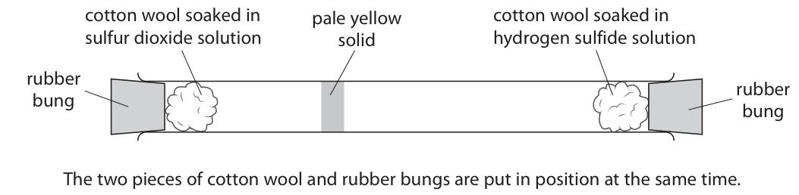
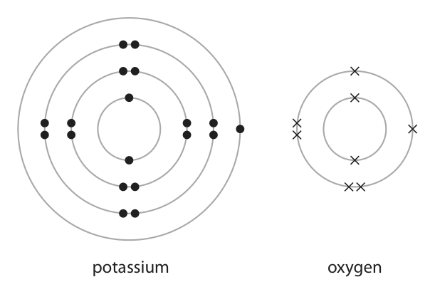
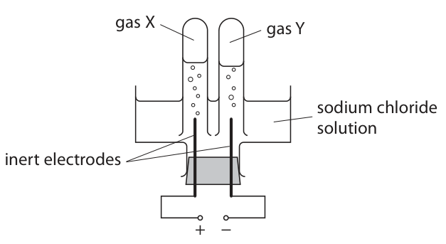
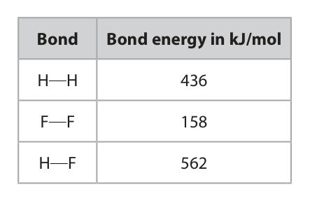
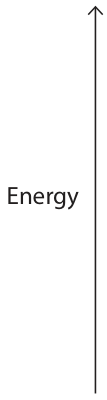

# 4CH1/2C — 2021-11 (official extraction)

> schema `syllabai.official-paper-questions/0.2` · paper_id `pearson-edexcel:international-gcse:chemistry:4ch1:2021-11:4CH1/2C` · qp sha256 `defac24dda59289c…` · extraction is the disclosed baseline (ADR-039)

## Question 1 (5 marks)

Use the Periodic Table to help you answer this question.

### 1(a) [1]

Identify the element with atomic number 7

**Mark scheme answer**

> nitrogen ALLOW N/N2

- **(1)** nitrogen ALLOW N/N2

### 1(b) [1]

Identify a solid non‑metallic element in Period 3

**Mark scheme answer**

> silicon/Si or phosphorus/P or sulfur/S

- **(1)** silicon/Si or phosphorus/P or sulfur/S

### 1(c) [1]

Name an element in Group 7 that is a liquid at room temperature.

**Mark scheme answer**

> bromine

- **(1)** bromine

### 1(d) [1]

State the relative atomic mass of the element that is in Group 4 and Period 4

**Mark scheme answer**

> 73

- **(1)** 73

### 1(e) [1]

Which row shows the most reactive element in Group 1 and Group 7? Most reactive element Most reactive element in Group 1 in Group 7

- **(A)** lithium                                                                                             fluorine
- **(B)** francium                                                                                            astatine
- **(C)** lithium                                                                                             astatine
- **(D)** francium                                                                                            fluorine  ✔

**Mark scheme answer**

> The only correct answer is D as francium is the most
> reactive element in Group 1 and fluorine is the
> most reactive element in Group 7
> A is not correct because lithium is not the most
> reactive element in Group 1
> B is not correct because astatine is not the most
> reactive element in Group 7
> C is not correct because lithium is not the most
> reactive element in Group 1 and astatine is not the
> most reactive element in Group 7
> Total marks for Question 1 = 5

- **(1)** Answer D: francium                                                                                            fluorine

## Question 2 (11 marks)
**(b)** The diagram shows the apparatus a student uses to make a saturated solution. thermometer water solid heat This is the student’s method. Step 1 add 4.5 g of solid to a boiling tube Step 2 measure exactly 10.0 cm3 of pure water and pour into the boiling tube Step 3 place the boiling tube in the beaker of water and heat gently, stirring the mixture continuously until all the solid dissolves Step 4 remove the boiling tube from the beaker and allow it to cool Step 5 record the temperature when crystals start to form in the boiling tube The recorded temperature shows when the solution becomes saturated.

**(c)** The solubility curves for two solids, A and B, are shown on the grid. 300 280 260 A 240 220 200 180 B 160 Solubility in g per 100 g water 140 120 100 20 30 40 50 60 70 80 90 100 Temperature in °C

### 2(a) [2]

The box lists words that may be used to explain the term saturated solution. solute solvent temperature Explain, using all the words in the box, the term saturated solution.

**Mark scheme answer**

> Explanation containing following ideas
> (A saturated solution is one which contains)
> M1 as much solute as possible in (a certain volume
> of) the solvent OWTTE
> M2 at a particular / given / constant temperature
> OWTTE

- **(1)** as much solute as possible in (a certain volume
- **(1)** at a particular / given / constant temperature

### 2(b)(i) [1]

Name the piece of apparatus that the student should use in Step 2 to measure exactly 10.0 cm3 of pure water.

**Mark scheme answer**

> (volumetric) pipette/burette

- **(1)** (volumetric) pipette/burette

### 2(b)(ii) [1]

Suggest why the boiling tube is not heated directly using a Bunsen burner in Step 3.

**Mark scheme answer**

> (water / solution) would be heated too quickly OR ALLOW (water /
> (water / solution) might spit out or be lost OWTTE solution) might boil or
> evaporate

- **(1)** (water / solution) would be heated too quickly OR ALLOW (water /

### 2(b)(iii) [1]

Suggest how the student could improve the reliability of her recorded temperature in Step 5.

**Mark scheme answer**

> repeat (and find the mean temperature)

- **(1)** repeat (and find the mean temperature)

### 2(b)(iv) [2]

In Step 5, crystals start to form at 26 °C. Calculate the solubility of the solid, in g per 100 g of water, at 26 °C. [1.0 cm3 of pure water has a mass of 1.0 g] solubility = g per 100 g of water

**Mark scheme answer**

> M1 4.5 (g solid in 10 g water)
> M2 (so solubility = 4.5 x 10) = 45 (g per 100 g of water) ALLOW M1×10
> 45 with no working
> scores 2

- **(1)** 4.5 (g solid in 10 g water)
- **(1)** (so solubility = 4.5 x 10) = 45 (g per 100 g of water) ALLOW M1×10

### 2(c)(i) [1]

State the temperature when A and B have the same solubility. temperature = °C

**Mark scheme answer**

> 71 (°C) ALLOW 70-72(°C)

- **(1)** 71 (°C) ALLOW 70-72(°C)

### 2(c)(ii) [2]

Calculate the mass of B that will dissolve in 250 g of water at 60 °C. Show your working. mass = g

**Mark scheme answer**

> M1 (from curve) 124 g of solid B dissolves in 100 g water ALLOW 123-125 g
> M2 (so 124 x 2.5) = 310 (g dissolves in 250 g water) ALLOW ecf from M1
> 307.5-312.5 with no
> working scores 2
> marks
> ALLOW M1×2.5
> If solid A used 1 mark
> for correct answer of
> 262-268g

- **(1)** (from curve) 124 g of solid B dissolves in 100 g water ALLOW 123-125 g
- **(1)** (so 124 x 2.5) = 310 (g dissolves in 250 g water) ALLOW ecf from M1

### 2(c)(iii) [1]

Suggest why the values for the solubility of A and B may be less accurate at 95 °C than at lower temperatures.

**Mark scheme answer**

> some water may have been lost/evaporated OWTTE
> Total marks for Question 2 = 11

- **(1)** some water may have been lost/evaporated OWTTE

## Question 3 (8 marks)

Sulfur dioxide (SO2) and hydrogen sulfide (H2S) are both gases. The two gases react together to form solid sulfur and water.

**(b)** The diagram shows apparatus used to compare the speed at which particles of the two gases diffuse. cotton wool soaked in pale yellow cotton wool soaked in sulfur dioxide solution solid hydrogen sulfide solution rubber rubber bung bung The two pieces of cotton wool and rubber bungs are put in position at the same time. A pale yellow solid soon forms.

### 3(a)(i) [2]

Complete the chemical equation for the reaction. 2H2S( ) + SO2( ) → S(s) + H2O( )

**Mark scheme answer**

> 2H2S (g) + SO2 (g) → 3 S (s) + 2 H2O (l)
> M1 all state symbols correct ALLOW upper case
> M2 balancing correct
> ALLOW
> multiples/fractions

- **(1)** all state symbols correct ALLOW upper case
- **(1)** balancing correct

### 3(a)(ii) [1]

State why the sulfur dioxide is reduced in the reaction.

**Mark scheme answer**

> (sulfur dioxide is reduced because it) loses oxygen IGNORE references to
> electrons

- **(1)** (sulfur dioxide is reduced because it) loses oxygen IGNORE references to

### 3(b)(i) [2]

Explain how the diagram shows that hydrogen sulfide gas diffuses more quickly than sulfur dioxide gas.

**Mark scheme answer**

> Explanation linking following points
> M1 sulfur/(pale yellow) solid forms nearer to sulfur
> dioxide side/closer to left OWTTE ORA
> M2 so hydrogen sulfide particles moved / diffused
> further (in same time) OWTTE ORA

- **(1)** sulfur/(pale yellow) solid forms nearer to sulfur
- **(1)** so hydrogen sulfide particles moved / diffused

### 3(b)(ii) [3]

Deduce a relationship between the relative formula mass (Mr) of a gas and the speed at which a gas diffuses. Use the Ar values to help you. [Ar values: H = 1 S = 32 O = 16]

**Mark scheme answer**

> M1 Mr of H2S = (1 + 1 + 32) = 34
> M2 Mr of SO2 = (32 +16 + 16) = 64
> M3 statement of relationship eg the higher the ACCEPT reverse
> Mr the slower the gas diffuses argument
> Total marks for Question 3 = 8
> 2+

- **(1)** Mr of H2S = (1 + 1 + 32) = 34
- **(1)** Mr of SO2 = (32 +16 + 16) = 64
- **(1)** statement of relationship eg the higher the ACCEPT reverse

## Question 4 (13 marks)

This question is about ionic compounds.

**(c)** A sample of solid potassium oxide is added to water. A reaction occurs and a colourless solution forms. When a few drops of phenolphthalein indicator are added to the solution it turns pink.

### 4(a) [2]

State the formula of the cation and the anion in magnesium sulfate. cation anion

**Mark scheme answer**

> M1 (cation) Mg ALLOW 1 mark if
> formulae correct but in
> wrong order
> M2 (anion) SO4 2-

- **(1)** (cation) Mg ALLOW 1 mark if
- **(1)** (anion) SO4 2-

### 4(b) [3]

The diagram shows the electronic configuration of a potassium atom and an oxygen atom. potassium oxygen Potassium oxide (K2O) is an ionic compound. Draw the electronic configuration of a potassium ion and an oxide ion. Show the charge on each ion. potassium ion oxide ion

**Mark scheme answer**

> M1 potassium ion
> ALLOW any combination
> of dots and crosses
> M2 oxide ion
> M3 (K)+ and (O)2-
> If only outer shells
> shows – max 2

- **(1)** potassium ion
- **(1)** oxide ion
- **(1)** (K)+ and (O)2-

### 4(c)(i) [1]

Identify the ion responsible for the colour change.

**Mark scheme answer**

> hydroxide/OH- ALLOW HO-

- **(1)** hydroxide/OH- ALLOW HO-

### 4(c)(ii) [1]

Give a chemical equation for the reaction between potassium oxide and water.

**Mark scheme answer**

> K2O + H2O → 2KOH ALLOW multiples

- **(1)** K2O + H2O → 2KOH ALLOW multiples

### 4(d) [2]

Explain why ionic compounds conduct electricity when molten or in aqueous solution, but not when in the solid state.

**Mark scheme answer**

> M1 (when molten or in aqueous solution) ions can
> move
> M2 (in solid) ions cannot move

- **(1)** (when molten or in aqueous solution) ions can
- **(1)** (in solid) ions cannot move

### 4(e) [4]

The diagram shows the apparatus a teacher uses to demonstrate the electrolysis of a concentrated aqueous solution of sodium chloride. gas X gas Y sodium chloride solution inert electrodes + − During the electrolysis two gases, X and Y, are formed. One of the gases produces a squeaky pop when tested with a lighted splint. Use ionic half‑equations to identify X and Y.

**Mark scheme answer**

> M1 X is chlorine / Cl2 ALLOW oxygen / O2
> M2 Y is hydrogen / H2 If both given but wrong
> way round or unclear
> which is which allow 1
> mark from M1 and M2
> M3 2Cl - → Cl2 + 2e (-) 2H2O → O2 + 4H+ + 4e(-)
> or
> 4OH-→O2 + 2H2O + 4e(-)
> M4 2H+ + 2e (-) → H2
> Total marks for Question 4 = 13

- **(1)** X is chlorine / Cl2 ALLOW oxygen / O2
- **(1)** Y is hydrogen / H2 If both given but wrong
- **(1)** 2Cl - → Cl2 + 2e (-) 2H2O → O2 + 4H+ + 4e(-)
- **(1)** 2H+ + 2e (-) → H2

## Question 5 (12 marks)

Metals are found in the Earth’s crust either as uncombined elements or in metal compounds in rocks. The method of extraction of a metal is related to its position in the reactivity series. The table shows the positions of some metals and carbon in the reactivity series. most reactive potassium sodium lithium calcium magnesium aluminium carbon zinc iron lead copper silver gold least reactive platinum

**(b)** Carbon extraction and electrolysis are two methods of obtaining a metal from a compound.

### 5(a)(i) [1]

State the name given to rocks that contain metal compounds used in the extraction of metals.

**Mark scheme answer**

> ore(s) IGNORE minerals

- **(1)** ore(s) IGNORE minerals

### 5(a)(ii) [1]

Name a metal that is found as an uncombined element in the Earth’s crust.

**Mark scheme answer**

> gold/platinum ALLOW silver/copper
> ALLOW symbols

- **(1)** gold/platinum ALLOW silver/copper

### 5(b)(i) [2]

Explain, without giving practical details, which method is most suitable to obtain calcium from calcium chloride.

**Mark scheme answer**

> (calcium from calcium chloride)
> M1 electrolysis
> M2 (because) calcium is more reactive than carbon ALLOW reverse
> OR carbon cannot displace calcium argument
> M2 dep on M1

- **(1)** electrolysis
- **(1)** (because) calcium is more reactive than carbon ALLOW reverse

### 5(b)(ii) [2]

Explain, without giving practical details, which method is most suitable to obtain lead from lead oxide.

**Mark scheme answer**

> (lead from lead oxide)
> M1 carbon extraction
> M2 (because) carbon is more reactive than lead OR ALLOW reverse
> carbon can displace lead argument
> M2 dep on M1

- **(1)** carbon extraction
- **(1)** (because) carbon is more reactive than lead OR ALLOW reverse

### 5(c) [3]

Explain, using a labelled diagram, why lead metal is malleable.

> 🖼 crop required: diagram (qp.pdf p.15)

**Mark scheme answer**

> M1 2-D diagram showing at least two layers of
> particles
> M2 particles labelled atoms or (positive) ions
> (malleable because)
> M3 layers can slide over each other

- **(1)** 2-D diagram showing at least two layers of
- **(1)** particles labelled atoms or (positive) ions
- **(1)** layers can slide over each other

### 5(d) [3]

Aluminium is extracted from aluminium oxide. The overall equation for the process is 2Al2O3 → 4Al + 3O2 Calculate the maximum mass, in grams, of aluminium that could be obtained from 1.275 kg of aluminium oxide. mass = g

**Mark scheme answer**

> M1 calculation of Mr of Al2O3
> M2 moles of Al2O3
> M3 calculation of mass of aluminium
> exemplar
> M1 102
> M2 1275÷102 OR 12.5(moles) ALLOW M1×2
> ALLOW ecf from M1
> M3 (12.5×2×27) = 675g ALLOW ecf from M2
> 675g without working
> scores 3
> 0.675 without working
> scores 2
> 337.5 without working
> scores 2
> 1350 without working
> scores 2
> Total marks for Question 5 = 12

- **(3)** M1 calculation of Mr of Al2O3

## Question 6 (11 marks)

This question is about alcohols, carboxylic acids and esters.

**(c)** Ethanoic acid (CH3COOH) is a carboxylic acid present in vinegar.

**(e)** Polyesters are formed in condensation polymerisation reactions between dicarboxylic acids and diols.

### 6(a) [1]

Ethanol can be manufactured by reacting ethene with steam in the presence of a phosphoric acid catalyst. Which row gives the correct conditions of temperature and pressure for this reaction? Temperature in °C Pressure in atmospheres

- **(A)** 35                          300
- **(B)** 65                          300
- **(C)** 300                         65  ✔
- **(D)** 300                         35

**Mark scheme answer**

> 1
> C is the only correct answer as temperature used is
> 300°C and pressure is 65 atm (60-70 atm)
> A is incorrect because 35°C and 300 atm are not the
> correct conditions
> B is incorrect because 65°C and 300 atm are not the
> correct conditions
> D is incorrect because 300°C and 35 atm are not
> the correct conditions

- **(1)** Answer C: 300                         65

### 6(b) [1]

Give the displayed formula of butanol.

**Mark scheme answer**

> 1
> formula must be fully
> displayed
> ALLOW fully displayed
> formula for butan-2-ol

- **(1)** 1

### 6(c)(i) [2]

The concentration of CH3COOH in vinegar can be found by titration with aqueous potassium hydroxide (KOH). The equation for the reaction is CH3COOH + KOH → CH3COOK + H2O In a titration, a 25.0 cm3 sample of vinegar is neutralised by 45.00 cm3 of KOH solution of concentration 0.400 mol/dm3. Calculate the concentration, in mol/dm3, of CH3COOH in this sample of vinegar. concentration = mol/dm3

**Mark scheme answer**

> M1 mol(KOH) = 45.00 x 0.40
> 1000
> = 0.018
> M2 conc(CH3COOH) = 0.018 x 1000 ALLOW ecf from M1
> = 0.72 (mol/dm 3) 0.72 (mol/dm3) without
> working scores 2

- **(1)** mol(KOH) = 45.00 x 0.40
- **(1)** conc(CH3COOH) = 0.018 x 1000 ALLOW ecf from M1

### 6(c)(ii) [2]

A sample of vinegar containing 0.0030 mol of CH3COOH is poured into a flask. Calculate the maximum volume, in cm3, of carbon dioxide gas formed at rtp when excess sodium carbonate is added to the flask. The equation for the reaction is 2CH3COOH + Na2CO3 → 2CH3COONa + H2O + CO2 [Assume that the molar volume of carbon dioxide at rtp is 24 000 cm3] volume = cm3

**Mark scheme answer**

> M1 mol(CO2) = (0.0030÷2) = 0.0015
> M2 vol(CO2) = 0.0015 x 24000 = 36 (cm3) ALLOW ecf from M1
> 36 (cm3) without
> working scores 2
> 72 (cm3) without
> working scores 1

- **(1)** mol(CO2) = (0.0030÷2) = 0.0015
- **(1)** vol(CO2) = 0.0015 x 24000 = 36 (cm3) ALLOW ecf from M1

### 6(d) [1]

Alcohols react with carboxylic acids to form esters. Which alcohol could react to form the ester ethyl propanoate?

- **(A)** CH3OH
- **(B)** C2H5OH  ✔
- **(C)** C3H7OH
- **(D)** C4H9OH

**Mark scheme answer**

> B C2H5OH is the only correct answer
> A is not correct because CH3OH could not form the
> ester ethyl propanoate
> C is not correct because C 3H7OH could not form the
> ester ethyl propanoate
> D is not correct because C4H9OH could not form the
> ester ethyl propanoate

- **(1)** Answer B: C2H5OH

### 6(e)(i) [1]

State one difference between condensation polymerisation and addition polymerisation.

**Mark scheme answer**

> (in condensation polymerisation)
> two different monomers used / water is produced ALLOW small molecule
> is produced

- **(1)** (in condensation polymerisation)

### 6(e)(ii) [2]

The repeat unit of a polyester is O O H H C C O C C O H H Give the displayed formula of each of the two monomers needed to form this polyester.

**Mark scheme answer**

> M1
> ALLOW -OH
> M2 ACCEPT in either order
> ALLOW -OH

- **(2)** M1

### 6(e)(iii) [1]

Give one advantage of biopolyesters.

**Mark scheme answer**

> biodegradable ACCEPT description
> Total marks for Question 6 = 11

- **(1)** biodegradable ACCEPT description

## Question 7 (10 marks)

Hydrogen gas and iodine gas react together to form hydrogen iodide gas. H2(g) + I2(g) ⇌ 2HI(g)

### 7(a)(i) [2]

The pressure of an equilibrium mixture of the three gases is increased. Predict the effect of this change on the yield of hydrogen iodide at equilibrium, giving a reason for your answer.

**Mark scheme answer**

> M1 no effect on yield IGNORE comments
> about rate
> M2 because same number of moles (of gas) on both M2 dep on M1
> sides of equation

- **(1)** no effect on yield IGNORE comments
- **(1)** because same number of moles (of gas) on both M2 dep on M1

### 7(a)(ii) [2]

A catalyst is added to an equilibrium mixture of the three gases. Predict the effect of the catalyst on the yield of hydrogen iodide at equilibrium, giving a reason for your answer.

**Mark scheme answer**

> M1 no effect on yield
> M2 because catalyst increases rate of both forward M2 dep on M1
> and backward reactions by same amount

- **(1)** no effect on yield
- **(1)** because catalyst increases rate of both forward M2 dep on M1

### 7(b) [3]

Hydrogen gas reacts with fluorine gas to form hydrogen fluoride gas. H2(g) + F2(g) → 2HF(g) The table gives some bond energies. Bond Bond energy in kJ/mol H H 436 F F 158 H F 562 Use the equation and the data in the table to calculate the enthalpy change (ΔH) in kJ/mol, for the reaction. Include a sign in your answer. ΔH = kJ/mol

**Mark scheme answer**

> M1 bonds broken = (436 + 158) OR 594 (ignore sign)
> M2 bonds made = (2 x 562) OR 1124 (ignore sign)
> M3 ∆H = -530 (kJ/mol) -530 with no working
> scores 3
> +530 or 530 with no
> working scores 2
> +32 or 32 with no
> working scores 2

- **(1)** bonds broken = (436 + 158) OR 594 (ignore sign)
- **(1)** bonds made = (2 x 562) OR 1124 (ignore sign)
- **(1)** ∆H = -530 (kJ/mol) -530 with no working

### 7(c) [3]

Draw an energy level diagram for the reaction between hydrogen and fluorine. Label the enthalpy change, ΔH. Energy

**Mark scheme answer**

> M1 right hand line below left hand line
> M2 correct names/formulae of reactants and ALLOW reactants and
> products products
> M3 enthalpy change, ∆H correctly shown and ACCEPT line with no
> labelled with arrow pointing down arrow head / double
> arrow head if
> -ΔH or -530 is labelled
> REJECT arrow pointing
> upwards
> If the answer to (b) is positive
> M1 right hand line above left hand line
> M2 correct names/formulae of reactants and ALLOW reactants and
> products products
> M3 enthalpy change, ∆H correctly shown and ACCEPT line with no
> labelled with arrow pointing up arrow head / double
> arrow head if
> (+)ΔH or +530 is
> labelled
> REJECT arrow pointing
> downwards
> Total marks for Question 7 = 10
> Total for Paper = 70
> Pearson Education Limited. Registered company number 872828
> with its registered office at 80 Strand, London, WC2R 0RL, United Kingdom

- **(3)** M1 right hand line below left hand line

