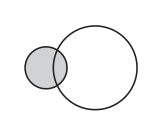
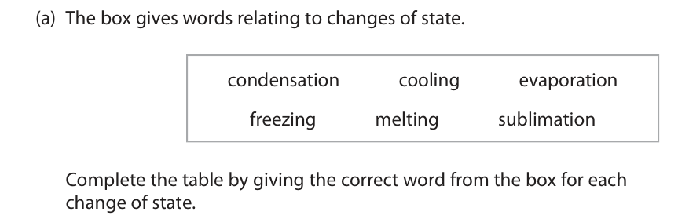
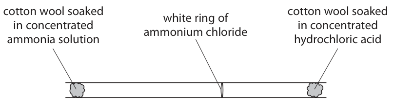
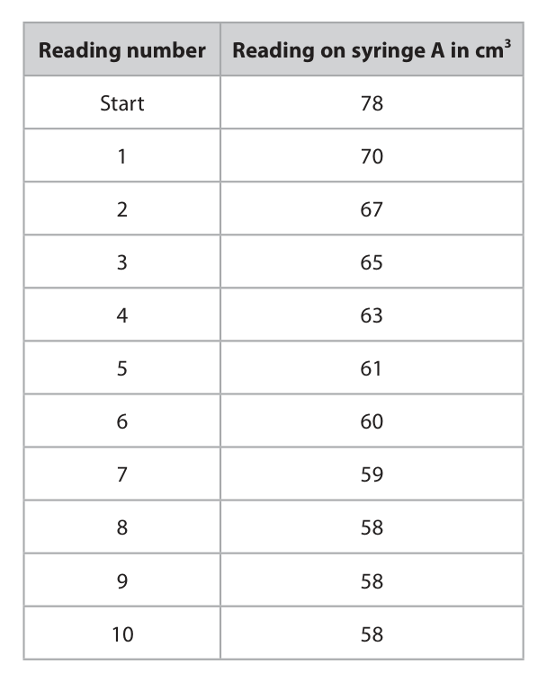
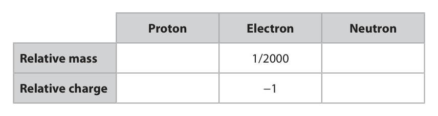
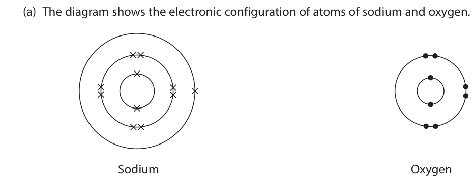
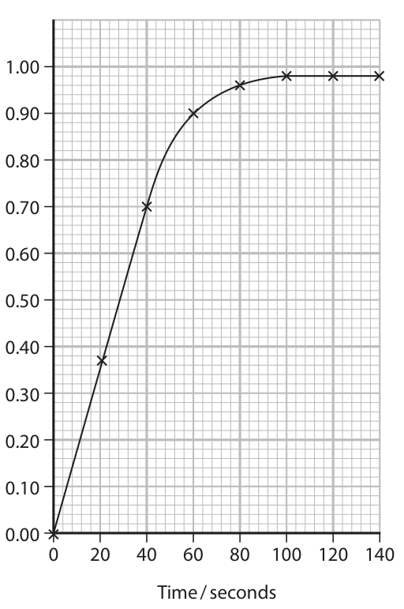
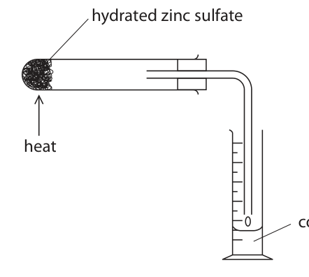

# 4CH1/1C — 2022-01 (official extraction)

> schema `syllabai.official-paper-questions/0.1` · paper_id `pearson-edexcel:international-gcse:chemistry:4ch1:2022-01:4CH1/1C` · qp sha256 `06c4f1f72748869e…` · extracted verbatim, never regenerated (ADR-037)

## Question 1 (7 marks)

This question is about mixtures and compounds.

**(a)** The box gives some methods used to separate mixtures. chromatography crystallisation fractional distillation simple distillation Choose methods from the box to answer the following questions. Each method may be used once, more than once or not at all.

**(c)** The molecular formula of another compound is C3H5N3O9

### 1(a)(i) [1]

Identify a method to separate a single food dye from a mixture of food dyes.

**Mark scheme answer**

> chromatography

- **(1)** chromatography

### 1(a)(ii) [1]

Identify a method to separate gasoline from crude oil.

**Mark scheme answer**

> fractional distillation

- **(1)** fractional distillation

### 1(a)(iii) [1]

Identify a method to separate water from copper(II) sulfate solution.

**Mark scheme answer**

> simple distillation

- **(1)** simple distillation

### 1(b) [2]

The diagram represents a molecule. Explain why this molecule is a compound.

**Mark scheme answer**

> M1 two / different elements ALLOW (two) different
> atoms
> M2 (chemically) joined / bonded together ALLOW a description of
> bonding

- **(1)** two / different elements ALLOW (two) different
- **(1)** (chemically) joined / bonded together ALLOW a description of

### 1(c)(i) [1]

State the number of different elements in C3H5N3O9

**Mark scheme answer**

> 4

- **(1)** 4

### 1(c)(ii) [1]

Determine the number of atoms in a molecule of C3H5N3O9

**Mark scheme answer**

> 20
> Total for question = 7 marks

- **(1)** 20

## Question 2 (9 marks)

This question is about rusting.

**(a)** A simplified formula for rust is Fe2O3

**(b)** Some iron objects are coated with a layer of zinc to prevent rusting.

### 2(a)(i) [2]

Name the two substances needed for iron to rust. 1 2

**Mark scheme answer**

> M1 oxygen / air
> M2 water

- **(1)** oxygen / air
- **(1)** water

### 2(a)(ii) [1]

Give the chemical name for rust.

**Mark scheme answer**

> (hydrated) iron(III) oxide REJECT (hydrated) iron
> (II) oxide

- **(1)** (hydrated) iron(III) oxide REJECT (hydrated) iron

### 2(a)(iii) [1]

What type of reaction occurs in the rusting of iron?

- **(A)** combustion
- **(B)** neutralisation
- **(C)** oxidation  ✔
- **(D)** thermal decomposition

**Mark scheme answer**

> C
> C is the correct answer because rusting involves the
> oxidation of iron.
> A is not the correct answer because the rusting of
> iron is not combustion.
> B is not the correct answer because the rusting of
> iron is not neutralisation.
> D is not the correct answer because the rusting of
> iron is not thermal decomposition.

- **(1)** Answer C: oxidation

### 2(b)(i) [1]

Name this type of rust prevention.

**Mark scheme answer**

> galvanising ALLOW galvanisation
> IGNORE sacrificial
> protection

- **(1)** galvanising ALLOW galvanisation

### 2(b)(ii) [2]

Explain how this type of rust prevention continues to protect iron when the layer of zinc is damaged.

**Mark scheme answer**

> M1 zinc is more reactive (than iron) ALLOW zinc is higher in
> the reactivity series
> (than iron)
> M2 zinc reacts / oxidises / corrodes REJECT references to
> before / instead of iron zinc rusting

- **(1)** zinc is more reactive (than iron) ALLOW zinc is higher in
- **(1)** zinc reacts / oxidises / corrodes REJECT references to

### 2(b)(iii) [2]

Give two other methods used to prevent iron from rusting. 1 2

**Mark scheme answer**

> Any two from:
> painting ALLOW powder coating
> plastic coating
> oiling / greasing
> chromium plating
> sacrificial protection
> cathodic protection
> Total for question = 9 marks

- **(2)** Any two from:

## Question 3 (7 marks)

This question is about states of matter.

**(b)** When ammonia gas and hydrogen chloride gas mix, they react together to form a white solid called ammonium chloride. The equation for the reaction is NH3(g) + HCl(g) → NH4Cl(s) A teacher soaks a piece of cotton wool in concentrated ammonia solution and another piece of cotton wool in concentrated hydrochloric acid. The teacher places the two pieces of cotton wool at opposite ends of a glass tube at the same time. After several minutes, a white ring of solid ammonium chloride forms. cotton wool soaked cotton wool soaked white ring of in concentrated in concentrated ammonium chloride ammonia solution hydrochloric acid

### 3(a) [3]

The box gives words relating to changes of state. condensation cooling evaporation freezing melting sublimation Complete the table by giving the correct word from the box for each change of state. Change of state Name of change solid to liquid solid to gas liquid to solid

**Mark scheme answer**

> solid to liquid melting
> solid to gas sublimation
> liquid to solid freezing

- **(3)** solid to liquid melting

### 3(b)(i) [1]

State the name given to the spreading out of gas particles.

**Mark scheme answer**

> diffusion ALLOW diffusing

- **(1)** diffusion ALLOW diffusing

### 3(b)(ii) [1]

State how the diagram shows that the particles of ammonia gas are travelling at higher speeds than the particles of hydrogen chloride gas.

**Mark scheme answer**

> Any one from:
> ammonia travels further (in the same time)
> the ammonium chloride / (white) ring / solid forms
> further away from the ammonia
> the ammonium chloride / (white) ring / solid forms
> closer to the hydrochloric acid

- **(1)** Any one from:

### 3(b)(iii) [1]

Gas particles travel at high speeds. Give a reason why the white ring of ammonium chloride takes several minutes to form.

**Mark scheme answer**

> Any one from:
> gas particles move in random directions
> gas particles collide with air particles / each other
> gas particles collide with the wall of the tube
> Any one from:

- **(1)** Any one from:

### 3(b)(iv) [1]

Concentrated ammonia solution and concentrated hydrochloric acid are corrosive. Give one safety precaution the teacher should take.

**Mark scheme answer**

> eye protection / wear safety glasses / goggles
> wear gloves
> apron / lab coat
> ALLOW put a bung /
> cork in both ends
> Total for question = 7 marks

- **(1)** eye protection / wear safety glasses / goggles

## Question 4 (8 marks)

A teacher uses this apparatus to find the percentage of oxygen in a gaseous mixture of oxygen and argon. mixture of oxygen and argon glass tube copper powder syringe A syringe B heat This is the teacher’s method. Step 1	heat the copper powder Step 2	push the plunger on syringe A to pass the mixture of oxygen and argon over the hot copper so that the mixture moves into syringe B Step 3	push the plunger on syringe B to pass the mixture of oxygen and argon over the hot copper so that the mixture moves into syringe A Step 4	record the reading on syringe A Step 5	repeat Steps 2, 3 and 4 a number of times The volume of gas decreases as the oxygen reacts with the copper. Argon is unreactive so does not react with the copper. The copper powder turns black.

**(b)** The table shows the teacher’s results. Reading number Reading on syringe A in cm3 Start 78 1 70 2 67 3 65 4 63 5 61 6 60 7 59 8 58 9 58 10 58

### 4(a)(i) [1]

Give a reason why the copper powder is heated.

**Mark scheme answer**

> Any one from:
> to increase the rate of reaction
> to give the particles enough energy to react ALLOW because copper
> does not react with
> oxygen when copper is
> cold
> ALLOW so that copper
> will react with oxygen

- **(1)** Any one from:

### 4(a)(ii) [1]

State why argon is unreactive.

**Mark scheme answer**

> because Ar does not (readily) gain / lose / share ACCEPT argon has a full
> electrons outer shell / valence
> shell of electrons

- **(1)** because Ar does not (readily) gain / lose / share ACCEPT argon has a full

### 4(a)(iii) [1]

Give the name of the black powder that forms when the oxygen reacts with the copper.

**Mark scheme answer**

> copper(II) oxide ALLOW copper oxide
> REJECT copper(I) oxide

- **(1)** copper(II) oxide ALLOW copper oxide

### 4(b)(i) [1]

State how the results show that all the oxygen has reacted.

**Mark scheme answer**

> results are the same (at the end) ALLOW results stop
> decreasing

- **(1)** results are the same (at the end) ALLOW results stop

### 4(b)(ii) [3]

The volume of gas in the glass tube and connecting tubes is 175 cm3. Use this value and the results table to calculate the percentage of oxygen in the mixture of oxygen and argon. percentage of oxygen = %

**Mark scheme answer**

> M1 volume oxygen = 20 cm 3
> M2 total volume = 253 cm3
> M3 (20÷253)×100 = 7.9% ALLOW correct
> evaluation from M1 and
> M2
> ALLOW any number of
> significant figures
> REJECT incorrect
> rounding
> Correct answer of 7.9%
> with or without working
> scores 3

- **(1)** volume oxygen = 20 cm 3
- **(1)** total volume = 253 cm3
- **(1)** (20÷253)×100 = 7.9% ALLOW correct

### 4(b)(iii) [1]

Suggest one reason why the calculated percentage of oxygen in the mixture may not be accurate.

**Mark scheme answer**

> Any one from:
> there is a leak in the apparatus
> temperature was not the same for all readings
> the apparatus was not left to cool (to room
> temperature)
> IGNORE not all oxygen
> reacted
> Total for question = 8 marks

- **(1)** Any one from:

## Question 5 (11 marks)
**(b)** Magnesium has three isotopes.

### 5(a) [2]

Complete the table to show the relative mass and relative charge of a proton and a neutron. Proton Electron Neutron Relative mass 1/2000 Relative charge −1

**Mark scheme answer**

> relative mass proton 1 All 4 correct scores 2
> 2 or 3 correct scores 1
> relative mass neutron 1
> relative charge proton +1
> relative charge neutron 0

- **(2)** relative mass proton 1 All 4 correct scores 2

### 5(b)(i) [2]

State the meaning of the term isotopes.

**Mark scheme answer**

> M1 atoms (of the same element) with the same ALLOW atoms with the
> number of protons same atomic number
> ALLOW atoms with the
> same number of
> electrons
> M2 but different numbers of neutrons ALLOW but different
> mass numbers

- **(1)** atoms (of the same element) with the same ALLOW atoms with the
- **(1)** but different numbers of neutrons ALLOW but different

### 5(b)(ii) [2]

The symbol for an atom of one isotope of magnesium is 12 Mg Give the number of protons, neutrons and electrons in one atom of this isotope. number of protons number of neutrons number of electrons

**Mark scheme answer**

> M1 number of protons and electrons = 12
> M2 number of neutrons = 14

- **(1)** number of protons and electrons = 12
- **(1)** number of neutrons = 14

### 5(b)(iii) [2]

A sample of magnesium contains these percentages of the three isotopes. Mg‑24 = 79.00 % Mg‑25 = 10.00 % Mg‑26 = 11.00 % Use this information to show that the relative atomic mass of magnesium is 24.32

**Mark scheme answer**

> 2
> scores 2 marks
> M1 multiplies each mass number by the percentages
> M2 adds multiples together and divides by 100
> (24 x 0.79) + (25 x 0.10)
> + (26 x 0.11) scores
> both marks

- **(1)** multiplies each mass number by the percentages
- **(1)** adds multiples together and divides by 100

### 5(b)(iv) [2]

One mole of magnesium has a mass of 24.32 g. There are 6.022 × 1023 atoms in one mole. Calculate the mass, in grams, of one atom of magnesium. Give your answer to 4 significant figures. mass = g

**Mark scheme answer**

> M1 24.32÷(6.022×1023)
> M2 4.039 × 10-23 ALLOW ecf from M1 as
> long as answer is given
> to 4 sig figs
> Correct answer of 4.039
> × 10-23 g to 4 sig sigs
> scores 2 with or without
> working

- **(1)** 24.32÷(6.022×1023)
- **(1)** 4.039 × 10-23 ALLOW ecf from M1 as

### 5(c) [1]

The equation for the reaction between magnesium and oxygen is 2Mg + O2 → 2MgO Determine the maximum amount, in moles, of magnesium oxide that can be produced from 0.50 mol of magnesium and 0.20 mol of oxygen. amount = mol

**Mark scheme answer**

> (moles of MgO) = 0.40
> Total for question = 11

- **(1)** (moles of MgO) = 0.40

## Question 6 (9 marks)

This question is about sodium oxide, Na2O

### 6(a) [3]

The diagram shows the electronic configuration of atoms of sodium and oxygen. Sodium Oxygen Describe the changes in the electronic configuration of the atoms of sodium and oxygen to form the ions in sodium oxide.

**Mark scheme answer**

> Any three from:
> M1 sodium (atom) loses electron(s)
> M2 oxygen (atom) gains electron(s)
> M3 sodium loses 1 electron AND oxygen gains 2
> electrons
> OR
> M3 (both atoms become ions with configuration) 2.8
> any mention of sharing
> of electrons scores 0

- **(3)** Any three from:

### 6(b) [1]

Calculate the relative formula mass (Mr ) of sodium oxide, Na2O, using information from the Periodic Table. Mr =

**Mark scheme answer**

> 62

- **(1)** 62

### 6(c) [2]

Explain why solid sodium oxide does not conduct electricity.

**Mark scheme answer**

> Any two from:
> M1 (sodium oxide has) ions / (giant) ionic structure
> M2 ions / electrons cannot flow / move
> M3 no delocalised electrons

- **(2)** Any two from:

### 6(d) [2]

Give a test to show that sodium oxide contains sodium ions.

**Mark scheme answer**

> M1 flame test ALLOW any description
> of a flame test
> M2 yellow colour ALLOW orange or
> yellow-orange
> M2 dep on M1 or
> mention of flame

- **(1)** flame test ALLOW any description
- **(1)** yellow colour ALLOW orange or

### 6(e) [1]

When sodium oxide is heated it reacts to form sodium metal and sodium peroxide, Na2O2 Complete the equation for this reaction. Na2O →

**Mark scheme answer**

> 2Na2O → 2Na + Na2O2
> Total for question = 9 marks

- **(1)** 2Na2O → 2Na + Na2O2

## Question 7 (8 marks)

This question is about soluble and insoluble compounds. A precipitate is an insoluble compound formed when solutions of soluble compounds react after mixing.

**(b)** A student mixes solutions, containing equal amounts in moles, of silver nitrate and sodium chloride. The equation for the reaction between silver nitrate solution and sodium chloride solution is AgNO3(aq) + NaCl(aq) → AgCl(s) + NaNO3(aq)

### 7(a) [1]

Different solutions are mixed in separate test tubes. Tube 1 copper(II) sulfate solution and calcium chloride solution Tube 2 magnesium nitrate solution and potassium sulfate solution Tube 3 sodium carbonate solution and copper(II) sulfate solution In which of the tubes will a precipitate form?

- **(A)** 1 and 2 only
- **(B)** 2 and 3 only
- **(C)** 1 and 3 only  ✔
- **(D)** 1, 2 and 3

**Mark scheme answer**

> C
> C is the correct answer because a precipitate of
> calcium sulfate will form in tube 1, no precipitate
> will form in tube 2 as both products are soluble in
> water and a precipitate of copper(II) carbonate will
> form in tube 3.
> A, B and D are not the correct answers as no
> precipitate will form in tube 2.

- **(1)** Answer C: 1 and 3 only

### 7(b)(i) [1]

State the colour of the precipitate of silver chloride.

**Mark scheme answer**

> white

- **(1)** white

### 7(b)(ii) [5]

The student wants to obtain pure, dry crystals of sodium nitrate. Crystals of sodium nitrate decompose at temperatures above 300 °C. Describe a method the student could use to obtain pure, dry crystals of sodium nitrate.

**Mark scheme answer**

> Any five from:
> M1 filter
> M2 heat/boil (the solution)
> M3 to evaporate some of the water ALLOW until crystals
> form on the end of a
> glass rod
> ALLOW until crystals
> first start to form
> ALLOW until the
> solution is saturated
> M4 leave / cool (to crystallise) M4 dep on M2
> M5 pour off excess liquid OR filter (to obtain M5 dep on crystals
> crystals) having been formed
> IGNORE references to
> washing
> M6 suitable method of drying the e.g. place in (warm)
> crystals oven / leave to
> dry (in warm place) /
> use filter
> paper / kitchen towel /
> / desiccator
> If solution heated to
> dryness or
> left to evaporate all of
> the water
> only M1 and M2 can be
> awarded.
> If method produces
> silver chloride only M1
> and M6 can be awarded

- **(5)** Any five from:

### 7(b)(iii) [1]

Give an advantage of mixing solutions containing equal amounts, in moles, of silver nitrate and sodium chloride.

**Mark scheme answer**

> any one from:
> to make sure the silver nitrate and sodium chloride ALLOW so all the
> fully reacted reactants react OR so
> nothing left unreacted
> OR so neither reagent is
> in excess
> to make sure the products only contained silver
> chloride and sodium nitrate
> to ensure the highest possible yield
> ALLOW to make sure
> the sodium nitrate
> (crystals) would be pure
> ALLOW If either solution
> were in excess, it would
> contaminate the sodium
> nitrate OWTTE
> Total for question = 8 marks

- **(1)** any one from:

## Question 8 (15 marks)

The table shows the structures of six organic compounds. A B C H H H H H H H C H H H H C C H C C C H C C C C H H H H H H H CH3 H C C H H D E F H H H H H H H H H C C C C H C C C H H C H H H H H H H H

**(b)** Compound F reacts with bromine in the presence of ultraviolet radiation.

**(d)** Compound E is used to make an addition polymer.

### 8(a)(i) [1]

Give the letter of a compound not shown as a displayed formula.

**Mark scheme answer**

> A

- **(1)** A

### 8(a)(ii) [1]

Give the letter of a saturated compound with the general formula CnH2n

**Mark scheme answer**

> C

- **(1)** C

### 8(a)(iii) [1]

Name compound E.

**Mark scheme answer**

> propene

- **(1)** propene

### 8(a)(iv) [2]

Explain why compound A and compound D are isomers.

**Mark scheme answer**

> M1 same molecular formula
> M2 different structural / displayed formulae

- **(1)** same molecular formula
- **(1)** different structural / displayed formulae

### 8(b)(i) [1]

Complete the equation for the reaction. CH4 + Br2 →

**Mark scheme answer**

> CH3Br + HBr ALLOW balanced
> equations for multiple
> substitutions

- **(1)** CH3Br + HBr ALLOW balanced

### 8(b)(ii) [1]

Give the name of this type of reaction.

**Mark scheme answer**

> substitution

- **(1)** substitution

### 8(c)(i) [3]

Another compound, G, has this percentage composition by mass. C = 37.8 % H = 6.3 % Cl = 55.9 % Show by calculation that the empirical formula of compound G is C2H4Cl

**Mark scheme answer**

> M1 37.8÷12, 6.3÷1, 55.9÷35.5
> M2 3.15, 6.3, 1.57 M2 subsumes M1
> M3 divide by smallest to get 2:4:1
> OR
> M1 Mr of C2H4Cl = 63.5
> M2 24/63.5 x 100 and 4/63.5 x 100 and 35.5/63.5
> x100
> M3 37.8% and 6.3% and 55.9% M3 must be calculated

- **(3)** M1 37.8÷12, 6.3÷1, 55.9÷35.5

### 8(c)(ii) [2]

The relative formula mass (Mr ) of G is 127 Determine the molecular formula of G. molecular formula =

**Mark scheme answer**

> M1 127÷63.5=2
> M2 Molecular formula = C4H8Cl2
> Answer of C4H8Cl2
> without working scores

- **(1)** 127÷63.5=2
- **(1)** Molecular formula = C4H8Cl2

### 8(d)(i) [2]

Complete the equation to show part of the polymer formed from two molecules of compound E. H H H 2 C C C H C C C C H H

**Mark scheme answer**

> 2
> M1 two carbon atoms both with 2 H atoms
> M2 two carbon atoms both with 1 H atom and 1 CH 3
> group and nothing attached to the joining bonds
> Marks are independent

- **(1)** two carbon atoms both with 2 H atoms
- **(1)** two carbon atoms both with 1 H atom and 1 CH 3

### 8(d)(ii) [1]

Give one problem caused by the disposal of addition polymers.

**Mark scheme answer**

> Any one from:
> landfill sites are getting full
> toxic / greenhouse gases are produced when burned
> Total for question = 15 marks

- **(1)** Any one from:

## Question 9 (15 marks)

A student uses this apparatus to investigate the rate of reaction between calcium carbonate chips and dilute hydrochloric acid. cotton wool plug calcium carbonate dilute hydrochloric acid chips balance 124.05 g Every 20 seconds the student records the reading on the balance.

**(c)** The student uses the balance readings to find the decrease in mass of the flask and contents. The graph shows the student’s results. 1.00 0.90 0.80 0.70 Decrease 0.60 in mass / g 0.50 0.40 0.30 0.20 0.10 0.00 0 20 40 60 80 100 120 140 Time / seconds

**(d)** The student repeats the investigation by diluting the original hydrochloric acid. The student then determines the initial rate of reaction at different percentage concentrations of the original hydrochloric acid. The graph shows the student’s results. 0.025 0.020 Initial rate of reaction 0.015 in g / s 0.010 0.005 0 20 40 60 80 100 Percentage concentration of original hydrochloric acid

### 9(a) [2]

Explain why using a cotton wool plug increases the accuracy of the student’s results.

**Mark scheme answer**

> M1 to prevent acid splashing out OR IGNORE solid leaving
> so only (carbon dioxide) gas leaves the flask the flask
> REJECT prevents gas
> escaping
> M2 so the decrease in mass is close to the actual
> value OR so that the decrease in mass is only due to
> the gas

- **(1)** to prevent acid splashing out OR IGNORE solid leaving
- **(1)** so the decrease in mass is close to the actual

### 9(b) [2]

Complete the equation for the reaction by adding the state symbols. CaCO3( ) + 2HCl( ) → CaCl2(aq) + H2O( ) + CO2( )

**Mark scheme answer**

> M1 CaCO3(s) + 2HCl(aq)
> M2 H2O(l) + CO2(g)

- **(1)** CaCO3(s) + 2HCl(aq)
- **(1)** H2O(l) + CO2(g)

### 9(c)(i) [1]

Give a reason why there are some calcium carbonate chips remaining in the flask when the reaction stops.

**Mark scheme answer**

> the hydrochloric acid has all reacted

- **(1)** the hydrochloric acid has all reacted

### 9(c)(ii) [1]

State how the student would know when the reaction has stopped.

**Mark scheme answer**

> mass stays the same / stops decreasing ALLOW effervescence /
> fizzing stops
> ALLOW the curve levels
> off

- **(1)** mass stays the same / stops decreasing ALLOW effervescence /

### 9(c)(iii) [2]

Use the graph to determine the amount, in moles, of carbon dioxide produced during the reaction. [Mr of CO2 = 44] amount = mol

**Mark scheme answer**

> M1 0.98
> M2 (0.98÷44) = 0.022 ALLOW any number of
> significant figures
> REJECT incorrect
> rounding
> ALLOW M1÷44
> Correct answer of 0.022
> moles with or without
> working scores 2 marks

- **(1)** 0.98
- **(1)** (0.98÷44) = 0.022 ALLOW any number of

### 9(c)(iv) [3]

Use the graph to calculate the rate of reaction, in grams per second, at time 60 seconds. Show your working on the graph. rate of reaction = g / s

**Mark scheme answer**

> M1 tangent shown on graph
> M2 method of calculating gradient
> (change in y ÷ change in x)
> M3 rate of reaction in g/s ALLOW ECF from M2
> Answer of 0.005 – 0.006
> with a tangent shown
> on the graph scores 3
> with or without other
> working.
> Answer of 0.015g/s (the
> average rate of reaction
> for the first 60s scores
> 1)

- **(1)** tangent shown on graph
- **(1)** method of calculating gradient
- **(1)** rate of reaction in g/s ALLOW ECF from M2

### 9(d)(i) [2]

Describe the relationship between the initial rate of reaction and percentage concentration of the original hydrochloric acid.

**Mark scheme answer**

> M1 the rate of reaction increases as the percentage
> concentration increases
> M2 the rate of reaction is (directly) proportional to M2 subsumes M1
> the percentage concentration

- **(1)** the rate of reaction increases as the percentage
- **(1)** the rate of reaction is (directly) proportional to M2 subsumes M1

### 9(d)(ii) [2]

Explain why changing the concentration of hydrochloric acid has an effect on the initial rate of reaction.

**Mark scheme answer**

> M1 change in number of particles (per unit volume) ALLOW particles are
> closer together or
> further apart
> M2 change in collisions per unit time ALLOW change in
> frequency of collisions
> REJECT increased /
> changed energy / speed
> Total for question = 15 marks

- **(1)** change in number of particles (per unit volume) ALLOW particles are
- **(1)** change in collisions per unit time ALLOW change in

## Question 10 (9 marks)

This question is about substances with covalent bonds.

**(b)** The diagram shows three different structures of carbon. Structure A Graphite C60 fullerene

### 10(a)(i) [2]

Draw a dot and cross diagram to show the outer shell electrons in a molecule of nitrogen, N2

**Mark scheme answer**

> 2
> ALLOW dots, crosses or
> any combination.
> M1 6 bonding electrons
> M2 2 non-bonding electrons on each atom M2 dep on M1

- **(1)** 6 bonding electrons
- **(1)** 2 non-bonding electrons on each atom M2 dep on M1

### 10(a)(ii) [2]

Describe the forces of attraction in a covalent bond.

**Mark scheme answer**

> M1 shared pair(s) of electrons
> M2 attracted to (two) nuclei REJECT nucleus. Must
> be plural for M2.
> M2 dep on mention of
> electrons in M1

- **(1)** shared pair(s) of electrons
- **(1)** attracted to (two) nuclei REJECT nucleus. Must

### 10(b)(i) [1]

Name structure A.

**Mark scheme answer**

> diamond

- **(1)** diamond

### 10(b)(ii) [4]

Graphite and C60 fullerene contain covalent bonds, but have different structures. Explain why C60 fullerene has a much lower melting point than graphite. Refer to structure and bonding in your answer.

**Mark scheme answer**

> Any four from:
> M1 graphite is giant covalent ALLOW giant structure
> if M2 is scored
> REJECT molecules of
> graphite
> M2 (in melting graphite) covalent bonds are ALLOW description of
> broken covalent bonds
> M3 (C60) (simple) molecular structure ALLOW molecules of C60
> M4 (in melting C60) intermolecular forces (of ALLOW breaking bonds
> attraction) are overcome in C60 if intermolecular
> forces clearly
> mentioned
> M4 subsumes M3
> M5 more energy is needed to break covalent bonds
> (in graphite) than intermolecular forces (in C60)
> Mention of
> intermolecular forces in
> graphite no M2 or M5
> Mention of breaking
> covalent bonds in C60 no
> M4 or M5
> Total for question = 9 marks

- **(4)** Any four from:

## Question 11 (12 marks)

A student uses this apparatus to heat crystals of hydrated zinc sulfate and collect the liquid produced. hydrated zinc sulfate heat colourless liquid

**(c)** In an experiment using a different mass of ZnSO4·7H2O the maximum volume of pure water that could be produced is 8.5 cm3. The student collected the pure water and calculated the percentage yield to be 20.3 %.

### 11(a)(i) [2]

Describe a chemical test to show that the colourless liquid contains water.

**Mark scheme answer**

> M1 add anhydrous copper sulfate ALLOW add white
> copper sulfate
> M2 turns (from white) to blue M2 dep on copper
> sulfate in M1
> ALLOW
> M1 add anhydrous /
> blue cobalt chloride
> M2 turns (from blue) to
> pink
> M2 dep on cobalt
> chloride in M1

- **(1)** add anhydrous copper sulfate ALLOW add white
- **(1)** turns (from white) to blue M2 dep on copper

### 11(a)(ii) [2]

Describe a physical test to show the colourless liquid is pure water.

**Mark scheme answer**

> M1 measure the boiling point / freezing point ALLOW boil it or freeze
> it
> M2 100 °C / 0°C
> Value must match
> property

- **(1)** measure the boiling point / freezing point ALLOW boil it or freeze
- **(1)** 100 °C / 0°C

### 11(b) [5]

The equation for the decomposition of hydrated zinc sulfate is ZnSO4·7H2O(s) → ZnSO4(s) + 7H2O(l) The student records these masses. mass of boiling tube = 41.64 g mass of boiling tube + ZnSO4·7H2O = 54.46 g Calculate the maximum volume, in cm3, of pure water that could be produced. Give your answer to 1 decimal place. [1.00 cm3 of pure water has a mass of 1.00 g] [Mr of ZnSO4·7H2O = 287 Mr of H2O = 18] maximum volume of pure water = cm3

**Mark scheme answer**

> M1 mass of hydrated zinc sulfate = 54.46-41.64 OR
> 12.82 g
> M2 Moles of hydrated zinc sulfate = 12.82÷287 OR ALLOW M1÷287
> 0.0447
> M3 Moles H2O = 0.0447×7 OR 0.313 ALLOW M2×7
> M4 Mass H2O = 5.63 g ALLOW M3×18
> M5 Volume H2O 5.6 cm3 Must be 1dp
> ALLOW M4 to 1dp
> Correct answer of 5.6
> cm3 to 1dp with or
> without working scores
> 5 marks

- **(1)** mass of hydrated zinc sulfate = 54.46-41.64 OR
- **(1)** Moles of hydrated zinc sulfate = 12.82÷287 OR ALLOW M1÷287
- **(1)** Moles H2O = 0.0447×7 OR 0.313 ALLOW M2×7
- **(1)** Mass H2O = 5.63 g ALLOW M3×18
- **(1)** Volume H2O 5.6 cm3 Must be 1dp

### 11(c)(i) [1]

Calculate the volume, in cm3, of pure water collected. volume of pure water = cm3

**Mark scheme answer**

> 1.7 ALLOW 2 or more
> significant figures
> REJECT incorrect
> rounding

- **(1)** 1.7 ALLOW 2 or more

### 11(c)(ii) [2]

Explain an improvement to the apparatus that would increase the percentage yield of pure water.

**Mark scheme answer**

> M1 stand the measuring cylinder in a beaker of ice ALLOW any way of
> cooling the measuring
> OR
> cylinder or delivery
> tube
> M1 replace the delivery tube with a (Liebig)
> condenser ALLOW add a condenser
> IGNORE add a stopper /
> bung
> M2 less water / water vapour / steam lost ALLOW more water
> (vapour) / steam
> condenses
> ALLOW less water
> evaporates
> Total for question = 12
> Pearson Education Limited. Registered company number 872828
> with its registered office at 80 Strand, London, WC2R 0RL, United Kingdom

- **(2)** M1 stand the measuring cylinder in a beaker of ice ALLOW any way of

