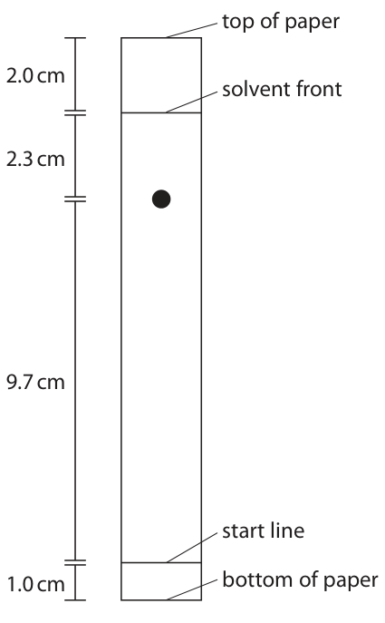
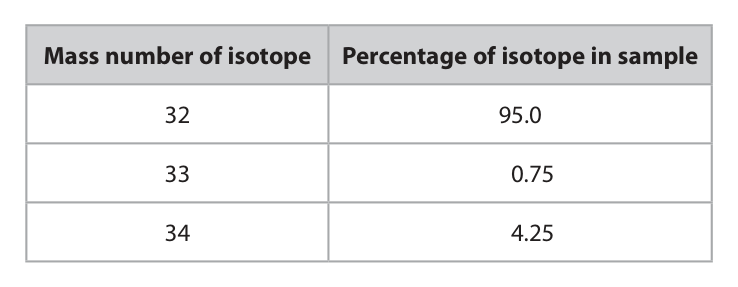

# 4CH1/1CR — 2022-01 (official extraction)

> schema `syllabai.official-paper-questions/0.2` · paper_id `pearson-edexcel:international-gcse:chemistry:4ch1:2022-01:4CH1/1CR` · qp sha256 `fa9fefbead81a289…` · extraction is the disclosed baseline (ADR-039)

## Question 1 (7 marks)

This question is about acids, alkalis and indicators.

### 1(a) [1]

Which of these is the colour of litmus indicator in an acidic solution?

- **(A)** blue
- **(B)** orange
- **(C)** red  ✔
- **(D)** yellow

**Mark scheme answer**

> C red is correct because litmus indicator in an
> acidic solution is red
> A is incorrect because litmus indicator in an acidic
> solution is not blue
> B is incorrect because litmus indicator in an acidic
> solution is not orange
> D is incorrect because litmus indicator in an acidic
> solution is not yellow

- **(1)** Answer C: red

### 1(b) [1]

Which of these is the pH value of a neutral solution?

- **(A)** 0
- **(B)** 4
- **(C)** 7  ✔
- **(D)** 14

**Mark scheme answer**

> C7 is correct because the pH value of a
> neutral solution is 7
> A is incorrect because the pH value of a neutral
> solution is not 0
> B is incorrect because the pH value of a neutral
> solution is not 4
> D is incorrect because the pH value of a neutral
> solution is not 14

- **(1)** Answer C: 7

### 1(c) [1]

Which of these describes a solution with a pH value of 9?

- **(A)** strongly acidic
- **(B)** strongly alkaline
- **(C)** weakly acidic
- **(D)** weakly alkaline  ✔

**Mark scheme answer**

> D is correct because a solution with a pH value
> of 9 is weakly alkaline
> A is incorrect because a solution with a pH value of
> 9 is not strongly acidic
> B is incorrect because a solution with a pH value of 9
> is not strongly alkaline
> C is incorrect because a solution with a pH value of 9
> is not weakly acidic

- **(1)** Answer D: weakly alkaline

### 1(d) [1]

Which of these is the chemical formula of an acid?

- **(A)** HNO3  ✔
- **(B)** H2O
- **(C)** NaCl
- **(D)** NaOH

**Mark scheme answer**

> A is correct because HNO3 is the chemical
> formula of an acid
> B is incorrect because H2O is not the chemical
> formula of an acid
> C is incorrect because NaCl is not the chemical
> formula of an acid
> D is incorrect because NaOH is not the chemical
> formula of an acid

- **(1)** Answer A: HNO3

### 1(e) [1]

Name the type of reaction that occurs when an acid reacts with an alkali.

**Mark scheme answer**

> neutralisation ALLOW exothermic

- **(1)** neutralisation ALLOW exothermic

### 1(f) [2]

Name the two products of the reaction between hydrochloric acid and potassium hydroxide. 1 2

**Mark scheme answer**

> M1 potassium chloride ACCEPT in either order
> M2 water ALLOW correct
> chemical formulae
> Total for Question 1 = 7 marks

- **(1)** potassium chloride ACCEPT in either order
- **(1)** water ALLOW correct

## Question 2 (6 marks)
### 2(a)(i) [1]

State the meaning of the term solute.

**Mark scheme answer**

> (solute is) the substance/solid that dissolves (in a
> solvent) OWTTE

- **(1)** (solute is) the substance/solid that dissolves (in a

### 2(a)(ii) [1]

State the meaning of the term solvent.

**Mark scheme answer**

> (solvent is) the substance/liquid the
> solute/solid/substance dissolves in OWTTE

- **(1)** (solvent is) the substance/liquid the

### 2(b) [2]

Explain what is meant by a saturated solution.

**Mark scheme answer**

> M1 (saturated solution) contains as much dissolved
> solute/solid/substance as possible OWTTE
> M2 at a particular temperature

- **(1)** (saturated solution) contains as much dissolved
- **(1)** at a particular temperature

### 2(c) [2]

A dark purple liquid is diluted by adding water. The diluted liquid becomes a pale purple colour. Explain the process that causes this change. Refer to particles in your answer.

**Mark scheme answer**

> M1 process called diffusion
> M2 particles spread out (evenly throughout
> water/solution/liquid) ALLOW particles move
> from area of high
> concentration to area of
> low concentration
> Total for Question 2 = 6 marks

- **(1)** process called diffusion
- **(1)** particles spread out (evenly throughout

## Question 3 (8 marks)

This question is about chromatography. Two students carry out separate chromatography experiments to find the Rf values for five different food dyes, A, B, C, D and E.

**(b)** After doing the experiments the students calculate the Rf value for each food dye. The table shows their results. Student 1 Student 2 Dye Rf value Rf value A 0.45 0.45 B 0.63 0.64 C 0.00 0.00 D 0.83 1.20 E 0.30 0.30

### 3(a) [2]

State two things that should be the same in both experiments so that the students can compare their results fairly. 1 2

**Mark scheme answer**

> M1 (same) solvent ALLOW (same) named solvent
> eg water
> M2 (same type of chromatography) paper IGNORE reference to
> size/length of paper
> ALLOW reference to use of
> pencil (for start line)/spots
> must start on horizontal line
> /solvent must start below line
> or spots
> ALLOW same distance
> travelled by solvent
> IGNORE distance of line from
> bottom of paper
> IGNORE
> amount/volume/concentration
> of solvent /references to
> size/volume of dyes or spots
> /references to
> temperature/time

- **(1)** (same) solvent ALLOW (same) named solvent
- **(1)** (same type of chromatography) paper IGNORE reference to

### 3(b)(i) [1]

State what can be concluded about dye C.

**Mark scheme answer**

> C is insoluble (in the solvent)

- **(1)** C is insoluble (in the solvent)

### 3(b)(ii) [2]

Explain which Rf value cannot be correct.

**Mark scheme answer**

> M1 Student 2 and dye D/(Rf value) 1.20
> M2 because Rf value must be less than 1 / cannot be ALLOW spot cannot move
> greater than 1 further than solvent front
> OWTTE

- **(1)** Student 2 and dye D/(Rf value) 1.20
- **(1)** because Rf value must be less than 1 / cannot be ALLOW spot cannot move

### 3(c) [3]

The diagram shows a chromatogram for a different food dye. Some distances are shown on the diagram. top of paper 2.0 cm solvent front 2.3 cm 9.7 cm start line 1.0 cm bottom of paper Calculate the Rf value for this food dye. Give your answer to two significant figures. Rf =

**Mark scheme answer**

> M1 (Rf =) 9.7
> M2 = 0.808(33..) 0.808(33..) with no
> working scores M1 and
> M2
> ALLOW M2 ECF if used
> 10.7 or 13 and Rf < 1
> ALLOW 1 mark for
> 12 = 1.2(37..)
> 9.7
> M3 = 0.81 (to 2 SF) ALLOW M3 ECF M2
> (must be correct to 2
> SF)
> 0.81 with no working
> scores 3
> Total for Question 3 = 8 marks

- **(1)** (Rf =) 9.7
- **(1)** = 0.808(33..) 0.808(33..) with no
- **(1)** = 0.81 (to 2 SF) ALLOW M3 ECF M2

## Question 4 (7 marks)
**(b)** An atom of element X contains 14 protons, 14 electrons and 15 neutrons.

### 4(a) [1]

State the meaning of the term atomic number.

**Mark scheme answer**

> number of protons (in nucleus of atom) IGNORE references to
> electrons

- **(1)** number of protons (in nucleus of atom) IGNORE references to

### 4(b)(i) [1]

Which of these is the mass number of this atom?

- **(A)** 14
- **(B)** 15
- **(C)** 28
- **(D)** 29  ✔

**Mark scheme answer**

> D 29 is correct because mass number = total
> number of protons and neutrons = 14 + 15 = 29
> A is incorrect because 14 is the number of protons
> B is incorrect because 15 is the number of neutrons
> C is incorrect because 28 is the number of protons +
> the number of electrons

- **(1)** Answer D: 29

### 4(b)(ii) [2]

Explain which group of the Periodic Table element X belongs to.

**Mark scheme answer**

> M1 (group) 4
> M2 because 4 electrons in outer shell ALLOW electronic
> configuration is 2.8.4

- **(1)** (group) 4
- **(1)** because 4 electrons in outer shell ALLOW electronic

### 4(c) [3]

The table shows the composition of a sample of a different element, Y, containing three isotopes. Mass number of isotope Percentage of isotope in sample 32 95.0 33 0.75 34 4.25 Using information from the table, calculate the relative atomic mass (Ar) of this sample of element Y. Give your answer to one decimal place. Ar =

**Mark scheme answer**

> M1 (32 x 95.0) + (33 x 0.75) + (34 x 4.25)
> 100
> OR (3040) + (24.75) + (144.5)
> 100
> M2 = 32.0925 32.09(25) with no
> working scores 2
> ALLOW 1 mark for
> 3209.25
> ALLOW M2 ECF M1 if
> minor error in
> calculation using all 3
> isotopes
> M3 = 32.1 (1 dp)
> correct answer to 1 dp
> with or without working
> scores 3
> ALLOW M3 ECF M2
> (must be correct to 1
> dp)
> Total for Question 4 = 7 marks

- **(1)** (32 x 95.0) + (33 x 0.75) + (34 x 4.25)
- **(1)** = 32.0925 32.09(25) with no
- **(1)** = 32.1 (1 dp)

## Question 5 (14 marks)

This is a question about metals and their compounds.

**(c)** Magnesium is a metal that burns in air.

**(d)** In the absence of air, magnesium reacts with sulfur to form the ionic compound magnesium sulfide, MgS

### 5(a) [1]

State one property of metals.

**Mark scheme answer**

> (good) conductors of electricity / malleable ACCEPT (good)
> conductors of
> heat/ductile/have basic
> oxides/hydroxides
> ALLOW high density/
> high melting point/
> sonorous/shiny/hard/
> strong

- **(1)** (good) conductors of electricity / malleable ACCEPT (good)

### 5(b) [2]

Mercury is the only metal that is liquid at room temperature. Describe the difference in the movement of particles in liquid mercury and in a solid metal.

**Mark scheme answer**

> M1 (in mercury) particles can move/flow OWTTE IGNORE references to
> spacing/gaps between
> particles / energy of
> particles
> M2 (in solid metal) particles do not move /are in ACCEPT particles
> fixed positions vibrate (about fixed
> position)

- **(1)** (in mercury) particles can move/flow OWTTE IGNORE references to
- **(1)** (in solid metal) particles do not move /are in ACCEPT particles

### 5(c)(i) [1]

State one observation made during the combustion of magnesium metal.

**Mark scheme answer**

> (bright) white flame ALLOW white light
> ACCEPT white
> solid/ash/powder
> (formed)

- **(1)** (bright) white flame ALLOW white light

### 5(c)(ii) [1]

State one chemical property of the product of combustion that can be used to classify magnesium as a metal.

**Mark scheme answer**

> (product/magnesium oxide is) basic / a base ALLOW
> (product/magnesium
> oxide) neutralises acid /
> dissolves in/reacts with
> acid /(produces) alkali
> (when added to water)
> REJECT if incorrect
> product given

- **(1)** (product/magnesium oxide is) basic / a base ALLOW

### 5(d)(i) [1]

Give a reason why the reaction needs to be done in the absence of air.

**Mark scheme answer**

> magnesium/sulfur would react with/ burn in oxygen ACCEPT magnesium
> oxide (not magnesium
> sulfide) would be
> formed
> ALLOW sulfur dioxide
> would be formed

- **(1)** magnesium/sulfur would react with/ burn in oxygen ACCEPT magnesium

### 5(d)(ii) [3]

Describe, in terms of electrons, the formation of the ions in magnesium sulfide. Give the charges on the ions.

**Mark scheme answer**

> M1 magnesium (atom) loses two electrons two electrons
> transferred from
> M2 sulfur (atom) gains two electrons (from magnesium (atom) to
> magnesium) sulfur (atom) scores M1
> and M2
> M3 charge on magnesium (ion) 2+/Mg2+ AND charge
> on sulfur/sulfide (ion) 2-/ S2-

- **(1)** magnesium (atom) loses two electrons two electrons
- **(1)** sulfur (atom) gains two electrons (from magnesium (atom) to
- **(1)** charge on magnesium (ion) 2+/Mg2+ AND charge

### 5(d)(iii) [3]

Explain why magnesium sulfide has a very high melting point.

**Mark scheme answer**

> M1 strong (electrostatic) force of attraction ALLOW strong ionic
> bonds but
> No M1 or M2 if between
> atoms/molecules or any
> reference to
> intermolecular forces /
> covalent bonds
> M2 between magnesium ions/Mg2+ and ACCEPT between
> sulfide ions/S2- ions oppositely charged ions
> ACCEPT between
> positive and negative
> ions
> M3 large amount/lot of (heat/thermal) energy ACCEPT large
> needed to overcome forces/attraction amount/lot of
> (heat/thermal) energy
> needed to break the
> bonds
> IGNORE more energy
> No M3 if reference to
> overcoming / breaking
> intermolecular forces /
> covalent bonds

- **(1)** strong (electrostatic) force of attraction ALLOW strong ionic
- **(1)** between magnesium ions/Mg2+ and ACCEPT between
- **(1)** large amount/lot of (heat/thermal) energy ACCEPT large

### 5(d)(iv) [2]

Magnesium sulfide reacts with hydrochloric acid to form magnesium chloride and hydrogen sulfide gas, H2S Give the chemical equation for this reaction.

**Mark scheme answer**

> MgS + 2HCl → MgCl2 + H2S IGNORE state symbols
> M1 all formulae correct
> M2 correctly balanced
> M2 DEP M1
> ACCEPT multiples and
> fractions
> Total for Question 5 = 14 marks

- **(1)** all formulae correct
- **(1)** correctly balanced

## Question 6 (13 marks)

Ocimene is an organic compound that gives some plants their particular smell. The molecular formula of ocimene is C10H16

**(d)** Ocimene is an alkene.

**(f)** Two different products can form during the incomplete combustion of ocimene. One product is a solid and the other is a poisonous gas.

### 6(a) [1]

Calculate the relative formula mass (Mr ) of ocimene. Mr =

**Mark scheme answer**

> 136

- **(1)** 136

### 6(b) [2]

Using ocimene as an example, explain what is meant by the term empirical formula.

**Mark scheme answer**

> M1 simplest (whole number) ratio of atoms present ALLOW elements for
> (in a compound) atoms
> M2 empirical formula (of ocimene/C10H16) is C5H8 ALLOW C : H ratio 5:8

- **(1)** simplest (whole number) ratio of atoms present ALLOW elements for
- **(1)** empirical formula (of ocimene/C10H16) is C5H8 ALLOW C : H ratio 5:8

### 6(c) [3]

The displayed formula of ocimene is H H H C H H C H H H H H H H H C C C C C C C C H H H Explain why ocimene is described as an unsaturated hydrocarbon.

**Mark scheme answer**

> unsaturated hydrocarbon because
> M1 contains (carbon to carbon) double bond(s)
> M2 contains carbon and hydrogen (atoms) REJECT molecules
> M3 only M3 DEP on mention of
> carbon and hydrogen

- **(1)** contains (carbon to carbon) double bond(s)
- **(1)** contains carbon and hydrogen (atoms) REJECT molecules
- **(1)** only M3 DEP on mention of

### 6(d)(i) [1]

Which of these types of reaction occurs between ocimene and bromine?

- **(A)** addition  ✔
- **(B)** polymerisation
- **(C)** precipitation
- **(D)** substitution

**Mark scheme answer**

> A addition
> B is incorrect because the type of reaction between
> an alkene and bromine is addition not
> polymerisation
> C is incorrect because the type of reaction between
> an alkene and bromine is addition not precipitation
> D is incorrect because the type of reaction between
> an alkene and bromine is addition not substitution

- **(1)** Answer A: addition

### 6(d)(ii) [1]

Many alkenes have the general formula CnH2n Suggest why ocimene does not have this general formula.

**Mark scheme answer**

> ocimene contains more than one double bond
> /three double bonds

- **(1)** ocimene contains more than one double bond

### 6(e) [2]

Ocimene can take part in combustion reactions. Complete the equation for the complete combustion of ocimene. C10H16 + O2 → +

**Mark scheme answer**

> 2
> C10H16 + 14 O2 → 10 CO2 + 8 H2O
> M1 CO2 + H2O ACCEPT in either order
> M2 correctly balanced M2 DEP M1
> ACCEPT multiples or
> fractions

- **(1)** CO2 + H2O ACCEPT in either order
- **(1)** correctly balanced M2 DEP M1

### 6(f)(i) [2]

Identify these two products.

**Mark scheme answer**

> M1 carbon/C/soot ACCEPT M1 M2 in
> either order
> M2 carbon monoxide/CO

- **(1)** carbon/C/soot ACCEPT M1 M2 in
- **(1)** carbon monoxide/CO

### 6(f)(ii) [1]

State why the gas produced is poisonous.

**Mark scheme answer**

> (carbon monoxide/CO) reduces capacity of blood to ACCEPT correct
> carry oxygen OWTTE references to
> haemoglobin /
> carboxyhaemoglobin
> Total for Question 6 = 13 marks

- **(1)** (carbon monoxide/CO) reduces capacity of blood to ACCEPT correct

## Question 7 (6 marks)
### 7(a) [2]

Explain the meaning of the term thermal decomposition.

**Mark scheme answer**

> M1 breaking up/down of a compound/substance REJECT elements
> OWTTE
> M2 by heat(ing) REJECT any
> references to heat
> being given
> out/exothermic

- **(1)** breaking up/down of a compound/substance REJECT elements
- **(1)** by heat(ing) REJECT any

### 7(b) [4]

The equation for the thermal decomposition of potassium hydrogencarbonate is 2KHCO3 → K2CO3 + H2O + CO2 Calculate the maximum mass of K2CO3 that could be produced from the thermal decomposition of 2.50 g of KHCO3 maximum mass of K2CO3 = g

**Mark scheme answer**

> examples of calculation of maximum mass of K 2CO3
> M1 Mr of KHCO3 = 100 AND Mr of K2CO3 = 138
> M2 200 g KHCO3 produces 138 g K2CO3
> M3 2.50 g KHCO3 produces 138 x 2.50 =
> 200
> M4 1.725 (g K2CO3)
> ALLOW 2 or more SF
> M2 M3 M4 ECF M1
> correct answer with
> or without working
> scores 4
> OR
> M1 Mr of KHCO3 = 100 AND Mr of K2CO3 = 138
> M2 amount KHCO3 = 2.50 = 0.025 (mol)
> 100
> M3 amount K2CO3 = 0.025 = 0.0125 (mol)
> M4 mass K2CO3 (= 0.0125 x 138) = 1.725 (g) ALLOW 2 or more SF
> M2 M3 M4 ECF M1
> correct answer with
> or without working
> scores 4
> 3.45/3.46/3.5/6.9
> scores 3
> Total for Question 7 = 6 marks

- **(4)** examples of calculation of maximum mass of K 2CO3

## Question 8 (15 marks)

A student uses this apparatus in an experiment to study the rate of the reaction between zinc and dilute sulfuric acid. zinc granules dilute sulfuric acid balance 175.624 g This is the student’s method. • add a few zinc granules to a conical flask on a balance • add 100 cm3 of dilute sulfuric acid to the flask, start a timer and immediately record the mass of the flask and contents • record the mass of the flask and contents every minute until the mass remains constant The mass of the flask and contents decreases because hydrogen gas is produced and leaves the flask. The student uses the mass readings to calculate the total mass of hydrogen produced.

**(b)** The table shows the student’s results. Total mass of hydrogen produced Time in minutes in mg 0 0 1 80 2 110 3 130 4 148 5 162 6 165 7 184 8 192 9 198 10 204 11 209 12 214 13 218 14 220 15 220

### 8(a) [1]

Complete the equation for the reaction by adding the state symbols. Zn ( ) + H2SO4 ( ) → ZnSO4 ( ) + H2 ( )

**Mark scheme answer**

> Zn (s) + H2SO4 (aq) → ZnSO4 (aq) + H2 (g)
> all state symbols correct

- **(1)** Zn (s) + H2SO4 (aq) → ZnSO4 (aq) + H2 (g)

### 8(b)(i) [1]

Plot the student’s results. The first three have been done for you.

**Mark scheme answer**

> all points correctly plotted (within +/- half a square)

- **(1)** all points correctly plotted (within +/- half a square)

### 8(b)(ii) [1]

Draw a circle around the anomalous result.

**Mark scheme answer**

> circle around point at 6 min

- **(1)** circle around point at 6 min

### 8(b)(iii) [1]

Draw a curve of best fit. 240 220 200 180 160 Total mass of hydrogen produced in mg 140 120 100 0 2 4 6 8 10 12 14 16 Time in minutes

**Mark scheme answer**

> smooth curve of best fit

- **(1)** smooth curve of best fit

### 8(b)(iv) [1]

Give a possible reason for the anomalous result.

**Mark scheme answer**

> student took reading too soon/before 6 min

- **(1)** student took reading too soon/before 6 min

### 8(b)(v) [1]

Determine a more likely value for this result.

**Mark scheme answer**

> mass from graph at 6 min
> IGNORE UNITS

- **(1)** mass from graph at 6 min

### 8(c)(i) [2]

Explain how the shape of the curve shows how the rate of the reaction changes as time increases.

**Mark scheme answer**

> M1 curve becomes less steep /gradient decreases
> (as time increases)
> M2 so rate of reaction decreases M2 DEP M1

- **(1)** curve becomes less steep /gradient decreases
- **(1)** so rate of reaction decreases M2 DEP M1

### 8(c)(ii) [1]

At the end of the experiment there is no zinc left in the flask. Give a conclusion the student could make from this observation.

**Mark scheme answer**

> the (sulfuric) acid was in excess OWTTE ALLOW not all (sulfuric)
> acid reacted
> ALLOW zinc was
> limiting reagent
> ALLOW zinc was not in
> excess

- **(1)** the (sulfuric) acid was in excess OWTTE ALLOW not all (sulfuric)

### 8(d) [3]

The student does another experiment using • the same amount of similarly sized magnesium granules instead of zinc • the same volume of sulfuric acid, but of a lower concentration Explain why it is difficult to predict how the rate of reaction in this experiment compares with the rate of reaction in the first experiment.

**Mark scheme answer**

> M1 magnesium (more reactive than zinc so) would REJECT reference to
> make reaction faster/increase the rate different surface area
> M2 less concentrated acid would make reaction REJECT references to
> slower/decrease the rate differences in
> energy/speed of
> particles
> M3 (so) difficult/impossible to know whether rate ALLOW
> will increase or decrease overall OWTTE difficult/impossible to
> know which change has
> greater effect OWTTE
> ALLOW idea of
> difficult/impossible to
> predict (overall) effect
> of changing two factors
> at same time OWTTE
> ALLOW idea of
> difficult/impossible to
> know if changes cancel
> each other out OWTTE

- **(1)** magnesium (more reactive than zinc so) would REJECT reference to
- **(1)** less concentrated acid would make reaction REJECT references to
- **(1)** (so) difficult/impossible to know whether rate ALLOW

### 8(e) [3]

Explain, in terms of particle collision theory, how increasing the temperature affects the rate of a reaction.

**Mark scheme answer**

> M1 at higher temperature particles have more ACCEPT more particles
> (kinetic) energy have the required
> activation energy
> ALLOW particles move
> faster
> M2 more (successful) collisions per unit time ALLOW more frequent
> (successful) collisions
> M3 rate of reaction increases
> Total for Question 8 = 15 marks

- **(1)** at higher temperature particles have more ACCEPT more particles
- **(1)** more (successful) collisions per unit time ALLOW more frequent
- **(1)** rate of reaction increases

## Question 9 (8 marks)

A student is given a mixture of two white solid compounds, and a colourless solution containing the same two compounds. The student is told that one of the compounds is a halide and that the other compound is a carbonate.

### 9(a) [2]

Give two reasons why the student should know, without doing any tests, that one of the compounds cannot be copper(II) carbonate. 1 2

**Mark scheme answer**

> M1 copper(II) carbonate is green IGNORE is not white/is
> a different colour
> M2 copper(II) carbonate is insoluble/cannot form a
> solution OWTTE

- **(1)** copper(II) carbonate is green IGNORE is not white/is
- **(1)** copper(II) carbonate is insoluble/cannot form a

### 9(b) [6]

Describe tests the student could do to show that the mixture contains potassium carbonate and potassium iodide.

**Mark scheme answer**

> Description including six of following points
> (Test for potassium ions)
> M1 flame test ALLOW description of
> flame test
> M2 lilac flame
> (Test for carbonate ions)
> M3 add acid (to mixture of solids/solution) ALLOW any named
> acid
> IGNORE references to
> concentration
> M4 (pass/bubble) gas/carbon dioxide into limewater M4 DEP on M3
> M5 which goes cloudy/milky / white ppt forms
> M5 DEP on mention of
> limewater
> (Test for iodide ions)
> M6 (add dilute nitric acid followed by) silver nitrate
> (solution)
> M7 yellow ppt/solid
> M7 DEP on mention of
> silver nitrate
> Total for Question 9 = 8 marks
> Question number Answer Notes Marks

- **(6)** Description including six of following points

## Question 10 (10 marks)
**(b)** The student uses this apparatus to find the value of x in Na2CO3.xH2O crucible sodium carbonate crystals heat This is the student’s method. • find the mass of an empty crucible without a lid • add some sodium carbonate crystals Na2CO3.xH2O to the crucible • find the total mass of the crucible and sodium carbonate crystals • heat the crucible to remove water from the crystals • allow the crucible and contents to cool down • find the mass of the cold crucible and contents These are the student’s results. Mass in grams empty crucible 22.75 crucible and sodium carbonate crystals Na2CO3.xH2O 29.71 cold crucible and contents 25.93

**(c)** The student’s teacher says that the correct formula of the sodium carbonate crystals is Na2CO3.10H2O

### 10(a) [1]

A student is given a pure sample of sodium carbonate crystals and is told that the formula of the crystals is Na2CO3.xH2O State what xH2O in the formula shows about the sodium carbonate crystals.

**Mark scheme answer**

> contain water of crystallisation /are hydrated

- **(1)** contain water of crystallisation /are hydrated

### 10(b)(i) [1]

Calculate the mass of sodium carbonate left after heating and cooling. mass of sodium carbonate = g

**Mark scheme answer**

> 3.18g

- **(1)** 3.18g

### 10(b)(ii) [1]

Calculate the mass of H2O lost from the sodium carbonate crystals during heating. mass of H2O = g

**Mark scheme answer**

> 3.78g

- **(1)** 3.78g

### 10(b)(iii) [3]

Show that the student’s results suggest that the formula of the sodium carbonate crystals is Na2CO3.7H2O [Mr of Na2CO3 = 106 Mr of H2O = 18]

**Mark scheme answer**

> calculation with following steps
> M1 calculate moles of Na2CO3
> M2 calculate moles of H2O
> M3 divide each by smaller to obtain ratio 1 : 7
> example calculation:
> M1 3.18 = 0.03 ALLOW ECF from (i)
> 106
> M2 3.78 = 0.21 ALLOW ECF from (ii)
> M3 0.03 : 0.21 =1 : 7
> 0.03 0.03
> Alternative method:
> M1 (If formula is Na2CO3.7H2O products will form in
> ratio) 106 g Na2CO3 : 126 g H2O
> M2 so mass of water that forms with 3.18 g Na2CO3
> should = (126 x 3.18)
> 106
> M3 = 3.78 g so formula is correct

- **(3)** calculation with following steps

### 10(c)(i) [2]

The student did not make any mistakes in their measurements. Explain what could have caused the student’s value for x to be too low.

**Mark scheme answer**

> explanation including
> M1 not heated crystals (for long) enough
> M2 so not all water removed/evaporated OWTTE

- **(1)** not heated crystals (for long) enough
- **(1)** so not all water removed/evaporated OWTTE

### 10(c)(ii) [2]

Describe how the student could improve the method to obtain a more accurate value for x.

**Mark scheme answer**

> M1 repeat heating (and cooling)
> ALLOW heat for longer
> M2 until constant mass OWTTE
> Total for Question 10 = 10 marks

- **(1)** repeat heating (and cooling)
- **(1)** until constant mass OWTTE

## Question 11 (16 marks)

A student investigates the temperature change during the reaction between zinc metal and copper(II) sulfate solution. The student considers two different methods. Method 1 • pour 50 cm3 of copper(II) sulfate solution into the polystyrene cup • record the temperature of the solution polystyrene cup • add 3 g of zinc powder • stir using the thermometer and record the highest temperature reached Method 2 bung • record the temperature of 50 cm3 of copper(II) sulfate solution • pour the 50 cm3 of copper(II) sulfate solution into the glass bottle glass bottle • add 3 g of zinc powder • push the bung and thermometer into the bottle and record the highest temperature reached

**(c)** The student reacts a solution containing 0.025 mol CuSO4 with an excess of zinc. These are the student’s results. temperature of 50 cm3 of copper(II) sulfate solution = 21.1 °C highest temperature reached = 40.6 °C

### 11(a) [6]

Discuss the advantages and disadvantages of each method.

**Mark scheme answer**

> Award 1 mark each for any six of the following:
> Method 1
> M1 polystyrene (insulator so) reduces/prevents heat
> loss (to atmosphere) OWTTE
> M2 no lid so heat/thermal energy will be lost (to
> atmosphere)
> M3 stirring will ensure even temperature / more ALLOW references to
> accurate (highest) temperature OWTTE heat/thermal energy
> evenly spread
> (throughout solution)
> OWTTE
> IGNORE references to
> increases rate of
> reaction
> M4 no lid so possibility of spillage
> OR
> polystyrene cup (containing thermometer)
> unstable/may fall over OWTTE
> Method 2
> M5 glass bottle poor insulator so heat/thermal
> energy loss occurs OWTTE
> M6 bung helps reduce/prevent heat/thermal energy
> loss (to atmosphere)
> M7 bung so no spillage
> M8 cannot stir so cannot ensure even temperature /
> ALLOW references to
> cannot ensure accurate (highest) temperature
> heat /thermal energy
> OWTTE
> not evenly spread
> (throughout solution)
> OWTTE

- **(6)** Award 1 mark each for any six of the following:

### 11(b) [2]

The equation for the reaction is Zn (s) + CuSO4 (aq) → ZnSO4 (aq) + Cu (s) 50 cm3 of copper(II) sulfate solution contains 0.025 mol CuSO4 A mass of 3 g of zinc is used. Show that the zinc is in excess. [Ar of zinc = 65]

**Mark scheme answer**

> M1 0.025 mol CuSO4 reacts with 0.025 mol Zn ALLOW reference to 1:1
> molar ratio or (only)
> 0.025 mol Zn needed
> M2 mass Zn needed = 0.025 x 65 = 1.625 g M2 subsumes M1
> (3g > 1.625g so having 3g Zn is excess)
> OR
> M1 0.025 mol CuSO4 reacts with 0.025 mol Zn ALLOW reference to 1:1
> molar ratio or (only)
> 0.025 mol Zn needed
> M2 3g Zn = 3 = 0.046 mol
> (0.046 > 0.025 so having 3g Zn is excess)

- **(2)** M1 0.025 mol CuSO4 reacts with 0.025 mol Zn ALLOW reference to 1:1

### 11(c)(i) [3]

Show that the energy change Q for this reaction is about 4000 J [mass of 1 cm3 of solution = 1.0 g] [for the solution, c = 4.2 J / g / °C]

**Mark scheme answer**

> M1 calculation of temperature rise
> M2 correct substitution into Q = m x 4.2 x temp rise
> M3 correct evaluation of Q
> Example calculation
> M1 (40.6 – 21.1) OR 19.5
> M2 Q = 50 x 4.2 x 19.5
> M3 = 4100 (J) ALLOW 4095
> IGNORE sign

- **(3)** M1 calculation of temperature rise

### 11(c)(ii) [3]

Calculate the molar enthalpy change (ΔH), in kJ / mol, for the reaction. ΔH = kJ / mol

**Mark scheme answer**

> M1 answer to (i) ÷ 0.025 ACCEPT use of 4000
> M2 correct evaluation in J
> M3 correct conversion to kJ and minus sign
> Example calculation
> M1 4095 ÷ 0.025
> M2 = 163 800 (J) ACCEPT 160 000/
> 164 000
> M3 = −160 kJ
> ACCEPT −163.8/−164
> 160/163.8/164 scores 2

- **(3)** M1 answer to (i) ÷ 0.025 ACCEPT use of 4000

### 11(d) [2]

The ionic equation for the reaction is Zn (s) + Cu2+ (aq) → Zn2+ (aq) + Cu (s) Explain what is oxidised and what is reduced in this reaction.

**Mark scheme answer**

> M1 Zn/zinc is oxidised because loses electrons
> M2 Cu2+/copper ions reduced because gains
> electrons
> Total for Question 11 = 16 marks
> Total for paper = 110 marks
> Pearson Education Limited. Registered company number 872828
> with its registered office at 80 Strand, London, WC2R 0RL, United Kingdom

- **(1)** Zn/zinc is oxidised because loses electrons
- **(1)** Cu2+/copper ions reduced because gains

