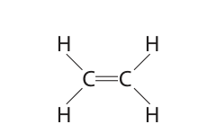
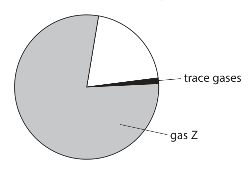
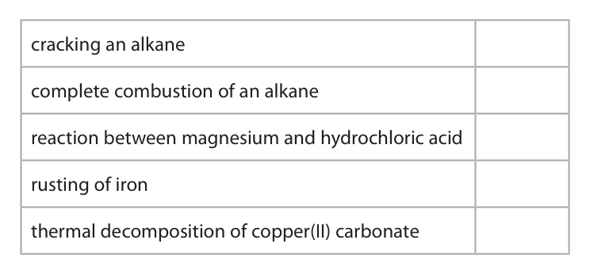
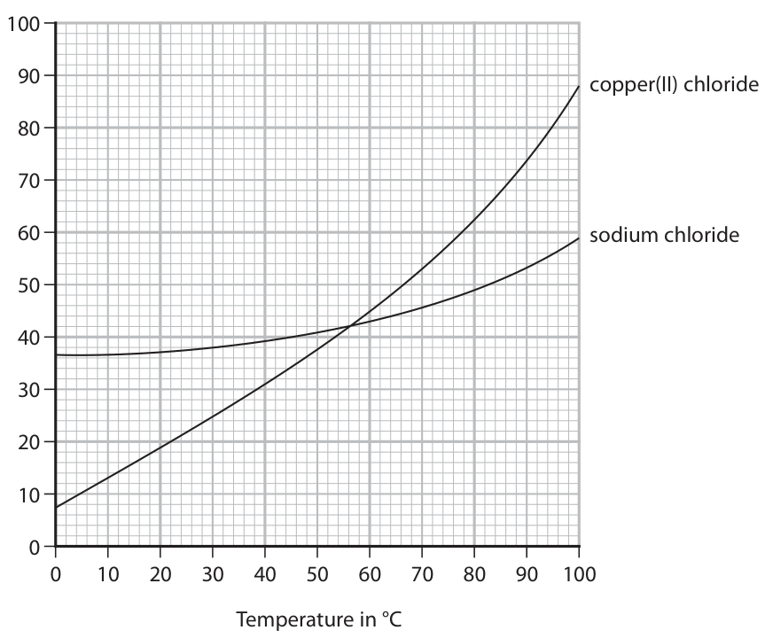
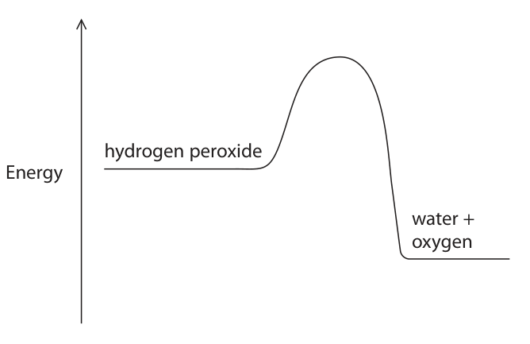
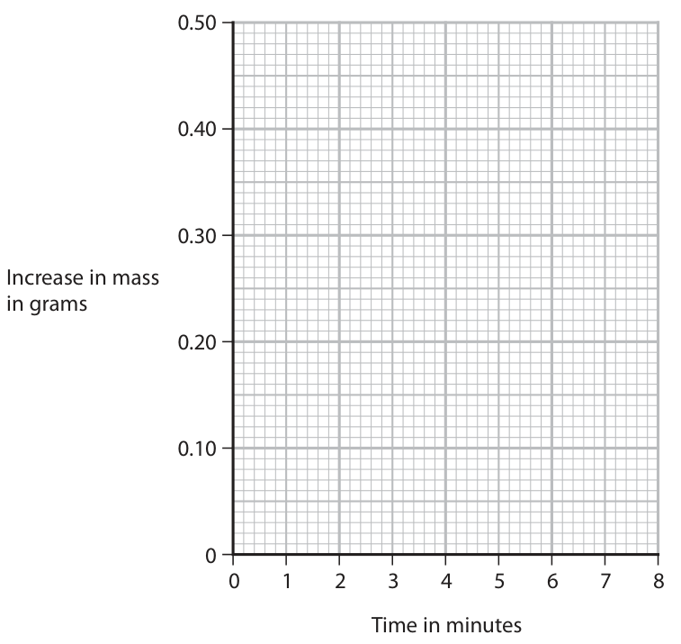
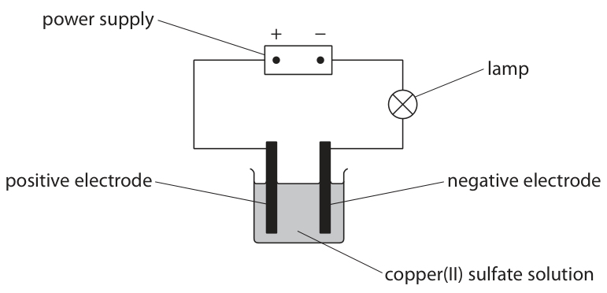

# 4CH1/2C — 2022-01 (official extraction)

> schema `syllabai.official-paper-questions/0.1` · paper_id `pearson-edexcel:international-gcse:chemistry:4ch1:2022-01:4CH1/2C` · qp sha256 `9e2169a9c8c40077…` · extracted verbatim, never regenerated (ADR-037)

## Question 1 (7 marks)

This question is about the unsaturated hydrocarbon, ethene. The displayed formula of ethene is H H C C H H

**(c)** Ethanol is produced industrially by the reaction between ethene and steam. The equation for the reaction is CH2CH2(g) + H2O(g) → CH3CH2OH(l)

### 1(a)(i) [2]

State the meaning of the term hydrocarbon.

**Mark scheme answer**

> M1 a compound/substance/molecule containing no M1 if reference to
> hydrogen/H and carbon/C (atoms) element containing C
> and H OR C and H
> molecules
> M2 only M2 dep on M1 or near
> miss

- **(1)** a compound/substance/molecule containing no M1 if reference to
- **(1)** only M2 dep on M1 or near

### 1(a)(ii) [1]

Give the reason why ethene is described as unsaturated.

**Mark scheme answer**

> ethene has a double bond

- **(1)** ethene has a double bond

### 1(b) [1]

Ethene is bubbled through bromine water until there is no further colour change. Which of these is the appearance of the solution formed?

- **(A)** colourless  ✔
- **(B)** orange
- **(C)** purple
- **(D)** red

**Mark scheme answer**

> A colourless
> A is the only correct answer because alkenes such
> as ethene react with bromine water forming a
> colourless solution
> B is not correct as bromine water is orange before
> it reacts with ethene
> C is not correct as the solution produced is not
> purple
> D is not correct as the solution produced is not red

- **(1)** Answer A: colourless

### 1(c)(i) [2]

State the temperature and pressure used in this reaction. temperature pressure

**Mark scheme answer**

> temperature = 300°C ACCEPT any value or
> range of values
> between 250 and
> 350°C If no unit given
> assume it is Celsius
> ACCEPT equivalent
> temperatures in other
> units provided the
> unit is given
> pressure = 60-70 atmospheres
> ACCEPT any value or
> range of values
> between 60 and 70
> atm If no unit given
> assume it is atm
> ACCEPT equivalent
> pressures in other
> units provided the
> unit is given

- **(2)** temperature = 300°C ACCEPT any value or

### 1(c)(ii) [1]

Give the molecular formula of ethanol.

**Mark scheme answer**

> C2H6O IGNORE size of
> numbers
> REJECT C2H5OH
> Total for question = 7

- **(1)** C2H6O IGNORE size of

## Question 2 (8 marks)

This question is about gases in the air. The pie chart represents the percentages of gases in dry, unpolluted air. Gases with percentages of less than 1% in air are called trace gases. trace gases gas Z

**(b)** One of the trace gases is carbon dioxide.

**(c)** Rainwater is acidic because carbon dioxide dissolves in water to form carbonic acid. Acid rain is more acidic than rainwater because acidic pollutant gases also dissolve in water.

### 2(a)(i) [1]

Which of these is gas Z?

- **(A)** hydrogen
- **(B)** methane
- **(C)** neon
- **(D)** nitrogen  ✔

**Mark scheme answer**

> D nitrogen
> D is the only correct answer as nitrogen is the most
> abundant gas in unpolluted air.
> A is not correct as there are only trace amounts of
> hydrogen in unpolluted air.
> B is not correct as there are only trace amounts of
> methane in unpolluted air.
> C is not correct as there are only trace amounts of
> neon in unpolluted air.

- **(1)** Answer D: nitrogen

### 2(a)(ii) [1]

Which of these is the approximate percentage of oxygen in dry, unpolluted air?

- **(A)** 0.04%
- **(B)** 0.9%
- **(C)** 21%  ✔
- **(D)** 35%

**Mark scheme answer**

> C 21%
> C is the only correct answer as the percentage of
> oxygen in the air is 21%
> A is not the correct answer as the percentage of
> oxygen in the air is not 0.04%
> B is not the correct answer as the percentage of
> oxygen in the air is not 0.9%
> D is not the correct answer as the percentage of
> oxygen in the air is not 35%

- **(1)** Answer C: 21%

### 2(b)(i) [2]

Identify two reactions that produce carbon dioxide by placing a tick (✓) in two boxes. cracking an alkane complete combustion of an alkane reaction between magnesium and hydrochloric acid rusting of iron thermal decomposition of copper(II) carbonate

**Mark scheme answer**

> 2
> cracking an alkane
> complete combustion of
> ✔
> an alkane
> reaction between magnesium and
> hydrochloric acid
> rusting of iron
> thermal decomposition of
> ✔
> copper(II) carbonate

- **(2)** 2

### 2(b)(ii) [1]

Name an environmental problem that is caused by the percentage of carbon dioxide increasing in the atmosphere.

**Mark scheme answer**

> Any one from: ALLOW greenhouse
> effect
> M1 global warming ALLOW an effect of
> global warming/climate
> M2 climate change change e.g. wildfires/
> melting of polar ice
> caps/flooding

- **(1)** Any one from: ALLOW greenhouse

### 2(b)(iii) [1]

Name the trace gas with the highest percentage in dry, unpolluted air.

**Mark scheme answer**

> argon

- **(1)** argon

### 2(c)(i) [1]

Give the name of the acid that forms when nitrogen dioxide dissolves in water.

**Mark scheme answer**

> nitric acid ALLOW HNO3/ nitrous
> acid /HNO2

- **(1)** nitric acid ALLOW HNO3/ nitrous

### 2(c)(ii) [1]

Name another pollutant gas that also forms acid rain.

**Mark scheme answer**

> sulfur dioxide ALLOW SO2
> ALLOW other oxides of
> nitrogen
> Total for question = 8

- **(1)** sulfur dioxide ALLOW SO2

## Question 3 (9 marks)

This question is about solubility.

**(a)** The graph shows the solubilities of copper(II) chloride and sodium chloride at different temperatures. 100 90 copper(II) chloride Solubility in 60 sodium chloride g per 100 g of water 50 0 10 20 30 40 50 60 70 80 90 100 Temperature in °C

**(b)** A student uses this method to determine the solubility of potassium chloride in water at room temperature. • record the mass of an empty evaporating basin • pour some saturated potassium chloride solution into the evaporating basin • record the mass of the evaporating basin and saturated potassium chloride solution • heat the evaporating basin to remove all the water • record the mass of the evaporating basin and the dry potassium chloride The table shows the student’s results. Mass in grams evaporating basin 58.1 evaporating basin and saturated 78.2 potassium chloride solution evaporating basin and dry 63.2 potassium chloride

### 3(a)(i) [2]

Determine the temperature at which copper(II) chloride and sodium chloride have the same solubility. Show on the graph how you obtained your answer. temperature = °C

**Mark scheme answer**

> M1 working shown on graph
> M2 56 (°C) ALLOW any value
> between 56 and 57
> inclusive.

- **(1)** working shown on graph
- **(1)** 56 (°C) ALLOW any value

### 3(a)(ii) [2]

A saturated solution of copper(II) chloride in 100 g of water is cooled from 40 °C to 10 °C. Determine the mass, in grams, of copper(II) chloride that crystallises. mass of copper(II) chloride = g

**Mark scheme answer**

> M1 31-13
> M2 18 (g) ALLOW ecf if one
> incorrect reading in
> M1
> correct answer of
> 18g with or without
> working scores 2

- **(1)** 31-13
- **(1)** 18 (g) ALLOW ecf if one

### 3(b)(i) [1]

Calculate the mass of dry potassium chloride obtained. mass = g

**Mark scheme answer**

> 5.1 (g)

- **(1)** 5.1 (g)

### 3(b)(ii) [1]

Calculate the mass of water removed. mass = g

**Mark scheme answer**

> 15 (g)

- **(1)** 15 (g)

### 3(b)(iii) [2]

Calculate the solubility of potassium chloride in grams per 100 grams of water. solubility = g per 100 g of water

**Mark scheme answer**

> M1 5.1÷15 OR 0.34 (g) OR answer to (i) ÷ answer to (ii)
> M2 34 (g) OR answer to M1 × 100
> correct answer of 34
> (g) with or without
> working scores 2

- **(1)** 5.1÷15 OR 0.34 (g) OR answer to (i) ÷ answer to (ii)
- **(1)** 34 (g) OR answer to M1 × 100

### 3(b)(iv) [1]

Suggest why the student’s method is not suitable for determining the solubility of hydrated copper(II) sulfate.

**Mark scheme answer**

> Any one from
> M1 (hydrated) copper(II) sulfate would become ALLOW the
> anhydrous copper sulfate (hydrated) crystals
> would decompose
> M2 (hydrated) copper(II) sulfate would lose water
> Total for question = 9

- **(1)** Any one from

## Question 4 (11 marks)

This question is about the reactions of Group 1 metals with water.

**(a)** A teacher adds a piece of sodium to some water containing universal indicator. piece of sodium water containing universal indicator The equation for this reaction is 2Na(s) + 2H2O(l) → 2NaOH(aq) + H2(g) The sodium floats on the surface of the water and the universal indicator changes colour because an alkaline solution is formed.

**(b)** The diagram represents an atom of lithium and an atom of sodium. lithium sodium

### 4(a)(i) [2]

Give two other observations. 1 2

**Mark scheme answer**

> Any two from:
> M1 sodium moves (on the surface)
> M2 sodium turns into a sphere/ball ALLOW sodium melts
> M3 effervescence ALLOW fizzing / bubbles
> M4 sodium gets smaller ALLOW sodium
> disappears / dissolves
> M5 white trail seen
> IGNORE references to a
> flame

- **(2)** Any two from:

### 4(a)(ii) [1]

Give the final colour of the universal indicator.

**Mark scheme answer**

> blue / purple IGNORE qualifiers
> ALLOW violet/lilac

- **(1)** blue / purple IGNORE qualifiers

### 4(b)(i) [1]

Give a reason why lithium and sodium have similar reactions with water.

**Mark scheme answer**

> same number of electrons/one electron in the outer ALLOW same number of
> shell. valence electrons/one
> valence electron

- **(1)** same number of electrons/one electron in the outer ALLOW same number of

### 4(b)(ii) [3]

Explain why lithium is less reactive than sodium.

**Mark scheme answer**

> M1 lithium (atom) has a smaller atomic radius ALLOW lithium is
> smaller (atom)/lithium
> (atom) has fewer shells
> /energy levels
> ALLOW outer electron
> in lithium (atom) is
> closer to the nucleus
> M2 the outer shell electron is more strongly
> attracted to the nucleus OWTTE
> M3 so is less easily lost
> ALLOW reverse
> argument for sodium

- **(1)** lithium (atom) has a smaller atomic radius ALLOW lithium is
- **(1)** the outer shell electron is more strongly
- **(1)** so is less easily lost

### 4(c) [4]

The teacher adds 0.150 g of lithium to an excess of water and collects the hydrogen gas produced. The equation for the reaction is 2Li(s) + 2H2O(l) → 2LiOH(aq) + H2(g) The teacher collects 254 cm3 of hydrogen gas at room temperature and pressure (rtp). Show by calculation that 1 mol of hydrogen gas has a volume of approximately 24 000 cm3 at rtp.

**Mark scheme answer**

> M1 amount lithium = 0.150 ÷ 7 OR 0.0214 mol penalise 1 sig fig in M1
> M2 amount hydrogen = 0.0107 mol ALLOW M1÷2
> ALLOW 2 or more sig
> figs in answers to M1
> M3 254 ÷ 0.0107 and M2
> M4 23,738 ALLOW 2 or more sig
> figs if all working shown
> correct answers in the
> range 23,707 to 24,910
> cm3 to 3 or more
> significant figures,
> without working scores
> 4 marks.
> Total for question = 11

- **(1)** amount lithium = 0.150 ÷ 7 OR 0.0214 mol penalise 1 sig fig in M1
- **(1)** amount hydrogen = 0.0107 mol ALLOW M1÷2
- **(1)** 254 ÷ 0.0107 and M2
- **(1)** 23,738 ALLOW 2 or more sig

## Question 5 (8 marks)

Hydrogen peroxide solution decomposes to give water and oxygen gas. The equation for this reaction is 2H2O2(aq) → 2H2O(l) + O2(g)

**(b)** The diagram shows the reaction profile for the decomposition of hydrogen peroxide without a catalyst. hydrogen peroxide Energy water + oxygen

### 5(a) [5]

Three different solids are catalysts for the decomposition of hydrogen peroxide solution. A student is given hydrogen peroxide solution and a sample of each of the solid catalysts. The student has a timer, a measuring cylinder, a balance and the apparatus shown in the diagram. Describe a method the student could use to find which of the three solids is the most effective catalyst for the decomposition of hydrogen peroxide solution.

**Mark scheme answer**

> A description that refers to any five of the following
> points
> M1 add hydrogen peroxide to the conical flask and
> add catalyst
> M2 start the timer
> M3 record volume of gas produced in a given time/
> record the time for certain volume of gas to be
> produced
> M4 repeat with same mass of a different catalyst
> M5 and with same volume of hydrogen peroxide
> M6 plot the results on a graph and calculate
> gradient (for each catalyst)
> M7 the most effective catalyst gives the fastest rate
> of reaction OWTTE

- **(5)** A description that refers to any five of the following

### 5(b)(i) [2]

Label the diagram to show the activation energy (Ea ) and the enthalpy change (ΔH) for this reaction.

**Mark scheme answer**

> M1 a vertical line from the level of the hydrogen the line does not need
> peroxide to the top of the curve labelled activation an arrow head
> energy or Ea
> ALLOW double headed
> arrow
> REJECT arrow pointing
> down
> M2 a vertical line from the level of the hydrogen ALLOW double headed
> peroxide to the level of the water and oxygen arrow
> labelled enthalpy change or ΔH
> REJECT arrow pointing
> up

- **(1)** a vertical line from the level of the hydrogen the line does not need
- **(1)** a vertical line from the level of the hydrogen ALLOW double headed

### 5(b)(ii) [1]

On the diagram, draw a curve to show the reaction profile for the same reaction when a catalyst is used.

**Mark scheme answer**

> curve starting from hydrogen peroxide level, below
> the peak of the original curve, and ending at water
> and oxygen level
> Total for question = 8

- **(1)** curve starting from hydrogen peroxide level, below

## Question 6 (12 marks)

This question is about the electrolysis of copper(II) sulfate solution.

**(a)** The diagram shows the apparatus used for the electrolysis. power supply + − lamp positive electrode negative electrode copper(II) sulfate solution A student records the total increase in mass of the negative electrode every minute for 8 minutes. The table shows the results. Total increase in mass of Time in minutes the negative electrode in grams 0 0.00 1 0.15 2 0.27 3 0.34 4 0.39 5 0.41 6 0.42 7 0.42 8 0.42

**(b)** The product at the positive electrode is oxygen gas.

**(c)** The wire used to connect the power supply to the electrodes is made of copper metal. The diagram shows the arrangement of the ions in a metal. + + + + + + + + + + + + + + + metal ion + + + + + + + + + + + + + +

### 6(a)(i) [1]

Plot the student’s results.

**Mark scheme answer**

> all points plotted ± half a square

- **(1)** all points plotted ± half a square

### 6(a)(ii) [1]

Draw a curve of best fit. 0.50 0.40 0.30 Increase in mass in grams 0.20 0.10 0 1 2 3 4 5 6 7 8 Time in minutes

**Mark scheme answer**

> curved line of best fit

- **(1)** curved line of best fit

### 6(a)(iii) [2]

Explain the shape of the graph.

**Mark scheme answer**

> An explanation that links the following two points
> M1 curve shows increasing mass (of negative
> electrode) because (more) copper deposits/forms
> M2 line becomes horizontal because there are no ALLOW line becomes
> more copper(II) ions left in the solution/ all the horizontal as there is no
> copper has been deposited/formed OWTTE copper sulfate solution
> left

- **(1)** curve shows increasing mass (of negative
- **(1)** line becomes horizontal because there are no ALLOW line becomes

### 6(b)(i) [2]

The student repeats the electrolysis using different apparatus. positive electrode negative electrode Describe how the student should collect a sample of pure oxygen at the positive electrode.

**Mark scheme answer**

> A description that refers to two of the following
> points
> M1 fill a test tube/measuring cylinder with copper ALLOW fill a test tube/
> sulfate solution measuring cylinder with
> water
> M2 place the tube over the positive electrode
> M3 collect gas/oxygen by displacement of
> solution/water

- **(2)** A description that refers to two of the following

### 6(b)(ii) [2]

Give an ionic half-equation for the formation of oxygen.

**Mark scheme answer**

> 2H2O → O2 + 4H+ + 4e(-)
> M1 all formulae correct
> M2 correct balancing of correct formulae M2 dep on M1
> OR
> 4OH- → O2 + 2H2O + 4e(-)
> M1 all formulae correct
> M2 correct balancing of correct formulae M2 dep on M1

- **(2)** 2H2O → O2 + 4H+ + 4e(-)

### 6(c)(i) [2]

Metals that are malleable can also be stretched to form long, thin wires. Suggest why metals can be stretched to form wires.

**Mark scheme answer**

> M1 layers (of atoms or ions) ALLOW sheets/rows
> M2 can slide over one another M2 dep on M1
> ALLOW atoms/ions slide
> over each other for M2

- **(1)** layers (of atoms or ions) ALLOW sheets/rows
- **(1)** can slide over one another M2 dep on M1

### 6(c)(ii) [2]

Explain why metals conduct electricity.

**Mark scheme answer**

> M1 delocalised electrons IGNORE sea of electrons
> /free electrons
> M2 are free to move (throughout the structure) M2 dep on mention of
> electrons in M1
> 0 marks if reference to
> ions moving
> Total for question = 12

- **(1)** delocalised electrons IGNORE sea of electrons
- **(1)** are free to move (throughout the structure) M2 dep on mention of

## Question 7 (15 marks)

This question is about esters. Ester A reacts with water to form ethanoic acid and ethanol. The displayed formulae of the reactants and products are shown in this equation H O H H H H H O H C C O + ⇌ H C C + H C C O H O C C H H H H O H H H H H H ester A The molar enthalpy change (ΔH) for the reaction is 0 kJ/mol.

**(c)** A mixture of ester A and water is left in a sealed container until the reaction mixture reaches dynamic equilibrium.

### 7(a)(i) [1]

Draw a ring around the functional group in ester A.

**Mark scheme answer**

> REJECT any other atoms
> in the ring.

- **(1)** REJECT any other atoms

### 7(a)(ii) [1]

Give the name of ester A.

**Mark scheme answer**

> ethyl ethanoate ALLOW ethylethanoate
> ALLOW ethyl acetate

- **(1)** ethyl ethanoate ALLOW ethylethanoate

### 7(a)(iii) [2]

Describe a chemical test, other than using an indicator, to show that the reaction mixture contains ethanoic acid.

**Mark scheme answer**

> M1 add a metal such as magnesium, aluminium, must be a named metal
> zinc or iron REJECT Group 1 metals
> M2 effervescence/bubbles/fizzing ACCEPT test gas with
> lighted splint which
> pops
> M2 dep on reference to
> adding a metal
> OR
> M1 add a carbonate ACCEPT any named
> carbonate
> M2 effervescence/bubbles/fizzing
> ACCEPT test gas with
> limewater which goes
> cloudy/milky
> M2 dep on M1

- **(2)** M1 add a metal such as magnesium, aluminium, must be a named metal

### 7(b) [2]

Explain why the molar enthalpy change (ΔH) for the reaction between ester A and water is 0 kJ/mol. In your answer, refer to the bonds broken and the bonds formed.

**Mark scheme answer**

> M1 C-O and one / two O-H bonds are broken and ALLOW the same bonds
> formed are broken and formed
> M2 so the same amount of energy is needed to ALLOW energy of bonds
> break the bonds in the reactants as is given off formed equals energy of
> when the bonds in the products are formed bonds broken

- **(1)** C-O and one / two O-H bonds are broken and ALLOW the same bonds
- **(1)** so the same amount of energy is needed to ALLOW energy of bonds

### 7(c)(i) [2]

Describe what is meant by dynamic equilibrium.

**Mark scheme answer**

> M1 the rate of the forward reaction equals the rate
> of the backward reaction
> M2 the concentrations of reactants and products REJECT concentration
> remain constant of the reactants and
> products are the same

- **(1)** the rate of the forward reaction equals the rate
- **(1)** the concentrations of reactants and products REJECT concentration

### 7(c)(ii) [2]

Explain why adding a catalyst does not change the position of equilibrium.

**Mark scheme answer**

> M1 a catalyst increases the rate of forward and
> backward reactions
> M2 equally M2 dep on M1

- **(1)** a catalyst increases the rate of forward and
- **(1)** equally M2 dep on M1

### 7(d) [3]

The ethanoic acid produced in the reaction is completely neutralised by 22.75 cm3 of 0.150 mol/dm3 barium hydroxide solution. The equation for the neutralisation reaction is 2CH3COOH + Ba(OH)2 → Ba(CH3COO)2 + 2H2O Calculate the amount, in moles, of ethanoic acid neutralised. Give your answer to 3 significant figures. amount = mol

**Mark scheme answer**

> 3
> example calculation
> M1 moles barium hydroxide = (0.150 × 22.75)÷ 1000 M1 needs to be given to
> OR 0.0034125 at least 3 sig figs
> M2 moles ethanoic acid = 0.006825 ALLOW M1 × 2
> M3 moles ethanoic acid to 3 significant figures = ALLOW answer to M2 to
> 0.00683 3 significant figures.
> correct answer of
> 0.00683 moles with or
> without working scores
> 3 marks
> ACCEPT answer in
> standard form
> ACCEPT 0.00682 if M1
> given to 3 sig figs
> 6.83 with or without
> working scores 2 marks

- **(1)** moles barium hydroxide = (0.150 × 22.75)÷ 1000 M1 needs to be given to
- **(1)** moles ethanoic acid = 0.006825 ALLOW M1 × 2
- **(1)** moles ethanoic acid to 3 significant figures = ALLOW answer to M2 to

### 7(e) [2]

The structures of two organic compounds are shown. H H H O O C C C H O C C O H H O O H H H H These compounds react together to form a polymer. Give the repeat unit of the polymer formed.

**Mark scheme answer**

> 2
> correct answer scores 2 marks ALLOW structure
> without extension bonds
> IGNORE brackets and n
> and + H2O
> M1 three carbons from the dicarboxylic acid and two
> from the diol and the ester linkage
> M2 -OH lost from the dicarboxylic acid and -H lost ALLOW -OH lost from
> from the diol diol and -H lost from
> dicarboxylic acid
> Total for question = 15
> Pearson Education Limited. Registered company number 872828
> with its registered office at 80 Strand, London, WC2R 0RL, United Kingdom

- **(1)** three carbons from the dicarboxylic acid and two
- **(1)** -OH lost from the dicarboxylic acid and -H lost ALLOW -OH lost from

