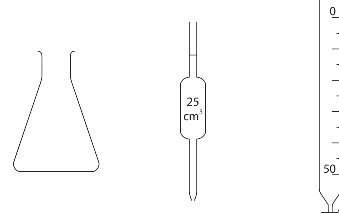
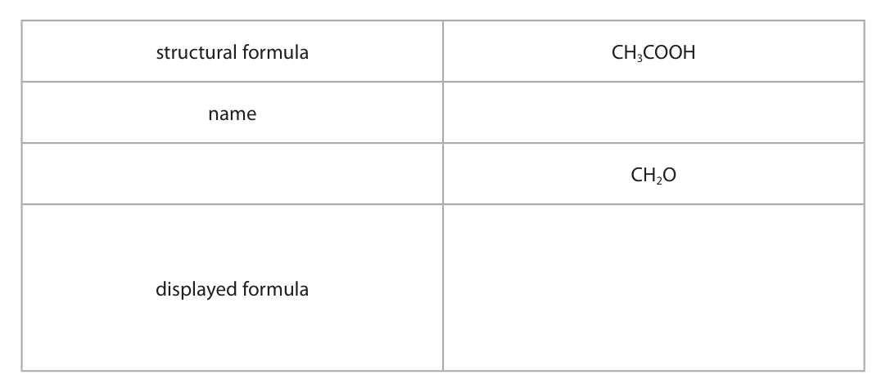
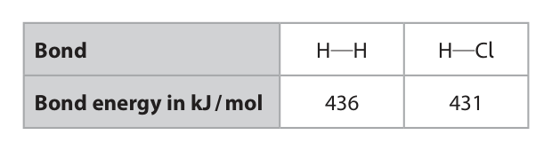
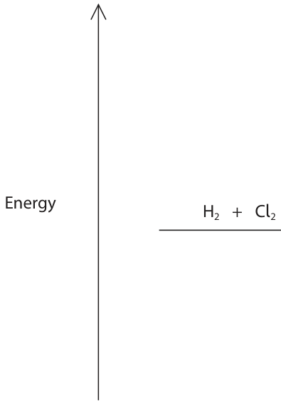

# 4CH1/2CR — 2022-01 (official extraction)

> schema `syllabai.official-paper-questions/0.1` · paper_id `pearson-edexcel:international-gcse:chemistry:4ch1:2022-01:4CH1/2CR` · qp sha256 `3909b340a2ac15a8…` · extracted verbatim, never regenerated (ADR-037)

## Question 1 (5 marks)
**(b)** The box gives the names of some substances. calcium copper gold iodine methane zinc Use words from the box to answer these questions.

### 1(a) [2]

Two substances are needed to cause iron to rust. Name these two substances. 1 2

**Mark scheme answer**

> M1 oxygen ALLOW air
> M2 water / water vapour ALLOW moisture
> ALLOW answers in
> either order

- **(1)** oxygen ALLOW air
- **(1)** water / water vapour ALLOW moisture

### 1(b)(i) [1]

Give the name of a non-metallic element.

**Mark scheme answer**

> iodine

- **(1)** iodine

### 1(b)(ii) [1]

Give the name of a compound.

**Mark scheme answer**

> methane

- **(1)** methane

### 1(b)(iii) [1]

Give the name of the metal that is lowest in the reactivity series.

**Mark scheme answer**

> gold

- **(1)** gold

## Question 2 (10 marks)

Crude oil is a mixture of hydrocarbons.

**(c)** One of the hydrocarbons in crude oil is an alkane with this structural formula. CH3CH2CH2CH2CH3

### 2(a) [3]

This passage is about the industrial separation of crude oil. Complete the passage by adding the missing words. Crude oil is to form vapour. The vapour is passed through a column. The refinery gases are collected at the top of the column because they have low

**Mark scheme answer**

> M1 heated ALLOW boiled
> IGNORE
> vapourised/evaporated
> M2 fractionating ACCEPT fractional
> distillation
> M3 boiling point(s) ACCEPT boiling
> temperature(s)
> IGNORE melting
> point(s)/low density

- **(1)** heated ALLOW boiled
- **(1)** fractionating ACCEPT fractional
- **(1)** boiling point(s) ACCEPT boiling

### 2(b) [1]

Bitumen is collected at the bottom of the column. Give one use of bitumen.

**Mark scheme answer**

> road surfacing / roofing ALLOW roads

- **(1)** road surfacing / roofing ALLOW roads

### 2(c)(i) [1]

Give the name of this alkane.

**Mark scheme answer**

> pentane

- **(1)** pentane

### 2(c)(ii) [1]

Calculate the relative molecular mass (Mr) of this alkane. Mr =

**Mark scheme answer**

> (Mr = 5 x 12 + 12 x 1 =) 72

- **(1)** (Mr = 5 x 12 + 12 x 1 =) 72

### 2(d) [2]

Catalytic cracking is used to convert long-chain alkanes into shorter-chain alkanes. Give the name of the catalyst and the temperature used in catalytic cracking. catalyst temperature

**Mark scheme answer**

> M1 alumina / silica ACCEPT aluminium
> oxide / silicon dioxide /
> Al2O3 / SiO2 / zeolite(s)
> / aluminosilicate(s)
> M2 any temperature in the range 600 – 700 oC
> inclusive

- **(1)** alumina / silica ACCEPT aluminium
- **(1)** any temperature in the range 600 – 700 oC

### 2(e) [2]

Catalytic cracking also produces alkenes. Decane (C10H22) can undergo cracking to give C4H10 and two different alkenes. Complete the equation for this cracking process. C10H22 → C4H10 + +

**Mark scheme answer**

> (C10H22 → C4H10) + C2H4 + C4H8 alkenes can be in either
> order
> M1 C2H4
> M2 C4H8 ALLOW 1 mark for
> C6H12 / 2C3H6
> / C3H6 + C3H6
> ALLOW correct
> displayed formulae

- **(1)** C2H4
- **(1)** C4H8 ALLOW 1 mark for

## Question 3 (11 marks)

A student does a titration to find the concentration of a solution of dilute sulfuric acid. The student uses these solutions and this apparatus. • dilute sulfuric acid • potassium hydroxide solution of concentration 0.240 mol / dm3 • methyl orange indicator cm3 cm3

**(b)** The student needs 15.00 cm3 of sulfuric acid to neutralise 25.0 cm3 of the potassium hydroxide solution. This is the equation for the reaction. 2KOH + H2SO4 → K2SO4 + 2H2O

### 3(a) [6]

The student wants to find the volume of sulfuric acid needed to neutralise 25.0 cm3 of the potassium hydroxide solution. Describe how the student should do this titration. Assume that all pieces of apparatus are clean and dry.

**Mark scheme answer**

> A description that includes six of the following
> points
> M1 use the pipette to add (25 cm3 of) potassium
> hydroxide (solution) to the (conical) flask
> M2 add a few drops of methyl orange (to the
> flask)
> M3 add sulfuric acid to the burette and record ALLOW fill burette with
> the initial burette reading sulfuric acid to “0” mark
> M4 add sulfuric acid (from the burette) to the ALLOW shaking (gently) /
> flask, swirling (continuously) stirring
> M5 until the (methyl orange) indicator turns
> red/orange
> M6 take the final burette reading and find ALLOW take final burette
> volume of acid added (by finding difference reading only if previously
> between initial and final burette readings) filled burette to “0” mark
> M7 repeat (the titration) adding the acid ACCEPT repeat (the
> dropwise near the end-point / repeat (the titration) to obtain results
> titration) to obtain concordant results within 0.2 cm3 of each
> other

- **(6)** A description that includes six of the following

### 3(b)(i) [2]

Calculate the amount, in moles, of KOH in 25.0 cm3 of potassium hydroxide solution of concentration 0.240 mol / dm3. amount of KOH = mol

**Mark scheme answer**

> M1 0.0250 x 0.240 OR 25.0 x 0.240 correct answer without
> 1000 working scores 2
> M2 0.006(00) If no division by 1000
> giving an answer of 6
> award 1 mark

- **(1)** 0.0250 x 0.240 OR 25.0 x 0.240 correct answer without
- **(1)** 0.006(00) If no division by 1000

### 3(b)(ii) [1]

Calculate the amount, in moles, of H2SO4 in 15.00 cm3 of the sulfuric acid. amount of H2SO4 = mol

**Mark scheme answer**

> (0.006 ÷ 2 =) 0.003 ALLOW ECF from (i)

- **(1)** (0.006 ÷ 2 =) 0.003 ALLOW ECF from (i)

### 3(b)(iii) [2]

Calculate the concentration, in mol / dm3, of the sulfuric acid. concentration of sulfuric acid = mol / dm3

**Mark scheme answer**

> M1 0.003(00) x 1000
> 15.00
> M2 0.2(00) ALLOW ECF from (ii)
> correct answer without
> working scores 2
> answer to (ii) ÷ 15.00
> scores 1
> do not penalise not
> multiplying by 1000 in (iii)
> if they have not divided by
> 1000 in (i)

- **(1)** 0.003(00) x 1000
- **(1)** 0.2(00) ALLOW ECF from (ii)

## Question 4 (8 marks)

This question is about alcohols, carboxylic acids and their reactions.

**(b)** Ethanol can be oxidised to produce a carboxylic acid.

**(c)** Alcohols and carboxylic acids can be heated together to form esters.

### 4(a) [3]

The boxes give some information about a carboxylic acid. Complete the boxes by giving the missing information. structural formula CH3COOH name CH2O displayed formula

**Mark scheme answer**

> 3
> 1 mark for each correct
> structural CH3COOH
> answer
> formula
> name ethanoic acid
> ALLOW acetic acid
> empirical CH2O
> formula
> Must show O-H bond
> displayed
> formula

- **(3)** 3

### 4(b)(i) [2]

Give the names of the two reagents used in this oxidation reaction. 1 2

**Mark scheme answer**

> M1 potassium dichromate(VI) VI not essential for the
> mark
> ACCEPT sodium
> dichromate(VI)
> ALLOW K2Cr2O7
> M2 (dilute) sulfuric acid ALLOW concentrated
> sulfuric acid
> ALLOW H2SO4
> ACCEPT reagents in
> either order

- **(1)** potassium dichromate(VI) VI not essential for the
- **(1)** (dilute) sulfuric acid ALLOW concentrated

### 4(b)(ii) [1]

Which of these colour changes occurs during the reaction?

- **(A)** green to orange
- **(B)** orange to green  ✔
- **(C)** red to yellow
- **(D)** yellow to red

**Mark scheme answer**

> B orange to green
> A is incorrect as the colour does not change from
> green to orange
> C is incorrect as the colour does not change from
> red to yellow
> D is incorrect as the colour does not change from
> yellow to red

- **(1)** Answer B: orange to green

### 4(c)(i) [1]

State why it is better to heat the mixture using a water bath rather than directly with a Bunsen burner flame.

**Mark scheme answer**

> alcohols are flammable/might catch fire/might ignite ACCEPT esters/mixture
> are/is flammable/might
> catch fire/might ignite
> ALLOW alcohol/ester/
> carboxylic acid might
> evaporate

- **(1)** alcohols are flammable/might catch fire/might ignite ACCEPT esters/mixture

### 4(c)(ii) [1]

An ester has the structural formula CH3CH2COOCH3 Which of these is the name of this ester?

- **(A)** ethyl methanoate
- **(B)** methyl ethanoate
- **(C)** methyl propanoate  ✔
- **(D)** propyl methanoate

**Mark scheme answer**

> C methyl propanoate
> A ethyl methanoate is not the correct name of the
> compound
> B methyl ethanoate is not the correct name of the
> compound
> D propyl methanoate is not the correct name of the
> compound

- **(1)** Answer C: methyl propanoate

## Question 5 (12 marks)

This question is about three stages in the manufacture of sulfuric acid.

**(a)** In stage 1, sulfur is burned in oxygen to form sulfur dioxide gas. S(s) + O2(g) → SO2(g)

**(b)** In stage 2, sulfur dioxide is reacted with oxygen to form sulfur trioxide gas. 2SO2(g) + O2(g) ⇌ 2SO3(g) The yield of sulfur trioxide is approximately 98%.

### 5(a)(i) [1]

State one environmental problem caused by the release of sulfur dioxide into the atmosphere.

**Mark scheme answer**

> (produces) acid rain ALLOW any detrimental
> effect of acid rain e.g.
> kills fish, damages
> limestone buildings

- **(1)** (produces) acid rain ALLOW any detrimental

### 5(a)(ii) [3]

A mass of 6.4 tonnes of sulfur is burned to produce sulfur dioxide gas. Calculate the maximum volume, in dm3, of sulfur dioxide gas that can be produced at rtp. [molar volume of sulfur dioxide gas at rtp = 24 dm3] [1 tonne = 106 g] Give your answer in standard form. maximum volume = dm3

**Mark scheme answer**

> • M1 find moles of sulfur
> • M2 multiply moles by 24
> • M3 answer in standard form
> Example calculation
> M1 6.4 x 106 ÷ 32 OR 2.0 x 105 / 200 000
> M2 2.0 x 105 x 24 / 200 000 x 24 / 4 800 000 ALLOW ECF as long as an
> attempt has been made
> to calculate moles
> M3 4.8 x 106
> Correct answer without
> working scores 3
> 4 800 000 (dm3) without
> working scores 2

- **(1)** 6.4 x 106 ÷ 32 OR 2.0 x 105 / 200 000
- **(1)** 2.0 x 105 x 24 / 200 000 x 24 / 4 800 000 ALLOW ECF as long as an
- **(1)** 4.8 x 106

### 5(b)(i) [2]

A catalyst is used in this reaction. Explain how a catalyst increases the rate of a reaction.

**Mark scheme answer**

> An explanation that links the following two points
> M1 provides an alternative (reaction) pathway/route
> M2 with a lower activation energy OWTTE
> ACCEPT so more
> particles/collisions have
> energy greater than the
> activation energy
> ALLOW lowers the energy
> needed to start the
> reaction

- **(1)** provides an alternative (reaction) pathway/route
- **(1)** with a lower activation energy OWTTE

### 5(b)(ii) [1]

The temperature is kept constant. Give a reason why increasing the pressure would increase the yield of sulfur trioxide.

**Mark scheme answer**

> fewer moles (of gas) on RHS (than on (LHS) ALLOW 3 moles (of gas)
> on LHS and 2 moles (of)
> gas on RHS
> ALLOW fewer moles of
> product/SO3 (gas) (than
> of reactants/SO2 and O2
> (gas))
> ALLOW molecules in
> place of moles
> IGNORE references to
> rate

- **(1)** fewer moles (of gas) on RHS (than on (LHS) ALLOW 3 moles (of gas)

### 5(b)(iii) [1]

Suggest why it is not necessary to increase the pressure in stage 2.

**Mark scheme answer**

> as yield is approximately 98% /very high (it is not ALLOW reference to
> necessary to increase the pressure ) OWTTE reaction rate (already
> high enough) as catalyst
> used OWTTE

- **(1)** as yield is approximately 98% /very high (it is not ALLOW reference to

### 5(c) [2]

In stage 3, the sulfur trioxide is reacted with concentrated sulfuric acid to form a liquid called oleum, H2S2O7 The oleum is then added to water to form concentrated sulfuric acid. Complete the chemical equations for these two reactions + → H2S2O7 H2S2O7 + →

**Mark scheme answer**

> ALLOW multiples
> M1 SO3 + H2SO4 → H2S2O7
> M2 H2S2O7 + H2O → 2H2SO4

- **(1)** SO3 + H2SO4 → H2S2O7
- **(1)** H2S2O7 + H2O → 2H2SO4

### 5(d) [2]

Sulfuric acid reacts with ammonia to form ammonium sulfate, (NH4)2SO4 Calculate the percentage by mass of nitrogen in ammonium sulfate. [Mr of (NH4)2SO4 = 132] percentage = %

**Mark scheme answer**

> M1 (2 x 14 ÷ 132) x 100
> M2 21.21 (%) ALLOW any number of sig
> figs except 1
> ALLOW ECF from M1 as
> long as 132 used correctly
> Correct answer without
> working scores 2
> 3Answer Notes Marks

- **(1)** (2 x 14 ÷ 132) x 100
- **(1)** 21.21 (%) ALLOW any number of sig

## Question 6 (12 marks)

A teacher prepares the insoluble salt lead(II) bromide (PbBr2) by mixing solutions of lead(II) nitrate and sodium bromide.

**(c)** The teacher heats the lead(II) bromide. When the lead(II) bromide is molten, the lamp lights and bromine forms at the positive electrode.

### 6(a) [3]

Describe what the teacher should do next to obtain a pure, dry sample of lead(II) bromide.

**Mark scheme answer**

> A description that refers to the following three
> points
> M1 filter
> M2 wash the precipitate/solid/lead(II) bromide
> /residue (with distilled water)
> M3 dry with filter paper/in a (warm) oven ALLOW leave to dry or
> any other suitable
> method
> REJECT direct heating
> e.g. with a Bunsen
> burner
> If description relates to
> preparation of a soluble
> salt allow 1 mark only
> for M3 for a suitable
> method of drying the
> solid

- **(1)** filter
- **(1)** wash the precipitate/solid/lead(II) bromide
- **(1)** dry with filter paper/in a (warm) oven ALLOW leave to dry or

### 6(b) [2]

The teacher then sets up a circuit in a fume cupboard using the pure, dry sample of lead(II) bromide. + − positive electrode negative electrode lead(II) bromide crucible Explain why the lamp does not light when the lead(II) bromide is solid.

**Mark scheme answer**

> 2
> M1 solid lead(II) bromide does not conduct ALLOW lead(II) bromide
> electricity only conducts when
> molten
> ALLOW when lead(II)
> bromide is solid no
> electricity/current
> flow(s) through the
> circuit/lamp
> M2 because ions cannot move/are in fixed positions REJECT reference to
> (delocalised) electrons
> /atoms cannot move in
> solid

- **(1)** solid lead(II) bromide does not conduct ALLOW lead(II) bromide
- **(1)** because ions cannot move/are in fixed positions REJECT reference to

### 6(c)(i) [1]

State what observation would be made at the positive electrode.

**Mark scheme answer**

> brown vapour/gas/fumes (of bromine) ALLOW orange/orange-
> brown

- **(1)** brown vapour/gas/fumes (of bromine) ALLOW orange/orange-

### 6(c)(ii) [4]

Explain how bromide ions in the molten lead(II) bromide become bromine molecules at the positive electrode.

**Mark scheme answer**

> An explanation that links the following four points
> Penalise incorrect use
> of ide/ine once only
> M1 bromide ions are negatively charged / Br – ALLOW bromide ions
> are anions
> M2 (so bromide ions/they) are attracted to the ALLOW anode
> positive electrode
> M3 (at the positive electrode) bromide ions/they ALLOW bromide ions
> lose/give up electron(s) (to form bromine atoms) are oxidised
> ALLOW Br - → Br + e(-)
> M4 (bromine atoms) join in pairs to form bromine ALLOW Br + Br → Br2
> molecules/Br2 OWTTE
> 2Br - → Br2 + 2e(-)
> scores M1 M3 and M4

- **(1)** bromide ions are negatively charged / Br – ALLOW bromide ions
- **(1)** (so bromide ions/they) are attracted to the ALLOW anode
- **(1)** (at the positive electrode) bromide ions/they ALLOW bromide ions
- **(1)** (bromine atoms) join in pairs to form bromine ALLOW Br + Br → Br2

### 6(d) [2]

Write an ionic half-equation for the reaction that occurs at the negative electrode. Include state symbols in your equation.

**Mark scheme answer**

> Pb2+(l) + 2e(−) → Pb(s) ALLOW Pb(l)
> M1 formulae and balancing correct ALLOW multiples and
> fractions
> M2 both state symbols correct ALLOW M2 ECF if
> charge on lead ion
> and/or balancing are
> incorrect

- **(1)** formulae and balancing correct ALLOW multiples and
- **(1)** both state symbols correct ALLOW M2 ECF if

## Question 7 (12 marks)

The reaction between hydrogen and chlorine is exothermic. This is the equation for the reaction. H2(g) + Cl2(g) → 2HCl(g) ΔH = −184 kJ

### 7(a) [1]

State the meaning of the term exothermic.

**Mark scheme answer**

> gives out thermal energy/heat (energy)

- **(1)** gives out thermal energy/heat (energy)

### 7(b) [4]

The table gives the bond energies for the H H and H Cl bonds. Bond H H H Cl Bond energy in kJ / mol 436 431 Use the equation and information from the table to calculate the bond energy of the Cl Cl bond. bond energy = kJ / mol

**Mark scheme answer**

> • M1 expression for Σ bond energies of
> reactants/bonds broken
> • M2 expression for Σ bond energies of
> products/bonds made or evaluation
> • M3 correct equation linking M1, M2 and value
> of ΔH
> • M4 evaluation of Cl-Cl bond energy
> Example calculation
> Correct answer without
> working scores 4
> M1 (Σ bond energies of reactants =) 436 + X ACCEPT E(Cl− Cl) or any
> suitable symbol or
> expression for X
> M2 (Σ bond energies of products =) 2 x 431 OR 862(kJ)
> M3 − 184 = 436 + X − 862 OR X = − 184 + 862 − 436
> ALLOW M3 ECF if 431
> for M2
> If not used (-)184 in M3
> can only score M1 M2
> M3 subsumes M1 M2
> M4 X = 242 (kJ/mol)
> ALLOW M4 ECF on M3
> as long as M3 involves
> 436, X, 862 (or 431) and
> (-)184

- **(1)** (Σ bond energies of reactants =) 436 + X ACCEPT E(Cl− Cl) or any
- **(1)** (Σ bond energies of products =) 2 x 431 OR 862(kJ)
- **(1)** − 184 = 436 + X − 862 OR X = − 184 + 862 − 436
- **(1)** X = 242 (kJ/mol)

### 7(c) [3]

Explain why this reaction is exothermic. Refer to bond-breaking and bond-making in your answer.

**Mark scheme answer**

> An explanation that links the following three points
> M1 energy needed to break bonds / bond-breaking is ALLOW energy is
> endothermic absorbed/taken in
> M2 energy given out when bonds are formed / ALLOW energy is released
> bond-forming is exothermic
> M3 energy given out is greater than energy needed
> (so exothermic) OWTTE M3 DEP M1 M2
> more energy released
> when new bonds are
> formed (in products) than
> is needed to break the
> bonds (in reactants)
> OWTTE scores M1 M2 M3
> If any contradictory
> statements max 1

- **(1)** energy needed to break bonds / bond-breaking is ALLOW energy is
- **(1)** energy given out when bonds are formed / ALLOW energy is released
- **(1)** energy given out is greater than energy needed

### 7(d) [4]

Complete the reaction profile diagram to show the position of the products, the enthalpy change (ΔH) and the activation energy (Ea) for the reaction. Energy H2 + Cl2

**Mark scheme answer**

> M1 horizontal line to show products below reactants
> and to the right of reactants and labelled 2HCl ALLOW products for 2HCl
> M2 vertical line from H2 + Cl2 level to 2HCl/products ACCEPT double headed
> level and labelled enthalpy change/ΔH/ -184 arrow or arrow pointing
> from H2 + Cl2 level to
> 2HCl/products level
> REJECT arrow pointing
> from 2HCl/products level
> to H2 + Cl2 level
> M3 curve with hump/peak shown on diagram going
> up from H2 + Cl2 line and ending at 2HCl/products
> line
> M4 vertical line from H2 + Cl2 level to top of hump ACCEPT double headed
> level and labelled activation energy/Ea arrow or arrow pointing
> from H2 + Cl2 level to top
> of hump
> REJECT arrow pointing
> from top of hump to H2 +
> Cl2 level
> If endothermic diagram
> shown, can score M2 M3
> (peak/hump must be
> above products line) and
> M4 Total 12
> Pearson Education Limited. Registered company number 872828
> with its registered office at 80 Strand, London, WC2R 0RL, United Kingdom

- **(1)** horizontal line to show products below reactants
- **(1)** vertical line from H2 + Cl2 level to 2HCl/products ACCEPT double headed
- **(1)** curve with hump/peak shown on diagram going
- **(1)** vertical line from H2 + Cl2 level to top of hump ACCEPT double headed

