# 4CH1/1C — 2022-06 (official extraction)

> schema `syllabai.official-paper-questions/0.2` · paper_id `pearson-edexcel:international-gcse:chemistry:4ch1:2022-06:4CH1/1C` · qp sha256 `222019063953cef8…` · extraction is the disclosed baseline (ADR-039)

## Question 1 (5 marks)

The diagram shows the electronic configuration of an atom of an element.

### 1(a) [1]

Name the part of the atom that contains the protons and neutrons.

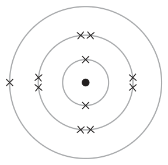

**Mark scheme answer**

> nucleus ACCEPT nuclei

- **(1)** nucleus ACCEPT nuclei

### 1(b) [1]

Give the number of protons in this atom.

**Mark scheme answer**

> 11 / eleven

- **(1)** 11 / eleven

### 1(c) [1]

Give the number of the group that contains this element.

**Mark scheme answer**

> 1 / one / group 1

- **(1)** 1 / one / group 1

### 1(d) [1]

Give the number of the period that contains this element.

**Mark scheme answer**

> 3 / three / period 3

- **(1)** 3 / three / period 3

### 1(e) [1]

Give the charge on the ion formed from this atom.

**Mark scheme answer**

> +1 / 1+ ACCEPT + / Na+ /
> positive 1
> IGNORE positive alone

- **(1)** +1 / 1+ ACCEPT + / Na+ /

## Question 2 (11 marks)
**(b)** A student plans to obtain salt crystals from a mixture of salt and sand. The student adds pure water to the mixture to dissolve the salt.

### 2(a) [4]

The box shows some changes of state. boiling condensation evaporation freezing melting sublimation The table lists some physical changes. Complete the table using words from the box to show the change of state for each physical change. Physical change Change of state water to ice steam to water solid wax to liquid wax iodine crystals to iodine vapour

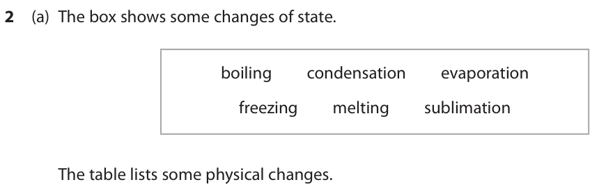

**Mark scheme answer**

> 4
> Change Change of
> state
> water to ice freezing
> steam to water condensation ALLOW condensing
> solid wax to liquid wax melting
> iodine crystals to iodine sublimation ALLOW subliming
> vapour

- **(4)** 4

### 2(b)(i) [2]

State two things the student could do to make the salt dissolve quickly. 1 2

**Mark scheme answer**

> M1 heat ALLOW use hot water
> IGNORE add more water
> M2 stir / mix ALLOW grind / crush
> the solid / mixture

- **(1)** heat ALLOW use hot water
- **(1)** stir / mix ALLOW grind / crush

### 2(b)(ii) [1]

State what the student should do next to separate the sand from the salt solution.

**Mark scheme answer**

> filter ALLOW a description of
> filtration

- **(1)** filter ALLOW a description of

### 2(b)(iii) [4]

Describe how the student can obtain pure dry crystals of salt from the salt solution.

**Mark scheme answer**

> A description that refers to four of the following IGNORE any steps
> points: before heating the
> solution
> M1 heat / boil (the solution)
> M2 evaporate some of the water ALLOW until crystals
> form on the end of a
> glass rod
> ALLOW until crystals
> first start to form
> ALLOW until the
> solution is saturated
> M3 leave / cool (the solution to crystallise) M3 dep on M1
> M4 pour off excess liquid OR filter (to obtain M4 dep on crystals
> crystals) having been formed
> IGNORE references to
> washing
> M5 suitable method of drying the crystals e.g. place in an
> oven / leave to
> dry /use filter
> paper / kitchen towel /
> / desiccator / heat to
> dryness
> If solution heated until
> all the water
> evaporates / heated
> until all the water has
> been removed / heated
> to dryness award M1
> and M5
> If the solution is left to
> evaporate all of
> the water
> only M5 can be
> awarded.

- **(4)** A description that refers to four of the following IGNORE any steps

## Question 3 (10 marks)

Crude oil is an important source of organic compounds.

**(a)** The diagram shows how crude oil can be separated into fractions by fractional distillation. F E D C B crude oil X A

**(b)** One of the compounds in fraction D is tridecane (C13H28) which can be cracked to form shorter-chain hydrocarbons.

### 3(a)(i) [1]

State what happens to the crude oil when it is in X.

**Mark scheme answer**

> (crude oil/it is) heated / vapourised ALLOW evaporated / boiled
> REJECT melted

- **(1)** (crude oil/it is) heated / vapourised ALLOW evaporated / boiled

### 3(a)(ii) [1]

Give the name of fraction E.

**Mark scheme answer**

> gasoline ALLOW petrol

- **(1)** gasoline ALLOW petrol

### 3(a)(iii) [1]

Give a use for fraction A.

**Mark scheme answer**

> road (surfacing) / roofs / tarmac

- **(1)** road (surfacing) / roofs / tarmac

### 3(b)(i) [2]

State the catalyst and temperature used in this cracking reaction. catalyst temperature

**Mark scheme answer**

> M1 silica / alumina (catalyst) ACCEPT SiO2/Al2O3 / silicon
> dioxide / aluminium oxide
> /aluminosilicates / zeolites
> M2 600 to 700 oC

- **(1)** silica / alumina (catalyst) ACCEPT SiO2/Al2O3 / silicon
- **(1)** 600 to 700 oC

### 3(b)(ii) [2]

The equation shows an example of a catalytic cracking reaction. C13H28 → C8H18 + C2H4 + C3H6 Give two reasons why this reaction is important. 1 2

**Mark scheme answer**

> Any two from:
> M1 shorter-chain alkanes are in high(er) ALLOW C8H18 is in high(er)
> demand / more useful / used for petrol / demand (than C13H28) / more
> more flammable useful / used for petrol / more
> flammable
> IGNORE shorter-chain alkanes
> are used as fuels
> M2 alkenes are needed / used to make ALLOW C2H4 / C3H6 are needed
> polymers / used to make polymers /
> plastics
> shorter chain hydrocarbons /
> the products are in high(er)
> demand / more useful / more
> flammable scores 1 if no other
> mark awarded
> to create shorter alkanes and
> alkenes scores 1 if no other
> mark awarded

- **(1)** shorter-chain alkanes are in high(er) ALLOW C8H18 is in high(er)
- **(1)** alkenes are needed / used to make ALLOW C2H4 / C3H6 are needed

### 3(c) [3]

Sulfur is an impurity in crude oil. Explain why this is a problem for the environment.

**Mark scheme answer**

> An explanation that links the following three
> points:
> M1 sulfur dioxide produced when fuel is ALLOW sulfur / fuel reacts
> burned with oxygen / oxidises forming
> sulfur dioxide
> IGNORE sulfur trioxide and
> sulfur oxide
> M2 (sulfur dioxide) dissolves in / reacts with ACCEPT (sulfur oxide / sulfur
> rain / water trioxide) dissolves in / reacts
> with rain / water
> IGNORE mixes
> M3 (causing) acid rain

- **(1)** sulfur dioxide produced when fuel is ALLOW sulfur / fuel reacts
- **(1)** (sulfur dioxide) dissolves in / reacts with ACCEPT (sulfur oxide / sulfur
- **(1)** (causing) acid rain

## Question 4 (10 marks)

A student uses the reaction between iron and oxygen to find the percentage of oxygen in air. The diagram shows the apparatus the student uses. 0 10 20 30 40 50 60 70 80 90 100 3 cm air wet iron powder

### 4(a)(i) [1]

State why the iron powder needs to be wet.

**Mark scheme answer**

> water is needed for iron to rust / react ALLOW reaction needs
> water (and oxygen)
> ALLOW increases rate of
> reaction

- **(1)** water is needed for iron to rust / react ALLOW reaction needs

### 4(a)(ii) [1]

State the colour of the compound formed in the reaction between iron and oxygen.

**Mark scheme answer**

> brown (coating on iron) ALLOW red-brown /
> orange-brown / orange /
> orange-red
> IGNORE red alone

- **(1)** brown (coating on iron) ALLOW red-brown /

### 4(a)(iii) [1]

Give the formula of the compound formed.

**Mark scheme answer**

> Fe2O3

- **(1)** Fe2O3

### 4(a)(iv) [2]

Explain the advantage of using iron powder rather than pieces of iron.

**Mark scheme answer**

> An explanation that links the following two points
> M1 (the powder has) a larger surface area ALLOW (the powder has)
> higher
> surface area:volume
> M2 so the iron will rust quicker/ the reaction will
> be faster / the results are (obtained) more quickly
> IGNORE references to the
> collision theory

- **(1)** (the powder has) a larger surface area ALLOW (the powder has)
- **(1)** so the iron will rust quicker/ the reaction will

### 4(b) [2]

The syringe in the diagram shows the reading at the end of the experiment. Complete table 1 to show the readings on the syringe. Give both values to the nearest 1 cm3. syringe reading at start syringe reading at end change in volume in cm3 65 Table 1

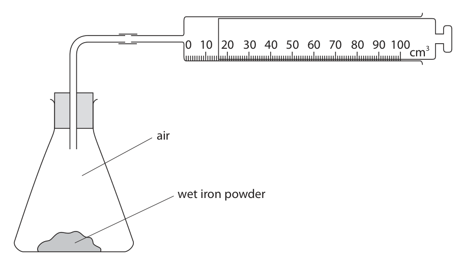

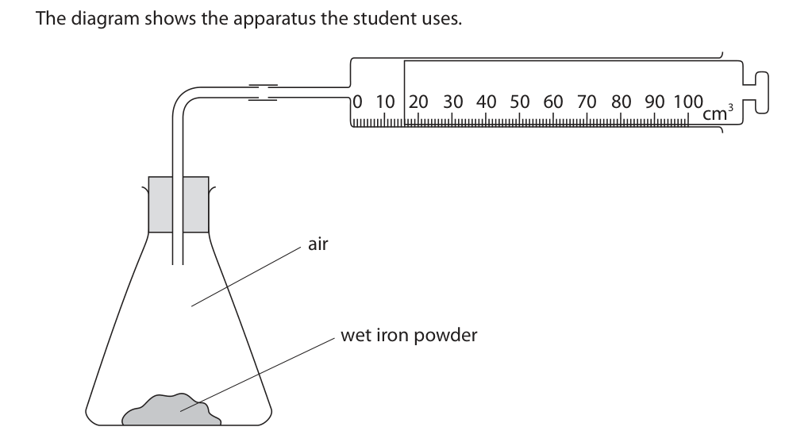

**Mark scheme answer**

> syringe reading at start 81 ALLOW ecf on syringe
> syringe reading at end 16 reading at start if syringe
> change in volume in cm3 65 reading at end read
> incorrectly
> correct volumes the wrong
> way round scores 1

- **(2)** syringe reading at start 81 ALLOW ecf on syringe

### 4(c) [3]

The student repeats the experiment and obtains a different set of results. Table 2 shows these results. volume of air in conical flask and glass tube in cm3 260 syringe reading at start 90 syringe reading at end 22 Table 2 Use the results from table 2 to calculate the percentage by volume of oxygen in the air. percentage by volume of oxygen in air = %

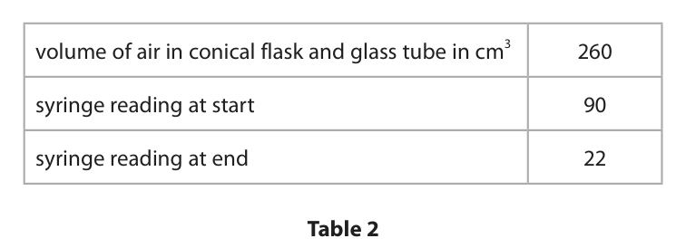

**Mark scheme answer**

> correct answer without
> working scores 3
> M1 (volume of oxygen =) 90 − 22 OR 68 (cm3)
> M2 (total volume at start =) 260 + 90 OR 350 (cm3)
> M3 68 x 100 = 19.4 (%) ALLOW ecf on M1 and M2
> 350 in M3 as long as the answer
> is less than 100%
> ACCEPT any number of sig
> figs except 1
> 26.2 (%) scores 2
> 25.7 (%) scores 2
> 75.6 (%) scores 2
> 34.6 (%) scores 1

- **(1)** (volume of oxygen =) 90 − 22 OR 68 (cm3)
- **(1)** (total volume at start =) 260 + 90 OR 350 (cm3)
- **(1)** 68 x 100 = 19.4 (%) ALLOW ecf on M1 and M2

## Question 5 (11 marks)

This question is about alkanes and alkenes.

**(a)** The alkane C5H12 has three isomers.

### 5(a)(i) [2]

State what is meant by the term isomers.

**Mark scheme answer**

> M1 (compounds with) same molecular formula ALLOW same number of
> carbons and hydrogens /
> atoms of each element
> M2 different structural / displayed formulae ALLOW different
> structures / arrangement
> of atoms

- **(1)** (compounds with) same molecular formula ALLOW same number of
- **(1)** different structural / displayed formulae ALLOW different

### 5(a)(ii) [1]

Calculate the relative formula mass (Mr ) of C5H12 Mr of C5H12 =

**Mark scheme answer**

> (5 x 12 + 12 x1 =) 72

- **(1)** (5 x 12 + 12 x1 =) 72

### 5(a)(iii) [1]

This is the displayed formula of one of the isomers. H H H H H H C C C C C H H H H H H Give the name of this isomer.

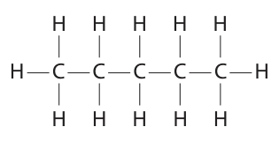

**Mark scheme answer**

> pentane spelling must be correct

- **(1)** pentane spelling must be correct

### 5(a)(iv) [2]

Draw the displayed formulae of the other two isomers. Isomer 1 Isomer 2

**Mark scheme answer**

> M1 either order
> M2

- **(2)** M1 either order

### 5(b) [5]

Ethane (C2H6) and ethene (C2H4) both react with bromine. Describe the differences in the reactions of ethane and ethene with bromine. Refer to the conditions, the products and the types of reaction involved.

**Mark scheme answer**

> A description that refers to any five of the following IGNORE any colour changes
> points: given
> M1 ethane needs UV (radiation) to react IGNORE UV for ethene
> M2 ethane produces bromoethane IGNORE any references to
> temperature and pressure
> M3 ethane produces hydrogen bromide / HBr ALLOW formulae
> M4 reaction with ethane involves breaking C-H bond
> / reaction with ethene involves breaking C=C bond
> M5 ethane reaction is substitution
> M6 ethene produces dibromoethane
> M7 ethene reaction is addition
> ALLOW formula
> M1, M2, M3 and M6 can be
> scored from word or
> chemical equations

- **(5)** A description that refers to any five of the following IGNORE any colour changes

## Question 6 (15 marks)

A student uses this apparatus to investigate the reaction between magnesium and dilute hydrochloric acid. gas syringe magnesium dilute ribbon hydrochloric acid

**(a)** The word equation for the reaction is magnesium + hydrochloric acid → magnesium chloride + hydrogen

**(b)** The student measures the volume of hydrogen collected at regular intervals until the reaction stops. The table shows the student’s results. Time in s 0 15 30 45 60 75 Volume of hydrogen in cm3 0 40 68 80 88 88

**(c)** The student repeats the experiment at a temperature 5 °C higher than the original temperature. All other conditions are kept the same.

### 6(a)(i) [1]

Complete the chemical equation for this reaction. Mg + 2HCl → +

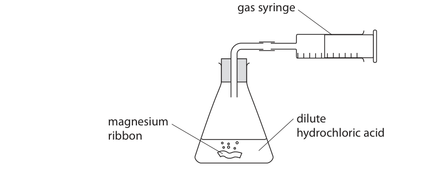

**Mark scheme answer**

> Mg + 2HCl → MgCl2 + H2 IGNORE state symbols
> even if incorrect

- **(1)** Mg + 2HCl → MgCl2 + H2 IGNORE state symbols

### 6(a)(ii) [1]

Give the test for hydrogen.

**Mark scheme answer**

> (squeaky) pop with lighted splint

- **(1)** (squeaky) pop with lighted splint

### 6(a)(iii) [2]

The student uses 0.090 g of magnesium and 0.025 mol of hydrochloric acid. Show by calculation that the hydrochloric acid is in excess.

**Mark scheme answer**

> M1 amount of magnesium = 0.090 ÷ 24 OR 0.00375 (mol)
> M2 amount of HCl needed = 2 × 0.00375 = 0.0075 (mol)
> (which is less than 0.025)
> OR
> M1 amount of magnesium needed = 0.025÷2 OR 0.0125
> (mol)
> M2 mass of magnesium needed = 0.0125 × 24 = 0.3(g)
> (there is less magnesium than needed)
> ALLOW any number of
> significant figures

- **(2)** M1 amount of magnesium = 0.090 ÷ 24 OR 0.00375 (mol)

### 6(b)(i) [1]

Plot the student’s results.

**Mark scheme answer**

> all points plotted correctly to the nearest grid line

- **(1)** all points plotted correctly to the nearest grid line

### 6(b)(ii) [1]

Draw a curve of best fit. 100 Volume of hydrogen in cm3 0 20 40 60 80 Time in s

**Mark scheme answer**

> best fit curve starting at 0 and levelling off at 88 cm3

- **(1)** best fit curve starting at 0 and levelling off at 88 cm3

### 6(b)(iii) [2]

Determine the volume of hydrogen collected in the first 10 seconds. Show on the graph how you obtained your answer. volume of hydrogen = cm3

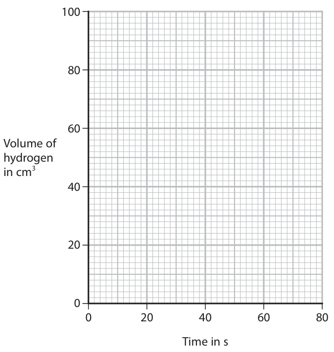

**Mark scheme answer**

> M1 vertical line on grid from 10 seconds to curve ALLOW any mark at
> correct position on
> curve / either axis
> M2 volume correctly read from their graph to the nearest expected value 25 to
> grid line 30 cm3

- **(1)** vertical line on grid from 10 seconds to curve ALLOW any mark at
- **(1)** volume correctly read from their graph to the nearest expected value 25 to

### 6(b)(iv) [2]

Explain why the rate of reaction is greatest at the start of the reaction.

**Mark scheme answer**

> An explanation that links the following two points
> M1 concentration (of HCl) is greatest (at the start) REJECT incorrect
> references to energy
> ALLOW more particles
> (of HCl / more H+
> ions)
> ALLOW more HCl
> molecules / greater
> surface area of Mg
> IGNORE greater mass
> /more Mg
> IGNORE references to
> the graph
> M2 more collisions per unit time / more frequent
> collisions

- **(1)** concentration (of HCl) is greatest (at the start) REJECT incorrect
- **(1)** more collisions per unit time / more frequent

### 6(c)(i) [2]

On the grid, draw the curve you would expect the student to obtain.

**Mark scheme answer**

> M1 curve starting at 0 and steeper than original curve ALLOW a curve
> starting within 1 small
> square of the original
> M2 curve levelling off at same volume as original curve

- **(1)** curve starting at 0 and steeper than original curve ALLOW a curve
- **(1)** curve levelling off at same volume as original curve

### 6(c)(ii) [3]

Explain, in terms of particle collision theory, how increasing the temperature affects the rate of reaction.

**Mark scheme answer**

> An explanation that links the following three points
> M1 particles gain more (kinetic) energy ALLOW particles move
> faster
> M2 more collisions have energy greater than the ACCEPT more
> activation energy collisions are
> successful
> M3 collision frequency increases OR rate of reaction ACCEPT more
> increases (successful) collisions
> per unit time

- **(1)** particles gain more (kinetic) energy ALLOW particles move
- **(1)** more collisions have energy greater than the ACCEPT more
- **(1)** collision frequency increases OR rate of reaction ACCEPT more

## Question 7 (13 marks)

This question is about copper and copper compounds.

**(a)** A sample of copper contains two isotopes. • Cu-63 with relative abundance 69.5% • Cu-65 with relative abundance 30.5%

**(b)** When copper(II) carbonate is heated, copper(II) oxide and carbon dioxide are formed.

**(c)** A student uses this apparatus to find the value of x in the formula CuSO4.xH2O hydrated copper(II) sulfate heat ice water This is the student’s method. • find the mass of an empty boiling tube • add hydrated copper(II) sulfate to the tube and record the new mass • heat the hydrated copper(II) sulfate until it changes colour • allow the tube to cool and record the mass again The table shows the student’s results. mass of empty tube in g 20.52 mass of tube and CuSO4.xH2O in g 31.77 mass of tube and CuSO4 in g 28.20

### 7(a)(i) [2]

State what is meant by the term isotopes.

**Mark scheme answer**

> M1 atoms of the same element / atoms with the same REJECT different
> number of protons /atoms with the same atomic number number of electrons
> IGNORE same
> number of electrons
> M2 (with a) different number of neutrons / different mass

- **(1)** atoms of the same element / atoms with the same REJECT different
- **(1)** (with a) different number of neutrons / different mass

### 7(a)(ii) [3]

Calculate the relative atomic mass (Ar ) of this sample of copper. Give your answer to three significant figures. Ar of copper =

**Mark scheme answer**

> correct answer
> without working
> scores 3
> M1 (63 x 69.5) + (65 x 30.5) OR 6361
> M2 their M1 ÷ 100 OR 63.61
> M3 63.6 ALLOW answer to
> M2 to 3 sig figs
> 63.61 without
> working scores 2

- **(1)** (63 x 69.5) + (65 x 30.5) OR 6361
- **(1)** their M1 ÷ 100 OR 63.61
- **(1)** 63.6 ALLOW answer to

### 7(b)(i) [1]

What is the name of this type of reaction?

- **(A)** decomposition  ✔
- **(B)** neutralisation
- **(C)** oxidation
- **(D)** reduction

**Mark scheme answer**

> A decomposition
> B is incorrect as it is not a neutralisation reaction
> C is incorrect as it is not an oxidation reaction
> D is incorrect as it is not a reduction reaction

- **(1)** Answer A: decomposition

### 7(b)(ii) [1]

Which colour change occurs during this reaction?

- **(A)** blue to black
- **(B)** blue to white
- **(C)** green to black  ✔
- **(D)** green to orange

**Mark scheme answer**

> C green to black
> A is incorrect as copper(II) carbonate is not blue
> B is incorrect as copper(II) carbonate is not blue and
> copper(II) oxide is not white
> D is incorrect as copper(II) oxide is not orange

- **(1)** Answer C: green to black

### 7(c)(i) [1]

Calculate the mass of CuSO4 formed. mass of CuSO4 = g

**Mark scheme answer**

> (28.20 − 20.52 =) 7.68

- **(1)** (28.20 − 20.52 =) 7.68

### 7(c)(ii) [1]

Calculate the mass of water formed. mass of water = g

**Mark scheme answer**

> (31.77 − 28.20 =) 3.57

- **(1)** (31.77 − 28.20 =) 3.57

### 7(c)(iii) [3]

Show that the value of x is approximately 4 [Mr of CuSO4 = 159.5 Mr of H2O = 18]

**Mark scheme answer**

> M1 7.68 ÷ 159.5 OR 0.04815 correct answer
> without working
> M2 3.57 ÷ 18 OR 0.1983 scores 3
> M3 0.1983 ÷ 0.04815 OR 4.12 ALLOW ecf from (i)
> and/or (ii) for M1
> and M2; and M3
> provided the answer
> rounds to 4
> REJECT incorrect
> rounding in M1 or
> M2
> ALLOW any number
> of sig figs in M1 and
> M2 except 1
> Penalise 1 sig fig
> once only

- **(1)** 7.68 ÷ 159.5 OR 0.04815 correct answer
- **(1)** 3.57 ÷ 18 OR 0.1983 scores 3
- **(1)** 0.1983 ÷ 0.04815 OR 4.12 ALLOW ecf from (i)

### 7(c)(iv) [1]

The actual value of x is 5 Give a reason why the calculated value of x is lower than the actual value.

**Mark scheme answer**

> not all the water was removed (from the hydrated ALLOW the
> copper(II) sulfate) (hydrated copper(II)
> sulfate) was not
> heated for long
> enough
> ALLOW not all the
> water left the tube
> (that was being
> heated)
> ALLOW not all the
> (hydrated copper
> sulfate) reacts

- **(1)** not all the water was removed (from the hydrated ALLOW the

## Question 8 (10 marks)

Diamond and graphite are giant covalent structures made of carbon atoms. The diagram shows their structures. Diamond Graphite

### 8(a) [6]

Discuss the differences between diamond and graphite. Refer to structure and bonding, electrical conductivity and hardness in your answer.

**Mark scheme answer**

> 6
> M1 diamond has a tetrahedral (structure) OR in REJECT ions /
> diamond each (carbon) atom is (covalently) bonded to metallic once in M1
> 4 other (carbon) atoms or M2
> M2 graphite has a hexagonal (structure) / has layers
> OR in graphite each (carbon) atom is (covalently)
> bonded to 3 other (carbon) atoms
> M3 diamond does not conduct electricity OR graphite
> conducts electricity
> M4 diamond has no delocalised electrons OR graphite
> has delocalised electrons
> M5 diamond is hard OR graphite is soft REJECT diamond is
> soft / graphite is hard
> M6 in diamond the strong (C-C) bonds need to be REJECT reference to
> broken OR in graphite the layers can slide over each intermolecular
> other OR graphite has weak forces between layers

- **(1)** diamond has a tetrahedral (structure) OR in REJECT ions /
- **(1)** graphite has a hexagonal (structure) / has layers
- **(1)** diamond does not conduct electricity OR graphite
- **(1)** diamond has no delocalised electrons OR graphite
- **(1)** diamond is hard OR graphite is soft REJECT diamond is
- **(1)** in diamond the strong (C-C) bonds need to be REJECT reference to

### 8(b) [4]

C60 fullerene is a simple molecular substance made of 60 carbon atoms. The diagram shows its structure. The table shows the approximate melting points of diamond, graphite and C60 fullerene. Approximate melting point Substance in °C diamond 4000 graphite 3600 C60 fullerene 600 Explain why C60 fullerene has a much lower melting point than diamond and graphite.

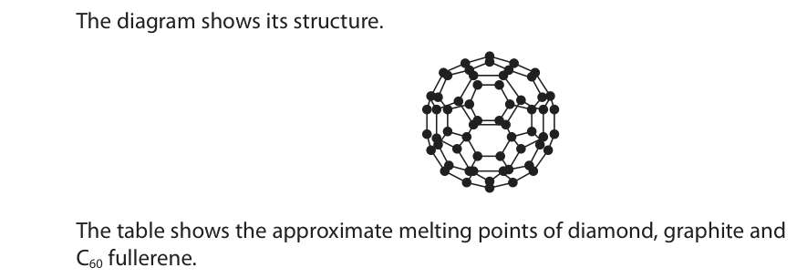

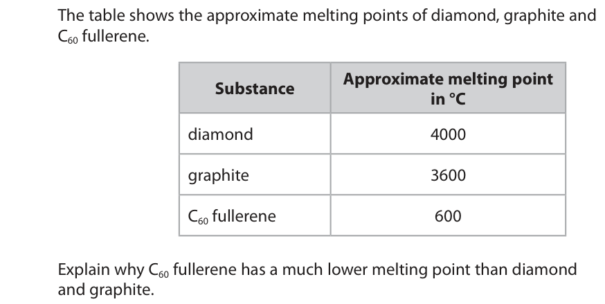

**Mark scheme answer**

> An explanation that links the following four points:
> M1 C60 fullerene has weak forces between the no M1 or M2 if
> molecules /weak intermolecular forces reference to breaking
> bonds in fullerene
> M2 little / less energy needed to break / overcome the
> forces /separate the molecules
> M3 diamond and graphite have many / strong no M3 or M4 if
> (covalent) bonds (between atoms) reference to
> intermolecular forces
> in diamond and
> graphite
> M4 large amount of /more energy needed to break
> /overcome the (covalent) bonds
> If M1 and M3 are not
> scored allow 1 mark
> for covalent bonds (in
> diamond and
> graphite) need to be
> broken / overcome
> AND intermolecular
> forces need to be
> broken / overcome in
> fullerene

- **(1)** C60 fullerene has weak forces between the no M1 or M2 if
- **(1)** little / less energy needed to break / overcome the
- **(1)** diamond and graphite have many / strong no M3 or M4 if
- **(1)** large amount of /more energy needed to break

## Question 9 (11 marks)

This question is about the oxides of lead.

**(a)** Yellow lead oxide (PbO) can be reacted with hydrogen to produce lead.

**(b)** When red lead oxide (Pb3O4) is heated, yellow lead oxide forms. The equation for the reaction is 2Pb3O4 → 6PbO + O2 A scientist heats a known mass of red lead oxide in a crucible in a fume cupboard. The scientist leaves the crucible to cool, then records the total mass of the crucible and its contents.

### 9(a)(i) [1]

Complete the equation for the reaction by adding the missing state symbols. PbO(s) + H2( ) → Pb( ) + H2O( )

**Mark scheme answer**

> PbO(s) + H2(g) → Pb(s) + H2O(l OR g) ALLOW upper case
> letters for state symbols

- **(1)** PbO(s) + H2(g) → Pb(s) + H2O(l OR g) ALLOW upper case

### 9(a)(ii) [1]

What is the charge on the lead ion in PbO?

- **(A)** 1−
- **(B)** 1+
- **(C)** 2−
- **(D)** 2+  ✔

**Mark scheme answer**

> D 2+
> A is incorrect as the charge on the lead ion is not 1-
> B is incorrect as the charge on the lead ion is not 1+
> C is incorrect as the charge on the lead ion is not 2-

- **(1)** Answer D: 2+

### 9(a)(iii) [2]

Explain why the reaction of yellow lead oxide with hydrogen is a redox reaction.

**Mark scheme answer**

> An explanation that links either pair of the two
> points
> M1 lead oxide is reduced and hydrogen is oxidised ACCEPT lead oxide is the
> oxidising agent and
> hydrogen is the reducing
> agent
> M2 lead oxide loses oxygen and hydrogen gains ACCEPT lead ions gain
> oxygen electrons and hydrogen
> loses electrons
> OR
> M1 lead oxide loses oxygen so is reduced ACCEPT lead ions gain
> electrons so are reduced
> M2 hydrogen gains oxygen so is oxidised ACCEPT hydrogen loses
> electrons so is oxidised
> ALLOW oxidation number
> of lead / Pb2+ decreases
> from +2 to 0 so is
> reduced for M1
> Oxidation number of
> hydrogen increases from
> 0 to +1 so is oxidised for
> M2

- **(2)** An explanation that links either pair of the two

### 9(a)(iv) [2]

Describe a physical test to show that the water produced in this reaction is pure.

**Mark scheme answer**

> A description that refers to the following two
> points:
> M1 measure the boiling point (of the water) ALLOW boil it / measure
> the freezing point /
> freeze it
> M2 (boiling point is) 100 oC ACCEPT (freezing point
> is) 0 oC

- **(1)** measure the boiling point (of the water) ALLOW boil it / measure
- **(1)** (boiling point is) 100 oC ACCEPT (freezing point

### 9(b)(i) [2]

Describe what the scientist should do next to make sure that all the red lead oxide has reacted.

**Mark scheme answer**

> An explanation that links the following two points:
> M1 heat the crucible ALLOW repeat the
> experiment
> M2 repeat until constant mass is obtained
> heat to constant mass
> scores 2

- **(1)** heat the crucible ALLOW repeat the
- **(1)** repeat until constant mass is obtained

### 9(b)(ii) [3]

The red lead oxide used in the reaction has a mass of 5.48 g. Calculate the maximum mass of yellow lead oxide that could form. [Mr of Pb3O4 = 685 Mr of PbO = 223] maximum mass of PbO = g

**Mark scheme answer**

> correct final answer
> without working scores 3
> M1 (moles of Pb3O4 =) 5.48 ÷ 685 OR 0.008(00)
> M2 (moles of PbO =) 0.008(00) x 3 OR 0.024(0) ALLOW ecf as long as an
> attempt has been made
> to find moles
> M3 (mass of PbO =) 0.024 x 223 = 5.352 (g) ALLOW answer to M1(if
> no M2) or M2 x 223
> ALLOW any number of sig
> figs except 1

- **(1)** (moles of Pb3O4 =) 5.48 ÷ 685 OR 0.008(00)
- **(1)** (moles of PbO =) 0.008(00) x 3 OR 0.024(0) ALLOW ecf as long as an
- **(1)** (mass of PbO =) 0.024 x 223 = 5.352 (g) ALLOW answer to M1(if

## Question 10 (14 marks)

This question is about ammonia and ammonium compounds.

**(b)** The table shows the names and formulae of some ammonium compounds. Name ammonium sulfate ammonium carbonate Formula (NH4)2SO4 NH4Cl

**(c)** The table gives some information about ammonia and ammonium compounds. Percentage of Approximate pH in Name Formula nitrogen (%) solution ammonia NH3(g) 82 11 ammonium nitrate NH4NO3(s) 5.5 ammonium sulfate (NH4)2SO4(s) 21 5.5

### 10(a) [2]

Ammonia (NH3) is a simple covalent molecule. Draw a dot-and-cross diagram to show the bonding in a molecule of ammonia.

**Mark scheme answer**

> 2
> M1 3 bonding pairs
> M2 rest of molecule fully correct M2 dep on M1
> ALLOW any combination of
> dots and crosses

- **(1)** 3 bonding pairs
- **(1)** rest of molecule fully correct M2 dep on M1

### 10(b)(i) [2]

Complete the table by giving the missing information.

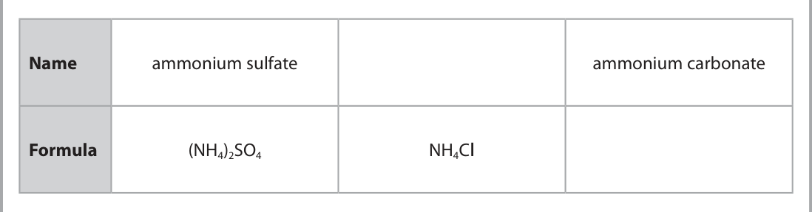

**Mark scheme answer**

> 2
> M1 ammonium ammonium
> chloride carbonate
> NH4Cl M2 (NH4)2CO3

- **(2)** 2

### 10(b)(ii) [1]

When ammonia reacts with sulfuric acid, ammonium sulfate is formed. Write a chemical equation for this reaction.

**Mark scheme answer**

> 2NH3 + H2SO4 → (NH4)2SO4 ALLOW multiples
> IGNORE state symbols even
> if incorrect

- **(1)** 2NH3 + H2SO4 → (NH4)2SO4 ALLOW multiples

### 10(b)(iii) [3]

Describe a test for ammonium ions.

**Mark scheme answer**

> M1 add sodium hydroxide (solution)
> M2 test (gas / ammonia) with (damp) red
> litmus paper / (damp) universal indicator paper
> M3 (red litmus) turns blue / universal indicator) REJECT if solution /
> turns blue / purple ammonium (sulfate) tested
> with litmus / universal
> indicator paper

- **(1)** add sodium hydroxide (solution)
- **(1)** test (gas / ammonia) with (damp) red
- **(1)** (red litmus) turns blue / universal indicator) REJECT if solution /

### 10(c)(i) [2]

Calculate the percentage of nitrogen in ammonium nitrate. [Mr of NH4NO3 = 80] percentage of nitrogen = %

**Mark scheme answer**

> M1 2 x 14 ÷ 80 OR 0.35 correct answer without
> working scores 2
> M2 (0.35 x 100 =) 35 (%) ALLOW 1 mark for 17 / 17.5
> / 18 (%)

- **(1)** 2 x 14 ÷ 80 OR 0.35 correct answer without
- **(1)** (0.35 x 100 =) 35 (%) ALLOW 1 mark for 17 / 17.5

### 10(c)(ii) [4]

Fertilisers add nitrogen to the soil to help plants grow. Ammonia and ammonium sulfate can both be used as fertilisers. Discuss the advantages and disadvantages of using each of these compounds as fertilisers. Use information from the table in your answer. [pH of rainwater is approximately 5.6]

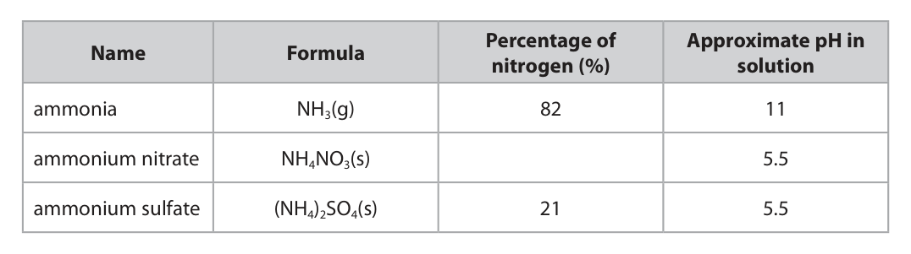

**Mark scheme answer**

> An answer that links any 4 points:
> M1 (NH3) higher % of N OR ((NH4)2SO4) lower %
> of N
> M2 (NH4)2SO4 easy to use (to soil) / easy for the
> plants to absorb / less wastage
> OR (NH3) difficult to use (to soil) / difficult for
> the plants to absorb / more wastage / has to
> be dissolved (in water) first
> M3 (NH4)2SO4 pH close to that of (rain) water / REJECT NH3 has a pH close
> will not alter the pH (of the soil/water) to rainwater
> M4 NH3 will cause (the soil/water) to become REJECT ammonia causes the
> alkaline / will raise the pH (of the soil/water) / soil / water to become
> neutralise (the water / soil) / may stunt growth acidic
> of plants / may damage / kill plants
> M5 NH3 and or (NH4)2SO4 soluble so runoff /
> wastage of fertiliser / water pollution /
> eutrophication / leaching
> Pearson Education Limited. Registered company number 872828
> with its registered office at 80 Strand, London, WC2R 0RL, United Kingdom

- **(4)** An answer that links any 4 points:

