# 4CH1/1CR — 2022-06 (official extraction)

> schema `syllabai.official-paper-questions/0.2` · paper_id `pearson-edexcel:international-gcse:chemistry:4ch1:2022-06:4CH1/1CR` · qp sha256 `f1d98b594b804b5d…` · extraction is the disclosed baseline (ADR-039)

## Question 1 (6 marks)
### 1(a) [4]

The diagram represents an atom of an element. proton neutron electron Use numbers from the box to complete the table. You may use each number once, more than once or not at all. 2 4 5 9 10 Atomic number of this atom Mass number of this atom Period number of this element Number of electrons in the 2+ ion formed from this atom

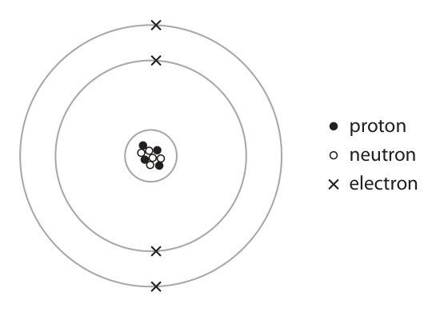

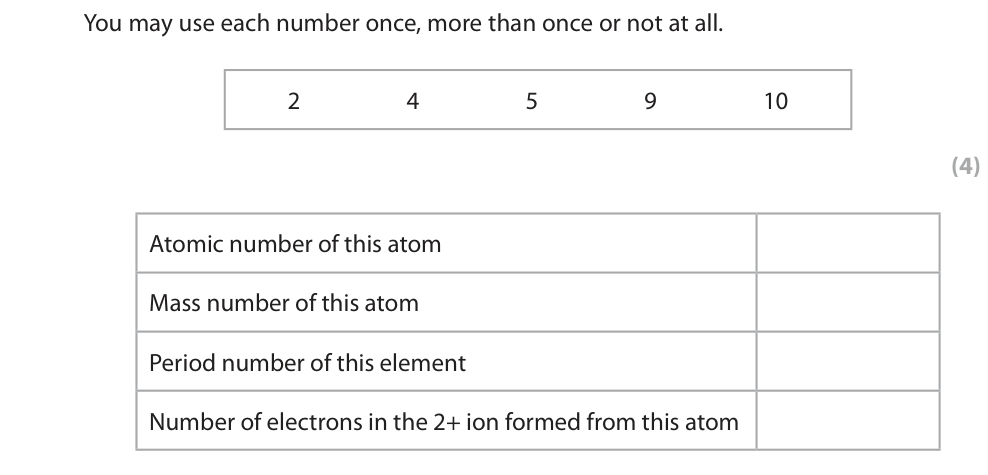

**Mark scheme answer**

> Atomic number of this atom 4 1 mark each correct
> answer
> Mass number of this atom 9
> Period number of this element 2
> Number of electrons in the 2+ ion formed from this
> atom 2

- **(4)** Atomic number of this atom 4 1 mark each correct

### 1(b) [2]

In terms of sub‑atomic particles, state a similarity and a difference for isotopes of the same element. similarity difference

**Mark scheme answer**

> Similarity = number of protons ALLOW both isotopes
> have 4 protons
> ALLOW references to
> electrons
> Difference = number of neutrons ALLOW stated examples
> eg one isotope has 5
> neutrons, the other has
> 6 neutrons
> If similarity: same
> atomic number and
> difference: different
> mass number
> ALLOW 1 mark

- **(2)** Similarity = number of protons ALLOW both isotopes

## Question 2 (8 marks)

This question is about apparatus used in the laboratory.

**(b)** The diagram shows apparatus used to obtain pure water from sodium chloride solution by simple distillation. water out sodium chloride solution water in conical flask pure water

### 2(a) [2]

Complete the table by giving the name of each piece of apparatus and a unit used for the quantity it measures. Apparatus Name Unit 0 20 40 60 80 100

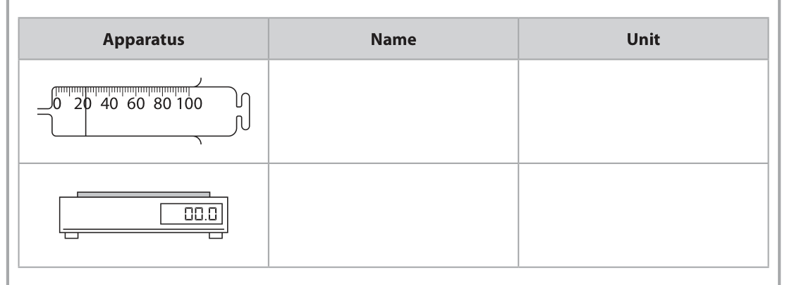

**Mark scheme answer**

> Apparatus Unit
> (gas) syringe cm3 ALLOW ml
> (top pan) balance OR g OR mg ALLOW words
> (weighing) scales e.g.grams
> ALLOW weighing
> machine
> ALLOW kg
> 1 mark each correct
> row/column
> Mark horizontally or
> vertically (whichever
> benefits the candidate)

- **(2)** Apparatus Unit

### 2(b)(i) [2]

Explain why it is necessary for water to flow continuously in and out of the apparatus.

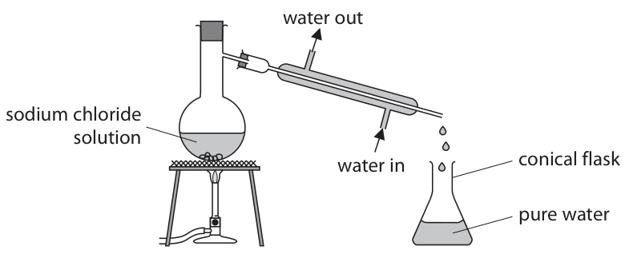

**Mark scheme answer**

> M1 to cool (the water vapour/steam) ALLOW to keep
> condenser cool
> M2 so the water vapour/steam condenses ALLOW so the water
> vapour/steam becomes
> liquid

- **(1)** to cool (the water vapour/steam) ALLOW to keep
- **(1)** so the water vapour/steam condenses ALLOW so the water

### 2(b)(ii) [2]

Describe a chemical test to show that the sodium chloride solution contains chloride ions.

**Mark scheme answer**

> M1 add silver nitrate/AgNO3 (solution) IGNORE addition of
> nitric acid but REJECT
> addition of
> hydrochloric/sulfuric
> acid for M1
> M2 white precipitate M2 dep on use of silver
> nitrate

- **(1)** add silver nitrate/AgNO3 (solution) IGNORE addition of
- **(1)** white precipitate M2 dep on use of silver

### 2(b)(iii) [2]

Describe a physical test to show that the liquid in the conical flask is pure water.

**Mark scheme answer**

> M1 measure its boiling point ALLOW boil it
> M2 (boiling point is) 100°C
> OR
> M1 measure its freezing point ALLOW freeze it
> M2 (freezing point is) 0°C

- **(2)** M1 measure its boiling point ALLOW boil it

## Question 3 (9 marks)

The diagram shows a chromatogram of the food dyes in four different food colourings, A, B, C and D. 8 solvent front 0 start line A B C D

### 3(a)(i) [1]

Give the letter of the food colouring that contains three different food dyes.

**Mark scheme answer**

> B

- **(1)** B

### 3(a)(ii) [1]

Give the letters of the two food colourings that contain the same dye.

**Mark scheme answer**

> A and B

- **(1)** A and B

### 3(a)(iii) [2]

Using the scale on the diagram, determine the Rf value of the dye in food colouring C. Rf =

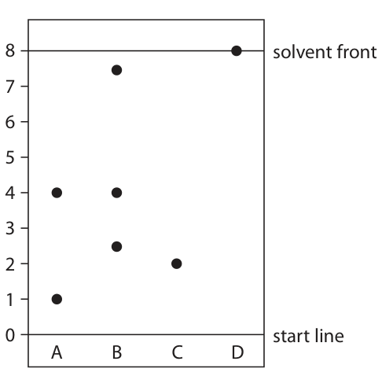

**Mark scheme answer**

> 0.25 without working
> scores 2
> M1 2 and 8
> ALLOW M1 for 1.8-2.2
> and 8 and ALLOW M2
> ECF as long as correctly
> evaluated to at least 2
> M2 0.25 SF
> (Special case if used
> ruler and then) 1.4-1.7
> and 5.9-6.2 used no M1
> but ALLOW M2 ECF as
> long as correctly
> evaluated to at least 2
> SF

- **(1)** 2 and 8
- **(1)** 0.25 SF

### 3(a)(iv) [1]

Give a reason why the dye in food colouring D moves the furthest from the start line.

**Mark scheme answer**

> the dye is the most soluble (in the solvent/water)

- **(1)** the dye is the most soluble (in the solvent/water)

### 3(b) [4]

Describe how a student could obtain a chromatogram similar to the one shown in the diagram.

**Mark scheme answer**

> Any four from ALLOW water for
> solvent throughout
> ALLOW dye for food
> colouring throughout
> M1 draw start line in pencil
> M2 use same food colourings/use same solvent/use IGNORE length of paper
> same (type of chromatography) paper
> M3 place (spots/samples of) A, B, C, D/food
> colourings on the start line OWTTE
> M4 (place paper in beaker) with start line above
> solvent OWTTE
> M5 (remove paper/stop experiment) when solvent
> almost reaches top of paper / when spots stop
> moving OWTTE
> M6 mark solvent front (on paper)
> M7 (remove paper from beaker and) allow to dry

- **(4)** Any four from ALLOW water for

## Question 4 (12 marks)

The diagram shows the positions of some elements in part of the Periodic Table. Na Al S Cl K Xe In

**(d)** A teacher adds a small piece of sodium to a glass trough containing water and universal indicator. The universal indicator changes colour. The equation for the reaction is 2Na(s) + 2H2O(l) → 2NaOH(aq) + H2(g)

### 4(a)(i) [1]

Give the symbol of a metal from the diagram.

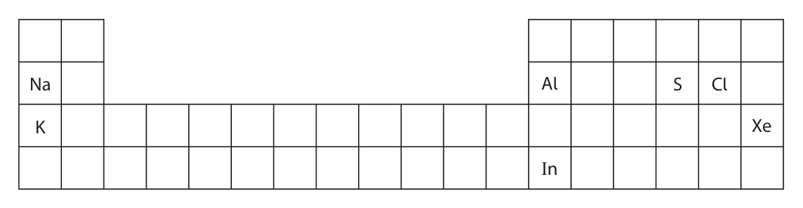

**Mark scheme answer**

> Any one from: ALLOW names of
> Na elements
> K Apply list principle
> Al
> In

- **(1)** Any one from: ALLOW names of

### 4(a)(ii) [1]

Give the symbol of an element from the diagram that forms an acidic oxide.

**Mark scheme answer**

> Any one from ALLOW names of
> S elements
> Cl

- **(1)** Any one from ALLOW names of

### 4(b) [1]

Give a similarity in the electron configurations of Al and In.

**Mark scheme answer**

> same number / three electrons in the outer shell ALLOW valence shell

- **(1)** same number / three electrons in the outer shell ALLOW valence shell

### 4(c) [2]

Explain which element in the diagram is unreactive.

**Mark scheme answer**

> M1 Xe or xenon
> M2 as it has a full outer shell (of electrons) ALLOW has eight
> electrons in outer shell
> ACCEPT does not
> (easily) gain/lose/share
> electrons
> M2 dep on M1

- **(1)** Xe or xenon
- **(1)** as it has a full outer shell (of electrons) ALLOW has eight

### 4(d)(i) [2]

Explain the final colour of the universal indicator.

**Mark scheme answer**

> M1 (universal indicator turns) blue or purple
> M2 because an alkali is produced ACCEPT OH− /
> hydroxide ions are
> produced
> ALLOW sodium
> hydroxide is a base / a
> base is produced

- **(1)** (universal indicator turns) blue or purple
- **(1)** because an alkali is produced ACCEPT OH− /

### 4(d)(ii) [2]

The teacher repeats the experiment with potassium instead of sodium. Give one similarity and one difference observed with potassium. similarity difference

**Mark scheme answer**

> (similarity) any one from:
> (both)
> effervesce ALLOW fizzes/bubbles
> melt / turn into a sphere
> move on surface ALLOW float
> universal indicator turns the same colour ALLOW both
> disappear/get
> smaller/dissolve
> (difference) any one from: ALLOW faster/more
> potassium gives a lilac flame vigorous reaction for
> potassium moves faster potassium
> potassium effervesces faster
> ALLOW reverse
> arguments for sodium

- **(2)** (similarity) any one from:

### 4(d)(iii) [3]

The reaction with sodium produces 0.036 g of hydrogen gas. One mole of hydrogen gas contains 6.0 × 10²³ molecules. Calculate the number of molecules of hydrogen gas produced in the reaction with sodium. Give your answer to two significant figures. number of molecules of hydrogen gas =

**Mark scheme answer**

> correct answer with no
> Example calculation working scores 3 marks
> M1 (moles of hydrogen) 0.036÷2 OR 0.018 mol
> M2 0.018 × 6.0× 10²³ OR 1.08× 10²² molecules ALLOW ECF M1 ×
> 6.0× 10²³
> M3 1.1× 10²² ALLOW ECF M2 but
> must be to 2 sig figs
> 2.16 x 1022 scores 1
> 2.2 x 1022 scores 2

- **(1)** (moles of hydrogen) 0.036÷2 OR 0.018 mol
- **(1)** 0.018 × 6.0× 10²³ OR 1.08× 10²² molecules ALLOW ECF M1 ×
- **(1)** 1.1× 10²² ALLOW ECF M2 but

## Question 5 (11 marks)

This question is about metal carbonates. When heated, some metal carbonates decompose to form a metal oxide and carbon dioxide gas.

**(b)** A student is given a solid metal carbonate with the formula XCO3 X represents the symbol of a Group 2 metal. A student uses this apparatus to heat a sample of XCO3 until it all decomposes. cotton wool plug XCO3 The equation for the decomposition of XCO3 is XCO3 → XO + CO2 The student records the mass of XCO3 and the mass of carbon dioxide that escapes through the cotton wool plug. These are the student’s results. mass of XCO3 = 7.40 g mass of CO2 = 2.20 g

### 5(a) [4]

A student is given three solid metal carbonates, a timer, some limewater and this apparatus. boiling tube test tube Describe a method the student can use to find out which metal carbonate decomposes fastest when heated.

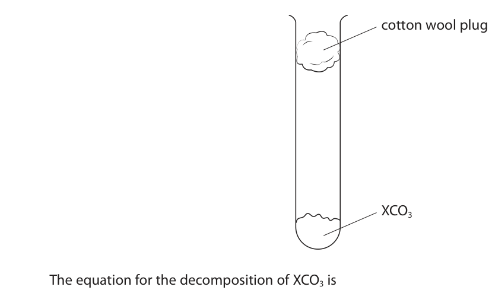

**Mark scheme answer**

> M1 (put the carbonate in the boiling tube) and the
> limewater in the test tube
> M2 heat the carbonate and time how long it takes
> for the limewater to turn cloudy OWTTE
> M3 repeat with the same mass / amount / number ACCEPT repeat with
> of moles of another carbonate another carbonate using
> same volume of
> limewater OWTTE
> M4 (the carbonate which decomposes the fastest)
> will turn the limewater cloudy in the least time
> To score M4 reference
> to limewater turning
> cloudy must be
> mentioned at least once
> somewhere in answer

- **(1)** (put the carbonate in the boiling tube) and the
- **(1)** heat the carbonate and time how long it takes
- **(1)** repeat with the same mass / amount / number ACCEPT repeat with
- **(1)** (the carbonate which decomposes the fastest)

### 5(b)(i) [1]

Give a reason why the student uses a cotton wool plug.

**Mark scheme answer**

> to prevent loss of solid/XCO3/carbonate/XO ALLOW so only carbon
> dioxide/gas can escape

- **(1)** to prevent loss of solid/XCO3/carbonate/XO ALLOW so only carbon

### 5(b)(ii) [1]

Calculate the amount, in mol, of carbon dioxide produced. [for carbon dioxide Mr = 44] amount of carbon dioxide = mol

**Mark scheme answer**

> 0.05

- **(1)** 0.05

### 5(b)(iii) [1]

Use the equation to determine the amount, in mol, of XCO3 that decomposed. amount of XCO3 = mol

**Mark scheme answer**

> 0.05 ALLOW ECF from (ii)

- **(1)** 0.05 ALLOW ECF from (ii)

### 5(b)(iv) [2]

Use the mass of XCO3 and your answer to (b)(iii) to calculate the relative formula mass (Mr) of XCO3 Mr of XCO3 =

**Mark scheme answer**

> M1 7.40 ÷ 0.05 correct answer with or
> without working scores
> M2 148
> ALLOW ECF from (iii)

- **(1)** 7.40 ÷ 0.05 correct answer with or
- **(1)** 148

### 5(b)(v) [2]

Use your answer to (b)(iv) and the Periodic Table on page 2 to determine the identity of the Group 2 metal X. Show your working. identity of X =

**Mark scheme answer**

> M1 Ar of metal = 148-60 OR 88 If (iv) correct
> strontium/Sr scores 2
> M2 metal is strontium / Sr without working
> ALLOW ECF from (iv)
> ALLOW ECF from M1 as
> long as answer is
> nearest Group 2 metal

- **(1)** Ar of metal = 148-60 OR 88 If (iv) correct
- **(1)** metal is strontium / Sr without working

## Question 6 (9 marks)

Silicon hydride (SiH4) and silicon dioxide (SiO2) both contain covalent bonds but they have different structures.

**(c)** The diagram represents part of the structure of silicon dioxide (SiO2). A

### 6(a) [2]

Describe the forces of attraction in a covalent bond.

**Mark scheme answer**

> M1 shared pair(s) of electrons
> M2 attracted to (two) nuclei REJECT nucleus. Must be
> plural for M2
> M2 dep on mention of
> electrons in M1

- **(1)** shared pair(s) of electrons
- **(1)** attracted to (two) nuclei REJECT nucleus. Must be

### 6(b) [1]

Complete the diagram to show the outer shell electrons in a molecule of silicon hydride (SiH4). H H Si H H

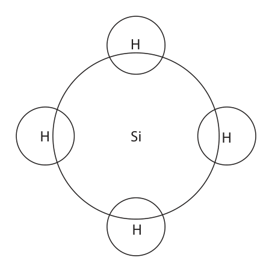

**Mark scheme answer**

> a pair of electrons in each bond and no non-bonding ALLOW dots, crosses or
> electrons. any combination

- **(1)** a pair of electrons in each bond and no non-bonding ALLOW dots, crosses or

### 6(c)(i) [1]

State how the diagram shows that the atom labelled A is oxygen, not silicon.

**Mark scheme answer**

> Any one from
> M1 oxygen is a smaller atom/particle than silicon
> M2 each (atom of) oxygen forms two bonds (to
> silicon atoms)

- **(1)** Any one from

### 6(c)(ii) [4]

Silicon hydride has a simple molecular structure. Silicon dioxide has the same type of structure as diamond. Explain why silicon dioxide has a much higher melting point than silicon hydride. Refer to structure and bonding in your answer.

**Mark scheme answer**

> M1 silicon dioxide has a giant (covalent) structure
> M2 (in melting silicon dioxide) strong/many ALLOW description of
> covalent bonds (need to be broken) covalent bonds as long as
> strong/many mentioned
> M3 (in melting silicon hydride) weak intermolecular ALLOW weak
> forces (of attraction need to be overcome/broken) intermolecular bonds
> M4 more (thermal/heat) energy is needed to break
> the (covalent) bonds (in SiO2) than break/overcome
> the intermolecular forces (in SiH4)
> Max 2 if
> contradictions/references
> to incorrect
> forces/particles

- **(1)** silicon dioxide has a giant (covalent) structure
- **(1)** (in melting silicon dioxide) strong/many ALLOW description of
- **(1)** (in melting silicon hydride) weak intermolecular ALLOW weak
- **(1)** more (thermal/heat) energy is needed to break

### 6(d) [1]

Silicon hydride reacts with oxygen to form silicon dioxide and water. Write a chemical equation for the reaction between silicon hydride and oxygen.

**Mark scheme answer**

> SiH4 + 2O2 → SiO2 + 2H2O
> all formula correct and equation correctly balanced IGNORE state symbols
> ALLOW multiples and
> fractions

- **(1)** SiH4 + 2O2 → SiO2 + 2H2O

## Question 7 (15 marks)

The diagram shows some important conversion processes used in the oil industry. crude oil process 1 kerosene process 2 ethene process 3 chloroethene process 4 poly(chloroethene)

**(b)** C12H26 is present in kerosene. In process 2, C12H26 is cracked to produce two molecules of ethene and one molecule of another hydrocarbon.

### 7(a) [5]

Describe how kerosene is produced from crude oil in process 1.

**Mark scheme answer**

> Any five from
> M1 fractional distillation
> M2 crude oil heated/vapourised ALLOW boiled
> M3 reference to (fractionating) column/tower
> M4 which is hotter at the bottom than at the top ALLOW reference to
> temperature gradient
> ALLOW the
> hydrocarbons/gases/vapours
> cool as they rise up the
> column
> M5 shorter hydrocarbons/chains/molecules have ACCEPT reverse argument
> lower boiling point (and rise higher/towards the
> top)
> M6 fractions/hydrocarbons/gases/vapours/kerosene ALLOW correct reference to
> condense(s) at (levels depending on) their boiling position of kerosene
> points OWTTE fraction below refinery
> gases and gasoline fractions
> or above diesel and fuel oil
> fractions

- **(5)** Any five from

### 7(b)(i) [1]

Complete the equation for the cracking of C12H26 C12H26 → 2C2H4 +

**Mark scheme answer**

> C8H18

- **(1)** C8H18

### 7(b)(ii) [4]

Explain why cracking is a useful process in the oil industry.

**Mark scheme answer**

> Any four from
> M1 fractional distillation/crude oil produces more ALLOW short(er) chain
> long-chain hydrocarbons than can be used (directly) hydrocarbons are in higher
> demand/more useful than
> long(er) chain hydrocarbons
> ORA
> M2 cracking produces short chain alkanes ALLOW cracking changes
> long(er) chain hydrocarbons
> into short(er) chain
> hydrocarbons
> M3 short chain alkanes/hydrocarbons are more
> flammable/can be used as fuels
> M4 cracking produces alkene(s) IGNORE named alkene
> M5 alkenes can be used to make polymers ALLOW named alkene
> forming (named) polymer
> e.g. ethene can be used to
> make poly(ethene)/polymer

- **(4)** Any four from

### 7(c) [1]

This is the equation for one of the reactions that may occur during process 3. What is the name of this type of reaction?

- **(A)** addition  ✔
- **(B)** combustion
- **(C)** decomposition
- **(D)** substitution

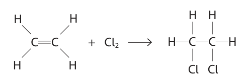

**Mark scheme answer**

> A Addition
> The only correct answer is A because the reaction
> between an alkene and a halogen forming a
> halogenoalkane is addition.
> B is not the correct answer since this reaction is not
> combustion.
> C is not the correct answer since this reaction is not
> decomposition.
> D is not the correct answer since this reaction is not
> substitution.

- **(1)** Answer A: addition

### 7(d)(i) [2]

Complete the equation for the polymerisation of chloroethene in process 4.

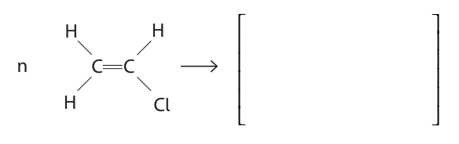

**Mark scheme answer**

> 2
> M1 single bond between the two carbons and single
> bonds to three hydrogens and one chlorine
> M2 two extension bonds and n n can be anywhere after
> brackets
> extension bonds do not have
> to go through brackets
> M2 dep on M1

- **(1)** single bond between the two carbons and single
- **(1)** two extension bonds and n n can be anywhere after

### 7(d)(ii) [2]

Explain why the disposal of polymers such as poly(chloroethene) is difficult.

**Mark scheme answer**

> 2
> M1 they are inert/unreactive
> M2 (so) they are non-biodegradable/ ALLOW take long time to
> do not (naturally) break down/decompose (in break down (so landfill sites
> landfill sites) may fill up)
> OR
> M1 when burned
> M2 they produce toxic fumes

- **(2)** 2

## Question 8 (10 marks)

This question is about exothermic reactions.

**(a)** A student uses this apparatus to measure the temperature increase when an excess of zinc powder is added to copper(II) sulfate solution. zinc powder 75 g copper(II) sulfate solution glass beaker polystyrene cup

### 8(a)(i) [1]

Complete the word equation for the reaction. zinc + copper(II) sulfate → +

**Mark scheme answer**

> zinc + copper(II) sulfate → zinc sulfate + copper REJECT copper(II) as a
> product
> ACCEPT zinc(II) sulfate

- **(1)** zinc + copper(II) sulfate → zinc sulfate + copper REJECT copper(II) as a

### 8(a)(ii) [1]

Give a reason why the student uses a polystyrene cup inside a glass beaker.

**Mark scheme answer**

> polystyrene is an insulator / prevents heat loss ALLOW to prevent the
> cup falling over

- **(1)** polystyrene is an insulator / prevents heat loss ALLOW to prevent the

### 8(a)(iii) [1]

State why zinc reacts with copper(II) sulfate solution.

**Mark scheme answer**

> zinc is more reactive / higher in the reactivity ALLOW reverse argument
> series than copper

- **(1)** zinc is more reactive / higher in the reactivity ALLOW reverse argument

### 8(a)(iv) [2]

The temperature at the start of the reaction is 19.7 °C. The temperature at the end of the reaction is 48.3 °C. Calculate the heat energy change, in joules, for the reaction. [for the mixture, c = 4.2 J/g/°C] heat energy change = J

**Mark scheme answer**

> 2
> correct answer without
> M1 temperature rise = 28.6°C working scores 2
> M2 (75 × 4.2 × 28.6 =) 9009 ALLOW 9010/9000
> IGNORE any sign
> ALLOW ECF from M1

- **(1)** temperature rise = 28.6°C working scores 2
- **(1)** (75 × 4.2 × 28.6 =) 9009 ALLOW 9010/9000

### 8(b)(i) [3]

The reaction between zinc and silver nitrate solution is exothermic. A mass of 0.65 g of zinc is added to excess silver nitrate solution. The heat energy change is 800 J. Calculate the molar enthalpy change, ΔH, in kJ/mol. Include a sign in your answer. ΔH = kJ/mol

**Mark scheme answer**

> correct answer without
> working scores 3
> M1 800÷1000 OR 0.8 (kJ)
> M2 0.65÷65 OR 0.01 (mol)
> M3 0.8÷0.01 = −80 (kJ/mol)
> OR
> M1 0.65÷65 OR 0.01 (mol)
> M2 800÷0.01 OR 80 000 (J/mol)
> M3 −80 (kJ/mol)
> ALLOW ECF but answer
> must have a − sign
> 80/+80 scores 2

- **(3)** correct answer without

### 8(b)(ii) [2]

This is the ionic equation for the reaction between zinc and silver nitrate solution. Zn(s) + 2Ag+(aq) → Zn2+(aq) + 2Ag(s) Explain, in terms of electrons, why this is a redox reaction.

**Mark scheme answer**

> M1 zinc/Zn is oxidised because loses electrons
> M2 silver ion(s)/Ag+ reduced because gain electrons
> OR
> M1 zinc/Zn is oxidised and silver ion(s)/Ag+ reduced
> M2 zinc/Zn loses electrons and silver ion(s)/Ag+
> gain electrons

- **(2)** M1 zinc/Zn is oxidised because loses electrons

## Question 9 (10 marks)

This question is about rates of reaction.

**(a)** A student uses this method to investigate the rate of reaction between iron(III) nitrate solution and sodium thiosulfate solution. • pour 50 cm3 of iron(III) nitrate solution into a conical flask • add one drop of catalyst solution • add 50 cm3 of sodium thiosulfate solution to the conical flask • record the time for the mixture to become colourless The student repeats the method using different catalysts and also with no catalyst. The table shows the student’s results. Catalyst Time for mixture to become colourless in s no catalyst 55 cobalt(II) chloride solution 32 copper(II) sulfate solution 8 iron(II) sulfate solution 27 zinc nitrate solution 75

**(b)** The rate of a reaction can also be altered by changing the temperature or by changing the concentration of solutions.

### 9(a)(i) [2]

Explain which is the best catalyst for the reaction.

**Mark scheme answer**

> M1 copper(II) sulfate (solution) ALLOW copper sulfate
> M2 shortest time taken to turn colourless ALLOW gave greatest
> increase in rate OWTTE
> ALLOW made reaction
> happen fastest OWTTE
> M2 dep on M1

- **(1)** copper(II) sulfate (solution) ALLOW copper sulfate
- **(1)** shortest time taken to turn colourless ALLOW gave greatest

### 9(a)(ii) [2]

Explain how a catalyst increases the rate of a reaction.

**Mark scheme answer**

> M1 a catalyst provides an alternative pathway
> M2 of lower activation energy Any reference to
> increasing
> energy/speed of
> particles scores 0

- **(1)** a catalyst provides an alternative pathway
- **(1)** of lower activation energy Any reference to

### 9(b)(i) [4]

Explain, using the particle collision theory, how increasing the temperature affects the rate of a reaction.

**Mark scheme answer**

> An explanation with following four points
> M1 the rate of reaction increases/ the reaction is
> faster/ the reaction speeds up
> M2 because the particles gain (kinetic) energy
> /move faster
> M3 there are more collisions per unit time ACCEPT more frequent
> collisions OWTTE
> M4 more of the collisions are successful / more
> collisions/particles have energy greater than the No M4 if refer to lower
> activation energy activation energy
> there are more
> frequent successful
> collisions scores M3 and
> M4

- **(1)** the rate of reaction increases/ the reaction is
- **(1)** because the particles gain (kinetic) energy
- **(1)** there are more collisions per unit time ACCEPT more frequent
- **(1)** more of the collisions are successful / more

### 9(b)(ii) [2]

Explain why using a solution of a lower concentration decreases the rate of reaction.

**Mark scheme answer**

> M1 fewer particles per unit volume ALLOW particles less
> tightly packed /
> particles further apart
> M2 (hence) fewer collisions per unit time ALLOW decrease in the
> frequency of collisions
> between particles
> Any reference to
> changing energy/speed
> of particles scores 0

- **(1)** fewer particles per unit volume ALLOW particles less
- **(1)** (hence) fewer collisions per unit time ALLOW decrease in the

## Question 10 (10 marks)

A student investigates how the electrical conductivity changes as dilute sulfuric acid is added to barium hydroxide solution. This is the student’s method. Step 1 add 50.0 cm3 of barium hydroxide solution to a beaker Step 2 measure the electrical conductivity of the solution Step 3 add 10.0 cm3 of dilute sulfuric acid to the beaker Step 4 stir the mixture Step 5 measure the electrical conductivity of the mixture Step 6 repeat steps 3 to 5 until a total of 100 cm3 of dilute sulfuric acid has been added The table shows the student’s results. Total volume of acid added Electrical conductivity in cm3 in arbitrary units 0.0 10.0 10.0 8.0 20.0 7.2 30.0 4.0 40.0 2.0 50.0 0.0 60.0 1.4 70.0 2.8 80.0 4.2 90.0 5.6 100.0 7.0

**(b)** This is the equation for the reaction. Ba(OH)2(aq) + H2SO4(aq) → BaSO4(s) + 2H2O(l)

### 10(a)(i) [1]

Name a piece of apparatus the student could use to add 10.0 cm3 of dilute sulfuric acid to the beaker.

**Mark scheme answer**

> measuring cylinder / burette / pipette ALLOW syringe

- **(1)** measuring cylinder / burette / pipette ALLOW syringe

### 10(a)(ii) [2]

Plot the student’s results.

**Mark scheme answer**

> M1 and M2 all the points correct ± half a square If only one plotting error
> scores M1

- **(2)** M1 and M2 all the points correct ± half a square If only one plotting error

### 10(a)(iii) [1]

Ignoring the anomalous result, draw two lines of best fit, making sure that the two lines cross. 10.0 8.0 6.0 Electrical conductivity in arbitrary units 4.0 2.0 0.0 0 20 40 60 80 100 Total volume of acid added in cm3

**Mark scheme answer**

> 2 straight lines of best fit, ignoring the anomalous Left line does not have to
> point go through/use (0.0, 10.0)
> if point has not been
> plotted

- **(1)** 2 straight lines of best fit, ignoring the anomalous Left line does not have to

### 10(a)(iv) [1]

Give the trend shown on the graph for the first 50 cm3 of acid added.

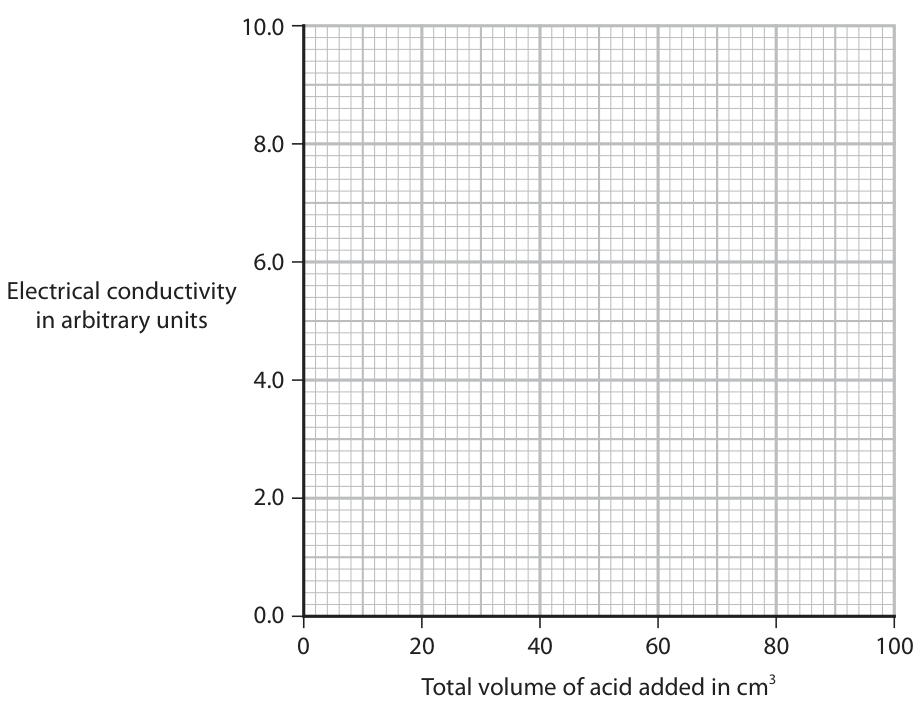

**Mark scheme answer**

> as the volume of sulfuric acid increases the IGNORE references to
> (electrical) conductivity decreases gradient/slope/correlation

- **(1)** as the volume of sulfuric acid increases the IGNORE references to

### 10(a)(v) [1]

Suggest a mistake the student could have made to cause the anomalous result.

**Mark scheme answer**

> (the student) forgot to stir the mixture ALLOW any reference to
> adding less acid/lower
> volume (than should have
> done) OWTTE

- **(1)** (the student) forgot to stir the mixture ALLOW any reference to

### 10(b)(i) [3]

When 50 cm3 of dilute sulfuric acid have been added, only barium sulfate and water are present in the mixture. Explain why this mixture does not conduct electricity. Refer to the type of bonding in barium sulfate and in water in your answer.

**Mark scheme answer**

> M1 barium sulfate has a (giant) ionic structure OR
> has ionic bonding
> M2 ionic substances do not conduct when solid ALLOW only conduct when
> dissolved/molten
> ALLOW in solid ions
> cannot move
> M3 water has covalent bonding and covalent ALLOW water does not
> compounds do not (usually) conduct electricity conduct because it is
> covalent
> IGNORE explanations of
> why covalent do not
> conduct

- **(1)** barium sulfate has a (giant) ionic structure OR
- **(1)** ionic substances do not conduct when solid ALLOW only conduct when
- **(1)** water has covalent bonding and covalent ALLOW water does not

### 10(b)(ii) [1]

Name a technique the student could use to separate barium sulfate from the mixture after 100 cm3 of dilute sulfuric acid has been added.

**Mark scheme answer**

> filtration OR filtering

- **(1)** filtration OR filtering

## Question 11 (10 marks)

This question is about the reduction of tungsten oxide, WO3

**(a)** A teacher uses this apparatus to reduce tungsten oxide. excess hydrogen burning hydrogen gas tungsten oxide in heat weighing boat This is the teacher’s method. • record the mass of a weighing boat • add tungsten oxide and record the mass again • heat the weighing boat and tungsten oxide strongly for two minutes and then allow to cool • record the mass of the weighing boat and its contents

### 11(a)(i) [2]

Complete the equation by adding the state symbols. WO3(…………. . ) + 3H2(… … … … .. ) → W(… … … … .. ) + 3H2O(… … … … .. )

**Mark scheme answer**

> M1 WO3(s) + 3H2(g) ALLOW upper case
> M2 W(s) + 3H2O(g or l)

- **(1)** WO3(s) + 3H2(g) ALLOW upper case
- **(1)** W(s) + 3H2O(g or l)

### 11(a)(ii) [1]

Give an addition to the method to check that the tungsten oxide has been completely reduced.

**Mark scheme answer**

> heat again to constant mass OWTTE

- **(1)** heat again to constant mass OWTTE

### 11(a)(iii) [3]

The table shows the teacher’s results. Mass in g empty weighing boat 14.72 weighing boat and tungsten oxide 17.04 weighing boat and tungsten 16.56 Use the teacher’s results to show that the empirical formula of tungsten oxide is WO3 [for tungsten, Ar = 184 for oxygen, Ar = 16]

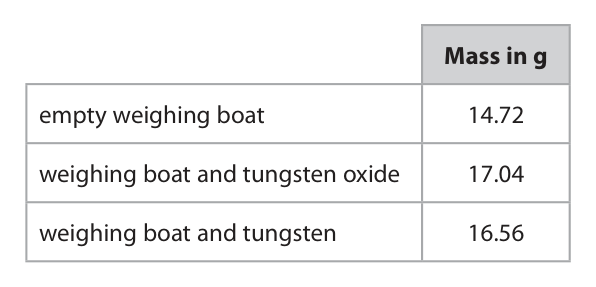

**Mark scheme answer**

> M1 (mass of tungsten =) 1.84g
> AND (mass of oxygen =) 0.48g
> M2 (moles of tungsten) = 1.84 or 0.01
> 184
> AND (moles of oxygen) = 0.48 or 0.03 M2 subsumes M1
> 16 ALLOW M2 ECF from
> incorrect masses
> M3 therefore ratio is 1:3 M3 dep on M2
> ALLOW ECF from
> incorrect M2 only if does
> give 1:3 when rounded

- **(1)** (mass of tungsten =) 1.84g
- **(1)** (moles of tungsten) = 1.84 or 0.01
- **(1)** therefore ratio is 1:3 M3 dep on M2

### 11(a)(iv) [1]

The teacher wears eye protection and a lab coat during the experiment. Give one other safety precaution the teacher should take.

**Mark scheme answer**

> Any one from
> M1 use a safety screen ALLOW heat proof/safety
> gloves
> M2 position the class some distance from the ALLOW tie back hair
> apparatus OWTTE
> M3 do the experiment in a fume cupboard

- **(1)** Any one from

### 11(b) [3]

In industry, tungsten oxide is reduced on a large scale using hydrogen. The percentage yield of tungsten is 73.5% This is the equation for the reaction. WO3 + 3H2 → W + 3H2O Calculate the mass, in tonnes, of tungsten that is produced when 2784 tonnes of tungsten oxide are reacted with an excess of hydrogen. [1 tonne = 1 × 10⁶ g] [for tungsten, Ar = 184 for oxygen, Ar = 16] mass of tungsten = tonnes

**Mark scheme answer**

> correct answer without
> working scores 3
> ALLOW any number of
> Example calculation significant figures ≥2
> throughout
> M1 moles of tungsten oxide = (2784 × 10⁶ ÷ 232) = ALLOW other correct
> methods
> 12 000 000 ALLOW working in
> megamoles
> M2 maximum mass of tungsten = (12 000 000 × 184)
> = 2 208 000 000 g OR 2208 tonnes ALLOW ECF M1×184
> M3 mass of tungsten (considering 73.5% yield) =
> (73.5 × 2208 ÷ 100) = 1622.88 (tonnes) ALLOW ECF from M2

- **(1)** moles of tungsten oxide = (2784 × 10⁶ ÷ 232) = ALLOW other correct
- **(1)** maximum mass of tungsten = (12 000 000 × 184)
- **(1)** mass of tungsten (considering 73.5% yield) =

