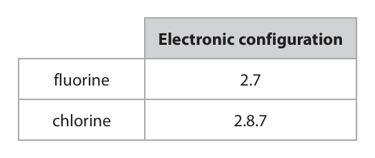
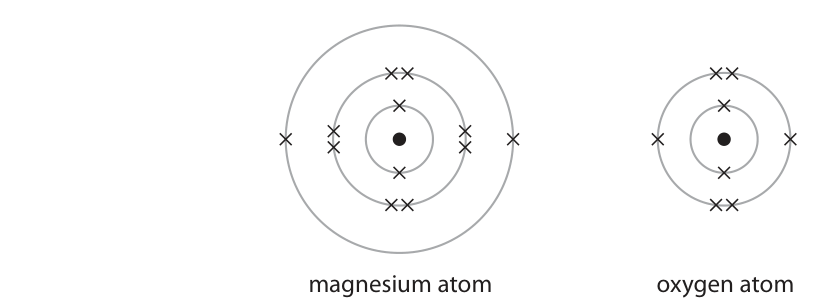
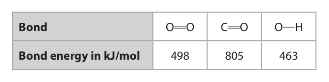
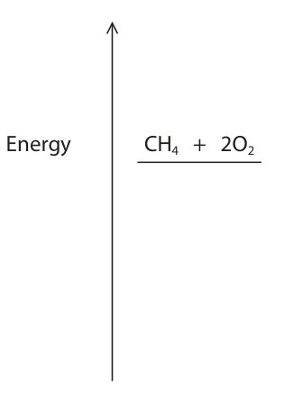

# 4CH1/2C — 2022-06 (official extraction)

> schema `syllabai.official-paper-questions/0.2` · paper_id `pearson-edexcel:international-gcse:chemistry:4ch1:2022-06:4CH1/2C` · qp sha256 `9e64b423851b6edb…` · extraction is the disclosed baseline (ADR-039)

## Question 1 (6 marks)

This question is about gases in the atmosphere. The box gives the names of some gases. argon carbon dioxide hydrogen nitrogen oxygen water vapour

**(a)** Choose gases from the box to answer these questions.

### 1(a)(i) [1]

Identify the least reactive gas in the atmosphere.

**Mark scheme answer**

> argon ALLOW Ar

- **(1)** argon ALLOW Ar

### 1(a)(ii) [1]

Identify the most abundant gas in the atmosphere.

**Mark scheme answer**

> nitrogen ALLOW N2/N

- **(1)** nitrogen ALLOW N2/N

### 1(a)(iii) [1]

Identify the gas that is not normally found in the atmosphere.

**Mark scheme answer**

> hydrogen ALLOW H2/H

- **(1)** hydrogen ALLOW H2/H

### 1(b) [1]

State an environmental problem caused by increasing amounts of carbon dioxide in the atmosphere.

**Mark scheme answer**

> climate change/global warming /oceans becoming ALLOW greenhouse
> more acidic effect
> ALLOW effects of
> global warming e.g.
> melting of polar ice
> caps/flooding/wild fires
> IGNORE acid rain
> REJECT references to
> ozone layer

- **(1)** climate change/global warming /oceans becoming ALLOW greenhouse

### 1(c) [2]

Describe a test for carbon dioxide.

**Mark scheme answer**

> M1 bubble/pass/add the gas/carbon dioxide into
> limewater
> M2 (limewater) turns cloudy/milky ALLOW white
> precipitate
> M2 dep on mention of
> limewater
> REJECT addition of
> extra reagents for both
> marks

- **(1)** bubble/pass/add the gas/carbon dioxide into
- **(1)** (limewater) turns cloudy/milky ALLOW white

## Question 2 (9 marks)
**(a)** The diagram shows two pieces of apparatus, X and Y. cm3 30 cm3 X Y

**(b)** The student uses methyl orange indicator in the titration.

### 2(a)(i) [2]

Give the name of each piece of apparatus. X Y

**Mark scheme answer**

> M1 (X) measuring cylinder
> M2 (Y) pipette ALLOW graduated
> pipette

- **(1)** (X) measuring cylinder
- **(1)** (Y) pipette ALLOW graduated

### 2(a)(ii) [1]

In a titration, a student adds 25.0 cm3 of barium hydroxide solution to a conical flask. Give a reason why it is better to use Y rather than X.

**Mark scheme answer**

> (volume measurement with Y is) more precise ORA ALLOW (volume
> measurement with Y
> is) more accurate
> ORA
> ALLOW (Y gives) a
> (more) exact volume
> /exactly 25 cm3

- **(1)** (volume measurement with Y is) more precise ORA ALLOW (volume

### 2(b)(i) [1]

State the colour of methyl orange in barium hydroxide solution.

**Mark scheme answer**

> yellow

- **(1)** yellow

### 2(b)(ii) [1]

Give a reason why universal indicator is not suitable for use in a titration.

**Mark scheme answer**

> there is no clear end point/ colour change is gradual (at ALLOW it has a
> the end point)/no sharp colour change OWTTE range of colours

- **(1)** there is no clear end point/ colour change is gradual (at ALLOW it has a

### 2(c) [3]

The student adds some dilute nitric acid to a burette and does the titration. The equation for the reaction is Ba(OH)2 + 2HNO3 → Ba(NO3)2 + 2H2O The student finds that 21.50 cm3 of nitric acid of concentration 0.600 mol/dm3 neutralises 25.0 cm3 of barium hydroxide solution. Calculate the concentration, in mol/dm3, of the barium hydroxide solution. concentration = mol/dm3

**Mark scheme answer**

> correct answer with
> or without working
> scores 3
> M1 moles of HNO3 = 21.5 × 0.6(00) OR 0.0129
> 1000
> M2 moles of Ba(OH)2 = 0.0129 ÷ 2 OR 0.00645 ALLOW ecf on M2
> M3 conc. of Ba(OH)2 = 0.00645 × 1000 = 0.258 (mol/dm3)
> 25 ACCEPT alternative
> methods
> 0.516 scores 2
> 1.032 scores 2
> ALLOW 2 sig figs
> correctly rounded
> throughout
> Penalise rounding to
> 1 sig fig once only

- **(1)** moles of HNO3 = 21.5 × 0.6(00) OR 0.0129
- **(1)** moles of Ba(OH)2 = 0.0129 ÷ 2 OR 0.00645 ALLOW ecf on M2
- **(1)** conc. of Ba(OH)2 = 0.00645 × 1000 = 0.258 (mol/dm3)

### 2(d) [1]

State why sulfuric acid would not be a suitable acid to use in this titration.

**Mark scheme answer**

> barium sulfate is insoluble /does not dissolve /forms a
> precipitate

- **(1)** barium sulfate is insoluble /does not dissolve /forms a

## Question 3 (12 marks)

This question is about Group 7, the halogens.

**(d)** Lithium reacts with chlorine to form lithium chloride.

### 3(a) [1]

Which halogen has the palest colour?

- **(A)** astatine
- **(B)** bromine
- **(C)** fluorine  ✔
- **(D)** iodine

**Mark scheme answer**

> C fluorine
> A is incorrect as astatine is black
> B is incorrect as bromine is brown
> D is incorrect as iodine is dark grey

- **(1)** Answer C: fluorine

### 3(b) [1]

Which halogen is a solid at room temperature?

- **(A)** astatine  ✔
- **(B)** bromine
- **(C)** chlorine
- **(D)** fluorine

**Mark scheme answer**

> A astatine
> B is incorrect as bromine is a liquid
> C is incorrect as chlorine is a gas
> D is incorrect as fluorine is a gas

- **(1)** Answer A: astatine

### 3(c) [4]

The table shows the electronic configurations of a fluorine atom and a chlorine atom. Electronic configuration fluorine 2.7 chlorine 2.8.7 Explain the relative reactivities of fluorine and chlorine using the information in the table.

**Mark scheme answer**

> An explanation that links the following four points
> M1 fluorine is more reactive than chlorine ORA ALLOW reactivity
> decreases down the
> group ORA
> M2 the outer shell is closer to the nucleus in ALLOW a fluorine atom is
> fluorine / fluorine has fewer shells / fluorine has a smaller than a chlorine
> smaller atomic radius ORA atom ORA
> M3 there is a stronger attraction to the nucleus for ALLOW there is less
> an electron in fluorine ORA shielding in fluorine ORA
> M4 so fluorine accepts an electron more readily ORA

- **(1)** fluorine is more reactive than chlorine ORA ALLOW reactivity
- **(1)** the outer shell is closer to the nucleus in ALLOW a fluorine atom is
- **(1)** there is a stronger attraction to the nucleus for ALLOW there is less
- **(1)** so fluorine accepts an electron more readily ORA

### 3(d)(i) [1]

Write a chemical equation for the reaction of lithium with chlorine.

**Mark scheme answer**

> 2Li + Cl2 → 2LiCl ALLOW multiples or
> fractions
> IGNORE state symbols
> even if incorrect
> ACCEPT 2Li+Cl-
> REJECT any charges on Li
> or Cl2

- **(1)** 2Li + Cl2 → 2LiCl ALLOW multiples or

### 3(d)(ii) [5]

Describe tests to show that the product of the reaction is lithium chloride.

**Mark scheme answer**

> A description that refers to the following five points
> Test for lithium ions
> ACCEPT description of
> M1 flame test flame test
> M2 red (flame) ALLOW crimson/scarlet
> REJECT brick red/orange
> red
> M2 dep on M1
> Test for chloride ions
> M3 add nitric acid REJECT incorrect acid
> e.g. HCl or H2SO4 for M3
> only
> M4 add silver nitrate (solution) ALLOW acidified silver
> nitrate for M3 and M4
> M5 white precipitate
> M5 dep on addition of
> silver nitrate

- **(1)** flame test flame test
- **(1)** red (flame) ALLOW crimson/scarlet
- **(1)** add nitric acid REJECT incorrect acid
- **(1)** add silver nitrate (solution) ALLOW acidified silver
- **(1)** white precipitate

## Question 4 (11 marks)

This question is about magnesium and magnesium compounds.

**(c)** Magnesium can be produced by the electrolysis of molten magnesium chloride.

**(d)** During the electrolysis of molten magnesium chloride, magnesium is formed at the negative electrode. The ionic half‑equation for the reaction is Mg2+ + 2e– → Mg

### 4(a) [2]

Magnesium burns in oxygen to form magnesium oxide. State two observations that would be seen during the reaction. 1 2

**Mark scheme answer**

> M1 bright/white light OR bright/white flame
> M2 white powder/solid/ash ALLOW white smoke
> ALLOW grey powder
> /solid/ash
> REJECT white precipitate

- **(1)** bright/white light OR bright/white flame
- **(1)** white powder/solid/ash ALLOW white smoke

### 4(b) [2]

The diagram shows the electron configurations of a magnesium atom and an oxygen atom. magnesium atom oxygen atom Describe the changes in the electronic configurations when magnesium reacts with oxygen to form the ionic compound magnesium oxide, MgO

**Mark scheme answer**

> A description that refers to the following two points
> M1 magnesium/Mg loses two electrons/becomes 2.8
> M2 oxygen/O gains two electrons/becomes 2.8 ACCEPT magnesium gives
> two electrons to oxygen
> for M1 and M2
> Both marks can be scored
> from diagrams showing
> correct electronic
> configurations of the ions.

- **(1)** magnesium/Mg loses two electrons/becomes 2.8
- **(1)** oxygen/O gains two electrons/becomes 2.8 ACCEPT magnesium gives

### 4(c)(i) [1]

State why magnesium cannot be produced by heating magnesium oxide with carbon.

**Mark scheme answer**

> magnesium is more reactive/higher in the reactivity
> series (than carbon)/magnesium is a better reducing ALLOW carbon cannot
> agent (than carbon) ORA displace magnesium

- **(1)** magnesium is more reactive/higher in the reactivity

### 4(c)(ii) [4]

Explain the different ways that magnesium and magnesium chloride conduct electricity. magnesium magnesium chloride

**Mark scheme answer**

> An explanation that links the following four points
> M1 (magnesium) has delocalised electrons
> M2 electrons can move REJECT reference to ions
> or atoms moving for M2
> M3 (magnesium chloride) can only conduct when
> molten/in solution OR (magnesium chloride) cannot ions are free to move
> conduct when solid when (magnesium
> chloride) is molten/in
> M4 ions are free to move solution scores M3 and M4
> REJECT reference to
> electrons moving for M4

- **(1)** (magnesium) has delocalised electrons
- **(1)** electrons can move REJECT reference to ions
- **(1)** (magnesium chloride) can only conduct when
- **(1)** ions are free to move solution scores M3 and M4

### 4(d)(i) [1]

State why this is a reduction reaction.

**Mark scheme answer**

> magnesium ions/ Mg2+ gains electrons ALLOW electrons are
> gained
> REJECT magnesium /Mg
> gains electrons
> REJECT reference to loss
> or gain of oxygen

- **(1)** magnesium ions/ Mg2+ gains electrons ALLOW electrons are

### 4(d)(ii) [1]

Write an ionic half‑equation for the formation of chlorine at the positive electrode.

**Mark scheme answer**

> 2Cl− → Cl2 + 2e(−) ALLOW 2Cl− − 2e(−)→ Cl2
> ALLOW multiples or
> fractions
> IGNORE state symbols
> even if incorrect

- **(1)** 2Cl− → Cl2 + 2e(−) ALLOW 2Cl− − 2e(−)→ Cl2

## Question 5 (12 marks)
**(a)** An organic compound has this percentage composition by mass. C = 40 % H = 6.7 % O = 53.3 %

**(b)** Methanoic acid (HCOOH) reacts with sodium carbonate solution to give three products.

**(c)** Methanoic acid also reacts with propanol to form an ester. The equation for the reaction is HCOOH + C3H7OH ⇌ HCOOC3H7 + H2O

**(d)** A polyester forms when butanedioic acid reacts with ethanediol. The diagram shows the repeat unit of the polyester that forms. O O C CH2CH2 C O CH2CH2 O

### 5(a)(i) [2]

Show that the empirical formula of the compound is CH2O

**Mark scheme answer**

> M1 40.0 6.7 53.3 0 marks for division by
> 12 1 16 atomic numbers or
> upside-down calculation
> M2 3.33 6.7 3.33 ALLOW any number of sig
> figs except 1
> AND
> 1 2
> ACCEPT alternative
> methods

- **(1)** 40.0 6.7 53.3 0 marks for division by
- **(1)** 3.33 6.7 3.33 ALLOW any number of sig

### 5(a)(ii) [1]

Draw the structural formula of a compound with the molecular formula C2H4O2

**Mark scheme answer**

> CH3COOH ACCEPT HCOOCH3
> OR OR

- **(1)** CH3COOH ACCEPT HCOOCH3

### 5(b)(i) [2]

Complete the equation for this reaction. 2HCOOH + Na2CO3 → + +

**Mark scheme answer**

> 2HCOOH + Na2CO3 → 2HCOONa + CO2 + H2O
> M1 CO2 + H2O IGNORE numbers in front
> of CO2 and/or H2O if only
> M1 scored
> M2 HCOONa and equation correctly balanced REJECT NaCOOH
> ALLOW NaHCOO

- **(1)** CO2 + H2O IGNORE numbers in front
- **(1)** HCOONa and equation correctly balanced REJECT NaCOOH

### 5(b)(ii) [1]

State what you would observe in this reaction.

**Mark scheme answer**

> bubbles/ fizzing/ effervescence IGNORE gas given off
> ALLOW sodium carbonate
> disappears/dissolves

- **(1)** bubbles/ fizzing/ effervescence IGNORE gas given off

### 5(c)(i) [1]

Give the name of the ester that forms.

**Mark scheme answer**

> propyl methanoate spelling must be correct
> ALLOW propyl formate

- **(1)** propyl methanoate spelling must be correct

### 5(c)(ii) [1]

State what is meant by the ⇌ symbol.

**Mark scheme answer**

> reversible reaction ALLOW reaction which
> goes both ways
> IGNORE equilibrium

- **(1)** reversible reaction ALLOW reaction which

### 5(c)(iii) [1]

When this reaction occurs in a sealed container, the reaction can reach dynamic equilibrium. Give one characteristic of a reaction at dynamic equilibrium.

**Mark scheme answer**

> forward and backward reactions occur at the same
> rate OWTTE
> OR
> concentrations of reactants and products remain ALLOW
> constant/stay the same/do not change amounts/moles/ratios of
> reactants and products
> remain constant
> REJECT concentrations of
> reactants and products
> are equal/the same

- **(1)** forward and backward reactions occur at the same

### 5(d)(i) [1]

Give the name of this type of polymerisation.

**Mark scheme answer**

> condensation (polymerisation)

- **(1)** condensation (polymerisation)

### 5(d)(ii) [2]

Draw the structural formulae of the two monomers used to make this polyester.

**Mark scheme answer**

> 2
> M1 M2 ALLOW
> HOOCCH2CH2COOH for M1
> ALLOW HOCH2CH2OH for
> M2
> REJECT OH—C once only

- **(2)** 2

## Question 6 (9 marks)

Titanium is an important metal in industry. Titanium dioxide (TiO2) can be converted into titanium metal in two stages. Stage 1 titanium dioxide is converted into titanium(IV) chloride (TiCl 4) Stage 2 titanium(IV) chloride is converted into titanium

### 6(a) [4]

This is the equation for the reaction in stage 1. TiO2 + 2Cl2 + C → TiCl4 + CO2 Calculate the volume, in dm3, of chlorine gas at rtp needed to react completely with 20 tonnes of titanium dioxide. Give your answer in standard form. [1 tonne = 106 g Mr of TiO2 = 80] [molar volume of chlorine gas at rtp = 24 dm3] volume of chlorine gas = dm3

**Mark scheme answer**

> correct answer with or
> without working scores 4
> M1 (moles of TiO2 =) 20 × 106 OR 2.5 × 105 (mol) ACCEPT 250 000 (mol)
> M2 (moles of Cl2 =) 2.5 × 105 x 2 OR 5.0 × 105 (mol) ACCEPT 500 000 (mol)
> M3 (vol of Cl2 =) 5.0 × 105 × 24 OR 12 000 000 (dm3)
> M4 1.2 × 107 (dm3) ALLOW ecf on M2 and
> M3
> 6 x 106 scores 3
> 3 x 106 scores 3
> 6 000 000 scores 2
> 3 000 000 scores 2
> 2.083 x 104 scores 3

- **(1)** (moles of TiO2 =) 20 × 106 OR 2.5 × 105 (mol) ACCEPT 250 000 (mol)
- **(1)** (moles of Cl2 =) 2.5 × 105 x 2 OR 5.0 × 105 (mol) ACCEPT 500 000 (mol)
- **(1)** (vol of Cl2 =) 5.0 × 105 × 24 OR 12 000 000 (dm3)
- **(1)** 1.2 × 107 (dm3) ALLOW ecf on M2 and

### 6(b) [2]

In stage 2, titanium(IV) chloride vapour is passed through molten magnesium in a container filled with argon. This is the equation for the reaction in stage 2. TiCl 4 + 2Mg → Ti + 2MgCl2 Explain why the container is filled with argon rather than air.

**Mark scheme answer**

> An explanation that links the following two points
> M1 argon is unreactive/inert
> M2 (so argon) will not react with/oxidise the ALLOW argon will not
> magnesium react with/oxidise
> titanium
> OR OR
> oxygen (in air) will react with/oxidise the oxygen (in air) will react
> magnesium with/oxidise the titanium

- **(1)** argon is unreactive/inert
- **(1)** (so argon) will not react with/oxidise the ALLOW argon will not

### 6(c) [3]

Aeroplanes are made of an alloy containing aluminium and titanium. Explain why the alloy is stronger than pure titanium metal. You may include diagrams in your answer.

**Mark scheme answer**

> An explanation that links the following three all marks can be awarded
> points from labelled diagrams
> M1 in pure titanium all atoms are the same size ALLOW cations/ions
> OR layers/atoms can slide over each other (making /particles in place of
> it soft /malleable) atoms throughout
> M2 the alloy has atoms of different sizes REJECT mention of
> molecules once only
> M3 (which disrupts the structure so that)
> atoms/layers do not/harder to slide over each
> other (making it stronger) OWTTE

- **(1)** in pure titanium all atoms are the same size ALLOW cations/ions
- **(1)** the alloy has atoms of different sizes REJECT mention of
- **(1)** (which disrupts the structure so that)

## Question 7 (11 marks)

A student uses this apparatus to find the heat energy supplied by a liquid fuel. thermometer copper container water liquid fuel The student burns some fuel to heat the water in the copper container and measures the change in temperature.

**(d)** The equation shows the combustion of methane. CH4 + 2O2 → CO2 + 2H2O ΔH = –890 kJ/mol This is the equation showing the displayed formulae. H O O H O H H C H + → O C O + O O H O H H The table shows the bond energies for O O, C O and O H Bond O O C O O H Bond energy in kJ/mol 498 805 463

### 7(a) [1]

The student notices that the bottom of the container turns black. Give the name of the black substance that forms on the bottom of the container.

**Mark scheme answer**

> carbon ALLOW soot
> ALLOW copper(II) oxide
> /copper oxide/CuO
> REJECT copper(I) oxide

- **(1)** carbon ALLOW soot

### 7(b) [2]

In one experiment, the student burns 0.92 g of ethanol. The student calculates that the heat energy absorbed by the water is 18.2 kJ. Show that the results of this experiment give an approximate value for the enthalpy of combustion of ethanol of ΔH = –900 kJ/mol. [Mr of ethanol = 46]

**Mark scheme answer**

> M1 (amount of ethanol) = 0.92 ÷ 46 OR 0.02(0) (mol)
> M2 (−)18.2 ÷ 0.02(0) = (−)910 (kJ/mol)
> ALLOW alternative
> methods

- **(1)** (amount of ethanol) = 0.92 ÷ 46 OR 0.02(0) (mol)
- **(1)** (−)18.2 ÷ 0.02(0) = (−)910 (kJ/mol)

### 7(c) [2]

The data book value of ΔH for the combustion of ethanol is –1367 kJ/mol. Give two reasons why the student’s value is much lower than the data book value. 1 2

**Mark scheme answer**

> Any 2 from
> M1 heat (energy)/ thermal energy was lost (to the
> surroundings/apparatus)
> M2 incomplete combustion (of ethanol)
> M3 the ethanol was impure/ethanol evaporates

- **(2)** Any 2 from

### 7(d)(i) [4]

Calculate the bond energy of the C H bond, using information from the equation and the table. C H bond energy = kJ/mol

**Mark scheme answer**

> correct answer with or
> without working scores 4
> M1 Σ bonds broken = 4 x C−H + 2 x 498 ALLOW 2 x 498 OR 996
> seen
> M2 Σ bonds formed = 2 x 805 + 4 x 463 OR 3462
> M3 4 x C−H + 996 − 3462 = − 890
> M4 C−H = 1576 ÷ 4 = 394 (kJ/mol) ALLOW ecf throughout
> 839 without working
> scores 3
> 616.5/617 without
> working scores 3

- **(1)** Σ bonds broken = 4 x C−H + 2 x 498 ALLOW 2 x 498 OR 996
- **(1)** Σ bonds formed = 2 x 805 + 4 x 463 OR 3462
- **(1)** 4 x C−H + 996 − 3462 = − 890
- **(1)** C−H = 1576 ÷ 4 = 394 (kJ/mol) ALLOW ecf throughout

### 7(d)(ii) [2]

Complete the energy level diagram to show the products and ΔH. Energy CH4 + 2O2

**Mark scheme answer**

> 2
> ↑
> Energy CH4 + 2O2
> ¯¯¯¯¯¯¯¯¯¯¯
> ΔH
> CO2 + 2H2O
> ¯¯¯¯¯¯¯¯¯¯¯
> M1 horizontal line to show products in correct
> position and correctly labelled
> M2 vertical line in correct position and labelled ACCEPT double headed
> ΔH/− 890 (kJ/mol) arrow or arrow pointing
> from reactants level to
> products level
> REJECT arrow pointing
> from products level to
> reactants level
> IGNORE any attempts at
> including activation
> energy
> If endothermic reaction
> shown M2 can be
> awarded for correct
> arrow/line labelled
> ΔH/+890 (kJ/mol)
> Pearson Education Limited. Registered company number 872828
> with its registered office at 80 Strand, London, WC2R 0RL, United Kingdom

- **(1)** horizontal line to show products in correct
- **(1)** vertical line in correct position and labelled ACCEPT double headed

