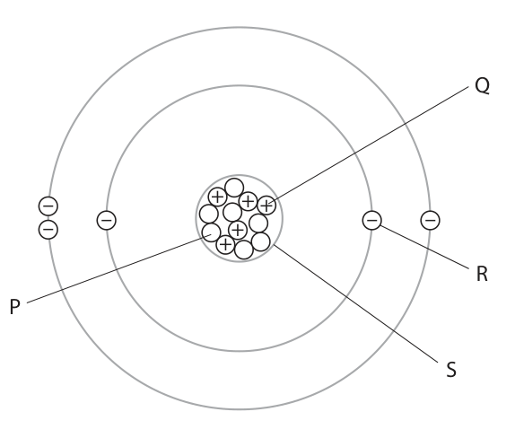
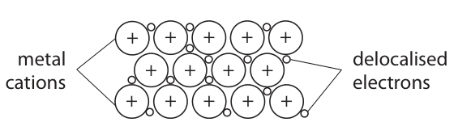

# 4CH1/2CR — 2022-06 (official extraction)

> schema `syllabai.official-paper-questions/0.2` · paper_id `pearson-edexcel:international-gcse:chemistry:4ch1:2022-06:4CH1/2CR` · qp sha256 `22dffd209d18e287…` · extraction is the disclosed baseline (ADR-039)

## Question 1 (5 marks)

The diagram shows the sub‑atomic particles in an atom of an element. Q – + ++ – – + – – + R P S

### 1(a)(i) [3]

Give the name of each of the sub‑atomic particles labelled P, Q and R. P Q R

**Mark scheme answer**

> P neutron
> Q proton
> R electron

- **(3)** P neutron

### 1(a)(ii) [1]

Give the name of the part of the atom labelled S.

**Mark scheme answer**

> nucleus ALLOW nuclei

- **(1)** nucleus ALLOW nuclei

### 1(b) [1]

Give the name of this element.

**Mark scheme answer**

> boron ALLOW B

- **(1)** boron ALLOW B

## Question 2 (5 marks)

A potassium permanganate crystal is placed in a beaker of water. potassium permanganate crystal After several days a coloured solution forms.

**(b)** The formula of potassium permanganate is KMnO4

### 2(a) [2]

Give the names of the two processes that cause the coloured solution to form. 1 2

**Mark scheme answer**

> M1 dissolving Answers can be in
> either order
> M2 diffusion IGNORE dilution

- **(1)** dissolving Answers can be in
- **(1)** diffusion IGNORE dilution

### 2(b)(i) [1]

How many different types of atom are in KMnO4?

- **(A)** 3  ✔
- **(B)** 4
- **(C)** 6
- **(D)** 7

**Mark scheme answer**

> A 3
> B is incorrect as there are not 4 different types of atoms
> in KMnO4
> C is incorrect as there are not 6 different types of atoms
> in KMnO4
> D is incorrect as there are not 7 different types of atoms
> in KMnO4

- **(1)** Answer A: 3

### 2(b)(ii) [1]

Calculate the relative formula mass (Mr) of KMnO4 Mr =

**Mark scheme answer**

> (Mr = 39 + 55 + 16 x 4 =) 158

- **(1)** (Mr = 39 + 55 + 16 x 4 =) 158

### 2(c) [1]

Potassium permanganate can be used as an oxidising agent. State what is meant by the term oxidising agent.

**Mark scheme answer**

> (something that) gives oxygen (to another ALLOW oxygen donor
> substance)/takes/gains electrons (from another ALLOW electron
> substance) OWTTE acceptor
> ALLOW (something
> that) causes another
> substance to be
> oxidised/to lose
> electrons OWTTE
> ALLOW (something
> that) is reduced (in a
> reaction)
> ALLOW increases the
> oxidation number (of
> another species)
> OWTTE

- **(1)** (something that) gives oxygen (to another ALLOW oxygen donor

## Question 3 (10 marks)

This question is about alkanes.

**(b)** In the presence of ultraviolet radiation, methane reacts with bromine to form bromomethane and hydrogen bromide.

**(c)** One mole of an alkane burns completely in oxygen. The equation represents the reaction. alkane + xO2 → yCO2 + zH2O The numbers x, y and z are used to balance the equation.

### 3(a)(i) [1]

Which of these is the molecular formula of an alkane?

- **(A)** C₂H₅
- **(B)** C₄H₁₀  ✔
- **(C)** CH₂CH₂
- **(D)** CH₃CH₂CH₃

**Mark scheme answer**

> B C4H10
> A is incorrect as C2H5 is not the molecular formula
> of an alkane
> C is incorrect as CH2CH2 is the structural formula of
> an alkene
> D is incorrect as CH3CH2CH3 is the structural formula
> of an alkane

- **(1)** Answer B: C4H10

### 3(a)(ii) [1]

Which of these has the same empirical formula and molecular formula?

- **(A)** CH₂
- **(B)** C₂H₆
- **(C)** C₃H₈  ✔
- **(D)** C₄H₁₀

**Mark scheme answer**

> C C 3 H8
> A is incorrect as CH2 is not a molecular formula but
> is an empirical formula of an alkene
> B is incorrect as the empirical formula of C2H6 is CH3
> D is incorrect as the empirical formula of C4H10 is
> C2H5

- **(1)** Answer C: C3H8

### 3(b)(i) [1]

State the name of this type of reaction.

**Mark scheme answer**

> substitution

- **(1)** substitution

### 3(b)(ii) [1]

Give a chemical equation for this reaction.

**Mark scheme answer**

> CH4 + Br2 → CH3Br + HBr ALLOW multiples
> IGNORE state symbols
> even if incorrect

- **(1)** CH4 + Br2 → CH3Br + HBr ALLOW multiples

### 3(c)(i) [2]

The complete combustion of one mole of the alkane produces 220 g of carbon dioxide and 108 g of water. Calculate the values of y and z. [Mr of CO2 = 44 Mr of H2O = 18] y = z =

**Mark scheme answer**

> M1 y (= 220 ÷ 44) = 5
> M2 z (= 108 ÷ 18) = 6

- **(1)** y (= 220 ÷ 44) = 5
- **(1)** z (= 108 ÷ 18) = 6

### 3(c)(ii) [2]

Determine the molecular formula of the alkane and the value of x. molecular formula = x =

**Mark scheme answer**

> M1 C5H12 ALLOW ECF in (ii) from
> incorrect values of y and
> z in (i)
> M2 x = 8 to score M1 the answer
> must be the formula of
> an alkane

- **(1)** C5H12 ALLOW ECF in (ii) from
- **(1)** x = 8 to score M1 the answer

### 3(d) [2]

When an alkane burns in a limited supply of air, incomplete combustion occurs. Explain why incomplete combustion of an alkane could be harmful to humans.

**Mark scheme answer**

> An explanation including one of the following pairs M2 dep on M1
> M1 carbon monoxide/CO is produced
> M2 (carbon monoxide) is toxic/poisonous /reduces ACCEPT prevents blood
> the capacity of the blood to carry oxygen OWTTE from carrying oxygen
> ALLOW correct
> explanation in terms of
> OR
> haemoglobin e.g.
> prevents haemoglobin
> from carrying oxygen
> M1 carbon/soot
> M2 causes asthma/bronchitis/respiratory problems
> OWTTE

- **(2)** An explanation including one of the following pairs M2 dep on M1

## Question 4 (11 marks)
**(b)** The diagram shows the electrolysis of copper(II) sulfate solution, using graphite electrodes. power supply + – lamp positive electrode negative electrode copper(II) sulfate solution Copper forms at the negative electrode and oxygen forms at the positive electrode.

### 4(a) [5]

The diagram represents the structure of copper metal. + + + + + metal delocalised + + + + cations electrons + + + + + Explain three properties of copper that make it a suitable metal to use in electrical wiring.

**Mark scheme answer**

> An explanation of properties that includes five of the reason must be linked to
> following points correct property
> IGNORE references to
> cost/reactivity/hardness/
> M1 conducts electricity strength/shiny
> M2 (because the) delocalised electrons can If any mention of
> move/flow (through structure) ions/atoms moving
> cannot score M2
> M3 malleable/ductile ALLOW explanations of
> malleable/ductile
> M4 (because) layers of cations/atoms ALLOW sheets/rows
> M5 layers/cations/atoms can slide/slip/move over
> each other
> M6 high melting point IGNORE high boiling point
> M7 (because) strong (electrostatic) attraction ALLOW giant metallic
> between cations and delocalised electrons lattice/strong bonds
> between cations and
> delocalised electrons
> /strong metallic bonds
> Max 4 if any mention of
> intermolecular
> forces/covalent/ionic
> bonding

- **(5)** An explanation of properties that includes five of the reason must be linked to

### 4(b)(i) [1]

Give the formula of the copper ion and the formula of the sulfate ion in copper(II) sulfate. copper ion sulfate ion

**Mark scheme answer**

> copper ion Cu2+ sulfate ion SO42− ALLOW Cu+2 SO4-2

- **(1)** copper ion Cu2+ sulfate ion SO42− ALLOW Cu+2 SO4-2

### 4(b)(ii) [1]

State what would be seen at the positive electrode.

**Mark scheme answer**

> effervescence/bubbles/fizzing IGNORE oxygen/gas

- **(1)** effervescence/bubbles/fizzing IGNORE oxygen/gas

### 4(b)(iii) [1]

Give a test for oxygen.

**Mark scheme answer**

> relights a glowing splint

- **(1)** relights a glowing splint

### 4(b)(iv) [2]

Give an ionic half‑equation for the formation of oxygen at the positive electrode. .

**Mark scheme answer**

> 2H2O → O2 + 4H+ + 4e(−)
> OR
> 4OH− → O2 + 2H2O + 4e(−)
> M1 all formulae correct
> M2 balancing of correct formulae

- **(1)** all formulae correct
- **(1)** balancing of correct formulae

### 4(b)(v) [1]

Suggest why the copper(II) sulfate solution contains some OH– ions.

**Mark scheme answer**

> (OH- ions/they) are present in/come from water ACCEPT (some) water
> OWTTE molecules dissociate to
> give OH- ions OWTTE
> ALLOW because copper
> sulfate solution/it
> contains water/is
> aqueous
> REJECT because copper
> sulfate/solution is
> alkaline

- **(1)** (OH- ions/they) are present in/come from water ACCEPT (some) water

## Question 5 (12 marks)

This question is about alcohols, carboxylic acids and esters.

**(a)** Ethanol can be manufactured by the fermentation of a solution of glucose.

**(b)** In the presence of an acid catalyst, ethanoic acid is heated with butanol to form an ester.

**(c)** Aspirin is a compound used to reduce pain. Aspirin contains a carboxylic acid functional group and an ester functional group.

### 5(a)(i) [1]

Write a word equation for this reaction.

**Mark scheme answer**

> glucose → ethanol + carbon dioxide ACCEPT fully correct
> chemical equation
> IGNORE yeast

- **(1)** glucose → ethanol + carbon dioxide ACCEPT fully correct

### 5(a)(ii) [1]

State the substance that needs to be added for the reaction to occur.

**Mark scheme answer**

> yeast IGNORE zymase/enzymes

- **(1)** yeast IGNORE zymase/enzymes

### 5(a)(iii) [2]

State two conditions needed for this reaction. 1 2

**Mark scheme answer**

> M1 30 oC ACCEPT any value
> between 20 and 40
> inclusive
> IGNORE yeast
> IGNORE room
> temperature
> M2 anaerobic conditions / absence of air/oxygen
> Answers can be in any
> order

- **(1)** 30 oC ACCEPT any value
- **(1)** anaerobic conditions / absence of air/oxygen

### 5(b)(i) [1]

Which of these is the formula of the ester?

- **(A)** CH₃COOC₃H₇
- **(B)** CH₃COOC₄H₉  ✔
- **(C)** C₂H₅COOC₄H₉
- **(D)** C₃H₇COOC₂H₅

**Mark scheme answer**

> B CH3COOC4H9
> A is incorrect as this is propyl ethanoate
> C is incorrect as this is butyl propanoate
> D is incorrect as this is ethyl butanoate

- **(1)** Answer B: CH3COOC4H9

### 5(b)(ii) [1]

State how you would know that an ester has formed.

**Mark scheme answer**

> sweet/fruity/distinctive smell OWTTE

- **(1)** sweet/fruity/distinctive smell OWTTE

### 5(b)(iii) [1]

Give one use of an ester.

**Mark scheme answer**

> perfumes/(food) flavourings/solvents IGNORE (food) colourings
> ACCEPT any other
> appropriate use eg
> emulsifiers

- **(1)** perfumes/(food) flavourings/solvents IGNORE (food) colourings

### 5(c)(i) [1]

State what is meant by the term functional group.

**Mark scheme answer**

> (atom/group of atoms in a compound that) ALLOW (atom/group of
> determines its chemical properties/reactions atoms that) determines
> OWTTE which homologous series
> a compound is in OWTTE

- **(1)** (atom/group of atoms in a compound that) ALLOW (atom/group of

### 5(c)(ii) [1]

This is the structural formula of aspirin. O O CH3 C O C6H4 C O H Draw a circle around the carboxylic acid functional group.

**Mark scheme answer**

> circle around O
> II
> −C—O—H

- **(1)** circle around O

### 5(c)(iii) [3]

Aspirin has this percentage composition by mass. C = 60.00 % H = 4.44 % O = 35.56 % Show by calculation that the empirical formula of aspirin is C9H8O4

**Mark scheme answer**

> M1 60.00 4.44 35.56 If upside down/use
> 12 1 16 atomic numbers scores 0
> M2 5.(00) 4.44 2.2225 ALLOW rounding of
> 2.2225 2.2225 2.2225 2.2225 but should show
> at least 2 dp
> OR 2.25 2
> M3 2.25 x 4 2 x 4 1 x 4 = 9:8:4
> ALLOW other correct
> methods eg
> M1 Mr (of aspirin) = 180
> M2 9x12 or 108 8x1 or 8
> 4x16 or 64
> ALL 3 needed for M2
> M3 108 x 100 = 60 (%)
> 180
> 8 x 100 = 4.44 (%)
> 180
> 108 x 100 = 35.56 (%)
> 180
> ALL 3 needed for M3

- **(1)** 60.00 4.44 35.56 If upside down/use
- **(1)** 5.(00) 4.44 2.2225 ALLOW rounding of
- **(1)** 2.25 x 4 2 x 4 1 x 4 = 9:8:4

## Question 6 (12 marks)

A student uses this method to do a titration. • use a measuring cylinder to obtain 25 cm3 of sodium hydroxide solution • transfer the solution to a conical flask • add a few drops of universal indicator to the flask • fill a burette with dilute sulfuric acid and record the initial burette reading • add the acid to the flask, swirling the flask continuously • add the acid slowly near the end‑point • record the final burette reading at the end‑point The student repeats the titration until at least two concordant results are obtained.

### 6(a) [1]

State what is meant by concordant results.

**Mark scheme answer**

> (results that are) within 0.2(0) (cm3) of each other ACCEPT other values if
> less than 0.2

- **(1)** (results that are) within 0.2(0) (cm3) of each other ACCEPT other values if

### 6(b) [4]

Explain two improvements to the student’s method so that more accurate results are obtained.

**Mark scheme answer**

> An explanation that links two of the following pairs
> of points
> M1 a pipette should have been used instead of
> measuring cylinder/to measure the sodium hydroxide
> solution
> M2 a pipette is more precise/a measuring cylinder is ALLOW a pipette is
> less precise more accurate/ a
> measuring cylinder is
> less accurate
> ALLOW pipette would
> give exactly 25 cm3
> M3 methyl orange/phenolphthalein/litmus should
> have been used instead of universal indicator
> M4 methyl orange/phenolphthalein/litmus would ALLOW universal
> give a clear/sharp colour change/end-point indicator would give a
> /universal indicator would not give a clear/sharp range of colours
> colour change/end-point ALLOW methyl orange/
> phenolphthalein/litmus
> only have two colours/
> are one colour in acid
> and one in alkali
> (colours given for a
> named indicator do not
> need to be correct)
> ALLOW easier to see
> colour change with
> methyl orange/
> phenolphthalein/litmus
> M5 use white tile (under conical flask)
> M6 easier to see colour change (at end point)
> OWTTE

- **(4)** An explanation that links two of the following pairs

### 6(c) [3]

The student makes the improvements and repeats the titration. The sulfuric acid has a concentration of 0.600 mol/dm3. The sodium hydroxide solution has a concentration of 1.50 mol/dm3. This is the equation for the reaction. 2NaOH + H2SO4 → Na2SO4 + 2H2O Calculate the volume, in cm3, of sulfuric acid that the student needs to completely react with 25.0 cm3 of the sodium hydroxide solution. volume of sulfuric acid = cm3

**Mark scheme answer**

> M1 amount of NaOH = 25.0 x 1.50 OR 0.0375 (mol) correct answer without
> 1000 working scores 3
> M2 amount of H2SO4 = 0.0375 OR 0.01875 (mol) ALLOW ECF throughout
> M3 volume of H2SO4 = (0.01875 x 1000) = 31.25 (cm3) ALLOW 2, 3 or 4 sig
> (0.600) figs throughout
> Penalise use of 1 sig fig
> once only
> 62.5/125 scores 2
> ACCEPT alternative
> methods

- **(1)** amount of NaOH = 25.0 x 1.50 OR 0.0375 (mol) correct answer without
- **(1)** amount of H2SO4 = 0.0375 OR 0.01875 (mol) ALLOW ECF throughout
- **(1)** volume of H2SO4 = (0.01875 x 1000) = 31.25 (cm3) ALLOW 2, 3 or 4 sig

### 6(d) [4]

The student plans to obtain pure dry crystals of hydrated sodium sulfate. They add the calculated volume of sulfuric acid to 25.0 cm3 of the sodium hydroxide solution to form sodium sulfate solution. Describe what the student should do to obtain pure dry crystals of hydrated sodium sulfate from the solution.

**Mark scheme answer**

> A description that refers to four of the following
> M1 heat the solution ALLOW boil
> Max 1 mark if solution
> evaporated to dryness
> M2 to evaporate some of the water/ to form a If solution left to
> saturated solution/ to crystallisation point partially evaporate
> without heating only M4
> and M5 can be awarded
> M3 leave the solution to cool / leave the solution leave solution to cool
> for (more) crystals to form and (then) filter off
> crystals scores M3 and
> M4
> M4 filter off the crystals ALLOW decant off
> solution
> IGNORE references to
> washing
> M5 suitable method of drying the crystals e.g. dry between filter
> papers/dry in a warm
> oven/ leave to dry
> REJECT hot oven or
> direct heating with
> Bunsen burner
> M5 DEP on crystals
> having been formed
> No M5 if crystals are
> washed after drying

- **(4)** A description that refers to four of the following

## Question 7 (15 marks)

In the presence of an iron catalyst, nitrogen reacts with hydrogen to form ammonia. The reaction conditions used are a temperature of 450 °C and a pressure of 200 atmospheres. This is the equation for the reaction. N2 + 3H2 ⇌ 2NH3 ΔH = –92 kJ/mol

**(d)** At the start of the reaction, 48 dm3 of nitrogen is added to 120 dm3 of hydrogen at rtp. N2 + 3H2 ⇌ 2NH3 [molar volume of any gas at rtp = 24 dm3 ]

### 7(a)(i) [1]

State what the symbol ⇌ represents.

**Mark scheme answer**

> reversible (reaction) / reaction that goes both ways IGNORE references to
> OWTTE equilibrium

- **(1)** reversible (reaction) / reaction that goes both ways IGNORE references to

### 7(a)(ii) [1]

Give the reason for using a catalyst.

**Mark scheme answer**

> increases the rate of reaction /speeds up the REJECT to increase
> reaction yield
> ALLOW to reach
> equilibrium faster
> IGNORE provides an
> alternative pathway
> with lower activation
> energy

- **(1)** increases the rate of reaction /speeds up the REJECT to increase

### 7(b)(i) [2]

The reaction mixture is kept at a pressure of 200 atmospheres, but the temperature is increased to 550 °C. Explain the effect of this change on the yield of ammonia at equilibrium.

**Mark scheme answer**

> IGNORE references to
> rate and Le Chatelier
> M1 yield decreases throughout
> M2 (forward) reaction is exothermic/ backward ACCEPT (when
> reaction is endothermic temperature increased
> equilibrium shifts in)
> endothermic direction
> which is (from right) to
> left
> M2 DEP M1 correct or
> missing

- **(1)** yield decreases throughout
- **(1)** (forward) reaction is exothermic/ backward ACCEPT (when

### 7(b)(ii) [2]

The reaction mixture is kept at a temperature of 450 °C, but the pressure is increased to 300 atmospheres. Explain the effect of this change on the yield of ammonia at equilibrium.

**Mark scheme answer**

> M1 yield increases
> M2 there are fewer moles (of gas) on the right-hand ALLOW molecules for
> side/product side / there are more moles (of gas) moles
> on the left-hand side/there are 4 moles of M2 DEP M1 correct or
> reactants and 2 moles of product/ OWTTE missing

- **(1)** yield increases
- **(1)** there are fewer moles (of gas) on the right-hand ALLOW molecules for

### 7(c) [3]

Draw an energy level diagram for the reaction between nitrogen and hydrogen. Include the reactants, products and ΔH in your diagram. energy QUESTION 7 CONTINUES ON NEXT PAGE

**Mark scheme answer**

> IGNORE any horizontal
> axis/labels
> IGNORE any attempts at
> Energy N2 + 3H2 including activation
> ¯¯¯¯¯¯¯¯¯¯¯ energy
> ΔH
> 2NH3
> ¯¯¯¯¯¯¯¯¯¯¯
> M1 horizontal line labelled with N2 + 3H2 ALLOW nitrogen and
> hydrogen
> M2 horizontal line showing 2NH3 in correct position ALLOW ammonia
> If not balanced or words
> reactants and products
> on horizontal lines in
> correct position scores
> 1 out of 2
> M3 vertical line in correct position and labelled ΔH
> /-92 (kJ/mol) ACCEPT double headed
> arrow or arrow pointing
> from reactants level to
> products level
> REJECT arrow pointing
> from products level to
> reactants level
> If endothermic reaction
> can score M1 and M3

- **(1)** horizontal line labelled with N2 + 3H2 ALLOW nitrogen and
- **(1)** horizontal line showing 2NH3 in correct position ALLOW ammonia
- **(1)** vertical line in correct position and labelled ΔH

### 7(d)(i) [3]

Show by calculation that the nitrogen is in excess.

**Mark scheme answer**

> M1 amount of nitrogen = (48 ÷ 24 =) 2 (mol)
> M2 amount of hydrogen = (120 ÷ 24 =) 5 (mol)
> M3 2.5 mol of hydrogen to 1 mol of nitrogen (which
> is less than 3 so nitrogen is in excess) OR 2 mol of
> nitrogen needs 6 mol of hydrogen (so not enough
> hydrogen to react with the nitrogen) ACCEPT alternative
> methods

- **(1)** amount of nitrogen = (48 ÷ 24 =) 2 (mol)
- **(1)** amount of hydrogen = (120 ÷ 24 =) 5 (mol)
- **(1)** 2.5 mol of hydrogen to 1 mol of nitrogen (which

### 7(d)(ii) [3]

The yield of ammonia at equilibrium is 20 %. Calculate the volume, in dm3, of ammonia formed from 120 dm3 of hydrogen. volume of ammonia = dm3

**Mark scheme answer**

> correct answer without
> working scores 3
> ALLOW ECF from (i)
> M1 5 mol of hydrogen gives 3.33 mol of ammonia ALLOW 3.3
> M2 volume of ammonia (if 100% conversion) = 3.33 use of 3.3 gives 79.2
> x 24 OR 80 (dm3)
> M3 (volume of ammonia if 20% conversion) = use of 79.2 gives 15.84
> (20 x 80) = 16.0 (dm3)
> 100 ALLOW ECF from M2
> ACCEPT 120 dm3 of
> hydrogen gives 2 x 120
> ÷ 3 OR 80 (dm3 of
> ammonia) for M1 and
> M2
> ALLOW max 2 for use of
> 48 dm3 of nitrogen
> giving 96 dm3 of
> ammonia and final
> answer of 19.2 (dm3)
> Pearson Education Limited. Registered company number 872828
> with its registered office at 80 Strand, London, WC2R 0RL, United Kingdom

- **(1)** 5 mol of hydrogen gives 3.33 mol of ammonia ALLOW 3.3
- **(1)** volume of ammonia (if 100% conversion) = 3.33 use of 3.3 gives 79.2
- **(1)** (volume of ammonia if 20% conversion) = use of 79.2 gives 15.84

