# 4CH1/1C — 2023-01 (official extraction)

> schema `syllabai.official-paper-questions/0.2` · paper_id `pearson-edexcel:international-gcse:chemistry:4ch1:2023-01:4CH1/1C` · qp sha256 `f25bac612af935d7…` · extraction is the disclosed baseline (ADR-039)

## Question 1 (6 marks)

This question is about the three states of matter, solid, liquid and gas.

**(a)** The diagram shows how particles of a substance are arranged in two of these states. solid liquid gas

### 1(a)(i) [1]

Complete the diagram to show how particles are arranged in the liquid state.

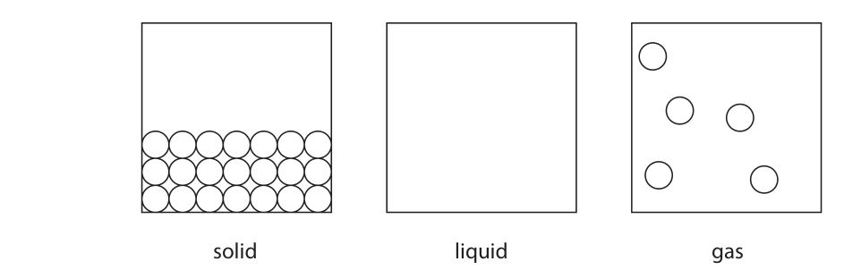

**Mark scheme answer**

> particles should be close together and should fill ALLOW particles filling
> from the bottom of the box, most particles should the whole box
> touch with a minimum of 2 random rows of
> particles IGNORE the size of the
> particles
> REJECT a regular
> arrangement

- **(1)** particles should be close together and should fill ALLOW particles filling

### 1(a)(ii) [1]

Identify the state of matter that contains particles with the least energy.

**Mark scheme answer**

> solid

- **(1)** solid

### 1(b) [2]

The table shows two changes of state. Complete the table by giving the name of each change of state. Change of state Name solid to liquid solid to gas

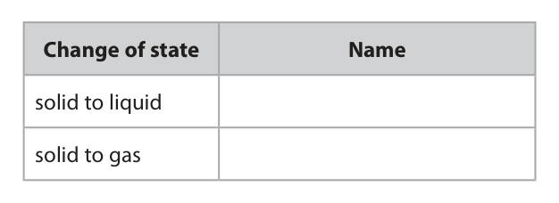

**Mark scheme answer**

> solid to liquid melting
> solid to gas sublimation ALLOW subliming

- **(2)** solid to liquid melting

### 1(c) [2]

Explain why hot water evaporates more quickly than cold water.

**Mark scheme answer**

> An explanation that links the two points.
> M1 (particles / molecules have) more (kinetic) ALLOW hot water has
> energy more (kinetic) energy
> ALLOW (particles /
> molecules) move
> faster
> IGNORE vibrate more
> M2 can overcome / break the (intermolecular) ALLOW can overcome /
> forces/forces (between water molecules) break the bonds
> (between water
> molecules) OR
> to break away from one
> another OR to escape
> more easily
> IGNORE references to
> collisions, activation
> energy or rate of
> reaction

- **(1)** (particles / molecules have) more (kinetic) ALLOW hot water has
- **(1)** can overcome / break the (intermolecular) ALLOW can overcome /

## Question 2 (7 marks)

This question is about elements, mixtures and compounds.

**(d)** A student adds a crystal of substance X to some water in a beaker and leaves the beaker for one day. The diagram shows the beaker immediately after adding the crystal, and after one day. immediately after after one day adding crystal

### 2(a) [1]

Which of these is the formula of a molecule of an element?

- **(A)** O
- **(B)** Cl₂  ✔
- **(C)** HCl
- **(D)** H₂O

**Mark scheme answer**

> B (Cl2)
> A is not the correct answer as the symbol O is for
> atoms of oxygen not molecules
> C is not the correct answer as HCl is a compound
> D is not the correct answer as H2O is a compound

- **(1)** Answer B: Cl2

### 2(b) [1]

Which method can be used to separate an insoluble solid from a liquid?

- **(A)** crystallisation
- **(B)** evaporation
- **(C)** filtration  ✔
- **(D)** simple distillation

**Mark scheme answer**

> C (filtration)
> A is not the correct answer as crystallisation is not
> used to separate an insoluble solid from a liquid
> B is not the correct answer as evaporation will not
> separate an insoluble solid from a liquid
> D is not the correct answer as simple distillation is
> used to separate a solvent from a solution

- **(1)** Answer C: filtration

### 2(c) [1]

Give the name of a method used to separate a mixture of liquids with different boiling points.

**Mark scheme answer**

> fractional distillation REJECT distillation
> REJECT simple distillation

- **(1)** fractional distillation REJECT distillation

### 2(d)(i) [1]

Which equation gives the correct state symbols for a process that occurs in the beaker?

- **(A)** X(s)                               → X(l)
- **(B)** X(s)                               → X(g)
- **(C)** X(aq) → X(s)
- **(D)** X(s)                               → X(aq)  ✔

**Mark scheme answer**

> D (X(s) → X(aq))
> A is not the correct answer as (l) is not the correct
> final state symbol
> B is not the correct answer as (g) Is not the final
> state symbol
> C is not the correct answer as the state symbols are
> the wrong way round

- **(1)** Answer D: X(s)                               → X(aq)

### 2(d)(ii) [1]

Which other process occurs in the beaker?

- **(A)** boiling
- **(B)** condensing
- **(C)** diffusion  ✔
- **(D)** sublimation

**Mark scheme answer**

> C (diffusion)
> A is not the correct answer as boiling does not
> occur in the beaker
> B is not the correct answer as condensing does not
> occur in the beaker
> D is not the correct answer as sublimation does not
> occur in the beaker

- **(1)** Answer C: diffusion

### 2(d)(iii) [2]

After one day the student does two tests on the liquid in the beaker. The table shows the student’s results. Test Result flame test lilac flame addition of acidified barium chloride solution white precipitate Identify substance X.

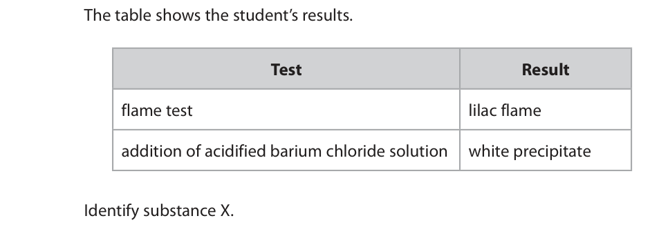

**Mark scheme answer**

> M1 potassium / K+ potassium sulfate scores 2
> M2 sulfate / SO42- K2SO4 scores 2
> KSO4 alone scores 1
> ALLOW in either order
> If name correct ignore
> incorrect formula

- **(1)** potassium / K+ potassium sulfate scores 2
- **(1)** sulfate / SO42- K2SO4 scores 2

## Question 3 (6 marks)

This question is about gases.

**(b)** A student uses this apparatus to find the percentage by volume of oxygen in a mixture of oxygen and neon. wet iron wool mixture of oxygen and neon water This is the student's method. • measure the initial length of the column of gas in the inverted test tube • leave the test tube in the beaker for a week • measure the final length of the column of gas in the test tube

### 3(a)(i) [1]

Name the gas that is about 1% of dry air by volume.

**Mark scheme answer**

> argon / Ar

- **(1)** argon / Ar

### 3(a)(ii) [1]

Which is the most abundant gas in dry air by volume?

- **(A)** carbon dioxide
- **(B)** methane
- **(C)** nitrogen  ✔
- **(D)** oxygen

**Mark scheme answer**

> C (nitrogen)
> A is not correct because nitrogen is more abundant
> than carbon dioxide methane or oxygen
> B is not correct because nitrogen is more abundant
> than methane
> D is not correct because nitrogen is more abundant
> than oxygen

- **(1)** Answer C: nitrogen

### 3(b)(i) [1]

Some of the iron wool rusts. Give the chemical name for rust.

**Mark scheme answer**

> (hydrated) iron (III) oxide REJECT other oxidation
> states
> ALLOW Fe2O3
> IGNORE iron oxide

- **(1)** (hydrated) iron (III) oxide REJECT other oxidation

### 3(b)(ii) [1]

Give a reason why neon does not react with the iron wool.

**Mark scheme answer**

> (neon) has a full outer shell (of electrons) ALLOW (neon) is
> unreactive / inert /has 8
> electrons in the outer
> shell
> ALLOW (neon) does not
> lose or gain (or share)
> electrons

- **(1)** (neon) has a full outer shell (of electrons) ALLOW (neon) is

### 3(b)(iii) [2]

The table shows the student’s results. initial length of column of gas 75 mm final length of column of gas 30 mm Use the results to calculate the percentage of oxygen in the mixture of oxygen and neon. percentage of oxygen = %

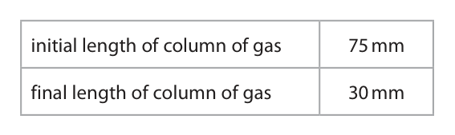

**Mark scheme answer**

> M1 75 − 30 OR 45 (mm)
> M2 (45 ÷ 75 × 100) = 60(%) ALLOW ecf from M1
> correct answer of 60%
> without working scores 2
> answer of 40% without
> working scores 1

- **(1)** 75 − 30 OR 45 (mm)
- **(1)** (45 ÷ 75 × 100) = 60(%) ALLOW ecf from M1

## Question 4 (7 marks)

A student uses this apparatus to investigate the dyes in a food colouring A. chromatography paper baseline drawn in ink A water

**(b)** The student repeats the experiment, but with no mistakes. The table shows the R f values for the two dyes in food colouring A. Dye R f value blue 0.50 yellow 0.25

### 4(a) [4]

Explain two mistakes that the student makes when setting up the apparatus. 1 2

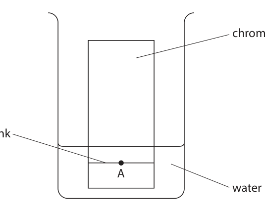

**Mark scheme answer**

> 4
> M1 baseline has been drawn in ink ALLOW baseline is not
> drawn in pencil
> M2 and will therefore interfere with / contaminate ALLOW will move up the
> the results paper / will get mixed
> up with A / will produce
> other colours /affect
> results / will smudge
> /ink is soluble
> M3 the water level is above A/the baseline ALLOW water level is
> too high / A is under
> water
> M4 and therefore A will mix with/dissolve in the ALLOW A will wash off
> water the paper
> IGNORE references to
> lid

- **(1)** baseline has been drawn in ink ALLOW baseline is not
- **(1)** and will therefore interfere with / contaminate ALLOW will move up the
- **(1)** the water level is above A/the baseline ALLOW water level is
- **(1)** and therefore A will mix with/dissolve in the ALLOW A will wash off

### 4(b)(i) [2]

Complete the chromatogram for food colouring A by adding and labelling the dyes. A

**Mark scheme answer**

> M1 one spot about ¼ of the way between the ALLOW answers that
> baseline and the top of the paper / solvent front show solvent front
> and one spot about ½ way
> M2 the lower spot labelled yellow and the higher
> spot labelled blue

- **(1)** one spot about ¼ of the way between the ALLOW answers that
- **(1)** the lower spot labelled yellow and the higher

### 4(b)(ii) [1]

Give a reason why the blue dye has a larger R f value than the yellow dye.

**Mark scheme answer**

> the blue food colouring/it is more soluble (in water)
> ORA as long as yellow food colouring is referred to IGNORE blue colour/it
> travels further up the
> paper

- **(1)** the blue food colouring/it is more soluble (in water)

## Question 5 (7 marks)

A student investigates the reactivities of four metals, aluminium, magnesium, copper and metal X.

**(a)** The student adds pieces of magnesium ribbon to aqueous solutions of the sulfates of each metal. After a few minutes the student removes the pieces of magnesium ribbon and records the appearance of each piece of magnesium. Table 1 shows the student’s results. Solution Appearance aluminium sulfate grey coating on magnesium magnesium sulfate no change copper(II) sulfate brown coating on magnesium sulfate of metal X grey coating on magnesium Table 1

**(b)** The student repeats the experiment with pieces of metal X instead of pieces of magnesium. Table 2 shows the student’s results. Solution Appearance aluminium sulfate no change magnesium sulfate no change copper(II) sulfate brown coating on metal X sulfate of metal X no change Table 2

### 5(a)(i) [1]

Name the substance that causes the brown coating on the magnesium.

**Mark scheme answer**

> copper ALLOW Cu
> REJECT copper(II) /Cu2+

- **(1)** copper ALLOW Cu

### 5(a)(ii) [1]

State why there is no change with magnesium sulfate solution.

**Mark scheme answer**

> magnesium cannot displace itself ALLOW magnesium does
> not react with
> magnesium sulfate
> /magnesium ions /Mg2+
> IGNORE magnesium
> does not react with
> magnesium /itself

- **(1)** magnesium cannot displace itself ALLOW magnesium does

### 5(b)(i) [2]

Use the information from both tables to deduce the order of reactivity of aluminium, magnesium, copper and metal X. most reactive least reactive

**Mark scheme answer**

> magnesium /Mg ALLOW 1 mark if
> aluminium /Al aluminium and X are
> X swapped.
> copper /Cu
> If copper(II) instead of
> copper 1 mark only

- **(2)** magnesium /Mg ALLOW 1 mark if

### 5(b)(ii) [1]

Give a possible identity for metal X.

**Mark scheme answer**

> zinc / iron ALLOW all other valid
> answers

- **(1)** zinc / iron ALLOW all other valid

### 5(c) [2]

This ionic equation represents the reaction between magnesium and aluminium nitrate. 3Mg(s) + 2Al3+(aq) → 3Mg2+(aq) + 2Al(s) Explain, in terms of electrons, which species acts as a reducing agent in this reaction.

**Mark scheme answer**

> An explanation that links the two points
> M1 magnesium /Mg (is the reducing agent)
> M2 magnesium /Mg donates electrons (causing Al 3+ ALLOW magnesium / Mg
> ions to be reduced) gives (away) / loses
> electrons (causing Al3+
> to be reduced) /Al3+
> gains electrons
> No M2 if reference to
> aluminium/Al instead of
> aluminium ions/Al3+
> IGNORE Mg is oxidised
> M2 dep on M1

- **(1)** magnesium /Mg (is the reducing agent)
- **(1)** magnesium /Mg donates electrons (causing Al 3+ ALLOW magnesium / Mg

## Question 6 (10 marks)

This question is about polymers.

### 6(a) [1]

This is the structure of a monomer. What is the name of this monomer?

- **(A)** chloroethane
- **(B)** chloroethene  ✔
- **(C)** chloropropane
- **(D)** chloropropene

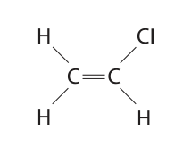

**Mark scheme answer**

> B (chloroethene)
> A is not correct as the monomer has a double bond
> C is not correct as the monomer has two carbons
> D is not correct as the monomer has two carbons

- **(1)** Answer B: chloroethene

### 6(b) [1]

Complete the equation to show the repeat unit of the polymer that forms from this monomer.

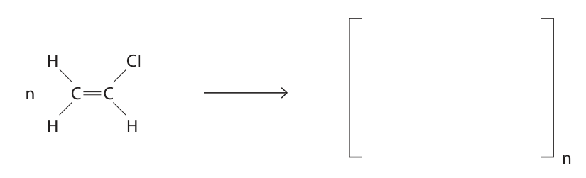

**Mark scheme answer**

> 1
> Extension bonds do not
> need to go through the
> brackets

- **(1)** 1

### 6(c) [2]

A typical molecule of the polymer has a relative molecular mass (Mr ) of 2 490 000 Show that the number of monomer molecules needed to make this typical molecule is about 40 000 [for C, Ar = 12 for Cl, Ar = 35.5]

**Mark scheme answer**

> M1 (Mr of chloroethene) = 62.5
> M2 2490000 ÷ 62.5 = 39 840

- **(1)** (Mr of chloroethene) = 62.5
- **(1)** 2490000 ÷ 62.5 = 39 840

### 6(d) [4]

These are two methods used to dispose of the polymer. • burying in landfill sites • burning Discuss the environmental problems caused by these two methods of disposal.

**Mark scheme answer**

> A discussion which refers to any 4 of the following
> points
> M1 polymers/poly(propene) will remain in landfill ALLOW reference to
> indefinitely OWTTE running out of landfill
> sites OWTTE
> M2 (as they) are inert /unreactive/do not
> biodegrade/do not decompose
> M3 burning produces greenhouse gases / CO2
> M4 reference to climate change /global warming
> M5 burning produces toxic gases ALLOW carbon
> monoxide /CO
> /hydrogen chloride/HCl
> Max 3 if any reference
> to the ozone layer

- **(4)** A discussion which refers to any 4 of the following

### 6(e) [2]

A different polymer molecule contains 10 600 atoms of carbon, 10 600 atoms of hydrogen and 31 800 atoms of chlorine. Determine the empirical formula of this polymer. empirical formula =

**Mark scheme answer**

> M1 1:1:3 / 31 800 ÷ 10 600 ALLOW other evidence
> of working
> M2 CHCl3 ALLOW the atoms in any
> order
> Answer of CHCl3 without
> working scores 2

- **(1)** 1:1:3 / 31 800 ÷ 10 600 ALLOW other evidence
- **(1)** CHCl3 ALLOW the atoms in any

## Question 7 (12 marks)

The table shows the displayed formulae of some organic compounds. V W H H H H H H H H H H H C C C C C C C C H H C C H H H H H H H H H H C C H H H X Y Z H H H H H H H H H H H H H C C C C O H C C C C H H C C C C H H H H H H H H H H H H

**(f)** Compound Z reacts with bromine in the presence of ultraviolet radiation.

### 7(a) [1]

Give a reason why compound X is not a hydrocarbon.

**Mark scheme answer**

> X contains oxygen /OH ALLOW hydrocarbons
> only contain hydrogen
> and carbon (atoms)
> REJECT oxygen
> molecules or hydrogen
> and carbon molecules

- **(1)** X contains oxygen /OH ALLOW hydrocarbons

### 7(b) [1]

Give the letter of the compound that is a saturated hydrocarbon with the empirical formula CH2

**Mark scheme answer**

> W

- **(1)** W

### 7(c) [1]

Give the letter of the compound that produces nine moles of water when one mole undergoes complete combustion.

**Mark scheme answer**

> V

- **(1)** V

### 7(d) [1]

Give the structural formula of compound Y.

**Mark scheme answer**

> CH2=CHCH2CH3 ALLOW CH2CHCH2CH3

- **(1)** CH2=CHCH2CH3 ALLOW CH2CHCH2CH3

### 7(e) [2]

Explain why compounds W and Y are isomers.

**Mark scheme answer**

> M1 same molecular formula ALLOW same numbers
> of C and H atoms
> M2 different displayed / structural formulae ALLOW different
> arrangement of atoms

- **(1)** same molecular formula ALLOW same numbers
- **(1)** different displayed / structural formulae ALLOW different

### 7(f)(i) [2]

Write a chemical equation for this reaction.

**Mark scheme answer**

> C4H10 + Br2 → C4H9Br + HBr
> M1 C4H9Br as product ALLOW polysubstitution
> M2 rest of the equation correct M2 dep on M1

- **(1)** C4H9Br as product ALLOW polysubstitution
- **(1)** rest of the equation correct M2 dep on M1

### 7(f)(ii) [1]

What is the name for this type of reaction?

- **(A)** addition
- **(B)** combustion
- **(C)** substitution  ✔
- **(D)** thermal decomposition

**Mark scheme answer**

> C (substitution)
> A is not the correct answer because alkanes do not
> undergo addition reactions
> B is not the correct answer as this is not a
> combustion reaction
> D is not the correct answer as this reaction is not
> thermal decomposition

- **(1)** Answer C: substitution

### 7(g) [3]

Describe how the combustion of sulfur-free petrol in a car engine produces gases that can cause acid rain. Do not refer to carbon dioxide in your answer.

**Mark scheme answer**

> A description that refers to any 3 from
> M1 nitrogen and oxygen (from air) REJECT mention of
> petrol contains nitrogen
> for M1 only
> M2 react at the high temperatures (in a car M2 dep on mention of
> engine) nitrogen and oxygen
> M3 forming oxides of nitrogen ALLOW NOx or named
> oxides of nitrogen
> M4 which react with/dissolve in water forming M4 dep on M3
> nitric acid /HNO3 /acid rain

- **(3)** A description that refers to any 3 from

## Question 8 (10 marks)

This question is about ionic compounds.

**(a)** The table gives the formulae of some positive and negative ions, and the formulae of some compounds containing these ions. Na+ Mg2+ Cl– O2– Na2O MgO N3– Na3N

**(b)** The diagram shows the arrangement of electrons in atoms of lithium and in an atom of oxygen. lithium atom lithium atom oxygen atom

### 8(a)(i) [3]

Complete the table by giving the missing formulae.

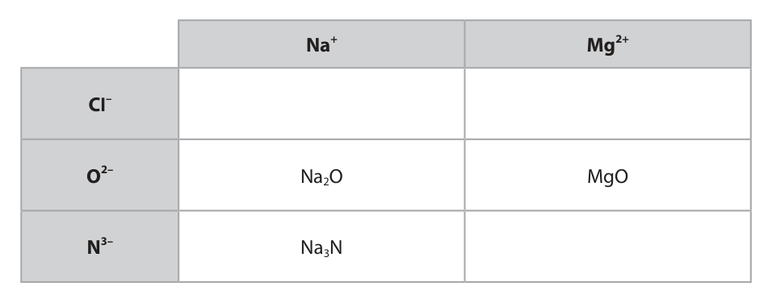

**Mark scheme answer**

> M1 NaCl Penalise once only for
> incorrect case or
> M2 MgCl2 superscript numbers
> M3 Mg3N2 ALLOW symbols
> reversed e.g. N2Mg3
> ALLOW correct charges
> on ions e.g Mg2+(Cl-)2

- **(1)** NaCl Penalise once only for
- **(1)** MgCl2 superscript numbers
- **(1)** Mg3N2 ALLOW symbols

### 8(a)(ii) [1]

Give the name of the compound with the formula MgO

**Mark scheme answer**

> magnesium oxide Spelling must be
> correct

- **(1)** magnesium oxide Spelling must be

### 8(a)(iii) [1]

Calculate the relative formula mass (Mr ) of Na3N [for Na, Ar = 23 for N, Ar = 14] Mr =

**Mark scheme answer**

> 83 IGNORE units

- **(1)** 83 IGNORE units

### 8(b)(i) [2]

Describe the changes in the electron configurations of lithium and oxygen when these atoms form lithium oxide, Li2O

**Mark scheme answer**

> M1 lithium changes (from 2.1) to 2 ALLOW (two) lithium
> (atoms) lose one
> electron
> M2 oxygen changes (from 2.6) to 2.8 ALLOW oxygen (atom)
> gains two electrons
> No marks if mention of
> sharing electrons

- **(1)** lithium changes (from 2.1) to 2 ALLOW (two) lithium
- **(1)** oxygen changes (from 2.6) to 2.8 ALLOW oxygen (atom)

### 8(b)(ii) [3]

Lithium oxide has a giant ionic structure. Explain why lithium oxide has a high melting point.

**Mark scheme answer**

> An explanation that links the three points
> M1 strong (electrostatic) forces of attraction ALLOW strong ionic
> bonds
> M2 between oppositely charged ions
> M3 which require a lot of energy to break IGNORE more energy
> 0 marks if any mention
> of covalent bonds,
> intermolecular forces or
> molecules

- **(1)** strong (electrostatic) forces of attraction ALLOW strong ionic
- **(1)** between oppositely charged ions
- **(1)** which require a lot of energy to break IGNORE more energy

## Question 9 (10 marks)

This question is about substances that contain covalent bonds.

### 9(a) [2]

The diagram represents a molecule of oxygen. + + Describe the forces of attraction in a covalent bond.

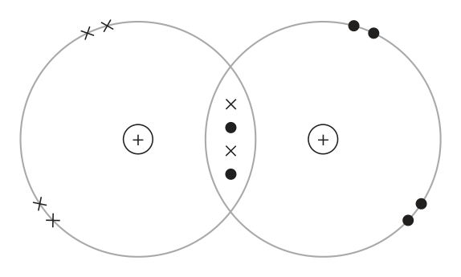

**Mark scheme answer**

> M1 (electrostatic) attraction between nuclei must be plural
> M2 and shared pair(s) of electrons
> OR
> M1 (electrostatic) attraction between shared pair(s)
> of electrons
> M2 and nuclei must be plural

- **(2)** M1 (electrostatic) attraction between nuclei must be plural

### 9(b) [3]

The table shows the boiling points of three Group 7 elements. Boiling point in °C fluorine –188 chlorine –34 bromine 59 Explain the trend in the boiling points.

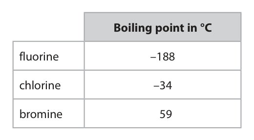

**Mark scheme answer**

> An explanation that links any 3 from
> M1 the boiling points increase (down the
> group/from F to Br)
> M2 because the intermolecular forces get stronger
> M3 as (molecular) mass / size / number of electrons
> /(electron) shells increases
> M4 so more energy needed to separate the
> molecules/break the intermolecular forces No M2, M3 or M4 if any
> mention of breaking
> covalent/ionic bonds

- **(3)** An explanation that links any 3 from

### 9(c) [5]

Graphite is a naturally-occurring form of carbon. Explain why graphite is soft and conducts electricity. Refer to structure and bonding in your answer.

**Mark scheme answer**

> An explanation that links any five from
> M1 the structure is in layers ALLOW sheets /rows
> M2 there are weak forces between the layers (of REJECT intermolecular
> atoms) forces/molecules/ions
> M3 which can slide (over one another making it
> soft)
> M4 each carbon / atom makes three covalent bonds REJECT ionic bonds
> M5 (one) delocalised electron (per carbon / atom) REJECT molecules/ions
> M6 (delocalised) electrons flow / move / are mobile
> (to conduct electricity)

- **(5)** An explanation that links any five from

## Question 10 (9 marks)

A student uses this apparatus to record the maximum temperature in the reaction between solutions of hydrochloric acid and sodium hydroxide. This is the student’s method. • add 25 cm3 of hydrochloric acid to the beaker • add 25 cm3 of sodium hydroxide solution to the beaker • stir the mixture • record the maximum temperature reached

**(b)** Before the reaction, both solutions have a temperature of 21.0 °C. The heat energy change, Q, for the reaction is 2880 J.

### 10(a) [1]

Name a suitable piece of apparatus to add 25 cm3 of solution to the beaker.

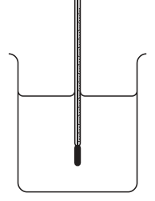

**Mark scheme answer**

> measuring cylinder ALLOW burette /
> pipette /syringe
> REJECT gas syringe

- **(1)** measuring cylinder ALLOW burette /

### 10(b)(i) [4]

Calculate the theoretical maximum temperature reached by the mixture, which has a mass of 50 g. [specific heat capacity of mixture, c = 4.2 J / g / °C] temperature = °C

**Mark scheme answer**

> M1 Q = m × c × ΔT
> M2 ΔT = 2880 ÷ (50 × 4.2) M2 subsumes M1
> M3 ΔT = 13.7(1) °C
> M4 (maximum temp = 13.7(1) + 21.(0) =) 34.7 (°C) ALLOW ecf from M3
> ALLOW any number of
> sig fig except 1 in M3
> and M4
> Correct answer without
> working scores 4

- **(1)** Q = m × c × ΔT
- **(1)** ΔT = 2880 ÷ (50 × 4.2) M2 subsumes M1
- **(1)** ΔT = 13.7(1) °C
- **(1)** (maximum temp = 13.7(1) + 21.(0) =) 34.7 (°C) ALLOW ecf from M3

### 10(b)(ii) [1]

Give a reason why the maximum temperature recorded by the student is lower than the theoretical maximum temperature calculated.

**Mark scheme answer**

> thermal energy/heat lost (to the atmosphere / IGNORE energy lost
> surroundings)

- **(1)** thermal energy/heat lost (to the atmosphere / IGNORE energy lost

### 10(b)(iii) [3]

In the reaction, 0.0500 mol of hydrochloric acid completely react. Calculate the molar enthalpy change, ΔH , in kilojoules per mole of hydrochloric acid. Include a sign in your answer. ΔH = kJ / mol

**Mark scheme answer**

> M1 2880 ÷ 1000 OR 2.880 kJ
> M2 2.880 ÷ 0.05(00) ALLOW ecf from M1
> M3 -57.6kJ/mol ALLOW any number of
> sig fig except 1 in M3
> OR
> M1 2880 ÷ 0.05(00) OR 57 600J
> M2 57 600 ÷ 1000 ALLOW ecf from M1
> M3 -57.6 kJ/mol ALLOW any number of
> sig fig except 1 in M3
> Correct answer without
> working scores 3

- **(3)** M1 2880 ÷ 1000 OR 2.880 kJ

## Question 11 (13 marks)

This question is about the reaction between magnesium and dilute nitric acid.

**(a)** A student reacts dilute nitric acid with an excess of magnesium powder as a first step in the preparation of dry crystals of hydrated magnesium nitrate. This is the equation for the reaction. Mg(s) + 2HNO3(aq) → Mg(NO3)2(aq) + H2(g)

### 11(a)(i) [2]

Explain why it is important that magnesium is in excess.

**Mark scheme answer**

> M1 so all the nitric acid reacts/is neutralised
> AND
> M2 therefore the solution only contains magnesium ALLOW so the excess
> nitrate magnesium can be
> removed by filtration
> OR
> M3 if acid is still present it will contaminate the
> crystals OWTTE

- **(2)** M1 so all the nitric acid reacts/is neutralised

### 11(a)(ii) [3]

The student adds 0.75 g of magnesium to 0.025 mol of nitric acid. Calculate the mass of magnesium, in grams, that remains at the end of the reaction. [for magnesium, Ar = 24] mass of magnesium = g

**Mark scheme answer**

> M1 moles of Mg that reacts = 0.0250 ÷ 2 OR 0.0125
> M2 mass of Mg that reacts = 0.0125 x 24 OR 0.3 (g) ALLOW M1 × 24
> M3 mass of Mg remaining = 0.45 (g) ALLOW 0.75 - M2
> OR
> M1 moles of Mg = 0.0250 ÷ 2 OR 0.0125
> M2 moles of Mg remaining = 0.75 ÷ 24 − 0.0125 OR ALLOW 0.03125 − M1
> 0.03125 − 0.0125 OR 0.01875
> M3 mass of Mg remaining (= 0.01875 x 24) = 0.45 (g) ALLOW M2 x 24
> Correct answer without
> working scores 3
> 0.15 (g) scores 2

- **(3)** M1 moles of Mg that reacts = 0.0250 ÷ 2 OR 0.0125

### 11(a)(iii) [5]

Describe how the student can obtain dry crystals of hydrated magnesium nitrate from the mixture at the end of the reaction.

**Mark scheme answer**

> M1 filter off the excess magnesium
> M2 heat the solution until crystals first start to form ALLOW heat until the
> solution is saturated
> / heat until crystals form
> on the end of a glass rod
> /heat to evaporate some
> of the water
> M3 leave the solution to cool (and crystallise)
> M4 pour/filter off excess liquid (to obtain crystals)
> IGNORE washing
> M5 leave (crystals) to dry ALLOW any method of
> drying that avoids excess
> heat e.g. filter paper, a
> desiccator, a warm oven
> If heated to dryness only
> M1 can be scored
> If solution is not heated
> only M1, M4 and M5 can
> be scored

- **(1)** filter off the excess magnesium
- **(1)** heat the solution until crystals first start to form ALLOW heat until the
- **(1)** leave the solution to cool (and crystallise)
- **(1)** pour/filter off excess liquid (to obtain crystals)
- **(1)** leave (crystals) to dry ALLOW any method of

### 11(b) [3]

The student repeats the experiment and records the volume of hydrogen gas collected. The graph shows the student’s results. 300 250 200 Volume of hydrogen in cm3 150 100 0 10 20 30 40 50 60 70 80 90 100 110 120 Time in s Use the graph to calculate the rate of reaction, in cm3/ s, at t = 40 s. Show your working on the graph. rate of reaction = cm3/ s

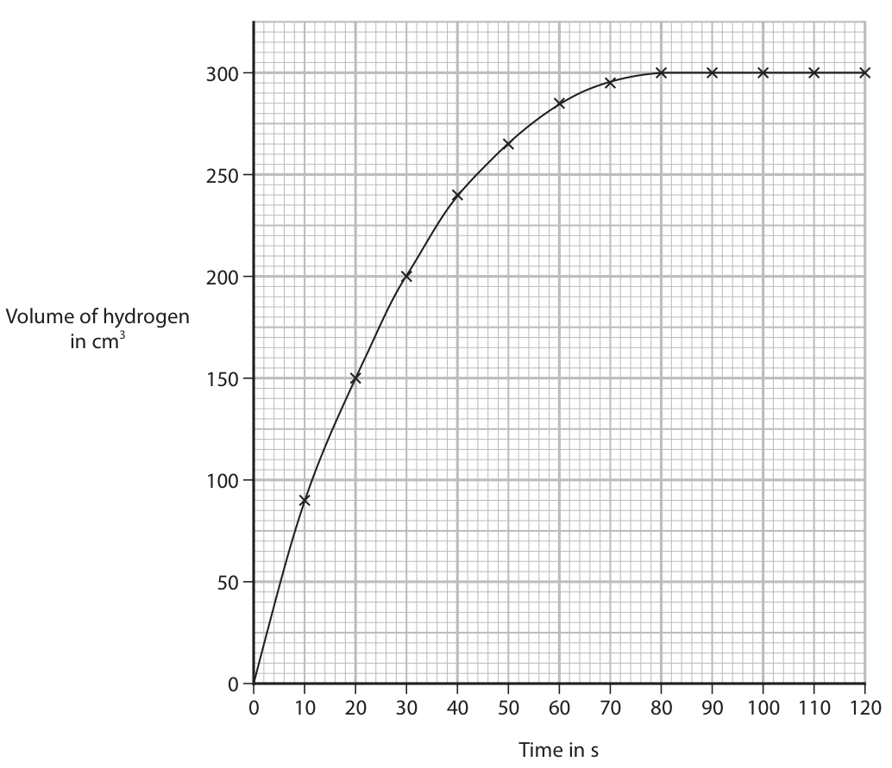

**Mark scheme answer**

> M1 tangent drawn (at 40 s)
> M2 change in volume of hydrogen ÷ change in time
> M3 correct answer between 2.75 and 3.75 (cm3/s)
> inclusive
> If no tangent drawn allow
> 1 mark for
> 240 ÷ 40 = 6 (cm3/s)

- **(1)** tangent drawn (at 40 s)
- **(1)** change in volume of hydrogen ÷ change in time
- **(1)** correct answer between 2.75 and 3.75 (cm3/s)

## Question 12 (13 marks)

This question is about hydrated compounds. Crystals of hydrated barium chloride (BaCl2 . xH2O) contain water of crystallisation. A student uses this apparatus to remove and collect the water from some crystals. barium chloride tube A crystals tube B heat water ice and salt mixture at –10 °C This is the student’s method. Step 1	record mass of tube A when empty Step 2	place a sample of hydrated barium chloride crystals in tube A and record new mass Step 3	heat tube A Step 4	allow tube A to cool and record mass Repeat steps 3 and 4 until the mass recorded in step 4 is constant. These are the student’s results. mass of tube A = 10.55 g mass of tube A and BaCl2 . xH2O = 16.65 g final mass of tube A and BaCl2 = 15.75 g

**(c)** A sample containing 0.02 mol of hydrated copper(II) sulfate is heated using the same apparatus. The products of the reaction are anhydrous copper(II) sulfate and water. This is the equation for the reaction. CuSO4 . 5H2O(s) ⇌ CuSO4(s) + 5H2O(l)

### 12(a)(i) [1]

Give a reason why the student repeats steps 3 and 4 until the mass is constant.

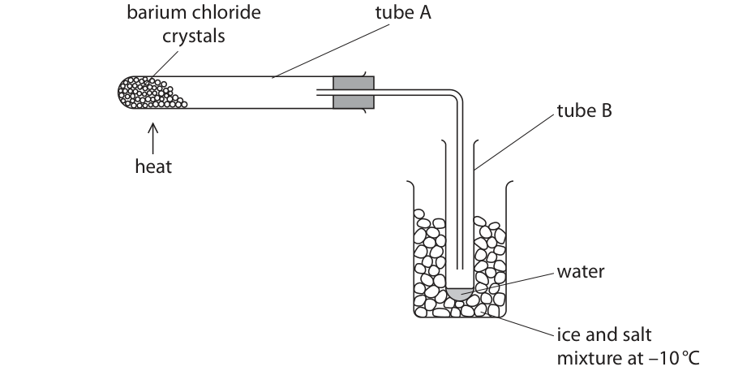

**Mark scheme answer**

> to make sure all the water is given off/evaporates ALLOW to make sure
> the reaction is
> complete

- **(1)** to make sure all the water is given off/evaporates ALLOW to make sure

### 12(a)(ii) [1]

Calculate the mass of BaCl2 that forms in tube A.

**Mark scheme answer**

> 5.2(0 g)

- **(1)** 5.2(0 g)

### 12(a)(iii) [1]

Calculate the mass of water lost.

**Mark scheme answer**

> 0.9(0 g)

- **(1)** 0.9(0 g)

### 12(a)(iv) [3]

Determine the value of x in BaCl2 . xH2O Show your working. [for BaCl2 , Mr = 208 for H2O, Mr = 18] x =

**Mark scheme answer**

> M1 moles of BaCl2= 5.2 ÷ 208 OR 0.025 ALLOW ecf from (ii)
> M2 moles of H2O = 0.9 ÷ 18 OR 0.05(0) ALLOW ecf from (iii)
> M3 0.05(0) ÷ 0.025 = 2 ALLOW ecf from M1 and
> M2 as long as the
> answer is an integer
> Correct answer without
> working scores 3

- **(1)** moles of BaCl2= 5.2 ÷ 208 OR 0.025 ALLOW ecf from (ii)
- **(1)** moles of H2O = 0.9 ÷ 18 OR 0.05(0) ALLOW ecf from (iii)
- **(1)** 0.05(0) ÷ 0.025 = 2 ALLOW ecf from M1 and

### 12(b) [2]

Describe a physical test to show that the water in tube B is pure.

**Mark scheme answer**

> M1 (measure the) boiling point ALLOW freezing point
> M2 100°C ALLOW 0°C for freezing
> point

- **(1)** (measure the) boiling point ALLOW freezing point
- **(1)** 100°C ALLOW 0°C for freezing

### 12(c)(i) [1]

Give the meaning of the symbol ⇌

**Mark scheme answer**

> reversible ALLOW the reaction
> goes in both directions
> IGNORE equilibrium

- **(1)** reversible ALLOW the reaction

### 12(c)(ii) [2]

Describe how the reaction can be used to show that a liquid contains water.

**Mark scheme answer**

> M1 add water to anhydrous copper sulfate ALLOW white copper
> sulfate
> M2 which turns (from white) to blue M2 dep on mention of
> anhydrous/white
> copper sulfate
> Max 1 mark if incorrect
> starting colour

- **(1)** add water to anhydrous copper sulfate ALLOW white copper
- **(1)** which turns (from white) to blue M2 dep on mention of

### 12(c)(iii) [2]

Calculate the maximum number of water molecules in tube B after the sample of hydrated copper(II) sulfate has completely reacted. One mole of any substance contains 6 × 10²³ particles. maximum number of molecules =

**Mark scheme answer**

> M1 moles of water = 0.02 x 5 OR 0.1
> M2 molecules of water = 6 × 10²² ALLOW ecf from M1
> Correct answer without
> working scores 2
> 1.2 x 1022 scores 1

- **(1)** moles of water = 0.02 x 5 OR 0.1
- **(1)** molecules of water = 6 × 10²² ALLOW ecf from M1

