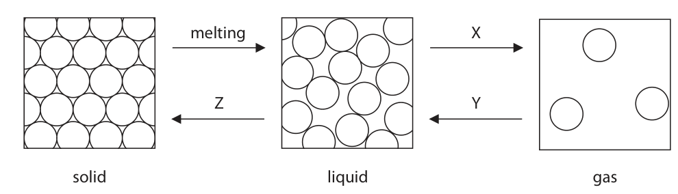
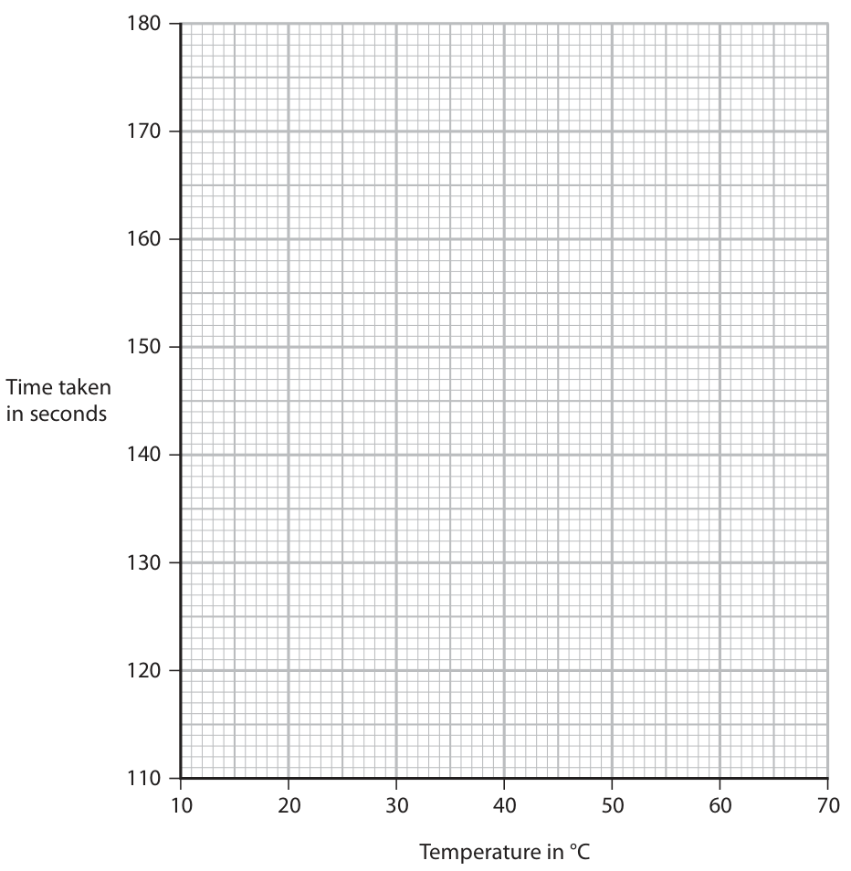
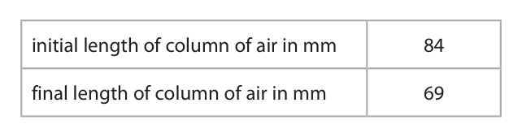
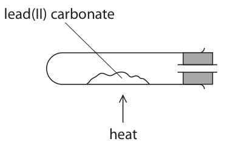
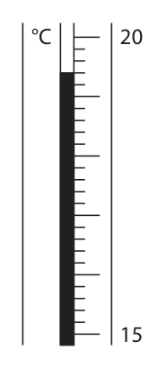
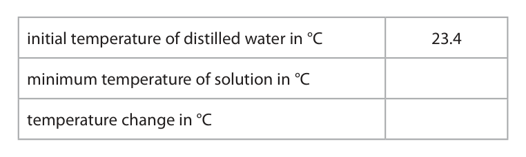
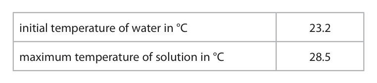

# 4CH1/1CR — 2023-01 (official extraction)

> schema `syllabai.official-paper-questions/0.2` · paper_id `pearson-edexcel:international-gcse:chemistry:4ch1:2023-01:4CH1/1CR` · qp sha256 `1378d3e64f2e80ce…` · extraction is the disclosed baseline (ADR-039)

## Question 1 (5 marks)

The diagram shows how the particles are arranged in the three states of matter. melting X Z Y solid liquid gas

### 1(a) [3]

Use words from the box to identify the changes of state X, Y and Z. condensing cooling crystallising diffusing evaporating freezing heating X Y Z

**Mark scheme answer**

> X evaporating ALLOW evaporation
> Y condensing ALLOW condensation
> Z freezing

- **(3)** X evaporating ALLOW evaporation

### 1(b) [2]

Describe the differences in the movement of particles in solids and gases.

**Mark scheme answer**

> M1 solid particles vibrate about a fixed position REJECT do not move
> M2 gas particles move randomly ALLOW gas particles
> move
> rapidly/quickly/freely

- **(1)** solid particles vibrate about a fixed position REJECT do not move
- **(1)** gas particles move randomly ALLOW gas particles

## Question 2 (7 marks)

This question is about gases in the atmosphere.

**(b)** A student uses this apparatus to determine the percentage of oxygen in a sample of air. wet iron wool column of air water This is the student’s method. • measure the initial length of the column of air in the tube • leave the apparatus for one week • measure the final length of the column of air The table shows the student’s results. initial length of column of air in mm 84 final length of column of air in mm 69

### 2(a)(i) [1]

Name the most abundant gas in the atmosphere.

**Mark scheme answer**

> nitrogen ALLOW N2
> IGNORE N

- **(1)** nitrogen ALLOW N2

### 2(a)(ii) [1]

Name the noble gas that makes up about 1% of the atmosphere.

**Mark scheme answer**

> argon ALLOW Ar

- **(1)** argon ALLOW Ar

### 2(a)(iii) [1]

Name a greenhouse gas in the atmosphere.

**Mark scheme answer**

> carbon dioxide ALLOW CO2/H2O(g)/water
> vapour/CH4/methane

- **(1)** carbon dioxide ALLOW CO2/H2O(g)/water

### 2(b)(i) [1]

State the appearance of the iron wool after one week.

**Mark scheme answer**

> brown/red-brown/orange-brown ALLOW orange
> IGNORE red
> ALLOW rusty/rust coloured
> (looks like)rust/rusted

- **(1)** brown/red-brown/orange-brown ALLOW orange

### 2(b)(ii) [2]

Use the student’s results to show that the percentage of oxygen in the sample of air is approximately 18%.

**Mark scheme answer**

> M1 (change in length of column =) 84 − 69 OR 15
> (mm)
> M2 15 x 100 = 17.86/17.9 (=18) M2 subsumes M1
> Working must be shown to
> score M2
> Ecf for M2 eg 18/84 x100
> =21.4
> REJECT 17.85/17.8 as
> wrongly rounded

- **(1)** (change in length of column =) 84 − 69 OR 15
- **(1)** 15 x 100 = 17.86/17.9 (=18) M2 subsumes M1

### 2(b)(iii) [1]

The actual percentage of oxygen in air is approximately 21%. Give a reason why the percentage of air calculated from the student’s results is less than 21%.

**Mark scheme answer**

> not all the oxygen in the sample of air had ALLOW there is water
> reacted with the iron wool OWTTE vapour in the column of
> /not enough iron wool air/changes in temperature
> / pressure / location
> ALLOW Reaction
> incomplete/reaction too
> slow

- **(1)** not all the oxygen in the sample of air had ALLOW there is water

## Question 3 (15 marks)

This question is about alkanes.

**(b)** There are two isomers of C4H10

**(c)** Methane reacts with bromine to form bromomethane and one other product.

**(d)** When ethane (C2H6 ) burns in a plentiful supply of air, carbon dioxide and water are formed.

### 3(a) [4]

An alkane has the structural formula CH3CH2CH2CH3 Give the missing information for this alkane. structural formula CH3CH2CH2CH3 name C4H10 empirical formula CnH2n+2

**Mark scheme answer**

> 4
> structural formula CH3CH2CH2CH3
> name butane
> molecular formula C4H10
> empirical formula C2H5
> general formula CnH2n+2
> 1 mark for each correct answer

- **(4)** 4

### 3(b)(i) [2]

State what is meant by the term isomers.

**Mark scheme answer**

> M1 (compounds with the) same molecular formula ALLOW same numbers
> of each atom
> M2 (but with) different structural/displayed ALLOW different
> formulae arrangement of atoms

- **(1)** (compounds with the) same molecular formula ALLOW same numbers
- **(1)** (but with) different structural/displayed ALLOW different

### 3(b)(ii) [2]

Draw the displayed formula of each isomer of C4H10 Isomer 1 Isomer 2

**Mark scheme answer**

> M1 displayed formula of butane
> M2 displayed formula of methylpropane

- **(1)** displayed formula of butane
- **(1)** displayed formula of methylpropane

### 3(c)(i) [1]

Give the formula of the other product.

**Mark scheme answer**

> HBr REJECT incorrect case
> letters
> Ignore name

- **(1)** HBr REJECT incorrect case

### 3(c)(ii) [1]

What is the name of this type of reaction?

- **(A)** addition
- **(B)** decomposition
- **(C)** neutralisation
- **(D)** substitution  ✔

**Mark scheme answer**

> D substitution
> A is incorrect as it is not an addition reaction
> B is incorrect as it is not a decomposition reaction
> C is incorrect as it is not a neutralisation reaction

- **(1)** Answer D: substitution

### 3(c)(iii) [1]

State the condition needed for this reaction to occur.

**Mark scheme answer**

> ultraviolet (radiation) ACCEPT UV (radiation)
> ALLOW ultraviolet/UV
> light/sunlight

- **(1)** ultraviolet (radiation) ACCEPT UV (radiation)

### 3(d)(i) [2]

Give a chemical equation for this reaction.

**Mark scheme answer**

> 2C2 H6 + 7O2 → 4CO2 + 6H2O ALLOW multiples and
> fractions
> M1 all formulae correct
> M2 balancing of correct formulae M2 dep on M1

- **(1)** all formulae correct
- **(1)** balancing of correct formulae M2 dep on M1

### 3(d)(ii) [2]

When the air supply is limited, incomplete combustion occurs. Explain why a gas formed by incomplete combustion can cause a problem for humans.

**Mark scheme answer**

> An explanation that links the following points
> M1 carbon monoxide/CO (is the gas produced)
> M2 (carbon monoxide) limits the capacity of the M2 dep on M1
> blood/haemoglobin to carry oxygen OWTTE

- **(1)** carbon monoxide/CO (is the gas produced)
- **(1)** (carbon monoxide) limits the capacity of the M2 dep on M1

## Question 4 (13 marks)

A student investigates the effect of temperature on the rate of reaction between two solutions, A and B. When the reaction occurs, the mixture turns from colourless to blue. This is the student’s method. • pour 25 cm3 of solution A into a conical flask • add solution B and measure the temperature of the mixture • record the time taken for the mixture to turn blue The student repeats this method at different temperatures.

**(b)** The table shows the student’s results. Temperature in °C 15 20 25 35 45 65 Time taken in seconds 178 156 132 130 122 113

### 4(a) [2]

Give two variables that the student needs to keep constant in this investigation. 1 2

**Mark scheme answer**

> Any two from
> M1 concentration of solution A
> M2 concentration of solution B
> ALLOW amount of
> M3 volume of solution B
> solution B
> Ignore apparatus

- **(2)** Any two from

### 4(b)(i) [1]

Plot the student’s results on the grid.

**Mark scheme answer**

> all points plotted correctly to the nearest grid line

- **(1)** all points plotted correctly to the nearest grid line

### 4(b)(ii) [1]

Draw a circle around the anomalous result.

**Mark scheme answer**

> anomalous point at 25oC circled ALLOW ecf from
> incorrect plotting

- **(1)** anomalous point at 25oC circled ALLOW ecf from

### 4(b)(iii) [1]

Draw a curve of best fit. 180 170 160 150 Time taken in seconds 140 130 120 110 10 20 30 40 50 60 70 Temperature in °C

**Mark scheme answer**

> smooth curve of best fit ignoring the anomalous point ALLOW Ecf if 35,130
> circled

- **(1)** smooth curve of best fit ignoring the anomalous point ALLOW Ecf if 35,130

### 4(b)(iv) [1]

Give a reason for the anomalous result.

**Mark scheme answer**

> Any one from
> M1 temperature was higher than 25oC
> M2 started the timer too late /stopped the timer too ALLOW ecf from
> early/took reading too early incorrect anomalous
> result circled so
> 35,130 gives slower as
> temp<35/timer
> stopped too late

- **(1)** Any one from

### 4(b)(v) [2]

Use your graph to determine the time taken for the mixture to turn blue at 55 °C. Show your working on the graph. time taken = s

**Mark scheme answer**

> M1 vertical line on graph drawn to curve from 55oC ALLOW extra point at
> 55oC on curve
> M2 value obtained from candidate’s graph expected value 115 to
> 117 s

- **(1)** vertical line on graph drawn to curve from 55oC ALLOW extra point at
- **(1)** value obtained from candidate’s graph expected value 115 to

### 4(c) [2]

Use information from the table to calculate the mean rate of reaction at 20 °C. Use the expression mean rate = time in seconds Give your answer in standard form. mean rate = s–1

**Mark scheme answer**

> M1 1 OR 0.00641 ALLOW use of value
> 156 from graph
> M2 6.41 × 10⁻³ ALLOW 6.4 x 10-3

- **(1)** 1 OR 0.00641 ALLOW use of value
- **(1)** 6.41 × 10⁻³ ALLOW 6.4 x 10-3

### 4(d) [3]

Explain how increasing the temperature affects the rate of a reaction. Refer to particle collision theory in your answer.

**Mark scheme answer**

> An explanation that links the following three points
> M1 rate (of reaction) increases ALLOW reaction is
> faster/ speeds up
> M2 (mean) kinetic energy of particles increases ALLOW particles
> move faster
> IGNORE vibrate more
> /faster
> M3 more successful collisions per second/unit time/ ALLOW more
> more frequent successful collisions frequent collisions
> having energy >
> activation energy

- **(1)** rate (of reaction) increases ALLOW reaction is
- **(1)** (mean) kinetic energy of particles increases ALLOW particles
- **(1)** more successful collisions per second/unit time/ ALLOW more

## Question 5 (12 marks)

This question is about organic compounds.

**(a)** The diagram shows the displayed formula of methanoic acid. O H C O H

**(b)** The atoms in methanoic acid are held together by covalent bonds.

### 5(a)(i) [1]

Give the total number of atoms in one molecule of methanoic acid.

**Mark scheme answer**

> 5/five

- **(1)** 5/five

### 5(a)(ii) [1]

Determine the relative molecular mass (Mr ) of methanoic acid. Mr =

**Mark scheme answer**

> 46

- **(1)** 46

### 5(a)(iii) [2]

Explain why methanoic acid is not a hydrocarbon.

**Mark scheme answer**

> M1 hydrocarbons contain only carbon and hydrogen REJECT molecules
> (atoms)
> M2 methanoic acid/it contains oxygen (as well as
> hydrogen and carbon)

- **(1)** hydrocarbons contain only carbon and hydrogen REJECT molecules
- **(1)** methanoic acid/it contains oxygen (as well as

### 5(b)(i) [2]

State, in terms of electrostatic attractions, what is meant by the term covalent bond.

**Mark scheme answer**

> 2
> M1 (electrostatic) attraction between nuclei Must be plural
> M2 (and the) shared pair of electrons
> OR
> M1 (electrostatic) attraction between shared pair(s)
> of electrons
> M2 and nuclei Must be plural

- **(2)** 2

### 5(b)(ii) [3]

Draw a dot‑and‑cross diagram to show the bonding in a molecule of methanoic acid. Show only the outer electrons of each atom.

> 🖼 crop required: diagram (qp.pdf p.15)

**Mark scheme answer**

> M1 3 pairs of electrons for 3 single bonds ALLOW any combination
> of dots and crosses
> M2 2 shared pairs for one C=O double bond
> M3 rest of molecule fully correct (lone pairs on M3 dep on M1 and M2
> oxygen atoms must be shown) correct

- **(1)** 3 pairs of electrons for 3 single bonds ALLOW any combination
- **(1)** 2 shared pairs for one C=O double bond
- **(1)** rest of molecule fully correct (lone pairs on M3 dep on M1 and M2

### 5(c) [3]

Calculate the empirical formula of the organic compound with this composition by mass. C = 52.2% H = 13.0% O = 34.8% empirical formula =

**Mark scheme answer**

> • divide percentages by relative atomic 0 marks if division by
> masses atomic numbers or
> • divide results by smallest value to obtain upside-down calculation
> ratio
> • write empirical formula
> Example calculation
> M1 C H O
> 52.2 13.0 34.8
> 12 1
> M2 4.35 13.0 2.175
> 2.175 2.175 2.175
> OR 2 6
> M3 C2H6O ACCEPT symbols in any
> order

- **(1)** C H O
- **(1)** 4.35 13.0 2.175
- **(1)** C2H6O ACCEPT symbols in any

## Question 6 (11 marks)

This question is about elements in Group 7 of the Periodic Table.

### 6(a)(i) [1]

Which element is a liquid at room temperature?

- **(A)** astatine
- **(B)** bromine  ✔
- **(C)** chlorine
- **(D)** fluorine

**Mark scheme answer**

> B bromine
> A is incorrect as astatine is a solid at room
> temperature
> C is incorrect as chlorine is a gas at room temperature
> D is incorrect as fluorine is a gas at room temperature

- **(1)** Answer B: bromine

### 6(a)(ii) [1]

What colour is solid iodine?

- **(A)** black
- **(B)** dark brown
- **(C)** dark grey  ✔
- **(D)** purple

**Mark scheme answer**

> C dark grey
> A is incorrect as solid iodine is not black
> B is incorrect as solid iodine is not dark brown
> D is incorrect as solid iodine is not purple

- **(1)** Answer C: dark grey

### 6(a)(iii) [2]

Describe a test for chlorine gas.

**Mark scheme answer**

> M1 test with (damp blue) litmus paper ALLOW Universal
> indicator paper/ pH
> paper
> M2 bleaches/turns white ACCEPT turns red
> and then bleaches

- **(1)** test with (damp blue) litmus paper ALLOW Universal
- **(1)** bleaches/turns white ACCEPT turns red

### 6(b) [3]

A sample of chlorine, containing two isotopes, has this percentage composition by mass. chlorine‑35 71.2% chlorine‑37 28.8% Calculate the relative atomic mass of this sample of chlorine. Give your answer to one decimal place. relative atomic mass =

**Mark scheme answer**

> M1 71.2 x 35 + 28.8 x 37 OR 3557.6 Correct answer
> without working
> scores 3
> M2 71.2 x 35 + 28.8 x 37 OR 3557.6 OR 35.576 M2 subsumes M1
> 100 100
> M3 35.6 35.5 without working
> scores 0

- **(1)** 71.2 x 35 + 28.8 x 37 OR 3557.6 Correct answer
- **(1)** 71.2 x 35 + 28.8 x 37 OR 3557.6 OR 35.576 M2 subsumes M1
- **(1)** 35.6 35.5 without working

### 6(c) [4]

A student is given an aqueous solution of chlorine and an aqueous solution of sodium iodide. Explain how the student can use these solutions to compare the reactivity of chlorine with the reactivity of iodine.

**Mark scheme answer**

> An explanation that links the following four points
> M1 add chlorine (solution) to sodium iodide (solution) ALLOW mix the two
> solutions
> M2 solution turns brown
> M3 iodine/I2 is displaced ALLOW iodine/I2 is
> formed
> M4 (so) chlorine is more reactive (than iodine) ORA
> REJECT incorrect
> use of iodide or
> chloride once only

- **(1)** add chlorine (solution) to sodium iodide (solution) ALLOW mix the two
- **(1)** solution turns brown
- **(1)** iodine/I2 is displaced ALLOW iodine/I2 is
- **(1)** (so) chlorine is more reactive (than iodine) ORA

## Question 7 (10 marks)
**(b)** The teacher demonstrates the reaction between aluminium and iron(III) oxide. magnesium fuse mixture of aluminium powder and iron(III) oxide powder The teacher ignites the magnesium fuse. A very exothermic reaction then occurs between aluminium powder and iron(III) oxide. The products of the reaction are iron and aluminium oxide.

**(c)** A student uses this apparatus to determine the formula of magnesium oxide. crucible lid magnesium ribbon heat This is the student’s method. • find mass of empty crucible and lid • place some magnesium ribbon in crucible • find mass of crucible, lid and magnesium ribbon • heat crucible, lifting lid occasionally • after five minutes, find mass of crucible, lid and magnesium oxide

### 7(a) [2]

A teacher ignites a piece of magnesium ribbon and places it in a gas jar of oxygen. This is the equation for the reaction. 2Mg + O2 → 2MgO Give two observations that would be made during this reaction. 1 2

**Mark scheme answer**

> M1 (bright) white flame/light
> M2 white powder/solid (formed) ALLOW white smoke/ash
> ALLOW grey powder
> REJECT white precipitate

- **(1)** (bright) white flame/light
- **(1)** white powder/solid (formed) ALLOW white smoke/ash

### 7(b)(i) [1]

State what is meant by the term exothermic.

**Mark scheme answer**

> gives out/releases heat (energy)/thermal energy IGNORE energy alone

- **(1)** gives out/releases heat (energy)/thermal energy IGNORE energy alone

### 7(b)(ii) [1]

Give a chemical equation for the reaction between aluminium and iron(III) oxide.

**Mark scheme answer**

> 2Al + Fe2O3 → 2Fe + Al2O3 ALLOW multiples and
> fractions

- **(1)** 2Al + Fe2O3 → 2Fe + Al2O3 ALLOW multiples and

### 7(b)(iii) [2]

Explain why this reaction is a redox reaction.

**Mark scheme answer**

> An explanation that links two of the following
> pairs of points
> M1 aluminium/Al gains oxygen so is oxidised ACCEPT aluminium loses
> electrons so is oxidised
> M2 iron oxide/Fe2O3 loses oxygen so is reduced ACCEPT iron ions/Fe3+ ions
> gain electrons so are
> reduced
> OR
> M1 aluminium/Al is oxidised and iron oxide/Fe2O3 ACCEPT aluminium loses
> is reduced electrons and iron
> ions/Fe3+ ions gain
> electrons
> M2 as aluminium/Al gains oxygen and iron oxide
> /Fe2O3 loses oxygen
> ALLOW answers in terms
> of change in oxidation

- **(2)** An explanation that links two of the following

### 7(c)(i) [2]

Explain why the student lifts the lid.

**Mark scheme answer**

> An explanation that links the following two points
> M1 to allow air/oxygen to enter the crucible
> OWTTE
> M2 so that oxygen can react with the magnesium

- **(1)** to allow air/oxygen to enter the crucible
- **(1)** so that oxygen can react with the magnesium

### 7(c)(ii) [2]

The mass of magnesium oxide formed is less than expected. Describe what the student should do next to obtain a more accurate value for the mass of magnesium oxide.

**Mark scheme answer**

> A description that refers to the following points
> M1 heat the crucible again and reweigh
> M2 repeat until constant mass Heat and reweigh to
> constant mass scores 2

- **(1)** heat the crucible again and reweigh
- **(1)** repeat until constant mass Heat and reweigh to

## Question 8 (12 marks)

This question is about the oxides of some elements in Group 4 of the Periodic Table.

**(a)** When 5.34 g of lead(II) carbonate are heated, lead(II) oxide and carbon dioxide are formed. This is the equation for the reaction. PbCO3(s) → PbO(s) + CO2(g)

**(b)** The diagram shows apparatus used to heat lead(II) carbonate. lead(II) carbonate heat

### 8(a)(i) [1]

Give the name for this type of reaction.

**Mark scheme answer**

> (thermal) decomposition

- **(1)** (thermal) decomposition

### 8(a)(ii) [2]

Calculate the maximum mass of lead(II) oxide that can be formed from 5.34 g of lead(II) carbonate. [for PbCO3, Mr = 267 for PbO, Mr = 223] maximum mass = g

**Mark scheme answer**

> M1 amount of PbCO3 = 5.34 = 0.02(00) (mol) Correct answer without
> 267 working scores 2
> M2 mass of PbO = 0.02(00) x 223 = 4.46 (g) ACCEPT alternative
> methods

- **(1)** amount of PbCO3 = 5.34 = 0.02(00) (mol) Correct answer without
- **(1)** mass of PbO = 0.02(00) x 223 = 4.46 (g) ACCEPT alternative

### 8(b)(i) [2]

Complete the diagram to show what needs to be added to the apparatus to test that the gas released is carbon dioxide.

**Mark scheme answer**

> M1 diagram showing delivery tube going into test REJECT if sealed with a
> tube containing liquid bung
> M2 limewater labelled

- **(1)** diagram showing delivery tube going into test REJECT if sealed with a
- **(1)** limewater labelled

### 8(b)(ii) [1]

Give the result of the test.

**Mark scheme answer**

> (limewater) turns cloudy/milky ALLOW white precipitate
> (ii) dep on mention of
> limewater in either (i) or

- **(1)** (limewater) turns cloudy/milky ALLOW white precipitate

### 8(c) [6]

Silicon dioxide (SiO2) and carbon dioxide both contain covalent bonds. Silicon dioxide is a solid with a high melting point. Carbon dioxide is a gas at room temperature. Explain why silicon dioxide has a much higher melting point than carbon dioxide. Refer to structure and bonding in your answer.

**Mark scheme answer**

> An explanation that links six of the following points
> M1 silicon dioxide has a giant (covalent) structure
> M2 covalent bonds are (very) strong
> M3 (in silicon dioxide) many covalent bonds need to
> be broken
> M4 a large amount of energy/more energy is No M3 or M4 if reference
> required to break the bonds in silicon dioxide to intermolecular forces
> in silicon dioxide
> M5 carbon dioxide has a simple molecular
> structure/is a simple molecule
> M6 the forces between the No M6 or M7 if any
> molecules/intermolecular forces (in carbon dioxide) reference to weak
> are weak covalent bonds or
> breaking of covalent
> M7 very little energy/less energy is needed to bonds in carbon dioxide
> overcome the forces between the Accept bonds between
> molecules/intermolecular forces (in carbon dioxide) molecules weak
> A statement such as
> ‘more energy is needed
> to break the bonds in
> silicon dioxide than to
> overcome the forces
> between the
> molecules/intermolecular
> forces (in carbon
> dioxide)’ scores M4 and
> M7

- **(6)** An explanation that links six of the following points

## Question 9 (10 marks)

A student uses the reaction between zinc powder and dilute nitric acid to prepare some zinc nitrate crystals.

**(b)** In the preparation, the student adds an excess of zinc powder to some dilute nitric acid.

### 9(a)(i) [1]

Complete the equation for the reaction by adding the state symbols. Zn ( ) + 2HNO3 ( ) → Zn(NO3)2 ( ) + H2 ( )

**Mark scheme answer**

> 1
> Zn (s) + 2HNO3(aq) Zn(NO3)2(aq) + H2(g) ACCEPT upper case
> letters

- **(1)** 1

### 9(a)(ii) [1]

State what the student would observe during this reaction.

**Mark scheme answer**

> effervescence/bubbles/fizzing IGNORE gas produced
> /given off
> IGNORE hydrogen
> produced / given off
> ALLOW colourless
> solution formed/gets
> hot/exothermic
> reaction/zinc dissolves
> IGNORE crystals form

- **(1)** effervescence/bubbles/fizzing IGNORE gas produced

### 9(b)(i) [1]

State why the student uses an excess of zinc powder.

**Mark scheme answer**

> so all the nitric acid reacts/is neutralised

- **(1)** so all the nitric acid reacts/is neutralised

### 9(b)(ii) [5]

Describe what the student should do next to obtain pure, dry crystals of zinc nitrate.

**Mark scheme answer**

> A description which refers to the following five
> points
> M1 filter off the excess zinc
> M2 heat the solution until crystals form ALLOW heat until the
> solution is saturated/
> heat until crystals form
> on the end of a glass
> rod/heat to evaporate
> some of the water
> M3 leave the solution to cool (and crystallise)
> M4 pour/filter off excess liquid (to obtain crystals) IGNORE washing
> M5 leave (crystals) to dry ALLOW any method of
> drying that avoids excess
> heat e.g. filter paper, a
> desiccator, a warm oven
> If heated to dryness only
> M1 can be scored
> If solution is not heated
> only M1, M4 and M5 can
> be scored

- **(1)** filter off the excess zinc
- **(1)** heat the solution until crystals form ALLOW heat until the
- **(1)** leave the solution to cool (and crystallise)
- **(1)** pour/filter off excess liquid (to obtain crystals) IGNORE washing
- **(1)** leave (crystals) to dry ALLOW any method of

### 9(c) [2]

The formula for the zinc nitrate crystals is Zn(NO3)2.6H2O When zinc nitrate crystals are heated, the products are zinc oxide, nitrogen dioxide (NO2), oxygen and water. Complete the equation for this reaction. 2Zn(NO3)2.6H2O → + + +

**Mark scheme answer**

> 2Zn(NO3)2.6H2O → 2ZnO + 4NO2 + O2 + 12H2O
> M1 all formulae correct
> M2 balancing of correct formulae M2 dep on M1

- **(1)** all formulae correct
- **(1)** balancing of correct formulae M2 dep on M1

## Question 10 (15 marks)

A student uses this apparatus to find the heat energy change when ammonium nitrate dissolves in water to form a solution. polystyrene cup distilled water This is the student’s method. • add 50 cm3 of distilled water to the polystyrene cup and record the initial temperature of the water • add a known mass of ammonium nitrate to the polystyrene cup and stir the mixture until all the solid dissolves • record the minimum temperature of the ammonium nitrate solution

**(c)** The student repeats the experiment, again using 50 cm3 water, and finds that the temperature change is 3.9 °C.

### 10(a) [2]

Give two reasons why the student stirs the mixture. 1 2

**Mark scheme answer**

> M1 so that the solid/ammonium nitrate dissolves IGNORE speed up
> more quickly reaction
> M2 so that the temperature is even throughout the ALLOW heat transfers
> solution OWTTE evenly (throughout the
> solution)

- **(1)** so that the solid/ammonium nitrate dissolves IGNORE speed up
- **(1)** so that the temperature is even throughout the ALLOW heat transfers

### 10(b) [2]

The diagram shows the minimum temperature of the solution. °C 20 Complete the table by giving the missing information. Give both values to the nearest 0.1 °C. initial temperature of distilled water in °C 23.4 minimum temperature of solution in °C temperature change in °C

**Mark scheme answer**

> 2
> initial temperature of distilled
> water in oC 23.4
> minimum temperature of solution 19.4
> in oC
> must be to 1 dp
> temperature change in oC 4.0 ALLOW ecf on incorrect
> mimimum temperature

- **(2)** 2

### 10(c)(i) [2]

Show that the heat energy change, Q , in this experiment is about 800 J. [c = 4.2 J / g / °C for the solution] [mass = 1.0 g for 1.0 cm3 of solution]

**Mark scheme answer**

> M1 (Q =) 50 x 4.2 x 3.9 (J) answer of 819 or 820
> without working scores 2
> M2 (Q =) 819/820 (J) ALLOW use of 4.0 giving
> an answer of 840

- **(1)** (Q =) 50 x 4.2 x 3.9 (J) answer of 819 or 820
- **(1)** (Q =) 819/820 (J) ALLOW use of 4.0 giving

### 10(c)(ii) [4]

The student uses 2.8 g of ammonium nitrate in this experiment. Calculate the enthalpy change, ΔH, in kJ / mol. Include a sign in your answer. [for NH4NO3, Mr = 80] ΔH = kJ / mol

**Mark scheme answer**

> • find moles of NH4NO3 correct answer without
> • division of Q by moles working scores 4
> • conversion to kJ/mol
> • answer with correct sign
> M1 (amount of NH4NO3 =) 2.8 ÷ 80 OR 0.035 (mol)
> M2 819 ÷ 0.035 OR 23 400 (J/mol) use of 820 gives 23 429
> use of 800 gives 22 857
> use of 840 gives 24 000
> M3 23 400 ÷ 1000 OR 23.4 (kJ/mol) use of 820 gives 23.4
> use of 800 gives 22.9
> use of 840 gives 24.0
> M4 (ΔH =) +23.4/+23 (kJ/mol)

- **(1)** (amount of NH4NO3 =) 2.8 ÷ 80 OR 0.035 (mol)
- **(1)** 819 ÷ 0.035 OR 23 400 (J/mol) use of 820 gives 23 429
- **(1)** 23 400 ÷ 1000 OR 23.4 (kJ/mol) use of 820 gives 23.4
- **(1)** (ΔH =) +23.4/+23 (kJ/mol)

### 10(d) [3]

Describe a test to show that the ammonium nitrate solution contains ammonium ions.

**Mark scheme answer**

> A description that refers to the following points
> M1 add sodium hydroxide (solution to the ammonium
> nitrate and warm)
> M2 test the gas/ammonia evolved with (damp) red M2 and M3 dep on M1
> litmus paper/(damp) universal indicator paper
> M3 (red litmus) turns blue/ (universal indicator) No M2 or M3 if solution
> turns blue/purple tested with litmus/
> universal indicator paper

- **(1)** add sodium hydroxide (solution to the ammonium
- **(1)** test the gas/ammonia evolved with (damp) red M2 and M3 dep on M1
- **(1)** (red litmus) turns blue/ (universal indicator) No M2 or M3 if solution

### 10(e) [2]

In another experiment the student adds anhydrous copper(II) sulfate to distilled water. The table shows the student’s results. initial temperature of water in °C 23.2 maximum temperature of solution in °C 28.5 Explain what the results show about the type of energy change that occurs when anhydrous copper(II) sulfate dissolves in water.

**Mark scheme answer**

> An explanation that links the following points
> M1 the temperature increases/rises
> M2 so the reaction is exothermic

- **(1)** the temperature increases/rises
- **(1)** so the reaction is exothermic

