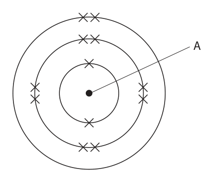
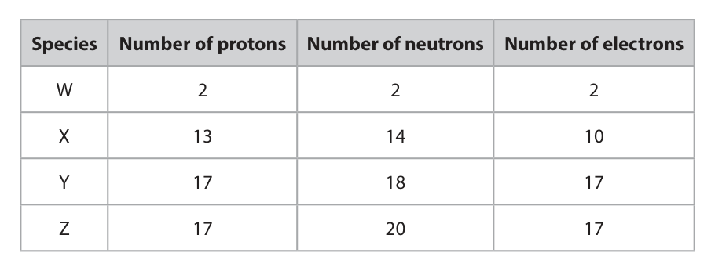
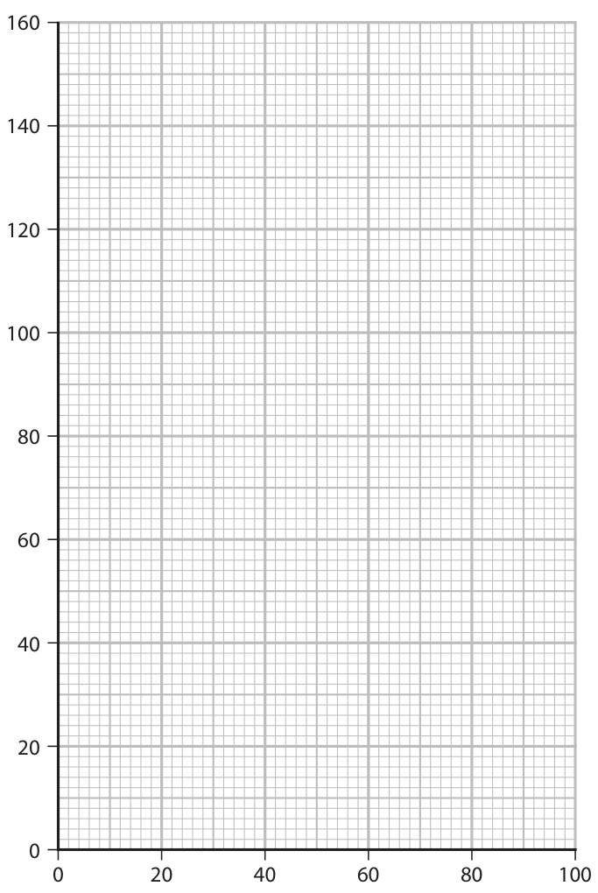
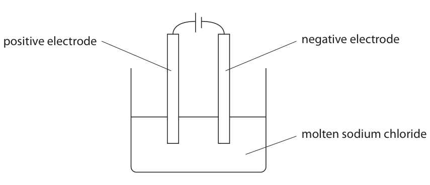
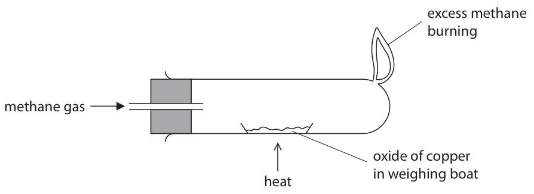
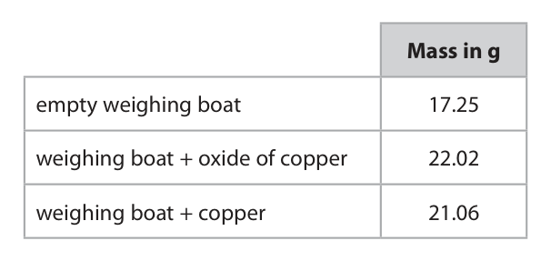
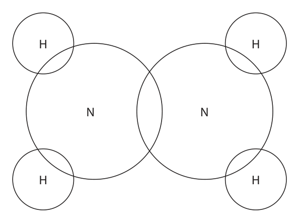
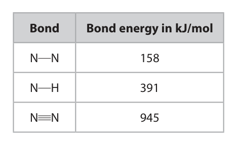

# 4CH1/2C — 2023-01 (official extraction)

> schema `syllabai.official-paper-questions/0.1` · paper_id `pearson-edexcel:international-gcse:chemistry:4ch1:2023-01:4CH1/2C` · qp sha256 `bdaefe6fde2fa7ca…` · extracted verbatim, never regenerated (ADR-037)

## Question 1 (7 marks)
**(b)** The table gives information about four different species, W, X, Y and Z. Species Number of protons Number of neutrons Number of electrons W 2 2 2 X 13 14 10 Y 17 18 17 Z 17 20 17

### 1(a) [3]

The diagram shows the electronic configuration of an atom of an element. A Complete the table by giving the missing information. Name of the part of this atom labelled A Number of the group that contains this element Number of the period that contains this element 

**Mark scheme answer**

> name of the part of this atom labelled A nucleus
> number of the group that contains this element 2
> number of the period that contains this element 3

- **(3)** name of the part of this atom labelled A nucleus

### 1(b)(i) [1]

Give the mass number of W.

**Mark scheme answer**

> 4

- **(1)** 4

### 1(b)(ii) [1]

Give a reason why X has a 3+ charge.

**Mark scheme answer**

> (species X has) three more protons than electrons / ALLOW (the atom which
> three fewer electrons than protons formed species X has)
> lost three electrons
> IGNORE refs to Group 3

- **(1)** (species X has) three more protons than electrons / ALLOW (the atom which

### 1(b)(iii) [2]

Explain why Y and Z are isotopes of the same element.

**Mark scheme answer**

> M1 same number of protons / both have 17 protons IGNORE all refs to
> electrons
> M2 different number of neutrons / one has two
> neutrons more / one has 18 neutrons and the other
> has 20 neutrons
> ALLOW “same atomic
> number, different mass
> number” for (1) mark
> Total for question = 7

- **(1)** same number of protons / both have 17 protons IGNORE all refs to
- **(1)** different number of neutrons / one has two

## Question 2 (5 marks)

The table shows properties of four substances, A, B, C and D. Melting point Boiling point Conducts electricity Conducts electricity Substance in °C in °C when solid when molten A 800 1465 no yes B 327 1749 yes yes C 232 573 no no D 3550 4830 no no

**(a)** Use information from the table to identify these substances.

**(b)** One of the substances in the table is a compound with the formula C10H16N2O3S

### 2(a)(i) [1]

Which substance could be a metal? A B C D

**Mark scheme answer**

> B
> A, C and D are not the correct answers as metals
> conduct electricity when solid

- **(1)** B

### 2(a)(ii) [1]

Which substance could be diamond? A B C D

**Mark scheme answer**

> D
> A is not the correct answer because diamond will
> not conduct electricity when molten
> B is not the correct answer because diamond will
> not conduct electricity when solid or molten
> C is not the correct answer because diamond has a
> much higher melting and boiling point

- **(1)** D

### 2(a)(iii) [1]

Which substance is a gas at 600 °C? A B C D 

**Mark scheme answer**

> C
> A is not the correct answer as A is a solid at 600°C
> B is not the correct answer as B is a liquid at 600°C
> D is not the correct answer as D is a solid at 600°C

- **(1)** C

### 2(b)(i) [1]

Give the number of different elements in C10H16N2O3S

**Mark scheme answer**

> 5/five

- **(1)** 5/five

### 2(b)(ii) [1]

Determine the number of atoms in a molecule of C10H16N2O3S

**Mark scheme answer**

> 32/thirty two
> Total for question = 5

- **(1)** 32/thirty two

## Question 3 (8 marks)

This question is about soluble salts and insoluble salts.

**(c)** The table gives the solubility of a salt in water at six different temperatures. Temperature in °C 0 20 40 60 80 100 Solubility in g per 100 g of water 18 34 54 77 104 142

### 3(a) [1]

Which pair of solutions produces an insoluble salt when mixed?

- **(A)** sodium sulfate and potassium nitrate
- **(B)** potassium carbonate and calcium nitrate  ✔
- **(C)** sodium chloride and ammonium nitrate
- **(D)** sodium hydroxide and potassium sulfate

**Mark scheme answer**

> B
> A is not correct because mixing sodium sulfate and
> potassium nitrate does not produce an insoluble
> salt.
> C is not correct because mixing sodium chloride and
> ammonium nitrate does not produce an insoluble
> salt.
> D is not correct because mixing sodium hydroxide
> and potassium sulfate does not produce an insoluble
> salt.

- **(1)** Answer B: potassium carbonate and calcium nitrate

### 3(b) [3]

When solutions of lead nitrate and sodium sulfate are mixed, one product is solid lead sulfate. This is the equation for the reaction. Pb(NO3)2(aq) + Na2SO4(aq) → PbSO4(s) + 2NaNO3(aq) Describe how a pure, dry sample of solid lead sulfate can be obtained from the mixture. 

**Mark scheme answer**

> M1 filter (the solid lead sulfate) If the method starts
> with crystallisation
> then, max (2)
> M2 wash / rinse (with deionised / distilled water)
> M3 leave (in a warm place) to dry ALLOW leave on a
> windowsill / dry using
> filter paper / dry in a
> (warm / drying) oven
> If the reaction mixture
> is just heated to
> dryness, score M3 only

- **(1)** filter (the solid lead sulfate) If the method starts
- **(1)** wash / rinse (with deionised / distilled water)
- **(1)** leave (in a warm place) to dry ALLOW leave on a

### 3(c)(i) [1]

Plot the points on the grid.

**Mark scheme answer**

> 6 points plotted ± half a square

- **(1)** 6 points plotted ± half a square

### 3(c)(ii) [1]

Draw a curve of best fit. 160 140 120 100 Solubility in g per 100 g of water 0 20 40 60 80 100 Temperature in °C 

**Mark scheme answer**

> smooth curve of best fit through, or within a
> square, of all points

- **(1)** smooth curve of best fit through, or within a

### 3(c)(iii) [2]

A saturated solution of the salt in 100 g of water is cooled from 90 °C to 30 °C. Use your graph to determine the mass of salt that will crystallise. Show your working on the graph. mass of salt = g

**Mark scheme answer**

> M1 working shown on graph ALLOW any evidence of
> temperatures marked
> on graph eg dots / lines
> M2 solubility at 90°C – solubility at 30°C Expected answer of 74-
> 82 scores 2 provided
> some working is shown
> on graph
> If no working shown,
> score M2 only
> Mark ECF on (ii), even if
> a straight line is drawn
> Total for question = 8

- **(1)** working shown on graph ALLOW any evidence of
- **(1)** solubility at 90°C – solubility at 30°C Expected answer of 74-

## Question 4 (13 marks)

Fractional distillation is used to separate crude oil into fractions. The diagram shows a fractionating column and the fractions obtained from crude oil. refinery gases gasoline kerosene diesel fuel oil crude oil bitumen

**(b)** Some fractions obtained from crude oil are cracked to form alkenes.

### 4(a)(i) [4]

Describe how crude oil is separated into fractions in the fractionating column. 

**Mark scheme answer**

> M1 crude oil is heated / vapourised ALLOW boiled
> REJECT burned
> M2 vapours / gases / compounds / hydrocarbons
> rise up the column
> M3 the column is hotter at the bottom than the top ALLOW temperature
> gradient of the column
> ALLOW different
> temperatures at each
> level
> ALLOW fractions with
> lowest boiling point rise
> to the top
> IGNORE refs to gradient
> in density of molecules
> M4 vapours / compounds / hydrocarbons condense ALLOW vapours /
> at their boiling point compounds /
> hydrocarbons /
> condense at different
> heights
> ALLOW the vapours /
> compounds /
> hydrocarbons /
> fractions have different
> boiling points
> IGNORE melting point

- **(1)** crude oil is heated / vapourised ALLOW boiled
- **(1)** vapours / gases / compounds / hydrocarbons
- **(1)** the column is hotter at the bottom than the top ALLOW temperature
- **(1)** vapours / compounds / hydrocarbons condense ALLOW vapours /

### 4(a)(ii) [2]

Give a use for kerosene and a use for bitumen. kerosene bitumen

**Mark scheme answer**

> kerosene = aeroplane fuel / fuel for heating ALLOW fuel for lamps /
> fuel for cooking
> bitumen = road tar / tarmac / (waterproofing) roofs ALLOW road surfacing /
> road making

- **(2)** kerosene = aeroplane fuel / fuel for heating ALLOW fuel for lamps /

### 4(b)(i) [2]

Describe what is meant by cracking.

**Mark scheme answer**

> M1 breaking down long-chain hydrocarbons / long- REJECT polymers
> chain molecules / long-chain alkanes IGNORE refs to
> separation
> M2 to form shorter chains (of alkanes / alkenes / ALLOW to break (C-C)
> hydrocarbons) bonds

- **(1)** breaking down long-chain hydrocarbons / long- REJECT polymers
- **(1)** to form shorter chains (of alkanes / alkenes / ALLOW to break (C-C)

### 4(b)(ii) [3]

Ethene is obtained by cracking. This is the displayed formula of ethene. H H C C H H Explain why ethene is described as an unsaturated hydrocarbon. 

**Mark scheme answer**

> M1 (ethene is unsaturated because it has a) double
> (C=C) bond
> M2 (ethene is a hydrocarbon as it contains) REJECT carbon and
> hydrogen and carbon (atoms) hydrogen molecules
> M3 only M3 dep on mention of
> carbon and hydrogen in
> M2

- **(1)** (ethene is unsaturated because it has a) double
- **(1)** (ethene is a hydrocarbon as it contains) REJECT carbon and
- **(1)** only M3 dep on mention of

### 4(b)(iii) [2]

Describe a test to show that ethene is unsaturated.

**Mark scheme answer**

> M1 add bromine water ALLOW bromine solution
> NOT just ‘bromine’
> M2 which decolourises / turns colourless M2 dep on mention of
> bromine in M1
> IGNORE starting colour
> of bromine
> IGNORE clear
> NOT just ‘changes
> colour’
> If reaction takes place
> in presence of uv, then
> score M1 only
> Total for question = 13

- **(1)** add bromine water ALLOW bromine solution
- **(1)** which decolourises / turns colourless M2 dep on mention of

## Question 5 (11 marks)

This question is about metals.

**(b)** Sodium metal is extracted by the electrolysis of molten sodium chloride. Sodium metal forms at the negative electrode and chlorine gas forms at the positive electrode. The diagram represents this electrolysis. positive electrode negative electrode molten sodium chloride

### 5(a) [2]

Explain why metals are malleable.

**Mark scheme answer**

> M1 layers / rows of atoms / (positive) ions REJECT molecules
> IGNORE refs to
> electrons
> M2 can slide over one another

- **(1)** layers / rows of atoms / (positive) ions REJECT molecules
- **(1)** can slide over one another

### 5(b)(i) [2]

Explain why molten sodium chloride conducts electricity.

**Mark scheme answer**

> M1 ions REJECT electrons
> M2 can move M2 dep on ions in M1

- **(1)** ions REJECT electrons
- **(1)** can move M2 dep on ions in M1

### 5(b)(ii) [2]

Explain how sodium metal forms at the negative electrode. 

**Mark scheme answer**

> M1 positive sodium ions / cations / Na+ (ions) are ALLOW move
> attracted (to the negative electrode) REJECT atoms / metal
> M2 where they gain electrons OR where they are ALLOW balanced ionic
> reduced equation (Na+ + e  Na)

- **(1)** positive sodium ions / cations / Na+ (ions) are ALLOW move
- **(1)** where they gain electrons OR where they are ALLOW balanced ionic

### 5(b)(iii) [1]

Write an ionic half-equation for the formation of chlorine gas at the positive electrode.

**Mark scheme answer**

> 2Cl− → Cl2 + 2e− ALLOW 2Cl− − 2e− → Cl2

- **(1)** 2Cl− → Cl2 + 2e− ALLOW 2Cl− − 2e− → Cl2

### 5(b)(iv) [1]

Give a reason why sodium metal does not form in the electrolysis of an aqueous solution of sodium chloride. 

**Mark scheme answer**

> sodium is more reactive (than hydrogen) / higher in ALLOW (in aqueous
> the reactivity series (than hydrogen) solution) hydrogen ions
> are discharged /
> hydrogen is produced

- **(1)** sodium is more reactive (than hydrogen) / higher in ALLOW (in aqueous

### 5(c) [3]

Copper can be produced by reacting an oxide of copper with methane. The diagram shows the apparatus used. excess methane burning methane gas oxide of copper in weighing boat heat The oxide of copper is heated until the reaction is complete. The table shows the results. Mass in g empty weighing boat 17.25 weighing boat + oxide of copper 22.02 weighing boat + copper 21.06 Use the results to show that this oxide has the empirical formula CuO [for Cu, A r = 63.5 for O, A r = 16]

**Mark scheme answer**

> M1 mass of copper = 3.81g and mass of oxygen =
> 0.96g
> M2 moles of copper = 0.06 and moles of oxygen = M2 allow ECF from M1
> 0.06 but only if Ar for copper
> and oxygen are used
> M3 ratio = 1:1 M3 dep on M1 and M2
> but must be 1:1 ratio
> IF Ar is divided by mass,
> then M1 only scores
> Total for question = 11

- **(1)** mass of copper = 3.81g and mass of oxygen =
- **(1)** moles of copper = 0.06 and moles of oxygen = M2 allow ECF from M1
- **(1)** ratio = 1:1 M3 dep on M1 and M2

## Question 6 (13 marks)

When ethanoic acid reacts with ethanol in the presence of concentrated sulfuric acid, one of the products is ester A. This is the equation for the reaction. H O H H H C C + H O C C H  ester A + O H O H H H H H ethanoic acid ethanol water

**(c)** During the reaction, the number of moles of ethanoic acid in the reaction mixture decreases, but the number of moles of concentrated sulfuric acid does not change.

### 6(a)(i) [1]

Draw a circle around the functional group in ethanoic acid.

**Mark scheme answer**

> REJECT more than one
> molecule or group
> circled

- **(1)** REJECT more than one

### 6(a)(ii) [2]

Give the displayed formula of ester A.

**Mark scheme answer**

> 2
> M1 ester linkage (COO) correctly displayed
> M2 rest of the molecule correct M2 dep on M1

- **(1)** ester linkage (COO) correctly displayed
- **(1)** rest of the molecule correct M2 dep on M1

### 6(a)(iii) [1]

Name ester A.

**Mark scheme answer**

> ethyl ethanoate

- **(1)** ethyl ethanoate

### 6(b) [2]

The reaction mixture is kept in a sealed container until dynamic equilibrium is reached. State what is meant by the term dynamic equilibrium. 

**Mark scheme answer**

> M1 the forwards and the reverse reactions occur at
> the same rate
> M2 the concentrations of reactants and products REJECT concentrations
> remain constant of reactants and
> products are the same
> ALLOW amounts

- **(1)** the forwards and the reverse reactions occur at
- **(1)** the concentrations of reactants and products REJECT concentrations

### 6(c)(i) [1]

Give a reason why the number of moles of concentrated sulfuric acid does not change.

**Mark scheme answer**

> (concentrated) sulfuric acid /it is a catalyst

- **(1)** (concentrated) sulfuric acid /it is a catalyst

### 6(c)(ii) [6]

A student does a titration to find the accurate volume of sodium hydroxide solution needed for complete neutralisation. The student starts by using a pipette to transfer 25.0 cm3 of the reaction mixture to a conical flask. Describe how the student should complete the titration.

**Mark scheme answer**

> Any 6 of the following:
> M1 rinse the burette with sodium hydroxide
> M2 fill the burette with sodium hydroxide
> M3 make sure that the jet / space between tap and ALLOW no bubbles in
> tip contains liquid the burette
> M4 add (a few drops) of indicator (to the conical ALLOW any named
> flask) indicator except
> universal indicator
> M5 add (sodium hydroxide) from the burette until ACCEPT any stated
> the indicator changes colour (permanently) colour change
> M6 swirl the conical flask ACCEPT shake
> M7 add (sodium hydroxide) dropwise close to the
> endpoint
> M8 record initial and final volume on burette ALLOW record volume
> of solution added
> M9 repeat until concordant results ALLOW repeat until two
> results are ± 0.2 cm3
> Total for question = 13

- **(6)** Any 6 of the following:

## Question 7 (13 marks)

This question is about hydrazine, N2H4

**(b)** This is the equation for the decomposition of hydrazine. 3N2H4(g) → 4NH3(g) + N2(g) The equation can be shown using displayed formulae. H H N N N H H H H H N H H H H H N N + N N H H N H H H H H N N N H H H H H The table gives the relevant bond energies. Bond Bond energy in kJ/mol N N 158 N H 391 N N 945

### 7(a) [2]

This is the displayed formula for a molecule of hydrazine. H H N N H H Complete the dot‑and‑cross diagram for hydrazine. H H N N H H 

**Mark scheme answer**

> M1 two electrons between nitrogen and each of the ALLOW any symbols
> four hydrogen atoms used for electrons
> M2 two electrons between the two nitrogen atoms, ALLOW each non-
> and a non-bonding pair on each nitrogen bonding pair shown as
> two separate electrons

- **(1)** two electrons between nitrogen and each of the ALLOW any symbols
- **(1)** two electrons between the two nitrogen atoms, ALLOW each non-

### 7(b)(i) [2]

Use the data in the table to calculate the total energy needed to break all the bonds in the reactants. energy needed = kJ 

**Mark scheme answer**

> M1 (3×158)+(12×391)
> M2 5166 kJ 5166 kJ without working
> scores 2
> IGNORE sign of final
> answer

- **(1)** (3×158)+(12×391)
- **(1)** 5166 kJ 5166 kJ without working

### 7(b)(ii) [2]

Use the data in the table to calculate the total energy released when all the bonds in the products are made. energy released = kJ

**Mark scheme answer**

> M1 (12×391)+945
> M2 5637kJ 5637 kJ without working
> scores 2
> IGNORE sign of final
> answer

- **(1)** (12×391)+945
- **(1)** 5637kJ 5637 kJ without working

### 7(b)(iii) [1]

Calculate the enthalpy change, ΔH, in kJ/mol, for the reaction. ΔH = kJ/mol

**Mark scheme answer**

> −471 (kJ/mol) ECF on b(i) & b(ii)
> If final answer is +ve do
> not penalise lack of sign

- **(1)** −471 (kJ/mol) ECF on b(i) & b(ii)

### 7(b)(iv) [2]

Explain, in terms of bonds broken and bonds made, why this reaction is exothermic. 

**Mark scheme answer**

> An explanation that links together the following two
> points:
> M1 bond breaking requires energy / is endothermic, “bonds” only needs
> bond formation releases energy / is exothermic mentioning once
> M2 more energy released than taken in / making
> bonds involves more energy than breaking bonds
> “more energy is given
> out when bonds are
> made than is taken in
> when bonds are broken”
> scores (2)

- **(1)** bond breaking requires energy / is endothermic, “bonds” only needs
- **(1)** more energy released than taken in / making

### 7(c) [4]

A sample of hydrazine is completely decomposed. This is the equation for the decomposition of hydrazine. 3N2H4(g) → 4NH3(g) + N2(g) The products of the decomposition are bubbled through 1100 cm3 of water. The ammonia completely dissolves in the water, but nitrogen is insoluble in water. The nitrogen has a volume of 1570 cm3 at room temperature and pressure (rtp). Calculate the concentration, in mol/dm3, of the ammonia solution. Give your answer to 3 significant figures. [for a gas at rtp, molar volume = 24 000 cm3 ] concentration = mol/dm3

**Mark scheme answer**

> M1 amount of nitrogen gas = 1570÷24000 OR
> 0.06542 (mol)
> M2 amount of ammonia = 0.0654×4 OR 0.2617 (mol) ALLOW M1×4
> M3 concentration of ammonia = 0.2617 ÷ 1100x1000 ALLOW M3÷1.1
> = 0.237878….
> M4 0.238 (mol/dm3) Must be 3 sig figs to
> * score M4
> answer of 0.238
> (mol/dm3) scores 4
> marks with or without
> working
> Total for question = 13
> Pearson Education Limited. Registered company number 872828
> with its registered office at 80 Strand, London, WC2R 0RL, United Kingdom

- **(1)** amount of nitrogen gas = 1570÷24000 OR
- **(1)** amount of ammonia = 0.0654×4 OR 0.2617 (mol) ALLOW M1×4
- **(1)** concentration of ammonia = 0.2617 ÷ 1100x1000 ALLOW M3÷1.1
- **(1)** 0.238 (mol/dm3) Must be 3 sig figs to

