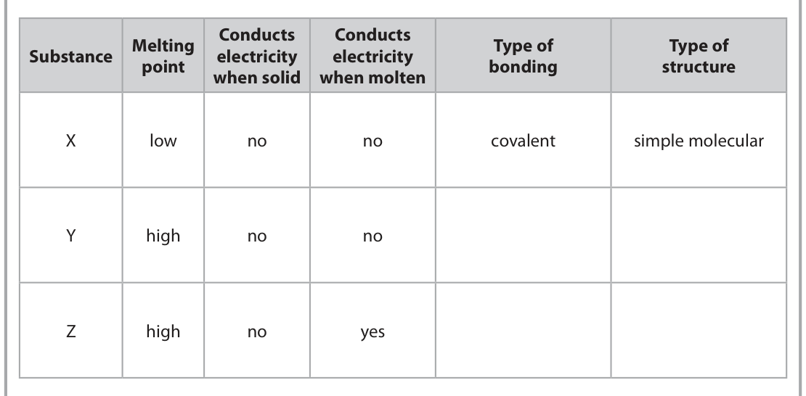
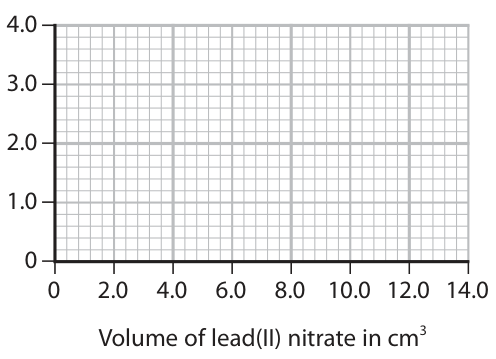
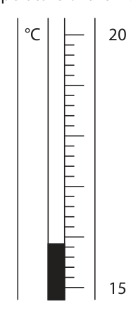
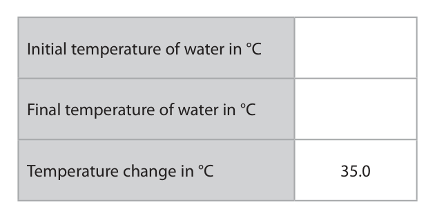
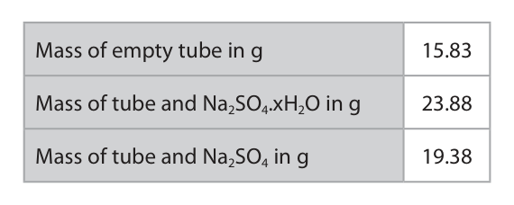
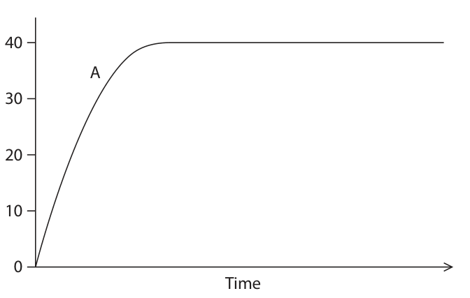

# 4CH1/1C — 2023-06 (official extraction)

> schema `syllabai.official-paper-questions/0.1` · paper_id `pearson-edexcel:international-gcse:chemistry:4ch1:2023-06:4CH1/1C` · qp sha256 `db3e6fdfb62c0357…` · extracted verbatim, never regenerated (ADR-037)

## Question 1 (7 marks)

The box gives some methods that are involved in the separation of mixtures. chromatography crystallisation dissolving evaporating filtering fractional distillation simple distillation

**(a)** Use words from the box to identify the method involved in each of these separations.

### 1(a)(i) [1]

Give the best method for obtaining gasoline from crude oil.

**Mark scheme answer**

> fractional distillation

- **(1)** fractional distillation

### 1(a)(ii) [1]

Give the best method for separating the dyes in black ink.

**Mark scheme answer**

> chromatography

- **(1)** chromatography

### 1(a)(iii) [1]

Give the best method for obtaining pure water from seawater. 

**Mark scheme answer**

> simple distillation ACCEPT distillation

- **(1)** simple distillation ACCEPT distillation

### 1(b) [4]

A sample of solid hydrated copper(II) sulfate can be obtained from a mixture of copper(II) oxide and copper(II) sulfate. Complete the passage by using words from the box. The mixture of copper(II) oxide and copper(II) sulfate can be separated by first the copper(II) sulfate in distilled water. The copper(II) oxide is then removed by Some of the water from the copper(II) sulfate solution is then removed by A pure sample of hydrated copper(II) sulfate is then obtained by

**Mark scheme answer**

> M1 A mixture of copper(II) oxide and copper(II)
> sulfate can be separated by first dissolving the
> copper(II) sulfate in distilled water.
> M2 The copper(II) oxide is then removed by filtering ACCEPT filtration
> M3 Some of the water from the copper(II) sulfate ACCEPT evaporation
> solution is then removed by evaporating
> ACCEPT simple
> distillation
> M4 A pure sample of hydrated copper(II) sulfate is ACCEPT crystallising
> then obtained by crystallisation
> Question
> Answer Notes Marks
> number

- **(1)** A mixture of copper(II) oxide and copper(II)
- **(1)** The copper(II) oxide is then removed by filtering ACCEPT filtration
- **(1)** Some of the water from the copper(II) sulfate ACCEPT evaporation
- **(1)** A pure sample of hydrated copper(II) sulfate is ACCEPT crystallising

## Question 2 (8 marks)

This question is about the reactions of iron.

**(a)** Iron rusts when exposed to water and oxygen.

**(b)** When iron reacts with dilute sulfuric acid, the products are iron(II) sulfate and hydrogen.

**(c)** An excess of iron is added to copper(II) sulfate solution.

### 2(a)(i) [1]

Give the chemical name of the compound that forms when iron rusts.

**Mark scheme answer**

> (hydrated) iron(III) oxide / Fe2O3 IGNORE iron oxide
> REJECT iron(II) oxide

- **(1)** (hydrated) iron(III) oxide / Fe2O3 IGNORE iron oxide

### 2(a)(ii) [1]

What type of reaction occurs when iron rusts?

- **(A)** combustion
- **(B)** decomposition
- **(C)** neutralisation
- **(D)** oxidation  ✔

**Mark scheme answer**

> D oxidation
> A is incorrect as it is not a combustion reaction
> B is incorrect as it is not a decomposition reaction
> C is incorrect as it is not a neutralisation reaction

- **(1)** Answer D: oxidation

### 2(a)(iii) [1]

Galvanising is a method used to prevent iron from rusting. Give the name of the metal used to galvanise iron.

**Mark scheme answer**

> zinc ALLOW Zn

- **(1)** zinc ALLOW Zn

### 2(b)(i) [1]

Give a chemical equation for the reaction between iron and sulfuric acid.

**Mark scheme answer**

> Fe + H2SO4 → FeSO4 + H2 ALLOW multiples and
> fractions
> IGNORE state symbols
> even if incorrect

- **(1)** Fe + H2SO4 → FeSO4 + H2 ALLOW multiples and

### 2(b)(ii) [1]

Give a test for hydrogen. 

**Mark scheme answer**

> (squeaky) pop with lighted splint/lit with a (Bunsen) IGNORE just ‘burns
> flame with a squeaky pop’
> REJECT use of glowing
> splint

- **(1)** (squeaky) pop with lighted splint/lit with a (Bunsen) IGNORE just ‘burns

### 2(c)(i) [1]

Name the type of reaction that occurs.

**Mark scheme answer**

> displacement ACCEPT redox
> /oxidation and
> reduction

- **(1)** displacement ACCEPT redox

### 2(c)(ii) [1]

State the appearance of the solid that forms in the reaction.

**Mark scheme answer**

> pink-brown /pink (solid) ACCEPT pink / brown
> / orange alone or in
> combinations eg
> orange-brown
> ALLOW red-brown
> REJECT red
> IGNORE copper

- **(1)** pink-brown /pink (solid) ACCEPT pink / brown

### 2(d) [1]

Give the reason why no reaction occurs when iron is added to magnesium sulfate solution.

**Mark scheme answer**

> iron is less reactive/lower in the reactivity series (than IGNORE just ‘iron is
> magnesium) ORA not reactive enough’
> with no comparison
> Question
> Answer Notes Marks
> number

- **(1)** iron is less reactive/lower in the reactivity series (than IGNORE just ‘iron is

## Question 3 (6 marks)

The table gives some information about three substances, X, Y and Z. Conducts Conducts Melting Type of Type of Substance electricity electricity point bonding structure when solid when molten X low no no covalent simple molecular Y high no no Z high no yes

### 3(a) [4]

Complete the table by giving the missing information.

**Mark scheme answer**

> Type of bonding Type of structure
> (X) covalent simple molecular
> (Y) M1 covalent
> M2 giant (covalent) ALLOW giant molecular
> /giant covalent lattice
> ACCEPT macromolecular
> (Z) M3 ionic
> M4 giant (ionic) lattice ALLOW (ionic) lattice
> IGNORE ‘giant’ alone

- **(4)** Type of bonding Type of structure

### 3(b) [2]

Explain why substance X has a low melting point.

**Mark scheme answer**

> An explanation that links the following points
> M1 (X has) weak intermolecular forces / weak ALLOW weak intermolecular
> forces between molecules bonds / weak bonds between
> molecules
> IGNORE less energy
> M2 (so) little energy needed to overcome the REJECT any reference to
> forces/separate the molecules / the forces weak covalent bonds or
> require little energy to break covalent bonds being broken
> or ionic bonds for both
> marks.
> REJECT intermolecular
> forces between atoms/bonds
> for both marks
> Question
> Answer Notes Marks
> number

- **(1)** (X has) weak intermolecular forces / weak ALLOW weak intermolecular
- **(1)** (so) little energy needed to overcome the REJECT any reference to

## Question 4 (14 marks)

This question is about unsaturated hydrocarbons.

**(a)** Ethene (C2H4 ) is a member of the homologous series of alkenes.

**(b)** Propene (C3H6) is another member of the homologous series of alkenes.

**(c)** This is the structural formula of another hydrocarbon compound. CH2 CH CH CH2

### 4(a)(i) [2]

Give two characteristics of a homologous series. 1 2

**Mark scheme answer**

> Any two from IGNORE references to a
> specific homologous series
> M1 same general formula
> M2 same functional group
> M3 each member differs from the next by CH2
> M4 similar chemical properties / (chemical) ALLOW same chemical
> reactions properties / (chemical)
> reactions
> M5 trend/change/increase in physical properties ACCEPT named physical
> property e.g. trend in
> boiling points
> REJECT same / similar
> physical properties

- **(2)** Any two from IGNORE references to a

### 4(a)(ii) [2]

Draw a dot-and-cross diagram to show the bonding in a molecule of ethene. Show outer electrons only. 

**Mark scheme answer**

> ACCEPT any combination
> of dots and crosses
> ACCEPT with or without
> shells drawn
> IGNORE inner shells on
> carbon atoms
> M1 two shared pairs of electrons between two REJECT if non-bonding
> carbon atoms electrons shown on carbon
> M2 shared pair of electrons between each hydrogen REJECT if non-bonding
> and the carbon it is bonded to electrons shown on
> hydrogen

- **(1)** two shared pairs of electrons between two REJECT if non-bonding
- **(1)** shared pair of electrons between each hydrogen REJECT if non-bonding

### 4(b)(i) [1]

State why the empirical formula of all alkenes in this homologous series is CH2

**Mark scheme answer**

> There are twice as many hydrogen atoms as carbon ACCEPT general formula is
> atoms (in every alkene) OWTTE CnH2n
> ACCEPT it is the lowest
> whole number ratio of
> atoms in alkenes

- **(1)** There are twice as many hydrogen atoms as carbon ACCEPT general formula is

### 4(b)(ii) [2]

Propene can be polymerised to form poly(propene). Draw the displayed formula of propene and the repeat unit of poly(propene). propene repeat unit of poly(propene) 

**Mark scheme answer**

> M1
> ALLOW methyl group to be
> shown as -CH3 rather than
> fully displayed
> M2 H H
> I I IGNORE brackets and n
> −C − C−
> I I REJECT structure without
> H CH3 extension bonds
> Question
> Answer Notes Marks
> number

- **(2)** M1

### 4(c)(i) [2]

Give the molecular formula and the empirical formula of this compound. molecular formula empirical formula

**Mark scheme answer**

> M1 (molecular formula) C4H6
> M2 (empirical formula) C2H3

- **(1)** (molecular formula) C4H6
- **(1)** (empirical formula) C2H3

### 4(c)(ii) [3]

Explain why this compound is an unsaturated hydrocarbon.

**Mark scheme answer**

> An explanation that links the following three points
> M1 made up of carbon/C and hydrogen/H (atoms) REJECT carbon and
> hydrogen molecules in M1
> M2 only M2 dep on mention of just
> carbon and hydrogen in M1
> M3 contains (two) C=C / (carbon-carbon) double ALLOW contains a (carbon-
> bonds carbon) double bond

- **(1)** made up of carbon/C and hydrogen/H (atoms) REJECT carbon and
- **(1)** only M2 dep on mention of just
- **(1)** contains (two) C=C / (carbon-carbon) double ALLOW contains a (carbon-

### 4(c)(iii) [2]

Describe a test to show that this hydrocarbon is unsaturated.

**Mark scheme answer**

> A description that refers to the following two points
> M1 add bromine water REJECT add bromine for
> M1
> M2 (bromine water) decolourised / turns (from M2 dep on reference to
> orange/yellow to) colourless bromine in M1
> IGNORE incorrect initial
> colour
> REJECT if reference to uv
> being needed for reaction
> to take place
> Question
> Answer Notes Marks
> number

- **(1)** add bromine water REJECT add bromine for
- **(1)** (bromine water) decolourised / turns (from M2 dep on reference to

## Question 5 (11 marks)

This question is about lithium and some of its compounds.

**(a)** A small piece of lithium is added to a trough containing water. The lithium floats on the surface of the water and a vigorous reaction occurs.

### 5(a)(i) [2]

Give two other observations when lithium reacts with water. 1 2

**Mark scheme answer**

> Any two from:
> M1 effervescence/fizzing/bubbles IGNORE hydrogen / gas
> formed
> M2 lithium becomes smaller/disappears ALLOW lithium dissolves
> M3 moves (across the surface) IGNORE melts / forms a
> ball / flame

- **(2)** Any two from:

### 5(a)(ii) [2]

A few drops of methyl orange are added to the solution in the trough. Explain the final colour of the solution. 

**Mark scheme answer**

> M1 (solution turns) yellow
> M2 (solution is) an alkali/alkaline ACCEPT lithium
> hydroxide / hydroxide
> ions / OH− ions formed
> ALLOW basic

- **(1)** (solution turns) yellow
- **(1)** (solution is) an alkali/alkaline ACCEPT lithium

### 5(b) [5]

An unlabelled bottle containing a white powder is found in a laboratory. Describe tests to show that the white powder in the bottle is lithium carbonate.

**Mark scheme answer**

> A description that refers to the following five points
> M1 flame test ACCEPT description of
> flame test
> IGNORE ‘burning’
> M2 red (flame) ACCEPT crimson
> REJECT brick-red
> M3 add (dilute hydrochloric) acid ACCEPT nitric or sulfuric
> acid
> REJECT if additional
> incorrect reagent given
> eg silver nitrate
> M4 (pass/bubble) gas/carbon dioxide into limewater M4 dep on acid in M3
> M5 (limewater) turns cloudy/milky / white ppt M5 dep on use of
> forms limewater
> No M4 or M5 if limewater
> added directly to the
> solution

- **(1)** flame test ACCEPT description of
- **(1)** red (flame) ACCEPT crimson
- **(1)** add (dilute hydrochloric) acid ACCEPT nitric or sulfuric
- **(1)** (pass/bubble) gas/carbon dioxide into limewater M4 dep on acid in M3
- **(1)** (limewater) turns cloudy/milky / white ppt M5 dep on use of

### 5(c) [2]

Lithium carbonate has ionic bonding. State what is meant by the term ionic bonding.

**Mark scheme answer**

> M1 electrostatic attraction
> M2 between oppositely charged ions ACCEPT between
> anions/negative ions and
> cations/positive ions
> REJECT implication of
> covalent bonding for M2
> Question
> Answer Notes Marks
> number

- **(1)** electrostatic attraction
- **(1)** between oppositely charged ions ACCEPT between

## Question 6 (12 marks)

When solutions of lead(II) nitrate and potassium chloride are mixed, a precipitate of lead(II) chloride forms.

**(b)** A student investigates the height of the precipitate formed when lead(II) nitrate solution is added to potassium chloride solution. This is the student’s method. Step 1	pour 15.0 cm3 of potassium chloride solution into a boiling tube Step 2	add 2.0 cm3 of lead(II) nitrate solution and allow the precipitate to settle Step 3 m  easure the height of the precipitate Repeat steps 2 and 3 until a total of 14.0 cm3 of lead(II) nitrate solution has been added. The table shows the student’s results. Volume of lead(II) nitrate in cm3 2.0 4.0 6.0 8.0 10.0 12.0 14.0 Height of precipitate in cm 0.8 1.6 2.9 3.2 3.6 3.6 3.6

### 6(a)(i) [1]

Complete the equation for the reaction by adding the state symbols. Pb(NO3)2 ( ) + 2KCl ( ) → PbCl2 ( ) + 2KNO3 ( )

**Mark scheme answer**

> 1
> Pb(NO3)2(aq) + 2KCl(aq) → PbCl2(s) + 2KNO3(aq) ALLOW upper case letters
> for state symbols

- **(1)** 1

### 6(a)(ii) [1]

Give the formula of each ion in lead(II) nitrate. lead ion nitrate ion

**Mark scheme answer**

> Pb2+ and NO3−

- **(1)** Pb2+ and NO3−

### 6(a)(iii) [2]

Calculate the relative formula mass (Mr) of lead(II) nitrate, Pb(NO3)2 Mr = 

**Mark scheme answer**

> M1 207 + (14 + 16 × 3) × 2 Correct answer without
> working scores
> M2 331 ALLOW ECF on M1 if other
> multiples of atomic masses
> added together eg 207 + 14
> + (16 x 3) = 269 for 1 mark
> REJECT use of atomic
> numbers for both marks

- **(1)** 207 + (14 + 16 × 3) × 2 Correct answer without
- **(1)** 331 ALLOW ECF on M1 if other

### 6(b)(i) [1]

Plot the results on the grid.

**Mark scheme answer**

> all points plotted correctly to the nearest grid line

- **(1)** all points plotted correctly to the nearest grid line

### 6(b)(ii) [1]

Draw a circle around the anomalous result.

**Mark scheme answer**

> point at 2.9 cm/6.0 cm3 circled ALLOW ecf from incorrect
> plotting

- **(1)** point at 2.9 cm/6.0 cm3 circled ALLOW ecf from incorrect

### 6(b)(iii) [2]

Draw a line of best fit through the first four points and another line of best fit through the last three points. Make sure that the lines cross. 4.0 3.0 Height of precipitate in cm 2.0 1.0 0 2.0 4.0 6.0 8.0 10.0 12.0 14.0 Volume of lead(II) nitrate in cm3 

**Mark scheme answer**

> M1 best fit straight line through first four points
> ignoring the anomalous point
> M2 horizontal straight line through last three points ALLOW max (1) if lines do
> not cross or meet, or if a
> smooth curve is drawn,
> avoiding the anomalous
> point

- **(1)** best fit straight line through first four points
- **(1)** horizontal straight line through last three points ALLOW max (1) if lines do

### 6(b)(iv) [2]

Give two possible mistakes the student could have made to cause the anomalous result. 1 2

**Mark scheme answer**

> Any two from
> M1 precipitate not allowed to settle ACCEPT height measured
> too soon
> M2 height (of precipitate) measured incorrectly
> eg reference to parallax when measuring height
> M3 more than 2 cm3 (of lead(II) nitrate) added / ALLOW too much lead(II)
> (total volume of lead(II) nitrate added was) more nitrate added
> than 6 cm3

- **(2)** Any two from

### 6(b)(v) [1]

State why the first line of best fit should pass through the origin.

**Mark scheme answer**

> no precipitate as no lead(II) nitrate added OWTTE

- **(1)** no precipitate as no lead(II) nitrate added OWTTE

### 6(b)(vi) [1]

Use your graph to determine the volume of lead(II) nitrate solution needed to react completely with 15.0 cm3 of potassium chloride solution. volume = cm3

**Mark scheme answer**

> value read from graph where lines cross no mark if lines do not
> cross/meet or if there
> aren’t two lines eg a curve
> is drawn
> Question
> Answer Notes Marks
> number

- **(1)** value read from graph where lines cross no mark if lines do not

## Question 7 (14 marks)

This question is about the three halogens, bromine, chlorine and iodine.

### 7(a) [2]

Give the number of protons and the number of neutrons in an atom of iodine–127 number of protons number of neutrons

**Mark scheme answer**

> M1 (number of protons) 53
> M2 (number of neutrons) (127 − 53 =) 74

- **(1)** (number of protons) 53
- **(1)** (number of neutrons) (127 − 53 =) 74

### 7(b) [3]

A sample of bromine contains two isotopes. • Br–79 with relative abundance 52.8 % • Br–81 with relative abundance 47.2 % Calculate the relative atomic mass (Ar ) of this sample of bromine. Give your answer to three significant figures. Ar =

**Mark scheme answer**

> M1 79 × 52.8 + 81 × 47.2 OR 7994.4 correct answer
> without working
> M2 7994.4  100 OR 79.944 scores 3
> M3 79.9 79.944 without
> working scores 2
> M3 dep on use of 79
> & 81 in calculation

- **(1)** 79 × 52.8 + 81 × 47.2 OR 7994.4 correct answer
- **(1)** 7994.4  100 OR 79.944 scores 3
- **(1)** 79.9 79.944 without

### 7(c) [3]

Aluminium reacts with chlorine to form aluminium chloride. This is the equation for the reaction. 2Al + 3Cl2 → 2AlCl3 Calculate the minimum mass of chlorine needed to form 26.7 g of aluminium chloride. [for Cl2 , Mr = 71 for AlCl3 , Mr = 133.5] minimum mass of chlorine = g 

**Mark scheme answer**

> M1 (amount of AlCl3 =) 26.7  133.5 OR 0.2(00) (mol) correct answer
> without working
> scores 3
> M2 (amount of Cl2 =) 0.2(00) × 3 OR 0.3(00) (mol) ALLOW ECF on M1,
> 2 as long as an
> attempt has been
> made to find moles
> M3 (mass of Cl2 =) 0.3(00) × 71 = 21.3 (g) ALLOW ECF on M2
> ALLOW any number
> of sig figs except 1
> OR
> M1 213g of Cl2 produces 267g of AlCl3
> M2 (mass of Cl2 =) 26.7 × 213
> 267
> M3 = 21.3 (g)

- **(3)** M1 (amount of AlCl3 =) 26.7  133.5 OR 0.2(00) (mol) correct answer

### 7(d) [6]

A student mixes the following pairs of solutions. Pair 1 bromine solution and potassium chloride solution Pair 2 bromine solution and potassium iodide solution Explain how the student can use the results of these experiments to show the order of reactivity of the three halogens, bromine, chlorine and iodine. Include observations in your answer.

**Mark scheme answer**

> An explanation which links six of the following points
> Pair 1
> M1 no reaction / no change (in colour) / stays yellow or ACCEPT it stays any
> orange stated colour
> M2 bromine cannot displace chlorine / bromine does not Penalise incorrect
> react with chloride ions to produce chlorine use of -ine and -ide
> ACCEPT Br2 + KCl →
> Br2 + KCl
> or ionic equation
> M3 therefore chlorine is more reactive than bromine ACCEPT “bromine
> cannot displace
> chlorine because it
> is less reactive”
> OWTTE for M2 and
> M3
> Pair 2
> M4 turns brown ACCEPT
> combinations that
> include brown eg
> red-brown
> M5 bromine displaces iodine / bromine reacts with iodide Penalise incorrect
> ions to produce iodine use of -ine and -ide
> ACCEPT Br2 + 2KI →
> I2 + 2KBr
> or ionic equation
> M6 therefore bromine is more reactive than iodine ACCEPT “bromine
> displaces iodine
> because it is more
> reactive” OWTTE
> for M5 and M6
> M7 the overall order of reactivity is chlorine > bromine > IGNORE references
> iodine ORA to reactivity
> up/down the group
> Question
> Answer Notes Marks
> number

- **(6)** An explanation which links six of the following points

## Question 8 (13 marks)

A student uses this apparatus to find the molar enthalpy change (ΔH) of combustion for the liquid fuel, pentanol. thermometer copper can water spirit burner pentanol This is the student’s method. • find the initial mass of the spirit burner and pentanol • add 100 cm3 of water to the copper can • record the initial temperature of the water • light the wick of the spirit burner to heat the water • stir the water until the temperature rises by 35.0 °C • extinguish the flame and immediately find the final mass of the spirit burner and pentanol

### 8(a)(i) [1]

State why the student stirs the water.

**Mark scheme answer**

> to allow the heat (energy) to be distributed evenly ACCEPT so the
> (throughout the water) OWTTE temperature is the
> same (throughout
> the water)

- **(1)** to allow the heat (energy) to be distributed evenly ACCEPT so the

### 8(a)(ii) [1]

Suggest why it is important that the student immediately finds the final mass of the spirit burner and pentanol. 

**Mark scheme answer**

> to avoid some of the liquid/fuel/pentanol evaporating
> OWTTE

- **(1)** to avoid some of the liquid/fuel/pentanol evaporating

### 8(b) [2]

The diagram shows the initial temperature of the water. °C 20 Complete the table to show the temperature readings. Give both values to the nearest 0.1 °C. Initial temperature of water in °C Final temperature of water in °C Temperature change in °C 35.0

**Mark scheme answer**

> PENALISE answer not
> to nearest 0.1 °C
> Initial temperature of water in oC 15.9 once only
> Final temperature of water in oC 50.9 ALLOW ecf on initial
> temperature
> Temperature change in oC 35.0 Correct values
> transposed scores (1)

- **(2)** PENALISE answer not

### 8(c)(i) [2]

Show by calculation that the heat energy (Q) supplied by the pentanol is approximately 15 000 J. [for water, c = 4.2 J / g / °C] [for 1.0 cm3 of water, mass = 1.0 g] 

**Mark scheme answer**

> M1 (Q =) 100 × 4.2 × 35 (J) Correct answer of
> 14 700 without
> working scores 2
> M2 14 700 (J) ALLOW 15 000 (J)
> only if M1 is scored

- **(1)** (Q =) 100 × 4.2 × 35 (J) Correct answer of
- **(1)** 14 700 (J) ALLOW 15 000 (J)

### 8(c)(ii) [5]

The table gives the initial and final mass readings. Initial mass of spirit burner and pentanol in g 90.11 Final mass of spirit burner and pentanol in g 89.75 Use your answer to part (c)(i) and the information in the table to calculate the molar enthalpy change (ΔH) of combustion, in kJ / mol, for pentanol. [for pentanol, Mr = 88] Include a sign in your answer. ΔH for pentanol = kJ / mol

**Mark scheme answer**

> M1 (mass of pentanol =) 90.11 − 89.75 OR 0.36 (g) Correct answer
> without working
> scores 5
> M2 (amount of pentanol =) 0.36  88 OR 0.0041 (mol) ALLOW ecf on
> incorrect mass
> REJECT 0.004
> (which gives final
> answer of −3675)
> M3 14 700  0.0041 OR 3 600 000 (J/mol) ALLOW ecf as long
> as there has been an
> attempt to calculate
> moles of pentanol
> M4 3 600 000  1000 OR 3600 (kJ/mol)
> M5 (H =) − 3600 (kJ/mol) ALLOW any SF
> except 1 SF

- **(1)** (mass of pentanol =) 90.11 − 89.75 OR 0.36 (g) Correct answer
- **(1)** (amount of pentanol =) 0.36  88 OR 0.0041 (mol) ALLOW ecf on
- **(1)** 14 700  0.0041 OR 3 600 000 (J/mol) ALLOW ecf as long
- **(1)** 3 600 000  1000 OR 3600 (kJ/mol)
- **(1)** (H =) − 3600 (kJ/mol) ALLOW any SF

### 8(d) [2]

The formula of pentanol is C5H11OH Write a chemical equation for the complete combustion of pentanol.

**Mark scheme answer**

> C5H11OH + 7.5O2 → 5CO2 + 6H2O ALLOW multiples
> M1 all formulae correct
> M2 balancing of correct formulae M2 dep on M1
> IGNORE state
> symbols even if
> incorrect
> Question
> Answer Notes Marks
> number

- **(1)** all formulae correct
- **(1)** balancing of correct formulae M2 dep on M1

## Question 9 (13 marks)

This question is about different hydrated forms of sodium sulfate.

**(a)** A compound has the formula Na2SO4.7H2O

**(b)** Another hydrated form of sodium sulfate has the formula Na2SO4.xH2O A student uses this apparatus to find the value of x. hydrated sodium sulfate heat ice water  This is the student’s method. • find the mass of an empty tube • add solid hydrated sodium sulfate to the tube • find the mass of the tube and hydrated sodium sulfate • heat the tube for several minutes • allow the tube to cool and find the mass of the tube and contents

### 9(a)(i) [1]

How many different elements are there in the formula Na2SO4.7H2O?

- **(A)** 3
- **(B)** 4  ✔
- **(C)** 5
- **(D)** 10

**Mark scheme answer**

> B4
> A is incorrect as there are not 3 different elements in
> Na2SO4.7H2O
> C is incorrect as there are not 5 different elements in
> Na2SO4.7H2O
> D is incorrect as there are not 10 different elements in
> Na2SO4.7H2O

- **(1)** Answer B: 4

### 9(a)(ii) [1]

What is the total number of atoms in the formula Na2SO4.7H2O?

- **(A)** 10
- **(B)** 22
- **(C)** 27
- **(D)** 28  ✔

**Mark scheme answer**

> D 28
> A is incorrect as there is not a total of 10 atoms in
> Na2SO4.7H2O
> B is incorrect as there is not a total of 22 atoms in
> Na2SO4.7H2O
> C is incorrect as there is not a total of 27 atoms in
> Na2SO4.7H2O

- **(1)** Answer D: 28

### 9(b)(i) [2]

Describe what the student should do next to make sure that all the water is removed from the hydrated sodium sulfate.

**Mark scheme answer**

> A description that refers to the following two points
> M1 heat the sodium sulfate (again) ACCEPT ‘heat to
> constant mass’ for
> M2 (repeat) until there is no further change in mass both marks

- **(1)** heat the sodium sulfate (again) ACCEPT ‘heat to
- **(1)** (repeat) until there is no further change in mass both marks

### 9(b)(ii) [2]

Explain the role of the ice in the beaker.

**Mark scheme answer**

> An explanation that links the following two points
> M1 to cool the (water) vapour ACCEPT steam
> M2 so it condenses / forms liquid/water

- **(1)** to cool the (water) vapour ACCEPT steam
- **(1)** so it condenses / forms liquid/water

### 9(b)(iii) [2]

Describe how the student could prove that the liquid collected is pure water. 

**Mark scheme answer**

> A description that refers to the following two points
> M1 heat (the water) / measure the boiling point ALLOW find the
> freezing point
> /melting point?
> M2 (if it) boils at 100 oC (it is pure water) / boiling REJECT evaporate
> point is 100 °C
> ALLOW freezes/
> melts at 0oC
> IGNORE chemical test
> even if incorrect

- **(1)** heat (the water) / measure the boiling point ALLOW find the
- **(1)** (if it) boils at 100 oC (it is pure water) / boiling REJECT evaporate

### 9(c) [5]

The table gives the student’s results. Mass of empty tube in g 15.83 Mass of tube and Na2SO4.xH2O in g 23.88 Mass of tube and Na2SO4 in g 19.38 Use the student’s results to calculate the value of x. [for Na2SO4, Mr = 142 for H2O, Mr = 18] x =

**Mark scheme answer**

> M1 mass of Na2SO4 (= 19.38 − 15.83) = 3.55 (g) Correct answer
> without working
> M2 mass of H2O (= 23.88 − 19.38) = 4.50 (g) scores 5
> M3 amount of Na2SO4 (= 3.55  142) = 0.025 (mol) ALLOW ECF from
> incorrect M1
> M4 amount of H2O (= 4.50  18) = 0.25 (mol) ALLOW ECF from
> incorrect M2
> M5 x (= 0.25  0.025) = 10 ALLOW an integer
> ECF on M3 & M4
> ACCEPT alternative
> correct methods
> OR
> M1 mass of Na2SO4 (= 19.38 − 15.83) = 3.55 (g)
> M2 mass of H2O (= 23.88 − 19.38) = 4.50 (g)
> M3 mass of water combined with 1 mole of sodium
> sulfate = 142 × 4.50 = 180 (g)
> 3.55
> M4 moles of H2O = 180  18
> M5 therefore, x = 10
> Question
> Answer Notes Marks
> number

- **(5)** M1 mass of Na2SO4 (= 19.38 − 15.83) = 3.55 (g) Correct answer

## Question 10 (12 marks)

Zinc reacts with dilute hydrochloric acid to form zinc chloride and hydrogen gas. This is the equation for the reaction. Zn(s) + 2HCl(aq) → ZnCl2(aq) + H2(g)

**(a)** In an experiment, 20 cm3 of hydrochloric acid containing 0.0036 mol are reacted with 1.3 g of zinc granules at a temperature of 30 °C.

**(b)** In the original experiment, 20 cm3 of hydrochloric acid containing 0.0036 mol were reacted with 1.3 g of zinc granules at a temperature of 30 °C and curve A was obtained. The student does two more experiments and obtains curves B and C. A Volume of 30 B hydrogen in cm3 C Time

### 10(a)(i) [2]

Show by calculation that the zinc is in excess.

**Mark scheme answer**

> M1 0.0036 moles of HCl react with 0.0018 moles of Zn
> M2 mass of Zn that reacts is 0.0018 x 65 = 0.117 (g) ALLOW 0.234 g is less
> (which is less than 1.3 g, so zinc is in excess) than 1.3g, so zinc in
> excess for (1)
> OR
> M1 moles of zinc that can react with 0.0036 moles of
> HCl = 0.0036 / 2 = 0.0018 (mol)
> M2 moles of Zn present = 1.3  65 = 0.02 (mol)
> (which is more than 0.0018, so zinc is in excess)
> OR
> M1 amount of zinc = 1.3  65 = 0.02 (mol)
> M2 amount of HCl that can react = 2 x 0.02 = 0.04
> (mol) (which is greater than 0.0036, so zinc is in
> excess)

- **(2)** M1 0.0036 moles of HCl react with 0.0018 moles of Zn

### 10(a)(ii) [2]

The volume of hydrogen collected is measured at regular time intervals. Curve A shows the results of this experiment. A Volume of 30 hydrogen in cm3 20 Time The experiment is repeated using 1.3 g of zinc powder instead of zinc granules. All other conditions are kept the same. On the grid, draw the curve you would expect to obtain. 

**Mark scheme answer**

> M1 curve starting at origin and steeper than curve A
> M2 curve levelling off at same volume as curve A
> /at 40 cm3

- **(1)** curve starting at origin and steeper than curve A
- **(1)** curve levelling off at same volume as curve A

### 10(b)(i) [4]

In one of these experiments the student repeats the original method but at a temperature of 20 °C. Explain in terms of particle collision theory why the curve obtained could be curve B. 

**Mark scheme answer**

> An explanation that links any of the following four
> points
> M1 curve B is less steep (than curve A)
> M2 (because) the particles have less kinetic energy ALLOW particles
> move more slowly
> M3 so there are fewer successful collisions per unit ACCEPT less frequent
> time/less frequent successful collisions collisions that exceed
> activation energy
> M4 so rate of reaction is slower / reaction takes longer
> to complete
> M5 no change in reacting quantities, so final volume is
> unchanged
> ACCEPT reverse
> argument throughout

- **(4)** An explanation that links any of the following four

### 10(b)(ii) [2]

In the other experiment the student repeats the original method but uses 20 cm3 of hydrochloric acid containing 0.0018 mol. Explain why curve C shows the results the student obtained.

**Mark scheme answer**

> An explanation that links two of the following points
> M1 only half the moles (of hydrochloric acid) used /
> (hydrochloric acid) concentration is halved
> M2 (so) only half the volume/20 cm3 of hydrogen/gas If M1 and M2 are not
> produced scored, allow (1)
> mark for the idea
> that less HCl
> produces less
> hydrogen
> M3 hydrochloric acid is less concentrated so curve is
> less steep

- **(2)** An explanation that links two of the following points

### 10(c) [2]

Catalysts can be used to speed up reactions. Describe how a catalyst works.

**Mark scheme answer**

> A description that refers to the following two points
> M1 (a catalyst) provides an alternative pathway/route IGNORE general
> statements about
> M2 with a lower activation energy catalysts increasing
> rate / not being used
> up
> Pearson Education Limited. Registered company number 872828
> with its registered office at 80 Strand, London, WC2R 0RL, United Kingdom

- **(1)** (a catalyst) provides an alternative pathway/route IGNORE general
- **(1)** with a lower activation energy catalysts increasing

