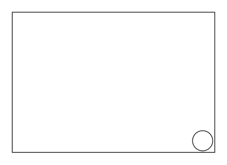
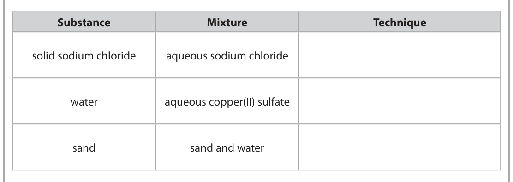
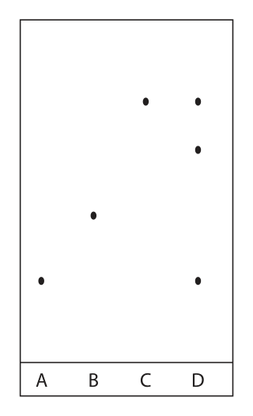
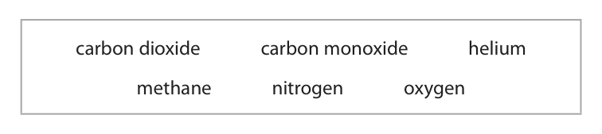
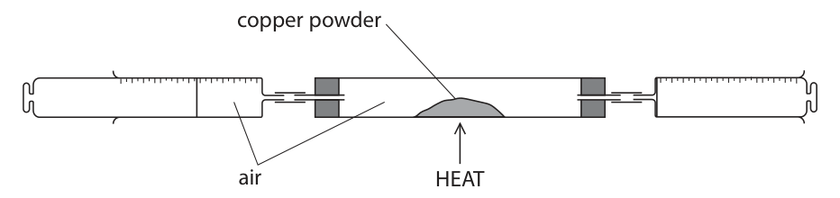
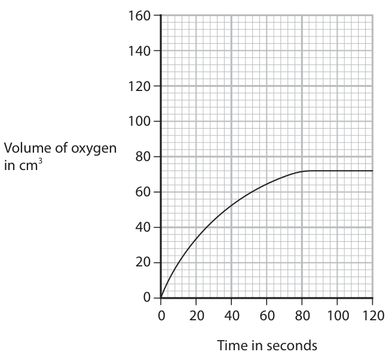
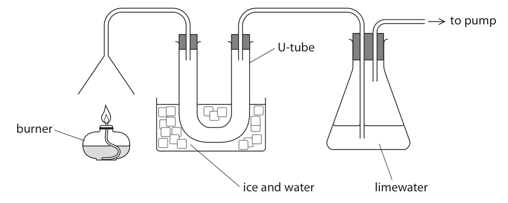
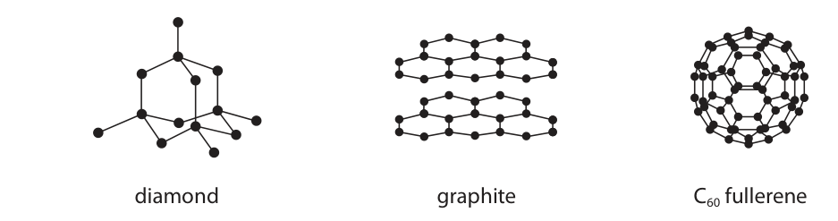
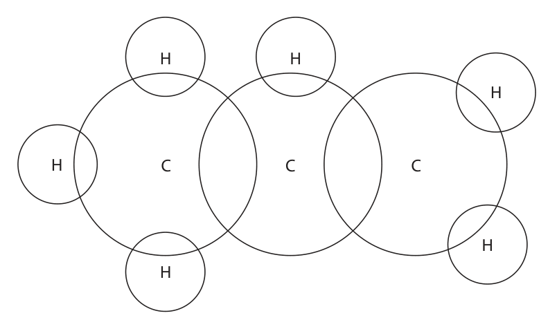
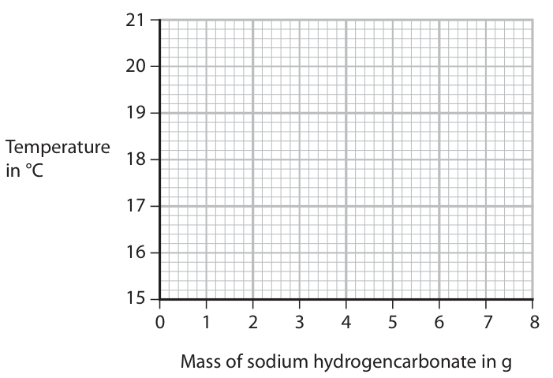

# 4CH1/1CR — 2023-06 (official extraction)

> schema `syllabai.official-paper-questions/0.2` · paper_id `pearson-edexcel:international-gcse:chemistry:4ch1:2023-06:4CH1/1CR` · qp sha256 `0766bcd0d5a790a1…` · extraction is the disclosed baseline (ADR-039)

## Question 1 (6 marks)

This question is about oxygen.

**(a)** Oxygen can be stored in tanks as a liquid or as a gas.

**(b)** Sulfur burns in oxygen to form sulfur dioxide.

### 1(a)(i) [1]

Complete the diagram to show the arrangement of six more particles in a gas.

**Mark scheme answer**

> six particles should be arranged randomly max of two particles
> should touch
> ALLOW between 5 and
> 10 particles

- **(1)** six particles should be arranged randomly max of two particles

### 1(a)(ii) [1]

Give a reason why a tank can store much more oxygen as a liquid.

**Mark scheme answer**

> particles are (much) closer together ALLOW the density is
> (much) greater / less
> space between particles
> / packed more tightly

- **(1)** particles are (much) closer together ALLOW the density is

### 1(a)(iii) [1]

Identify a hazard when storing oxygen as a gas.

**Mark scheme answer**

> Any one from:
> high pressure
> risk of explosion
> oxidising agent
> risk in contact with combustible materials ALLOW risk of fire
> IGNORE flammable

- **(1)** Any one from:

### 1(b)(i) [1]

Give one observation that can be made when sulfur burns in oxygen.

**Mark scheme answer**

> blue flame ALLOW choking
> /pungent gas produced
> / sulfur darkens

- **(1)** blue flame ALLOW choking

### 1(b)(ii) [2]

Some universal indicator is added to sulfur dioxide. Explain the final colour of the universal indicator.

**Mark scheme answer**

> M1 (final colour) red/orange/yellow IGNORE any original
> colour
> M2 an acidic solution/an acid/sulfurous acid is ALLOW sulfuric acid
> formed
> ALLOW sulfur dioxide is
> acidic
> ACCEPT the solution
> formed contains
> hydrogen ions
> Total for question = 6

- **(1)** (final colour) red/orange/yellow IGNORE any original
- **(1)** an acidic solution/an acid/sulfurous acid is ALLOW sulfuric acid

## Question 2 (8 marks)

This question is about mixtures and compounds.

**(d)** A compound has the formula Ca(HCO3)2

### 2(a) [3]

The box gives some techniques used to separate mixtures. crystallisation filtration fractional distillation simple distillation The table lists some substances and mixtures. Complete the table using words from the box to show the best technique to obtain the named substance from each mixture. Each technique may be used once, more than once or not at all. Substance Mixture Technique solid sodium chloride aqueous sodium chloride water aqueous copper(II) sulfate sand sand and water

**Mark scheme answer**

> crystallisation
> simple distillation REJECT distillation
> filtration

- **(3)** crystallisation

### 2(b) [1]

State how the box represents a mixture.

**Mark scheme answer**

> (the box contains) (2) different substances IGNORE type of particle
> /elements
> REJECT compounds

- **(1)** (the box contains) (2) different substances IGNORE type of particle

### 2(c) [2]

Food colourings are mixtures of food dyes. A student uses paper chromatography to separate the food dyes contained in food colouring D. The student places spots of three food dyes A, B and C and food colouring D on chromatography paper. The diagram shows the appearance of the paper after the experiment. A B C D Describe the composition of food colouring D.

**Mark scheme answer**

> Any two from:
> M1 D contains 3 food dyes
> M2 food colouring D contains A and C
> M3 food colouring D does not contain B
> / food colouring D contains another dye (which is
> not A. B or C)

- **(2)** Any two from:

### 2(d)(i) [1]

Determine the number of different elements in Ca(HCO3)2

**Mark scheme answer**

> 4

- **(1)** 4

### 2(d)(ii) [1]

Determine the number of atoms in the formula of Ca(HCO3)2

**Mark scheme answer**

> 11
> Total for question = 8

- **(1)** 11

## Question 3 (8 marks)
**(a)** The diagram represents an atom of an element. W

**(b)** There are two isotopes of the element lithium. 3 Li 73Li

### 3(a)(i) [1]

What is the particle labelled W?

- **(A)** electron  ✔
- **(B)** neutron
- **(C)** nucleus
- **(D)** proton

**Mark scheme answer**

> A (electron)
> B is not the correct answer because neutrons exist
> in the nucleus.
> C is not the correct answer because particle W is
> not a nucleus.
> D is not the correct answer because protons exist in
> the nucleus.

- **(1)** Answer A: electron

### 3(a)(ii) [1]

An atom of this element contains 13 neutrons. What is the mass number of this element?

- **(A)** 12
- **(B)** 13
- **(C)** 25  ✔
- **(D)** 49

**Mark scheme answer**

> C (25)
> A is not the correct answer as the proton number is
> B is not the correct answer as the number of
> neutrons is 13
> D is not the correct answer as the number of
> protons, neutrons and electrons is not 49

- **(1)** Answer C: 25

### 3(a)(iii) [1]

State why atoms have no overall charge.

**Mark scheme answer**

> (atoms have the) same number of protons and
> electrons

- **(1)** (atoms have the) same number of protons and

### 3(a)(iv) [1]

What is the charge on the ion usually formed from this element?

- **(A)** 1+
- **(B)** 2+  ✔
- **(C)** 1–
- **(D)** 2–

**Mark scheme answer**

> B (2+)
> A is not the correct answer as this atom will not
> form an ion with a + charge.
> C is not the correct answer as this atom will not
> form an ion with a - charge.
> D is not the correct answer as this atom will not
> form an ion with a 2- charge.

- **(1)** Answer B: 2+

### 3(b)(i) [1]

State why both isotopes react in the same way.

**Mark scheme answer**

> (both isotopes have) the same number of electrons IGNORE same number of
> / the same electron configuration protons / same number
> of electrons in the
> outer shell

- **(1)** (both isotopes have) the same number of electrons IGNORE same number of

### 3(b)(ii) [3]

A sample of lithium contains 7.60% 36Li and 92.4% 73Li Calculate the relative atomic mass, Ar , of this sample of lithium. Give your answer to two decimal places. Ar =

**Mark scheme answer**

> Answer of 6.92 scores 3
> M1 (7.60 × 6) + (92.4 × 7) ACCEPT (6 × 0.076) + (7
> × 0.924)
> M2 692.4÷100 OR 6.924
> M3 6.92 ALLOW ecf if use of 6
> and 7 in calculation
> Total for question = 8

- **(1)** (7.60 × 6) + (92.4 × 7) ACCEPT (6 × 0.076) + (7
- **(1)** 692.4÷100 OR 6.924
- **(1)** 6.92 ALLOW ecf if use of 6

## Question 4 (8 marks)

This question is about gases.

**(b)** A teacher uses this apparatus to determine the percentage of oxygen in a sample of air. copper powder air HEAT This is the teacher’s method. • record the total volume of air in the apparatus • heat the copper powder • use the syringes to pass air over the heated copper powder several times • allow the remaining gas to cool and record its volume The copper powder turns black.

### 4(a) [4]

The table gives information about some gases. Complete the table by choosing a gas from the box that matches the information. carbon dioxide carbon monoxide helium methane nitrogen oxygen You may use each gas once, more than once, or not at all. Information Gas the most abundant gas in air a toxic gas that is a product of incomplete combustion of hydrocarbons an unreactive gas that exists as atoms a gas produced by the fractional distillation of crude oil

**Mark scheme answer**

> 4
> Information Gas
> the most abundant gas in air nitrogen
> a toxic gas that is a product of
> carbon
> incomplete combustion of
> monoxide
> hydrocarbons
> an unreactive gas that exists as
> helium
> atoms
> a gas produced by the
> methane
> fractional distillation of crude oil

- **(4)** 4

### 4(b)(i) [1]

State why the copper powder turns black.

**Mark scheme answer**

> copper(II) oxide / CuO / copper oxide forms REJECT copper(I) oxide

- **(1)** copper(II) oxide / CuO / copper oxide forms REJECT copper(I) oxide

### 4(b)(ii) [1]

Give a reason why the remaining gas is allowed to cool before its volume is recorded.

**Mark scheme answer**

> the volume of a gas changes with temperature / gas
> expands when hot / heated / gas shrinks when cools
> OWTTE

- **(1)** the volume of a gas changes with temperature / gas

### 4(b)(iii) [2]

At the start of the experiment, the total volume of air in the apparatus is 138 cm3. At the end of the experiment, the volume of gas remaining is 108 cm3. Calculate the percentage of oxygen in the sample of air. Assume that all the oxygen has reacted. percentage of oxygen = %

**Mark scheme answer**

> M1 138 – 108 OR 30 (cm3)
> M2 ((30÷138) × 100 =) 21.7 ALLOW minimum 2
> significant figures
> 21.7 / 21.74 / 22 scores 2
> 78.3 / 78.26 / 78 scores 1
> Total for question = 8

- **(1)** 138 – 108 OR 30 (cm3)
- **(1)** ((30÷138) × 100 =) 21.7 ALLOW minimum 2

## Question 5 (12 marks)

This question is about iron.

**(a)** One problem with iron is that it rusts.

**(b)** Iron can be prevented from rusting by painting or by coating with zinc.

**(c)** Iron is formed when aluminium reacts with iron(III) oxide. This is the equation for the reaction. 2Al + Fe2O3 → Al2O3 + 2Fe

### 5(a)(i) [2]

Name the two substances that iron reacts with when it rusts. 1 2

**Mark scheme answer**

> M1 water ALLOW moisture / H2O
> M2 oxygen ALLOW air / O2
> answers can be in
> either order

- **(1)** water ALLOW moisture / H2O
- **(1)** oxygen ALLOW air / O2

### 5(a)(ii) [1]

State what type of reaction occurs when iron rusts.

**Mark scheme answer**

> oxidation ALLOW oxidisation /
> oxidising / redox

- **(1)** oxidation ALLOW oxidisation /

### 5(b)(i) [2]

Explain how painting prevents iron from rusting.

**Mark scheme answer**

> M1 paint acts as a barrier / layer
> M2 which prevents air / oxygen / water getting to /
> reacting with the iron

- **(1)** paint acts as a barrier / layer
- **(1)** which prevents air / oxygen / water getting to /

### 5(b)(ii) [1]

Name the process used to coat iron with zinc.

**Mark scheme answer**

> galvanising ALLOW galvanisation
> IGNORE sacrificial
> protection

- **(1)** galvanising ALLOW galvanisation

### 5(b)(iii) [2]

Explain why a layer of zinc protects iron from rusting, even if the layer of zinc is scratched.

**Mark scheme answer**

> M1 zinc is more reactive than iron
> M2 (therefore) is oxidised / reacts with oxygen / ALLOW corrodes instead
> loses electrons more readily / in preference to of iron
> /instead of iron
> REJECT zinc rusts

- **(1)** zinc is more reactive than iron
- **(1)** (therefore) is oxidised / reacts with oxygen / ALLOW corrodes instead

### 5(c)(i) [2]

Explain what this reaction shows about the relative reactivities of aluminium and iron.

**Mark scheme answer**

> M1 aluminium is more reactive than iron / ORA
> M2 because aluminium displaces iron (from iron(III)
> oxide)

- **(1)** aluminium is more reactive than iron / ORA
- **(1)** because aluminium displaces iron (from iron(III)

### 5(c)(ii) [2]

Explain which substance acts as an oxidising agent in this reaction.

**Mark scheme answer**

> M1 iron(III) oxide (is the oxidising agent) ALLOW iron oxide / iron
> ions / Fe3+ ions
> throughout
> M2 iron(III) oxide donates oxygen to aluminium ALLOW (iron(III) oxide /
> iron ions / Fe3+ ions)
> takes electrons from
> aluminium
> ALLOW (iron(III) oxide /
> iron ions / Fe3+ ions)
> causes aluminium to be
> oxidised
> Total for question = 12

- **(1)** iron(III) oxide (is the oxidising agent) ALLOW iron oxide / iron
- **(1)** iron(III) oxide donates oxygen to aluminium ALLOW (iron(III) oxide /

## Question 6 (10 marks)

A student uses this apparatus to investigate the rate of reaction when hydrogen peroxide solution decomposes. hydrogen peroxide solution 0 20 40 60 80 100 cm3 oxygen This is the equation for the reaction. 2H2O2 → 2H2O + O2

### 6(a) [1]

Give a reason why the gas that collects in the gas syringe is not pure oxygen.

**Mark scheme answer**

> the gas also contains air (displaced from the conical
> flask)

- **(1)** the gas also contains air (displaced from the conical

### 6(b) [2]

The rate of reaction can be increased by adding a catalyst to the hydrogen peroxide solution. Describe how a catalyst increases the rate of a reaction.

**Mark scheme answer**

> M1 a catalyst provides an alternative (reaction)
> pathway / route
> M2 of lower activation energy

- **(1)** a catalyst provides an alternative (reaction)
- **(1)** of lower activation energy

### 6(c) [5]

These solids catalyse the decomposition of hydrogen peroxide solution. • lead(IV) oxide • manganese(IV) oxide Describe a method that the student could use to find out which solid is the more effective catalyst.

**Mark scheme answer**

> M1 add hydrogen peroxide solution (to the conical
> flask) and add one of the catalysts
> M2 record the time taken to collect a fixed volume ALLOW record the time
> of gas OR record the volume of gas collected in a when no more gas
> fixed time produced
> AND any 2 from
> M3 repeat with the same volume / same ALLOW same amount
> concentration of hydrogen peroxide solution
> M4 (repeat at) same temperature
> M5 use same mass / same surface area of each ALLOW same amount
> catalyst
> AND
> M6 the most effective catalyst produces the ALLOW the least time
> greatest volume of gas per unit time OR takes the taken to complete the
> least time to produce a fixed volume of oxygen reaction is the most
> effective catalyst

- **(5)** M1 add hydrogen peroxide solution (to the conical

### 6(d) [2]

A student investigates the decomposition of a solution of hydrogen peroxide at different temperatures. The graph shows how the total volume of oxygen collected in the syringe changes with time when the solution is at a temperature of 20 °C. 160 140 120 100 Volume of oxygen in cm3 0 20 40 60 80 100 120 Time in seconds On the grid, draw the curve the student would obtain at a temperature of 40 °C when all other conditions are kept the same.

**Mark scheme answer**

> M1 steeper curve starting at the origin
> M2 same volume of oxygen produced
> Total for question = 10

- **(1)** steeper curve starting at the origin
- **(1)** same volume of oxygen produced

## Question 7 (11 marks)

A teacher uses this apparatus to test the products of the combustion of liquid hydrocarbons. to pump U-tube burner ice and water limewater

**(b)** The equation represents the complete combustion of an alkene. CnH2n + oxygen → carbon dioxide + nH2O Complete combustion of 0.0100 mol of the alkene produces 2.16 g of water.

### 7(a) [2]

Explain the change in appearance that occurs in the limewater.

**Mark scheme answer**

> M1 limewater turns cloudy /milky ALLOW chalky / white
> precipitate
> AND any one from:
> M2 because carbon dioxide / CO2 is / produced ALLOW carbon dioxide /
> /one of the products CO2 is present
> M3 which reacts with limewater forming calcium ALLOW forming an
> carbonate insoluble product

- **(2)** M1 limewater turns cloudy /milky ALLOW chalky / white

### 7(b)(i) [3]

Determine the molecular formula of this alkene. [for H2O, Mr = 18] molecular formula =

**Mark scheme answer**

> M1 amount of water = 2.16÷18 OR 0.12 mol
> M2 number of hydrogen atoms (0.12÷0.01)×2 OR 24 ALLOW 12H2O
> M3 formula of alkene = C12H24
> Correct answer of C12H24
> scores 3
> C6H12 scores 2

- **(1)** amount of water = 2.16÷18 OR 0.12 mol
- **(1)** number of hydrogen atoms (0.12÷0.01)×2 OR 24 ALLOW 12H2O
- **(1)** formula of alkene = C12H24

### 7(b)(ii) [1]

Give a reason why the mass of pure water that collects in the U-tube is less than 2.16 g.

**Mark scheme answer**

> some steam / water vapour is lost (to the ALLOW some steam
> atmosphere) /water vapour does not
> condense
> IGNORE references to
> incomplete combustion

- **(1)** some steam / water vapour is lost (to the ALLOW some steam

### 7(b)(iii) [2]

Give a physical test to show that the water that collects in the U-tube is pure.

**Mark scheme answer**

> M1 heat (the water) / measure the boiling point ALLOW find the freezing
> point /melting point
> REJECT evaporate
> M2 (if it) boils at 100 oC (it is pure water) / boiling ALLOW freezes/ melts at
> point is 100 °C 0 oC

- **(1)** heat (the water) / measure the boiling point ALLOW find the freezing
- **(1)** (if it) boils at 100 oC (it is pure water) / boiling ALLOW freezes/ melts at

### 7(c) [3]

The teacher burns 30.0 g of heptane. This is the equation for the complete combustion of heptane. C7H16 + 11O2 → 7CO2 + 8H2O Calculate the minimum mass of oxygen needed for the complete combustion of 30.0 g of heptane. [for C7H16 , Mr = 100 for O2 , Mr = 32] minimum mass of oxygen = g

**Mark scheme answer**

> M1 (moles of heptane) = 30 ÷ 100 OR 0.3(0) Answer of 106 g OR 105.6
> g scores 3
> M2 (moles of oxygen) = 0.3(0) × 11 OR 3.3 ALLOW M1 × 11
> M3 (mass of oxygen) = (3.3 × 32) = 106 (g) ALLOW ecf from M2
> ALLOW 2 or more
> OR significant figures for M3
> M1 11 x 32 OR 352 (g) of oxygen
> M2 so mass of oxygen = 352 x 30 ÷ 100
> M3 106 (g)
> Answer of 9.6 (g) scores 2
> Total for question = 11

- **(3)** M1 (moles of heptane) = 30 ÷ 100 OR 0.3(0) Answer of 106 g OR 105.6

## Question 8 (5 marks)

Diamond, graphite and C60 fullerene are all forms of the element carbon. The diagram shows the structures of these three substances. diamond graphite C60 fullerene

### 8(a) [2]

Explain why graphite conducts electricity.

**Mark scheme answer**

> M1 graphite has delocalised electrons IGNORE sea of electrons
> /free electrons
> M2 that are able to flow throughout the structure ACCEPT are able to
> move / are mobile
> IGNORE references to
> carrying charge/
> current
> M2 dep on mention of
> electrons
> Any mention of ions in
> graphite scores 0 out of

- **(1)** graphite has delocalised electrons IGNORE sea of electrons
- **(1)** that are able to flow throughout the structure ACCEPT are able to

### 8(b) [2]

Explain why diamond is hard but graphite is soft.

**Mark scheme answer**

> M1 (diamond is hard because) it has a 3D ALLOW 3D/ rigid/
> lattice/rigid lattice /tetrahedral lattice /every tetrahedral structure
> carbon is bonded to four other carbons
> REJECT mention of
> intermolecular forces in
> diamond
> M2 (graphite is soft because) the layers can slide IGNORE mention of
> over one another intermolecular forces
> between layers in
> graphite

- **(1)** (diamond is hard because) it has a 3D ALLOW 3D/ rigid/
- **(1)** (graphite is soft because) the layers can slide IGNORE mention of

### 8(c) [1]

Doctors use C60 fullerene to deliver medicines to certain parts of the body, so that the medicine does not damage other parts of the body. Suggest why C60 fullerene is suitable for this purpose.

**Mark scheme answer**

> Any one from: ALLOW any acceptable
> answer
> (the C60 molecule/it) will not react ALLOW it is inert
> with the blood/medicine /unreactive
> (the C60 molecule/it) is non-toxic
> the medicine can fit inside (the C60
> molecule)
> Total for question = 5

- **(1)** Any one from: ALLOW any acceptable

## Question 9 (13 marks)

This question is about ionic compounds.

**(a)** Calcium nitrate has the formula Ca(NO3)2

### 9(a)(i) [2]

Give the formula of each ion in calcium nitrate. calcium ion nitrate ion

**Mark scheme answer**

> M1 Ca2+ Max 1 for use of incorrect
> subscripts, case
> M2 NO3−

- **(1)** Ca2+ Max 1 for use of incorrect
- **(1)** NO3−

### 9(a)(ii) [4]

Explain why calcium nitrate has a high melting point. Refer to structure and bonding in your answer.

**Mark scheme answer**

> M1 (calcium nitrate) has a giant ionic structure
> /lattice
> M2 strong electrostatic forces / attraction ALLOW strong ionic bonds
> M3 between oppositely charged ions /negative and No M2 or M3 if reference
> positive ions / anions and cations to sharing of electrons or
> intermolecular forces
> M4 which take a lot of energy to overcome (the IGNORE more
> forces) / break the bonds energy /heat

- **(1)** (calcium nitrate) has a giant ionic structure
- **(1)** strong electrostatic forces / attraction ALLOW strong ionic bonds
- **(1)** between oppositely charged ions /negative and No M2 or M3 if reference
- **(1)** which take a lot of energy to overcome (the IGNORE more

### 9(a)(iii) [1]

Calcium nitrate decomposes when heated. Complete the chemical equation for the decomposition of calcium nitrate Ca(NO3)2 → CaO + NO2 + O2

**Mark scheme answer**

> 2Ca(NO3)2 → 2CaO + 4NO2 + O2 ALLOW fractions and
> multiples

- **(1)** 2Ca(NO3)2 → 2CaO + 4NO2 + O2 ALLOW fractions and

### 9(b) [6]

A student has four unlabelled beakers, each containing a colourless solution of a different salt. These are the four salt solutions. • calcium bromide • calcium chloride • sodium chloride • sodium sulfate Describe a series of tests to identify each solution. Do not refer to safety precautions in your answer.

**Mark scheme answer**

> Any 2 from M1, M2 and M3
> flame test
> M1 do a flame test ALLOW description of
> flame test
> M2 sodium chloride and sodium sulfate give a ALLOW sodium (ions)
> yellow flame
> M3 calcium chloride and calcium bromide give an ALLOW orange/brick-red
> orange-red flame
> ALLOW calcium (ions)
> Any 4 from M4 to M8
> halide ion test REJECT any extra
> incorrect reagent for M4
> M4 add acidified silver nitrate / add nitric acid and REJECT hydrochloric or
> silver nitrate sulfuric acid for M4
> M5 calcium bromide / bromide ions
> gives a cream precipitate
> M6 calcium chloride / sodium chloride /chloride M5 and M6 dep on silver
> ions give a white precipitate nitrate in M4
> sulfate ion test REJECT any extra
> incorrect reagent for M7
> M7 add acidified barium chloride / barium nitrate ALLOW any named acid
> except sulfuric acid
> M8 sodium sulfate / sulfate ions gives a white M8 dep on barium
> precipitate chloride / barium nitrate
> in M7
> Total for question = 13

- **(6)** Any 2 from M1, M2 and M3

## Question 10 (15 marks)

This question is about propene.

**(c)** Propene is used to make poly(propene).

**(d)** Propene can be converted into compound X.

### 10(a)(i) [2]

The structural formula of propene is CH3CH CH2 Complete the dot-and-cross diagram for a molecule of propene. H H H H C C C H H

**Mark scheme answer**

> M1 four electrons between carbon 2 and carbon 3 ACCEPT any combination
> and two electrons between carbon 1 and carbon 2 of dots and crosses
> M2 two electrons between each carbon and Max 1 if any extra non-
> hydrogen bonding electrons added

- **(1)** four electrons between carbon 2 and carbon 3 ACCEPT any combination
- **(1)** two electrons between each carbon and Max 1 if any extra non-

### 10(a)(ii) [2]

Describe the forces of attraction that hold the atoms together in a molecule of propene.

**Mark scheme answer**

> M1 shared pair(s) of electrons
> M2 attracted to (two) nuclei REJECT nucleus. Must
> be plural for M2
> OR
> M1 (two) nuclei REJECT nucleus. Must
> be plural for M1
> M2 attracted to shared pair(s) of electrons

- **(2)** M1 shared pair(s) of electrons

### 10(b) [2]

The alkane pentadecane has the formula C15H32 Describe how propene can be produced from pentadecane.

**Mark scheme answer**

> Any two from:
> M1 cracking ALLOW a correct cracking
> equation including
> propene
> M2 heat to / at a temperature of 600-700°C
> M3 with a catalyst of silica/alumina ALLOW aluminosilicates /
> aluminium oxide / silicon
> oxide/Al2O3/SiO2
> /zeolites

- **(2)** Any two from:

### 10(c)(i) [2]

Complete the equation for the formation of poly(propene). H CH3 n C C → H H

**Mark scheme answer**

> M1
> H H ALLOW correct repeat
> I I unit with or without
> −C − C− extension bonds
> I I
> H CH3
> M2 extension bonds, brackets and n to the right M2 dep on M1

- **(2)** M1

### 10(c)(ii) [2]

Explain why the disposal of poly(propene) in landfill sites is a problem.

**Mark scheme answer**

> M1 (poly(propene)) remains for a long time (in ALLOW takes up a lot of
> landfill) space
> M2 because it is inert/unreactive/non- ALLOW does not
> biodegradable decompose

- **(1)** (poly(propene)) remains for a long time (in ALLOW takes up a lot of
- **(1)** because it is inert/unreactive/non- ALLOW does not

### 10(d)(i) [3]

Compound X contains these percentages by mass. • carbon 60% • hydrogen 13.3% • oxygen 26.7% Compound X has an Mr of 60 Determine the molecular formula of compound X. molecular formula =

**Mark scheme answer**

> M1 C3H8O scores 3
> M2
> OR 3:8:1
> M3 (36 + 8 + 16 = 60 / 60 ÷ 60 = 1 so molecular atoms can be in any
> formula is) C3H8O order
> no marks for upside
> down calculation or use
> of atomic numbers
> ACCEPT alternative
> methods

- **(3)** M1 C3H8O scores 3

### 10(d)(ii) [2]

Propene and compound X both have simple molecular structures. Explain why compound X has a higher boiling point than propene.

**Mark scheme answer**

> M1 intermolecular forces in compound X are
> stronger
> AND any one from
> M2 so require more energy to overcome M2, M3, and M4 dep on
> M1
> M3 because the Mr / the surface area of the
> molecule is higher
> M4 because the molecule has more electrons
> Total for question = 15

- **(2)** M1 intermolecular forces in compound X are

## Question 11 (14 marks)

A student uses this method to investigate the temperature change when solid sodium hydrogencarbonate is added to ethanoic acid solution. • pour 100 cm3 of ethanoic acid solution into a polystyrene cup • record the temperature of the ethanoic acid solution • add a 1 g portion of sodium hydrogencarbonate to the ethanoic acid solution and stir • record the new temperature • add further 1 g portions of sodium hydrogencarbonate, stirring and recording the temperature after each portion is added The table shows the student’s results. Mass of Temperature sodium hydrogencarbonate added in °C in g 0 20.8 1 19.4 2 18.1 3 18.0 4 16.4 5 15.8 6 15.3 7 15.3 8 15.3

### 11(a)(i) [1]

Plot the student’s results on the grid.

**Mark scheme answer**

> all 9 points plotted ± half a square

- **(1)** all 9 points plotted ± half a square

### 11(a)(ii) [1]

Draw a circle around the anomalous result.

**Mark scheme answer**

> circle around point at 3 g ALLOW 18 or 3 circled in
> the table

- **(1)** circle around point at 3 g ALLOW 18 or 3 circled in

### 11(a)(iii) [1]

Draw a curve of best fit. Temperature in °C 0 1 2 3 4 5 6 7 8 Mass of sodium hydrogencarbonate in g

**Mark scheme answer**

> points joined by curved line of best fit

- **(1)** points joined by curved line of best fit

### 11(b)(i) [2]

Explain why using a polystyrene cup makes the results more accurate.

**Mark scheme answer**

> M1 polystyrene / it is a good insulator ALLOW poor conductor
> (of heat)
> M2 polystyrene / it reduces heat (energy) / thermal ALLOW polystyrene /it
> energy gain / transfer from surroundings OWTTE does not absorb heat
> /stops heat entering (the
> cup)
> REJECT heat loss (to
> surroundings)

- **(1)** polystyrene / it is a good insulator ALLOW poor conductor
- **(1)** polystyrene / it reduces heat (energy) / thermal ALLOW polystyrene /it

### 11(b)(ii) [1]

Suggest a mistake the student might have made to cause the anomalous result.

**Mark scheme answer**

> the student forgot to stir the mixture ALLOW took the
> temperature reading too
> soon
> REJECT the student
> added too little or forgot
> to add the solid

- **(1)** the student forgot to stir the mixture ALLOW took the

### 11(b)(iii) [1]

State how the results show the reaction is complete.

**Mark scheme answer**

> (the last three) results / temperatures are the same

- **(1)** (the last three) results / temperatures are the same

### 11(b)(iv) [1]

State how the results show that the reaction is endothermic.

**Mark scheme answer**

> because the temperature decreases ALLOW because heat /
> thermal energy is taken
> in

- **(1)** because the temperature decreases ALLOW because heat /

### 11(c) [2]

Use the results to calculate the heat energy change, Q, in joules. [for 1.0 cm3 of ethanoic acid solution, mass = 1.0 g] [for ethanoic acid solution, c = 4.2 J / g / °C] Q = J

**Mark scheme answer**

> M1 (ΔT =) 20.8 − 15.3 OR 5.5 (°C) Answer of 2310 scores 2
> M2 (Q = 100 x 4.2 x 5.5 =) 2 310 (J) ALLOW ecf if incorrect
> temperature change
> IGNORE any sign given

- **(1)** (ΔT =) 20.8 − 15.3 OR 5.5 (°C) Answer of 2310 scores 2
- **(1)** (Q = 100 x 4.2 x 5.5 =) 2 310 (J) ALLOW ecf if incorrect

### 11(d) [4]

The student repeats the experiment starting with a different volume of ethanoic acid solution. The student uses 7.0 g of sodium hydrogencarbonate to neutralise the ethanoic acid solution. The heat energy change, Q, is 3200 J. Calculate the molar enthalpy change, ΔH, in kJ / mol. Include a sign with your answer. [for sodium hydrogencarbonate, Mr = 84] ΔH = kJ / mol

**Mark scheme answer**

> M1 moles of NaHCO3 = 7.0 ÷ 84 OR 0.0833
> M2 3 200 ÷ 0.0833 OR 38 400 (J)
> M3 38 400 ÷ 1000 OR 38.4 (kJ/mol)
> M4 +38.4 (kJ/mol)
> OR
> M1 moles of NaHCO3 = 7.0 ÷ 84 OR 0.0833
> M2 3 200 ÷ 1 000 OR 3.20 (kJ)
> M3 3.20 ÷ 0.0833 OR 38.4 (kJ/mol)
> M4 +38.4 (kJ/mol)
> Answer of +38.4 scores 4
> Answer of 38.4 scores 3
> Use of 0.08 moles gives
> +40 which scores 4
> Use of 0.083 moles gives
> +38.6 which scores 4
> ALLOW any number of sig
> figs
> Total for question = 14

- **(4)** M1 moles of NaHCO3 = 7.0 ÷ 84 OR 0.0833

