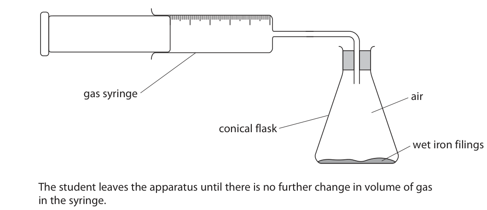
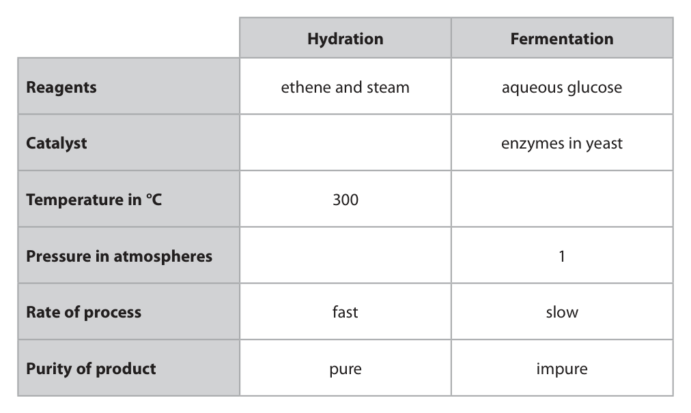

# 4CH1/2C — 2023-06 (official extraction)

> schema `syllabai.official-paper-questions/0.1` · paper_id `pearson-edexcel:international-gcse:chemistry:4ch1:2023-06:4CH1/2C` · qp sha256 `49e32df30edacbb7…` · extracted verbatim, never regenerated (ADR-037)

## Question 1 (7 marks)

Use the Periodic Table to help you answer this question.

### 1(a)(i) [1]

Name the element with atomic number 14.

**Mark scheme answer**

> silicon ALLOW Si

- **(1)** silicon ALLOW Si

### 1(a)(ii) [1]

Name the element in Group 2 and Period 3.

**Mark scheme answer**

> magnesium ALLOW Mg

- **(1)** magnesium ALLOW Mg

### 1(a)(iii) [1]

Name an element that is a liquid at room temperature.

**Mark scheme answer**

> bromine ALLOW mercury / Hg
> ALLOW Br / Br2
> REJECT bromide / Br−

- **(1)** bromine ALLOW mercury / Hg

### 1(a)(iv) [1]

Give the electronic configuration of an atom of phosphorus.

**Mark scheme answer**

> 2,8,5 / 2.8.5 ACCEPT diagram
> showing electron
> configuration

- **(1)** 2,8,5 / 2.8.5 ACCEPT diagram

### 1(a)(v) [1]

Give the formula of sodium sulfide.

**Mark scheme answer**

> Na2S ALLOW Na+2S2−

- **(1)** Na2S ALLOW Na+2S2−

### 1(b) [2]

Explain, in terms of electron configuration, why neon is unreactive.

**Mark scheme answer**

> An explanation that links the following two points
> M1 full outer shell / 8 electrons in outer shell /
> (electron configuration) 2.8
> M2 (so) does not need to lose or gain (or share)
> electrons / e(-)

- **(1)** full outer shell / 8 electrons in outer shell /
- **(1)** (so) does not need to lose or gain (or share)

## Question 2 (10 marks)

This question is about gases in the atmosphere.

**(b)** When copper(II) carbonate is heated, copper(II) oxide and carbon dioxide form.

### 2(a) [1]

Which of these gases has the lowest percentage by volume in the atmosphere?

- **(A)** argon
- **(B)** carbon dioxide  ✔
- **(C)** nitrogen
- **(D)** oxygen

**Mark scheme answer**

> B (carbon dioxide)
> A is incorrect as there is more argon in the
> atmosphere than carbon dioxide
> C is incorrect as there is more nitrogen in the
> atmosphere than carbon dioxide
> D is incorrect as there is more oxygen in the
> atmosphere than carbon dioxide

- **(1)** Answer B: carbon dioxide

### 2(b)(i) [1]

What is the name of this type of reaction?

- **(A)** addition
- **(B)** decomposition  ✔
- **(C)** oxidation
- **(D)** substitution

**Mark scheme answer**

> B (decomposition)
> A is incorrect as this is not an addition reaction
> C is incorrect as this is not an oxidation reaction
> D is incorrect as this is not a substitution reaction

- **(1)** Answer B: decomposition

### 2(b)(ii) [1]

Which colour change occurs when copper(II) carbonate is heated?

- **(A)** blue to black
- **(B)** blue to orange
- **(C)** green to black  ✔
- **(D)** green to orange

**Mark scheme answer**

> C (green to black)
> A is incorrect as copper(II) carbonate is not blue
> B is incorrect as copper(II) carbonate is not blue and
> copper(II) oxide is not orange
> D is incorrect as copper(II) oxide is not orange

- **(1)** Answer C: green to black

### 2(b)(iii) [1]

Give the chemical equation for this reaction.

**Mark scheme answer**

> CuCO3 → CuO + CO2 ALLOW multiples
> IGNORE state symbols
> even if incorrect

- **(1)** CuCO3 → CuO + CO2 ALLOW multiples

### 2(c) [4]

A student uses this apparatus to find the percentage of oxygen in a sample of air. gas syringe air conical flask wet iron filings The student leaves the apparatus until there is no further change in volume of gas in the syringe. These are the student’s results. volume of gas in flask and connecting tube in cm3 280 volume of gas in syringe at start in cm3 100 volume of gas in syringe at end in cm3 27 Calculate the percentage of oxygen in the sample of air. Give your answer to two significant figures. percentage of oxygen = %

**Mark scheme answer**

> M1 (volume of oxygen =) 100 − 27 OR 73 (cm3) correct answer with or
> without working scores 4
> M2 (volume of air at start =) 280 + 100 OR 380 (cm3) ALLOW ECF throughout
> M3 73 ÷ 380 × 100 OR 19.2 (%) Use of 280 gives an
> answer of 26 scores 3
> M4 19 (%)
> Alternative method
> M1 (volume of air left=)
> 280 + 27 OR 307 (cm3)
> M2 307 ÷ 380 x 100 OR
> 80.8 (%)
> M3 100 − 80.8 OR 19.2
> M4 19 (%)

- **(1)** (volume of oxygen =) 100 − 27 OR 73 (cm3) correct answer with or
- **(1)** (volume of air at start =) 280 + 100 OR 380 (cm3) ALLOW ECF throughout
- **(1)** 73 ÷ 380 × 100 OR 19.2 (%) Use of 280 gives an
- **(1)** 19 (%)

### 2(d) [2]

Explain why an increasing amount of carbon dioxide in the atmosphere is likely to cause a problem for the environment.

**Mark scheme answer**

> An explanation that links two of the following three
> points
> M1 carbon dioxide is a greenhouse gas ACCEPT description of
> greenhouse effect
> e.g. carbon dioxide traps
> heat / infra-red rays in
> AND the atmosphere
> M2 (that causes) climate change / global warming /
> global temperature rise
> OR
> M3 melting of polar icecaps / flooding / wildfires / ALLOW oceans becoming
> sea levels rising more acidic / less basic
> /pH decreasing
> REJECT reference to the
> ozone layer for M2 or M3
> IGNORE reference to acid
> rain

- **(2)** An explanation that links two of the following three

## Question 3 (15 marks)

This question is about alcohols. Ethanol can be manufactured using two different methods. • hydration of ethene • fermentation of glucose This is the equation for hydration. C2H4 + H2O → C2H5OH

**(b)** The table gives some information about the two methods. Hydration Fermentation Reagents ethene and steam aqueous glucose Catalyst enzymes in yeast Temperature in °C 300 Pressure in atmospheres 1 Rate of process fast slow Purity of product pure impure

**(d)** Propanol has this percentage composition by mass. C = 60.0% H = 13.3% O = 26.7%

### 3(a) [2]

Complete the equation for fermentation. C6H12O6 → +

**Mark scheme answer**

> C6H12O6 → 2C2H5OH + 2CO2 ACCEPT CH3CH2OH
> M1 both formulae correct
> M2 balancing of correct formulae M2 dep on M1 but if
> C2H6O given no M1
> but allow M2 for
> correct balancing
> IGNORE state
> symbols even if
> incorrect
> ALLOW multiples
> and fractions

- **(1)** both formulae correct
- **(1)** balancing of correct formulae M2 dep on M1 but if

### 3(b)(i) [3]

Complete the table by giving the missing information.

**Mark scheme answer**

> 3
> ACCEPT H3PO4
> Hydration Fermentation If formula alone
> must be correct, but
> Reagents ethene and steam aqueous glucose if name given and
> formula incorrect
> Catalyst phosphoric acid enzymes in yeast ignore formula
> Temperature in
> o 300 30 ALLOW sulphuric
> C
> Pressure in acid / H2SO4
> 60 − 70
> atmospheres
> ACCEPT any
> temperature
> between 20 and 40
> inclusive
> ACCEPT any
> pressure between 60
> and 70 inclusive

- **(3)** 3

### 3(b)(ii) [4]

Explain one advantage and one disadvantage of using fermentation rather than hydration to produce ethanol. You should use information from the table to help your answer. advantage disadvantage

**Mark scheme answer**

> An explanation that links one advantage and one
> disadvantage
> advantage:
> M1 uses low(er) pressure / atmospheric pressure / 1 atm
> M2 so less energy needed / less costly equipment / safer IGNORE cheaper
> /less costly alone
> OR
> M1 uses low(er) temperature
> M2 so less energy / heat needed IGNORE cheaper
> /less costly
> OR
> M1 glucose /sugar cane is a natural resource /is
> renewable
> M2 whereas ethene obtained from crude oil /ethene is
> non-renewable / ethene is a finite resource
> OR
> M1 yeast is a natural resource
> M2 whereas phosphoric acid is a manufactured catalyst
> disadvantage:
> M3 fermentation is slow(er) ALLOW
> M4 fermentation is less efficient /so hydration is more M3 fermentation is a
> efficient batch process
> M4 whereas
> hydration is a
> continuous process
> OR (so more efficient)
> M3 ethanol is impure IGNORE reference to
> M4 so ethanol needs to be purified ORA yield
> OR
> M3 growing sugar cane takes up land
> M4 that can be used to grow food crops

- **(4)** An explanation that links one advantage and one

### 3(c) [2]

Explain why fermentation needs to occur in the absence of air.

**Mark scheme answer**

> An explanation that links the following two points
> M1 oxygen would oxidise / react with ethanol / alcohol
> M2 which would produce ethanoic acid / CH3COOH ALLOW acetic acid /
> vinegar
> OR IGNORE carboxylic acid
> M1 fermentation needs to be anaerobic
> M2 so ethanol / alcohol will be formed / otherwise
> only carbon dioxide and water would form

- **(2)** An explanation that links the following two points

### 3(d)(i) [3]

Show by calculation that the empirical formula of propanol is C3H8O.

**Mark scheme answer**

> M1 60.0 13.3 26.7 0 marks for division by
> 12 1 16 atomic numbers or
> upside-down calculation
> M2 5.0 13.3 1.67 ALLOW any number of sig
> figs except 1 apart from 5
> M3 5.0 13.3 1.67 in M2 and M3
> 1.67 1.67 1.67
> OR 2.99 7.96
> ACCEPT alternative
> methods

- **(1)** 60.0 13.3 26.7 0 marks for division by
- **(1)** 5.0 13.3 1.67 ALLOW any number of sig
- **(1)** 5.0 13.3 1.67 in M2 and M3

### 3(d)(ii) [1]

Draw the displayed formula of propanol.

**Mark scheme answer**

> H H H Bond between O and H
> I I I must be shown
> H⎯C⎯C⎯C⎯O⎯H
> I I I ACCEPT structure of
> H H H propan-2-ol

- **(1)** H H H Bond between O and H

## Question 4 (11 marks)

A student does a titration to find the concentration of potassium hydroxide solution. This is the student’s method. • add 25.0 cm3 of the potassium hydroxide solution to a conical flask • add a few drops of methyl orange indicator to the conical flask • fill a burette with dilute sulfuric acid and record the initial burette reading • place the conical flask on a white tile • add the acid from the burette to the mixture in the conical flask, swirling the flask continuously • when the indicator changes colour at the end point, record the final burette reading Repeat the titration to obtain concordant results.

### 4(a) [1]

Give the name of the most suitable piece of apparatus to measure out 25.0 cm3 of potassium hydroxide solution.

**Mark scheme answer**

> pipette

- **(1)** pipette

### 4(b) [2]

Give the colour of methyl orange in potassium hydroxide solution and in dilute sulfuric acid. colour in potassium hydroxide solution colour in dilute sulfuric acid

**Mark scheme answer**

> M1 (colour in potassium hydroxide) yellow
> M2 (colour in sulfuric acid) red ALLOW pink

- **(1)** (colour in potassium hydroxide) yellow
- **(1)** (colour in sulfuric acid) red ALLOW pink

### 4(c) [1]

State why the student places the conical flask on a white tile.

**Mark scheme answer**

> to see the colour (change more) clearly (at the end-
> point) OWTTE

- **(1)** to see the colour (change more) clearly (at the end-

### 4(d) [1]

State why the student swirls the flask continuously.

**Mark scheme answer**

> to mix the solutions (more thoroughly) OWTTE ALLOW to speed up the
> reaction between the acid
> and alkali OWTTE

- **(1)** to mix the solutions (more thoroughly) OWTTE ALLOW to speed up the

### 4(e) [1]

State what is meant by the term concordant results.

**Mark scheme answer**

> titres/results within (+ or −) 0.2 (cm3 of each other) ALLOW within 0.1
> REJECT > 0.2 or < 0.1

- **(1)** titres/results within (+ or −) 0.2 (cm3 of each other) ALLOW within 0.1

### 4(f) [3]

The student finds that 15.00 cm3 of sulfuric acid of concentration 0.180 mol / dm3 neutralises 25.0 cm3 of potassium hydroxide solution. This is the equation for the reaction. 2KOH + H2SO4 → K2SO4 + 2H2O Calculate the concentration of the potassium hydroxide solution. concentration = mol / dm3

**Mark scheme answer**

> correct answer with or
> without working scores 3
> M1 n(H2SO4) = 0.0150 × 0.180 or 0.0027(0) (mol)
> M2 n(KOH) = 0.0027(0) × 2 or 0.0054(0) (mol) answer to M1 × 2
> M3 concn = (0.0054(0) ÷ 0.0250) = 0.216 (mol/dm3) answer to M2 ÷ 0.0250
> ALLOW any number of sig
> figs except 1
> common answers:
> 0.108 and 0.054 scores 2

- **(1)** n(H2SO4) = 0.0150 × 0.180 or 0.0027(0) (mol)
- **(1)** n(KOH) = 0.0027(0) × 2 or 0.0054(0) (mol) answer to M1 × 2
- **(1)** concn = (0.0054(0) ÷ 0.0250) = 0.216 (mol/dm3) answer to M2 ÷ 0.0250

### 4(g) [2]

This is the ionic equation for the reaction between an acid and an alkali. H+(aq) + OH−(aq) → H2O(l) Explain why the OH− ion is a proton acceptor in this reaction.

**Mark scheme answer**

> An explanation that links the following two points
> M1 an H+ ion is a proton
> M2 the OH− (ion) reacts / bonds with the H+ (ion) (to ALLOW donates a proton
> form water) / H+ (ion) to the OH−
> IGNORE accepts a proton

- **(1)** an H+ ion is a proton
- **(1)** the OH− (ion) reacts / bonds with the H+ (ion) (to ALLOW donates a proton

## Question 5 (10 marks)

When copper(II) sulfate solution is electrolysed, copper forms at the negative electrode. A student uses this apparatus to investigate the electrolysis of copper(II) sulfate solution. power supply + – lamp positive electrode negative electrode copper(II) sulfate solution

**(d)** Oxygen forms at the positive electrode.

### 5(a) [2]

Describe how the student could test a sample of copper(II) sulfate solution to show that it contains copper(II) ions.

**Mark scheme answer**

> M1 add sodium hydroxide (to the copper(II) sulfate ALLOW potassium
> solution) hydroxide or aqueous
> ammonia
> No M1 if any incorrect
> reagent added
> M2 blue precipitate (forms) IGNORE qualifiers e.g.
> pale / dark etc.
> M2 dep on addition of a
> OR correct alkali
> M1 flame test ACCEPT description of
> flame test
> M2 blue-green (flame) ALLOW green
> M2 dep on flame

- **(2)** M1 add sodium hydroxide (to the copper(II) sulfate ALLOW potassium

### 5(b) [3]

Describe how copper metal forms at the negative electrode.

**Mark scheme answer**

> An description that refers to any three from
> M1 copper ions are positively charged / cations ALLOW M1 and M3 for a
> / Cu2+ (ions) fully correct half
> equation
> M2 and are attracted to / travel to the negative i.e. Cu2+ + 2e → Cu
> electrode / cathode
> M3 where they accept electrons
> M4 and become (copper) atoms

- **(3)** An description that refers to any three from

### 5(c) [1]

State the appearance of the copper that forms on the negative electrode.

**Mark scheme answer**

> pink solid / deposit / coating / metal ACCEPT pink-brown /
> orange-brown / brown /
> orange / red-brown
> REJECT red
> REJECT precipitate

- **(1)** pink solid / deposit / coating / metal ACCEPT pink-brown /

### 5(d)(i) [1]

Give a test for oxygen.

**Mark scheme answer**

> relights a glowing splint

- **(1)** relights a glowing splint

### 5(d)(ii) [2]

Complete the half-equation for the formation of oxygen at the positive electrode. 2H2O → + +

**Mark scheme answer**

> 2H2O → 4H+ + O2 + 4e(−) 4OH− → 2H2O + O2 + 4e(−)
> scores 1
> IGNORE state symbols
> even if incorrect
> M1 O2 + e(−) IGNORE any numbers in
> front of O2 + e(−) and any
> M2 equation fully correct other species

- **(1)** O2 + e(−) IGNORE any numbers in
- **(1)** equation fully correct other species

### 5(d)(iii) [1]

State why the formation of oxygen at the positive electrode is an oxidation reaction.

**Mark scheme answer**

> electrons are lost ALLOW H2O / water
> loses electrons

- **(1)** electrons are lost ALLOW H2O / water

## Question 6 (6 marks)

Ethanoic acid reacts with methanol to form an ester. The equation shows the displayed formulae for the reactants and products. H O H H O H H C C O H + H C O H → H C C O C H + H O H H H H H

**(b)** The table shows the number of bonds in the reactants and the number of bonds in the products. Bond C H C C C O C O O H Number of bonds in reactants 6 1 2 1 2 Number of bonds in products 6 1 2 1 2

### 6(a)(i) [1]

Give the name of a suitable catalyst to increase the rate of this reaction.

**Mark scheme answer**

> sulfuric acid / H2SO4 ACCEPT hydrochloric acid
> / HCl and nitric acid /
> HNO3 / phosphoric acid /
> H3PO4

- **(1)** sulfuric acid / H2SO4 ACCEPT hydrochloric acid

### 6(a)(ii) [1]

State how you would know that an ester has formed.

**Mark scheme answer**

> distinctive / sweet / fruity smell ACCEPT an oily layer
> forms (on the surface)

- **(1)** distinctive / sweet / fruity smell ACCEPT an oily layer

### 6(a)(iii) [1]

Give the name of this ester.

**Mark scheme answer**

> methyl ethanoate spelling must be correct

- **(1)** methyl ethanoate spelling must be correct

### 6(b)(i) [1]

State which two bonds need to be broken in the reactants.

**Mark scheme answer**

> C⎯O and O⎯H

- **(1)** C⎯O and O⎯H

### 6(b)(ii) [2]

Explain why the enthalpy change in this reaction is approximately 0 kJ / mol.

**Mark scheme answer**

> An explanation that links the following two points
> M1 the same (two) bonds / C⎯O and O⎯H are ALLOW ecf if wrong
> broken and formed bonds in (i)
> IGNORE the same number
> of bonds are broken and
> formed
> M2 energy needed to break bonds equals energy
> released when bonds form (so overall enthalpy
> change is 0)

- **(1)** the same (two) bonds / C⎯O and O⎯H are ALLOW ecf if wrong
- **(1)** energy needed to break bonds equals energy

## Question 7 (11 marks)

Methane reacts with steam to form carbon monoxide and hydrogen. This is the equation for the reaction. CH4(g) + H2O(g) ⇌ CO(g) + 3H2(g) ∆H = +206 kJ / mol

**(c)** The reaction conditions for this reaction are a temperature of 700 °C and a pressure of 5 atmospheres.

### 7(a) [1]

State why carbon monoxide is poisonous to humans.

**Mark scheme answer**

> reduces the capacity of blood to transport oxygen ALLOW carbon monoxide
> round the body OWTTE /it binds with
> haemoglobin

- **(1)** reduces the capacity of blood to transport oxygen ALLOW carbon monoxide

### 7(b) [2]

Explain the effect, if any, on the yield of hydrogen at equilibrium when a nickel catalyst is used.

**Mark scheme answer**

> An explanation that links the following two points
> M1 no effect
> M2 as increases rate of forward reaction and rate
> of backward reaction equally
> M2 dep on M1 or missing

- **(1)** no effect
- **(1)** as increases rate of forward reaction and rate

### 7(c)(i) [2]

The temperature of the reaction mixture is reduced to 600 °C, but the pressure is kept at 5 atmospheres. Explain the effect on the yield of hydrogen at equilibrium.

**Mark scheme answer**

> An explanation that links the following two points
> M1 yield decreases
> M2 as (forward) reaction is endothermic (so ALLOW backward
> equilibrium shifts to the LHS / reactants side) /reverse reaction is
> exothermic
> M2 dep on M1 or missing
> IGNORE references to Le
> Chatelier

- **(1)** yield decreases
- **(1)** as (forward) reaction is endothermic (so ALLOW backward

### 7(c)(ii) [2]

The pressure of the reaction mixture is reduced to 4 atmospheres, but the temperature is kept at 700 °C. Explain the effect on the yield of hydrogen at equilibrium.

**Mark scheme answer**

> An explanation that links the following two points
> M1 yield increases
> M2 as there are fewer moles / molecules (of gas)
> on the left-hand side / there are 2 mol on LHS and
> 4 mol on RHS (so equilibrium shifts to the RHS /
> products side) ORA M2 dep on M1 or missing
> IGNORE references to Le
> Chatelier

- **(1)** yield increases
- **(1)** as there are fewer moles / molecules (of gas)

### 7(d) [4]

Calculate the volume, in dm3, of methane gas at rtp needed to produce 6.6 tonnes of hydrogen gas. [at rtp, molar volume = 24 dm3 1 tonne = 106 g] Give your answer in standard form. volume of methane = dm3

**Mark scheme answer**

> correct answer with or
> without working scores 4
> M1 n(H2) = 6.6 × 106 ÷ 2 OR 3.3 × 106 (mol) ACCEPT 3 300 000
> M2 n(CH4) = 3.3 × 106 ÷ 3 OR 1.1 × 106 (mol) ACCEPT 1 100 000
> M3 vol(CH4) = 1.1 × 106 × 24 OR 26 400 000 (dm3) M2 × 24
> M4 2.6 × 107 ACCEPT 2.64 × 107
> ALLOW ECF throughout
> common answers:
> 7.9(2) × 107 scores 3
> 5.28 × 107 scores 3
> 1.584 × 108 scores 2
> Pearson Education Limited. Registered company number 872828
> with its registered office at 80 Strand, London, WC2R 0RL, United Kingdom

- **(1)** n(H2) = 6.6 × 106 ÷ 2 OR 3.3 × 106 (mol) ACCEPT 3 300 000
- **(1)** n(CH4) = 3.3 × 106 ÷ 3 OR 1.1 × 106 (mol) ACCEPT 1 100 000
- **(1)** vol(CH4) = 1.1 × 106 × 24 OR 26 400 000 (dm3) M2 × 24
- **(1)** 2.6 × 107 ACCEPT 2.64 × 107

