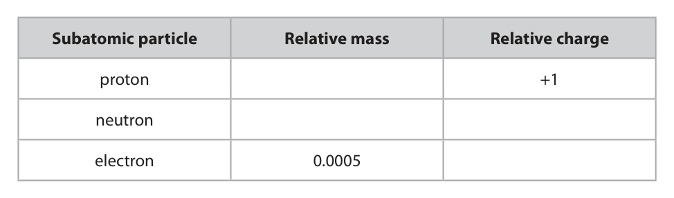
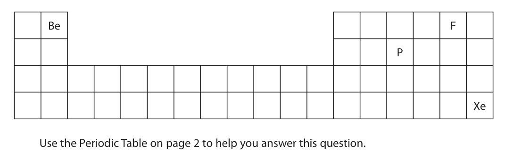
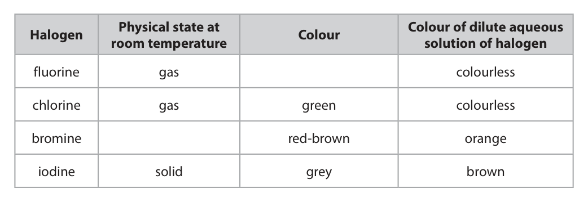
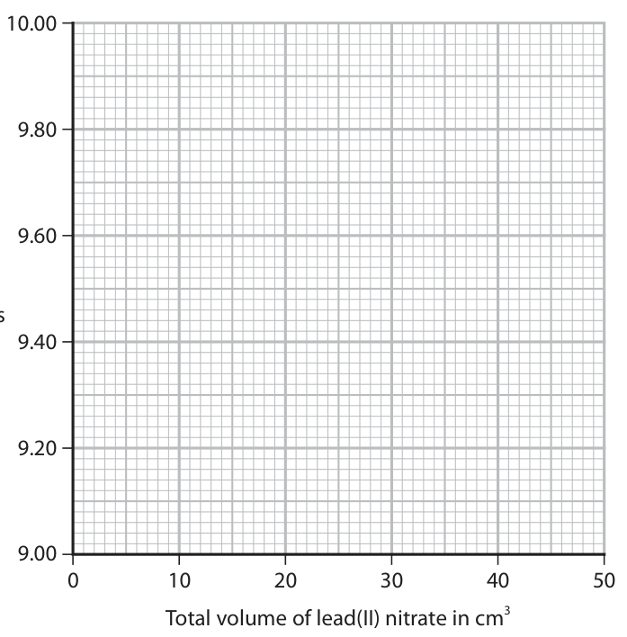
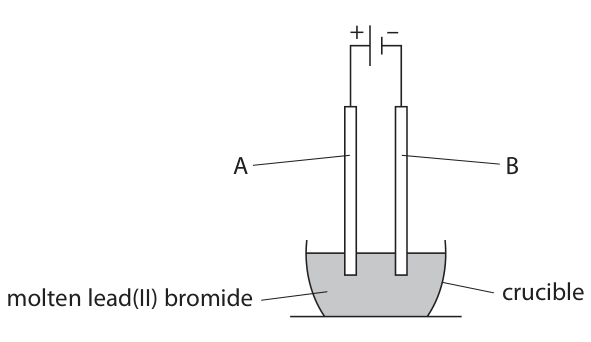

# 4CH1/2CR — 2023-06 (official extraction)

> schema `syllabai.official-paper-questions/0.1` · paper_id `pearson-edexcel:international-gcse:chemistry:4ch1:2023-06:4CH1/2CR` · qp sha256 `e200f7eb08b55d55…` · extracted verbatim, never regenerated (ADR-037)

## Question 1 (6 marks)
**(b)** The diagram shows the position of some elements in the Periodic Table. Be F P Xe Use the Periodic Table on page 2 to help you answer this question.

### 1(a) [2]

The table lists three subatomic particles. Complete the table by giving the missing information. Subatomic particle Relative mass Relative charge proton +1 neutron electron 0.0005

**Mark scheme answer**

> 2
> Subatomic Relative Relative All 4 correct = (2)
> particle mass charge 2 or 3 correct = (1)
> 0 or 1 correct = (0)
> proton 1 +1
> neutron 1
> electron 0.0005 −1

- **(2)** 2

### 1(b)(i) [1]

How are elements arranged in the Periodic Table?

- **(A)** increasing atomic number  ✔
- **(B)** increasing melting point
- **(C)** increasing reactivity
- **(D)** increasing relative atomic mass

**Mark scheme answer**

> A increasing atomic number
> B is incorrect as elements are not arranged in order
> of increasing melting point
> C is incorrect as elements are not arranged in order
> of increasing reactivity
> D is incorrect as elements are not arranged in order
> of increasing relative atomic mass

- **(1)** Answer A: increasing atomic number

### 1(b)(ii) [1]

Which statement is correct about the position of phosphorus, P, in the Periodic Table?

- **(A)** Group 2 and Period 5
- **(B)** Group 3 and Period 5
- **(C)** Group 5 and Period 2
- **(D)** Group 5 and Period 3  ✔

**Mark scheme answer**

> D Group 5 Period 3
> A is incorrect as phosphorus is not in Group 2 and
> Period 5
> B is incorrect as phosphorus is not in Group 3 and
> Period 5
> C is incorrect as phosphorus is not in Group 5 and
> Period 2

- **(1)** Answer D: Group 5 and Period 3

### 1(b)(iii) [2]

Explain which of the four elements in the diagram is least reactive.

**Mark scheme answer**

> M1 Xe / xenon
> M2 because it has a full outer shell (of M2 dep on M1
> electrons) / 8 electrons in the outer
> shell IGNORE refs to noble
> gas

- **(1)** Xe / xenon
- **(1)** because it has a full outer shell (of M2 dep on M1

## Question 2 (7 marks)

The table gives some information about the halogens, fluorine, chlorine, bromine and iodine. Physical state at Colour of dilute aqueous Halogen Colour room temperature solution of halogen fluorine gas colourless chlorine gas green colourless bromine red‑brown orange iodine solid grey brown

### 2(a) [2]

Complete the table by giving the missing information.

**Mark scheme answer**

> 2
> Physical state at
> Colour
> room temperature
> gas pale green / yellow
> gas green
> liquid red-brown
> solid grey

- **(2)** 2

### 2(b) [2]

Describe a test to show that a colourless liquid is an alkene.

**Mark scheme answer**

> M1 bromine water / bromine solution ALLOW aqueous bromine
> M2 turns colourless / decolourised IGNORE any starting colour
> M2 is dep on mention of
> bromine in M1

- **(1)** bromine water / bromine solution ALLOW aqueous bromine
- **(1)** turns colourless / decolourised IGNORE any starting colour

### 2(c) [3]

A student is given an aqueous solution of chlorine and an aqueous solution of sodium iodide. The student mixes the two solutions. Explain the colour change that occurs.

**Mark scheme answer**

> M1 (mixture) turns (from colourless) to brown ALLOW red-brown / orange-
> brown
> M2 iodine / I2 is displaced REJECT iodide
> OR IGNORE a displacement
> reaction occurs
> (chlorine reacts with iodide ions) to produce /
> form iodine M2 can be scored by I2 as a
> product in a balanced
> equation or by a word
> equation
> M3 (because) chlorine is more reactive (than ALLOW reverse argument
> iodine)
> REJECT iodide, except if
> already penalised in M2

- **(1)** (mixture) turns (from colourless) to brown ALLOW red-brown / orange-
- **(1)** iodine / I2 is displaced REJECT iodide
- **(1)** (because) chlorine is more reactive (than ALLOW reverse argument

## Question 3 (6 marks)
**(a)** The box gives the names of some metals. aluminium calcium gold magnesium silver zinc Use words from the box to answer these questions.

**(b)** Steel is an alloy of iron and carbon. The diagram shows how the particles are arranged in steel. iron atom carbon atom

### 3(a)(i) [1]

Identify the metal that burns with a bright white flame.

**Mark scheme answer**

> magnesium

- **(1)** magnesium

### 3(a)(ii) [2]

Explain which metal is most likely to be found in the Earth as an uncombined element.

**Mark scheme answer**

> M1 gold IGNORE silver
> M2 is the least reactive M2 DEP on M1
> ALLOW it is (the most)
> unreactive

- **(1)** gold IGNORE silver
- **(1)** is the least reactive M2 DEP on M1

### 3(b)(i) [1]

State what is meant by the term alloy.

**Mark scheme answer**

> (an alloy is) a mixture of metals
> OR
> (an alloy is) a mixture of a metal and another metal ALLOW (an alloy is) a
> mixture of a metal and
> carbon
> REJECT references to
> compounds / combining
> of metals

- **(1)** (an alloy is) a mixture of metals

### 3(b)(ii) [2]

Explain why an alloy is less malleable than a pure metal.

**Mark scheme answer**

> M1 the regular arrangement of atoms is distorted / ALLOW lattice / layers
> disrupted / disturbed OWTTE / rows of atoms are
> disrupted / distorted /
> are less regular / are
> OR irregular
> carbon atoms are smaller than iron ALLOW carbon and iron
> atoms / because iron atoms are larger atoms are of different
> than carbon atoms sizes
> ALLOW the atoms are
> not the same size / the
> atoms are different
> sizes
> M2 (therefore) it is more difficult for IGNORE references to
> the atoms/layers to slide over one the strength of metallic
> another bonds

- **(1)** the regular arrangement of atoms is distorted / ALLOW lattice / layers
- **(1)** (therefore) it is more difficult for IGNORE references to

## Question 4 (9 marks)
**(a)** The diagram shows a fractionating column used to separate crude oil into fractions. refinery gases gasoline kerosene diesel crude oil fuel oil bitumen

**(b)** There is a low demand for some of the hydrocarbons obtained from crude oil. Catalytic cracking can be used to convert low‑demand hydrocarbons into more useful products.

### 4(a)(i) [2]

Give one use for refinery gases and one use for bitumen. refinery gases bitumen

**Mark scheme answer**

> refinery gases: (fuel for) heating / cooking ALLOW bottled gas
> bitumen: tar / road surfacing / road building ALLOW roads
> / roofing

- **(2)** refinery gases: (fuel for) heating / cooking ALLOW bottled gas

### 4(a)(ii) [1]

Give a reason why refinery gases rise to the top of the column.

**Mark scheme answer**

> any one from:
> refinery gases have the low(est) boiling point ALLOW they are the
> most volatile
> OR
> REJECT refs to melting
> refinery gases do not condense in the column point

- **(1)** any one from:

### 4(a)(iii) [1]

State what must happen to the crude oil before it is pumped into the column.

**Mark scheme answer**

> it is heated / vaporised IGNORE any
> temperatures given
> ALLOW boiled

- **(1)** it is heated / vaporised IGNORE any

### 4(b)(i) [2]

Give the conditions needed for cracking.

**Mark scheme answer**

> M1 temperature 600 − 700°C ALLOW any temperature
> in the range
> M2 catalyst alumina / silica / zeolites / aluminium
> IGNORE pressures
> oxide / silicon dioxide

- **(1)** temperature 600 − 700°C ALLOW any temperature
- **(1)** catalyst alumina / silica / zeolites / aluminium

### 4(b)(ii) [3]

The cracking of tetradecane is shown in the equation. C14H30 → 2C3H6 + C8H18 Explain why there is a high demand for both of the products.

**Mark scheme answer**

> an explanation containing any three of the following
> points:
> M1 alkenes / propene / C3H6 can be used to make ALLOW used to make
> (addition) polymers / plastics poly(propene)
> ALLOW to make
> alcohols / propanol
> IGNORE used as fuels
> M2 (because) they have double bonds / are
> unsaturated
> M3 shorter alkanes / octane / C8H18 are used as
> fuels / petrol
> M4 (because) they have lower boiling points / are
> more flammable

- **(3)** an explanation containing any three of the following

## Question 5 (13 marks)

This question is about the insoluble salt, lead(II) bromide. Lead(II) bromide can be made by a precipitation reaction. This is the equation for the reaction. Pb(NO3)2(aq) + 2KBr(aq) → PbBr2(s) + 2KNO3(aq)

**(c)** A student investigates the change in electrical conductivity as dilute lead(II) nitrate solution is added to dilute potassium bromide solution. This is the student’s method. Step 1 add 50 cm3 of potassium bromide solution to a beaker Step 2 measure the electrical conductivity of the solution Step 3 add 10 cm3 of lead(II) nitrate solution to the beaker Step 4 stir the mixture Step 5 measure the electrical conductivity of the mixture Repeat steps 3, 4 and 5 until a total of 50 cm3 of lead(II) nitrate solution has been added. The table shows the student’s results. Total volume of lead(II) nitrate Electrical conductivity solution added in cm3 in arbitrary units 0 10.00 10 9.80 20 9.77 30 9.40 40 9.20 50 9.00

### 5(a) [4]

Describe how solutions of lead nitrate and potassium bromide can be used to make a pure, dry sample of lead(II) bromide.

**Mark scheme answer**

> M1 mix / react the two solutions (together) IGNORE volumes
> IGNORE heating at this
> stage
> REJECT an indication that
> solids are mixed for M1
> M2 filter (the solid lead bromide)
> M3 wash (using deionised water) IGNORE any washing before
> filtering
> M4 method of drying eg leave to dry / dry in an
> oven / leave in a warm
> place / dry with filter
> paper
> REJECT direct heating of
> final product for M4
> REJECT if solid is washed
> again after drying for M4
> Methods of producing a
> soluble salt eg evaporating
> after mixing, leaving
> solutions in an evaporating
> basin scores M1 only

- **(1)** mix / react the two solutions (together) IGNORE volumes
- **(1)** filter (the solid lead bromide)
- **(1)** wash (using deionised water) IGNORE any washing before
- **(1)** method of drying eg leave to dry / dry in an

### 5(b) [2]

A solution containing 0.150 mol of lead(II) nitrate is reacted with an excess of potassium bromide solution. A mass of 49.6 g of pure, dry lead(II) bromide is produced. Show, by calculation, that the percentage yield of lead(II) bromide is 90.1%. [for PbBr2 , Mr = 367]

**Mark scheme answer**

> M1 0.150 × 367 OR 55.05 g
> M2 (49.6 ÷ 55.05) × 100
> OR
> M1 (49.6 ÷ 367) OR 0.1351 ALLOW 0.135
> M2 (0.1351 ÷ 0.150) x 100
> ALLOW a final answer of
> 90% by either method
> REJECT
> (49.6 ÷ 0.15) = 330.67
> (330.67 ÷ 367) x 100
> for both marks

- **(2)** M1 0.150 × 367 OR 55.05 g

### 5(c)(i) [1]

Plot the student’s results on the grid.

**Mark scheme answer**

> all 6 points plotted ± half a square

- **(1)** all 6 points plotted ± half a square

### 5(c)(ii) [1]

Draw a line of best fit, ignoring the anomalous result. 10.00 9.80 9.60 Electrical conductivity in arbitrary units 9.40 9.20 9.00 0 10 20 30 40 50 Total volume of lead(II) nitrate in cm

**Mark scheme answer**

> straight line of best fit ignoring the anomalous
> result at volume = 20 cm3

- **(1)** straight line of best fit ignoring the anomalous

### 5(c)(iii) [2]

Explain the shape of the graph.

**Mark scheme answer**

> M1 the conductivity decreases (when the volume IGNORE proportional
> of lead(II) nitrate added increases) /inversely proportional
> REJECT directly
> proportional
> ACCEPT negative
> correlation between
> volume of lead(II) nitrate
> and electrical conductivity
> ALLOW the conductivity
> increases when the volume
> of lead(II) nitrate decrease
> M2 there are fewer ions in the mixture ALLOW ions are being
> removed (as lead(II)
> bromide is formed)

- **(1)** the conductivity decreases (when the volume IGNORE proportional
- **(1)** there are fewer ions in the mixture ALLOW ions are being

### 5(c)(iv) [1]

Suggest a mistake the student could have made to cause the anomalous result.

**Mark scheme answer**

> the student forgot to stir the mixture ALLOW the student didn’t
> allow enough time for the
> reaction to take place
> before measuring
> conductivity
> REJECT the student added
> less / too little lead(iI)
> nitrate solution

- **(1)** the student forgot to stir the mixture ALLOW the student didn’t

### 5(c)(v) [1]

Further 10 cm3 volumes of lead(II) nitrate are added to the beaker so the lead(II) nitrate is in excess. Predict what will happen to the conductivity of the mixture when the lead(II) nitrate is in excess.

**Mark scheme answer**

> the conductivity would increase

- **(1)** the conductivity would increase

### 5(d) [1]

The diagram shows the electrolysis of molten lead(II) bromide, PbBr2 + – A B molten lead(II) bromide crucible This is the ionic half‑equation for the formation of bromine at electrode A. 2Br − → Br 2 + 2e− Give a reason why this half‑equation shows oxidation.

**Mark scheme answer**

> electrons are lost (from bromide REJECT bromine / bromine
> ions) ions lose electrons

- **(1)** electrons are lost (from bromide REJECT bromine / bromine

## Question 6 (15 marks)
**(b)** When a small piece of potassium is added to water, bubbles of hydrogen gas are observed.

### 6(a) [2]

Describe the forces of attraction in metallic bonding.

**Mark scheme answer**

> M1 (electrostatic attraction between) ACCEPT (electrostatic attraction
> positive ions between positive) nuclei of (metal)
> atoms
> M2 (and) delocalised electrons
> REJECT any references to ionic bonding
> / sharing of electrons / intermolecular
> forces for both marks

- **(1)** (electrostatic attraction between) ACCEPT (electrostatic attraction
- **(1)** (and) delocalised electrons

### 6(b)(i) [1]

Give the test for hydrogen gas.

**Mark scheme answer**

> (squeaky) pop with lighted splint/lit with a IGNORE just ‘burns with a squeaky pop’
> (Bunsen) flame
> REJECT use of glowing splint

- **(1)** (squeaky) pop with lighted splint/lit with a IGNORE just ‘burns with a squeaky pop’

### 6(b)(ii) [2]

Give two other observations that would be made. 1 2

**Mark scheme answer**

> any two from:
> M1 lilac / purple flame ALLOW flame
> REJECT other colours
> M2 potassium melts / turns into a ball
> M3 potassium moves on the surface ALLOW floats
> M4 potassium gets smaller ALLOW potassium disappears / dissolves
> IGNORE fizzing / bubbles etc

- **(2)** any two from:

### 6(c) [3]

Explain why lithium is less reactive than potassium. Refer to atomic structure in your answer.

**Mark scheme answer**

> an explanation linking the following
> points:
> M1 lithium has fewer shells than potassium ALLOW lithium has smaller atoms than
> potassium
> ALLOW (outer shell) electron in lithium
> is closer to the nucleus
> ALLOW correct electron configurations
> REJECT ‘fewer outer shells’
> M2 outer shell / outer electron in lithium ALLOW outer shell / outer electron in
> is more strongly attracted to the nucleus lithium is less shielded (by inner shells)
> ACCEPT valence electron
> M3 (so in lithium the outer shell) electron
> is less easily lost
> ALLOW reverse argument throughout
> for potassium

- **(1)** lithium has fewer shells than potassium ALLOW lithium has smaller atoms than
- **(1)** outer shell / outer electron in lithium ALLOW outer shell / outer electron in
- **(1)** (so in lithium the outer shell) electron

### 6(d) [4]

This is the equation for the reaction between sodium and water. 2Na(s) + 2H2O(l) → 2NaOH(aq) + H2(g) A mass of 0.750 g of sodium is reacted with an excess of water. Calculate the volume of hydrogen gas produced, in cm3, at room temperature. [molar volume of hydrogen at rtp = 24 000 cm3] [for Na, Ar = 23] Give your answer to three significant figures. volume of hydrogen = cm3

**Mark scheme answer**

> M1 (moles of sodium) 0.75 ÷ 23 OR 0.0326
> moles
> M2 (moles of hydrogen) 0.0326 ÷ 2 ALLOW M1 ÷ 2
> M3 (volume of hydrogen) 391.304 (cm3) ALLOW M2 × 24 000
> REJECT incorrect rounding / use of 1SF
> once in M1 – M3
> M4 391 (cm3) ALLOW M3 to 3 significant figures,
> provided some attempt at calculation
> 391 (cm3) scores 4 marks
> If M1 is rounded to 0.033 moles, final
> answer of 396 (cm3) scores 4 marks
> If M2 is absent, final answer of 782 /
> 783 (cm3) scores 3 marks
> If x 2 instead of ÷ 2 in M2 , final answer
> of 1560 (cm3) scores 3 marks

- **(1)** (moles of sodium) 0.75 ÷ 23 OR 0.0326
- **(1)** (moles of hydrogen) 0.0326 ÷ 2 ALLOW M1 ÷ 2
- **(1)** (volume of hydrogen) 391.304 (cm3) ALLOW M2 × 24 000
- **(1)** 391 (cm3) ALLOW M3 to 3 significant figures,

### 6(e) [3]

This is the equation for the reaction between sodium hydroxide and sulfuric acid. 2NaOH + H2SO4 → Na2SO4 + 2H2O A volume of 25.0 cm3 of sodium hydroxide solution is completely neutralised by 16.3 cm3 of 0.0500 mol / dm3 sulfuric acid. Calculate the concentration of the sodium hydroxide solution in mol / dm3. concentration = mol / dm3

**Mark scheme answer**

> M1 (moles of sulfuric acid)
> (16.3 × 0.0500) ÷ 1000 OR 0.000815 ALLOW 8.15 x 10-4 (moles)
> M2 (moles of sodium hydroxide) = 0.00163 ALLOW M1 × 2
> M3 0.0652 (mol/dm3) ALLOW M2 ÷ 0.025
> 0.0652 (mol/dm3) scores 3 marks
> ALLOW any SF except 1SF
> If M2 is absent, final answer of 0.0326
> (mol/dm3) scores 2 marks
> If ÷ 2 instead of x 2 in M2 , final answer
> of 0.0163 (mol/dm3) scores 2 marks
> REJECT 16.3 / 25.0 = 0.652 (mol/dm3)
> for all 3 marks

- **(1)** (moles of sulfuric acid)
- **(1)** (moles of sodium hydroxide) = 0.00163 ALLOW M1 × 2
- **(1)** 0.0652 (mol/dm3) ALLOW M2 ÷ 0.025

## Question 7 (14 marks)

Methanol is made by the reaction between hydrogen and carbon monoxide. This is the equation for the reaction. 2H2(g) + CO(g) ⇌ CH3OH(g) ΔH = −119 kJ / mol A mixture of hydrogen and carbon monoxide is left until dynamic equilibrium is reached.

**(b)** This equation shows the displayed formulae for the reactants and product. H H H + C O ⇌ H C O H H H H The table gives the bond energies for the bonds in the reactants and product. Bond energy Bond in kJ / mol H H 436 C O 1072 C H 414 C O 358 O H 463

**(c)** The diagram shows the displayed formula of an ester that is made from methanol and a carboxylic acid. H H O H C C C H O C H H H C H H H

### 7(a)(i) [2]

Give two characteristics of a reaction at dynamic equilibrium. 1 2

**Mark scheme answer**

> M1 the forward and reverse reactions occur
> at the same rate
> M2 so the concentrations of reactants and ALLOW so the moles of
> products remain constant reactants and products remain
> constant
> REJECT so the concentrations of
> reactants and products are the
> same

- **(1)** the forward and reverse reactions occur
- **(1)** so the concentrations of reactants and ALLOW so the moles of

### 7(a)(ii) [1]

Give a reason why adding a catalyst does not affect the yield of methanol.

**Mark scheme answer**

> a catalyst increases the rate of (both) the ALLOW has the same effect on
> forwards and the reverse reaction equally the rate of forward and reverse
> reaction

- **(1)** a catalyst increases the rate of (both) the ALLOW has the same effect on

### 7(a)(iii) [2]

The temperature of the reaction mixture is decreased at constant pressure. Explain the effect of this change on the yield of methanol.

**Mark scheme answer**

> M1 yield increases
> M2 the (forward) reaction is exothermic ALLOW the reverse reaction is
> endothermic
> IGNORE any references to Le
> Chatelier’s Principle (moves /
> shifts)
> M2 dep on M1 correct or missing

- **(1)** yield increases
- **(1)** the (forward) reaction is exothermic ALLOW the reverse reaction is

### 7(a)(iv) [2]

The pressure of the reaction mixture is increased at constant temperature. Explain the effect of this change on the yield of methanol.

**Mark scheme answer**

> M1 yield increases
> M2 there are more moles of (gaseous) reactants IGNORE any references to Le
> than products / there are fewer (gaseous) moles Chatelier’s Principle (moves
> on the right hand side / there are 3 moles (of /shifts)
> gas) on the left and 1 mole (of gas) on the right
> ORA M2 dep on M1 correct or missing

- **(1)** yield increases
- **(1)** there are more moles of (gaseous) reactants IGNORE any references to Le

### 7(b)(i) [3]

Show that the molar enthalpy change, ΔH, for the reaction is −119 kJ / mol.

**Mark scheme answer**

> M1 (bonds broken) = 436 + 436 + 1072 OR 1944
> M2 (bonds formed) = 414 + 414 + 414 + 358 + 463
> OR 2063
> M3 1944 – 2063 (= – 119)

- **(1)** (bonds broken) = 436 + 436 + 1072 OR 1944
- **(1)** (bonds formed) = 414 + 414 + 414 + 358 + 463
- **(1)** 1944 – 2063 (= – 119)

### 7(b)(ii) [2]

Explain why this reaction is exothermic.

**Mark scheme answer**

> an explanation that links together
> the following two points:
> M1 more energy is given out when IGNORE refs to numbers of
> the bonds are made bonds
> M2 than is taken in when the bonds
> are broken ORA
> OR
> M1 breaking bonds is endothermic / takes in
> energy AND making bonds is exothermic /
> releases energy
> M2 the energy released is more than the energy DEP on M1
> taken in
> If state / imply that energy
> required to make bonds
> OR
> If state / imply that energy
> released when bonds are
> broken scores 0

- **(2)** an explanation that links together

### 7(c)(i) [1]

Draw a circle around the functional group of the ester.

**Mark scheme answer**

> 1

- **(1)** 1

### 7(c)(ii) [1]

Give the displayed formula of the carboxylic acid used to make this ester.

**Mark scheme answer**

> REJECT -OH not displayed
> Pearson Education Limited. Registered company number 872828
> with its registered office at 80 Strand, London, WC2R 0RL, United Kingdom

- **(1)** REJECT -OH not displayed

