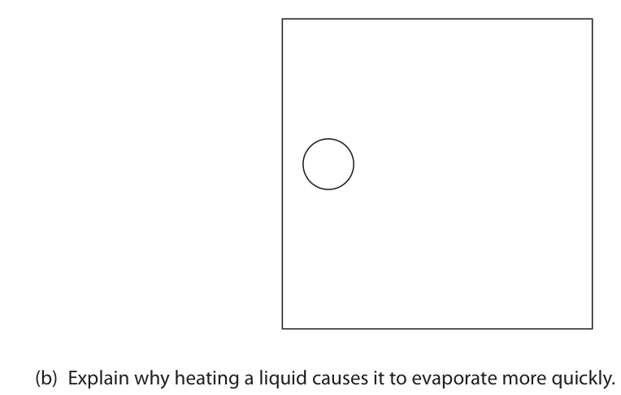
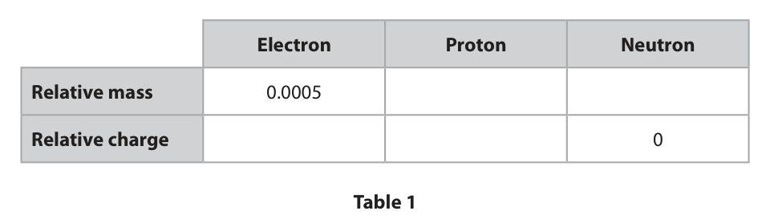
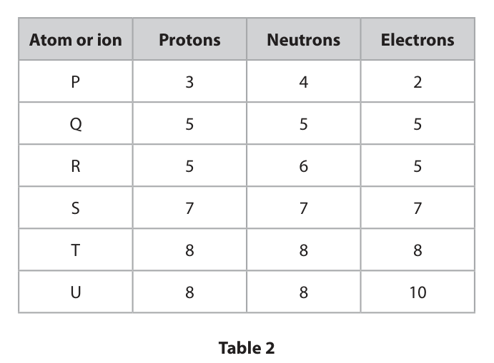
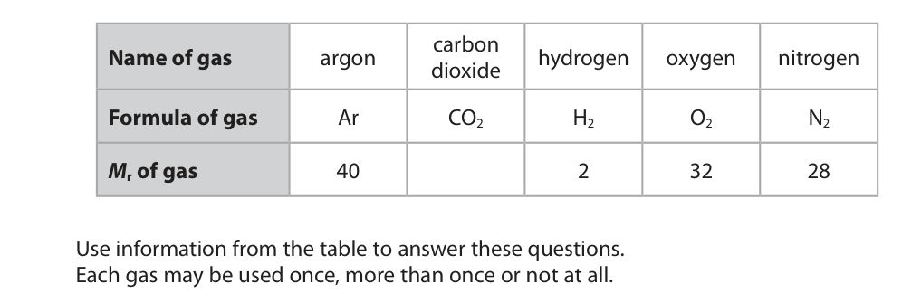
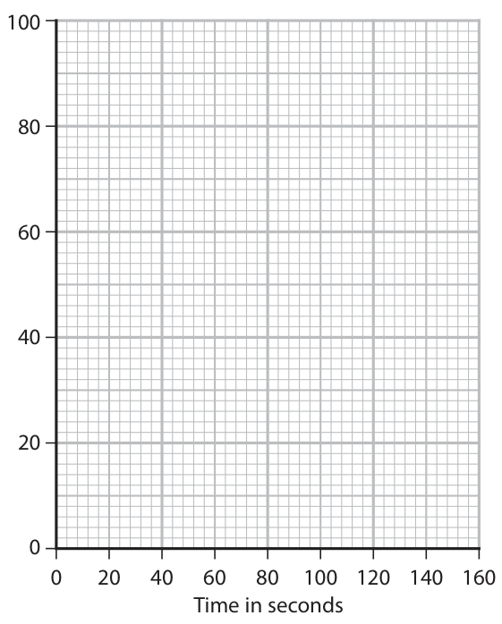
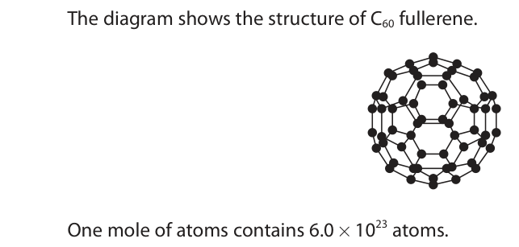

# 4CH1/1C — 2023-11 (official extraction)

> schema `syllabai.official-paper-questions/0.1` · paper_id `pearson-edexcel:international-gcse:chemistry:4ch1:2023-11:4CH1/1C` · qp sha256 `180909048496d940…` · extracted verbatim, never regenerated (ADR-037)

## Question 1 (7 marks)

A substance can exist in three states of matter, solid, liquid or gas. When a liquid evaporates at room temperature it changes into a gas.

**(c)** When the temperature decreases, water in the gas state changes to a liquid.

### 1(a) [1]

Complete the diagram to show the arrangement of another four particles in a gas.

**Mark scheme answer**

> Four more particles (randomly spaced and) far IGNORE any lines or
> apart arrows GR
> ACCEPT more than four
> particles as long as they
> are far apart
> REJECT any particles
> touching

- **(1)** Four more particles (randomly spaced and) far IGNORE any lines or

### 1(b) [2]

Explain why heating a liquid causes it to evaporate more quickly.

**Mark scheme answer**

> An explanation that links the following two points
> EXP
> M1 (mean kinetic) energy of particles increases ALLOW particles move
> faster/more quickly
> IGNORE particles
> vibrate more
> IGNORE it has more
> energy/ heat energy
> increases
> M2 more particles have enough energy to escape ALLOW particles escape
> /more particles overcome the (intermolecular) more quickly/more
> forces (of attraction) holding them together easily
> IGNORE more collisions
> REJECT breaking of
> bonds
> ALLOW molecules
> /atoms for particles in
> M1 and M2

- **(1)** (mean kinetic) energy of particles increases ALLOW particles move
- **(1)** more particles have enough energy to escape ALLOW particles escape

### 1(c)(i) [1]

Give the name of this change of state.

**Mark scheme answer**

> condensation/condensing
> CL

- **(1)** condensation/condensing

### 1(c)(ii) [1]

Write an equation, including state symbols, to show the change of state of water from a gas to a liquid. 

**Mark scheme answer**

> H2O(g)  H2O(l) ACCEPT multiples
> Formula must be GR
> correct
> ALLOW
> steam(g)  water(l)
> water(g)  water(l)
> Water vapour(g)
> water(l)
> ALLOW upper case
> letters for state symbols
> Ignore missing brackets

- **(1)** H2O(g)  H2O(l) ACCEPT multiples

### 1(d) [2]

Describe the arrangement and movement of particles in a solid.

**Mark scheme answer**

> M1 regular arrangement of particles/particles ALLOW particles in a
> closely packed regular lattice EXP
> M2 (particles) vibrate around a fixed
> position/vibrate only
> Question
> Answer Notes Marks
> number

- **(1)** regular arrangement of particles/particles ALLOW particles in a
- **(1)** (particles) vibrate around a fixed

## Question 2 (10 marks)
**(b)** Table 2 gives the number of protons, neutrons and electrons in atoms and ions of some elements. The letters are not the symbols of the elements. Atom or ion Protons Neutrons Electrons P 3 4 2 Q 5 5 5 R 5 6 5 S 7 7 7 T 8 8 8 U 8 8 10 Table 2

**(c)** Q and R represent isotopes of the same element.

### 2(a) [2]

Table 1 shows some relative masses and charges of subatomic particles. Complete table 1 by giving the missing information. Electron Proton Neutron Relative mass 0.0005 Relative charge 0 Table 1

**Mark scheme answer**

> 2
> Electron Proton Neutron
> Relative mass 0.0005 1
> Relative charge 1 +1
> ALLOW - + All 4 correct 2 marks
> 2 or 3 correct 1 mark

- **(2)** 2

### 2(b)(i) [1]

What is the atomic number of P in table 2? 

- **(A)** 2
- **(B)** 3  ✔
- **(C)** 4
- **(D)** 7

**Mark scheme answer**

> B (3)
> A is incorrect as 2 is not the atomic number of P
> C is incorrect as 4 is not the atomic number of P
> D is incorrect as 7 is the mass number of P

- **(1)** Answer B: 3

### 2(b)(ii) [1]

What is the mass number of U in table 2?

- **(A)** 8
- **(B)** 16  ✔
- **(C)** 18
- **(D)** 26

**Mark scheme answer**

> B (16)
> A is incorrect as 8 is the atomic number of U
> C is incorrect as 18 is not the mass number of U
> D is incorrect as 26 is not the mass number of U

- **(1)** Answer B: 16

### 2(b)(iii) [1]

Give the letter in table 2 that represents an element in Group 5 of the Periodic Table.

**Mark scheme answer**

> S ALLOW nitrogen/N/N2

- **(1)** S ALLOW nitrogen/N/N2

### 2(c)(i) [2]

Explain, in terms of subatomic particles, why Q and R are isotopes.

**Mark scheme answer**

> An explanation that links the following two points
> M1 (Q and R have) same number of protons/ both have IGNORE same number
> 5 protons of electrons
> M2 (but) different numbers of neutrons/ (Q has) 5 IGNORE references to
> neutrons and (R has) 6 neutrons/R has an extra neutron atomic and mass
> numbers

- **(1)** (Q and R have) same number of protons/ both have IGNORE same number
- **(1)** (but) different numbers of neutrons/ (Q has) 5 IGNORE references to

### 2(c)(ii) [3]

A sample containing the isotopes Q and R has this percentage composition by mass. Q = 20.6 % R = 79.4 % Calculate the relative atomic mass (Ar) of this sample of the element. Give your answer to one decimal place. Ar =

**Mark scheme answer**

> M1 20.6 × 10 + 79.4 x 11 OR 1079.4
> ALLOW ecf if
> M2 20.6 × 10 + 79.4 × 11 OR 1079.4 OR 10.794 incorrect mass
> 100 100 numbers used
> M3 10.8 10.8 without working
> scores 3
> 10.79/10.794 without
> working scores 2
> Use of 5 and 6 = 5.8
> scores 2
> Use of 15 and 16 =
> 15.8 scores 2
> Use of 5 and 5 =5.0
> scores 1
> Question
> Answer Notes Marks
> number

- **(1)** 20.6 × 10 + 79.4 x 11 OR 1079.4
- **(1)** 20.6 × 10 + 79.4 × 11 OR 1079.4 OR 10.794 incorrect mass
- **(1)** 10.8 10.8 without working

## Question 3 (12 marks)

Crude oil is an important source of organic compounds.

**(a)** The diagram shows how crude oil can be separated into useful mixtures of hydrocarbons. F E D X C B crude oil A

**(c)** Catalytic cracking can be used to break down long‑chain hydrocarbons to produce shorter‑chain alkanes and alkenes.

### 3(a)(i) [1]

Give the name of this method of separation.

**Mark scheme answer**

> fractional distillation ALLOW fractionating

- **(1)** fractional distillation ALLOW fractionating

### 3(a)(ii) [1]

State what happens to the crude oil when it is in X.

**Mark scheme answer**

> (crude oil/it is) heated / vapourised/ boiled Ignore evaporated

- **(1)** (crude oil/it is) heated / vapourised/ boiled Ignore evaporated

### 3(a)(iii) [1]

Give the letter of the mixture that is most likely to contain a hydrocarbon with six carbon atoms.

**Mark scheme answer**

> E ALLOW gasoline/petrol

- **(1)** E ALLOW gasoline/petrol

### 3(a)(iv) [1]

Give the name of mixture D.

**Mark scheme answer**

> kerosene ALLOW paraffin

- **(1)** kerosene ALLOW paraffin

### 3(a)(v) [1]

Give a use for mixture B. 

**Mark scheme answer**

> (Fuel) for ships ALLOW any acceptable use of
> fuel oil eg home heating,
> industrial heating, electricity
> generation, power station,
> furnaces for metal smelting,
> feedstock for
> plastics/fertilisers

- **(1)** (Fuel) for ships ALLOW any acceptable use of

### 3(b) [3]

Explain, in terms of intermolecular forces, why a hydrocarbon in mixture B has a higher boiling point than a hydrocarbon in mixture D.

**Mark scheme answer**

> An explanation that links the following three
> points
> M1 B has longer chain/molecules ORA ALLOW B has
> larger/bigger/longer
> chain/ molecule/hydrocarbon
> ALLOW molecule/hydrocarbon
> with greater mass
> M2 B has stronger intermolecular ALLOW more intermolecular
> forces/bonds forces/ bonds
> Forces/bonds between molecules ORA REJECT IMF between atoms
> M3 more energy is needed to overcome the
> (intermolecular) forces/intermolecular bonds No M2 or M3 if any reference
> separate the molecules ORA to breaking of covalent bonds

- **(1)** B has longer chain/molecules ORA ALLOW B has
- **(1)** B has stronger intermolecular ALLOW more intermolecular
- **(1)** more energy is needed to overcome the

### 3(c)(i) [1]

Give the name of a catalyst used in catalytic cracking.

**Mark scheme answer**

> silica / alumina (catalyst) ACCEPT SiO2/Al2O3 /silicon
> dioxide /aluminium oxide
> /aluminosilicates /zeolites

- **(1)** silica / alumina (catalyst) ACCEPT SiO2/Al2O3 /silicon

### 3(c)(ii) [2]

Complete the equation to show two different alkenes that could be produced in this cracking reaction. C15H32 → C8H18 + +

**Mark scheme answer**

> Any one of the following two pairs
> M1 C2H4 and M2 C5H10 If the equation does not
> OR balance allow 1 mark for a
> M1 C3H6 and M2 C4H8 correct formula of an alkene

- **(2)** Any one of the following two pairs

### 3(c)(iii) [1]

Give one important use for short‑chain alkenes.

**Mark scheme answer**

> (to make) polymers /polymerisation ACCEPT the name of a correct
> addition polymer eg
> polyethene, polypropene etc.
> ACCEPT to make alcohol(s)
> Reject fuels
> Question
> Answer Notes Marks
> number

- **(1)** (to make) polymers /polymerisation ACCEPT the name of a correct

## Question 4 (11 marks)

This question is about gases.

**(a)** The table gives information about five gases. carbon Name of gas argon hydrogen oxygen nitrogen dioxide Formula of gas Ar CO2 H2 O2 N2 Mr of gas 40 2 32 28 Use information from the table to answer these questions. Each gas may be used once, more than once or not at all.

**(b)** When copper(II) carbonate is heated, the products are copper(II) oxide and carbon dioxide.

### 4(a)(i) [1]

Give the name of the gas that is about 79 % of the atmosphere by volume.

**Mark scheme answer**

> nitrogen ALLOW N2

- **(1)** nitrogen ALLOW N2

### 4(a)(ii) [1]

Give the name of the gas that is a compound.

**Mark scheme answer**

> carbon dioxide ALLOW CO2

- **(1)** carbon dioxide ALLOW CO2

### 4(a)(iii) [1]

Give the name of the least reactive gas.

**Mark scheme answer**

> argon ALLOW Ar

- **(1)** argon ALLOW Ar

### 4(a)(iv) [1]

Give the name of the gas that is not normally found in the atmosphere.

**Mark scheme answer**

> hydrogen ALLOW H2

- **(1)** hydrogen ALLOW H2

### 4(a)(v) [1]

Give the name of the gas that affects global warming.

**Mark scheme answer**

> carbon dioxide ALLOW CO2

- **(1)** carbon dioxide ALLOW CO2

### 4(a)(vi) [1]

Calculate the Mr for carbon dioxide. Mr =

**Mark scheme answer**

> (12 + 2 × 16 =) 44

- **(1)** (12 + 2 × 16 =) 44

### 4(a)(vii) [1]

Give a reason why it is not possible to give information for air in the table. 

**Mark scheme answer**

> air is a mixture (of gases) / does not have a formula
> / does not have an Mr OWTTE

- **(1)** air is a mixture (of gases) / does not have a formula

### 4(b)(i) [1]

Give the name for this type of reaction.

**Mark scheme answer**

> (thermal) decomposition

- **(1)** (thermal) decomposition

### 4(b)(ii) [2]

Give the colour change that occurs during this reaction to

**Mark scheme answer**

> M1 green Mark independently
> colours must be in the
> M2 (to) black correct order

- **(1)** green Mark independently
- **(1)** (to) black correct order

### 4(b)(iii) [1]

Give a chemical equation for this reaction.

**Mark scheme answer**

> CuCO3  CuO + CO2 ALLOW multiples and
> fractions
> IGNORE state symbols even
> if incorrect
> Question
> Answer Notes Marks
> number

- **(1)** CuCO3  CuO + CO2 ALLOW multiples and

## Question 5 (17 marks)

This question is about alkanes and alkenes.

**(a)** The alkane C4H10 exists as two isomers.

**(b)** Ethane (C2H6) can react with bromine.

### 5(a)(i) [2]

State what is meant by the term isomers.

**Mark scheme answer**

> M1 (compounds with) same molecular formula IGNORE general
> formula/chemical formula
> M2 different structural/displayed formulae ALLOW different
> structures/arrangement of
> atoms

- **(1)** (compounds with) same molecular formula IGNORE general
- **(1)** different structural/displayed formulae ALLOW different

### 5(a)(ii) [2]

Draw the displayed formulae for the two isomers of C4H10 Isomer 1 Isomer 2

**Mark scheme answer**

> M1 displayed formula of butane REJECT molecular
> formula in structure
> Accept either order
> M2 displayed formula of methylpropane

- **(1)** displayed formula of butane REJECT molecular
- **(1)** displayed formula of methylpropane

### 5(b)(i) [1]

State the condition needed for ethane to react with bromine.

**Mark scheme answer**

> ultraviolet/UV (radiation) ALLOW ultraviolet/UV
> light/rays

- **(1)** ultraviolet/UV (radiation) ALLOW ultraviolet/UV

### 5(b)(ii) [1]

Complete the equation for this reaction. C2H6 + Br2 → +

**Mark scheme answer**

> C2H6 + Br2  C2H5Br + HBr ALLOW multiple
> substitutions as long as the
> equation is balanced

- **(1)** C2H6 + Br2  C2H5Br + HBr ALLOW multiple

### 5(b)(iii) [1]

Give the name for this type of reaction. 

**Mark scheme answer**

> Substitution

- **(1)** Substitution

### 5(c) [2]

Explain why ethane is described as a saturated compound.

**Mark scheme answer**

> An explanation that links the following two points
> M1 (has) all single bonds/only single bonds/ (has)
> no double/multiple bonds
> M2 (so) no other atoms can be added (to ALLOW contains the
> ethane)/no addition reactions maximum number of
> hydrogen atoms /each
> carbon bonded to four
> hydrogen atoms
> ALLOW only undergoes
> substitution reactions

- **(1)** (has) all single bonds/only single bonds/ (has)
- **(1)** (so) no other atoms can be added (to ALLOW contains the

### 5(d) [2]

State what you would observe when ethane and ethene are added separately to two samples of bromine water. ethane ethene

**Mark scheme answer**

> M1 with ethane bromine water stays orange/yellow ALLOW no (colour) change
> /not decolourised
> IGNORE no reaction
> ,no observation
> IGNORE brown
> REJECT any other colour
> M2 with ethene bromine water changes (from IGNORE brown
> orange/yellow) to colourless/ is decolourised REJECT any other colour

- **(1)** with ethane bromine water stays orange/yellow ALLOW no (colour) change
- **(1)** with ethene bromine water changes (from IGNORE brown

### 5(e) [3]

Explain why straight‑chain alkenes always have the same empirical formula, but straight‑chain alkanes have different empirical formulae. Refer to the molecular formulae of the alkanes C2H6 and C4H10 in your answer. 

**Mark scheme answer**

> An explanation that links the following three points
> M1 there are twice as many H atoms as C atoms in ALLOW examples of any
> alkenes OR general formula of alkenes is CnH2n two from C2H4 C3H6 C4H8
> M2 (so alkenes) empirical formula is always CH2
> M3 (alkanes)empirical formula of C2H6 is CH3 and
> empirical formula of C4H10 is C2H5 (shows they are
> different)
> Alkanes general formula is CnH2n+2 so can’t divide by
> n

- **(1)** there are twice as many H atoms as C atoms in ALLOW examples of any
- **(1)** (so alkenes) empirical formula is always CH2
- **(1)** (alkanes)empirical formula of C2H6 is CH3 and

### 5(f) [3]

An organic compound has this percentage composition by mass. C = 19.2 % H = 4.0 % O = 12.8 % Br = 64.0 % Calculate the empirical formula of this compound. empirical formula =

**Mark scheme answer**

> M1 19.2 4.0 12.8 64.0 0 marks for upside down
> 12 1 16 80 calculation or use of
> atomic numbers
> Ecf on incorrect atomic
> mass but can’t be an
> atomic number 6,8 or 35
> M2 1.6 4.0 0.8 0.8
> 0.8 0.8 0.8 0.8
> OR 2 5 1
> M3 C2H5OBr Symbols can be in any
> order
> correct answer without
> working scores 3
> Question number Answer Notes Marks

- **(1)** 19.2 4.0 12.8 64.0 0 marks for upside down
- **(1)** 1.6 4.0 0.8 0.8
- **(1)** C2H5OBr Symbols can be in any

## Question 6 (12 marks)

A student uses this apparatus to investigate the decomposition of hydrogen peroxide solution. 0 20 40 60 80 100 cm3 hydrogen peroxide solution oxygen manganese(IV) oxide This is the equation for the reaction. 2H2O2 → 2H2O + O2

**(c)** The student measures the volume of oxygen collected at regular intervals until the reaction stops. The table shows the student’s results. Time in seconds 0 20 40 60 80 100 120 140 160 Volume of oxygen in cm3 0 24 44 62 78 88 94 94 94

### 6(a) [1]

Give the test for oxygen.

**Mark scheme answer**

> Relights/ignites a glowing splint/spill

- **(1)** Relights/ignites a glowing splint/spill

### 6(b) [2]

Complete the dot‑and‑cross diagram for a molecule of hydrogen peroxide. Show outer electrons only. H O O H 

> 🖼 crop required: diagram (qp.pdf p.15)

**Mark scheme answer**

> M1 3 bond pairs correct ALLOW any combination
> of dots and crosses
> M2 rest of molecule fully correct
> Eg. M2 dep on M1

- **(1)** 3 bond pairs correct ALLOW any combination
- **(1)** rest of molecule fully correct

### 6(c)(i) [1]

Plot the student’s results on the grid.

**Mark scheme answer**

> all points plotted correctly to the nearest grid line
> (+-1/2 small square)
> (ii) best fit curve starting at 0 and levelling off at 94 cm3 Ecf possible from
> misplotted point

- **(1)** all points plotted correctly to the nearest grid line

### 6(c)(ii) [1]

Draw a curve of best fit. 100 Volume of oxygen in cm3 0 20 40 60 80 100 120 140 160 Time in seconds 

### 6(d)(i) [3]

Explain in terms of particle collision theory how decreasing the concentration affects the rate of a reaction.

**Mark scheme answer**

> An explanation that links the following three points
> M1 fewer particles (in the same volume) REJECT if reference to
> less/more kinetic
> energy/less movement
> M2 fewer collisions per unit time/less frequent collisions IGNORE less chance of
> collisions
> REJECT if reference to
> less/more kinetic
> energy/less movement
> M3 (so) rate of reaction decreases MAX 1 mark can be
> awarded here If kinetic
> energy/particle
> movement mentioned in
> answer
> (ii) M1 curve starting at 0 and less steep than original curve
> M2 curve levelling off at 46-48 cm3 inclusive

- **(3)** An explanation that links the following three points

### 6(d)(ii) [2]

The student repeats the experiment using the same volume of hydrogen peroxide solution but with half the original concentration. All other conditions are kept the same. On the grid, draw the curve you would expect the student to obtain.

### 6(e) [2]

In this reaction, the manganese(IV) oxide acts as a catalyst. Explain how a catalyst works.

**Mark scheme answer**

> An explanation that links the following two points
> M1 provides an alternative pathway/route
> M2 with lower activation energy
> Total
> Question
> Answer Notes Marks
> number

- **(1)** provides an alternative pathway/route
- **(1)** with lower activation energy

## Question 7 (11 marks)
**(c)** When iron(III) chloride dissolves in water, an acidic solution forms.

### 7(a) [6]

A technician needs to identify the solution in an unlabelled bottle. The technician knows that the solution contains one of these compounds. • iron(II) bromide • iron(II) chloride • iron(III) bromide • iron(III) chloride Describe how the technician can use chemical tests to identify the compound. 

**Mark scheme answer**

> A description that refers to the following six points
> M1 add sodium hydroxide (solution) ALLOW add (aqueous)
> ammonia
> M2 if a green precipitate forms it is an iron(II)/Fe2+ M2 and M3 dep on M1
> compound
> M3 if a brown precipitate forms it is an iron(III)/Fe3+ ALLOW red-
> compound brown/orange-brown
> precipitate
> M4 add silver nitrate (solution to a fresh sample) IGNORE addition of
> nitric acid
> REJECT addition of
> hydrochloric or
> sulfuric acid for M4
> M5 if cream precipitate forms it is a bromide/Br M5 and M6 dep on
> addition of silver
> M6 if white precipitate forms it is a chloride/Cl nitrate

- **(1)** add sodium hydroxide (solution) ALLOW add (aqueous)
- **(1)** if a green precipitate forms it is an iron(II)/Fe2+ M2 and M3 dep on M1
- **(1)** if a brown precipitate forms it is an iron(III)/Fe3+ ALLOW red-
- **(1)** add silver nitrate (solution to a fresh sample) IGNORE addition of
- **(1)** if cream precipitate forms it is a bromide/Br M5 and M6 dep on
- **(1)** if white precipitate forms it is a chloride/Cl nitrate

### 7(b) [3]

When chlorine gas is passed over heated iron powder, iron(III) chloride forms. This is the equation for the reaction. 2Fe + 3Cl2 → 2FeCl3 0.060 mol of chlorine gas is passed over 2.8 g of iron powder. Show by calculation that the iron powder is in excess.

**Mark scheme answer**

> M1 moles of iron = 2.8  56 = 0.05(0)
> M2 2 mol iron reacts with 3 mol chlorine
> M3 moles of Fe to react with Cl2 = 0.060 × 2 = 0.04(0)
> (so iron is in excess)
> OR
> M2 2 mol iron reacts with 3 mol chlorine/ 3 mol
> chlorine reacts with 2 mol iron
> M3 moles of Fe to react with Cl2 = 0.060 × 2 = 0.04(0)
> M4 0.04(0) × 56 = 2.24 g (so iron is in excess)
> OR
> M1 moles of iron = 2.8  56 = 0.05(0)
> M2,M3
> moles of Cl2 to react with Fe = 0.05(0) × 3 = 0.075
> (so 0.060 moles is not enough, so iron is in excess)
> MAXIMUM 3 MARKS

- **(3)** M1 moles of iron = 2.8  56 = 0.05(0)

### 7(c)(i) [1]

Give the colour of litmus in this solution.

**Mark scheme answer**

> red ALLOW pink
> REJECT red-orange

- **(1)** red ALLOW pink

### 7(c)(ii) [1]

Give the formula of the ion that causes the solution to be acidic.

**Mark scheme answer**

> H+ ALLOW H3O+
> Question
> Answer Notes Marks
> number

- **(1)** H+ ALLOW H3O+

## Question 8 (9 marks)

Diamond and graphite are made of carbon atoms, joined together by covalent bonds. The diagram shows their structures. diamond graphite

### 8(a) [2]

State, in terms of electrostatic attractions, what is meant by a covalent bond.

**Mark scheme answer**

> M1 (electrostatic) attraction between (two) nuclei nuclei must be plural
> ALLOW nucleus of
> both/two atoms
> M2 and shared/bonding pair(s) of electrons
> OR
> M1 (electrostatic) attraction between shared/bonding
> pair(s) of electrons
> M2 and (two) nuclei nuclei must be plural

- **(2)** M1 (electrostatic) attraction between (two) nuclei nuclei must be plural

### 8(b) [3]

Explain why diamond has a high melting point.

**Mark scheme answer**

> An explanation that links the following three points
> M1 diamond is a giant covalent structure/giant lattice IGNORE giant
> structure molecule
> M2 there are (many) strong covalent bonds (which
> need to be broken)
> M3 large amount of (heat/thermal) energy needed to IGNORE more energy
> break the covalent bonds
> no M2 or M3 if
> reference to
> intermolecular
> forces/ions in
> diamond

- **(1)** diamond is a giant covalent structure/giant lattice IGNORE giant
- **(1)** there are (many) strong covalent bonds (which
- **(1)** large amount of (heat/thermal) energy needed to IGNORE more energy

### 8(c) [2]

Explain why graphite is a good conductor of electricity. 

**Mark scheme answer**

> An explanation that links the following two points
> M1 (graphite has) delocalised electrons Ignore free electrons
> M2 (electrons) are mobile/move/flow M2 dep on mention of
> electrons
> Ignore carry charge
> 0 marks if reference
> to ions in graphite or
> atoms moving

- **(1)** (graphite has) delocalised electrons Ignore free electrons
- **(1)** (electrons) are mobile/move/flow M2 dep on mention of

### 8(d) [2]

C60 fullerene is a molecule made of 60 carbon atoms. The diagram shows the structure of C60 fullerene. One mole of atoms contains 6.0 × 1023 atoms. Determine the number of atoms in one mole of C60 fullerene. Give your answer in standard form. number of atoms =

**Mark scheme answer**

> M1 (number of atoms =) 60 × 6.0 × 1023 correct answer
> without working
> scores 2
> M2 3.6 × 1025 answer must be in
> correct standard form
> to 1 decimal place
> Question
> Answer Notes Marks
> number

- **(1)** (number of atoms =) 60 × 6.0 × 1023 correct answer
- **(1)** 3.6 × 1025 answer must be in

## Question 9 (12 marks)

A scientist uses this apparatus in an experiment to reduce a metal oxide to a metal. hydrogen metal oxide burning hydrogen tube heat Before heating the mass of the empty tube and the mass of the tube and the metal oxide are recorded. After heating, the tube is allowed to cool and the mass of the tube and its contents is recorded again.

**(b)** In this experiment a mass of 4.14 g of metal is formed from 4.46 g of the metal oxide.

### 9(a)(i) [1]

State why the reaction of the metal oxide to form a metal is described as a reduction reaction.

**Mark scheme answer**

> the metal oxide/it loses oxygen ACCEPT metal ions gain
> electrons
> Ignore metal oxide gains
> electrons

- **(1)** the metal oxide/it loses oxygen ACCEPT metal ions gain

### 9(a)(ii) [1]

State why it is important to relight the hydrogen at the end of the tube if the flame goes out.

**Mark scheme answer**

> (the gas would escape and) it is flammable/could
> cause a fire/could cause an explosion

- **(1)** (the gas would escape and) it is flammable/could

### 9(a)(iii) [2]

Explain why it is important to continue passing hydrogen into the tube and burning the hydrogen at the end of the tube until the contents have cooled. 

**Mark scheme answer**

> An explanation that links the following two points
> M1 to stop oxygen/air entering the tube OWTTE
> M2 as some of the metal would change back to the
> metal oxide/be oxidised/react with oxygen OWTTE

- **(1)** to stop oxygen/air entering the tube OWTTE
- **(1)** as some of the metal would change back to the

### 9(a)(iv) [2]

Describe what should be done next to ensure that all the metal oxide has been converted into the metal.

**Mark scheme answer**

> A description that refers to the following two points
> M1 reheat the tube and contents( and reweigh when ALLOW repeat the
> cool) instructions/repeat
> what I did
> M2( repeat) until constant mass is obtained OWTTE Reheat to constant mass
> scores 2

- **(2)** A description that refers to the following two points

### 9(b)(i) [2]

Calculate the amount, in moles, of oxygen atoms in the sample of the metal oxide. amount of oxygen atoms = mol

**Mark scheme answer**

> M1 mass of oxygen = 4.46  4.14 OR 0.32 (g) correct answer without
> working scores 2
> M2 (moles of oxygen atoms = 0.32  16 =) 0.02(0) ALLOW ecf on incorrect
> mass of oxygen atoms

- **(1)** mass of oxygen = 4.46  4.14 OR 0.32 (g) correct answer without
- **(1)** (moles of oxygen atoms = 0.32  16 =) 0.02(0) ALLOW ecf on incorrect

### 9(b)(ii) [1]

The formula of the metal oxide is MO, where M represents the symbol of the metal. Deduce the amount, in moles, of M in the sample of the metal oxide. amount of M = mol

**Mark scheme answer**

> (moles of M =) 0.02(0) ALLOW ecf as long as an
> attempt has been made
> to find moles

- **(1)** (moles of M =) 0.02(0) ALLOW ecf as long as an

### 9(b)(iii) [2]

Calculate the relative atomic mass of M. relative atomic mass of M =

**Mark scheme answer**

> M1 (Ar of M =) 4.14  0.02(0) ALLOW ecf from (ii)
> M2 207 207 without working
> scores 2
> ALLOW ecf on incorrect
> mass of M or incorrect
> moles -use of 4.46 gives
> 223 (scores 1)

- **(1)** (Ar of M =) 4.14  0.02(0) ALLOW ecf from (ii)
- **(1)** 207 207 without working

### 9(b)(iv) [1]

Use the Periodic Table to identify metal M.

**Mark scheme answer**

> Pb/lead ALLOW ecf on incorrect
> Ar of M as long as
> calculation in (ii)
> and/or (iii) is viable
> Use of 4.46 gives 223
> Francium (scores 1)
> Question
> Answer Notes Marks
> number

- **(1)** Pb/lead ALLOW ecf on incorrect

## Question 10 (9 marks)

This method is used in an experiment to produce hydrated zinc nitrate crystals. • pour 50 cm3 of dilute nitric acid into a beaker • add a spatula of zinc powder to the acid • add more zinc until it is in excess • filter the mixture • obtain crystals of zinc nitrate from the filtrate

**(c)** This equation represents the formation of hydrated zinc nitrate in the experiment. Zn(s) + 2HNO3(aq) + 6H2O(l) → Zn(NO3)2.6H2O(aq) + H2(g)

### 10(a) [1]

State why the mixture is filtered.

**Mark scheme answer**

> to remove
> excess/unreacted/undissolved/insoluble
> zinc/solid/metal

- **(1)** to remove

### 10(b) [4]

Describe how a pure, dry sample of hydrated zinc nitrate crystals could be obtained from the filtrate. 

**Mark scheme answer**

> A description that refers to the following four Max 1 mark if solution
> points evaporated to dryness
> M1 heat the solution to evaporate some of the If solution left to partially
> water/ to form a saturated solution/ to evaporate without heating
> crystallisation point only M3 and M4 can be
> awarded
> M2 leave the solution to cool /leave the
> solution for (more) crystals to form
> M3 filter off the crystals Decant/pour off solution/pick
> out crystals
> IGNORE references to
> washing
> M4 suitable method of drying the crystals e.g. dry between filter
> papers/dry in a warm oven/
> leave to dry
> REJECT hot oven or direct
> heating with Bunsen burner
> No M4 if crystals are washed
> after drying

- **(1)** heat the solution to evaporate some of the If solution left to partially
- **(1)** leave the solution to cool /leave the
- **(1)** filter off the crystals Decant/pour off solution/pick
- **(1)** suitable method of drying the crystals e.g. dry between filter

### 10(c)(i) [2]

In another experiment, 9.75 g of zinc is completely reacted with nitric acid. Show that the maximum possible mass of hydrated zinc nitrate crystals that could be formed is approximately 45 g. [for Zn(NO3)2.6H2O, Mr = 297]

**Mark scheme answer**

> M1 moles of zinc = 9.75 OR 0.15(0)
> M2 mass of Zn(NO3)2.6H2O = 297 × 0.15(0) (g) 44.55 / 44.6 (g) without
> = 44.55 (g) working scores 2
> ALLOW 297 X 9.75/65
> =44.55/44.6 for 2 marks
> 297 X 9.75 /30 = 96.52
> scores 0

- **(1)** moles of zinc = 9.75 OR 0.15(0)
- **(1)** mass of Zn(NO3)2.6H2O = 297 × 0.15(0) (g) 44.55 / 44.6 (g) without

### 10(c)(ii) [2]

The actual yield of hydrated zinc nitrate crystals is 36.4 g. Calculate the percentage yield of hydrated zinc nitrate crystals. percentage yield = %

**Mark scheme answer**

> M1 36.4  44.55 × 100 ALLOW ecf from (i)
> M2 81.7(%) ALLOW any number of sig figs
> except 1 but rounded
> correctly
> correct answer without
> working scores 2
> use of 44.6 gives 81.6(%)/82
> use of 45 gives 80.9(%)/81
> Pearson Education Limited. Registered company number 872828
> with its registered office at 80 Strand, London, WC2R 0RL, United Kingdom

- **(1)** 36.4  44.55 × 100 ALLOW ecf from (i)
- **(1)** 81.7(%) ALLOW any number of sig figs

