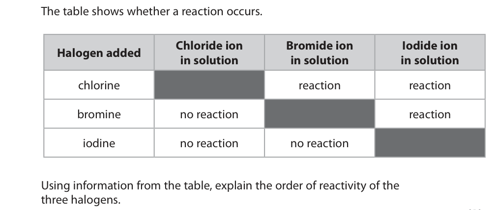
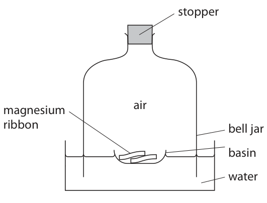
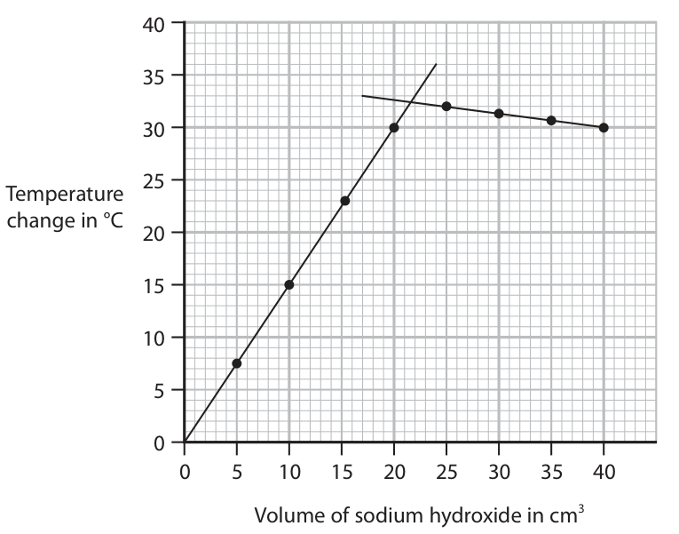
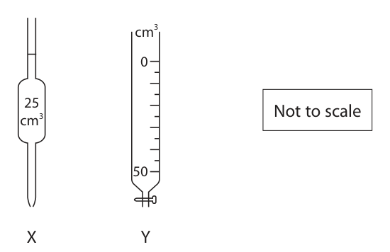
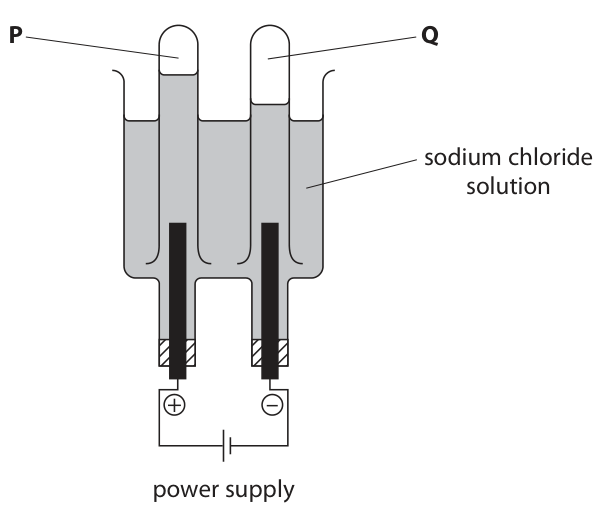

# 4CH1/2C — 2023-11 (official extraction)

> schema `syllabai.official-paper-questions/0.1` · paper_id `pearson-edexcel:international-gcse:chemistry:4ch1:2023-11:4CH1/2C` · qp sha256 `240272b2a0e8b434…` · extracted verbatim, never regenerated (ADR-037)

## Question 1 (6 marks)

This question is about Group 7, the halogens.

### 1(a) [1]

What is the total number of electrons in one fluorine atom?

- **(A)** 7
- **(B)** 9  ✔
- **(C)** 10
- **(D)** 19

**Mark scheme answer**

> B (9)
> A is incorrect as there are not 7 electrons in total
> C is incorrect as there are not 10 electrons in total
> D is incorrect as there are not 19 electrons in total

- **(1)** Answer B: 9

### 1(b) [1]

What is the charge on a bromide ion?

- **(A)** 1–  ✔
- **(B)** 1+
- **(C)** 2–
- **(D)** 2+

**Mark scheme answer**

> A (1−)
> B is incorrect as the charge on a bromide ion is not
> 1+
> C is incorrect as the charge on a bromide ion is not
> 2−
> D is incorrect as the charge on a bromide ion is not
> 2+

- **(1)** Answer A: 1–

### 1(c) [1]

Which of these describes the element iodine at room temperature? 

- **(A)** brown liquid
- **(B)** brown solid
- **(C)** grey solid  ✔
- **(D)** purple gas

**Mark scheme answer**

> C (grey solid)
> A is not correct as iodine is not a brown liquid at
> room temperature
> B is not correct as iodine is not a brown solid at
> room temperature
> D is not correct as iodine is not a purple gas at
> room temperature

- **(1)** Answer C: grey solid

### 1(d) [3]

When a halogen is added to a solution containing halide ions, a displacement reaction may occur. The table shows whether a reaction occurs. Chloride ion Bromide ion Iodide ion Halogen added in solution in solution in solution chlorine reaction reaction bromine no reaction reaction iodine no reaction no reaction Using information from the table, explain the order of reactivity of the three halogens.

**Mark scheme answer**

> An explanation that links the following three points
> M1 chlorine displaces bromine and iodine/chlorine ALLOW chlorine has
> reacts with bromide and iodide (ions) two reactions
> M2 bromine displaces iodine/iodine doesn’t ALLOW iodine has no
> displace chlorine or bromine /bromine reacts with reactions
> iodide (ions) /iodine doesn’t react with chloride or
> bromide (ions)
> M3 most reactive chlorine ACCEPT chlorine is
> bromine most reactive and
> least reactive iodine iodine is least reactive
> ALLOW reactivity
> decreases down the
> group
> Deduct 1 mark only for
> incorrect use of ide or
> ine
> Question
> Answer Notes Marks
> number

- **(1)** chlorine displaces bromine and iodine/chlorine ALLOW chlorine has
- **(1)** bromine displaces iodine/iodine doesn’t ALLOW iodine has no
- **(1)** most reactive chlorine ACCEPT chlorine is

## Question 2 (8 marks)

This question is about gases in the atmosphere. A teacher uses this apparatus to determine the percentage of oxygen in air. stopper magnesium air ribbon bell jar basin water The teacher removes the stopper, ignites the magnesium ribbon and immediately replaces the stopper. The magnesium reacts with oxygen to form magnesium oxide. During the reaction the water level in the bell jar rises. When the flame goes out, some magnesium remains in the basin.

### 2(a)(i) [1]

Give the appearance of the magnesium oxide.

**Mark scheme answer**

> white solid/powder/ash ALLOW (pale/light) grey
> solid/powder /ash
> REJECT white precipitate
> IGNORE bright/white
> flame

- **(1)** white solid/powder/ash ALLOW (pale/light) grey

### 2(a)(ii) [1]

Give a chemical equation for the reaction of magnesium with oxygen.

**Mark scheme answer**

> 2Mg + O2 → 2MgO ALLOW multiples and
> fractions
> IGNORE state symbols even
> if incorrect

- **(1)** 2Mg + O2 → 2MgO ALLOW multiples and

### 2(a)(iii) [2]

Explain why the water in the bell jar rises. 

**Mark scheme answer**

> An explanation that links the following two points ALLOW arguments in terms
> of pressure
> M1 (oxygen is used in the reaction so)
> volume/amount of air/oxygen decreases /pressure
> decreases
> M2 (water level rises) to take the place of the
> oxygen /to equalise the pressure OWTTE

- **(1)** (oxygen is used in the reaction so)
- **(1)** (water level rises) to take the place of the

### 2(b) [3]

The volume of air in the bell jar at the start of the reaction is 2000 cm3. When the reaction ends, the apparatus cools down to room temperature. Calculate the expected volume of gas in the bell jar at room temperature. volume of gas = cm3

**Mark scheme answer**

> M1 percentage of oxygen in air = 21% /percentage ALLOW 20% / 80%
> of air remaining = 79%
> M2 volume of air remaining = 2000 × 79 (cm3) M2 subsumes M1
> 100
> ALLOW ecf if incorrect
> percentage used
> M3 1580 (cm3) use of 80% gives an answer
> of 1600 (cm3)
> correct answer of 1580 or
> 1600 without working
> scores 3
> 420 /400 scores 2

- **(1)** percentage of oxygen in air = 21% /percentage ALLOW 20% / 80%
- **(1)** volume of air remaining = 2000 × 79 (cm3) M2 subsumes M1
- **(1)** 1580 (cm3) use of 80% gives an answer

### 2(c) [1]

State why the gas remaining in the bell jar at the end of the reaction is approximately 99% nitrogen.

**Mark scheme answer**

> The percentages of argon and carbon dioxide are ACCEPT references to
> very small OWTTE approximate percentages
> ALLOW (all the oxygen has
> been removed and) only 1%
> / small amounts of the
> other gases remain
> Question
> Answer Notes Marks
> number

- **(1)** The percentages of argon and carbon dioxide are ACCEPT references to

## Question 3 (8 marks)

This question is about aluminium.

### 3(a) [1]

State why aluminium cannot be extracted by heating aluminium oxide with carbon.

**Mark scheme answer**

> aluminium/it is more reactive than
> carbon/aluminium/it is above carbon in the
> reactivity series ORA

- **(1)** aluminium/it is more reactive than

### 3(b) [4]

Aluminium is a metal with many uses. Aluminium is malleable, a good conductor of heat and electricity, and has a low density compared to most other metals. Explain two uses of aluminium that are related to its properties. 1 2 

**Mark scheme answer**

> An explanation which links two pairs of points In all cases M2 is dep on
> M1
> Pair 1
> M1 drink cans
> M2 malleable/low density ALLOW does not corrode/
> non-toxic/doesn’t react
> with the drink
> Pair 2
> M1 aircraft/aeroplanes/bicycle frames/car
> bodies
> M2 low density ALLOW does not corrode
> Pair 3
> M1 (overhead) power cables ALLOW wires
> M2 (good) conductor of electricity /low density
> /malleable /ductile
> Pair 4
> M1 pans
> M2 (good) conductor of heat ALLOW does not corrode/
> non-toxic /doesn’t react
> with the food
> Pair 5
> M1 (aluminium) foil
> M2 malleable ALLOW does not corrode/
> non-toxic /doesn’t react
> with the food /prevents
> heat loss
> ACCEPT any correct use
> with corresponding
> relevant property
> REJECT any incorrect
> answer for M2

- **(4)** An explanation which links two pairs of points In all cases M2 is dep on

### 3(c) [3]

The diagram represents the structure of pure aluminium, and the structure of an alloy of aluminium. Pure aluminium Alloy of aluminium Use the diagram to explain why the alloy is harder than pure aluminium.

> 🖼 crop required: diagram (qp.pdf p.9)

**Mark scheme answer**

> An explanation that links the following three
> points
> M1 in pure metal layers (of atoms/cations ALLOW sheets/rows for
> /particles) slide over each other (easily) OWTTE layers
> M2 in an alloy the different sized/larger atoms
> /cations/particles disrupt the structure/are
> more randomly arranged
> M3 which prevents layers (of atoms/cations
> /particles) sliding over each other
> REJECT molecules
> /intermolecular forces
> /negative ions /anions
> /ionic /covalent for 1 mark
> only
> Deduct 1 mark if no
> mention of
> layers/sheets/rows
> Question
> Answer Notes Marks
> number

- **(1)** in pure metal layers (of atoms/cations ALLOW sheets/rows for
- **(1)** in an alloy the different sized/larger atoms
- **(1)** which prevents layers (of atoms/cations

## Question 4 (12 marks)

A student uses this method to investigate the reaction between sodium hydroxide solution and dilute hydrochloric acid. • pour 25 cm3 of dilute hydrochloric acid into a glass beaker • measure the temperature of the acid • add 5 cm3 of sodium hydroxide solution and stir the mixture • record the highest temperature reached • continue to add further 5 cm3 portions of sodium hydroxide solution until a total of 40 cm3 has been added • record the temperature after adding each 5 cm3 portion of sodium hydroxide solution

**(c)** The graph shows the student’s results. Temperature change in °C 0 5 10 15 20 25 30 35 40 Volume of sodium hydroxide in cm3

### 4(a) [2]

State two factors that the student must keep constant to make this a valid investigation. 1 2

**Mark scheme answer**

> Any two from
> M1 concentration of sodium hydroxide (solution) IGNORE references to
> concentration of acid
> IGNORE references to
> volume / mass / amount of
> either solution
> M2 rate of / same stirring
> M3 temperature of sodium hydroxide (solution) ALLOW temperature of the
> room /environment

- **(2)** Any two from

### 4(b) [2]

Explain how using a polystyrene cup, instead of a glass beaker, would increase the accuracy of the results. 

**Mark scheme answer**

> An explanation that links any two of the
> following points
> M1 polystyrene/it is a better insulator than glass ALLOW polystyrene/it is an
> OWTTE insulator
> M2 less heat/thermal energy will be lost ALLOW prevents heat loss
> /retains heat
> M3 using a polystyrene cup will lead to a more
> accurate/a higher temperature (change)

- **(2)** An explanation that links any two of the

### 4(c)(i) [1]

Use the graph to determine the maximum temperature change in °C. maximum temperature change = °C

**Mark scheme answer**

> any value between 32.0 and 33.0 inclusive

- **(1)** any value between 32.0 and 33.0 inclusive

### 4(c)(ii) [3]

Explain the shape of the graph. 

**Mark scheme answer**

> An explanation that links the following three
> points
> M1 the first line shows that as more sodium ACCEPT the temperature is
> hydroxide is added the temperature rises (at a directly proportional to the
> steady rate) volume added
> ALLOW there is a positive
> correlation between the
> temperature and the volume
> added
> M2 the point where the lines cross/ the highest
> temperature reached/ the volume of 21-22 cm3
> of sodium hydroxide shows that the sodium
> hydroxide has neutralised the acid/ the acid has
> fully reacted
> M3 the second line shows that (there is no ALLOW the second line
> further reaction and) the cool sodium hydroxide shows that there is no
> solution decreases the temperature OWTTE further reaction as the
> mixture cools down OWTTE

- **(1)** the first line shows that as more sodium ACCEPT the temperature is
- **(1)** the point where the lines cross/ the highest
- **(1)** the second line shows that (there is no ALLOW the second line

### 4(d) [4]

The student repeats the experiment using a polystyrene cup. These are the student’s results. Maximum temperature change 35 °C Volume of hydrochloric acid 25 cm3 Volume of sodium hydroxide solution added for complete reaction 22 cm3 Calculate the heat energy change (Q) in kJ. [for the solution, 1.0 cm3 has a mass of 1.0 g c = 4.2 J / g / °C] Q = kJ

**Mark scheme answer**

> M1 mass of solution = 25 + 22 OR 47 (g) correct answer without
> working scores 4
> M2 Q = mcΔT OR Q = 47 × 4.2 × 35 ALLOW ecf from M1 if
> incorrect mass used e.g. use
> of 1, 22 or 25
> M2 subsumes M1
> M3 6909 (J)
> M4 6.9 (kJ) ALLOW ecf from M3 if
> correct conversion from J to
> kJ
> 147 /3234 /3675 (J) score 2
> 0.147 / 3.234 / 3.675 (kJ)
> score 3
> ACCEPT any number of
> significant figures correctly
> rounded except 1
> Question
> Answer Notes Marks
> number

- **(1)** mass of solution = 25 + 22 OR 47 (g) correct answer without
- **(1)** Q = mcΔT OR Q = 47 × 4.2 × 35 ALLOW ecf from M1 if
- **(1)** 6909 (J)
- **(1)** 6.9 (kJ) ALLOW ecf from M3 if

## Question 5 (11 marks)

This question is about carboxylic acids and esters.

**(a)** Ethanoic acid reacts with magnesium to form two products.

**(b)** Propanoic acid reacts with methanol to form an ester.

**(c)** A polyester can be made by reacting ethanedioic acid with ethanediol. These are the displayed formulae of the two reactants. O O H H H O C C O H H O C C O H H H ethanedioic acid ethanediol

### 5(a)(i) [2]

Complete the equation for this reaction + → (CH3COO)2Mg +

**Mark scheme answer**

> 2CH3COOH + Mg → (CH3COO)2Mg + H2 ALLOW multiples and
> fractions
> M1 2CH3COOH + Mg ALLOW 2C2H4O2
> REJECT 2CH4COO
> M2 H2
> IGNORE state symbols
> even if incorrect

- **(1)** 2CH3COOH + Mg ALLOW 2C2H4O2
- **(1)** H2

### 5(a)(ii) [2]

Give two observations that could be made during this reaction. 1 2

**Mark scheme answer**

> M1 effervescence/fizzing/bubbles IGNORE gas evolved
> M2 magnesium becomes smaller/disappears ALLOW dissolves

- **(1)** effervescence/fizzing/bubbles IGNORE gas evolved
- **(1)** magnesium becomes smaller/disappears ALLOW dissolves

### 5(b)(i) [1]

Give the name of a suitable catalyst for this reaction.

**Mark scheme answer**

> (concentrated) sulfuric acid ALLOW any suitable
> inorganic acid e.g.
> hydrochloric or nitric or
> phosphoric
> IGNORE dilute

- **(1)** (concentrated) sulfuric acid ALLOW any suitable

### 5(b)(ii) [1]

What is the structural formula of the ester that forms? 

- **(A)** HCOOCH2CH2CH3
- **(B)** CH3COOCH2CH2CH3
- **(C)** CH3CH2COOCH3  ✔
- **(D)** CH3CH2CH2COOCH3

**Mark scheme answer**

> C (CH3CH2COOCH3)
> A is incorrect as it is propyl methanoate
> B is incorrect as it is propyl ethanoate
> D is incorrect as it is methyl butanoate

- **(1)** Answer C: CH3CH2COOCH3

### 5(c)(i) [1]

Give the name for this type of polymerisation.

**Mark scheme answer**

> condensation (polymerisation)

- **(1)** condensation (polymerisation)

### 5(c)(ii) [1]

Give the name of the other product of this reaction.

**Mark scheme answer**

> water ALLOW H2O

- **(1)** water ALLOW H2O

### 5(c)(iii) [2]

Draw the displayed formula for the repeat unit of the polyester that forms.

**Mark scheme answer**

> OO H H
> II II I I
> −C−C−O−C−C−O−
> I I
> H H
> M1 correct displayed ester functional group
> M2 rest of structure correct ALLOW structure without
> extension bonds
> O can be on LHS instead
> of on RHS
> IGNORE brackets and n

- **(1)** correct displayed ester functional group
- **(1)** rest of structure correct ALLOW structure without

### 5(d) [1]

State what is meant by the term biopolyester.

**Mark scheme answer**

> (a polyester that) is biodegradable ACCEPT can be degraded
> by bacteria
> ALLOW can be
> decomposed
> Question
> Answer Notes Marks
> number

- **(1)** (a polyester that) is biodegradable ACCEPT can be degraded

## Question 6 (11 marks)
**(c)** A student does a titration using sodium carbonate solution and dilute nitric acid. This is the equation for the reaction. Na2CO3 + 2HNO3 → 2NaNO3 + CO2 + H2O The table shows the concentrations of the two solutions and the volume of sodium carbonate used in the titration. Concentration of nitric acid in mol / dm3 0.350 Concentration of sodium carbonate solution in mol / dm3 0.220 Volume of sodium carbonate solution in cm3 25.0 Use the equation and the data in the table to answer these questions.

### 6(a) [2]

The diagram shows two pieces of apparatus used in a titration. cm3 cm3 Not to scale X Y Give the names of these pieces of apparatus. X Y

**Mark scheme answer**

> M1 (X) pipette
> M2 (Y) burette

- **(1)** (X) pipette
- **(1)** (Y) burette

### 6(b) [1]

Give the name of a suitable indicator that can be used in an acid-alkali titration. 

**Mark scheme answer**

> methyl orange/phenolphthalein/litmus (solution) REJECT universal
> indicator
> REJECT litmus paper
> IGNORE pp indicator
> ACCEPT other alternative
> appropriate indicators

- **(1)** methyl orange/phenolphthalein/litmus (solution) REJECT universal

### 6(c)(i) [3]

Calculate the volume of dilute nitric acid that the student would need to neutralise the sodium carbonate solution. volume of nitric acid = cm3

**Mark scheme answer**

> M1 (moles of Na2CO3 =) 0.220 × 25.0 OR 0.0055(0) Correct answer without
> 1000 working scores 3
> M2 (moles of HNO3 =) 0.0055(0) × 2 OR 0.011(0) If they use mega moles
> can still score 3 for 31.4
> ALLOW ecf from M1
> M3 (volume of HNO3 = 0.011(0) × 1000 =) 31.4 (cm3) ALLOW ecf on incorrect
> 0.350 moles in M2
> ACCEPT any number of
> sig figs except 1
> ACCEPT alternative
> methods
> 7.86 /7.9 /7.857 scores 2
> 15.7 /16 scores 2

- **(1)** (moles of Na2CO3 =) 0.220 × 25.0 OR 0.0055(0) Correct answer without
- **(1)** (moles of HNO3 =) 0.0055(0) × 2 OR 0.011(0) If they use mega moles
- **(1)** (volume of HNO3 = 0.011(0) × 1000 =) 31.4 (cm3) ALLOW ecf on incorrect

### 6(c)(ii) [2]

Calculate the volume, in cm3, of carbon dioxide gas at rtp that would be produced from the 25.0 cm3 of the sodium carbonate solution. [at rtp, molar volume = 24 000 cm3] volume of carbon dioxide = cm3 

**Mark scheme answer**

> M1 (moles of Na2CO3 = 0.220 × 25.0 = 0.0055(0) so) Correct answer without
> 1000 working scores 2
> moles of CO2 = 0.0055(0)
> M2 (volume of CO2 = 0.0055(0) × 24 000 =) 132 (cm3) ALLOW ecf on incorrect
> number of moles from (i)
> If they use mega moles in
> (i) only 1 mark for 132000

- **(1)** (moles of Na2CO3 = 0.220 × 25.0 = 0.0055(0) so) Correct answer without
- **(1)** (volume of CO2 = 0.0055(0) × 24 000 =) 132 (cm3) ALLOW ecf on incorrect

### 6(d) [3]

Describe a test to show that sodium carbonate solution contains carbonate ions.

**Mark scheme answer**

> A description that refers to the following three
> points
> M1 add (dilute) hydrochloric acid (to the sodium ALLOW any suitable
> carbonate) named acid
> REJECT any other
> incorrect reagent for M1
> and M2
> M2 bubble/pass the gas through limewater OR test M2 dep on M1 or mention
> the gas with limewater of adding acid
> M3 (limewater) turns milky/cloudy ALLOW white precipitate
> M3 dep on limewater
> Question
> Answer Notes Marks
> number

- **(1)** add (dilute) hydrochloric acid (to the sodium ALLOW any suitable
- **(1)** bubble/pass the gas through limewater OR test M2 dep on M1 or mention
- **(1)** (limewater) turns milky/cloudy ALLOW white precipitate

## Question 7 (14 marks)
**(b)** A solution of sodium chloride can be electrolysed using this apparatus. P Q sodium chloride solution + – power supply 

**(c)** The gas that collects at Q is hydrogen.

**(d)** Hydrogen reacts with oxygen to form water. The equation shows the covalent bonds in the molecules. 2H H + O O → 2H O H The table gives the bond energies. Bond H H O O O H Bond energy in kJ / mol 436 498 463

### 7(a) [2]

Sodium chloride is an ionic compound. Explain why sodium chloride conducts electricity when it is molten or in solution, but not when it is solid.

**Mark scheme answer**

> An explanation that links the two points
> M1 in solid sodium chloride ions are in a fixed
> position/in a lattice/cannot move
> M2 when molten or in solution ions are free to
> move/flow
> No marks if reference to
> electrons moving

- **(1)** in solid sodium chloride ions are in a fixed
- **(1)** when molten or in solution ions are free to

### 7(b)(i) [1]

If the solution is dilute, a significant amount of oxygen collects at P. Complete the ionic half-equation for this reaction H2O → H+ + O2 + e–

**Mark scheme answer**

> 2H2O → 4H+ + (1)O2 + 4e− ALLOW multiples and
> fractions
> IGNORE state symbols
> even if incorrect

- **(1)** 2H2O → 4H+ + (1)O2 + 4e− ALLOW multiples and

### 7(b)(ii) [1]

If the solution is concentrated, chlorine is the main product that collects at P. This is the ionic half-equation for the reaction. 2Cl– → Cl2 + 2e– State why this is an oxidation reaction.

**Mark scheme answer**

> chloride (ions)/(2)Cl−/it lose electrons ALLOW electrons are
> lost
> REJECT chlorine loses
> electrons

- **(1)** chloride (ions)/(2)Cl−/it lose electrons ALLOW electrons are

### 7(c)(i) [1]

Give a test for hydrogen.

**Mark scheme answer**

> (squeaky) pop with lighted splint REJECT glowing splint

- **(1)** (squeaky) pop with lighted splint REJECT glowing splint

### 7(c)(ii) [3]

Explain how hydrogen gas forms at the negative electrode. 

**Mark scheme answer**

> An explanation that links any three of the following four
> points
> M1 solution/water contains hydrogen ions/H+
> M2 hydrogen ions/H+ are attracted to the negative IGNORE sodium ions
> electrode/cathode
> M3 hydrogen ions/H+ gain electrons Can score M3 and M4 for
> fully correct half
> M4 and (combine in pairs to) form hydrogen equation.
> molecules/H2 i.e. 2H+ + 2e → H2

- **(3)** An explanation that links any three of the following four

### 7(d)(i) [3]

Use the equation and the values in the table to calculate the enthalpy change, ΔH , for the reaction. Include a sign in your answer. ΔH = kJ

> 🖼 crop required: table (qp.pdf p.22)

**Mark scheme answer**

> M1  bond energies on LHS = 2 × 436 + 498 OR 1370 (kJ) Correct answer without
> working scores 3
> M2  bond energies on RHS = 4 × 463 OR 1852 (kJ)
> M3 (1370 − 1852) = −482 (kJ) ALLOW ecf on M1 and
> M2
> ALLOW −241 (kJ) (for 1
> mole of water) for all 3
> marks
> sign required to score
> M3
> Question
> Answer Notes Marks
> number

- **(1)**  bond energies on LHS = 2 × 436 + 498 OR 1370 (kJ) Correct answer without
- **(1)**  bond energies on RHS = 4 × 463 OR 1852 (kJ)
- **(1)** (1370 − 1852) = −482 (kJ) ALLOW ecf on M1 and

### 7(d)(ii) [3]

Complete the diagram to show the energy levels of the reactants and products, and the enthalpy change, ΔH . Energy

**Mark scheme answer**

> M1 two horizontal lines in correct positions with ALLOW ecf on incorrect
> products line to the right of reactants line positive value for M3
> M2 horizontal lines labelled correctly with formulae
> of reactants and products
> M3 vertical line in correct position and labelled ΔH ACCEPT double headed
> arrow or arrow pointing
> from reactants level to
> products level
> REJECT arrow pointing
> from products level to
> reactants level
> IGNORE activation energy
> hump
> Pearson Education Limited. Registered company number 872828
> with its registered office at 80 Strand, London, WC2R 0RL, United Kingdom

- **(1)** two horizontal lines in correct positions with ALLOW ecf on incorrect
- **(1)** horizontal lines labelled correctly with formulae
- **(1)** vertical line in correct position and labelled ΔH ACCEPT double headed

