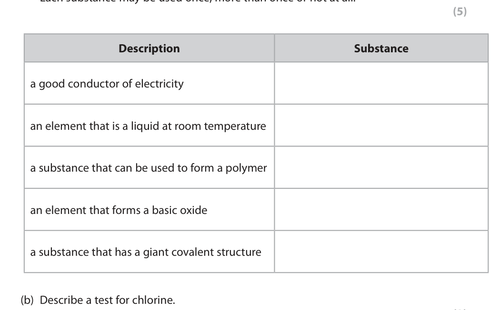
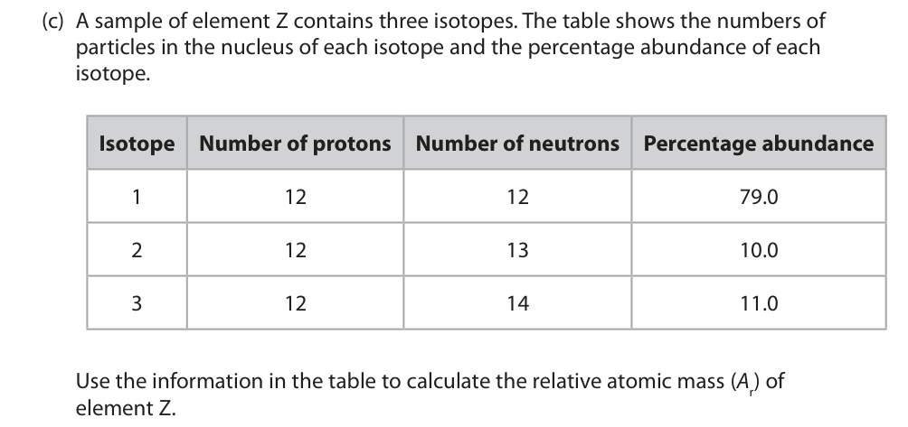
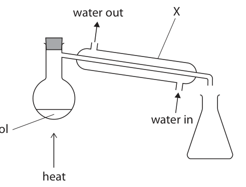
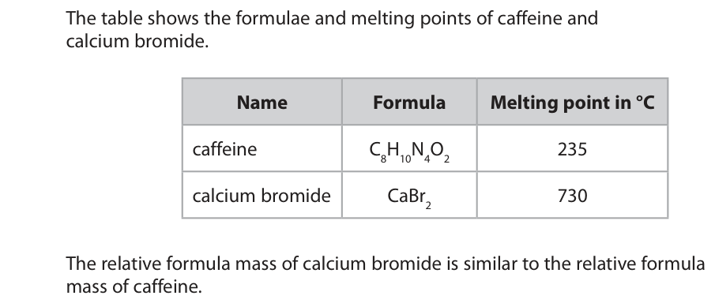
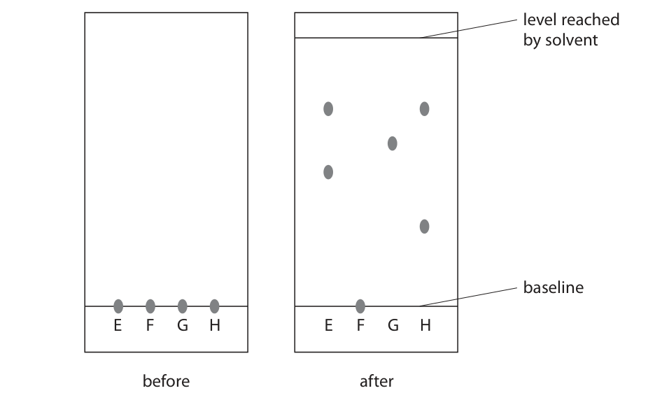
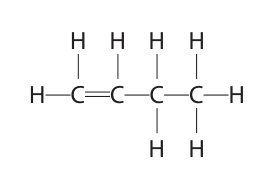
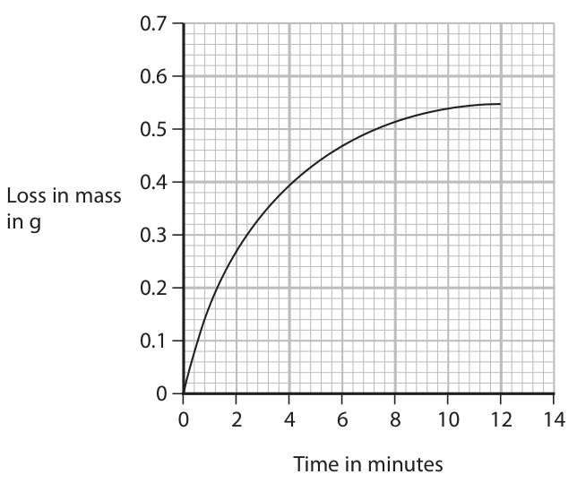
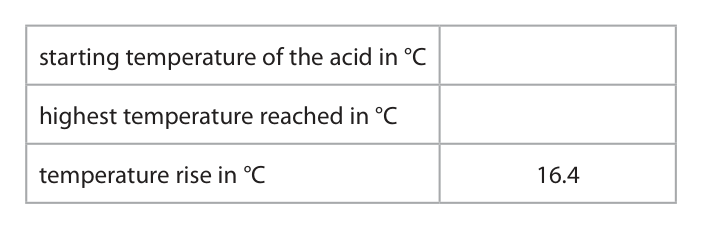

# 4CH1/1C — 2024-06 (official extraction)

> schema `syllabai.official-paper-questions/0.2` · paper_id `pearson-edexcel:international-gcse:chemistry:4ch1:2024-06:4CH1/1C` · qp sha256 `1aec3bb887bbfaa9…` · extraction is the disclosed baseline (ADR-039)

## Question 1 (7 marks)

The box gives the names of some substances. bromine chlorine diamond ethene iodine lithium methane water

### 1(a) [5]

Complete the table by choosing a substance from the box that matches each description. Each substance may be used once, more than once or not at all. Description Substance a good conductor of electricity an element that is a liquid at room temperature a substance that can be used to form a polymer an element that forms a basic oxide a substance that has a giant covalent structure

**Mark scheme answer**

> 5
> Description Substance
> a good conductor of ALLOW Li
> electricity lithium
> an element that is a liquid bromine
> ALLOW Br/Br2
> at room temperature
> REJECT Br−
> a substance that can be ethene
> used to form a polymer ALLOW C2H4
> an element that forms a lithium
> basic oxide ALLOW Li
> a substance that has a diamond
> giant covalent structure

- **(5)** 5

### 1(b) [2]

Describe a test for chlorine.

**Mark scheme answer**

> A description that refers to the following two points ALLOW universal
> indicator paper
> M1 (use damp blue) litmus paper
> ACCEPT blue litmus
> paper turns red and
> then bleached
> M2 (litmus paper) bleached/turns white
> IGNORE gas/solution
> Ignore gas/solution
> ALLOW
> M1 bromide solution
> M2 turns brown
> REJECT iodide solution
> M2 dep on M1
> Red litmus paper turns
> blue then
> bleaches/turns white
> scores M1 only

- **(1)** (use damp blue) litmus paper
- **(1)** (litmus paper) bleached/turns white

## Question 2 (9 marks)

This question is about the reactivities of metals.

**(a)** The table shows the reactions of four metals, P, Q, R and S, with water and with dilute hydrochloric acid. The letters are not the symbols of the elements. Metal Reaction with water Reaction with dilute hydrochloric acid P no reaction no reaction Q very fast reaction (not done) R no reaction slow reaction S slow reaction fast reaction

**(b)** The diagram shows the apparatus used to demonstrate the reaction between aluminium and iron(III) oxide. magnesium fuse mixture of aluminium powder and iron(III) oxide powder When the magnesium fuse is lit, a very exothermic reaction occurs. This is the equation for the reaction. Fe2O3 + 2Al → 2Fe + Al2O3

### 2(a)(i) [1]

Deduce the order of reactivity of the metals. most reactive least reactive

**Mark scheme answer**

> most reactive Q
> S
> R
> least reactive P

- **(1)** most reactive Q

### 2(a)(ii) [1]

Give the letter of the metal that could be zinc.

**Mark scheme answer**

> R

- **(1)** R

### 2(a)(iii) [1]

Give a word equation for the reaction between aluminium and hydrochloric acid.

**Mark scheme answer**

> aluminium + hydrochloric acid → aluminium chloride + hydrogen ALLOW
> 2Al + 6HCl → 2AlCl3 + 3H2
> or multiples or fractions

- **(1)** aluminium + hydrochloric acid → aluminium chloride + hydrogen ALLOW

### 2(a)(iv) [1]

Give the name of a metal that could be P.

**Mark scheme answer**

> copper/silver/gold ALLOW platinum or any
> other metal that does
> not react with
> hydrochloric acid
> ALLOW correct symbol

- **(1)** copper/silver/gold ALLOW platinum or any

### 2(a)(v) [1]

Give a reason why the reaction of Q with dilute hydrochloric acid is not done.

**Mark scheme answer**

> explosive/dangerous/violent/unsafe IGNORE volatile/vigorous

- **(1)** explosive/dangerous/violent/unsafe IGNORE volatile/vigorous

### 2(b)(i) [1]

State what is meant by the term exothermic.

**Mark scheme answer**

> heat/thermal energy is given out/released (to the IGNORE energy on its
> surroundings) own

- **(1)** heat/thermal energy is given out/released (to the IGNORE energy on its

### 2(b)(ii) [1]

State why aluminium displaces iron.

**Mark scheme answer**

> aluminium is more reactive/ higher in the reactivity ACCEPT aluminium is a
> series (than iron) ORA better/stronger reducing
> agent
> ALLOW Al

- **(1)** aluminium is more reactive/ higher in the reactivity ACCEPT aluminium is a

### 2(b)(iii) [2]

Explain why this reaction is a redox reaction.

**Mark scheme answer**

> An explanation that links the following two points
> M1 aluminium/Al gains oxygen and iron(III) oxide ACCEPT aluminium/Al
> /Fe2O3 loses oxygen loses electrons and iron
> ions/Fe3+ gain electrons
> M2 (so) aluminium/Al is oxidised and iron(III) oxide for M1
> /Fe2O3 is reduced
> ACCEPT correct changes
> OR in oxidation numbers
> M1 Aluminium/Al gains oxygen so is oxidised ACCEPT aluminium/Al
> loses electrons so is
> M2 Iron(III) oxide/Fe2O3 loses oxygen so is reduced oxidised scores for M1
> and iron ions/Fe3+ gain
> electrons so is reduced
> for M2
> REJECT iron loses
> oxygen for M2

- **(2)** An explanation that links the following two points

## Question 3 (10 marks)

The diagram represents an atom of element Z. Z is not the symbol of the element.

### 3(a)(i) [1]

Give the number of the group to which element Z belongs.

**Mark scheme answer**

> 2 ALLOW two

- **(1)** 2 ALLOW two

### 3(a)(ii) [1]

Give the number of the period to which element Z belongs.

**Mark scheme answer**

> 3 ALLOW three

- **(1)** 3 ALLOW three

### 3(a)(iii) [1]

Give the formula of the compound that forms when Z reacts with fluorine.

**Mark scheme answer**

> ZF2 ALLOW MgF2
> ALLOW F2Mg
> ALLOW F2Z
> REJECT MgFl2
> Penalise incorrect case
> or superscripts

- **(1)** ZF2 ALLOW MgF2

### 3(b) [2]

One mole of Z contains 6.0 × 10²³ atoms. Calculate the number of electrons in one mole of atoms of element Z. Give your answer in standard form. number of electrons =

**Mark scheme answer**

> M1 12 × 6.0 × 10²³
> ALLOW ecf if incorrect
> number of electrons x
> M2 7.2 × 10²⁴
> 6.0 x 1023
> ALLOW ecf if /12 ONLY
> rather than x12 giving
> 5(.0) x1022

- **(1)** 12 × 6.0 × 10²³
- **(1)** 7.2 × 10²⁴

### 3(c) [4]

A sample of element Z contains three isotopes. The table shows the numbers of particles in the nucleus of each isotope and the percentage abundance of each isotope. Isotope Number of protons Number of neutrons Percentage abundance 1 12 12 79.0 2 12 13 10.0 3 12 14 11.0 Use the information in the table to calculate the relative atomic mass (Ar) of element Z. Give your answer to one decimal place. Ar =

**Mark scheme answer**

> M1 (isotopic masses) 24, 25 and 26
> M2 79.0 × 24 + 10.0 × 25 + 11.0 × 26 OR 2432 M2 subsumes M1
> ALLOW ecf if incorrect
> mass numbers used
> 12.3 scores 3 with
> working
> M3 79.0 × 24 + 10.0 × 25 + 11.0 × 26 OR 2432 OR 24.32
> 100 100 24.3 without working
> scores 4
> M4 24.3
> 24.32 without working
> scores 3
> M4 scores only if
> numbers from the table
> are used.
> ALLOW Mg

- **(1)** (isotopic masses) 24, 25 and 26
- **(1)** 79.0 × 24 + 10.0 × 25 + 11.0 × 26 OR 2432 M2 subsumes M1
- **(1)** 79.0 × 24 + 10.0 × 25 + 11.0 × 26 OR 2432 OR 24.32
- **(1)** 24.3

### 3(d) [1]

Deduce the name of element Z.

**Mark scheme answer**

> magnesium

- **(1)** magnesium

## Question 4 (12 marks)

Caffeine is a stimulant found in coffee, tea and some soft drinks.

**(a)** The molecular formula of caffeine is C8H10N4O2

**(b)** Ethanol can be obtained from a solution of caffeine in ethanol using this apparatus. water out X water in caffeine in ethanol heat

### 4(a)(i) [1]

Determine the number of atoms in one molecule of caffeine.

**Mark scheme answer**

> 24

- **(1)** 24

### 4(a)(ii) [2]

Calculate the relative formula mass (Mr ) of caffeine. Mr =

**Mark scheme answer**

> correct answer of 194
> scores 2
> M1 12 × 8 + 1 x 10 + 14 × 4 + 16 × 2
> No ECF
> M2 194

- **(1)** 12 × 8 + 1 x 10 + 14 × 4 + 16 × 2
- **(1)** 194

### 4(a)(iii) [1]

Give the empirical formula for caffeine.

**Mark scheme answer**

> C4H5N2O ALLOW atoms in any
> order

- **(1)** C4H5N2O ALLOW atoms in any

### 4(b)(i) [1]

Give the name of the method of separation shown in the diagram.

**Mark scheme answer**

> (simple) distillation REJECT fractional
> distillation

- **(1)** (simple) distillation REJECT fractional

### 4(b)(ii) [2]

Describe what happens to the ethanol vapour in apparatus X.

**Mark scheme answer**

> A description that refers to two of the following
> points
> M1 (the condenser/X) cools the (ethanol) vapour
> M2 so it condenses OR forms liquid (ethanol)

- **(1)** (the condenser/X) cools the (ethanol) vapour
- **(1)** so it condenses OR forms liquid (ethanol)

### 4(c) [5]

Calcium bromide is an ionic compound. The table shows the formulae and melting points of caffeine and calcium bromide. Name Formula Melting point in °C caffeine C8H10N4O2 235 calcium bromide CaBr2 730 The relative formula mass of calcium bromide is similar to the relative formula mass of caffeine. Explain why calcium bromide has a much higher melting point than caffeine.

**Mark scheme answer**

> M1 calcium bromide is a giant (ionic)
> lattice/structure
> M2 with many/strong electrostatic attractions ALLOW many/strong
> between (oppositely charged) ions ionic bonds
> No M2 if covalent bonds
> or IMF given here
> M3 caffeine has a simple molecular structure ALLOW simple covalent
> structure
> M4 caffeine has weak intermolecular forces
> /weak forces between molecules REJECT weak forces
> between bonds
> M5 more energy is needed to break the No M5 if reference to
> electrostatic attractions (in calcium bromide) breaking covalent bonds
> than to overcome the intermolecular forces (in
> caffeine) OWTTE No M5 if reference to
> incorrect bonds

- **(1)** calcium bromide is a giant (ionic)
- **(1)** with many/strong electrostatic attractions ALLOW many/strong
- **(1)** caffeine has a simple molecular structure ALLOW simple covalent
- **(1)** caffeine has weak intermolecular forces
- **(1)** more energy is needed to break the No M5 if reference to

## Question 5 (9 marks)

A student uses paper chromatography in an experiment to separate the dyes in four different felt tip pens, E, F, G and H. The diagram shows the appearance of the paper before and after the experiment. level reached by solvent baseline E F G H E F G H before after

### 5(a)(i) [2]

The chromatography paper is placed in a solvent. Explain why the spots on the baseline are placed above the level of the solvent.

**Mark scheme answer**

> An explanation that links the following two points ALLOW dye in place of
> spot throughout question 5
> M1 They will not dissolve/diffuse into the solvent (at ALLOW water
> the bottom of beaker) OWTTE
> M2 so that the dyes can travel up the paper

- **(1)** They will not dissolve/diffuse into the solvent (at ALLOW water
- **(1)** so that the dyes can travel up the paper

### 5(a)(ii) [2]

Explain which two felt tip pens contain the same dye.

**Mark scheme answer**

> An explanation that links the following two points
> M1 E and H M2 dep on M1
> M2 as the dye is/both have a spot at the same
> level/travelled the same distance/same Rf value

- **(1)** E and H M2 dep on M1
- **(1)** as the dye is/both have a spot at the same

### 5(a)(iii) [2]

The student thought that both F and G contained only one dye. Explain why the student can only be certain about one of these dyes.

**Mark scheme answer**

> An explanation that links the following two points
> M1 The student can only be certain about G containing
> one dye as only one spot
> M2 As F is insoluble/not moved (so you cannot tell how
> many dyes it has) OWTTE

- **(1)** The student can only be certain about G containing
- **(1)** As F is insoluble/not moved (so you cannot tell how

### 5(b) [3]

Calculate the Rf value for the dye in G. Show your working. Rf value =

**Mark scheme answer**

> M1 distance from baseline to solvent level in mm = 65
> M2 distance from baseline to spot/dye in mm = 39 ACCEPT any value between
> 38 and 41 inclusive
> M3 (Rf value = 39 ÷ 65 =) 0.6 ACCEPT any value between
> 0.57 and 0.64
> M3 not awarded if value is
> incorrectly rounded

- **(1)** distance from baseline to solvent level in mm = 65
- **(1)** distance from baseline to spot/dye in mm = 39 ACCEPT any value between
- **(1)** (Rf value = 39 ÷ 65 =) 0.6 ACCEPT any value between

## Question 6 (13 marks)

This question is about some Group 1 elements and their compounds.

**(a)** A teacher adds a small piece of sodium to a trough of water.

**(b)** A student does a flame test to see if a white solid contains lithium ions. They clean a platinum wire before using it for the flame test.

**(c)** Potassium aluminium sulfate can be used in baking. Anhydrous potassium aluminium sulfate has the formula KAl(SO4)2

### 6(a)(i) [2]

Give two observations that are made when sodium reacts with water. 1 2

**Mark scheme answer**

> Any 2 from
> M1 effervescence/bubbles/fizzing
> M2 moves moves on surface scores
> M2 and M3
> M3 floats
> M4 disappears/ gets smaller ALLOW dissolves
> M5 melts/forms a ball/forms a sphere IGNORE heat produced
> M6 white trail IGNORE flame

- **(2)** Any 2 from

### 6(a)(ii) [2]

After the reaction has stopped, the teacher adds a few drops of phenolphthalein to the solution in the trough. Explain the colour of the phenolphthalein after it is added to the solution.

**Mark scheme answer**

> An explanation that links the following two points Mark independently
> M1 (the phenolphthalein) turns pink ALLOW an alkaline solution
> /an alkali is produced
> REJECT red or purple
> M2 (because) OH− ions/hydroxide ions are present IGNORE metal oxide forms

- **(1)** (the phenolphthalein) turns pink ALLOW an alkaline solution
- **(1)** (because) OH− ions/hydroxide ions are present IGNORE metal oxide forms

### 6(b)(i) [2]

Explain why the student needs to clean the platinum wire.

**Mark scheme answer**

> An explanation that links the following two points
> M1 (to remove) any other ions/chemicals/
> impurities/substances/elements (that may be on
> the wire)
> M2 (so that) they do not interfere with/mask the
> colour of the flame/change the flame colour

- **(1)** (to remove) any other ions/chemicals/
- **(1)** (so that) they do not interfere with/mask the

### 6(b)(ii) [1]

What is the colour of the flame if the solid contains lithium ions?

- **(A)** lilac
- **(B)** orange
- **(C)** red  ✔
- **(D)** yellow

**Mark scheme answer**

> C (red)
> A is incorrect as lithium ions do not give a lilac
> flame
> B is incorrect as lithium ions do not give an orange
> flame
> D is incorrect as lithium ions do not give a yellow
> flame

- **(1)** Answer C: red

### 6(c)(i) [2]

Give the formula of each ion in potassium aluminium sulfate. potassium ion aluminium ion sulfate ion

**Mark scheme answer**

> M1 potassium ion K+
> M2 aluminium ion Al3+ ALLOW Al+3
> M3 sulfate ion SO42- ALLOW SO4-2
> All three correct 2 marks
> Any two correct 1 mark

- **(2)** M1 potassium ion K+

### 6(c)(ii) [4]

Potassium aluminium sulfate is normally found as a hydrated salt, with the formula KAl(SO4)2.xH2O When 23.7 g of the hydrated salt is heated to remove all the water, 12.9 g of the anhydrous salt is formed. Calculate the value of x. [for KAl(SO4)2 , Mr = 258 for H2O , Mr = 18] x =

**Mark scheme answer**

> 4
> correct answer of 12
> M1 (mass of water =) 23.7 − 12.9 OR 10.8 without working scores 4
> M2 (moles of KAl(SO4)2 =) 12.9 ÷ 258 OR 0.05(00) ALLOW ecf on incorrect
> mass of water
> M3 (moles of water =) 10.8 ÷ 18 OR 0.6(00)
> answer to M4 must be a
> M4 (x = 0.6 ÷ 0.05 =) 12 whole number
> ACCEPT alternative
> methods

- **(1)** (mass of water =) 23.7 − 12.9 OR 10.8 without working scores 4
- **(1)** (moles of KAl(SO4)2 =) 12.9 ÷ 258 OR 0.05(00) ALLOW ecf on incorrect
- **(1)** (moles of water =) 10.8 ÷ 18 OR 0.6(00)
- **(1)** (x = 0.6 ÷ 0.05 =) 12 whole number

## Question 7 (13 marks)

This question is about nitrogen and its compounds.

**(c)** Nitrogen dioxide produced in car engines reacts with water vapour and oxygen in the atmosphere to form nitric acid.

**(d)** Ammonium carbonate contains nitrogen.

### 7(a) [1]

What is the approximate percentage by volume of nitrogen in the atmosphere?

- **(A)** 1%
- **(B)** 20%
- **(C)** 70%
- **(D)** 80%  ✔

**Mark scheme answer**

> D (80 %)
> A is incorrect as there is not approximately 1 % of
> nitrogen in the atmosphere
> B is incorrect as there is not approximately 20 % of
> nitrogen in the atmosphere
> C is incorrect as there is not approximately 70 % of
> nitrogen in the atmosphere

- **(1)** Answer D: 80%

### 7(b) [2]

Complete the dot-and-cross diagram for a molecule of nitrogen. Show outer electrons only. N N

**Mark scheme answer**

> M1 3 pairs of electrons between the two nitrogen ALLOW any combination
> atoms of dots and crosses
> M2 rest of molecule fully correct M2 dep on M1

- **(1)** 3 pairs of electrons between the two nitrogen ALLOW any combination
- **(1)** rest of molecule fully correct M2 dep on M1

### 7(c)(i) [2]

Give a chemical equation for this reaction.

**Mark scheme answer**

> 4NO2 + 2H2O + O2 → 4HNO3 ALLOW multiples and
> fractions
> M1 all formulae correct
> IGNORE state symbols
> M2 balancing of correct formulae even if incorrect
> M2 dep on M1

- **(1)** all formulae correct
- **(1)** balancing of correct formulae even if incorrect

### 7(c)(ii) [1]

Nitric acid forms acid rain. State one environmental effect of acid rain.

**Mark scheme answer**

> any one environmental effect of acid rain ACCEPT any other
> environmental effect
> e.g. acidifies lakes /kills fish /deforestation /damages
> plants /corrodes marble statues /corrodes buildings REJECT ozone layer
> IGNORE climate change

- **(1)** any one environmental effect of acid rain ACCEPT any other

### 7(d)(i) [1]

What is the formula of ammonium carbonate?

- **(A)** NH₃CO₃
- **(B)** (NH₃)₂CO₃
- **(C)** NH₄CO₃
- **(D)** (NH₄)₂CO₃  ✔

**Mark scheme answer**

> D (NH4)2CO3
> A is incorrect as NH3CO3 is not the formula of
> ammonium carbonate
> B is incorrect as (NH3)2CO3 is not the formula of
> ammonium carbonate
> C is incorrect as NH4CO3 is not the formula of
> ammonium carbonate

- **(1)** Answer D: (NH4)2CO3

### 7(d)(ii) [6]

A technician finds an unlabelled bottle on a shelf that could be ammonium carbonate solution. Describe tests that the technician should do to confirm that the solution contains ammonium ions and carbonate ions.

**Mark scheme answer**

> A description that refers to the following six points
> Test for ammonium ions ACCEPT universal
> indicator paper which
> turns blue/purple for M2
> M1 add sodium hydroxide solution (and heat) and M3
> M2 test the gas/ammonia with (damp) red litmus M2 is dependent on M1
> paper OR can be awarded for
> heating the solution and
> producing a gas to test
> M3 (red litmus) turns blue M3 can be awarded
> independently if
> ammonia gas is correctly
> tested with correct
> colour change
> No M2 and M3 if litmus
> paper added directly to
> the solution
> Test for carbonate ions
> M4 add (hydrochloric) acid ONLY ACCEPT other acids
> M5 test the gas/carbon dioxide with limewater M5 dependent on gaining
> M4 by adding acid ONLY
> to the solution
> M6 (limewater) turns cloudy/milky/white precipitate M6 can be awarded
> independently if a
> correct limewater test
> on carbon dioxide gas is
> carried out
> No M5 and M6 if
> limewater added directly
> to the solution.

- **(1)** add sodium hydroxide solution (and heat) and M3
- **(1)** test the gas/ammonia with (damp) red litmus M2 is dependent on M1
- **(1)** (red litmus) turns blue M3 can be awarded
- **(1)** add (hydrochloric) acid ONLY ACCEPT other acids
- **(1)** test the gas/carbon dioxide with limewater M5 dependent on gaining
- **(1)** (limewater) turns cloudy/milky/white precipitate M6 can be awarded

## Question 8 (15 marks)

This question is about hydrocarbons.

**(a)** The molecular formula C4H8 represents all the isomers of an alkene.

**(c)** The alkene C3H6 can be polymerised to form the polymer poly(propene).

**(e)** In a petrol engine, incomplete combustion occurs because there is a limited supply of oxygen.

### 8(a)(i) [2]

Explain what is meant by the term isomers.

**Mark scheme answer**

> An explanation that links the following two points
> M1 (compounds with) the same molecular formula ALLOW same number of
> carbons and
> hydrogens/atoms of
> each element
> REJECT elements with
> the same molecular
> formula
> REJECT chemical
> formula for M1
> M2 but different structural/displayed formulae ALLOW different
> structures/arrangements
> of atoms
> M2 independent of M1

- **(1)** (compounds with) the same molecular formula ALLOW same number of
- **(1)** but different structural/displayed formulae ALLOW different

### 8(a)(ii) [2]

The displayed formula of one of the isomers of the alkene is shown. Draw displayed formulae for two other alkene isomers with the molecular formula C4H8 alkene isomer 1 alkene isomer 2

**Mark scheme answer**

> M1
> Must show all bonds
> ALLOW cis and trans
> isomers for both marks
> M2
> REJECT cycloalkanes

- **(2)** M1

### 8(b) [1]

But-1-ene reacts with bromine to form a compound with molecular formula C4H8Br2 What is the name given to this type of reaction?

- **(A)** addition  ✔
- **(B)** combustion
- **(C)** decomposition
- **(D)** substitution

**Mark scheme answer**

> A (addition)
> B is incorrect as this is not a combustion reaction
> C is incorrect as this is not a decomposition reaction
> D is incorrect as this is not a substitution reaction

- **(1)** Answer A: addition

### 8(c)(i) [1]

Draw the repeat unit of poly(propene).

**Mark scheme answer**

> H CH3
> I I IGNORE brackets and n
> C−C
> I I
> H H

- **(1)** H CH3

### 8(c)(ii) [2]

These are two methods for disposing of polymers such as poly(propene). method 1 burying them in landfill sites method 2 burning them to release heat energy State one environmental problem linked to each of these methods of disposal. method 1 method 2

**Mark scheme answer**

> M1 they are inert/unreactive/do not
> biodegrade/decomposes (very) slowly/running out
> space
> IGNORE global warming
> M2 they produce toxic fumes/greenhouse gases
> (when burned)

- **(1)** they are inert/unreactive/do not
- **(1)** they produce toxic fumes/greenhouse gases

### 8(d) [3]

Complete combustion of one mole of an alkane produces 396 g of carbon dioxide and 180 g of water. This is the equation for the reaction. alkane + xO2 → yCO2 + zH2O Calculate the values of x, y and z. [for CO2 , Mr = 44 for H2O , Mr = 18] x = y = z =

**Mark scheme answer**

> M1 y (= 396 ÷ 44) = 9
> M2 z (= 180 ÷ 18) = 10
> ALLOW ecf for M3 on
> M3 x = 14 incorrect values for M1
> and/or M2

- **(1)** y (= 396 ÷ 44) = 9
- **(1)** z (= 180 ÷ 18) = 10
- **(1)** x = 14 incorrect values for M1

### 8(e)(i) [2]

Petrol contains octane, C8H18 Complete the equation for this reaction, including state symbols. C8H18(l) + O2( ) → CO( ) + 3C( ) + H2O( )

**Mark scheme answer**

> C8H18(l) + 7O2(g) → 5CO(g) + 3C(s) + 9H2O(l)
> M1 correct balancing
> M2 correct state symbols
> ACCEPT (g) for H2O

- **(1)** correct balancing
- **(1)** correct state symbols

### 8(e)(ii) [2]

Explain one problem for humans caused by a product of this incomplete combustion.

**Mark scheme answer**

> ALLOW carbon/C
> M1 carbon monoxide/CO
> ALLOW soot causes
> M2 is poisonous/toxic/limits the capacity to carry
> respiratory problems
> oxygen in the blood
> ACCEPT correct
> references to
> haemoglobin
> M2 dep on M1
> IGNORE harmful

- **(1)** carbon monoxide/CO
- **(1)** is poisonous/toxic/limits the capacity to carry

## Question 9 (11 marks)

A student uses this apparatus to investigate the rate of reaction between marble chips and dilute hydrochloric acid. cotton wool marble chips dilute hydrochloric acid g balance This is the equation for the reaction. CaCO3 + 2HCl → CaCl2 + H2O + CO2

**(a)** During the reaction the reading on the balance decreases because mass is lost from the flask.

**(b)** This is a graph of the student’s results. 0.7 0.6 0.5 0.4 Loss in mass in g 0.3 0.2 0.1 0 2 4 6 8 10 12 14 Time in minutes

### 9(a)(i) [1]

State why mass is lost from the flask.

**Mark scheme answer**

> carbon dioxide/a gas is given off IGNORE marble
> dissolving
> IGNORE gas formed

- **(1)** carbon dioxide/a gas is given off IGNORE marble

### 9(a)(ii) [1]

State the purpose of the cotton wool.

**Mark scheme answer**

> to prevent acid spray from leaving the flask OWTTE IGNORE to stop solid
> from escaping

- **(1)** to prevent acid spray from leaving the flask OWTTE IGNORE to stop solid

### 9(b)(i) [4]

Explain the shape of the graph. You should assume that the marble chips are in excess.

**Mark scheme answer**

> Any two linked pairs from the following: IGNORE comments
> linked to rate of
> M1 the curve is steep(est) at the start/the loss in reaction
> mass is fastest at the start
> M2 because the acid concentration is Max 2 marks for M1, M3
> highest/maximum number of reacting particles and M5
> OR
> M3 curves becomes less steep/the loss in mass slows
> down
> M4 acid becomes more dilute/less concentrated
> OR
> M5 curve levels off/becomes flat/plateaus/the loss
> in mass stops
> M6 acid has been used up

- **(4)** Any two linked pairs from the following: IGNORE comments

### 9(b)(ii) [2]

On the grid, draw the curve you would expect to obtain if the student uses the same volume of hydrochloric acid but with half the concentration. Assume that all other conditions are kept the same.

**Mark scheme answer**

> M1 curve drawn starting at the origin and below the
> original curve
> M2 curve levels off at 0.27 g + or − half a small
> square

- **(1)** curve drawn starting at the origin and below the
- **(1)** curve levels off at 0.27 g + or − half a small

### 9(c) [3]

The student repeats the experiment using the same mass of smaller marble chips. Explain, using particle collision theory, how using smaller marble chips would affect the rate of this reaction. Assume that all other conditions are kept the same as in the initial experiment.

**Mark scheme answer**

> An explanation that links the following three points
> M1 the rate of reaction would increase/be faster
> M2 (because) the smaller marble chips have a IGNORE less chance of
> greater surface area collisions
> M3 (so) there will be more collisions per unit time ACCEPT more frequent
> collisions
> MAX 1 mark if reference
> to particles having more
> energy or moving faster

- **(1)** the rate of reaction would increase/be faster
- **(1)** (because) the smaller marble chips have a IGNORE less chance of
- **(1)** (so) there will be more collisions per unit time ACCEPT more frequent

## Question 10 (11 marks)

A student investigates the reaction between magnesium and nitric acid. The student uses this method. • add 40 cm3 of dilute nitric acid to a glass beaker • record the temperature of the acid • find the mass of a strip of magnesium ribbon • add the magnesium ribbon to the nitric acid • when all the magnesium has reacted, record the highest temperature reached

### 10(a) [1]

Complete the chemical equation for this reaction. Mg + 2HNO3 → +

**Mark scheme answer**

> Mg + 2HNO3 → Mg(NO3)2 + H2
> IGNORE state symbols
> even if incorrect

- **(1)** Mg + 2HNO3 → Mg(NO3)2 + H2

### 10(b) [2]

The thermometer shows the highest temperature reached. °C Complete the table by giving the temperatures to the nearest 0.1°C starting temperature of the acid in °C highest temperature reached in °C temperature rise in °C 16.4

**Mark scheme answer**

> Must be given to 1dp
> temperature of the acid 16.0
> at the start in oC ALLOW ECF from
> incorrect highest
> highest temperature 32.4 temperature reached
> reached in oC
> ALLOW ECF from an
> temperature rise in oC 16.4 incorrect starting
> temperature

- **(2)** Must be given to 1dp

### 10(c)(i) [2]

Show that the heat energy change (Q ) for this reaction is about 2800 J. [for 1.0 cm3 of solution, mass = 1.0 g] [for the solution, c = 4.2 J/g/°C]

**Mark scheme answer**

> M1 Q = 40 × 4.2 × 16.4
> ACCEPT any number of
> M2 2755 (J) sig figs except 1

- **(1)** Q = 40 × 4.2 × 16.4
- **(1)** 2755 (J) sig figs except 1

### 10(c)(ii) [4]

The mass of magnesium used by the student was 0.12 g. Calculate the value of the enthalpy change (ΔH ), in kJ/mol, for the magnesium reacting with nitric acid. Give your answer to two significant figures, including a sign in your answer. ΔH = kJ/mol

**Mark scheme answer**

> • find the amount of magnesium in moles
> • divide Q by n
> • convert answer in J/mol to kJ/mol
> • answer including sign to 2sf
> M1 n(Mg) = 0.12 ÷ 24 OR 0.005 correct answer with
> minus sign and without
> M2 Q ÷ n OR 2755 ÷ 0.005 OR 551 000 (J/mol) working scores 4
> ACCEPT use of 2760 or
> 2800
> ALLOW ECF on
> incorrect answer to (i)
> M3 551 000 ÷ 1000 OR 551 (kJ/mol) and/or M1
> M4 − 550 (kJ/mol) ALLOW ECF on
> incorrect answer to M2
> ALLOW ECF on
> incorrect answer to M3
> M4 – to score must be
> to 2sf and have correct
> sign
> Use of 2800 gives an
> answer of
> − 560 (kJ/mol)

- **(1)** n(Mg) = 0.12 ÷ 24 OR 0.005 correct answer with
- **(1)** Q ÷ n OR 2755 ÷ 0.005 OR 551 000 (J/mol) working scores 4
- **(1)** 551 000 ÷ 1000 OR 551 (kJ/mol) and/or M1
- **(1)** − 550 (kJ/mol) ALLOW ECF on

### 10(d) [2]

Explain why using a polystyrene cup, instead of a glass beaker, would give a more accurate result.

**Mark scheme answer**

> An explanation that links the following two points
> M1 polystyrene is an insulator/poor conductor OWTTE
> M2 (so) there is less heat loss/more heat retained
> (compared to the glass beaker) REJECT no heat loss

- **(1)** polystyrene is an insulator/poor conductor OWTTE
- **(1)** (so) there is less heat loss/more heat retained

