# 4CH1/1CR — 2024-06 (official extraction)

> schema `syllabai.official-paper-questions/0.1` · paper_id `pearson-edexcel:international-gcse:chemistry:4ch1:2024-06:4CH1/1CR` · qp sha256 `aacf1223dedbcf7e…` · extracted verbatim, never regenerated (ADR-037)

## Question 1 (5 marks)

This question is about atomic structure.

**(a)** The table shows the number of protons, neutrons and electrons in five species, V, W, X, Y and Z. The letters represent the species but are not symbols from the Periodic Table. Species Number of protons Number of neutrons Number of electrons V 29 38 27 W 12 12 12 X 9 10 10 Y 6 6 8 Z 7 7 10 Choose letters from the table to answer these questions. Each letter may be used once, more than once or not at all.

### 1(a)(i) [1]

Which species is an atom?

**Mark scheme answer**

> W

- **(1)** W

### 1(a)(ii) [1]

Which species is an ion with a positive charge?

**Mark scheme answer**

> V

- **(1)** V

### 1(a)(iii) [1]

Which species is an ion with a 3− charge?

**Mark scheme answer**

> Z

- **(1)** Z

### 1(b)(i) [1]

State what is meant by the term atomic number.

**Mark scheme answer**

> the number of protons (in the nucleus) IGNORE reference to
> electrons
> ALLOW amount of
> protons

- **(1)** the number of protons (in the nucleus) IGNORE reference to

### 1(b)(ii) [1]

State what is meant by the term mass number.

**Mark scheme answer**

> (the sum of) the number of protons and neutrons (in ALLOW amount of
> the nucleus) protons and neutrons
> total for question = 5

- **(1)** (the sum of) the number of protons and neutrons (in ALLOW amount of

## Question 2 (6 marks)

This question is about methane, CH4 The diagram shows a Bunsen burner that uses methane.

**(c)** During the incomplete combustion of methane, carbon monoxide forms.

### 2(a) [1]

During combustion, methane reacts with a gas in the air. Give the name of this gas.

**Mark scheme answer**

> oxygen ALLOW O2

- **(1)** oxygen ALLOW O2

### 2(b) [2]

Give the two products of the complete combustion of methane.

**Mark scheme answer**

> M1 carbon dioxide / CO2 answers can be in
> either order
> M2 water / H2O ACCEPT water vapour
> ALLOW steam

- **(1)** carbon dioxide / CO2 answers can be in
- **(1)** water / H2O ACCEPT water vapour

### 2(c)(i) [1]

Give a reason why carbon monoxide forms during incomplete combustion.

**Mark scheme answer**

> there is a limited supply of air / oxygen OWTTE ALLOW not enough
> air/oxygen

- **(1)** there is a limited supply of air / oxygen OWTTE ALLOW not enough

### 2(c)(ii) [1]

State why carbon monoxide is poisonous.

**Mark scheme answer**

> carbon monoxide reduces the capacity of blood to ACCEPT correct
> transport oxygen OWTTE references to
> haemoglobin
> ALLOW produces
> carboxyhaemoglobin

- **(1)** carbon monoxide reduces the capacity of blood to ACCEPT correct

### 2(d) [1]

The equation shows the reaction of methane with bromine. CH4 + Br2 → CH3Br + HBr Give the name of this type of chemical reaction.

**Mark scheme answer**

> substitution ALLOW redox (reaction)
> total for question = 6

- **(1)** substitution ALLOW redox (reaction)

## Question 3 (8 marks)

This question is about elements, mixtures and compounds.

**(a)** The box gives some methods used to separate mixtures. crystallisation filtration fractional distillation simple distillation Choose methods from the box to answer these questions.

**(c)** The molecular formula of the compound insulin is C257H383N65O77S6

### 3(a)(i) [1]

Identify a method to remove sand from a mixture of sand and seawater.

**Mark scheme answer**

> filtration

- **(1)** filtration

### 3(a)(ii) [1]

Identify a method to separate a mixture of liquids with different boiling points.

**Mark scheme answer**

> fractional distillation

- **(1)** fractional distillation

### 3(b) [2]

The diagram shows part of the structure of silicon dioxide. oxygen silicon Explain why silicon dioxide is a compound.

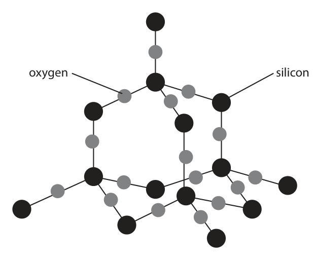

**Mark scheme answer**

> M1 (two) different atoms / elements ACCEPT atoms/elements
> of silicon and oxygen
> M2 joined / bonded together REJECT M2 intermolecular
> forces / ionic bonds

- **(1)** (two) different atoms / elements ACCEPT atoms/elements
- **(1)** joined / bonded together REJECT M2 intermolecular

### 3(c)(i) [1]

Determine the number of different elements in C257H383N65O77S6

**Mark scheme answer**

> 5 / five

- **(1)** 5 / five

### 3(c)(ii) [1]

Determine the number of atoms in a molecule of C257H383N65O77S6 number of atoms =

**Mark scheme answer**

> 788

- **(1)** 788

### 3(d) [2]

Magnalium is a mixture of magnesium atoms and aluminium atoms. The diagram shows a sample of magnalium. magnesium atom aluminium atom Calculate the percentage of magnesium atoms in this sample. percentage = %

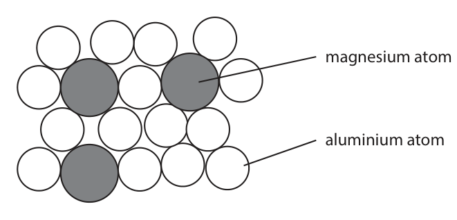

**Mark scheme answer**

> M1 (3 ÷ 18) × 100
> M2 16.7% ALLOW ecf from M1
> e.g. (3 ÷ 15) × 100 = 20%
> scores 1 mark
> ALLOW 2 or more sig figs
> as long as a percentage
> sum and correctly
> rounded.
> total for question = 8

- **(1)** (3 ÷ 18) × 100
- **(1)** 16.7% ALLOW ecf from M1

## Question 4 (6 marks)

This question is about the alkali metals. A teacher demonstrates the reaction between sodium and water. The teacher fills a trough with water and then adds a piece of sodium. sodium

**(c)** Lithium, sodium and potassium react in a similar way when added to water.

### 4(a) [2]

The sodium reacts with the water, forming bubbles of hydrogen gas and a colourless solution. State two other observations that would be made. 1 2

**Mark scheme answer**

> any two from:
> M1 floats M1 and M2 moves on
> the surface
> M2 moves
> M3 melts / turns into a ball /sphere
> M4 gets smaller / disappears ALLOW sodium dissolves
> M5 white trail
> IGNORE effervescence /
> bubbling / fizzing

- **(2)** any two from:

### 4(b) [2]

Give a test to show that, at the end of the reaction, the solution contains sodium ions.

**Mark scheme answer**

> M1 do a flame test ALLOW a description of
> the flame test
> M2 yellow (flame) ALLOW orange (flame)

- **(1)** do a flame test ALLOW a description of
- **(1)** yellow (flame) ALLOW orange (flame)

### 4(c)(i) [1]

State, with reference to the electronic configurations of atoms, why these elements have similar reactions.

**Mark scheme answer**

> (they have the) same number of outer shell
> electrons / one outer shell electron

- **(1)** (they have the) same number of outer shell

### 4(c)(ii) [1]

The table shows the atomic radius of a lithium atom, a sodium atom and a potassium atom. Atom Atomic radius in cm lithium 1.82 × 10−12 sodium 2.27 × 10−12 potassium 2.80 × 10−12 Deduce the relationship between the atomic radius and the reactivity of the metals.

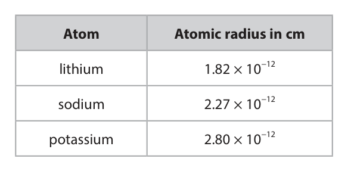

**Mark scheme answer**

> as the atomic radius increases they get more
> reactive OWTTE
> total for question = 6

- **(1)** as the atomic radius increases they get more

## Question 5 (7 marks)

Chromatography is used to separate the components in a mixture.

**(a)** Diagram 1 shows the apparatus used to separate the different dyes in a food colouring. baseline drawn in pencil food colouring Diagram 1

**(b)** Diagram 2 shows a chromatogram produced from four different food colourings, W, X, Y and Z. W X Y Z Diagram 2

### 5(a)(i) [3]

Complete the diagram by adding the missing labels.

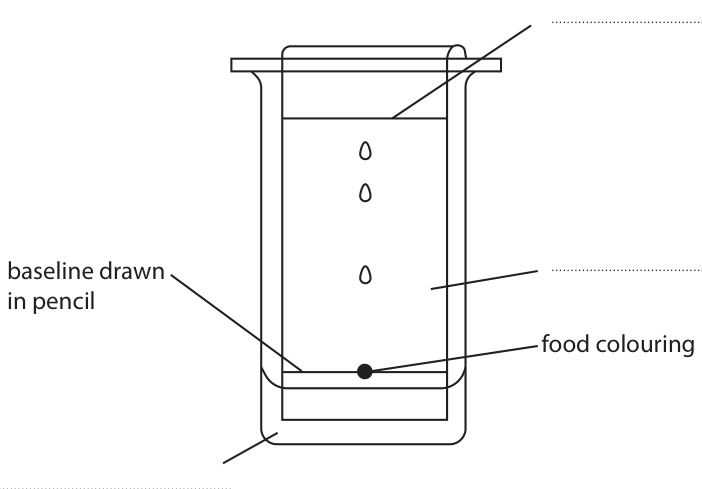

**Mark scheme answer**

> clockwise from bottom left
> M1 solvent ALLOW water
> M2 solvent front
> M3 chromatography paper ALLOW paper
> ALLOW chromatogram

- **(1)** solvent ALLOW water
- **(1)** solvent front
- **(1)** chromatography paper ALLOW paper

### 5(a)(ii) [1]

Give a reason why the baseline is drawn in pencil.

**Mark scheme answer**

> pencil is not soluble / insoluble ACCEPT pencil will not
> dissolve
> ALLOW pencil will not
> run (up the
> chromatogram)

- **(1)** pencil is not soluble / insoluble ACCEPT pencil will not

### 5(b)(i) [1]

Which two food colourings contain the same dye?

- **(A)** W and X
- **(B)** W and Y  ✔
- **(C)** X and Z
- **(D)** Y and Z

**Mark scheme answer**

> B (W and Y)
> A is not the correct answer because W and X do not
> have a spot at the same height
> C is not the correct answer because X and Z do not
> have a spot at the same height
> D is not the correct answer because Y and Z do not
> have a spot at the same height

- **(1)** Answer B: W and Y

### 5(b)(ii) [2]

Calculate the Rf value of the dye in food colouring W. Rf =

**Mark scheme answer**

> M1 distance moved by the dye from 1.1 to 1.4 (cm)
> distance moved by the solvent 6.5 (cm)
> M2 distance moved by the dye ÷ distance moved by e.g. 0.17 / 0.18 / 0.2(0)
> the solvent and correctly evaluated / 0.22
> ALLOW any number of
> sig figs as long as it is
> correctly rounded.
> ALLOW ECF from M1
> total for question = 7

- **(1)** distance moved by the dye from 1.1 to 1.4 (cm)
- **(1)** distance moved by the dye ÷ distance moved by e.g. 0.17 / 0.18 / 0.2(0)

## Question 6 (11 marks)

A student uses this apparatus to find the heat energy released by the combustion of liquid fuels. metal can water burner liquid fuel

### 6(a) [2]

Explain what is meant by the term fuel.

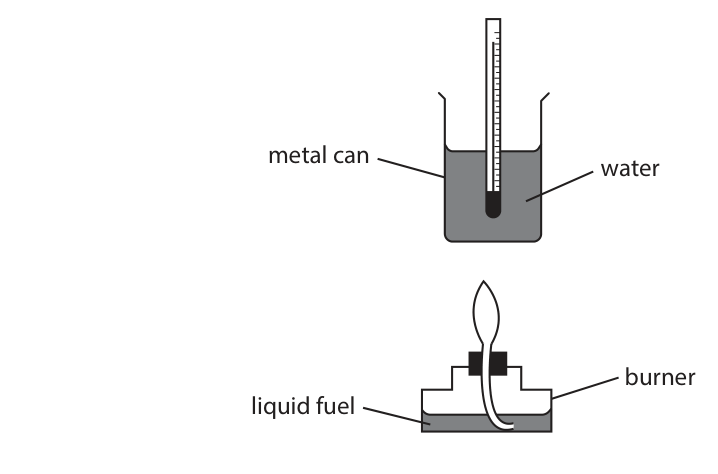

**Mark scheme answer**

> M1 (a substance/a fuel that) when burned ALLOW burns / combusts
> /catches fire
> M2 releases heat (energy) / thermal energy

- **(1)** (a substance/a fuel that) when burned ALLOW burns / combusts
- **(1)** releases heat (energy) / thermal energy

### 6(b)(i) [2]

In one experiment, the student uses liquid ethanol as the fuel. The thermometer shows the temperature of the water at the start of the experiment. ºC 23 Complete the table by giving the temperatures to the nearest 0.1 °C. temperature of the water at the start in °C highest temperature reached in °C temperature rise in °C 57.2

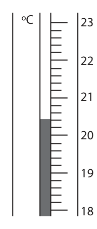

**Mark scheme answer**

> temperature at the start = 20.4 °C ALLOW ECF from
> incorrect temperature
> highest temperature reached = 77.6 °C reading

- **(2)** temperature at the start = 20.4 °C ALLOW ECF from

### 6(b)(ii) [2]

The metal can contains water of mass 150 g. Show, by calculation, that the heat energy change (Q) for this reaction is approximately 36 000 J. [for water, c = 4.2 J/g/ °C] Q = J

**Mark scheme answer**

> M1 150 × 4.2 × 57.2
> M2 36 036 (J) ALLOW 36 000 if M1 is
> scored
> 36 036 with no working
> scores 2
> ALLOW ECF from M1 as
> long as the 3 values are
> multiplied

- **(1)** 150 × 4.2 × 57.2
- **(1)** 36 036 (J) ALLOW 36 000 if M1 is

### 6(b)(iii) [4]

In the experiment, 2.3 g of ethanol (Mr = 46) is burned. Calculate the molar enthalpy change (ΔH), in kJ/mol, for the combustion of ethanol, C2H5OH Include a sign in your answer. Give your answer to two significant figures. ΔH = kJ/mol

**Mark scheme answer**

> M1 36.036 kJ ALLOW 36 kJ
> M2 amount of ethanol = 2.3 ÷ 46 OR 0.05 (mol)
> M3 36.036 ÷ 0.05 OR 720.720 (kJ) M3 subsumes M1 and M2
> OR
> M3 36036 ÷ 0.05 (J) ALLOW M3 to 2 sig figs
> M4 −720 (kJ/mol) ALLOW ECF M4 with 2 sig
> figs and a − sign
> Correct answer without
> working scores 4 marks

- **(4)** M1 36.036 kJ ALLOW 36 kJ

### 6(c) [1]

In this experiment, the calculated value of ΔH is less than the value given in a data book. Give a possible reason for the difference in values.

**Mark scheme answer**

> any one from
> heat absorbed by the metal can
> incomplete combustion
> heat lost to the surroundings ALLOW heat loss
> total for question = 11

- **(1)** any one from

## Question 7 (13 marks)

A student uses this apparatus to investigate the rate of reaction between dilute sulfuric acid and an excess of small pieces of zinc. gas syringe dilute sulfuric acid zinc pieces This is the student’s method. Step 1 use 50 cm3 of dilute sulfuric acid Step 2 add approximately 5 g of small zinc pieces to the sulfuric acid Step 3 quickly connect the gas syringe Step 4	record the reading on the gas syringe every 30 seconds until the reaction stops

**(b)** The graph shows the volume of gas collected in the syringe during the experiment. Volume of gas in cm3 0 30 60 90 120 150 180 210 240 Time in s

### 7(a)(i) [1]

Name a suitable piece of apparatus to measure the volume of sulfuric acid.

**Mark scheme answer**

> measuring cylinder ALLOW burette /
> pipette / syringe
> REJECT gas syringe

- **(1)** measuring cylinder ALLOW burette /

### 7(a)(ii) [1]

Give a reason why the mass of zinc pieces does not need to be measured accurately.

**Mark scheme answer**

> (the) zinc / Zn / it is in excess

- **(1)** (the) zinc / Zn / it is in excess

### 7(a)(iii) [1]

Give a reason why the student quickly connects the gas syringe in step 3.

**Mark scheme answer**

> so as little gas as possible is lost ACCEPT to keep as
> much gas as possible
> ALLOW to avoid loss of
> gas / so gas does not
> escape

- **(1)** so as little gas as possible is lost ACCEPT to keep as

### 7(a)(iv) [1]

State how the student would know when the reaction stops.

**Mark scheme answer**

> any one from
> no further effervescence / bubbles / fizzing
> no more gas collects in the syringe ALLOW gas syringe does
> not move

- **(1)** any one from

### 7(b)(i) [3]

A tangent to the curve has been drawn at a time of 80 s. Use the tangent to calculate the rate of reaction at 80 s. Show your working on the graph. Give the unit. rate of reaction = unit

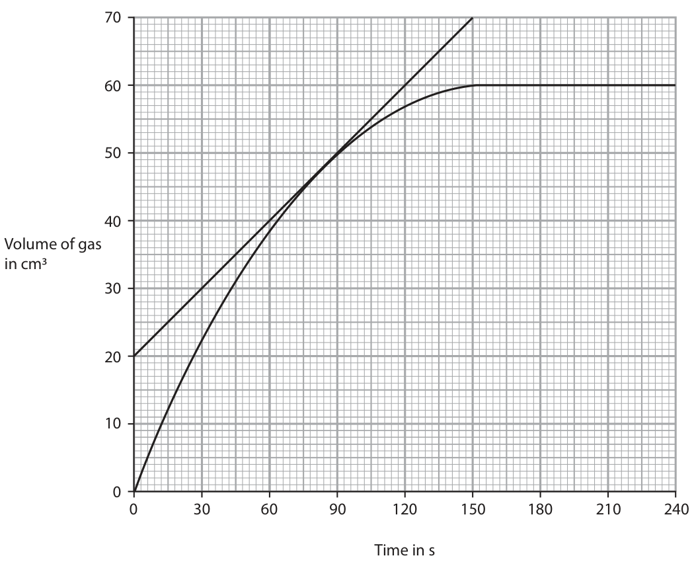

**Mark scheme answer**

> M1 calculation of gradient OR 50 ÷ 150 triangle needs to be
> drawn on graph for M1
> M2 0.33 ALLOW ECF from M1
> M3 units cm3/s ACCEPT cm3 s−1

- **(1)** calculation of gradient OR 50 ÷ 150 triangle needs to be
- **(1)** 0.33 ALLOW ECF from M1
- **(1)** units cm3/s ACCEPT cm3 s−1

### 7(b)(ii) [6]

Explain the shape of the graph in these regions. from 0 s to 60 s from 60 s to 150 s from 150 s to 240 s

**Mark scheme answer**

> from 0 to 60 s
> M1 gradient is steepest
> M2 because there are most acid particles (per unit ACCEPT because
> volume) / most collisions (per unit time) / most concentration is
> frequent collisions greatest / highest
> from 60 to 150 s
> M3 the curve becomes less steep
> M4 because there are fewer particles (per unit ACCEPT because
> volume) / fewer collisions (per unit time) / fewer concentration is lower
> frequent collisions
> from 150 to 240 s
> M5 the reaction has stopped / curve levels ALLOW the volume of
> off/becomes flat/plateaus gas becomes constant
> M6 because the (sulfuric) acid has been used up
> total for question = 13

- **(1)** gradient is steepest
- **(1)** because there are most acid particles (per unit ACCEPT because
- **(1)** the curve becomes less steep
- **(1)** because there are fewer particles (per unit ACCEPT because
- **(1)** the reaction has stopped / curve levels ALLOW the volume of
- **(1)** because the (sulfuric) acid has been used up

## Question 8 (11 marks)

This question is about crude oil.

### 8(a) [4]

Describe how crude oil is separated into fractions by fractional distillation.

**Mark scheme answer**

> a description that links any 4 of the following points
> M1 crude oil is heated / vapourised ALLOW boiled
> M2 the vapour enters the lower part / bottom of the
> column
> M3 there is a temperature gradient in the column ACCEPT cooler at the
> top and hotter at the
> bottom
> M4 the vapours rise up the column until they
> condense
> M5 at a height where the boiling point of the vapour ALLOW the fractions are
> is lower than the temperature in the column separated according to
> their boiling point

- **(4)** a description that links any 4 of the following points

### 8(b) [4]

Some of the products of fractional distillation are then cracked. This equation represents a reaction that occurs during cracking. C15H32 → C8H18 + C3H6 + 2C2H4 Explain why cracking is an important process in the oil industry.

**Mark scheme answer**

> an explanation that links any 4 of the following
> points
> M1 fractional distillation of crude oil produces more ALLOW is a lower
> long chain hydrocarbons than can be used directly demand for long chain
> hydrocarbons / a higher
> demand for short chain
> hydrocarbons
> M2 (cracking) produces shorter (chain) alkanes ALLOW petrol / gasoline
> M3 which are more flammable/ more useful as fuels M3 dep on M2
> M4 (cracking) produces alkenes
> M5 which are used to make polymers/plastics M5 dep on M4

- **(4)** an explanation that links any 4 of the following

### 8(c) [3]

Fuels obtained from crude oil may contain impurities. Explain how an impurity found in fuels can cause an environmental problem.

**Mark scheme answer**

> M1 fuels contain sulfur IGNORE C / CO / CO2
> and any reference to
> global warming etc.
> REJECT nitrogen for M1
> M2 which burns producing sulfur dioxide
> M3 causing acid rain ALLOW effects of acid
> rain
> M3 dep on M1 or M2 or
> NO2 or SO3
> total for question = 11

- **(1)** fuels contain sulfur IGNORE C / CO / CO2
- **(1)** which burns producing sulfur dioxide
- **(1)** causing acid rain ALLOW effects of acid

## Question 9 (14 marks)
**(a)** The table shows the formulae of some positive and negative ions, and the formulae of some compounds containing these ions. Cl− O2− SO42− Na+ Na2O Na2SO4 NH4+ NH4Cl Zn2+ ZnCl2 ZnSO4

**(b)** Hydrogen chloride and magnesium chloride have different types of bonding and have different structures.

### 9(a)(i) [3]

Complete the table by giving the formulae of the missing compounds.

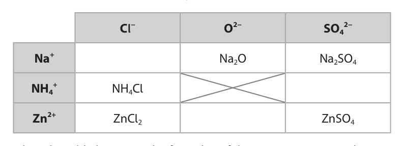

**Mark scheme answer**

> M1 NaCl ACCEPT Na+Cl− / ClNa
> M2 ZnO ACCEPT Zn2+O2− / OZn
> M3 (NH4)2SO4 ACCEPT (NH4+)2SO42−
> /SO4(NH4)2
> REJECT any incorrect
> charges
> Penalise once only for
> incorrect case or
> subscripts / superscripts

- **(1)** NaCl ACCEPT Na+Cl− / ClNa
- **(1)** ZnO ACCEPT Zn2+O2− / OZn
- **(1)** (NH4)2SO4 ACCEPT (NH4+)2SO42−

### 9(a)(ii) [1]

Give the name of the compound with the formula ZnSO4

**Mark scheme answer**

> zinc sulfate

- **(1)** zinc sulfate

### 9(b)(i) [2]

Complete the dot-and-cross diagram to show the outer shell electrons in a molecule of hydrogen chloride. H Cl

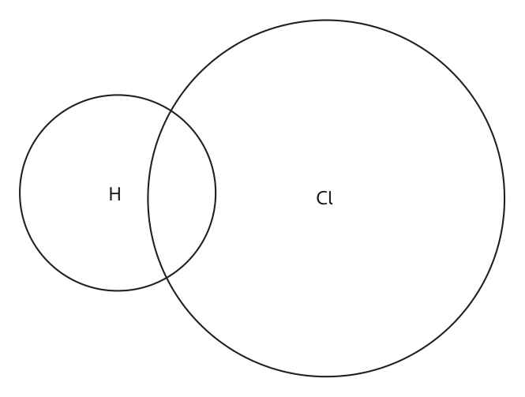

**Mark scheme answer**

> M1 2 bonding electrons ALLOW dots, crosses or
> any combination
> M2 rest of the molecule correct M2 dep on M1

- **(1)** 2 bonding electrons ALLOW dots, crosses or
- **(1)** rest of the molecule correct M2 dep on M1

### 9(b)(ii) [3]

The diagram shows the electronic configuration of a magnesium atom and of a chlorine atom. xx xx x xx xx xx x x xx xx magnesium chlorine Draw the electronic configuration of a magnesium ion and of a chloride ion in the boxes. Show the charge on each ion. magnesium ion chloride ion

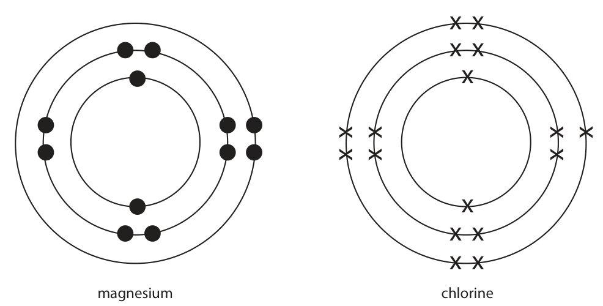

**Mark scheme answer**

> M1 magnesium ion ALLOW dots, crosses or
> any combination
> Only 1 mark max in M1
> and M2 if they only
> show the outer
> electrons, as the
> question requires the
> electronic
> M2 chloride ion configurations
> M3 Mg2+ and Cl−

- **(1)** magnesium ion ALLOW dots, crosses or
- **(1)** chloride ion configurations
- **(1)** Mg2+ and Cl−

### 9(b)(iii) [5]

Explain why magnesium chloride has a much higher melting point than hydrogen chloride. Refer to structure and bonding in your answer.

**Mark scheme answer**

> An explanation that links any 5 of the following
> points
> M1 hydrogen chloride is simple molecular / simple ALLOW molecular
> covalent covalent
> M2 magnesium chloride is giant ionic / ionic lattice ALLOW giant structure
> if ions are mentioned
> M3 strong electrostatic attraction between ALLOW strong ionic
> (oppositely charged) ions bonds
> No M3 if any mention of
> covalent bonds or
> intermolecular forces in
> magnesium chloride
> M4 in hydrogen chloride there are weak REJECT weak forces
> intermolecular forces / weak forces between between bonds
> molecules
> M5 (much) more energy is required to break the REJECT any reference
> (ionic) bonds in MgCl2 than to overcome the to breaking covalent
> (intermolecular) forces in HCl bonds in HCl or MgCl2
> total for question = 14

- **(1)** hydrogen chloride is simple molecular / simple ALLOW molecular
- **(1)** magnesium chloride is giant ionic / ionic lattice ALLOW giant structure
- **(1)** strong electrostatic attraction between ALLOW strong ionic
- **(1)** in hydrogen chloride there are weak REJECT weak forces
- **(1)** (much) more energy is required to break the REJECT any reference

## Question 10 (6 marks)

This is the equation for the decomposition of hydrogen peroxide. 2H2O2(aq) → 2H2O(l) + O2(g) The rate of reaction increases when a catalyst of manganese(IV) oxide is added.

**(b)** A student adds 50 cm3 of hydrogen peroxide solution to a glass container and then adds 1.0 g of manganese(IV) oxide. The diagram shows the apparatus the student uses. glass container hydrogen peroxide solution manganese(IV) oxide

### 10(a) [2]

Describe how a catalyst increases the rate of a reaction.

**Mark scheme answer**

> M1 a catalyst provides an alternative pathway /
> route
> M2 of lower activation energy

- **(1)** a catalyst provides an alternative pathway /
- **(1)** of lower activation energy

### 10(b)(i) [1]

Name the glass container the student uses.

**Mark scheme answer**

> conical flask ALLOW flask

- **(1)** conical flask ALLOW flask

### 10(b)(ii) [3]

The student waits until the hydrogen peroxide solution completely decomposes. Describe how the student could then show that the manganese(IV) oxide was a catalyst and not a reactant.

**Mark scheme answer**

> M1 filter out the manganese(IV) oxide
> M2 allow it to dry
> M3 reweigh the catalyst, the same mass should be
> left / mass is still 1 g
> total for question = 6

- **(1)** filter out the manganese(IV) oxide
- **(1)** allow it to dry
- **(1)** reweigh the catalyst, the same mass should be

## Question 11 (12 marks)

Diamond and graphite are both forms of the element carbon. Diamond and graphite both have covalent bonds and giant covalent structures. The diagram represents the structure of diamond and the structure of graphite. diamond graphite

### 11(a) [1]

Give a reason why diamond is an element.

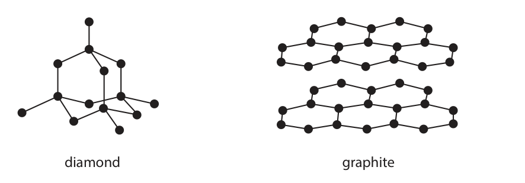

**Mark scheme answer**

> has only one type of atom ACCEPT only made up
> of carbon atoms

- **(1)** has only one type of atom ACCEPT only made up

### 11(b) [2]

Describe the forces of attraction in a covalent bond.

**Mark scheme answer**

> M1 (attraction between) a shared pair of electrons
> M2 and nuclei do not accept nucleus
> nuclei must be plural
> OR
> M1 a shared pair of electrons
> M2 and (attraction between) nuclei do not accept nucleus
> nuclei must be plural

- **(2)** M1 (attraction between) a shared pair of electrons

### 11(c)(i) [2]

Explain why graphite conducts electricity.

**Mark scheme answer**

> M1 delocalised electrons No marks if mention of
> ions / molecules in
> M2 (electrons) can move / flow (throughout the graphite
> structure)

- **(1)** delocalised electrons No marks if mention of
- **(1)** (electrons) can move / flow (throughout the graphite

### 11(c)(ii) [4]

Explain why diamond is hard but graphite is soft.

**Mark scheme answer**

> M1 (diamond is hard because) it has a 3D ALLOW 3D/ rigid/
> lattice/rigid lattice /tetrahedral lattice /every tetrahedral structure
> carbon is bonded to four other carbons
> M2 in diamond, the bonds need a lot of energy to REJECT mention of
> break intermolecular forces in
> diamond for M1 and M2
> M3 (graphite is soft because) it has layers ALLOW sheets
> M4 which can slide over one another IGNORE intermolecular
> forces in graphite
> M4 dep on M3

- **(1)** (diamond is hard because) it has a 3D ALLOW 3D/ rigid/
- **(1)** in diamond, the bonds need a lot of energy to REJECT mention of
- **(1)** (graphite is soft because) it has layers ALLOW sheets
- **(1)** which can slide over one another IGNORE intermolecular

### 11(d) [3]

Another form of carbon has molecules with the formula Cx x represents the number of carbon atoms in each molecule. Each molecule of Cx has a mass of 1.40 × 10−21 g. One mole of Cx contains 6.02 × 1023 molecules. Calculate the Mr of Cx and the value of x [for carbon, Ar = 12] Mr = x =

**Mark scheme answer**

> M1 calculation Mr of Cx
> M2 Mr ÷ 12
> M3 answer given as an integer
> exemplar
> M1 1.40 × 10−21 × 6.02 × 1023 OR 842.8 ALLOW any number of
> significant figures from
> M2 842.8 ÷ 12 (= 70.23) ALLOW ECF if division
> by atomic number 6
> M3 70 Answer of 70 without
> working scores 3
> total for question = 12

- **(3)** M1 calculation Mr of Cx

## Question 12 (11 marks)

This question is about the metal tantalum, Ta. Tantalum metal can be produced by heating tantalum chloride (TaCl5) and hydrogen gas in a furnace. The other product of the reaction is hydrogen chloride.

**(b)** As tantalum chloride is heated, the mass of solid in the furnace decreases leaving tantalum as the only solid product. The table shows the mass of solid in the furnace at one-hour intervals. Time Mass of solid in the furnace in hours in kg 0 2510 1 2207 2 1960 3 1506 4 1329 5 1267 6 1267 7 1267

**(c)** Another method of extracting tantalum is by reacting tantalum(V) oxide with carbon. This is the equation for the reaction. Ta2O5(s) + 5C(s) → 2Ta(s) + 5CO(g)

### 12(a) [1]

Complete the equation for the reaction TaCl5(s) + H2(g) → Ta(s) + HCl(g)

**Mark scheme answer**

> 2TaCl5(s) + 5H2(g) → 2Ta(s) + 10HCl(g) ALLOW multiples or
> fractions

- **(1)** 2TaCl5(s) + 5H2(g) → 2Ta(s) + 10HCl(g) ALLOW multiples or

### 12(b)(i) [1]

State how the data in the table shows that the reaction is complete.

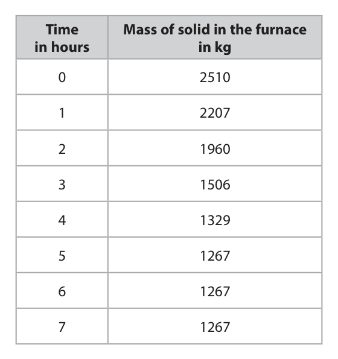

**Mark scheme answer**

> the last (3) masses are the same ALLOW mass does not
> change / mass becomes
> constant

- **(1)** the last (3) masses are the same ALLOW mass does not

### 12(b)(ii) [3]

Use the data to show that the formula of tantalum chloride is TaCl5 [for tantalum, Ar = 181 for chlorine, Ar = 35.5] QUESTION 12 CONTINUES ON NEXT PAGE.

**Mark scheme answer**

> M1 mass of chlorine = 1243 (kg)
> M2 1 267 000 ÷ 181 and 1 243 000 ÷ 35.5 ALLOW calculation done
> in kilomoles
> e.g. 1267 ÷ 181 and 1243
> ÷ 35.5
> M3 7000 moles of tantalum and 35 014 moles of e.g. ratio 7 : 35 moles
> chlorine (so 1:5 ratio)
> M3 subsumes M1 and M2
> no M2 or M3 for upside
> down calculation or use
> of atomic numbers

- **(1)** mass of chlorine = 1243 (kg)
- **(1)** 1 267 000 ÷ 181 and 1 243 000 ÷ 35.5 ALLOW calculation done
- **(1)** 7000 moles of tantalum and 35 014 moles of e.g. ratio 7 : 35 moles

### 12(c)(i) [2]

Explain why this is a redox reaction.

**Mark scheme answer**

> M1 carbon is oxidised and tantalum oxide is Penalise tantalum is
> reduced reduced or tantalum
> loses oxygen once only
> M2 carbon gains oxygen and tantalum oxide loses
> oxygen
> OR
> M1 carbon gains oxygen and is oxidised
> M2 tantalum oxide loses oxygen and is reduced REJECT tantalum loses
> oxygen and is reduced
> ALLOW correct symbols
> and formulae throughout
> ACCEPT correct changes
> in oxidation numbers

- **(2)** M1 carbon is oxidised and tantalum oxide is Penalise tantalum is

### 12(c)(ii) [2]

2000 mol of tantalum(V) oxide is heated with 500 000 g of carbon. Show by calculation that the carbon is in excess. [for carbon, Ar = 12]

**Mark scheme answer**

> M1 (5 × 2000 =) 10 000 moles of carbon is needed (12 × 2000 =) 24 000 g
> M2 (10 000 × 12 =) 120 000 g of carbon is needed (5 × 24 000 =) 120 000 g of
> (which is less than 500 000 g) carbon is needed
> OR
> M1 (500 000 ÷ 12) of carbon is 41 667 moles (500 000 ÷ 5) is 100 000 g
> M2 which is enough to react with (41 667 ÷ 5 =) which is enough to react
> 8333 moles of tantalum oxide with (100 000 ÷ 12 =)
> 8333 moles of tantalum
> OR oxide
> M1 (5 × 2000 =) 10 000 moles of carbon is needed
> M2 (500 000 ÷ 12) is more than 41 667 moles of
> carbon

- **(2)** M1 (5 × 2000 =) 10 000 moles of carbon is needed (12 × 2000 =) 24 000 g

### 12(c)(iii) [2]

Calculate the maximum mass, in grams, of tantalum that can be obtained from 2000 mol of tantalum(V) oxide. [for tantalum, Ar = 181] mass = g

**Mark scheme answer**

> M1 (2 × 2000 =) 4000 moles of tantalum
> M2 (4000 × 181=) 724 000 g of tantalum ALLOW ECF for incorrect
> moles
> e.g. 2000 × 181 = 362 000
> scores 1
> 1000 × 181 = 181 000
> scores 1
> 4000 × 362 = 1 448 000
> scores 1
> total for question = 11
> Pearson Education Limited. Registered company number 872828
> with its registered office at 80 Strand, London, WC2R 0RL, United Kingdom

- **(1)** (2 × 2000 =) 4000 moles of tantalum
- **(1)** (4000 × 181=) 724 000 g of tantalum ALLOW ECF for incorrect

