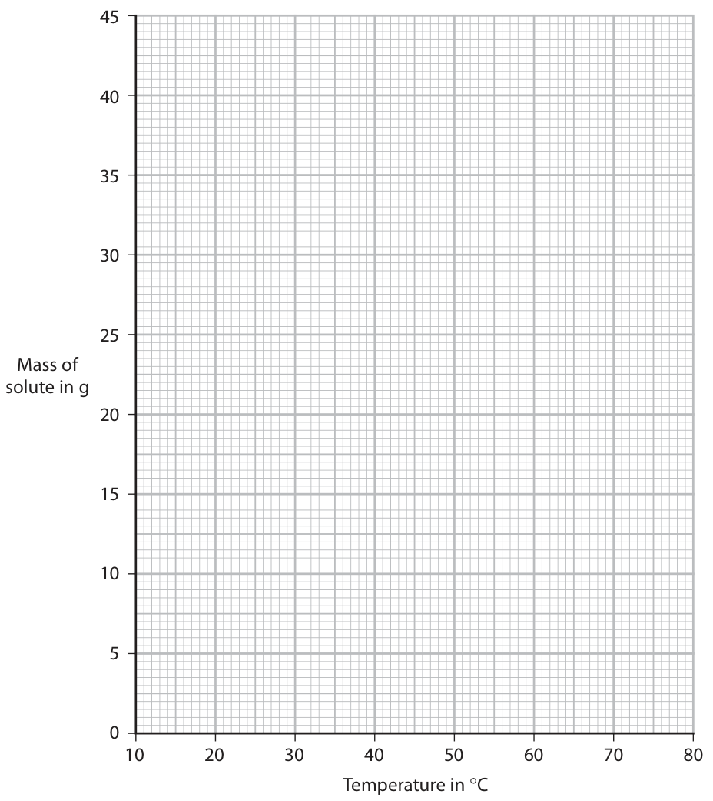
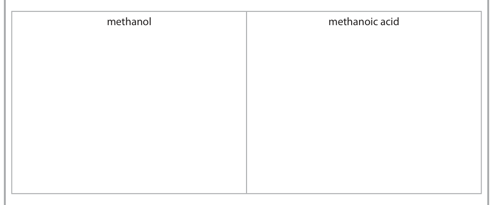

# 4CH1/2C — 2024-06 (official extraction)

> schema `syllabai.official-paper-questions/0.1` · paper_id `pearson-edexcel:international-gcse:chemistry:4ch1:2024-06:4CH1/2C` · qp sha256 `2972808949e609f0…` · extracted verbatim, never regenerated (ADR-037)

## Question 1 (7 marks)

Use the Periodic Table to answer these questions.

### 1(a)(i) [1]

Give the name of the element with atomic number 16

**Mark scheme answer**

> sulfur ALLOW S

- **(1)** sulfur ALLOW S

### 1(a)(ii) [1]

Give the name of the element with relative atomic mass 9

**Mark scheme answer**

> beryllium ALLOW Be

- **(1)** beryllium ALLOW Be

### 1(a)(iii) [1]

Give the name of the element in Group 3 and Period 2

**Mark scheme answer**

> boron ALLOW B

- **(1)** boron ALLOW B

### 1(a)(iv) [1]

Give the electronic configuration of an atom of silicon.

**Mark scheme answer**

> 2,8,4 / 2.8.4 ACCEPT diagram
> showing electron
> configuration

- **(1)** 2,8,4 / 2.8.4 ACCEPT diagram

### 1(b) [3]

Explain, in terms of electron configuration, why sodium is more reactive than lithium.

**Mark scheme answer**

> An explanation that links the following three points
> M1 the outer shell is further from the nucleus in ALLOW a sodium atom
> sodium/sodium has more shells/sodium has a larger is larger than a lithium
> atomic radius ORA atom
> ALLOW Li 2,1 Na 2,8,1
> M2 there is less attraction to the nucleus for the ALLOW there is more
> outer electron/outer shell in sodium ORA shielding in sodium
> ORA
> M3 so the (outer) electron is more easily lost ORA IGNORE electrons
> (plural) in M1 and M2
> but do not allow
> electrons in M3
> Question
> Answer Notes Marks
> number

- **(1)** the outer shell is further from the nucleus in ALLOW a sodium atom
- **(1)** there is less attraction to the nucleus for the ALLOW there is more
- **(1)** so the (outer) electron is more easily lost ORA IGNORE electrons

## Question 2 (5 marks)

Structures made of iron can rust.

### 2(a)(i) [2]

Name the two substances that cause iron to rust. 1 2

**Mark scheme answer**

> M1 oxygen ALLOW air /O2
> M2 water ALLOW moisture / water
> vapour /H2O

- **(1)** oxygen ALLOW air /O2
- **(1)** water ALLOW moisture / water

### 2(a)(ii) [1]

State a barrier method that prevents rusting.

**Mark scheme answer**

> painting/oiling/coating with plastic/galvanising REJECT sacrificial
> /electroplating /waxing /greasing protection

- **(1)** painting/oiling/coating with plastic/galvanising REJECT sacrificial

### 2(b) [2]

Explain how sacrificial protection prevents the rusting of iron.

**Mark scheme answer**

> An explanation that links the following two points
> M1 a more reactive metal is connected to/coated on ACCEPT a suitable metal,
> the iron OWTTE e.g. zinc/magnesium
> /aluminium
> IGNORE an element
> M2 the more reactive metal will react /oxidise REJECT a more reactive
> /corrode instead of iron metal rusts instead of
> iron
> Question Notes
> Answer Marks
> number

- **(1)** a more reactive metal is connected to/coated on ACCEPT a suitable metal,
- **(1)** the more reactive metal will react /oxidise REJECT a more reactive

## Question 3 (11 marks)

The diagram shows the separation of crude oil into fractions. A gasoline kerosene diesel fuel oil crude oil F

**(b)** One of the fractions is kerosene.

**(c)** Catalytic cracking is a process used to break down fractions containing long‑chain molecules.

### 3(a) [2]

Give the name of fraction A and the name of fraction F. fraction A fraction F

**Mark scheme answer**

> M1 (A) refinery gases
> M2 (F) bitumen

- **(1)** (A) refinery gases
- **(1)** (F) bitumen

### 3(b)(i) [1]

Give one use of kerosene.

**Mark scheme answer**

> aircraft fuel

- **(1)** aircraft fuel

### 3(b)(ii) [3]

Describe how kerosene can be obtained from crude oil. 

**Mark scheme answer**

> A description that refers to three of the following
> points
> M1 crude oil is heated/vaporised IGNORE evaporated
> M2 (the vapour) passes into/rises up the
> (fractionating) column / chamber OWTTE
> M3 the kerosene /the fraction is tapped ALLOW
> off/removed at its boiling point range /condenses kerosene/the
> and removed fraction is removed
> at the 3rd or 4th
> level

- **(1)** crude oil is heated/vaporised IGNORE evaporated
- **(1)** (the vapour) passes into/rises up the
- **(1)** the kerosene /the fraction is tapped ALLOW

### 3(c)(i) [2]

Give the name of the catalyst and the temperature used for catalytic cracking. catalyst temperature

**Mark scheme answer**

> M1 silica/alumina ALLOW silicon
> dioxide/SiO2
> /aluminium oxide
> /Al2O3 /zeolites
> /aluminosilicates
> M2 any value or range between 600 and 700 (C )
> inclusive

- **(1)** silica/alumina ALLOW silicon
- **(1)** any value or range between 600 and 700 (C )

### 3(c)(ii) [3]

Explain why catalytic cracking is useful.

**Mark scheme answer**

> An explanation that links three of the following
> points
> M1 there is a surplus supply of / less demand for
> larger fractions /molecules/hydrocarbons
> OR
> there is not enough supply / greater demand for
> smaller fractions/molecules /hydrocarbons
> M2 alkenes are produced which are needed to make ALLOW plastics / to
> polymers make ethanol
> M3 smaller fractions /alkanes /molecules ALLOW gasoline /
> /hydrocarbons are needed for petrol fuel for cars
> Question
> Answer Notes Marks
> number

- **(1)** there is a surplus supply of / less demand for
- **(1)** alkenes are produced which are needed to make ALLOW plastics / to
- **(1)** smaller fractions /alkanes /molecules ALLOW gasoline /

## Question 4 (10 marks)

The table shows the maximum mass of potassium nitrate (KNO3) and the maximum mass of sodium nitrate (NaNO3) that dissolves in 25 cm3 of water at different temperatures. Temperature in °C 10 25 40 60 75 Mass of potassium nitrate in g 5 10 16 28 39 Mass of sodium nitrate in g 21 23 26 31 35

### 4(a)(i) [2]

Plot the data for potassium nitrate and for sodium nitrate on the grid.

**Mark scheme answer**

> M1 all points plotted correctly to the nearest + or –
> half a small square for KNO3
> M2 all points plotted correctly to the nearest + or –
> half a small square for NaNO3

- **(1)** all points plotted correctly to the nearest + or –
- **(1)** all points plotted correctly to the nearest + or –

### 4(a)(ii) [2]

Draw and label a curve of best fit for KNO3 and for NaNO3 Mass of solute in g 10 20 30 40 50 60 70 80 Temperature in °C 

**Mark scheme answer**

> M1 smooth curve of best fit for KNO3 If KNO3 and NaNO3
> are not labelled or
> M2 smooth curve of best fit for NaNO3 labelled incorrectly
> lose 1 mark if curves
> are correct but allow
> ECF for (c) and (d) if
> the curves are the
> wrong way round

- **(1)** smooth curve of best fit for KNO3 If KNO3 and NaNO3
- **(1)** smooth curve of best fit for NaNO3 labelled incorrectly

### 4(b) [1]

The graph shows the temperature at which the maximum mass dissolved is the same for each solute. Determine this temperature. temperature = °C

**Mark scheme answer**

> temperature where their lines cross (expected
> value approximately 68 C)

- **(1)** temperature where their lines cross (expected

### 4(c) [2]

Use your graph to calculate the solubility, in g per 100 g of water, of sodium nitrate at 30 °C. [1.0 cm3 of water has a mass of 1.0 g] solubility of sodium nitrate in g per 100 g of water =

**Mark scheme answer**

> M1 mass at 30 C read from graph (expected value
> approximately 24 g)
> M2 4 x answer to M1 (expected value approximately
> 96 g)

- **(1)** mass at 30 C read from graph (expected value
- **(1)** 4 x answer to M1 (expected value approximately

### 4(d) [3]

25 cm3 of a saturated solution of potassium nitrate is cooled from 50 °C to 20 °C. Use your graph to determine the mass, in grams, of potassium nitrate that crystallises. Show your working on the graph. mass = g

**Mark scheme answer**

> M1 mass at 50 C read from graph (expected value Need to show
> approximately 21 g) working on the graph
> for M1 and M2 to
> M2 mass at 20 C read from graph (expected value score but allow M3
> approximately 8 g) for M1 – M2
> M3 M1 − M2 (expected value approximately 13 g)
> Question
> Answer Notes Marks
> number

- **(1)** mass at 50 C read from graph (expected value Need to show
- **(1)** mass at 20 C read from graph (expected value score but allow M3
- **(1)** M1 − M2 (expected value approximately 13 g)

## Question 5 (10 marks)

Methanol, CH3OH, is the first member of the homologous series of alcohols.

**(b)** Methanol is heated with potassium dichromate(VI) and one other reagent. The methanol is oxidised to methanoic acid, HCOOH

**(d)** The structural formula of an ester is CH3COOCH2CH2CH2CH3

### 5(a) [2]

Give two characteristics of a homologous series. 1 2

**Mark scheme answer**

> Any two from
> M1 same general formula
> M2 same functional group
> M3 similar chemical properties /characteristics IGNORE same chemical
> properties
> M4 trend in physical properties /characteristics accept any trend in
> specified physical
> property
> M5 consecutive members differ by a CH2 group

- **(2)** Any two from

### 5(b)(i) [1]

Give the formula of the other reagent.

**Mark scheme answer**

> H2SO4

- **(1)** H2SO4

### 5(b)(ii) [2]

Give the colour change that occurs during the reaction. from to

**Mark scheme answer**

> M1 (from) orange must be in the correct
> order
> M2 (to) green

- **(1)** (from) orange must be in the correct
- **(1)** (to) green

### 5(b)(iii) [2]

Draw the displayed formula for methanol and for methanoic acid in the boxes. methanol methanoic acid 

**Mark scheme answer**

> M1 (methanol) H Penalise once only if
> I O − H bond not shown
> H−C−O−H and both structures
> I correct
> H
> M2 (methanoic acid) O
> II
> H−C−O−H

- **(1)** (methanol) H Penalise once only if
- **(1)** (methanoic acid) O

### 5(c) [1]

Methanol reacts with methanoic acid to form an ester. Complete the equation for this reaction. CH3OH + HCOOH → +

**Mark scheme answer**

> CH3OH + HCOOH → HCOOCH3 + H2O ALLOW multiples
> ALLOW CH3OOCH
> IGNORE state symbols
> even if incorrect
> REJECT CH3COOH and
> C2H4O2

- **(1)** CH3OH + HCOOH → HCOOCH3 + H2O ALLOW multiples

### 5(d)(i) [1]

What is the name of this ester?

- **(A)** butyl ethanoate  ✔
- **(B)** butyl methanoate
- **(C)** ethyl butanoate
- **(D)** methyl butanoate

**Mark scheme answer**

> A (butyl ethanoate)
> B butyl methanoate is not the correct name of the
> ester CH3COOCH2CH2CH2CH3
> C ethyl butanoate is not the correct name of the
> ester CH3COOCH2CH2CH2CH3
> D methyl butanoate is not the correct name of the
> ester CH3COOCH2CH2CH2CH3

- **(1)** Answer A: butyl ethanoate

### 5(d)(ii) [1]

Deduce the molecular formula of this ester.

**Mark scheme answer**

> C6H12O2 ALLOW symbols in any
> order
> Question
> Answer Notes Marks
> number

- **(1)** C6H12O2 ALLOW symbols in any

## Question 6 (14 marks)

A scientist reacts lead(II) nitrate solution with sodium bromide solution. This is the equation for the reaction. Pb(NO3)2(aq) + 2NaBr(aq) → PbBr2(s) + 2NaNO3(aq)

**(b)** The scientist reacts an excess of lead(II) nitrate solution with 25 cm3 of sodium bromide solution of concentration 2.0 mol/dm3.

**(c)** The scientist electrolyses molten lead(II) bromide using this apparatus. +– positive electrode negative electrode molten lead(II) bromide crucible

**(d)** Bromine forms at the positive electrode. This is the half‑equation for the reaction at the positive electrode. 2Br– → Br2 + 2e–

### 6(a) [3]

Describe how the scientist could obtain a pure dry sample of lead(II) bromide (PbBr2) from the reaction mixture.

**Mark scheme answer**

> A description that refers to the following three
> points
> M1 filter (the mixture)
> M2 wash (the precipitate/solid/lead(II) bromide
> with distilled water)
> M3 suitable drying method e.g. dry with filter paper
> /leave to dry/dry in a
> desiccator/dry in an
> oven
> REJECT M3 if they
> attempt to crystallise
> the filtrate
> If any attempt to
> evaporate the solution
> allow MAX 1

- **(1)** filter (the mixture)
- **(1)** wash (the precipitate/solid/lead(II) bromide
- **(1)** suitable drying method e.g. dry with filter paper

### 6(b)(i) [1]

Show that the amount of sodium bromide used is 0.050 mol.

**Mark scheme answer**

> 2(.0) x 0.025 = 0.05(0) (mol) ACCEPT
> 25 ÷ 1000 = 0.025
> 0.05 ÷ 0.025 = 2
> OR
> 2(.0) x 25 = 0.05(0) (mol) All working must be
> 1000 shown to gain full marks

- **(1)** 2(.0) x 0.025 = 0.05(0) (mol) ACCEPT

### 6(b)(ii) [2]

Show that the maximum theoretical mass of lead(II) bromide is approximately 9 g. [for PbBr2 Mr = 367] 

**Mark scheme answer**

> M1 (n PbBr2) = 0.05(0) ÷ 2 = 0.025 ALLOW 2:1 = 0.05:0.025
> M2 0.025 x 367 = 9.175 (g) ACCEPT 9.18/9.2/9 (g)
> OR
> M1 0.05 x 367 = 18.35 (g)
> M2 18.35 ÷ 2 = 9.175 (g) ACCEPT 9.18/9.2/9 (g)
> All working must be
> shown to gain full marks

- **(2)** M1 (n PbBr2) = 0.05(0) ÷ 2 = 0.025 ALLOW 2:1 = 0.05:0.025

### 6(c)(i) [3]

Explain why lead(II) bromide needs to be molten rather than solid for electrolysis to occur.

**Mark scheme answer**

> An explanation that links the following three
> points
> M1 when solid the ions are in fixed positions/in a
> lattice
> M2 so there are no ions/electrons/charged
> particles free to move
> M3 (when molten) the ions are free to move so can IGNORE carry charge
> conduct electricity/carry a current
> REJECT solution for M3
> REJECT electrons
> moving /delocalised
> electrons for M3

- **(1)** when solid the ions are in fixed positions/in a
- **(1)** so there are no ions/electrons/charged
- **(1)** (when molten) the ions are free to move so can IGNORE carry charge

### 6(c)(ii) [2]

The electrolyte is at a temperature of 400 °C. Explain a suitable material for the electrodes. 

**Mark scheme answer**

> An explanation that links the following two points
> M1 graphite IGNORE carbon
> ALLOW platinum
> M2 resistance to high temperature /has a high ALLOW conducts
> melting point electricity / doesn’t
> react with product /is
> inert
> M2 dependent on
> graphite /carbon
> /a transition metal

- **(1)** graphite IGNORE carbon
- **(1)** resistance to high temperature /has a high ALLOW conducts

### 6(c)(iii) [1]

Give the half‑equation that occurs at the negative electrode.

**Mark scheme answer**

> Pb2+ + 2e(−) → Pb ACCEPT multiples
> IGNORE state symbols
> even if incorrect

- **(1)** Pb2+ + 2e(−) → Pb ACCEPT multiples

### 6(d)(i) [1]

State what is observed at the positive electrode.

**Mark scheme answer**

> brown vapour/gas/fumes ALLOW red-brown
> vapour/gas/fumes
> REJECT orange/orange-
> brown/red alone

- **(1)** brown vapour/gas/fumes ALLOW red-brown

### 6(d)(ii) [1]

State why the half‑equation represents an oxidation reaction.

**Mark scheme answer**

> bromide (ions)/Br − loses electrons ALLOW electrons are
> lost
> REJECT bromine loses
> electrons
> Question
> Answer Notes Marks
> number

- **(1)** bromide (ions)/Br − loses electrons ALLOW electrons are

## Question 7 (13 marks)

This question is about hydrogen chloride (HCl). Hydrogen chloride is a covalent compound.

**(c)** In the presence of ultraviolet radiation, hydrogen reacts with chlorine to form hydrogen chloride. This is the equation for the reaction. H2(g) + Cl2(g) → 2HCl(g) The table shows the bond energies. Bond H H Cl Cl H Cl Bond energy in kJ/mol 436 242 431

### 7(a) [2]

State, in terms of electrostatic attraction, what is meant by a covalent bond.

**Mark scheme answer**

> M1 (electrostatic) attraction between nuclei (of both nuclei must be plural
> atoms)
> M2 and a shared/bonding pair of electrons
> OR
> M1 (electrostatic) attraction between a
> shared/bonding pair of electrons
> M2 and nuclei (of both atoms) nuclei must be plural

- **(2)** M1 (electrostatic) attraction between nuclei (of both nuclei must be plural

### 7(b) [4]

When hydrogen chloride gas is dissolved in an organic solvent, the hydrogen chloride remains a covalent molecule. When hydrogen chloride gas is dissolved in water, ions are formed. Explain what happens when dry blue litmus paper is dipped into separate samples of each solution. 

**Mark scheme answer**

> An explanation that links the following four points
> M1 (in the organic solvent) litmus paper stays blue/has No M1 or M2 if
> no change litmus paper turns
> red
> M2 because there are no (H+) ions/ the solution is not
> acidic /does not dissociate in an organic solvent
> M3 (in the aqueous solution) litmus paper turns red REJECT M3 if litmus
> is bleached or turns
> white
> M4 because H+ ions are formed/hydrochloric acid M4 dep on litmus
> forms turning red initially

- **(1)** (in the organic solvent) litmus paper stays blue/has No M1 or M2 if
- **(1)** because there are no (H+) ions/ the solution is not
- **(1)** (in the aqueous solution) litmus paper turns red REJECT M3 if litmus
- **(1)** because H+ ions are formed/hydrochloric acid M4 dep on litmus

### 7(c)(i) [3]

Calculate the enthalpy change (ΔH), in kJ/mol, for the reaction. Include a sign in your answer. ΔH = kJ/mol

**Mark scheme answer**

> correct answer − 184
> with or without
> working scores 3
> (+)184 scores 2
> M1 reactants bond energy = 436 + 242 OR 678 (kJ)
> M2 products bond energy = 2 x 431 OR 862 (kJ)
> M3 − 184 (kJ/mol) ALLOW ecf on
> incorrect values on
> M1 and/or M2

- **(1)** reactants bond energy = 436 + 242 OR 678 (kJ)
- **(1)** products bond energy = 2 x 431 OR 862 (kJ)
- **(1)** − 184 (kJ/mol) ALLOW ecf on

### 7(c)(ii) [4]

Draw a reaction profile for the reaction. Label the reactants, the products, ΔH and the activation energy (Ea ). energy

**Mark scheme answer**

> M1 show correct positions of horizontal lines and ALLOW ecf if
> activation energy hump positive answer in (i)
> M3 REJECT arrow
> pointing down
> M2 correct labelling of (reactants) H2 + Cl2 and
> (products) 2HCl
> M3 vertical line in correct position labelled H ACCEPT arrow
> pointing down or
> double headed arrow
> REJECT arrow
> pointing up
> M4 vertical line in correct position labelled Ea or ACCEPT arrow
> activation energy pointing up or
> double headed arrow
> REJECT arrow
> pointing down
> Pearson Education Limited. Registered company number 872828
> with its registered office at 80 Strand, London, WC2R 0RL, United Kingdom

- **(1)** show correct positions of horizontal lines and ALLOW ecf if
- **(1)** correct labelling of (reactants) H2 + Cl2 and
- **(1)** vertical line in correct position labelled H ACCEPT arrow
- **(1)** vertical line in correct position labelled Ea or ACCEPT arrow

