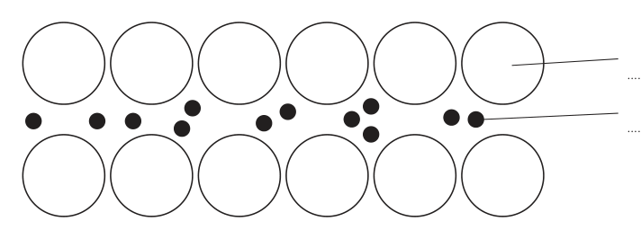
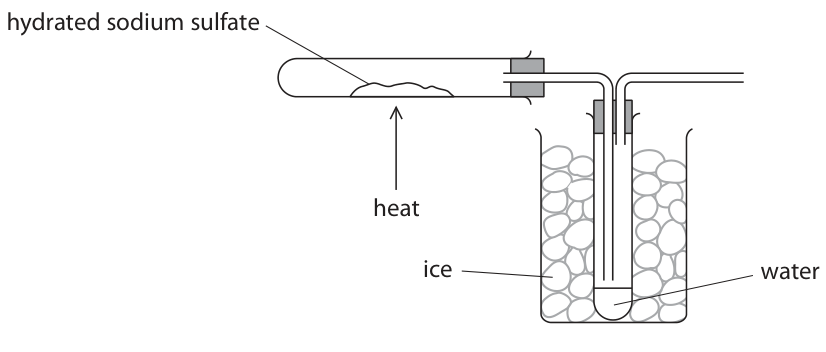
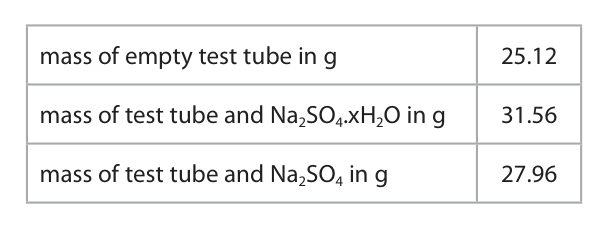
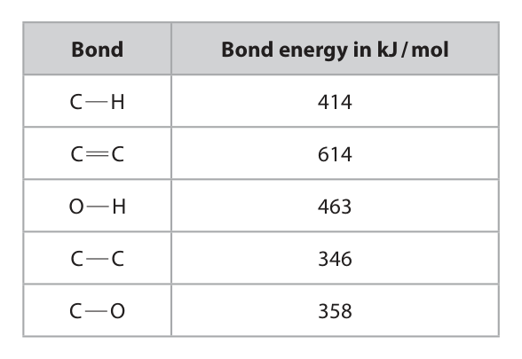
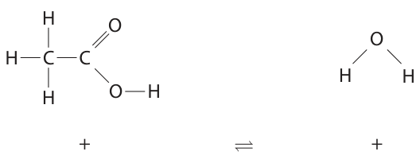
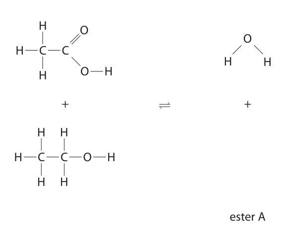

# 4CH1/2CR — 2024-06 (official extraction)

> schema `syllabai.official-paper-questions/0.2` · paper_id `pearson-edexcel:international-gcse:chemistry:4ch1:2024-06:4CH1/2CR` · qp sha256 `c6edac244e596ee7…` · extraction is the disclosed baseline (ADR-039)

## Question 1 (4 marks)

This question is about sulfur.

**(a)** The diagram represents the electronic configuration of an atom of sulfur.

**(b)** When a mixture of sulfur and zinc is heated to a high temperature a reaction occurs, forming the compound zinc sulfide, ZnS

### 1(a)(i) [1]

Which period of the Periodic Table contains sulfur?

- **(A)** 2
- **(B)** 3  ✔
- **(C)** 4
- **(D)** 6

**Mark scheme answer**

> B (3)
> A is not the correct answer because sulfur is not in
> period 2
> C is not the correct answer because sulfur is not in
> period 4
> D is not the correct answer because sulfur is not in
> period 6

- **(1)** Answer B: 3

### 1(a)(ii) [1]

What is the charge on a sulfide ion?

- **(A)** 1+
- **(B)** 2+
- **(C)** 1–
- **(D)** 2–  ✔

**Mark scheme answer**

> D (2−)
> A is not the correct answer because the charge on
> a sulfide ion is not 1+
> B is not the correct answer because the charge on
> a sulfide ion is not 2+
> C is not the correct answer because the charge on
> a sulfide ion is not 1−

- **(1)** Answer D: 2–

### 1(b)(i) [1]

Give a reason why the mixture of sulfur and zinc needs heating before a reaction occurs.

**Mark scheme answer**

> the reaction has a high activation energy ALLOW to give zinc and
> sulfur enough energy to
> react
> ALLOW speeds reaction
> up/increases rate of
> reaction/reacts quicker
> ALLOW the reaction is
> very slow at room
> temperature
> IGNORE
> unreactive/does not
> react
> ALLOW gains kinetic
> energy

- **(1)** the reaction has a high activation energy ALLOW to give zinc and

### 1(b)(ii) [1]

Calculate the relative formula mass (Mr) of zinc sulfide. [for Zn, Ar = 65 for S, Ar = 32] Mr =

**Mark scheme answer**

> 97 IGNORE any units given

- **(1)** 97 IGNORE any units given

## Question 2 (6 marks)
**(a)** The diagram represents an atom of an element. + + + W +

**(b)** These are the symbols for the two isotopes of lithium. 6 7 Li Li 3 3

### 2(a)(i) [1]

What is the name of the particle labelled W?

- **(A)** electron
- **(B)** ion
- **(C)** neutron  ✔
- **(D)** proton

**Mark scheme answer**

> C (neutron)
> A is not the correct answer because electrons are
> not in the nucleus
> B is not the correct answer as ions are not in the
> nucleus
> D is not the correct answer as protons have a
> positive charge

- **(1)** Answer C: neutron

### 2(a)(ii) [1]

What is the mass number of this atom?

- **(A)** 4
- **(B)** 5
- **(C)** 9  ✔
- **(D)** 13

**Mark scheme answer**

> C (9)
> A is not the correct answer because the proton
> number = 4
> B is not the correct answer as there are 5 neutrons
> D is not the correct answer because 13 is the
> number of protons + neutrons + electrons

- **(1)** Answer C: 9

### 2(b)(i) [2]

In terms of sub-atomic particles, give one similarity and one difference between the two isotopes. similarity difference

**Mark scheme answer**

> similarity = number of protons/proton number ALLOW number of
> electrons
> difference = number of neutrons ALLOW one has 3
> neutrons and the other
> has 4 neutrons
> IGNORE reference to
> atomic number and
> mass numbers

- **(2)** similarity = number of protons/proton number ALLOW number of

### 2(b)(ii) [2]

A sample of lithium contains 7.5% of 63Li and 92.5% of 73Li Calculate the relative atomic mass (Ar) of this sample of lithium. Ar =

**Mark scheme answer**

> M1 ((7.5 × 6) + (92.5 × 7)) ÷ 100
> M2 6.925/6.93/6.9 ALLOW 2 or more
> significant figures
> Answer 6.925/6.93/6.9
> without working scores
> 2 marks
> Answer of 7 with
> correct method scores
> M1
> Answer of 7 without
> working scores 0

- **(1)** ((7.5 × 6) + (92.5 × 7)) ÷ 100
- **(1)** 6.925/6.93/6.9 ALLOW 2 or more

## Question 3 (12 marks)

This question is about magnesium metal and its compounds.

**(b)** Magnesium burns in oxygen gas to form solid magnesium oxide.

**(c)** A student uses this method to make a solution of magnesium chloride. Step 1 measure 25 cm3 of dilute hydrochloric acid into a beaker Step 2 add magnesium powder a little at a time Step 3 keep adding magnesium powder until it is in excess Step 4 remove the excess magnesium powder by filtration This is the equation for the reaction. Mg(s) + 2HCl(aq) → MgCl2(aq) + H2(g)

### 3(a)(i) [2]

The diagram represents the structure of magnesium. Complete the diagram by adding the labels.

**Mark scheme answer**

> M1 (positive) ion/cation ALLOW atom
> REJECT proton for M1
> M2 (delocalised) electron

- **(1)** (positive) ion/cation ALLOW atom
- **(1)** (delocalised) electron

### 3(a)(ii) [2]

Explain why magnesium is malleable.

**Mark scheme answer**

> M1 layers (of atoms / ions) ALLOW particles
> M2 (atoms/ions) can slide over one another REJECT references to
> intermolecular forces

- **(1)** layers (of atoms / ions) ALLOW particles
- **(1)** (atoms/ions) can slide over one another REJECT references to

### 3(b)(i) [2]

Complete the chemical equation for the reaction by balancing the equation and adding the state symbols Mg(s) + O2( ) → MgO( )

**Mark scheme answer**

> 2Mg(s) + O2(g) → 2MgO(s)
> M1 balancing ALLOW multiples or
> fractions – O2 must also
> be changed to score.
> M2 state symbols

- **(1)** balancing ALLOW multiples or
- **(1)** state symbols

### 3(b)(ii) [1]

Give a reason why magnesium is oxidised in this reaction.

**Mark scheme answer**

> magnesium gains oxygen ALLOW magnesium loses
> electrons
> IGNORE magnesium
> reacts with oxygen

- **(1)** magnesium gains oxygen ALLOW magnesium loses

### 3(c)(i) [1]

Give a reason why the student uses magnesium powder rather than magnesium ribbon.

**Mark scheme answer**

> to increase the rate of reaction OWTTE

- **(1)** to increase the rate of reaction OWTTE

### 3(c)(ii) [1]

Give a reason why the student adds an excess of magnesium in step 3.

**Mark scheme answer**

> to ensure all the acid has reacted/neutralise the
> acid OWTTE

- **(1)** to ensure all the acid has reacted/neutralise the

### 3(c)(iii) [3]

Calculate the minimum mass of magnesium needed to react with 25.0 cm3 of 2.00 mol / dm3 hydrochloric acid. [for Mg, Ar = 24] mass = g

**Mark scheme answer**

> M1 amount of HCl = (25 × 2) ÷ 1000 OR 0.050 (mol)
> M2 amount of magnesium = 0.050 ÷ 2 OR 0.025 ALLOW ecf M1 ÷ 2
> (mol)
> M3 0.025 × 24 = 0.60 g/0.6 g ALLOW ecf M2 × 24
> Answer of 0.60 g
> without working scores
> 3
> Answer of 1.20 g with
> working scores 2

- **(1)** amount of HCl = (25 × 2) ÷ 1000 OR 0.050 (mol)
- **(1)** amount of magnesium = 0.050 ÷ 2 OR 0.025 ALLOW ecf M1 ÷ 2
- **(1)** 0.025 × 24 = 0.60 g/0.6 g ALLOW ecf M2 × 24

## Question 4 (8 marks)

This question is about the manufacture of ethanol by the fermentation of glucose.

### 4(a) [2]

Fermentation needs to be done in the absence of air. Give two other conditions needed for fermentation. 1 2

**Mark scheme answer**

> M1 30°C ALLOW values within the
> range of 30°C- 40°C
> M2 (enzymes from) yeast ALLOW zymase
> IGNORE
> glucose/anaerobic/pressure

- **(1)** 30°C ALLOW values within the
- **(1)** (enzymes from) yeast ALLOW zymase

### 4(b) [2]

Explain why fermentation needs to be done in the absence of air.

**Mark scheme answer**

> M1 oxygen in the air would react with ethanol ACCEPT ethanol would be
> oxidised
> M2 to form ethanoic acid ALLOW to form carboxylic
> acid ALLOW to form vinegar
> OR
> M1 ethanol would not be formed
> M2 CO2 and H2O would form

- **(2)** M1 oxygen in the air would react with ethanol ACCEPT ethanol would be

### 4(c)(i) [1]

Complete the equation for fermentation. C6H12O6 → 2C2H5OH + 2

**Mark scheme answer**

> CO2

- **(1)** CO2

### 4(c)(ii) [3]

A mixture containing 500 mol of glucose is fermented. A mass of 5750 g of ethanol is obtained. Calculate the percentage yield. [for ethanol, Mr = 46] percentage yield = %

**Mark scheme answer**

> 12.5% Answer of 12.5% without
> working scores 3 marks
> M1 (theoretical moles of ethanol from glucose) = 500
> x 2 = 1000
> M2 (100% yield) = 46 000 g ALLOW ecf from M1
> M3 (percentage yield) = (5750 ÷ 46 000) × 100 = 12.5% ALLOW ecf from M2
> OR
> M1 moles of ethanol from mass = 5750/46 = 125
> M2 theoretical moles of ethanol = 500 x 2 = 1000
> M3 (percentage yield) = 125/1000 × 100 = 12.5% Allow ecf for M3

- **(3)** 12.5% Answer of 12.5% without

## Question 5 (14 marks)

Sodium sulfate can be prepared by the reaction between sodium hydroxide solution and sodium hydrogensulfate (NaHSO4) solution. This is the equation for the reaction. NaOH(aq) + NaHSO4(aq) → Na2SO4(aq) + H2O(l) Sodium hydrogensulfate solution is acidic. A student adds 25.0 cm3 of sodium hydroxide solution to a conical flask and adds two drops of indicator. The student does a titration.

### 5(a)(i) [1]

Name a piece of apparatus that should be used to add 25.0 cm3 of sodium hydroxide solution to the conical flask.

**Mark scheme answer**

> (volumetric) pipette ALLOW burette
> REJECT measuring
> cylinder

- **(1)** (volumetric) pipette ALLOW burette

### 5(a)(ii) [5]

Describe the method the student should use to find the accurate volume of sodium hydrogensulfate solution needed to neutralise the 25.0 cm3 of sodium hydroxide solution.

**Mark scheme answer**

> M1 fill a burette (with sodium hydrogensulfate) REJECT NaOH in burette
> for M1
> M2 add sodium hydrogensulfate until the indicator
> changes colour
> M3 swirl (the conical flask)
> M4 add sodium hydrogensulfate dropwise near to
> the endpoint/end
> M5 repeat until concordant results

- **(1)** fill a burette (with sodium hydrogensulfate) REJECT NaOH in burette
- **(1)** add sodium hydrogensulfate until the indicator
- **(1)** swirl (the conical flask)
- **(1)** add sodium hydrogensulfate dropwise near to
- **(1)** repeat until concordant results

### 5(b) [4]

The student repeats the titration without the indicator and forms a solution of sodium sulfate. Describe how the student can obtain pure, dry crystals of hydrated sodium sulfate from the solution.

**Mark scheme answer**

> M1 heat until crystals first start to form/a saturated ALLOW heat until
> solution forms/crystallisation point is reached volume is about half
> original volume
> M2 cool and crystallise/leave to crystallise
> M3 pour off any excess liquid ALLOW filter
> IGNORE washing with
> water
> M4 leave in a warm place to dry ALLOW leave to dry OR
> dry using a desiccator
> OR warm oven
> OR dry between pieces
> of filter paper
> If heated to dryness
> then MAX 1 MARK

- **(1)** heat until crystals first start to form/a saturated ALLOW heat until
- **(1)** cool and crystallise/leave to crystallise
- **(1)** pour off any excess liquid ALLOW filter
- **(1)** leave in a warm place to dry ALLOW leave to dry OR

### 5(c) [4]

Crystals of hydrated sodium sulfate decompose when heated. This is the equation for the decomposition. Na2SO4.xH2O → Na2SO4 + xH2O A student uses this apparatus to find the value of x. hydrated sodium sulfate heat ice water The student heats the crystals until the decomposition is complete. The table shows the student’s results. mass of empty test tube in g 25.12 mass of test tube and Na2SO4.xH2O in g 31.56 mass of test tube and Na2SO4 in g 27.96 Use the results to calculate the value of x. [for Na2SO4 , Mr = 142 for H2O, Mr = 18] value of x =

**Mark scheme answer**

> M1 mass of sodium sulfate = 2.84 g Answer of 10 without
> working scores 4
> M2 mass of water = 3.6 g
> M3 moles of sodium sulfate = 0.02 AND moles of
> water = 0.20
> M4 x = 10 Allow ecf for M4 if
> dividing by the smallest
> number but only if x is
> given as a whole
> OR
> M1 mass of sodium sulfate = 2.84g
> M2 mass of hydrated salt = 6.44g
> M3 Mr of hydrated salt = 6.44/0.02 = 322
> M4 xH2O = 322-142 = 180 so x = 10

- **(4)** M1 mass of sodium sulfate = 2.84 g Answer of 10 without

## Question 6 (11 marks)

This question is about electrolysis.

**(a)** This apparatus is used to collect the gases produced when an electric current passes through dilute sulfuric acid. dilute sulfuric acid oxygen hydrogen inert electrode inert electrode + – power supply

**(b)** This apparatus is used to electrolyse a concentrated solution of sodium chloride. chlorine hydrogen concentrated solution of sodium chloride – power + supply

### 6(a)(i) [1]

Name a suitable material for the inert electrodes.

**Mark scheme answer**

> platinum ALLOW silver / gold /
> graphite

- **(1)** platinum ALLOW silver / gold /

### 6(a)(ii) [1]

Give a test to show that the gas produced at the positive electrode is oxygen.

**Mark scheme answer**

> glowing splint relights

- **(1)** glowing splint relights

### 6(a)(iii) [1]

Give a test to show that the gas produced at the negative electrode is hydrogen.

**Mark scheme answer**

> lit splint (with a squeaky) pop

- **(1)** lit splint (with a squeaky) pop

### 6(a)(iv) [1]

Give an ionic half-equation for the formation of hydrogen at the negative electrode.

**Mark scheme answer**

> 2H+ + 2e− →H2

- **(1)** 2H+ + 2e− →H2

### 6(a)(v) [3]

The oxygen gas in the tube has a volume of 17.8 cm3 at rtp. Calculate the mass, in grams, of oxygen gas in the tube. Give your answer to 3 significant figures. [for O2 at rtp, molar volume = 24 000 cm3] mass of oxygen = g

**Mark scheme answer**

> 0.0237 g correct answer (to 3 sig
> figs) without working
> scores 3
> M1 (moles of oxygen) 17.80 ÷ 24 000 OR 0.000742
> M2 Mr of oxygen = 32
> M3 0.0237 g ALLOW ecf from M1 and
> M2
> answer must be to 3 sig
> figs for M3

- **(1)** (moles of oxygen) 17.80 ÷ 24 000 OR 0.000742
- **(1)** Mr of oxygen = 32
- **(1)** 0.0237 g ALLOW ecf from M1 and

### 6(b)(i) [1]

Give a reason why sodium chloride solution conducts electricity.

**Mark scheme answer**

> ions can move/are mobile OWTTE

- **(1)** ions can move/are mobile OWTTE

### 6(b)(ii) [1]

The positive ions in the solution are H+ and Na+. Give a reason why hydrogen forms at the negative electrode rather than sodium.

**Mark scheme answer**

> Hydrogen/it is less reactive than sodium ORA ALLOW H+ ions are more
> easily reduced / accept
> electrons more easily
> than Na+ ions
> ALLOW hydrogen is
> below sodium in the
> reactivity series

- **(1)** Hydrogen/it is less reactive than sodium ORA ALLOW H+ ions are more

### 6(b)(iii) [2]

A sample of the solution is taken from near the negative electrode. The sample is tested with universal indicator. Explain the final colour of the universal indicator.

**Mark scheme answer**

> M1 the universal indicator turns blue / purple
> M2 OH− / hydroxide ions are present in solution ALLOW solution is
> sodium hydroxide
> ALLOW the solution is
> alkaline

- **(1)** the universal indicator turns blue / purple
- **(1)** OH− / hydroxide ions are present in solution ALLOW solution is

## Question 7 (15 marks)

Gaseous ethanol is manufactured by reacting ethene gas with steam. This is the equation for the reaction. C2H4(g) + H2O(g) ⇌ C2H5OH(g)

**(b)** The equation shows the displayed formulae for the reactants and products. H H H H O C C + ⇌ H C C O H H H H H H H The table gives the bond energies. Bond Bond energy in kJ / mol C H 414 C C 614 O H 463 C C 346 C O 358

**(c)** Ethanoic acid reacts with ethanol to form ester A and water.

### 7(a)(i) [2]

The pressure on an equilibrium mixture of the three gases is decreased. All the other conditions are kept the same. Predict the effect of this change on the yield of ethanol at equilibrium, giving a reason for your answer.

**Mark scheme answer**

> M1 yield decreases AND reaction shifts towards the left hand ALLOW backward
> side reaction
> M2 which is the side with more moles (of gas) ALLOW molecules

- **(1)** yield decreases AND reaction shifts towards the left hand ALLOW backward
- **(1)** which is the side with more moles (of gas) ALLOW molecules

### 7(a)(ii) [2]

Predict the effect of adding a catalyst on the yield of ethanol at equilibrium, giving a reason for your answer.

**Mark scheme answer**

> M1 The yield (of ethanol) does not change
> M2 as (adding a catalyst) increases the rate of the forwards
> and backwards reactions equally

- **(1)** The yield (of ethanol) does not change
- **(1)** as (adding a catalyst) increases the rate of the forwards

### 7(b)(i) [3]

Using the data in the table and the equation, show that the enthalpy change, ΔH , is approximately –40 kJ / mol.

**Mark scheme answer**

> M1 (bonds broken) (4 × 414) + 614 + (2 × 463) OR 3196 answer of −41 with
> no working scores 3
> M2 (bonds formed) (5 × 414) + 346 + 358 + 463 OR 3237
> answer of -40 with
> M3 sum of bonds broken − sum of bonds formed OR −41 /mol no working scores 0
> OR
> M1 (bonds broken) 614 + (2 × 463) OR 1540
> M2 (bonds formed) 414 + 346 + 358 + 463 OR 1581
> M3 sum of bonds broken − sum of bonds formed OR −41
> kJ/mol

- **(3)** M1 (bonds broken) (4 × 414) + 614 + (2 × 463) OR 3196 answer of −41 with

### 7(b)(ii) [2]

Explain, in terms of bonds broken and bonds made, why this reaction is exothermic.

**Mark scheme answer**

> An explanation that links together the following two points:
> M1 more energy is given out when the bonds are made If state/imply that
> energy required to
> make bonds scores 0
> M2 than is taken in when the bonds are broken If state/imply that
> energy released
> when bonds are
> broken scores 0
> OR
> M1 Breaking bonds is endothermic/takes in energy and
> making bonds is exothermic/releases energy
> M2 More energy is released than taken in M2 dep on M1

- **(2)** An explanation that links together the following two points:

### 7(b)(iii) [3]

Draw an energy level diagram for the reaction between ethene and steam. Label the enthalpy change, ΔH . Energy

**Mark scheme answer**

> M1 right hand line below left hand line
> M2 correct names/formulae of both reactants and products
> M3 ΔH correctly shown and labelled

- **(1)** right hand line below left hand line
- **(1)** correct names/formulae of both reactants and products
- **(1)** ΔH correctly shown and labelled

### 7(c)(i) [2]

Complete the equation by adding the displayed formula of ester A.

**Mark scheme answer**

> M1 displayed ester linkage
> M2 rest of molecule correct

- **(1)** displayed ester linkage
- **(1)** rest of molecule correct

### 7(c)(ii) [1]

Give the name of ester A.

**Mark scheme answer**

> ethyl ethanoate

- **(1)** ethyl ethanoate

