# 4CH1/1C — 2024-11 (official extraction)

> schema `syllabai.official-paper-questions/0.2` · paper_id `pearson-edexcel:international-gcse:chemistry:4ch1:2024-11:4CH1/1C` · qp sha256 `81f416f2c32d849e…` · extraction is the disclosed baseline (ADR-039)

## Question 1 (6 marks)

The three states of matter are solid, liquid and gas.

**(b)** The diagram shows two states of matter for a substance. solid liquid gas Each circle represents an atom of the substance.

### 1(a) [3]

Substances can change from one state to another. The box gives some words about changes of state. condensing cooling evaporation freezing heating melting sublimation Complete the table by giving the correct word from the box for each change of state. You may use each word once, more than once or not at all. Change of state Name of change from liquid to solid from gas to liquid from solid to gas

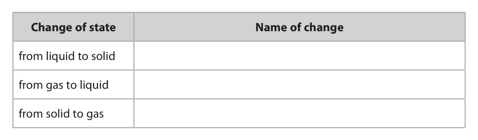

**Mark scheme answer**

> from liquid to solid freezing
> from gas to liquid condensing ALLOW condensation
> from solid to gas sublimation ALLOW subliming

- **(3)** from liquid to solid freezing

### 1(b)(i) [1]

Complete the diagram by drawing six circles to represent atoms in the gas state.

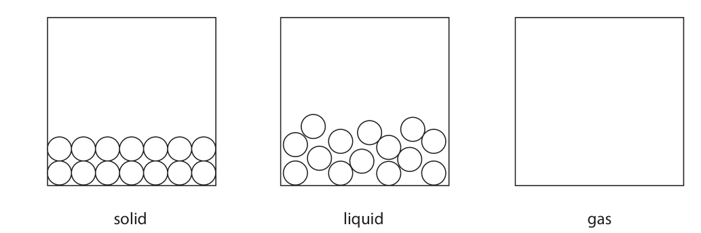

**Mark scheme answer**

> 6 circles similar size randomly arranged none touching At least one circle in
> top/bottom of box

- **(1)** 6 circles similar size randomly arranged none touching At least one circle in

### 1(b)(ii) [1]

Which statement is correct about this substance?

- **(A)** the atoms move randomly in the gas state  ✔
- **(B)** the atoms move randomly in the solid state
- **(C)** the atoms are in fixed positions in the gas state
- **(D)** the atoms are in fixed positions in the liquid state

**Mark scheme answer**

> A (the atoms move randomly in the gas state)
> B is not correct since atoms do not move randomly in
> the solid state
> C is not correct since atoms are not in a fixed position
> in the gas state
> D is not correct since atoms are not in a fixed position
> in the liquid state

- **(1)** Answer A: the atoms move randomly in the gas state

### 1(c) [1]

Complete the equation, by adding the state symbols, for the conversion of water into ice. H2O( ) → H2O( )

**Mark scheme answer**

> H2O(l) → H2O(s) ALLOW upper
> case/lower case
> Total = 6

- **(1)** H2O(l) → H2O(s) ALLOW upper

## Question 2 (6 marks)

The table gives some information about five gases. Name Formula Boiling point in °C chlorine Cl2 –35 hydrogen chloride HCl –114 oxygen O2 –183 nitrogen N2 –196 hydrogen H2 –253

**(a)** Use gases from the table to answer these questions. You may use each gas once, more than once or not at all.

### 2(a)(i) [1]

Name the gas needed for combustion.

**Mark scheme answer**

> oxygen ALLOW O2

- **(1)** oxygen ALLOW O2

### 2(a)(ii) [1]

Name the gas that is most abundant in air.

**Mark scheme answer**

> nitrogen ALLOW N2

- **(1)** nitrogen ALLOW N2

### 2(a)(iii) [1]

Name the gas that can bleach damp litmus paper.

**Mark scheme answer**

> chlorine ALLOW Cl2

- **(1)** chlorine ALLOW Cl2

### 2(b) [2]

Explain why hydrogen chloride is classified as a compound.

**Mark scheme answer**

> M1 (hydrogen chloride) has (atoms of) two / ALLOW two different
> different elements atoms
> M2 (chemically) bonded/joined / (chemically)
> combined together

- **(1)** (hydrogen chloride) has (atoms of) two / ALLOW two different
- **(1)** (chemically) bonded/joined / (chemically)

### 2(c) [1]

Why does chlorine have the highest boiling point of the gases in the table?

- **(A)** chlorine has the strongest covalent bonds between its atoms
- **(B)** chlorine has the strongest covalent bonds between its molecules
- **(C)** chlorine has the strongest ionic bonds between its atoms
- **(D)** chlorine has the strongest forces of attraction between its molecules  ✔

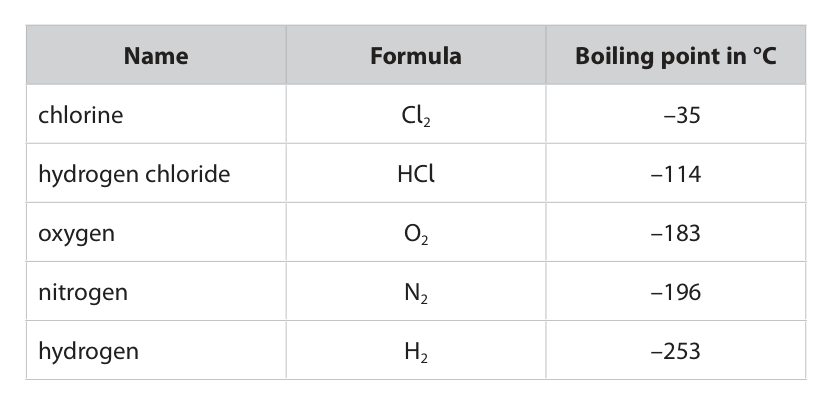

**Mark scheme answer**

> D (chlorine has the strongest forces of attraction
> between its molecules)
> A is not the correct answer because covalent bonds
> are not broken when chlorine boils
> B is not the correct answer because covalent bonds
> do not occur between molecules
> C is not the correct answer because chlorine does
> not have ionic bonds
> Total = 6

- **(1)** Answer D: chlorine has the strongest forces of attraction between its molecules

## Question 3 (8 marks)

This question is about the rusting of iron.

**(b)** The diagram shows two methods used to prevent iron from rusting. iron iron paint zinc Method A Method B Method A will work only if the paint coating is not scratched. Method B will work even if the zinc coating is scratched.

### 3(a)(i) [2]

Name the two substances needed for iron to rust. 1 2

**Mark scheme answer**

> M1 oxygen ALLOW air
> ALLOW O2
> M2 water ALLOW moisture
> ALLOW H2O

- **(1)** oxygen ALLOW air
- **(1)** water ALLOW moisture

### 3(a)(ii) [1]

Give the chemical name for rust.

**Mark scheme answer**

> (hydrated) iron (III) oxide ALLOW ferric oxide
> ALLOW Fe2O3

- **(1)** (hydrated) iron (III) oxide ALLOW ferric oxide

### 3(b)(i) [2]

Explain how method A prevents iron from rusting.

**Mark scheme answer**

> M1 paint acts as a barrier / (protective) layer NOT galvanising
> OWTTE NOT coating/covering
> M2 which prevents water/oxygen/air getting to the
> iron/reacting with iron

- **(1)** paint acts as a barrier / (protective) layer NOT galvanising
- **(1)** which prevents water/oxygen/air getting to the

### 3(b)(ii) [1]

Give the name of method B.

**Mark scheme answer**

> galvanising ALLOW sacrificial
> protection

- **(1)** galvanising ALLOW sacrificial

### 3(b)(iii) [2]

Explain how method B prevents iron from rusting even when the zinc coating is scratched.

**Mark scheme answer**

> M1 zinc is more reactive than iron OR zinc has a ALLOW zinc reacts
> greater tendency to lose electrons instead of iron
> NOT zinc reacts more
> rapidly/faster
> M2 zinc oxidises / forms zinc oxide/reacts before REJECT references to
> iron zinc rusting
> REJECT zinc reacts with
> iron
> Total = 8

- **(1)** zinc is more reactive than iron OR zinc has a ALLOW zinc reacts
- **(1)** zinc oxidises / forms zinc oxide/reacts before REJECT references to

## Question 4 (11 marks)

A student does an experiment to identify the dyes in inks A, B, C, D and E. The student uses this apparatus. • a piece of chromatography paper • a beaker • a solvent • inks A, B, C, D and E

**(b)** The chromatogram shows the results for inks A, B, C, D and E. solvent front start line A B C D E

### 4(a) [5]

Describe how the student should set up the apparatus and do the experiment. You may use a diagram to help your answer.

**Mark scheme answer**

> M1 draw a line in pencil (just above the bottom of
> the paper)
> M2 put a spot of each ink on the line (before
> contact with solvent)
> M3 pour some solvent in the beaker ALLOW water for
> solvent
> M4 place the paper in the beaker so the spots are
> above the solvent
> M5 leave until the solvent has risen up the paper ALLOW water for
> (nearly to the top) solvent
> ALL marks can be
> scored/supported from
> a labelled diagram

- **(1)** draw a line in pencil (just above the bottom of
- **(1)** put a spot of each ink on the line (before
- **(1)** pour some solvent in the beaker ALLOW water for
- **(1)** place the paper in the beaker so the spots are
- **(1)** leave until the solvent has risen up the paper ALLOW water for

### 4(b)(i) [2]

Explain which ink contains a dye that is insoluble in the solvent.

**Mark scheme answer**

> M1 E
> M2 because it stayed on the start line/did not ALLOW didn’t move/ Rf
> travel up paper value =0
> M2 dep on M1

- **(1)** E
- **(1)** because it stayed on the start line/did not ALLOW didn’t move/ Rf

### 4(b)(ii) [2]

Explain which inks contain the same dye.

**Mark scheme answer**

> M1 A and C
> M2 because they both (have a spot) at the same ALLOW travelled same
> height OWTTE distance/same Rf value
> M2 dep on M1

- **(1)** A and C
- **(1)** because they both (have a spot) at the same ALLOW travelled same

### 4(b)(iii) [2]

Describe how the student can use the chromatogram to determine the Rf value for the dye in ink C. You do not need to calculate the Rf value.

**Mark scheme answer**

> M1 measure the distance from the start line to the
> spot and the distance from the start line to the
> solvent front
> M2 distance moved by the spot ÷ distance moved by M2 subsumes M1
> the solvent
> Allow 2 marks for a
> correct calculation
> method
> Total = 11

- **(1)** measure the distance from the start line to the
- **(1)** distance moved by the spot ÷ distance moved by M2 subsumes M1

## Question 5 (11 marks)

Hydrogen peroxide decomposes to form water and oxygen. This decomposition is shown in the equation. 2H2O2 → 2H2O + O2

**(c)** A student uses this apparatus to investigate the rate of decomposition of hydrogen peroxide solution. hydrogen peroxide solution 0 20 40 60 80 100 cm3 oxygen B A catalyst The student adds 100 cm3 of hydrogen peroxide solution at 20 °C to the apparatus labelled A. The student records the volume of oxygen gas collected every minute for 16 minutes. The graph shows the student’s results. 100 Volume of oxygen in cm3 0 4 8 12 16 Time in minutes

### 5(a) [1]

Give the test for oxygen gas.

**Mark scheme answer**

> oxygen relights a glowing splint

- **(1)** oxygen relights a glowing splint

### 5(b) [2]

The rate of reaction is increased by adding a suitable catalyst. Describe how a catalyst increases the rate of a reaction.

**Mark scheme answer**

> M1 a catalyst provides an alternative pathway ALLOW alternative
> route
> M2 of lower activation energy

- **(1)** a catalyst provides an alternative pathway ALLOW alternative
- **(1)** of lower activation energy

### 5(c)(i) [2]

Name the pieces of apparatus labelled A and B. A B

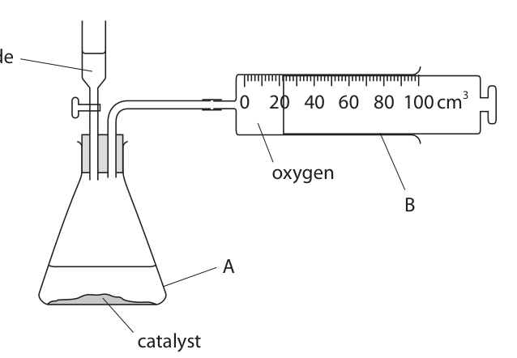

**Mark scheme answer**

> A (conical) flask
> B (gas) syringe

- **(2)** A (conical) flask

### 5(c)(ii) [2]

Determine the volume of oxygen gas produced in the first 4 minutes. Show on the graph how you obtain your answer. volume of oxygen = cm3

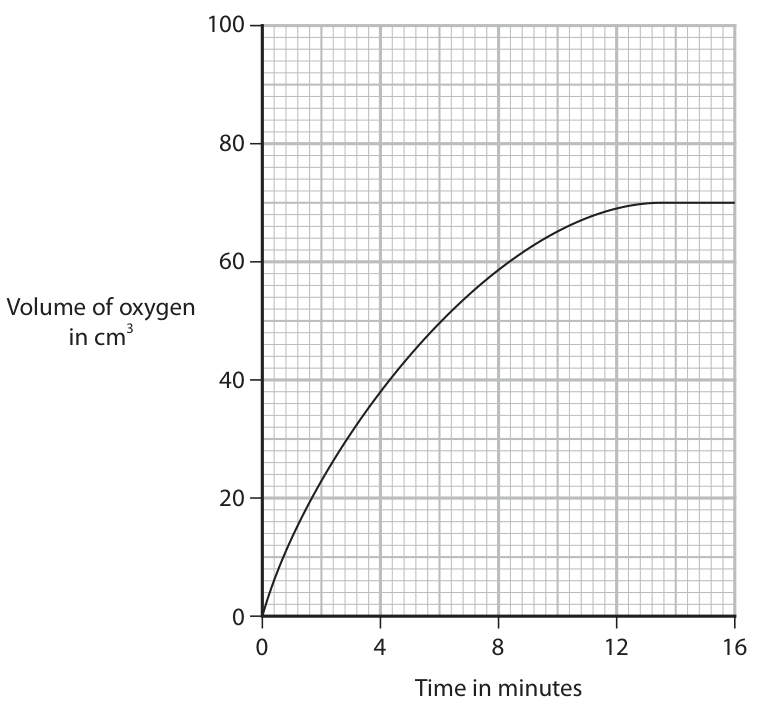

**Mark scheme answer**

> M1 line from 4 minutes to the curved line
> M2 38cm3 ALLOW values 37-39cm3

- **(1)** line from 4 minutes to the curved line
- **(1)** 38cm3 ALLOW values 37-39cm3

### 5(c)(iii) [4]

Determine the rate of reaction at 8 minutes by drawing a suitable tangent to the curve. Include the units for the rate of reaction. rate of reaction = units

**Mark scheme answer**

> M1 tangent drawn to the graph at 8 minutes
> touches curve once only
> M2 measurements made from ALLOW ecf for tangent
> drawn at other than 8
> minutes
> M3 use measurements to calculate rate
> (y2-y1/x2-x1)(1sf or more)
> M4 cm3/minute ALLOW cm3/min
> ALLOW cm3min-1
> ALLOW cm3/s
> ALLOW cm3s-1
> If NO tangent drawn or drawn incorrectly(M1 not
> awarded)
> then M3 awarded for 58-60/8 or 480 calculated
> correctly OR numbers from a calculated
> correctly
> AND M4 for cm3/minutes ALLOW cm3/min
> ALLOW cm3min-1
> ALLOW cm3/s
> ALLOW cm3s-1
> Total = 11

- **(1)** tangent drawn to the graph at 8 minutes
- **(1)** measurements made from ALLOW ecf for tangent
- **(1)** use measurements to calculate rate
- **(1)** cm3/minute ALLOW cm3/min

## Question 6 (11 marks)

This question is about ionic and covalent compounds.

**(a)** The table gives the formulae of some positive ions, some negative ions and some compounds containing these ions. NH+4 Zn2+ Al3+ Cl– NH4Cl ZnCl2 SO42– (NH4)2SO4 Al2(SO4)3 N3– Zn3N2 AlN

### 6(a)(i) [3]

Complete the table by giving the three missing formulae.

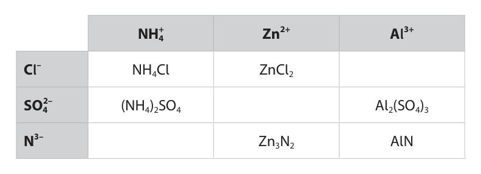

**Mark scheme answer**

> AlCl3 ALLOW formula in
> reverse
> ZnSO4 NOT molecular formula
> Penalise symbol
> (NH4)3N letters/size of subscripts
> once only

- **(3)** AlCl3 ALLOW formula in

### 6(a)(ii) [1]

Give the name of the compound with the formula Al2(SO4)3

**Mark scheme answer**

> aluminium sulfate ALLOW aluminium
> sulphate

- **(1)** aluminium sulfate ALLOW aluminium

### 6(b) [3]

The diagram shows the arrangement of electrons in an atom of magnesium and an atom of chlorine. Magnesium Chlorine Describe, in terms of electrons, what happens when magnesium atoms and chlorine atoms form magnesium chloride.

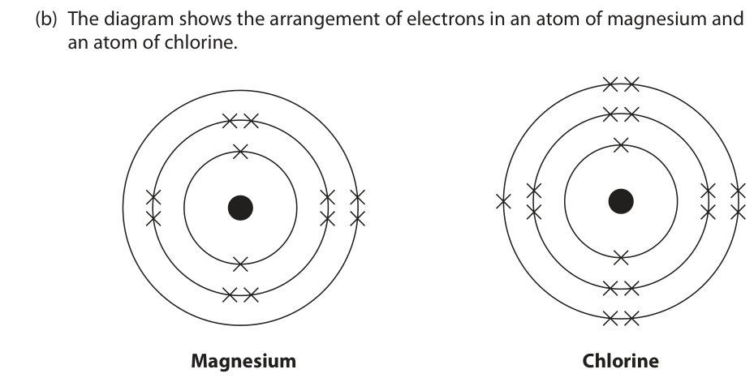

**Mark scheme answer**

> M1 magnesium loses electrons ALLOW magnesium
> gives/transfers electrons
> M2 chlorine gains electrons to chlorine for M1,M2
> NOT chloride gains
> electrons
> M3 magnesium loses two electrons and two chlorines M3 assumes M1,M2
> each gain one electron
> ALLOW correct ionic
> equations

- **(1)** magnesium loses electrons ALLOW magnesium
- **(1)** chlorine gains electrons to chlorine for M1,M2
- **(1)** magnesium loses two electrons and two chlorines M3 assumes M1,M2

### 6(c)(i) [2]

Complete the dot-and-cross diagram to show the outer shell electrons in a molecule of ammonia. N H H H

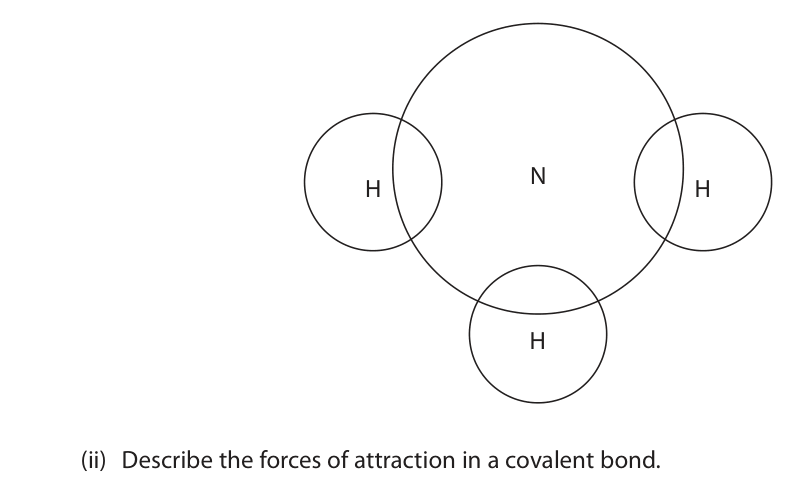

**Mark scheme answer**

> M1 two electrons between each nitrogen and
> hydrogen atom
> M2 two non-bonding electrons M2 dep on M1

- **(1)** two electrons between each nitrogen and
- **(1)** two non-bonding electrons M2 dep on M1

### 6(c)(ii) [2]

Describe the forces of attraction in a covalent bond.

**Mark scheme answer**

> M1 (electrostatic) forces of attraction between shared
> pair(s) of electrons
> M2 and the nuclei REJECT nucleus (must
> be plural)
> REJECT intermolecular
> forces for both marks
> Total = 11

- **(1)** (electrostatic) forces of attraction between shared
- **(1)** and the nuclei REJECT nucleus (must

## Question 7 (8 marks)

Magnesium sulfate crystals have the formula MgSO4.xH2O A student uses this apparatus to heat tube A and collect water of crystallisation in tube B. magnesium sulfate crystals tube A tube B heat ice water The student records the mass of tube B at the start and every minute for 6 minutes. The table gives the student’s results. Time in minutes Mass of tube B in g 0 15.8 1 16.5 2 17.6 3 19.2 4 20.4 5 22.1 6 22.1

### 7(a)(i) [1]

Give a reason why the student surrounds tube B with ice.

**Mark scheme answer**

> any one from:
> M1 to condense the water vapour ALLOW condense
> steam/condense gas
> NOT cools water
> M2 to ensure all the water collects in the tube (as a NOT stops water
> liquid) evaporating

- **(1)** any one from:

### 7(a)(ii) [1]

State how the student knows when all the water of crystallisation has been given off.

**Mark scheme answer**

> When the mass doesn’t change / is constant/stops Accept: the last two
> increasing results are the same
> Accept: balance reading
> stays the same

- **(1)** When the mass doesn’t change / is constant/stops Accept: the last two

### 7(b) [2]

Describe a chemical test the student can use to show that the liquid in tube B contains water.

**Mark scheme answer**

> M1 add anhydrous/white copper(II) sulfate/sulphate ALLOW
> anhydrous/white copper
> sulfate/sulphate
> ALLOW add
> anhydrous/blue cobalt
> chloride
> M2 which turns (from white to) blue ALLOW which turns
> (from blue to) pink
> M2 dep on M1

- **(1)** add anhydrous/white copper(II) sulfate/sulphate ALLOW
- **(1)** which turns (from white to) blue ALLOW which turns

### 7(c) [4]

The decomposition of hydrated magnesium sulfate is shown in the equation. MgSO4.xH2O → MgSO4 + xH2O At the end of the reaction, the mass of MgSO4 remaining in the tube is 6.0 g. Use this mass and the results in the table to calculate x in MgSO4.xH2O [for MgSO4 , Mr = 120 for H2O, Mr = 18] x =

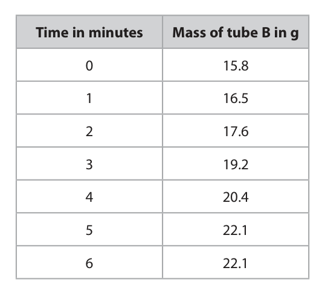

**Mark scheme answer**

> M1 (mass of water) = 6.3g Ecf for incorrect mass of
> water
> M2 (moles of MgSO4) = 0.05
> M3 (moles of H2O) 0.35 M1 can be awarded
> from moles of H2O in M3
> M4 x=7
> Answer of 7 on its own
> scores 4 marks
> Total = 8

- **(1)** (mass of water) = 6.3g Ecf for incorrect mass of
- **(1)** (moles of MgSO4) = 0.05
- **(1)** (moles of H2O) 0.35 M1 can be awarded
- **(1)** x=7

## Question 8 (9 marks)

A student uses this apparatus to investigate the rate of reaction between marble chips and dilute hydrochloric acid. cotton wool dilute hydrochloric acid marble chips balance g This is the equation for the reaction. CaCO3(s) + 2HCl(aq) → CaCl2(aq) + H2O(l) + CO2(g)

**(d)** The student repeats the experiment with hydrochloric acid at a higher temperature to investigate the effect on the rate of reaction.

### 8(a) [1]

Give a reason why the reading on the balance decreases during the reaction.

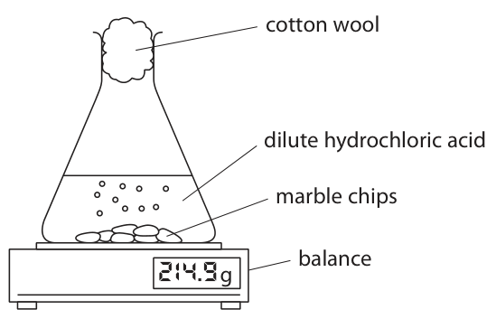

**Mark scheme answer**

> carbon dioxide/a gas escapes/is lost/released NOT carbon dioxide/gas
> (through the cotton wool) is given off/produced
> NOT wrong named gas

- **(1)** carbon dioxide/a gas escapes/is lost/released NOT carbon dioxide/gas

### 8(b) [2]

Explain why the rate of reaction is greatest at the start.

**Mark scheme answer**

> M1 the concentration (of hydrochloric acid) is ALLOW there is a
> highest greater surface area of
> marble chips
> ALLOW greater amount
> of hydrochloric
> acid/reactants
> ALLOW more particles
> M2 so there are more collisions per unit time ALLOW more frequent
> collisions
> REJECT references to
> greater (kinetic) energy
> for both marks

- **(1)** the concentration (of hydrochloric acid) is ALLOW there is a
- **(1)** so there are more collisions per unit time ALLOW more frequent

### 8(c) [1]

After 10 minutes, the reaction stops even though there are marble chips remaining. Give a reason why the reaction stops.

**Mark scheme answer**

> the hydrochloric acid has been used up OWTTE NOT acid is saturated
> IGNORE acid is a
> limiting factor

- **(1)** the hydrochloric acid has been used up OWTTE NOT acid is saturated

### 8(d)(i) [2]

Give two variables that should be controlled to make sure the results are valid. 1 2

**Mark scheme answer**

> any two from:
> (same) mass of marble chips ALLOW (same) amount
> of marble chips
> (same) surface area of marble chips ALLOW (same) size
> marble chips
> (same) concentration of hydrochloric acid
> (same) volume of hydrochloric acid NOT same amount of
> acid

- **(2)** any two from:

### 8(d)(ii) [3]

Explain the effect of increasing the temperature of hydrochloric acid on the rate of reaction.

**Mark scheme answer**

> M1 rate of reaction increases
> M2 particles have more energy OR more particles ALLOW particles move
> have energy greater than (or equal to) the faster
> activation energy
> M3 so more successful collisions per unit time ALLOW more frequent
> successful collisions
> Total = 9

- **(1)** rate of reaction increases
- **(1)** particles have more energy OR more particles ALLOW particles move
- **(1)** so more successful collisions per unit time ALLOW more frequent

## Question 9 (13 marks)

A student uses this apparatus to investigate the heat energy released when a liquid fuel burns. thermometer aluminium can water spirit burner liquid fuel This is the student’s method. • measure the mass of the spirit burner and fuel • add 100 g of water to the aluminium can • measure the temperature of the water • use the spirit burner to heat the water until the temperature rises by 50 °C • measure the new mass of the spirit burner and fuel

**(b)** When the fuel burns, a black solid forms on the aluminium can.

**(d)** In a different experiment, the student burns 3.7 g of butanol. This is an equation for the incomplete combustion of butanol. C4H9OH(l) + O2(g) → 2CO2(g) + 2CO(g) + 5H2O(g)

### 9(a) [1]

Give a reason why the student uses an aluminium can rather than a glass beaker.

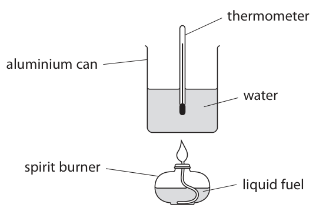

**Mark scheme answer**

> aluminium is a better conductor (of heat) than glass REJECT insulation
> (comparison needed) references

- **(1)** aluminium is a better conductor (of heat) than glass REJECT insulation

### 9(b)(i) [1]

Identify the black solid.

**Mark scheme answer**

> carbon / soot/ C

- **(1)** carbon / soot/ C

### 9(b)(ii) [1]

Give a reason why the black solid forms.

**Mark scheme answer**

> incomplete combustion occurs OR the supply of
> oxygen/air is limited

- **(1)** incomplete combustion occurs OR the supply of

### 9(c)(i) [2]

Show that the heat energy needed to raise the temperature of 100 g of water by 50 °C is approximately 20 000 J. [for water, c = 4.2 J/g/°C]

**Mark scheme answer**

> M1100×4.2×50
> M2 21000(J) ALLOW ecf for M2 if
> answer close to 20000J

- **(2)** M1100×4.2×50

### 9(c)(ii) [4]

The student burns 1.84 g of ethanol. Calculate the molar enthalpy change, ΔH, in kJ/mol, for the combustion of ethanol. Include a sign in your answer. [for ethanol, Mr = 46] ΔH = kJ/mol

**Mark scheme answer**

> M1 21 kJ ALLOW 20kJ
> M2 1.84÷46 OR 0.04 moles
> M3 21÷0.04 OR 525 (kJ/mol) ALLOW 21÷M2
> ALLOW 500 (kJ/mol) if
> 20kJ used
> M4 -525 (kJ/mol) M4 is for the – sign.
> ALLOW ecf from M3

- **(1)** 21 kJ ALLOW 20kJ
- **(1)** 1.84÷46 OR 0.04 moles
- **(1)** 21÷0.04 OR 525 (kJ/mol) ALLOW 21÷M2
- **(1)** -525 (kJ/mol) M4 is for the – sign.

### 9(d)(i) [1]

Complete the equation for the incomplete combustion of butanol.

**Mark scheme answer**

> 5O2 ALLOW multiples if the
> rest of the balancing
> numbers have been
> multiplied

- **(1)** 5O2 ALLOW multiples if the

### 9(d)(ii) [3]

Calculate the total amount, in moles, of gas produced by the incomplete combustion of 3.7 g of butanol. amount of gas = mol

**Mark scheme answer**

> M1 (Mr of butanol) 74
> M2 (moles of butanol) 3.7÷74 OR 0.05 ALLOW 3.7÷M1 if
> attempted Mr shown
> M3 0.45 moles ALLOW M2×9
> Answer of 0.45 scores 3
> Total = 13

- **(1)** (Mr of butanol) 74
- **(1)** (moles of butanol) 3.7÷74 OR 0.05 ALLOW 3.7÷M1 if
- **(1)** 0.45 moles ALLOW M2×9

## Question 10 (12 marks)

This question is about alkanes and alkenes.

**(a)** Ethane and ethene each react with bromine, but under different conditions.

**(b)** The diagram shows the displayed formulae of two compounds in the homologous series of alkenes. H H H H H H H H C C C C H H C C C C H H H H H H

### 10(a)(i) [1]

Give a reason why ethane does not undergo an addition reaction with bromine.

**Mark scheme answer**

> any one from:
> M1 ethane is saturated
> M2 ethane has no double bonds
> M3 ethane has single bonds only

- **(1)** any one from:

### 10(a)(ii) [2]

Complete the equation for the substitution reaction between ethane and bromine, including an essential condition for the reaction. C2H6 + Br2 → + condition

**Mark scheme answer**

> M1 products C2H5Br and HBr In either order
> ALLOW balanced
> equations with a
> polysubstituted
> halogenoalkane
> M2 condition ultra violet radiation / ultra violet
> light/UV

- **(1)** products C2H5Br and HBr In either order
- **(1)** condition ultra violet radiation / ultra violet

### 10(a)(iii) [1]

Give the colour change that occurs when ethene reacts with bromine water.

**Mark scheme answer**

> orange/yellow/brown to colourless/decolourises NOT red/red-brown

- **(1)** orange/yellow/brown to colourless/decolourises NOT red/red-brown

### 10(b)(i) [2]

Compounds in the same homologous series have the same general formula. Give two other characteristics of compounds in the same homologous series. 1 2

**Mark scheme answer**

> any two from:
> M1 same functional group
> M2 the same/similar chemical properties OR NOT similar reactivity
> undergo same/similar chemical reactions
> M3 trend in physical properties ALLOW a named
> physical property e.g.
> boiling point
> NOT similar physical
> properties
> M4 differ by CH2

- **(2)** any two from:

### 10(b)(ii) [2]

Explain why the alkenes in the diagram are isomers.

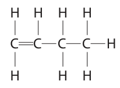

**Mark scheme answer**

> M1 same molecular formula NOT same
> empirical/general
> formula
> M2 different displayed/structural formulae ALLOW different
> structures/arrangements

- **(1)** same molecular formula NOT same
- **(1)** different displayed/structural formulae ALLOW different

### 10(b)(iii) [1]

Draw the displayed formula of another alkene that is an isomer of these two alkenes.

**Mark scheme answer**

> ALLOW E/trans isomer
> M1 chain length longer in poly(ethene)

- **(1)** chain length longer in poly(ethene)

### 10(c) [3]

The reaction used to make poly(ethene) can be represented by this equation. ( ( H H H H n C C C C H H H H n Describe the differences between the reactant and the product in this reaction. Refer to carbon chain length, type of bond and state of matter in your answer.

**Mark scheme answer**

> 3
> M2 polymer contains only single (covalent) bonds
> /no double bond ALLOW monomer
> contains double C=C
> bonds
> ALLOW reactant/ethene
> unsaturated
> ALLOW
> product/polyethene
> saturated
> M3 ethene is a gas and poly(ethene) is a solid
> Total = 12

- **(3)** 3

## Question 11 (15 marks)

This question is about the reactions of some compounds of lead.

**(a)** Lead can be extracted from lead(II) sulfide, PbS, in two stages. Stage 1	lead(II) sulfide is heated in air and reacts with oxygen to produce lead(II) oxide, PbO, and sulfur dioxide Stage 2 lead(II) oxide is heated with carbon in a furnace

### 11(a)(i) [2]

Write a chemical equation for the reaction in stage 1.

**Mark scheme answer**

> 2PbS + 3O2 → 2PbO + 2SO2
> M1 formulae of O2 and SO2
> M2 rest of equation correctly balanced M2 dep on M1
> ALLOW
> multiples/fractions

- **(1)** formulae of O2 and SO2
- **(1)** rest of equation correctly balanced M2 dep on M1

### 11(a)(ii) [1]

Give a reason why sulfur dioxide should not be released into the atmosphere.

**Mark scheme answer**

> (sulfur dioxide causes) acid rain / breathing problems ALLOW named
> breathing problems such
> as asthma
> ALLOW other effects of
> acid rain such as killing
> fish, damage to
> stonework, killing plants

- **(1)** (sulfur dioxide causes) acid rain / breathing problems ALLOW named

### 11(a)(iii) [3]

This is the equation for stage 2. 2PbO + C → 2Pb + CO2 A mass of 892 tonnes of lead(II) oxide is heated in a furnace with an excess of carbon. Calculate the maximum mass, in tonnes, of carbon dioxide that could be released into the atmosphere. [1 tonne = 1 × 106 g] [for PbO, Mr = 223 for CO2 , Mr = 44] mass = tonnes

**Mark scheme answer**

> M1 (moles lead(II) oxide) = 892 000 000 ÷ 223 OR ALLOW calculations
> 4 000 000 moles done in megamoles
> throughout
> M2 (moles of carbon dioxide) = 2 000 000 ALLOW M1÷2
> M3(mass of carbon dioxide) = 88 (tonnes) 88 (tonnes) scores 3
> marks

- **(3)** M1 (moles lead(II) oxide) = 892 000 000 ÷ 223 OR ALLOW calculations

### 11(a)(iv) [5]

The diagram shows the structures of lead(II) sulfide and sulfur dioxide. Lead(II) sulfide Sulfur dioxide Explain, in terms of bonding and structure, why lead(II) sulfide is a solid with a very high melting point at room temperature and why sulfur dioxide is a gas at room temperature. lead(II) sulfide sulfur dioxide QUESTION 11 CONTINUES ON NEXT / BACK PAGE.

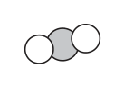

**Mark scheme answer**

> any 5 from:
> lead(II) sulfide
> M1 giant ionic structure/lattice REJECT
> molecules/covalent
> bonds/ intermolecular
> forces for all three
> marks
> M2 strong (ionic) bonds OR strong electrostatic
> forces (between oppositely charged) ions
> M3 which take a lot of energy to break / overcome M3 dep on M2
> sulfur dioxide
> REJECT ions/ionic
> bonds for all 3 marks
> M4 simple molecular/covalent structure ALLOW molecules
> NOT particles/atoms
> M5 weak intermolecular forces OR weak forces NOT weak IMF between
> between molecules atoms
> M6 which take little energy to overcome M6 dep on M5

- **(5)** any 5 from:

### 11(b) [4]

A different oxide of lead contains 90.7% by mass of lead and 9.3% by mass of oxygen. Determine the empirical formula of this oxide of lead. empirical formula =

**Mark scheme answer**

> M1 90.7÷207 and 9.30÷16 NOT atomic numbers
> M2 0.438 (moles of lead) and 0.581 (moles of ALLOW 9.30÷32 for ecf
> oxygen) Answer must be 2sf or
> more
> M3 ratio of moles = 1:1.33 ALLOW 1.3
> M4 empirical formula is Pb3O4 ALLOW ecf from ratio
> shown to produce
> formula
> Total = 15
> Pearson Education Limited. Registered company number 872828
> with its registered office at 80 Strand, London, WC2R 0RL, United Kingdom

- **(1)** 90.7÷207 and 9.30÷16 NOT atomic numbers
- **(1)** 0.438 (moles of lead) and 0.581 (moles of ALLOW 9.30÷32 for ecf
- **(1)** ratio of moles = 1:1.33 ALLOW 1.3
- **(1)** empirical formula is Pb3O4 ALLOW ecf from ratio

