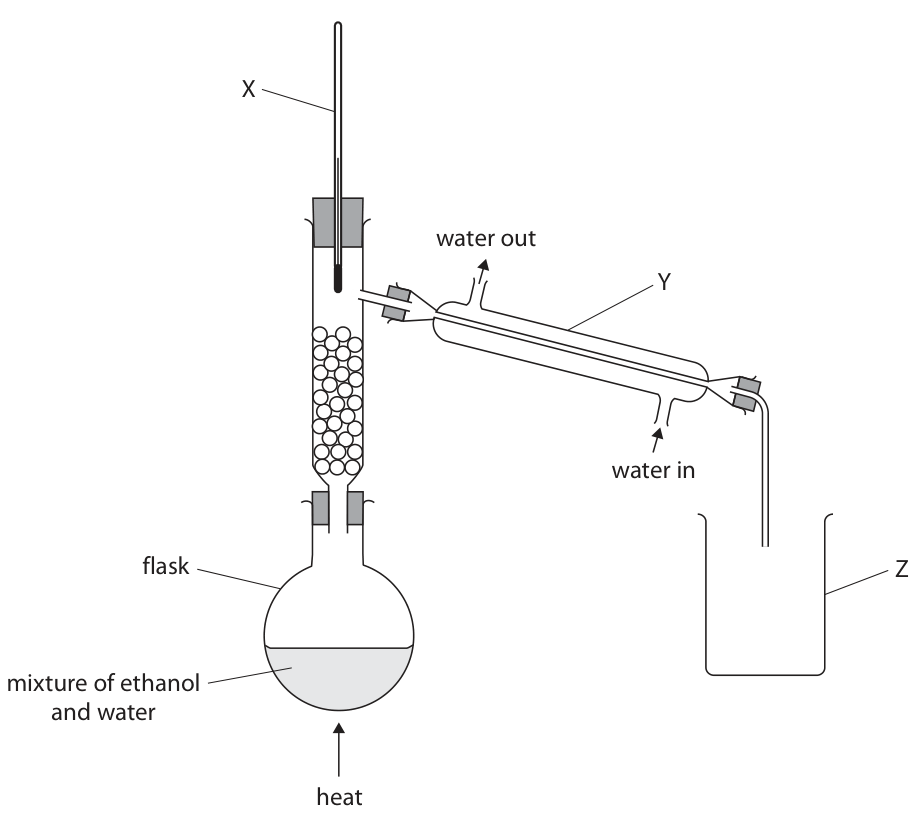
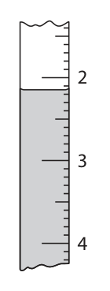
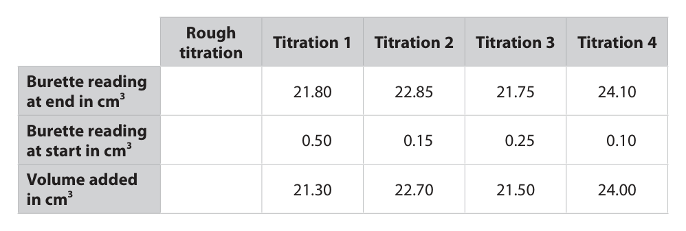
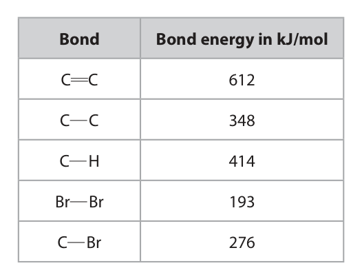

# 4CH1/2C — 2024-11 (official extraction)

> schema `syllabai.official-paper-questions/0.1` · paper_id `pearson-edexcel:international-gcse:chemistry:4ch1:2024-11:4CH1/2C` · qp sha256 `ab746dd318eecaaf…` · extracted verbatim, never regenerated (ADR-037)

## Question 1 (7 marks)

The table shows the composition of five species that are either atoms or ions. Species Number of protons Number of neutrons Number of electrons A 1 0 1 B 3 3 3 C 3 4 3 D 9 10 10 E 13 14 13

**(a)** Use the table to answer these questions. You may use each letter once, more than once, or not at all.

### 1(a)(i) [1]

Give the letter of the species that is a negative ion.

**Mark scheme answer**

> D

- **(1)** D

### 1(a)(ii) [1]

Give the letter of the species that has a full outer shell of electrons.

**Mark scheme answer**

> D

- **(1)** D

### 1(a)(iii) [1]

Give the letter of the species that has an atomic number equal to its mass number. 

**Mark scheme answer**

> A

- **(1)** A

### 1(b) [2]

Explain why species B and C are atoms of the same element with identical chemical properties.

**Mark scheme answer**

> M1 (they are both atoms of the same element ALLOW same atomic
> because they both have the) same number of protons number
> M2 (they have the same chemical properties because
> they both have the) same electron configuration ALLOW same number
> of electrons
> IGNORE same number
> of electrons in the outer
> shell
> IGNORE any mention of
> neutrons

- **(1)** (they are both atoms of the same element ALLOW same atomic
- **(1)** (they have the same chemical properties because

### 1(c) [2]

A proton has a mass of 1.6726 × 10–24 g. A neutron has a mass of 1.6740 × 10–24 g. Calculate the mass, in grams, of the nucleus of an atom of species C. mass = g

**Mark scheme answer**

> M1 (3×1.6726×10-24)+(4×1.6740×10-24) 1.17138×10-23 without
> working scores 2
> M2 1.1714×10-23
> answer must be in
> correct standard form
> ALLOW any number of
> significant figures from 2
> and correctly rounded
> ALLOW ecf for M2 as
> long as the numbers are
> added
> possible answers 1
> mark for 3.3466 x 10-24
> 1.00398 x 10-23
> Total = 7
> Question
> Answer Notes Marks
> number

- **(1)** (3×1.6726×10-24)+(4×1.6740×10-24) 1.17138×10-23 without
- **(1)** 1.1714×10-23

## Question 2 (8 marks)

This question is about metals and metal compounds.

**(a)** All metals are malleable and good conductors of electricity. The diagram shows the structure of a metal. + + + + + metal ion + + + + electron + + + + +

### 2(a)(i) [2]

Explain why metals are malleable.

**Mark scheme answer**

> M1 layers (of atoms or ions or particles) ALLOW rows or sheets
> M2 (atoms /ions) can slide over one another
> no marks if mention of
> intermolecular forces or
> electrons sliding

- **(1)** layers (of atoms or ions or particles) ALLOW rows or sheets
- **(1)** (atoms /ions) can slide over one another

### 2(a)(ii) [2]

Explain why metals are good conductors of electricity. 

**Mark scheme answer**

> M1 electrons are delocalised any reference to ions
> moving scores 0
> M2 and (electrons) can move / flow (throughout the must mention electrons
> structure) in the answer in M1

- **(1)** electrons are delocalised any reference to ions
- **(1)** and (electrons) can move / flow (throughout the must mention electrons

### 2(b) [2]

Two methods of obtaining a metal from a compound are electrolysis and extraction using carbon. Explain, without giving practical details, which method is most suitable for extracting iron from iron(III) oxide.

**Mark scheme answer**

> M1 carbon extraction / extraction using carbon no marks if electrolysis
> in M1
> M2 iron is less reactive (than carbon) OR carbon is
> more reactive (than iron)

- **(1)** carbon extraction / extraction using carbon no marks if electrolysis
- **(1)** iron is less reactive (than carbon) OR carbon is

### 2(c) [2]

A student has a solution of iron(II) sulfate and a solution of iron(III) sulfate. Describe a chemical test the student could use to identify which solution is iron(II) sulfate.

**Mark scheme answer**

> M1 add sodium hydroxide (to both solutions) IGNORE OH-/ hydroxide
> ions for M1 but allow M2
> M2 iron(II) sulfate forms a green precipitate /ppt IGNORE sluggish green
> or green sludge
> IGNORE iron(III) sulfate
> even if incorrect unless
> it is a green precipitate
> M2 dep on M1 or any
> soluble hydroxides
> Total = 8
> Question
> Answer Notes Marks
> number

- **(1)** add sodium hydroxide (to both solutions) IGNORE OH-/ hydroxide
- **(1)** iron(II) sulfate forms a green precipitate /ppt IGNORE sluggish green

## Question 3 (6 marks)

A teacher uses this apparatus to separate a mixture of ethanol and water. X water out Y water in flask Z mixture of ethanol and water heat

### 3(a) [1]

Give the name of this method of separation. 

- **(A)** chromatography
- **(B)** crystallisation
- **(C)** filtration
- **(D)** fractional distillation  ✔

**Mark scheme answer**

> D (fractional distillation)
> A is not the answer as this technique is not
> chromatography
> B is not the answer as this technique is not
> crystallisation
> C is not the answer is this technique is not filtration

- **(1)** Answer D: fractional distillation

### 3(b) [3]

Name the pieces of apparatus labelled X, Y and Z. X Y Z

**Mark scheme answer**

> X = thermometer
> Y = (Liebig) condenser
> Z = beaker

- **(3)** X = thermometer

### 3(c) [2]

Give a physical test that the teacher could do to find out if the ethanol produced is pure.

**Mark scheme answer**

> M1 measure / test the boiling point ALLOW boil the ethanol
> M2 a pure substance has a fixed boiling point / IGNORE a pure
> boiling point of 78ºC substance has a fixed
> melting point
> IGNORE any incorrect
> temperature
> ALLOW a pure
> substance will not boil
> over a range of
> temperatures
> ALLOW if it boils over a
> range of temperatures
> it is impure
> Total = 6
> Question
> Answer Notes Marks
> number

- **(1)** measure / test the boiling point ALLOW boil the ethanol
- **(1)** a pure substance has a fixed boiling point / IGNORE a pure

## Question 4 (11 marks)

A teacher adds a small piece of lithium to water and collects the gas produced.

**(c)** The teacher then adds a small piece of potassium to water.

### 4(a)(i) [2]

Give two observations when lithium is added to water. 1 2

**Mark scheme answer**

> any two from:
> M1 effervescence / bubbles / fizzing (of hydrogen)
> M2 (the piece of lithium) gets smaller / disappears ALLOW dissolves
> M3 (the piece of lithium) moves on the surface ALLOW (the piece of
> lithium) floats (on the
> surface)
> M4 white trail
> any mention of a flame
> MAX = 1

- **(2)** any two from:

### 4(a)(ii) [2]

The teacher adds a few drops of universal indicator to the solution at the end of the reaction. Explain the final colour of the universal indicator.

**Mark scheme answer**

> M1 blue/purple
> M2 hydroxide ions / lithium hydroxide / an alkaline
> solution / an alkali / OH- (ions) is produced / formed

- **(1)** blue/purple
- **(1)** hydroxide ions / lithium hydroxide / an alkaline

### 4(b) [3]

This is the equation for the reaction between lithium and water. 2Li(s) + 2H2O(l) → 2LiOH(aq) + H2(g) The teacher collects 550 cm3 of hydrogen at rtp. Calculate the mass, in grams, of lithium that the teacher added to the water. [one mole of gas at rtp has a volume of 24 000 cm3] [for lithium, Ar = 7] [for carbon Ar = 12 for hydrogen, Ar = 1 for oxygen Ar = 16] mass = g 

**Mark scheme answer**

> M1 (moles of H2) = 550÷24000 OR 0.0229 0.321g scores 3
> M2 (moles of Li) = 0.0229×2 OR 0.0458 ALLOW M1×2
> M3 (mass of Li) 0.321 (g) ALLOW M2×7
> ALLOW 0.32 / 0.3206
> /0.32088 /0.32083
> /0.322
> minimum 2 sig. figs.

- **(1)** (moles of H2) = 550÷24000 OR 0.0229 0.321g scores 3
- **(1)** (moles of Li) = 0.0229×2 OR 0.0458 ALLOW M1×2
- **(1)** (mass of Li) 0.321 (g) ALLOW M2×7

### 4(c)(i) [1]

Give one observation seen with potassium that is not seen with lithium.

**Mark scheme answer**

> any one from:
> M1 (lilac) flame REJECT an incorrect
> colour of the flame
> M2 melts / turns into a ball
> ALLOW faster
> effervescence / moves
> faster / can explode

- **(1)** any one from:

### 4(c)(ii) [3]

Explain why potassium is more reactive than lithium. Refer to atomic structure in your answer.

**Mark scheme answer**

> M1 (atoms of potassium) are bigger / have more ALLOW / more shielding
> shells (of electrons) / larger atomic radius from the nucleus
> / the outer shell electron is further from the nucleus / Li 2,1 K 2,8,8,1
> M2 (therefore) the outer shell electron is less lose 1 mark if outer shell
> attracted to the nucleus electron is not
> mentioned
> M3 (and therefore the outer shell) electron is more lose 1 mark in M2 or M3
> easily lost if electrons are
> mentioned
> Total = 11
> Question
> Answer Notes Marks
> number

- **(1)** (atoms of potassium) are bigger / have more ALLOW / more shielding
- **(1)** (therefore) the outer shell electron is less lose 1 mark if outer shell
- **(1)** (and therefore the outer shell) electron is more lose 1 mark in M2 or M3

## Question 5 (13 marks)

A student does some titrations to find the volume of dilute nitric acid needed to exactly neutralise 25.0 cm3 of sodium hydroxide solution. This is the student’s method. Step 1 add 25.0 cm3 of sodium hydroxide solution to a conical flask Step 2 add three drops of methyl orange indicator Step 3 fill a burette with the acid Step 4 add acid from the burette until the indicator changes colour Step 5 record the volume of acid added

**(b)** The student completes a rough titration and four accurate titrations. The diagram shows the burette readings from the rough titration. Start End 2 23 3 24 4 25  The table shows the student’s results. Rough Titration 1 Titration 2 Titration 3 Titration 4 titration Burette reading 21.80 22.85 21.75 24.10 at end in cm3 Burette reading 0.50 0.15 0.25 0.10 at start in cm3 Volume added 21.30 22.70 21.50 24.00 in cm3

### 5(a)(i) [1]

Give the name of the apparatus that the student should use to measure the volume of sodium hydroxide solution in step 1.

**Mark scheme answer**

> (volumetric) pipette REJECT dropping pipette

- **(1)** (volumetric) pipette REJECT dropping pipette

### 5(a)(ii) [1]

Give the colour change seen in step 4.

**Mark scheme answer**

> yellow to red ALLOW yellow to orange
> / yellow to pink
> must be in the correct
> order

- **(1)** yellow to red ALLOW yellow to orange

### 5(a)(iii) [1]

Give a reason why the student does not use universal indicator in this titration.

**Mark scheme answer**

> any one from:
> M1 (universal indicator) does not give a sharp colour ALLOW has no clear end
> change point
> M2 (universal indicator) changes colour over a range ALLOW there are a wide
> of pH values range of colours / colour
> change is too gradual

- **(1)** any one from:

### 5(b)(i) [2]

Complete the table by adding the results from the rough titration. Record the volumes to the nearest 0.05 cm3

**Mark scheme answer**

> M1 volume at end 23.80(cm3) and volume at start no M1 for 23.8
> 2.15(cm3)
> M2 volume added 21.65(cm3) ALLOW ecf if M1 values
> are incorrect but correct
> subtraction to 2 decimal
> places

- **(1)** volume at end 23.80(cm3) and volume at start no M1 for 23.8
- **(1)** volume added 21.65(cm3) ALLOW ecf if M1 values

### 5(b)(ii) [3]

Concordant results are results within 0.20 cm3 of each other. Use the concordant results from the table to calculate the mean volume of acid added. mean volume of acid = cm3 

**Mark scheme answer**

> M1 volumes from titrations 1 and 3 used
> M2 (21.30+21.50)÷2 ALLOW ECF from M1
> M3 21.40(cm3) ALLOW ECF from M2
> common answers are
> 21.48/22.38/21.83/22.23
> 21.50/22.40/21.85/22.25

- **(1)** volumes from titrations 1 and 3 used
- **(1)** (21.30+21.50)÷2 ALLOW ECF from M1
- **(1)** 21.40(cm3) ALLOW ECF from M2

### 5(c) [5]

This is the equation for the reaction between dilute nitric acid and sodium hydroxide solution. HNO3(aq) + NaOH(aq) → NaNO3(aq) + H2O(l) After the titration, the student knows the volume of acid needed to neutralise 25.0 cm3 of the sodium hydroxide solution. Sodium nitrate decomposes at high temperatures. Describe how the student could obtain pure, dry crystals of sodium nitrate from dilute nitric acid and sodium hydroxide solution.

**Mark scheme answer**

> M1 repeat using the same volumes of NaOH and HNO 3 M1 only if heated to
> OR repeat without indicator dryness
> M2 heat until crystals first start to form /heat to ALLOW heat to evaporate
> crystallisation point / heat until crystals form on the some/most of the water
> end of a glass rod /to form a saturated
> solution
> lose 1 mark if no mention
> M3 leave to cool (and crystallise) of crystals for M3, M4, M5
> M4 pour off excess liquid OR filter (to remove IGNORE wash crystals
> crystals)
> ALLOW dry in a (warm)
> oven/in a dessicator
> M5 leave (in a warm place) to dry /dry with filter paper
> /towel/cloth
> Total = 13
> Question
> Answer Notes Marks
> number

- **(1)** repeat using the same volumes of NaOH and HNO 3 M1 only if heated to
- **(1)** heat until crystals first start to form /heat to ALLOW heat to evaporate
- **(1)** leave to cool (and crystallise) of crystals for M3, M4, M5
- **(1)** pour off excess liquid OR filter (to remove IGNORE wash crystals
- **(1)** leave (in a warm place) to dry /dry with filter paper

## Question 6 (13 marks)

This question is about crude oil.

**(b)** Some of the long-chain alkanes obtained from fractional distillation are cracked, producing shorter-chain alkanes and ethene.

### 6(a) [4]

Describe how crude oil is separated into fractions by fractional distillation.

**Mark scheme answer**

> M1 crude oil / it is heated ALLOW boiled/vaporised
> M2 the vapours / gases rise up the column
> M3 the column is hotter at the bottom than the top ALLOW the vapours cool as
> OWTTE they rise up the
> column/temperature
> gradient
> M4 the vapours condense at their boiling points

- **(1)** crude oil / it is heated ALLOW boiled/vaporised
- **(1)** the vapours / gases rise up the column
- **(1)** the column is hotter at the bottom than the top ALLOW the vapours cool as
- **(1)** the vapours condense at their boiling points

### 6(b)(i) [2]

Give the conditions necessary for cracking to occur.

**Mark scheme answer**

> M1 600-700°C ALLOW any number or
> range between 600-700
> M2 catalyst of silica/alumina ALLOW aluminosilicates/
> zeolites / SiO2 / Al2O3

- **(1)** 600-700°C ALLOW any number or
- **(1)** catalyst of silica/alumina ALLOW aluminosilicates/

### 6(b)(ii) [2]

Explain why shorter-chain alkanes are more useful than longer-chain alkanes. 

**Mark scheme answer**

> M1 (shorter chain alkanes) are more flammable / are
> easier to burn
> M2 therefore are more useful as fuels /petrol ALLOW used as fuels
> /gasoline /petrol/gasoline

- **(1)** (shorter chain alkanes) are more flammable / are
- **(1)** therefore are more useful as fuels /petrol ALLOW used as fuels

### 6(b)(iii) [3]

Ethene reacts with bromine. The equation shows the displayed formulae of the reactants and product. H H H H C C + Br Br → H C C H H H Br Br The table shows some bond energies. Bond Bond energy in kJ/mol C C 612 C C 348 C H 414 Br Br 193 C Br 276 Show that the molar enthalpy change, ΔH, for this reaction is about –100 kJ/mol. ΔH = kJ/mol 

**Mark scheme answer**

> M1 (bonds broken) = 612+193 OR 805 (kJ/mol) working must be shown for
> a show that question
> M2 (bonds formed) = 348+(2×276) OR 900 (kJ/mol)
> M3 -95 (kJ/mol)
> ALLOW M1-M2 as long as
> OR answer is between -80 and
> -120 (kJ/mol)
> M1 (bonds broken) = (4×414)+612+193 OR 2461
> (kJ/mol)
> M2 (bonds formed) = (4×414)+348+(2×276) OR 2556
> (kJ/mol) ALLOW M1-M2 as long as
> answer is between -80 and
> M3 -95 (kJ/mol) -120 (kJ/mol)

- **(3)** M1 (bonds broken) = 612+193 OR 805 (kJ/mol) working must be shown for

### 6(b)(iv) [2]

Explain why the reaction between ethene and bromine is exothermic. Refer to bond energies in your answer.

**Mark scheme answer**

> M1 more energy / heat was given out /released when ALLOW sum of bond
> the bonds (in the products) were formed energies to break the
> bonds (in the reactants)
> M2 than was taken in / needed to break the bonds (in ALLOW is less than the
> the reactants) sum of the bond energies
> for making the bonds (in
> the products)
> no marks for energy taken
> in /needed to make the
> bonds OR for energy given
> out /released to break the
> bonds
> Total = 13
> Question
> Answer Notes Marks
> number

- **(1)** more energy / heat was given out /released when ALLOW sum of bond
- **(1)** than was taken in / needed to break the bonds (in ALLOW is less than the

## Question 7 (12 marks)

This question is about alcohols and carboxylic acids.

**(a)** These are the structural formulae of alcohol A and carboxylic acid B. Alcohol A CH3CH2CH2OH Carboxylic acid B CH3(CH2)nCOOH

**(b)** These are the structural formulae of dicarboxylic acid C and diol D. Dicarboxylic acid C HOOCCH2CH2COOH Diol D HOCH2CH2OH

### 7(a)(i) [1]

Name alcohol A.

**Mark scheme answer**

> propan-1-ol ALLOW propanol
> REJECT propan-2-ol

- **(1)** propan-1-ol ALLOW propanol

### 7(a)(ii) [1]

Draw the displayed formula of alcohol A.

**Mark scheme answer**

> REJECT -OH
> must be -O-H

- **(1)** REJECT -OH

### 7(a)(iii) [3]

Carboxylic acid B has a chain of carbon atoms with no branches. The number of CH2 units is represented by the letter n. Calculate the value of n. [for carboxylic acid B, Mr = 242] n =

**Mark scheme answer**

> M1 242-(15+45) = 182 13 without working
> scores 3
> M2 182÷14 ALLOW M1÷14
> M3 13 M3 must be an integer
> 17 scores 2

- **(1)** 242-(15+45) = 182 13 without working
- **(1)** 182÷14 ALLOW M1÷14
- **(1)** 13 M3 must be an integer

### 7(a)(iv) [1]

Alcohol A and carboxylic acid B react together to form an ester. Give the other product of the reaction. 

**Mark scheme answer**

> H2O / water

- **(1)** H2O / water

### 7(b)(i) [4]

This is the equation for the reaction between dicarboxylic acid C and sodium hydroxide solution. HOOCCH2CH2COOH + 2NaOH → NaOOCH2CH2COONa + 2H2O 25.0 cm3 of 0.150 mol/dm3 sodium hydroxide solution is completely neutralised by 17.5 cm3 of a solution of dicarboxylic acid C. Calculate the concentration, in mol/dm3, of the solution of dicarboxylic acid C. Give your answer to three significant figures. concentration = mol/dm3 

**Mark scheme answer**

> correct answer without
> working scores all 4
> M1 (moles of NaOH) 0.150×0.025 OR 0.00375(mol) marks
> M2 (moles of C) 0.00375÷2 OR 0.001875(mol) ALLOW M1÷2
> M3 0.001875÷0.0175 OR 0.10714(mol/dm3) ALLOW M2÷0.0175
> ALLOW M3 to 3 sig figs
> M4 0.107(mol/dm3) M4 must be to 3 sig figs
> 0.214 scores 3 marks

- **(1)** (moles of NaOH) 0.150×0.025 OR 0.00375(mol) marks
- **(1)** (moles of C) 0.00375÷2 OR 0.001875(mol) ALLOW M1÷2
- **(1)** 0.001875÷0.0175 OR 0.10714(mol/dm3) ALLOW M2÷0.0175
- **(1)** 0.107(mol/dm3) M4 must be to 3 sig figs

### 7(b)(ii) [2]

Dicarboxylic acid C and diol D react to form a polyester. Draw the displayed formula of the repeat unit of this polyester.

**Mark scheme answer**

> ALLOW without the
> extension bonds
> M1 for the ester linkage
> M2 rest of the molecule correct M2 dep on M1
> Total = 12
> Pearson Education Limited. Registered company number 872828
> with its registered office at 80 Strand, London, WC2R 0RL, United Kingdom

- **(1)** for the ester linkage
- **(1)** rest of the molecule correct M2 dep on M1

