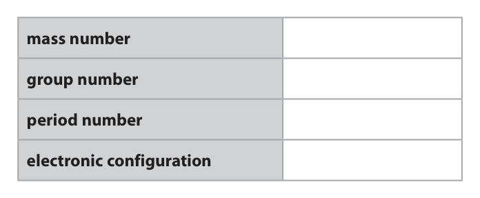
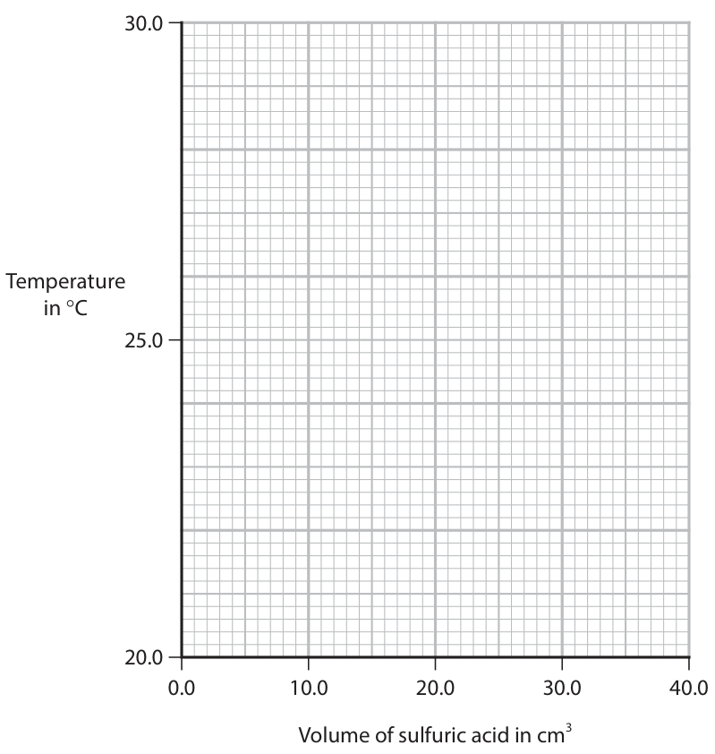

# 4CH1/1C — 2025-06 (official extraction)

> schema `syllabai.official-paper-questions/0.1` · paper_id `pearson-edexcel:international-gcse:chemistry:4ch1:2025-06:4CH1/1C` · qp sha256 `d860cbae11a72b38…` · extracted verbatim, never regenerated (ADR-037)

## Question 1 (8 marks)

The diagram represents an atom of an element.

### 1(a) [3]

Label the three subatomic particles on the diagram.

**Mark scheme answer**

> M1 •_________ proton must be in the
> right order
> M2 o_________ neutron
> if proton and
> M3 x_________ electron neutron in wrong
> order allow one
> mark for M1 & M2.

- **(1)** •_________ proton must be in the
- **(1)** o_________ neutron
- **(1)** x_________ electron neutron in wrong

### 1(b) [4]

Use information from the diagram to complete the table for this element. mass number group number period number electronic configuration

**Mark scheme answer**

> 4
> mass number
> group number
> period number
> electronic 2,3
> configuration

- **(4)** 4

### 1(c) [1]

Give the name of this element.

**Mark scheme answer**

> boron ALLOW B
> Question number Answer Notes Marks

- **(1)** boron ALLOW B

## Question 2 (8 marks)

A small piece of lithium is added to a trough of water.

**(c)** After the reaction is complete, a few drops of universal indicator are added to the solution in the trough.

### 2(a) [2]

State two observations made when lithium reacts with water. 1 2

**Mark scheme answer**

> Any 2 from
> M1 effervescence /fizzing /bubbles IGNORE gas given off
> M2 moves moves on the surface
> scores M2 and M3
> M3 floats
> M4 gets smaller / disappears ALLOW dissolves
> IGNORE heat
> produced
> IGNORE colour change

- **(2)** Any 2 from

### 2(b) [1]

What are the products of the reaction?

- **(A)** lithium hydroxide and hydrogen  ✔
- **(B)** lithium hydroxide and oxygen
- **(C)** lithium oxide and hydrogen
- **(D)** lithium oxide and oxygen

**Mark scheme answer**

> A (lithium hydroxide and hydrogen)
> B is incorrect as lithium hydroxide and oxygen
> are not the products
> C is incorrect as lithium oxide and hydrogen
> are not the products
> D is incorrect as lithium oxide and oxygen are
> not the products

- **(1)** Answer A: lithium hydroxide and hydrogen

### 2(c)(i) [3]

Explain the colour and pH of the solution in the trough.

**Mark scheme answer**

> An explanation that links the following three
> points
> M1 (colour of solution is) blue/purple ALLOW indigo/violet
> M2 (pH value or range between) 10 and 14
> M3 (as the solution is) alkaline /an alkali ACCEPT (the solution
> is) basic

- **(1)** (colour of solution is) blue/purple ALLOW indigo/violet
- **(1)** (pH value or range between) 10 and 14
- **(1)** (as the solution is) alkaline /an alkali ACCEPT (the solution

### 2(c)(ii) [1]

Give the formula of the ion responsible for this pH.

**Mark scheme answer**

> − ACCEPT HO−
> OH

- **(1)** − ACCEPT HO−

### 2(d) [1]

Lithium ions can be identified using a flame test. What flame colour indicates the presence of lithium ions?

- **(A)** lilac
- **(B)** orange
- **(C)** red  ✔
- **(D)** yellow

**Mark scheme answer**

> C (red)
> A is incorrect as it is not lilac
> B is incorrect as it is not orange
> D is incorrect as it is not yellow

- **(1)** Answer C: red

## Question 3 (11 marks)

A student uses paper chromatography to investigate the dyes in five different inks, V, W, X, Y and Z. The chromatogram shows the results of the investigation. solvent front start line V W X Y Z

### 3(a) [2]

Explain why the start line on the paper is drawn in pencil rather than in ink.

**Mark scheme answer**

> An explanation that links the following two points
> M1 ink would dissolve in the solvent/pencil would ALLOW ink is
> not dissolve in the solvent soluble/pencil is
> insoluble
> M2 ink would travel/run/smudge/produce spots on ALLOW unable to
> the chromatogram which would interfere with the calculate Rf value
> results/ pencil would not produce spots on the
> chromatogram so would not interfere with the
> results OWTTE

- **(1)** ink would dissolve in the solvent/pencil would ALLOW ink is
- **(1)** ink would travel/run/smudge/produce spots on ALLOW unable to

### 3(b) [2]

Explain which two inks contain the dye that is most soluble in the solvent.

**Mark scheme answer**

> An explanation that links the following two points
> M1 X and Z
> M2 as they both have a dye that travelled the
> furthest up the paper M2 dep on M1

- **(1)** X and Z
- **(1)** as they both have a dye that travelled the

### 3(c) [3]

Explain how the chromatogram shows that • W contains only one dye • V may contain more than one dye

**Mark scheme answer**

> An explanation that links the following three
> points
> M1 (W contains only one dye) produces only one
> spot
> M2 V is insoluble/not soluble
> M3 (V may contain more than one dye) as it has
> not moved (from the start line)/not separated

- **(1)** (W contains only one dye) produces only one
- **(1)** V is insoluble/not soluble
- **(1)** (V may contain more than one dye) as it has

### 3(d) [4]

Calculate the Rf value for the dye in W. Give your answer to two significant figures. Rf value =

**Mark scheme answer**

> M1 measurement to spot W = 2.2 cm/ 22 mm or ALLOW within range of
> 2.3cm/ 23mm 2.2-2.3 cm
> M2 measurement to solvent front = 6.9 cm/ 69 mm
> M3 (Rf value =) 2.2 OR 2.3 more than 2 sig figs ALLOW ecf on incorrect
> 6.9 6.9 measurements in M1
> and M2
> M4 0.32/0.33 ALLOW ecf corrected to
> 2 sig figs
> Question number Answer Notes Marks

- **(1)** measurement to spot W = 2.2 cm/ 22 mm or ALLOW within range of
- **(1)** measurement to solvent front = 6.9 cm/ 69 mm
- **(1)** (Rf value =) 2.2 OR 2.3 more than 2 sig figs ALLOW ecf on incorrect
- **(1)** 0.32/0.33 ALLOW ecf corrected to

## Question 4 (7 marks)

Calcium phosphate is an ionic compound with the formula Ca3(PO4)2

### 4(a)(i) [1]

What is the total number of atoms in the formula Ca3(PO4)2?

- **(A)** 8
- **(B)** 11
- **(C)** 13  ✔
- **(D)** 19

**Mark scheme answer**

> C (13)
> A is incorrect as there are not 8 atoms
> B is incorrect as there are not 11 atoms
> D is incorrect as there are not 19 atoms

- **(1)** Answer C: 13

### 4(a)(ii) [1]

What are the correct charges on the ions in calcium phosphate?

- **(A)** Ca2+ and PO42–
- **(B)** Ca2+ and PO43–  ✔
- **(C)** Ca3+ and PO42–
- **(D)** Ca3+ and PO43–

**Mark scheme answer**

> B (Ca2+ and PO43-)
> A the charges are incorrect
> C the charges are incorrect
> D the charges are incorrect

- **(1)** Answer B: Ca2+ and PO43–

### 4(b)(i) [2]

Calculate the relative formula mass (Mr) of Ca3(PO4)2 Mr of Ca3(PO4)2 =

**Mark scheme answer**

> M1 Use of addition of Ca = 40 P = 31 O = 16
> M2 (40 × 3 + 31 × 2 + 16 × 8 =) 310

- **(1)** Use of addition of Ca = 40 P = 31 O = 16
- **(1)** (40 × 3 + 31 × 2 + 16 × 8 =) 310

### 4(b)(ii) [2]

Calculate the percentage by mass of calcium in calcium phosphate. percentage = %

**Mark scheme answer**

> M1 40 × 3 × 100 ALLOW ecf for Mr
> 310 incorrectly calculated
> M2 39 (%) ALLOW 1 mark for 13 (%)
> if working shown
> ALLOW any number of sig
> figs except 1 e.g. 38.7 for
> 2 marks or 12.9 for 1 mark

- **(1)** 40 × 3 × 100 ALLOW ecf for Mr
- **(1)** 39 (%) ALLOW 1 mark for 13 (%)

### 4(c) [1]

Calcium hydroxide can react with phosphoric acid to form calcium phosphate. Complete the equation for this reaction Ca(OH)2 + H3PO4 → Ca3(PO4)2 + H2O

**Mark scheme answer**

> 3Ca(OH)2 + 2H3PO4 → (1)Ca3(PO4)2 + 6H2O ALLOW multiples and
> fractions

- **(1)** 3Ca(OH)2 + 2H3PO4 → (1)Ca3(PO4)2 + 6H2O ALLOW multiples and

## Question 5 (14 marks)

Butane (C4H10) is an alkane.

**(c)** C4H10 exists as two isomers.

### 5(a) [3]

Explain why butane is a saturated hydrocarbon.

**Mark scheme answer**

> M1 butane contains hydrogen/H and carbon/C REJECT hydrogen and
> (atoms) carbon molecules for M1
> M2 dep on hydrogen and
> M2 only carbon
> ACCEPT does not contain
> M3 and contains only single bonds double bonds/multiple
> bonds

- **(1)** butane contains hydrogen/H and carbon/C REJECT hydrogen and
- **(1)** only carbon
- **(1)** and contains only single bonds double bonds/multiple

### 5(b)(i) [2]

When butane burns completely in oxygen, carbon dioxide and water are produced. Give a chemical equation for this combustion reaction.

**Mark scheme answer**

> 2C4H10 + 13O2 → 8CO2 + 10H2O
> M1 all formulae correct
> M2 balancing of correct formulae ALLOW multiples and
> fractions

- **(1)** all formulae correct
- **(1)** balancing of correct formulae ALLOW multiples and

### 5(b)(ii) [1]

Incomplete combustion can occur when the oxygen supply is limited. One product of the incomplete combustion of butane is carbon monoxide. Give the name of another product of this incomplete combustion.

**Mark scheme answer**

> carbon ALLOW soot / C
> ALLOW water / water
> vapour / steam

- **(1)** carbon ALLOW soot / C

### 5(b)(iii) [1]

State why carbon monoxide is poisonous to humans.

**Mark scheme answer**

> carbon monoxide reduces the capacity of blood ACCEPT correct references
> to transport oxygen OWTTE to haemoglobin
> ALLOW produces
> carboxyhaemoglobin

- **(1)** carbon monoxide reduces the capacity of blood ACCEPT correct references

### 5(c)(i) [2]

State what is meant by the term isomers.

**Mark scheme answer**

> M1 isomers have the same molecular formula ALLOW same number of
> carbons and hydrogens
> M2 but different structural/displayed formulae ALLOW different
> arrangement of atoms

- **(1)** isomers have the same molecular formula ALLOW same number of
- **(1)** but different structural/displayed formulae ALLOW different

### 5(c)(ii) [2]

Draw the displayed formula of each isomer.

**Mark scheme answer**

> M1 H H H H Must show all bonds for
> I I I I both M1 and M2
> H─C─C─C─C─H
> I I I I
> H H H H
> M2 H H H
> I I I
> H─C──C──C─H
> I I I
> H H─C─H H
> I
> H

- **(1)** H H H H Must show all bonds for
- **(1)** H H H

### 5(d) [3]

Explain why hexane (C6H14) has a higher boiling point than butane (C4H10).

**Mark scheme answer**

> An explanation that links the following three
> points
> M1 hexane is a larger molecule/longer chain ORA ALLOW contains more
> carbon (and hydrogen)
> atoms
> M2 stronger intermolecular forces between the no M2 or M3 if any mention
> molecules ORA of breaking covalent bonds
> M3 so more energy to overcome the forces ORA Total 14

- **(1)** hexane is a larger molecule/longer chain ORA ALLOW contains more
- **(1)** stronger intermolecular forces between the no M2 or M3 if any mention
- **(1)** so more energy to overcome the forces ORA Total 14

## Question 6 (13 marks)
**(e)** A sample of iron(III) oxide reacts with excess carbon monoxide. This is the equation for the reaction. Fe2O3 + 3CO → 2Fe + 3CO2

### 6(a) [2]

When iron rusts, iron(III) oxide forms. State two conditions needed for iron to rust. 1 2

**Mark scheme answer**

> M1 oxygen /O2 ALLOW air
> M2 water /H2O ALLOW moisture
> /water vapour
> /steam

- **(1)** oxygen /O2 ALLOW air
- **(1)** water /H2O ALLOW moisture

### 6(b) [1]

What is the name of the process used to coat iron with zinc?

- **(A)** galvanisation  ✔
- **(B)** oxidation
- **(C)** reduction
- **(D)** sacrificial protection

**Mark scheme answer**

> A (galvanisation)
> B oxidation is not the name of the process
> C reduction is not the name of the process
> D sacrificial protection is not the name of the process

- **(1)** Answer A: galvanisation

### 6(c) [1]

What is the correct order of reactivity of these four metals? most reactive least reactive

- **(A)** aluminium                                                                                                copper                                                                          iron                                      zinc
- **(B)** aluminium                                                                                                iron                                                                            zinc                                      copper
- **(C)** aluminium                                                                                                zinc                                                                            iron                                      copper  ✔
- **(D)** zinc                                                                                                     aluminium                                                                       iron                                      copper

**Mark scheme answer**

> C (aluminium zinc iron copper)
> A this is not the correct order of reactivity
> B this is not the correct order of reactivity
> D this is not the correct order of reactivity

- **(1)** Answer C: aluminium                                                                                                zinc                                                                            iron                                      copper

### 6(d) [2]

Describe a test to show that a solution contains Fe3+ ions. test result

**Mark scheme answer**

> M1 add sodium hydroxide (solution)
> M2 a brown precipitate (forms) ACCEPT red-brown
> /orange-brown
> M2 dependent on M1

- **(1)** add sodium hydroxide (solution)
- **(1)** a brown precipitate (forms) ACCEPT red-brown

### 6(e)(i) [2]

Explain why this is a redox reaction.

**Mark scheme answer**

> An explanation that links the following points
> M1 iron(III) oxide /Fe2O3 loses oxygen so is reduced ACCEPT Fe3+ gains
> electrons and is
> M2 carbon monoxide gains oxygen so is oxidised reduced
> OR
> M1 iron(III) oxide /Fe2O3 is reduced and carbon
> monoxide /CO is oxidised
> M2 iron(III) oxide /Fe2O3 loses oxygen and carbon
> monoxide /CO gains oxygen

- **(2)** An explanation that links the following points

### 6(e)(ii) [3]

Calculate the minimum mass of iron(III) oxide needed to produce a theoretical yield of 28 g of iron. [for Fe2O3 Mr = 160] minimum mass of iron(III) oxide = g

**Mark scheme answer**

> M1 (amount of Fe =) 28 ÷ 56 OR 0.5(0) (mol) ALLOW ecf
> throughout
> M2 (amount of Fe2O3 =) 0.5 ÷ 2 OR 0.25 (mol)
> correct answer
> M3 (mass of Fe2O3 = 0.25 × 160 =) 40 (g) without working
> scores 3

- **(1)** (amount of Fe =) 28 ÷ 56 OR 0.5(0) (mol) ALLOW ecf
- **(1)** (amount of Fe2O3 =) 0.5 ÷ 2 OR 0.25 (mol)
- **(1)** (mass of Fe2O3 = 0.25 × 160 =) 40 (g) without working

### 6(e)(iii) [2]

The actual yield of iron from this sample is 21 g. Calculate the percentage yield of iron. percentage yield = %

**Mark scheme answer**

> M1 21 x 100 correct answer
> 28 without working
> scores 2
> M2 75 (%) ALLOW ecf for any
> correct calculation
> involving 21 as the
> numerator
> 0.75 scores 1

- **(1)** 21 x 100 correct answer
- **(1)** 75 (%) ALLOW ecf for any

## Question 7 (12 marks)

A student does an experiment to determine the maximum temperature change when sulfuric acid reacts with sodium hydroxide.

**(c)** The table shows the student’s results. Total volume of acid 0 5 10 15 20 25 30 35 40 in cm3 Temperature of mixture 21.0 22.3 23.8 24.4 26.5 28.0 28.5 28.2 27.9 in °C

### 7(a) [2]

Complete the chemical equation for this neutralisation reaction. Include the state symbols. 2NaOH(aq) + H2SO4(aq) → +

**Mark scheme answer**

> 2NaOH(aq) + H2SO4(aq) → Na2SO4(aq) + 2H2O(l)
> M1 equation correct and balanced
> M2 state symbols correct If H2 is shown as a
> product in the
> equation allow
> (g) for M2

- **(1)** equation correct and balanced
- **(1)** state symbols correct If H2 is shown as a

### 7(b) [2]

This is the student’s method. Step 1 add 50 cm3 of sodium hydroxide solution to a glass beaker Step 2 record the initial temperature of the sodium hydroxide solution Step 3 add 5 cm3 of dilute sulfuric acid to the beaker Step 4 stir the mixture and record the highest temperature reached The student repeats steps 3 and 4 until a total of 40 cm3 of acid has been added. Explain one way the student could improve the accuracy of the experiment.

**Mark scheme answer**

> An explanation that links the following points ALLOW any other
> acceptable
> M1 use a polystyrene cup instead of a beaker / or use a answer
> lid on the beaker
> M2 as less heat is lost REJECT prevent
> heat loss

- **(1)** use a polystyrene cup instead of a beaker / or use a answer
- **(1)** as less heat is lost REJECT prevent

### 7(c)(i) [1]

Plot the results on the grid.

**Mark scheme answer**

> all points plotted correctly to the nearest small square

- **(1)** all points plotted correctly to the nearest small square

### 7(c)(ii) [1]

Draw a circle around the anomalous result.

**Mark scheme answer**

> circle the correct anomalous point at 15 cm3

- **(1)** circle the correct anomalous point at 15 cm3

### 7(c)(iii) [2]

Draw a straight line of best fit through the first six points, ignoring the anomalous result. Draw another straight line of best fit through the last three points. Make sure that the two lines cross. 30.0 Temperature in C 25.0 20.0 0.0 10.0 20.0 30.0 40.0 Volume of sulfuric acid in cm3

**Mark scheme answer**

> M1 first best fit line
> M2 second best fit line

- **(1)** first best fit line
- **(1)** second best fit line

### 7(d) [2]

The point where the lines cross shows the volume of acid needed to exactly neutralise the alkali and the maximum temperature reached. Use your graph to determine these values. volume of acid = cm3 maximum temperature = °C

**Mark scheme answer**

> M1 volume of acid (approximately 27.5) values from the
> candidates graph
> M2 maximum temperature (approximately 28.6) to the nearest
> small square

- **(1)** volume of acid (approximately 27.5) values from the
- **(1)** maximum temperature (approximately 28.6) to the nearest

### 7(e) [2]

Explain what might have caused the anomalous result.

**Mark scheme answer**

> An explanation that links the following points do not allow use
> too little of the
> M1 took the temperature too early acid as this would
> affect the rest of
> M2 so highest temperature was not reached the graph
> OR
> M1 did not stir the mixture
> M2 so highest temperature was not reached
> I Total 12

- **(2)** An explanation that links the following points do not allow use

## Question 8 (9 marks)

Diamond and graphite are two naturally‑occurring forms of carbon. They both have giant covalent structures. diamond graphite

### 8(a) [3]

Explain, with reference to its bonding, why diamond has a high melting point.

**Mark scheme answer**

> An explanation that links the following three
> points
> M1 covalent bonds are strong ACCEPT strong
> (electrostatic) forces
> between the shared
> pair of electrons and
> nuclei
> M2 many (covalent) bonds (need to be broken)
> M3 a large amount of (heat/thermal) energy is IGNORE more energy
> needed to break the bonds
> NOT just heat
> Any mention of
> intermolecular
> forces/forces between
> molecules or ions/ionic
> bonding/metallic
> bonding scores 0 out of

- **(1)** covalent bonds are strong ACCEPT strong
- **(1)** many (covalent) bonds (need to be broken)
- **(1)** a large amount of (heat/thermal) energy is IGNORE more energy

### 8(b) [6]

Explain why graphite is soft and is a conductor of electricity. Refer to structure and bonding in your answer.

**Mark scheme answer**

> An explanation that links six of the following
> points but must include M3 and M7 for full marks
> M1 carbon atoms are joined together by covalent
> bonds
> M2 (structure is) in layers /in a 2D structure ACCEPT sheets
> M3 (layers) can slide over each other (therefore
> it is soft)
> M4 (because there are) weak forces between If reference to weak
> layers intermolecular forces or
> layers of molecules
> then no M4
> M5 each carbon atom is bonded to three others
> (carbons)
> M6 there are delocalised electrons (between the IGNORE free/spare
> layers) electron/unbonded
> M7 electrons are free to move (therefore they IGNORE reference to
> can conduct electricity) can carrying a
> charge/current
> number Answer Notes Marks

- **(6)** An explanation that links six of the following

## Question 9 (17 marks)

This question is about organic compounds.

**(a)** Chloroethene (C2H3Cl) is a covalent molecule that is used to make poly(chloroethene). This is the displayed formula of chloroethene. H Cl C C H H

### 9(a)(i) [2]

Draw a dot‑and‑cross diagram of chloroethene. Show only the outer shell electrons.

> 🖼 crop required: diagram (qp.pdf p.20)

**Mark scheme answer**

> M1 two shared pairs between carbon atoms ALLOW any
> combination of dots
> M2 rest of molecule fully correct and crosses
> M2 dep on M1

- **(1)** two shared pairs between carbon atoms ALLOW any
- **(1)** rest of molecule fully correct and crosses

### 9(a)(ii) [2]

Describe, in terms of electrostatic attraction, what is meant by a covalent bond.

**Mark scheme answer**

> a description that refers to the following
> points
> M1 attraction between a shared pair of
> electrons
> M2 and two nuclei
> Do not allow nucleus
> OR
> M1 attraction between nuclei
> M2 and a shared pair of electrons Do not allow nucleus

- **(2)** a description that refers to the following

### 9(a)(iii) [1]

Chloroethene is a monomer. Draw the displayed formula of the repeat unit of poly(chloroethene).

**Mark scheme answer**

> H H ALLOW with or
> | | without extension
> — C — C— bonds
> | |
> H Cl IGNORE brackets and n

- **(1)** H H ALLOW with or

### 9(a)(iv) [4]

Poly(chloroethene) is non‑biodegradable. There are two main methods used to dispose of poly(chloroethene). Describe one problem caused by each method. 1 2

**Mark scheme answer**

> A description that refers to the following two
> pairs of points
> M1 disposal of poly(chloroethene) in landfill
> M2 takes up space / takes a very long time IGNORE non-
> to decompose/ they are inert OWTTE biodegradable
> M2 dependent on M1
> M3 burning poly(chloroethene) M4 dependent on M3
> M4 hydrogen chloride / toxic gases produced ALLOW produces
> greenhouse gases

- **(1)** disposal of poly(chloroethene) in landfill
- **(1)** takes up space / takes a very long time IGNORE non-
- **(1)** burning poly(chloroethene) M4 dependent on M3
- **(1)** hydrogen chloride / toxic gases produced ALLOW produces

### 9(b) [3]

An organic compound contains this percentage composition by mass. C = 22.0% H = 4.6% Br = 73.4% Calculate the empirical formula of this compound. empirical formula =

**Mark scheme answer**

> M1 22.0 4.6 73.4 0 marks if division by
> 12 1 80 atomic numbers or
> upside down
> M2 1.83 4.6 0.92 calculation
> 0.92 0.92 0.92
> correct answer without
> OR 2 5 1 working scores 3
> M3 C2H5Br
> ALLOW symbols in any
> order

- **(1)** 22.0 4.6 73.4 0 marks if division by
- **(1)** 1.83 4.6 0.92 calculation
- **(1)** C2H5Br

### 9(c) [5]

Ethane and ethene undergo different types of reaction with bromine. Describe the differences between these two reactions.

**Mark scheme answer**

> A description that refers to any five of the
> following points with a maximum of three
> marks from each section/reactant:
> ethane
> M1 a substitution reaction
> M2 does not decolourise/stays
> orange/decolourises very slowly
> M3 ultraviolet radiation/light needed ALLOW UV
> M4 produces bromoethane/C2H5Br
> M5 produces hydrogen bromide/HBr
> ethene
> M6 an addition reaction
> M7 decolourises (immediately) / turns
> colourless
> M8 produces dibromoethane/C2H4Br2
> Question number Answer Notes Marks

- **(5)** A description that refers to any five of the

## Question 10 (11 marks)

A student uses this apparatus to investigate the energy content of different fuels. thermometer copper can water spirit burner liquid fuel

**(b)** In one of the experiments, the student uses ethanol as the fuel. These are the student’s results for ethanol. initial mass of spirit burner and ethanol in g 38.52 final mass of spirit burner and ethanol in g 38.29 volume of water in cm3 100 initial temperature of water in °C 18 final temperature of water in °C 30

### 10(a) [4]

This is the student’s method. • pour some water into the copper can • record the mass of the spirit burner and fuel • measure the initial temperature of the water • place the spirit burner under the copper can and light the burner • stop heating the water when the temperature reaches 30°C • record the new mass of the spirit burner and fuel The student repeats the experiment with different fuels. Explain two variables the student should control to make this a valid test. 1 2

**Mark scheme answer**

> An explanation that links any two pairs
> Pair 1
> M1 same volume of water ALLOW same mass of
> water
> M2 so the same amount of fuel/heat is required IGNORE references to
> time
> Pair 2
> M1 stir the water
> M2 so the temperature is uniform throughout the
> water
> Pair 3
> M1 to make sure the spirit burner is the same ALLOW the wick is the
> distance to the copper can same height
> M2 so the same amount of heat loss occurs
> ALLOW any other
> acceptable answer

- **(4)** An explanation that links any two pairs

### 10(b)(i) [2]

Calculate the value of heat energy change (Q) in joules. [for water, c = 4.2 J/g/°C 1.0 cm3 of water has mass = 1.0 g] Q = J

**Mark scheme answer**

> M1 ΔT = (30-18) = 12
> M2 Q = 100 × 4.2 × 12 (= 5040 / 5000 (J)) correct answer without
> working scores 2 marks
> ALLOW ecf if incorrect
> temperature change
> e.g. 7560 /7600 or
> 12600 /13000 scores 1

- **(1)** ΔT = (30-18) = 12
- **(1)** Q = 100 × 4.2 × 12 (= 5040 / 5000 (J)) correct answer without

### 10(b)(ii) [5]

Calculate the enthalpy change (ΔH) in kJ/mol. [for ethanol, Mr = 46] Include a sign in your answer. ΔH = kJ/mol

**Mark scheme answer**

> M1 (mass of ethanol =) 38.52 — 38.29 OR 0.23 (g) correct answer without
> working scores 5 marks
> M2 (amount =) 0.23 ÷ 46 OR 0.005(0) (mol)
> ALLOW ecf throughout
> M3 5040 ÷ 0.005(0) OR 1 008 000 (J/mol)
> ACCEPT 1 000 000
> M4 1 008 000 ÷ 1000 OR 1008 (kJ/mol)
> ACCEPT 1000
> M5 — 1008 (kJ/mol)
> ACCEPT — 1000
> Pearson Education Limited. Registered company number 872828
> with its registered office at 80 Strand, London, WC2R 0RL, United Kingdom

- **(1)** (mass of ethanol =) 38.52 — 38.29 OR 0.23 (g) correct answer without
- **(1)** (amount =) 0.23 ÷ 46 OR 0.005(0) (mol)
- **(1)** 5040 ÷ 0.005(0) OR 1 008 000 (J/mol)
- **(1)** 1 008 000 ÷ 1000 OR 1008 (kJ/mol)
- **(1)** — 1008 (kJ/mol)

